# Data Analysis

## Setup

    (2020, 33)
    Alzheimer: (22, 33)

# Information about the dataset

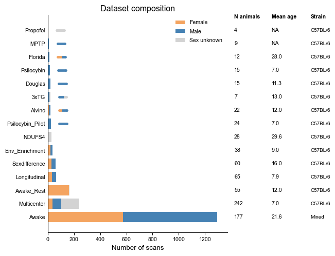

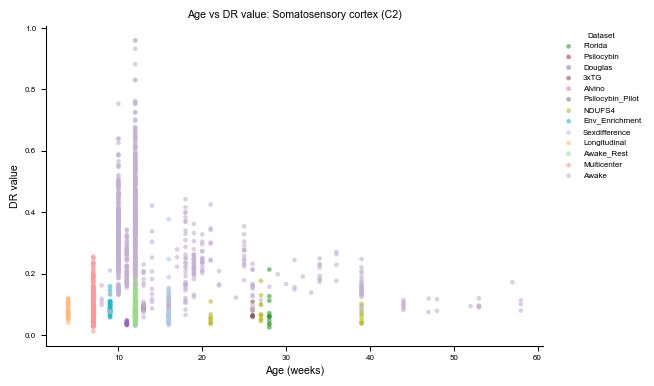

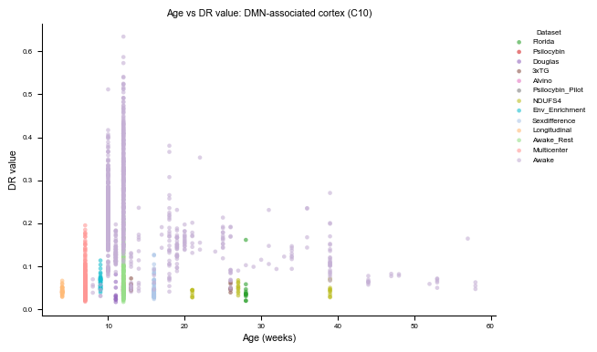

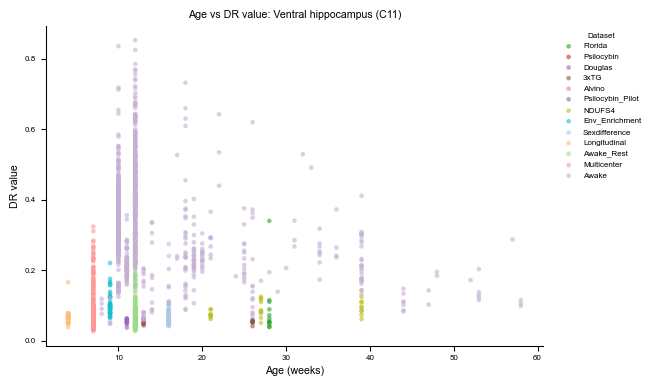

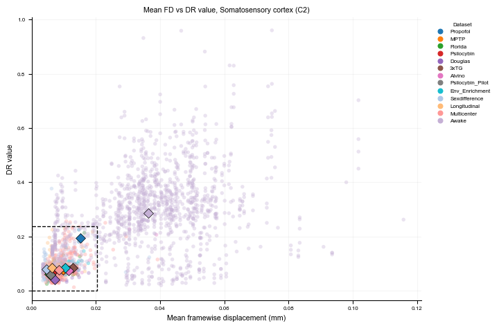

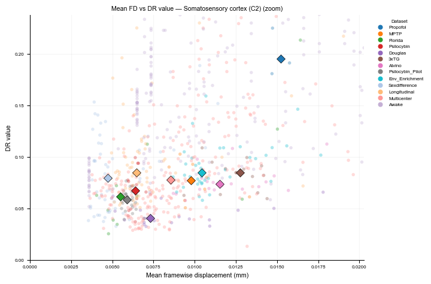

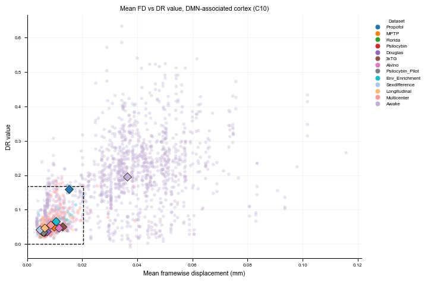

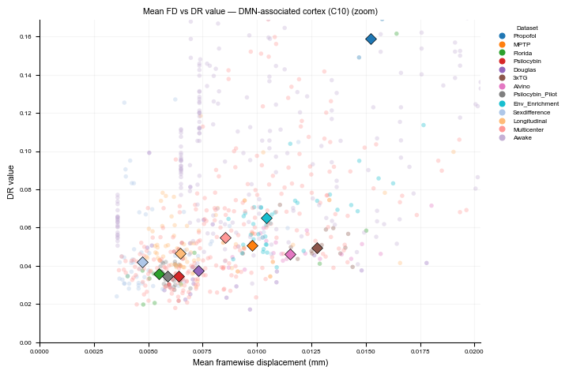

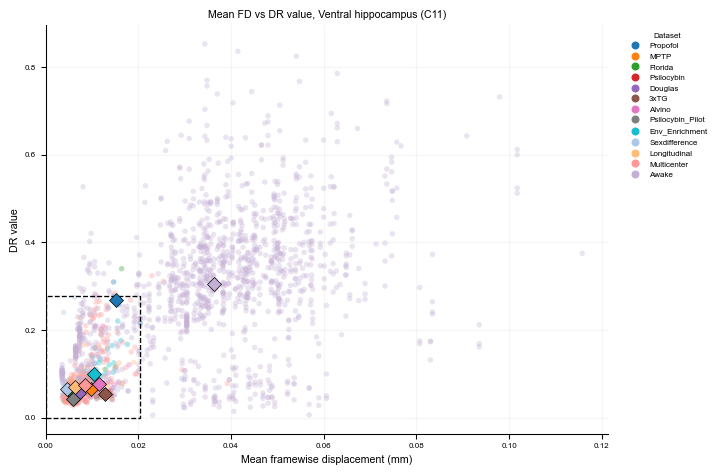

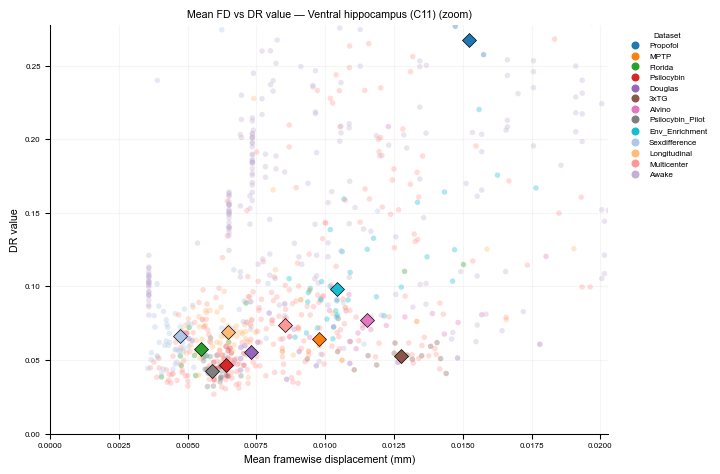

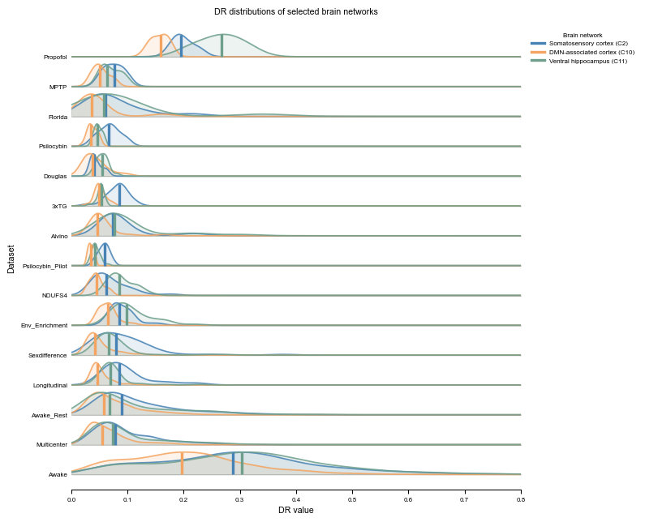

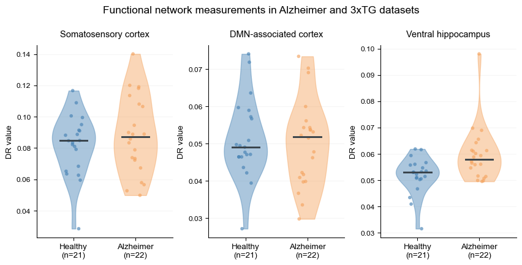

## statistical test

    Component  Median_Alzheimer  Median_3xTG     U        p    p_FDR Direction
        comp1          0.072450     0.082182 100.0 0.001521 0.006843     Lower
        comp2          0.087316     0.084703 255.0 0.568022 0.730314    Normal
        comp3          0.099011     0.086414 273.0 0.313309 0.512687    Normal
        comp4          0.072222     0.064685 293.0 0.135115 0.243206    Normal
        comp5          0.054973     0.046199 333.0 0.013660 0.040979    Higher
        comp6          0.076556     0.055398 379.0 0.000339 0.002032    Higher
        comp7          0.085871     0.069445 405.0 0.000025 0.000250    Higher
        comp8          0.071799     0.070811 230.0 0.990307 0.990307    Normal
        comp9          0.063418     0.065395 219.0 0.779931 0.877422    Normal
       comp10          0.051882     0.049059 216.0 0.724614 0.869537    Normal
       comp11          0.057956     0.052952 334.0 0.012760 0.040979    Higher
       comp12          0.058755     0.055063 314.0 0.045021 0.101297    Normal
       comp13          0.060653     0.057613 297.0 0.111515 0.223031    Normal
       comp14          0.046163     0.052446 147.0 0.042483 0.101297    Normal
       comp15          0.061365     0.060261 224.0 0.874514 0.925956    Normal
       comp16          0.048481     0.047463 267.0 0.388399 0.582598    Normal
       comp17          0.045951     0.039082 404.0 0.000028 0.000250    Higher
       comp18          0.038712     0.037918 258.0 0.519668 0.719541    Normal

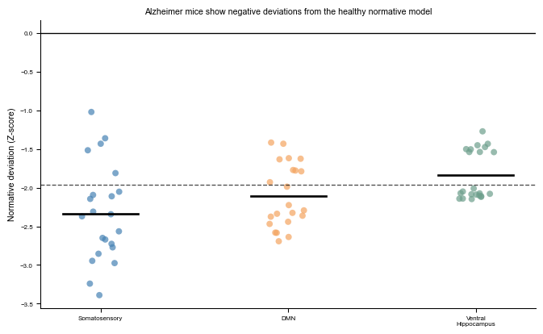
