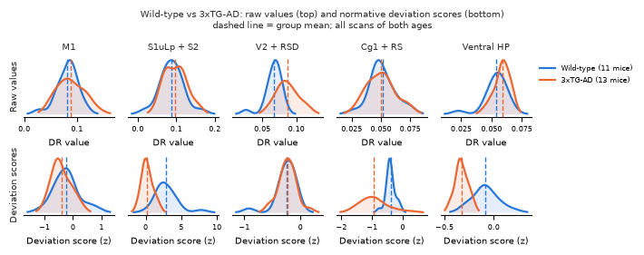
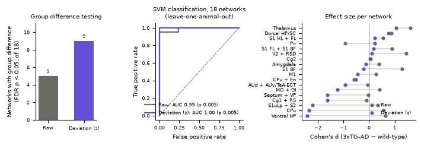

# Wild-type vs 3xTG-AD: raw values vs normative deviation scores


Raw dual-regression values and normative-model deviation (z) scores
compared between wild-type controls and 3xTG-AD mice of the same study
(same scanner, 11.75 T, medetomidine + isoflurane), in the style of
Rutherford et al. (group difference testing, SVM classification).

The wild-type controls (`Dataset_name == "3xTG"` in
`Model_dataframe.csv`) are part of the main training set. Here the
normative model is refit **without** them, with the same settings as
`Model_Training.qmd`, so that both groups are unseen by the model (like
a new lab).

``` python
import warnings
from pathlib import Path

import numpy as np
import pandas as pd
import matplotlib.pyplot as plt
from scipy.stats import gaussian_kde
import statsmodels.formula.api as smf
from statsmodels.stats.multitest import multipletests
from sklearn.pipeline import make_pipeline
from sklearn.preprocessing import StandardScaler
from sklearn.svm import SVC
from sklearn.model_selection import LeaveOneGroupOut
from sklearn.metrics import roc_auc_score, roc_curve

from pcntoolkit import BLR, BsplineBasisFunction, NormativeModel, NormData
import pcntoolkit.util.output

from component_labels import COMPONENTS, ACRONYM, NAME, SELECTED_COMPONENTS

from statsmodels.tools.sm_exceptions import ConvergenceWarning

warnings.filterwarnings("ignore", category=FutureWarning)
# mixed models with ~1-2 scans per animal often hit the variance boundary
# (random-intercept variance ~ 0); the fixed effect of group is still valid
warnings.filterwarnings("ignore", category=ConvergenceWarning)
pcntoolkit.util.output.Output.set_show_messages(False)

# pcntoolkit switches seaborn's dark grid on at import: reset to plain style
plt.style.use("default")

root = Path.cwd().parent
fig_dir = root / "results" / "Figures_Analysis"
fig_dir.mkdir(parents=True, exist_ok=True)
out_dir = root / "results" / "normative_model_WT_heldout"
out_dir.mkdir(parents=True, exist_ok=True)

MM = 1 / 25.4
WT_COLOR = "#2a78d6"     # wild-type
AD_COLOR = "#eb6834"     # 3xTG-AD
RAW_COLOR = "#6b6a64"    # raw values (summary panels)
Z_COLOR = "#6250d6"      # deviation scores (summary panels)
INK = "#2b2b29"
MUTED = "#6b6a64"

plt.rcParams.update({
    "font.family": "Liberation Sans",
    "font.size": 6,
    "axes.labelsize": 7,
    "axes.titlesize": 7,
    "xtick.labelsize": 6,
    "ytick.labelsize": 6,
    "legend.fontsize": 6,
    "svg.fonttype": "none",
})
```

## Refit the normative model without the wild-type controls

``` python
model_df = pd.read_csv(root / "results" / "combined_dataset" / "Model_dataframe.csv")

id_cols = ["Scan_id", "Participant_Id", "Session", "Dataset_name"]
covariates = [c for c in model_df.columns if c not in id_cols + COMPONENTS]


def to_normdata(name, df):
    return NormData.from_dataframe(
        name=name, dataframe=df, covariates=covariates,
        batch_effects=[], response_vars=COMPONENTS, remove_Nan=False,
    )


train_df = (
    model_df[model_df["Dataset_name"] != "3xTG"]
    .dropna(subset=covariates + COMPONENTS)
)

# same configuration as Model_Training.qmd
spline_columns = [
    covariates.index(c)
    for c in ["Age(week)", "FD average", "log_tSNR"]
    if c in covariates
]

model = NormativeModel(
    BLR(
        basis_function_mean=BsplineBasisFunction(basis_column=spline_columns, degree=3, nknots=5),
        basis_function_var=BsplineBasisFunction(basis_column=spline_columns, degree=3, nknots=5),
        heteroskedastic=True,
    ),
    inscaler="standardize",
    outscaler="standardize",
    savemodel=True,
    evaluate_model=False,
    saveresults=False,
    saveplots=False,
    save_dir=str(out_dir),
)

model.fit(to_normdata("train_without_WT", train_df))
print(f"Model refit on {len(train_df)} scans; wild-type controls held out")
```

    /home/traaffneu/giuvas/digitalrodent/Analysis/.venv/lib64/python3.11/site-packages/pcntoolkit/regression_model/blr.py:674: LinAlgWarning: An ill-conditioned matrix detected: slice 0 has rcond = 3.4244893703068966e-43.
      invAXt: np.ndarray = linalg.solve(self.A, X.T, check_finite=False)
    /home/traaffneu/giuvas/digitalrodent/Analysis/.venv/lib64/python3.11/site-packages/pcntoolkit/util/output.py:239: UserWarning: Process: 2806329 - 2026-11-05 10:45:22 - Estimation of posterior distribution failed due to: 
    Matrix is not positive definite
      warnings.warn(message)
    /home/traaffneu/giuvas/digitalrodent/Analysis/.venv/lib64/python3.11/site-packages/pcntoolkit/regression_model/blr.py:674: LinAlgWarning: An ill-conditioned matrix detected: slice 0 has rcond = 3.4822944740281944e-43.
      invAXt: np.ndarray = linalg.solve(self.A, X.T, check_finite=False)
    /home/traaffneu/giuvas/digitalrodent/Analysis/.venv/lib64/python3.11/site-packages/pcntoolkit/regression_model/blr.py:674: LinAlgWarning: An ill-conditioned matrix detected: slice 0 has rcond = 3.619652446223361e-43.
      invAXt: np.ndarray = linalg.solve(self.A, X.T, check_finite=False)
    /home/traaffneu/giuvas/digitalrodent/Analysis/.venv/lib64/python3.11/site-packages/pcntoolkit/regression_model/blr.py:674: LinAlgWarning: An ill-conditioned matrix detected: slice 0 has rcond = 3.2310708956082085e-43.
      invAXt: np.ndarray = linalg.solve(self.A, X.T, check_finite=False)
    /home/traaffneu/giuvas/digitalrodent/Analysis/.venv/lib64/python3.11/site-packages/pcntoolkit/regression_model/blr.py:674: LinAlgWarning: An ill-conditioned matrix detected: slice 0 has rcond = 3.3714453321351764e-43.
      invAXt: np.ndarray = linalg.solve(self.A, X.T, check_finite=False)
    /home/traaffneu/giuvas/digitalrodent/Analysis/.venv/lib64/python3.11/site-packages/pcntoolkit/regression_model/blr.py:674: LinAlgWarning: An ill-conditioned matrix detected: slice 0 has rcond = 3.42451713532975e-43.
      invAXt: np.ndarray = linalg.solve(self.A, X.T, check_finite=False)
    /home/traaffneu/giuvas/digitalrodent/Analysis/.venv/lib64/python3.11/site-packages/pcntoolkit/regression_model/blr.py:674: LinAlgWarning: An ill-conditioned matrix detected: slice 0 has rcond = 3.4252171460823487e-43.
      invAXt: np.ndarray = linalg.solve(self.A, X.T, check_finite=False)
    /home/traaffneu/giuvas/digitalrodent/Analysis/.venv/lib64/python3.11/site-packages/pcntoolkit/regression_model/blr.py:674: LinAlgWarning: An ill-conditioned matrix detected: slice 0 has rcond = 3.4220725910024693e-43.
      invAXt: np.ndarray = linalg.solve(self.A, X.T, check_finite=False)
    /home/traaffneu/giuvas/digitalrodent/Analysis/.venv/lib64/python3.11/site-packages/pcntoolkit/regression_model/blr.py:674: LinAlgWarning: An ill-conditioned matrix detected: slice 0 has rcond = 3.695112475962462e-43.
      invAXt: np.ndarray = linalg.solve(self.A, X.T, check_finite=False)
    /home/traaffneu/giuvas/digitalrodent/Analysis/.venv/lib64/python3.11/site-packages/pcntoolkit/regression_model/blr.py:674: LinAlgWarning: An ill-conditioned matrix detected: slice 0 has rcond = 3.458975539493419e-43.
      invAXt: np.ndarray = linalg.solve(self.A, X.T, check_finite=False)
    /home/traaffneu/giuvas/digitalrodent/Analysis/.venv/lib64/python3.11/site-packages/pcntoolkit/regression_model/blr.py:674: LinAlgWarning: An ill-conditioned matrix detected: slice 0 has rcond = 3.0784309853422907e-43.
      invAXt: np.ndarray = linalg.solve(self.A, X.T, check_finite=False)
    /home/traaffneu/giuvas/digitalrodent/Analysis/.venv/lib64/python3.11/site-packages/pcntoolkit/regression_model/blr.py:674: LinAlgWarning: An ill-conditioned matrix detected: slice 0 has rcond = 2.6881241072747567e-43.
      invAXt: np.ndarray = linalg.solve(self.A, X.T, check_finite=False)
    /home/traaffneu/giuvas/digitalrodent/Analysis/.venv/lib64/python3.11/site-packages/pcntoolkit/regression_model/blr.py:674: LinAlgWarning: An ill-conditioned matrix detected: slice 0 has rcond = 3.423624930709139e-43.
      invAXt: np.ndarray = linalg.solve(self.A, X.T, check_finite=False)
    /home/traaffneu/giuvas/digitalrodent/Analysis/.venv/lib64/python3.11/site-packages/pcntoolkit/regression_model/blr.py:674: LinAlgWarning: An ill-conditioned matrix detected: slice 0 has rcond = 3.4201036521218573e-43.
      invAXt: np.ndarray = linalg.solve(self.A, X.T, check_finite=False)
    /home/traaffneu/giuvas/digitalrodent/Analysis/.venv/lib64/python3.11/site-packages/pcntoolkit/regression_model/blr.py:674: LinAlgWarning: An ill-conditioned matrix detected: slice 0 has rcond = 3.413780696749894e-43.
      invAXt: np.ndarray = linalg.solve(self.A, X.T, check_finite=False)
    /home/traaffneu/giuvas/digitalrodent/Analysis/.venv/lib64/python3.11/site-packages/pcntoolkit/regression_model/blr.py:674: LinAlgWarning: An ill-conditioned matrix detected: slice 0 has rcond = 3.2645488399348787e-43.
      invAXt: np.ndarray = linalg.solve(self.A, X.T, check_finite=False)
    /home/traaffneu/giuvas/digitalrodent/Analysis/.venv/lib64/python3.11/site-packages/pcntoolkit/regression_model/blr.py:674: LinAlgWarning: An ill-conditioned matrix detected: slice 0 has rcond = 3.5286529322146908e-43.
      invAXt: np.ndarray = linalg.solve(self.A, X.T, check_finite=False)
    /home/traaffneu/giuvas/digitalrodent/Analysis/.venv/lib64/python3.11/site-packages/pcntoolkit/regression_model/blr.py:674: LinAlgWarning: An ill-conditioned matrix detected: slice 0 has rcond = 3.4145342966699914e-43.
      invAXt: np.ndarray = linalg.solve(self.A, X.T, check_finite=False)
    /home/traaffneu/giuvas/digitalrodent/Analysis/.venv/lib64/python3.11/site-packages/pcntoolkit/regression_model/blr.py:674: LinAlgWarning: An ill-conditioned matrix detected: slice 0 has rcond = 3.4370131782577737e-43.
      invAXt: np.ndarray = linalg.solve(self.A, X.T, check_finite=False)
    /home/traaffneu/giuvas/digitalrodent/Analysis/.venv/lib64/python3.11/site-packages/pcntoolkit/regression_model/blr.py:674: LinAlgWarning: An ill-conditioned matrix detected: slice 0 has rcond = 3.801447529631587e-43.
      invAXt: np.ndarray = linalg.solve(self.A, X.T, check_finite=False)
    /home/traaffneu/giuvas/digitalrodent/Analysis/.venv/lib64/python3.11/site-packages/pcntoolkit/regression_model/blr.py:674: LinAlgWarning: An ill-conditioned matrix detected: slice 0 has rcond = 3.695110875993955e-43.
      invAXt: np.ndarray = linalg.solve(self.A, X.T, check_finite=False)
    /home/traaffneu/giuvas/digitalrodent/Analysis/.venv/lib64/python3.11/site-packages/pcntoolkit/util/output.py:239: UserWarning: Process: 2806329 - 2026-11-05 10:45:23 - Estimation of posterior distribution failed due to: 
    Matrix is not positive definite
      warnings.warn(message)
    /home/traaffneu/giuvas/digitalrodent/Analysis/.venv/lib64/python3.11/site-packages/pcntoolkit/regression_model/blr.py:674: LinAlgWarning: An ill-conditioned matrix detected: slice 0 has rcond = 3.3428186827690987e-43.
      invAXt: np.ndarray = linalg.solve(self.A, X.T, check_finite=False)
    /home/traaffneu/giuvas/digitalrodent/Analysis/.venv/lib64/python3.11/site-packages/pcntoolkit/regression_model/blr.py:674: LinAlgWarning: An ill-conditioned matrix detected: slice 0 has rcond = 3.224396519659761e-43.
      invAXt: np.ndarray = linalg.solve(self.A, X.T, check_finite=False)
    /home/traaffneu/giuvas/digitalrodent/Analysis/.venv/lib64/python3.11/site-packages/pcntoolkit/regression_model/blr.py:674: LinAlgWarning: An ill-conditioned matrix detected: slice 0 has rcond = 3.3649597949758153e-43.
      invAXt: np.ndarray = linalg.solve(self.A, X.T, check_finite=False)
    /home/traaffneu/giuvas/digitalrodent/Analysis/.venv/lib64/python3.11/site-packages/pcntoolkit/regression_model/blr.py:674: LinAlgWarning: An ill-conditioned matrix detected: slice 0 has rcond = 3.413150326817365e-43.
      invAXt: np.ndarray = linalg.solve(self.A, X.T, check_finite=False)
    /home/traaffneu/giuvas/digitalrodent/Analysis/.venv/lib64/python3.11/site-packages/pcntoolkit/regression_model/blr.py:674: LinAlgWarning: An ill-conditioned matrix detected: slice 0 has rcond = 3.054411148527593e-43.
      invAXt: np.ndarray = linalg.solve(self.A, X.T, check_finite=False)
    /home/traaffneu/giuvas/digitalrodent/Analysis/.venv/lib64/python3.11/site-packages/pcntoolkit/regression_model/blr.py:674: LinAlgWarning: An ill-conditioned matrix detected: slice 0 has rcond = 3.522595415539188e-43.
      invAXt: np.ndarray = linalg.solve(self.A, X.T, check_finite=False)
    /home/traaffneu/giuvas/digitalrodent/Analysis/.venv/lib64/python3.11/site-packages/pcntoolkit/regression_model/blr.py:674: LinAlgWarning: An ill-conditioned matrix detected: slice 0 has rcond = 3.5529034721137713e-43.
      invAXt: np.ndarray = linalg.solve(self.A, X.T, check_finite=False)
    /home/traaffneu/giuvas/digitalrodent/Analysis/.venv/lib64/python3.11/site-packages/pcntoolkit/regression_model/blr.py:674: LinAlgWarning: An ill-conditioned matrix detected: slice 0 has rcond = 1.570619348761299e-44.
      invAXt: np.ndarray = linalg.solve(self.A, X.T, check_finite=False)
    /home/traaffneu/giuvas/digitalrodent/Analysis/.venv/lib64/python3.11/site-packages/pcntoolkit/regression_model/blr.py:674: LinAlgWarning: An ill-conditioned matrix detected: slice 0 has rcond = 3.5311031854914042e-43.
      invAXt: np.ndarray = linalg.solve(self.A, X.T, check_finite=False)
    /home/traaffneu/giuvas/digitalrodent/Analysis/.venv/lib64/python3.11/site-packages/pcntoolkit/regression_model/blr.py:674: LinAlgWarning: An ill-conditioned matrix detected: slice 0 has rcond = 3.4630024588839356e-43.
      invAXt: np.ndarray = linalg.solve(self.A, X.T, check_finite=False)
    /home/traaffneu/giuvas/digitalrodent/Analysis/.venv/lib64/python3.11/site-packages/pcntoolkit/regression_model/blr.py:674: LinAlgWarning: An ill-conditioned matrix detected: slice 0 has rcond = 3.4355982126858093e-43.
      invAXt: np.ndarray = linalg.solve(self.A, X.T, check_finite=False)
    /home/traaffneu/giuvas/digitalrodent/Analysis/.venv/lib64/python3.11/site-packages/pcntoolkit/regression_model/blr.py:674: LinAlgWarning: An ill-conditioned matrix detected: slice 0 has rcond = 2.8660083514979445e-43.
      invAXt: np.ndarray = linalg.solve(self.A, X.T, check_finite=False)
    /home/traaffneu/giuvas/digitalrodent/Analysis/.venv/lib64/python3.11/site-packages/pcntoolkit/regression_model/blr.py:674: LinAlgWarning: An ill-conditioned matrix detected: slice 0 has rcond = 3.476882933261417e-43.
      invAXt: np.ndarray = linalg.solve(self.A, X.T, check_finite=False)
    /home/traaffneu/giuvas/digitalrodent/Analysis/.venv/lib64/python3.11/site-packages/pcntoolkit/regression_model/blr.py:674: LinAlgWarning: An ill-conditioned matrix detected: slice 0 has rcond = 3.0841358627940123e-43.
      invAXt: np.ndarray = linalg.solve(self.A, X.T, check_finite=False)
    /home/traaffneu/giuvas/digitalrodent/Analysis/.venv/lib64/python3.11/site-packages/pcntoolkit/regression_model/blr.py:674: LinAlgWarning: An ill-conditioned matrix detected: slice 0 has rcond = 3.747498672055856e-43.
      invAXt: np.ndarray = linalg.solve(self.A, X.T, check_finite=False)
    /home/traaffneu/giuvas/digitalrodent/Analysis/.venv/lib64/python3.11/site-packages/pcntoolkit/regression_model/blr.py:674: LinAlgWarning: An ill-conditioned matrix detected: slice 0 has rcond = 3.548301344049e-43.
      invAXt: np.ndarray = linalg.solve(self.A, X.T, check_finite=False)
    /home/traaffneu/giuvas/digitalrodent/Analysis/.venv/lib64/python3.11/site-packages/pcntoolkit/regression_model/blr.py:674: LinAlgWarning: An ill-conditioned matrix detected: slice 0 has rcond = 3.502789292093651e-43.
      invAXt: np.ndarray = linalg.solve(self.A, X.T, check_finite=False)
    /home/traaffneu/giuvas/digitalrodent/Analysis/.venv/lib64/python3.11/site-packages/pcntoolkit/regression_model/blr.py:674: LinAlgWarning: An ill-conditioned matrix detected: slice 0 has rcond = 3.60454834590245e-43.
      invAXt: np.ndarray = linalg.solve(self.A, X.T, check_finite=False)
    /home/traaffneu/giuvas/digitalrodent/Analysis/.venv/lib64/python3.11/site-packages/pcntoolkit/regression_model/blr.py:674: LinAlgWarning: An ill-conditioned matrix detected: slice 0 has rcond = 3.3434758363328983e-43.
      invAXt: np.ndarray = linalg.solve(self.A, X.T, check_finite=False)
    /home/traaffneu/giuvas/digitalrodent/Analysis/.venv/lib64/python3.11/site-packages/pcntoolkit/regression_model/blr.py:674: LinAlgWarning: An ill-conditioned matrix detected: slice 0 has rcond = 3.802161775421841e-43.
      invAXt: np.ndarray = linalg.solve(self.A, X.T, check_finite=False)
    /home/traaffneu/giuvas/digitalrodent/Analysis/.venv/lib64/python3.11/site-packages/pcntoolkit/regression_model/blr.py:674: LinAlgWarning: An ill-conditioned matrix detected: slice 0 has rcond = 7.006432447122531e-64.
      invAXt: np.ndarray = linalg.solve(self.A, X.T, check_finite=False)
    /home/traaffneu/giuvas/digitalrodent/Analysis/.venv/lib64/python3.11/site-packages/pcntoolkit/util/output.py:239: UserWarning: Process: 2806329 - 2026-11-05 10:45:54 - Estimation of posterior distribution failed due to: 
    Matrix is not positive definite
      warnings.warn(message)
    /home/traaffneu/giuvas/digitalrodent/Analysis/.venv/lib64/python3.11/site-packages/pcntoolkit/regression_model/blr.py:674: LinAlgWarning: An ill-conditioned matrix detected: slice 0 has rcond = 4.158388592443478e-64.
      invAXt: np.ndarray = linalg.solve(self.A, X.T, check_finite=False)
    /home/traaffneu/giuvas/digitalrodent/Analysis/.venv/lib64/python3.11/site-packages/pcntoolkit/regression_model/blr.py:674: LinAlgWarning: An ill-conditioned matrix detected: slice 0 has rcond = 7.006427831212404e-64.
      invAXt: np.ndarray = linalg.solve(self.A, X.T, check_finite=False)
    /home/traaffneu/giuvas/digitalrodent/Analysis/.venv/lib64/python3.11/site-packages/pcntoolkit/regression_model/blr.py:674: LinAlgWarning: An ill-conditioned matrix detected: slice 0 has rcond = 6.947714606537058e-64.
      invAXt: np.ndarray = linalg.solve(self.A, X.T, check_finite=False)
    /home/traaffneu/giuvas/digitalrodent/Analysis/.venv/lib64/python3.11/site-packages/pcntoolkit/regression_model/blr.py:674: LinAlgWarning: An ill-conditioned matrix detected: slice 0 has rcond = 6.665473734014056e-64.
      invAXt: np.ndarray = linalg.solve(self.A, X.T, check_finite=False)
    /home/traaffneu/giuvas/digitalrodent/Analysis/.venv/lib64/python3.11/site-packages/pcntoolkit/regression_model/blr.py:674: LinAlgWarning: An ill-conditioned matrix detected: slice 0 has rcond = 6.831397505613374e-64.
      invAXt: np.ndarray = linalg.solve(self.A, X.T, check_finite=False)
    /home/traaffneu/giuvas/digitalrodent/Analysis/.venv/lib64/python3.11/site-packages/pcntoolkit/regression_model/blr.py:674: LinAlgWarning: An ill-conditioned matrix detected: slice 0 has rcond = 6.951960484276382e-64.
      invAXt: np.ndarray = linalg.solve(self.A, X.T, check_finite=False)
    /home/traaffneu/giuvas/digitalrodent/Analysis/.venv/lib64/python3.11/site-packages/pcntoolkit/regression_model/blr.py:674: LinAlgWarning: An ill-conditioned matrix detected: slice 0 has rcond = 6.941386779861635e-64.
      invAXt: np.ndarray = linalg.solve(self.A, X.T, check_finite=False)
    /home/traaffneu/giuvas/digitalrodent/Analysis/.venv/lib64/python3.11/site-packages/pcntoolkit/regression_model/blr.py:674: LinAlgWarning: An ill-conditioned matrix detected: slice 0 has rcond = 7.079356865592644e-64.
      invAXt: np.ndarray = linalg.solve(self.A, X.T, check_finite=False)
    /home/traaffneu/giuvas/digitalrodent/Analysis/.venv/lib64/python3.11/site-packages/pcntoolkit/regression_model/blr.py:674: LinAlgWarning: An ill-conditioned matrix detected: slice 0 has rcond = 7.77354570343341e-64.
      invAXt: np.ndarray = linalg.solve(self.A, X.T, check_finite=False)
    /home/traaffneu/giuvas/digitalrodent/Analysis/.venv/lib64/python3.11/site-packages/pcntoolkit/regression_model/blr.py:674: LinAlgWarning: An ill-conditioned matrix detected: slice 0 has rcond = 7.434493208345197e-64.
      invAXt: np.ndarray = linalg.solve(self.A, X.T, check_finite=False)
    /home/traaffneu/giuvas/digitalrodent/Analysis/.venv/lib64/python3.11/site-packages/pcntoolkit/regression_model/blr.py:674: LinAlgWarning: An ill-conditioned matrix detected: slice 0 has rcond = 6.924570250842375e-64.
      invAXt: np.ndarray = linalg.solve(self.A, X.T, check_finite=False)
    /home/traaffneu/giuvas/digitalrodent/Analysis/.venv/lib64/python3.11/site-packages/pcntoolkit/regression_model/blr.py:674: LinAlgWarning: An ill-conditioned matrix detected: slice 0 has rcond = 6.630123891310558e-64.
      invAXt: np.ndarray = linalg.solve(self.A, X.T, check_finite=False)
    /home/traaffneu/giuvas/digitalrodent/Analysis/.venv/lib64/python3.11/site-packages/pcntoolkit/regression_model/blr.py:674: LinAlgWarning: An ill-conditioned matrix detected: slice 0 has rcond = 6.801212871581554e-64.
      invAXt: np.ndarray = linalg.solve(self.A, X.T, check_finite=False)
    /home/traaffneu/giuvas/digitalrodent/Analysis/.venv/lib64/python3.11/site-packages/pcntoolkit/util/output.py:239: UserWarning: Process: 2806329 - 2026-11-05 10:45:55 - Estimation of posterior distribution failed due to: 
    Matrix is not positive definite
      warnings.warn(message)
    /home/traaffneu/giuvas/digitalrodent/Analysis/.venv/lib64/python3.11/site-packages/pcntoolkit/regression_model/blr.py:674: LinAlgWarning: An ill-conditioned matrix detected: slice 0 has rcond = 6.982384931408148e-64.
      invAXt: np.ndarray = linalg.solve(self.A, X.T, check_finite=False)
    /home/traaffneu/giuvas/digitalrodent/Analysis/.venv/lib64/python3.11/site-packages/pcntoolkit/regression_model/blr.py:674: LinAlgWarning: An ill-conditioned matrix detected: slice 0 has rcond = 7.00643239441058e-64.
      invAXt: np.ndarray = linalg.solve(self.A, X.T, check_finite=False)
    /home/traaffneu/giuvas/digitalrodent/Analysis/.venv/lib64/python3.11/site-packages/pcntoolkit/regression_model/blr.py:674: LinAlgWarning: An ill-conditioned matrix detected: slice 0 has rcond = 7.838012452200424e-64.
      invAXt: np.ndarray = linalg.solve(self.A, X.T, check_finite=False)
    /home/traaffneu/giuvas/digitalrodent/Analysis/.venv/lib64/python3.11/site-packages/pcntoolkit/regression_model/blr.py:674: LinAlgWarning: An ill-conditioned matrix detected: slice 0 has rcond = 6.903880304019755e-64.
      invAXt: np.ndarray = linalg.solve(self.A, X.T, check_finite=False)
    /home/traaffneu/giuvas/digitalrodent/Analysis/.venv/lib64/python3.11/site-packages/pcntoolkit/regression_model/blr.py:674: LinAlgWarning: An ill-conditioned matrix detected: slice 0 has rcond = 6.763718577941949e-64.
      invAXt: np.ndarray = linalg.solve(self.A, X.T, check_finite=False)
    /home/traaffneu/giuvas/digitalrodent/Analysis/.venv/lib64/python3.11/site-packages/pcntoolkit/regression_model/blr.py:674: LinAlgWarning: An ill-conditioned matrix detected: slice 0 has rcond = 6.831152523114402e-64.
      invAXt: np.ndarray = linalg.solve(self.A, X.T, check_finite=False)
    /home/traaffneu/giuvas/digitalrodent/Analysis/.venv/lib64/python3.11/site-packages/pcntoolkit/regression_model/blr.py:674: LinAlgWarning: An ill-conditioned matrix detected: slice 0 has rcond = 6.846793643966222e-64.
      invAXt: np.ndarray = linalg.solve(self.A, X.T, check_finite=False)
    /home/traaffneu/giuvas/digitalrodent/Analysis/.venv/lib64/python3.11/site-packages/pcntoolkit/regression_model/blr.py:674: LinAlgWarning: An ill-conditioned matrix detected: slice 0 has rcond = 6.988253697661924e-64.
      invAXt: np.ndarray = linalg.solve(self.A, X.T, check_finite=False)
    /home/traaffneu/giuvas/digitalrodent/Analysis/.venv/lib64/python3.11/site-packages/pcntoolkit/regression_model/blr.py:674: LinAlgWarning: An ill-conditioned matrix detected: slice 0 has rcond = 7.006432408169333e-64.
      invAXt: np.ndarray = linalg.solve(self.A, X.T, check_finite=False)
    /home/traaffneu/giuvas/digitalrodent/Analysis/.venv/lib64/python3.11/site-packages/pcntoolkit/regression_model/blr.py:674: LinAlgWarning: An ill-conditioned matrix detected: slice 0 has rcond = 6.30765234262446e-64.
      invAXt: np.ndarray = linalg.solve(self.A, X.T, check_finite=False)
    /home/traaffneu/giuvas/digitalrodent/Analysis/.venv/lib64/python3.11/site-packages/pcntoolkit/regression_model/blr.py:674: LinAlgWarning: An ill-conditioned matrix detected: slice 0 has rcond = 7.20583928723539e-64.
      invAXt: np.ndarray = linalg.solve(self.A, X.T, check_finite=False)
    /home/traaffneu/giuvas/digitalrodent/Analysis/.venv/lib64/python3.11/site-packages/pcntoolkit/regression_model/blr.py:674: LinAlgWarning: An ill-conditioned matrix detected: slice 0 has rcond = 7.266999517877336e-64.
      invAXt: np.ndarray = linalg.solve(self.A, X.T, check_finite=False)
    /home/traaffneu/giuvas/digitalrodent/Analysis/.venv/lib64/python3.11/site-packages/pcntoolkit/regression_model/blr.py:674: LinAlgWarning: An ill-conditioned matrix detected: slice 0 has rcond = 7.343905057142091e-64.
      invAXt: np.ndarray = linalg.solve(self.A, X.T, check_finite=False)
    /home/traaffneu/giuvas/digitalrodent/Analysis/.venv/lib64/python3.11/site-packages/pcntoolkit/regression_model/blr.py:674: LinAlgWarning: An ill-conditioned matrix detected: slice 0 has rcond = 7.21282065965248e-64.
      invAXt: np.ndarray = linalg.solve(self.A, X.T, check_finite=False)
    /home/traaffneu/giuvas/digitalrodent/Analysis/.venv/lib64/python3.11/site-packages/pcntoolkit/regression_model/blr.py:674: LinAlgWarning: An ill-conditioned matrix detected: slice 0 has rcond = 7.078994695748942e-64.
      invAXt: np.ndarray = linalg.solve(self.A, X.T, check_finite=False)
    /home/traaffneu/giuvas/digitalrodent/Analysis/.venv/lib64/python3.11/site-packages/pcntoolkit/regression_model/blr.py:674: LinAlgWarning: An ill-conditioned matrix detected: slice 0 has rcond = 3.710947046042946e-64.
      invAXt: np.ndarray = linalg.solve(self.A, X.T, check_finite=False)
    /home/traaffneu/giuvas/digitalrodent/Analysis/.venv/lib64/python3.11/site-packages/pcntoolkit/regression_model/blr.py:674: LinAlgWarning: An ill-conditioned matrix detected: slice 0 has rcond = 7.407259765886831e-64.
      invAXt: np.ndarray = linalg.solve(self.A, X.T, check_finite=False)
    /home/traaffneu/giuvas/digitalrodent/Analysis/.venv/lib64/python3.11/site-packages/pcntoolkit/regression_model/blr.py:674: LinAlgWarning: An ill-conditioned matrix detected: slice 0 has rcond = 7.108487317516096e-64.
      invAXt: np.ndarray = linalg.solve(self.A, X.T, check_finite=False)
    /home/traaffneu/giuvas/digitalrodent/Analysis/.venv/lib64/python3.11/site-packages/pcntoolkit/regression_model/blr.py:674: LinAlgWarning: An ill-conditioned matrix detected: slice 0 has rcond = 7.694570381154115e-64.
      invAXt: np.ndarray = linalg.solve(self.A, X.T, check_finite=False)
    /home/traaffneu/giuvas/digitalrodent/Analysis/.venv/lib64/python3.11/site-packages/pcntoolkit/regression_model/blr.py:674: LinAlgWarning: An ill-conditioned matrix detected: slice 0 has rcond = 7.105763752049684e-64.
      invAXt: np.ndarray = linalg.solve(self.A, X.T, check_finite=False)
    /home/traaffneu/giuvas/digitalrodent/Analysis/.venv/lib64/python3.11/site-packages/pcntoolkit/regression_model/blr.py:674: LinAlgWarning: An ill-conditioned matrix detected: slice 0 has rcond = 7.207404557046246e-64.
      invAXt: np.ndarray = linalg.solve(self.A, X.T, check_finite=False)
    /home/traaffneu/giuvas/digitalrodent/Analysis/.venv/lib64/python3.11/site-packages/pcntoolkit/regression_model/blr.py:674: LinAlgWarning: An ill-conditioned matrix detected: slice 0 has rcond = 7.150760519109957e-64.
      invAXt: np.ndarray = linalg.solve(self.A, X.T, check_finite=False)
    /home/traaffneu/giuvas/digitalrodent/Analysis/.venv/lib64/python3.11/site-packages/pcntoolkit/regression_model/blr.py:674: LinAlgWarning: An ill-conditioned matrix detected: slice 0 has rcond = 7.360334658428757e-64.
      invAXt: np.ndarray = linalg.solve(self.A, X.T, check_finite=False)
    /home/traaffneu/giuvas/digitalrodent/Analysis/.venv/lib64/python3.11/site-packages/pcntoolkit/regression_model/blr.py:674: LinAlgWarning: An ill-conditioned matrix detected: slice 0 has rcond = 6.339682245097691e-64.
      invAXt: np.ndarray = linalg.solve(self.A, X.T, check_finite=False)
    /home/traaffneu/giuvas/digitalrodent/Analysis/.venv/lib64/python3.11/site-packages/pcntoolkit/regression_model/blr.py:674: LinAlgWarning: An ill-conditioned matrix detected: slice 0 has rcond = 7.743305380021411e-64.
      invAXt: np.ndarray = linalg.solve(self.A, X.T, check_finite=False)
    /home/traaffneu/giuvas/digitalrodent/Analysis/.venv/lib64/python3.11/site-packages/pcntoolkit/regression_model/blr.py:674: LinAlgWarning: An ill-conditioned matrix detected: slice 0 has rcond = 6.040063152520541e-147.
      invAXt: np.ndarray = linalg.solve(self.A, X.T, check_finite=False)
    /home/traaffneu/giuvas/digitalrodent/Analysis/.venv/lib64/python3.11/site-packages/pcntoolkit/util/output.py:239: UserWarning: Process: 2806329 - 2026-11-05 10:46:58 - Estimation of posterior distribution failed due to: 
    Matrix is not positive definite
      warnings.warn(message)
    /home/traaffneu/giuvas/digitalrodent/Analysis/.venv/lib64/python3.11/site-packages/pcntoolkit/regression_model/blr.py:674: LinAlgWarning: An ill-conditioned matrix detected: slice 0 has rcond = 3.292100508204878e-147.
      invAXt: np.ndarray = linalg.solve(self.A, X.T, check_finite=False)
    /home/traaffneu/giuvas/digitalrodent/Analysis/.venv/lib64/python3.11/site-packages/pcntoolkit/regression_model/blr.py:674: LinAlgWarning: An ill-conditioned matrix detected: slice 0 has rcond = 6.040046810977767e-147.
      invAXt: np.ndarray = linalg.solve(self.A, X.T, check_finite=False)
    /home/traaffneu/giuvas/digitalrodent/Analysis/.venv/lib64/python3.11/site-packages/pcntoolkit/regression_model/blr.py:674: LinAlgWarning: An ill-conditioned matrix detected: slice 0 has rcond = 6.0580918833428e-147.
      invAXt: np.ndarray = linalg.solve(self.A, X.T, check_finite=False)
    /home/traaffneu/giuvas/digitalrodent/Analysis/.venv/lib64/python3.11/site-packages/pcntoolkit/regression_model/blr.py:674: LinAlgWarning: An ill-conditioned matrix detected: slice 0 has rcond = 6.327210132683191e-147.
      invAXt: np.ndarray = linalg.solve(self.A, X.T, check_finite=False)
    /home/traaffneu/giuvas/digitalrodent/Analysis/.venv/lib64/python3.11/site-packages/pcntoolkit/regression_model/blr.py:674: LinAlgWarning: An ill-conditioned matrix detected: slice 0 has rcond = 6.338812968852358e-147.
      invAXt: np.ndarray = linalg.solve(self.A, X.T, check_finite=False)
    /home/traaffneu/giuvas/digitalrodent/Analysis/.venv/lib64/python3.11/site-packages/pcntoolkit/regression_model/blr.py:674: LinAlgWarning: An ill-conditioned matrix detected: slice 0 has rcond = 6.026610327327518e-147.
      invAXt: np.ndarray = linalg.solve(self.A, X.T, check_finite=False)
    /home/traaffneu/giuvas/digitalrodent/Analysis/.venv/lib64/python3.11/site-packages/pcntoolkit/regression_model/blr.py:674: LinAlgWarning: An ill-conditioned matrix detected: slice 0 has rcond = 5.799955882994015e-147.
      invAXt: np.ndarray = linalg.solve(self.A, X.T, check_finite=False)
    /home/traaffneu/giuvas/digitalrodent/Analysis/.venv/lib64/python3.11/site-packages/pcntoolkit/regression_model/blr.py:674: LinAlgWarning: An ill-conditioned matrix detected: slice 0 has rcond = 5.718119384499056e-147.
      invAXt: np.ndarray = linalg.solve(self.A, X.T, check_finite=False)
    /home/traaffneu/giuvas/digitalrodent/Analysis/.venv/lib64/python3.11/site-packages/pcntoolkit/regression_model/blr.py:674: LinAlgWarning: An ill-conditioned matrix detected: slice 0 has rcond = 6.963559017428941e-147.
      invAXt: np.ndarray = linalg.solve(self.A, X.T, check_finite=False)
    /home/traaffneu/giuvas/digitalrodent/Analysis/.venv/lib64/python3.11/site-packages/pcntoolkit/regression_model/blr.py:674: LinAlgWarning: An ill-conditioned matrix detected: slice 0 has rcond = 6.768726403734437e-147.
      invAXt: np.ndarray = linalg.solve(self.A, X.T, check_finite=False)
    /home/traaffneu/giuvas/digitalrodent/Analysis/.venv/lib64/python3.11/site-packages/pcntoolkit/regression_model/blr.py:674: LinAlgWarning: An ill-conditioned matrix detected: slice 0 has rcond = 1.0286163212003e-146.
      invAXt: np.ndarray = linalg.solve(self.A, X.T, check_finite=False)
    /home/traaffneu/giuvas/digitalrodent/Analysis/.venv/lib64/python3.11/site-packages/pcntoolkit/regression_model/blr.py:674: LinAlgWarning: An ill-conditioned matrix detected: slice 0 has rcond = 5.917448285246518e-147.
      invAXt: np.ndarray = linalg.solve(self.A, X.T, check_finite=False)
    /home/traaffneu/giuvas/digitalrodent/Analysis/.venv/lib64/python3.11/site-packages/pcntoolkit/regression_model/blr.py:674: LinAlgWarning: An ill-conditioned matrix detected: slice 0 has rcond = 5.691616759648675e-147.
      invAXt: np.ndarray = linalg.solve(self.A, X.T, check_finite=False)
    /home/traaffneu/giuvas/digitalrodent/Analysis/.venv/lib64/python3.11/site-packages/pcntoolkit/regression_model/blr.py:674: LinAlgWarning: An ill-conditioned matrix detected: slice 0 has rcond = 5.926665461471087e-147.
      invAXt: np.ndarray = linalg.solve(self.A, X.T, check_finite=False)
    /home/traaffneu/giuvas/digitalrodent/Analysis/.venv/lib64/python3.11/site-packages/pcntoolkit/regression_model/blr.py:674: LinAlgWarning: An ill-conditioned matrix detected: slice 0 has rcond = 6.033663834627488e-147.
      invAXt: np.ndarray = linalg.solve(self.A, X.T, check_finite=False)
    /home/traaffneu/giuvas/digitalrodent/Analysis/.venv/lib64/python3.11/site-packages/pcntoolkit/regression_model/blr.py:674: LinAlgWarning: An ill-conditioned matrix detected: slice 0 has rcond = 6.066729120857298e-147.
      invAXt: np.ndarray = linalg.solve(self.A, X.T, check_finite=False)
    /home/traaffneu/giuvas/digitalrodent/Analysis/.venv/lib64/python3.11/site-packages/pcntoolkit/regression_model/blr.py:674: LinAlgWarning: An ill-conditioned matrix detected: slice 0 has rcond = 6.291060266733228e-147.
      invAXt: np.ndarray = linalg.solve(self.A, X.T, check_finite=False)
    /home/traaffneu/giuvas/digitalrodent/Analysis/.venv/lib64/python3.11/site-packages/pcntoolkit/regression_model/blr.py:674: LinAlgWarning: An ill-conditioned matrix detected: slice 0 has rcond = 6.380071187005937e-147.
      invAXt: np.ndarray = linalg.solve(self.A, X.T, check_finite=False)
    /home/traaffneu/giuvas/digitalrodent/Analysis/.venv/lib64/python3.11/site-packages/pcntoolkit/regression_model/blr.py:674: LinAlgWarning: An ill-conditioned matrix detected: slice 0 has rcond = 6.1396733600373e-147.
      invAXt: np.ndarray = linalg.solve(self.A, X.T, check_finite=False)
    /home/traaffneu/giuvas/digitalrodent/Analysis/.venv/lib64/python3.11/site-packages/pcntoolkit/regression_model/blr.py:674: LinAlgWarning: An ill-conditioned matrix detected: slice 0 has rcond = 6.040054431693351e-147.
      invAXt: np.ndarray = linalg.solve(self.A, X.T, check_finite=False)
    /home/traaffneu/giuvas/digitalrodent/Analysis/.venv/lib64/python3.11/site-packages/pcntoolkit/regression_model/blr.py:674: LinAlgWarning: An ill-conditioned matrix detected: slice 0 has rcond = 6.028641102442063e-147.
      invAXt: np.ndarray = linalg.solve(self.A, X.T, check_finite=False)
    /home/traaffneu/giuvas/digitalrodent/Analysis/.venv/lib64/python3.11/site-packages/pcntoolkit/regression_model/blr.py:674: LinAlgWarning: An ill-conditioned matrix detected: slice 0 has rcond = 5.998694394171141e-147.
      invAXt: np.ndarray = linalg.solve(self.A, X.T, check_finite=False)
    /home/traaffneu/giuvas/digitalrodent/Analysis/.venv/lib64/python3.11/site-packages/pcntoolkit/regression_model/blr.py:674: LinAlgWarning: An ill-conditioned matrix detected: slice 0 has rcond = 6.085993616065783e-147.
      invAXt: np.ndarray = linalg.solve(self.A, X.T, check_finite=False)
    /home/traaffneu/giuvas/digitalrodent/Analysis/.venv/lib64/python3.11/site-packages/pcntoolkit/regression_model/blr.py:674: LinAlgWarning: An ill-conditioned matrix detected: slice 0 has rcond = 6.052171710880774e-147.
      invAXt: np.ndarray = linalg.solve(self.A, X.T, check_finite=False)
    /home/traaffneu/giuvas/digitalrodent/Analysis/.venv/lib64/python3.11/site-packages/pcntoolkit/regression_model/blr.py:674: LinAlgWarning: An ill-conditioned matrix detected: slice 0 has rcond = 6.040067365719366e-147.
      invAXt: np.ndarray = linalg.solve(self.A, X.T, check_finite=False)
    /home/traaffneu/giuvas/digitalrodent/Analysis/.venv/lib64/python3.11/site-packages/pcntoolkit/util/output.py:239: UserWarning: Process: 2806329 - 2026-11-05 10:46:59 - Estimation of posterior distribution failed due to: 
    Matrix is not positive definite
      warnings.warn(message)
    /home/traaffneu/giuvas/digitalrodent/Analysis/.venv/lib64/python3.11/site-packages/pcntoolkit/regression_model/blr.py:674: LinAlgWarning: An ill-conditioned matrix detected: slice 0 has rcond = 6.040039660036735e-147.
      invAXt: np.ndarray = linalg.solve(self.A, X.T, check_finite=False)
    /home/traaffneu/giuvas/digitalrodent/Analysis/.venv/lib64/python3.11/site-packages/pcntoolkit/regression_model/blr.py:674: LinAlgWarning: An ill-conditioned matrix detected: slice 0 has rcond = 4.943741062404333e-147.
      invAXt: np.ndarray = linalg.solve(self.A, X.T, check_finite=False)
    /home/traaffneu/giuvas/digitalrodent/Analysis/.venv/lib64/python3.11/site-packages/pcntoolkit/regression_model/blr.py:674: LinAlgWarning: An ill-conditioned matrix detected: slice 0 has rcond = 6.040042143634051e-147.
      invAXt: np.ndarray = linalg.solve(self.A, X.T, check_finite=False)
    /home/traaffneu/giuvas/digitalrodent/Analysis/.venv/lib64/python3.11/site-packages/pcntoolkit/regression_model/blr.py:674: LinAlgWarning: An ill-conditioned matrix detected: slice 0 has rcond = 6.040040370349544e-147.
      invAXt: np.ndarray = linalg.solve(self.A, X.T, check_finite=False)
    /home/traaffneu/giuvas/digitalrodent/Analysis/.venv/lib64/python3.11/site-packages/pcntoolkit/regression_model/blr.py:674: LinAlgWarning: An ill-conditioned matrix detected: slice 0 has rcond = 7.83062273093895e-147.
      invAXt: np.ndarray = linalg.solve(self.A, X.T, check_finite=False)
    /home/traaffneu/giuvas/digitalrodent/Analysis/.venv/lib64/python3.11/site-packages/pcntoolkit/regression_model/blr.py:674: LinAlgWarning: An ill-conditioned matrix detected: slice 0 has rcond = 6.039677969876569e-147.
      invAXt: np.ndarray = linalg.solve(self.A, X.T, check_finite=False)
    /home/traaffneu/giuvas/digitalrodent/Analysis/.venv/lib64/python3.11/site-packages/pcntoolkit/regression_model/blr.py:674: LinAlgWarning: An ill-conditioned matrix detected: slice 0 has rcond = 6.040042164487891e-147.
      invAXt: np.ndarray = linalg.solve(self.A, X.T, check_finite=False)
    /home/traaffneu/giuvas/digitalrodent/Analysis/.venv/lib64/python3.11/site-packages/pcntoolkit/regression_model/blr.py:674: LinAlgWarning: An ill-conditioned matrix detected: slice 0 has rcond = 3.149156720769611e-147.
      invAXt: np.ndarray = linalg.solve(self.A, X.T, check_finite=False)
    /home/traaffneu/giuvas/digitalrodent/Analysis/.venv/lib64/python3.11/site-packages/pcntoolkit/regression_model/blr.py:674: LinAlgWarning: An ill-conditioned matrix detected: slice 0 has rcond = 6.040046459054893e-147.
      invAXt: np.ndarray = linalg.solve(self.A, X.T, check_finite=False)
    /home/traaffneu/giuvas/digitalrodent/Analysis/.venv/lib64/python3.11/site-packages/pcntoolkit/regression_model/blr.py:674: LinAlgWarning: An ill-conditioned matrix detected: slice 0 has rcond = 6.040049895621503e-147.
      invAXt: np.ndarray = linalg.solve(self.A, X.T, check_finite=False)
    /home/traaffneu/giuvas/digitalrodent/Analysis/.venv/lib64/python3.11/site-packages/pcntoolkit/regression_model/blr.py:674: LinAlgWarning: An ill-conditioned matrix detected: slice 0 has rcond = 6.040047051026099e-147.
      invAXt: np.ndarray = linalg.solve(self.A, X.T, check_finite=False)
    /home/traaffneu/giuvas/digitalrodent/Analysis/.venv/lib64/python3.11/site-packages/pcntoolkit/regression_model/blr.py:674: LinAlgWarning: An ill-conditioned matrix detected: slice 0 has rcond = 6.040034856354983e-147.
      invAXt: np.ndarray = linalg.solve(self.A, X.T, check_finite=False)
    /home/traaffneu/giuvas/digitalrodent/Analysis/.venv/lib64/python3.11/site-packages/pcntoolkit/regression_model/blr.py:674: LinAlgWarning: An ill-conditioned matrix detected: slice 0 has rcond = 6.040069767063114e-147.
      invAXt: np.ndarray = linalg.solve(self.A, X.T, check_finite=False)
    /home/traaffneu/giuvas/digitalrodent/Analysis/.venv/lib64/python3.11/site-packages/pcntoolkit/regression_model/blr.py:674: LinAlgWarning: An ill-conditioned matrix detected: slice 0 has rcond = 6.039965790572048e-147.
      invAXt: np.ndarray = linalg.solve(self.A, X.T, check_finite=False)
    /home/traaffneu/giuvas/digitalrodent/Analysis/.venv/lib64/python3.11/site-packages/pcntoolkit/regression_model/blr.py:674: LinAlgWarning: An ill-conditioned matrix detected: slice 0 has rcond = 6.040068681189879e-147.
      invAXt: np.ndarray = linalg.solve(self.A, X.T, check_finite=False)
    /home/traaffneu/giuvas/digitalrodent/Analysis/.venv/lib64/python3.11/site-packages/pcntoolkit/regression_model/blr.py:674: LinAlgWarning: An ill-conditioned matrix detected: slice 0 has rcond = 6.040047603004746e-147.
      invAXt: np.ndarray = linalg.solve(self.A, X.T, check_finite=False)
    /home/traaffneu/giuvas/digitalrodent/Analysis/.venv/lib64/python3.11/site-packages/pcntoolkit/regression_model/blr.py:674: LinAlgWarning: An ill-conditioned matrix detected: slice 0 has rcond = 6.040043132282909e-147.
      invAXt: np.ndarray = linalg.solve(self.A, X.T, check_finite=False)
    /home/traaffneu/giuvas/digitalrodent/Analysis/.venv/lib64/python3.11/site-packages/pcntoolkit/regression_model/blr.py:674: LinAlgWarning: An ill-conditioned matrix detected: slice 0 has rcond = 1.077895980998881e-54.
      invAXt: np.ndarray = linalg.solve(self.A, X.T, check_finite=False)
    /home/traaffneu/giuvas/digitalrodent/Analysis/.venv/lib64/python3.11/site-packages/pcntoolkit/util/output.py:239: UserWarning: Process: 2806329 - 2026-11-05 10:47:33 - Estimation of posterior distribution failed due to: 
    Matrix is not positive definite
      warnings.warn(message)
    /home/traaffneu/giuvas/digitalrodent/Analysis/.venv/lib64/python3.11/site-packages/pcntoolkit/regression_model/blr.py:674: LinAlgWarning: An ill-conditioned matrix detected: slice 0 has rcond = 1.1181506381702983e-54.
      invAXt: np.ndarray = linalg.solve(self.A, X.T, check_finite=False)
    /home/traaffneu/giuvas/digitalrodent/Analysis/.venv/lib64/python3.11/site-packages/pcntoolkit/regression_model/blr.py:674: LinAlgWarning: An ill-conditioned matrix detected: slice 0 has rcond = 1.0558836428639666e-54.
      invAXt: np.ndarray = linalg.solve(self.A, X.T, check_finite=False)
    /home/traaffneu/giuvas/digitalrodent/Analysis/.venv/lib64/python3.11/site-packages/pcntoolkit/regression_model/blr.py:674: LinAlgWarning: An ill-conditioned matrix detected: slice 0 has rcond = 1.015735008430873e-54.
      invAXt: np.ndarray = linalg.solve(self.A, X.T, check_finite=False)
    /home/traaffneu/giuvas/digitalrodent/Analysis/.venv/lib64/python3.11/site-packages/pcntoolkit/regression_model/blr.py:674: LinAlgWarning: An ill-conditioned matrix detected: slice 0 has rcond = 1.0577917663948585e-54.
      invAXt: np.ndarray = linalg.solve(self.A, X.T, check_finite=False)
    /home/traaffneu/giuvas/digitalrodent/Analysis/.venv/lib64/python3.11/site-packages/pcntoolkit/regression_model/blr.py:674: LinAlgWarning: An ill-conditioned matrix detected: slice 0 has rcond = 1.0766667391596164e-54.
      invAXt: np.ndarray = linalg.solve(self.A, X.T, check_finite=False)
    /home/traaffneu/giuvas/digitalrodent/Analysis/.venv/lib64/python3.11/site-packages/pcntoolkit/regression_model/blr.py:674: LinAlgWarning: An ill-conditioned matrix detected: slice 0 has rcond = 1.089114948451835e-54.
      invAXt: np.ndarray = linalg.solve(self.A, X.T, check_finite=False)
    /home/traaffneu/giuvas/digitalrodent/Analysis/.venv/lib64/python3.11/site-packages/pcntoolkit/regression_model/blr.py:674: LinAlgWarning: An ill-conditioned matrix detected: slice 0 has rcond = 9.659340703956987e-55.
      invAXt: np.ndarray = linalg.solve(self.A, X.T, check_finite=False)
    /home/traaffneu/giuvas/digitalrodent/Analysis/.venv/lib64/python3.11/site-packages/pcntoolkit/regression_model/blr.py:674: LinAlgWarning: An ill-conditioned matrix detected: slice 0 has rcond = 1.0328139243152567e-54.
      invAXt: np.ndarray = linalg.solve(self.A, X.T, check_finite=False)
    /home/traaffneu/giuvas/digitalrodent/Analysis/.venv/lib64/python3.11/site-packages/pcntoolkit/regression_model/blr.py:674: LinAlgWarning: An ill-conditioned matrix detected: slice 0 has rcond = 1.0778444881755959e-54.
      invAXt: np.ndarray = linalg.solve(self.A, X.T, check_finite=False)
    /home/traaffneu/giuvas/digitalrodent/Analysis/.venv/lib64/python3.11/site-packages/pcntoolkit/regression_model/blr.py:674: LinAlgWarning: An ill-conditioned matrix detected: slice 0 has rcond = 1.0613992722302667e-54.
      invAXt: np.ndarray = linalg.solve(self.A, X.T, check_finite=False)
    /home/traaffneu/giuvas/digitalrodent/Analysis/.venv/lib64/python3.11/site-packages/pcntoolkit/regression_model/blr.py:674: LinAlgWarning: An ill-conditioned matrix detected: slice 0 has rcond = 1.0203142881733461e-54.
      invAXt: np.ndarray = linalg.solve(self.A, X.T, check_finite=False)
    /home/traaffneu/giuvas/digitalrodent/Analysis/.venv/lib64/python3.11/site-packages/pcntoolkit/regression_model/blr.py:674: LinAlgWarning: An ill-conditioned matrix detected: slice 0 has rcond = 1.0469291395796673e-54.
      invAXt: np.ndarray = linalg.solve(self.A, X.T, check_finite=False)
    /home/traaffneu/giuvas/digitalrodent/Analysis/.venv/lib64/python3.11/site-packages/pcntoolkit/regression_model/blr.py:674: LinAlgWarning: An ill-conditioned matrix detected: slice 0 has rcond = 1.0772143360430743e-54.
      invAXt: np.ndarray = linalg.solve(self.A, X.T, check_finite=False)
    /home/traaffneu/giuvas/digitalrodent/Analysis/.venv/lib64/python3.11/site-packages/pcntoolkit/regression_model/blr.py:674: LinAlgWarning: An ill-conditioned matrix detected: slice 0 has rcond = 1.0778959780374757e-54.
      invAXt: np.ndarray = linalg.solve(self.A, X.T, check_finite=False)
    /home/traaffneu/giuvas/digitalrodent/Analysis/.venv/lib64/python3.11/site-packages/pcntoolkit/regression_model/blr.py:674: LinAlgWarning: An ill-conditioned matrix detected: slice 0 has rcond = 1.177733838335472e-54.
      invAXt: np.ndarray = linalg.solve(self.A, X.T, check_finite=False)
    /home/traaffneu/giuvas/digitalrodent/Analysis/.venv/lib64/python3.11/site-packages/pcntoolkit/regression_model/blr.py:674: LinAlgWarning: An ill-conditioned matrix detected: slice 0 has rcond = 1.0778956744022901e-54.
      invAXt: np.ndarray = linalg.solve(self.A, X.T, check_finite=False)
    /home/traaffneu/giuvas/digitalrodent/Analysis/.venv/lib64/python3.11/site-packages/pcntoolkit/regression_model/blr.py:674: LinAlgWarning: An ill-conditioned matrix detected: slice 0 has rcond = 1.0587998350416366e-54.
      invAXt: np.ndarray = linalg.solve(self.A, X.T, check_finite=False)
    /home/traaffneu/giuvas/digitalrodent/Analysis/.venv/lib64/python3.11/site-packages/pcntoolkit/regression_model/blr.py:674: LinAlgWarning: An ill-conditioned matrix detected: slice 0 has rcond = 1.0160189661473544e-54.
      invAXt: np.ndarray = linalg.solve(self.A, X.T, check_finite=False)
    /home/traaffneu/giuvas/digitalrodent/Analysis/.venv/lib64/python3.11/site-packages/pcntoolkit/regression_model/blr.py:674: LinAlgWarning: An ill-conditioned matrix detected: slice 0 has rcond = 1.0534212286532752e-54.
      invAXt: np.ndarray = linalg.solve(self.A, X.T, check_finite=False)
    /home/traaffneu/giuvas/digitalrodent/Analysis/.venv/lib64/python3.11/site-packages/pcntoolkit/regression_model/blr.py:674: LinAlgWarning: An ill-conditioned matrix detected: slice 0 has rcond = 1.0778355693978095e-54.
      invAXt: np.ndarray = linalg.solve(self.A, X.T, check_finite=False)
    /home/traaffneu/giuvas/digitalrodent/Analysis/.venv/lib64/python3.11/site-packages/pcntoolkit/regression_model/blr.py:674: LinAlgWarning: An ill-conditioned matrix detected: slice 0 has rcond = 9.703930154074959e-55.
      invAXt: np.ndarray = linalg.solve(self.A, X.T, check_finite=False)
    /home/traaffneu/giuvas/digitalrodent/Analysis/.venv/lib64/python3.11/site-packages/pcntoolkit/regression_model/blr.py:674: LinAlgWarning: An ill-conditioned matrix detected: slice 0 has rcond = 1.1085734810195432e-54.
      invAXt: np.ndarray = linalg.solve(self.A, X.T, check_finite=False)
    /home/traaffneu/giuvas/digitalrodent/Analysis/.venv/lib64/python3.11/site-packages/pcntoolkit/regression_model/blr.py:674: LinAlgWarning: An ill-conditioned matrix detected: slice 0 has rcond = 1.1179826014675596e-54.
      invAXt: np.ndarray = linalg.solve(self.A, X.T, check_finite=False)
    /home/traaffneu/giuvas/digitalrodent/Analysis/.venv/lib64/python3.11/site-packages/pcntoolkit/regression_model/blr.py:674: LinAlgWarning: An ill-conditioned matrix detected: slice 0 has rcond = 1.1298140395518724e-54.
      invAXt: np.ndarray = linalg.solve(self.A, X.T, check_finite=False)
    /home/traaffneu/giuvas/digitalrodent/Analysis/.venv/lib64/python3.11/site-packages/pcntoolkit/regression_model/blr.py:674: LinAlgWarning: An ill-conditioned matrix detected: slice 0 has rcond = 1.1096475216710417e-54.
      invAXt: np.ndarray = linalg.solve(self.A, X.T, check_finite=False)
    /home/traaffneu/giuvas/digitalrodent/Analysis/.venv/lib64/python3.11/site-packages/pcntoolkit/regression_model/blr.py:674: LinAlgWarning: An ill-conditioned matrix detected: slice 0 has rcond = 1.0890592308777501e-54.
      invAXt: np.ndarray = linalg.solve(self.A, X.T, check_finite=False)
    /home/traaffneu/giuvas/digitalrodent/Analysis/.venv/lib64/python3.11/site-packages/pcntoolkit/regression_model/blr.py:674: LinAlgWarning: An ill-conditioned matrix detected: slice 0 has rcond = 1.0949903912119132e-54.
      invAXt: np.ndarray = linalg.solve(self.A, X.T, check_finite=False)
    /home/traaffneu/giuvas/digitalrodent/Analysis/.venv/lib64/python3.11/site-packages/pcntoolkit/regression_model/blr.py:674: LinAlgWarning: An ill-conditioned matrix detected: slice 0 has rcond = 9.005568888800713e-55.
      invAXt: np.ndarray = linalg.solve(self.A, X.T, check_finite=False)
    /home/traaffneu/giuvas/digitalrodent/Analysis/.venv/lib64/python3.11/site-packages/pcntoolkit/regression_model/blr.py:674: LinAlgWarning: An ill-conditioned matrix detected: slice 0 has rcond = 1.0935964869937307e-54.
      invAXt: np.ndarray = linalg.solve(self.A, X.T, check_finite=False)
    /home/traaffneu/giuvas/digitalrodent/Analysis/.venv/lib64/python3.11/site-packages/pcntoolkit/regression_model/blr.py:674: LinAlgWarning: An ill-conditioned matrix detected: slice 0 has rcond = 9.687698266621959e-55.
      invAXt: np.ndarray = linalg.solve(self.A, X.T, check_finite=False)
    /home/traaffneu/giuvas/digitalrodent/Analysis/.venv/lib64/python3.11/site-packages/pcntoolkit/regression_model/blr.py:674: LinAlgWarning: An ill-conditioned matrix detected: slice 0 has rcond = 1.093177483414901e-54.
      invAXt: np.ndarray = linalg.solve(self.A, X.T, check_finite=False)
    /home/traaffneu/giuvas/digitalrodent/Analysis/.venv/lib64/python3.11/site-packages/pcntoolkit/regression_model/blr.py:674: LinAlgWarning: An ill-conditioned matrix detected: slice 0 has rcond = 1.1088142880280988e-54.
      invAXt: np.ndarray = linalg.solve(self.A, X.T, check_finite=False)
    /home/traaffneu/giuvas/digitalrodent/Analysis/.venv/lib64/python3.11/site-packages/pcntoolkit/regression_model/blr.py:674: LinAlgWarning: An ill-conditioned matrix detected: slice 0 has rcond = 1.1000999556913728e-54.
      invAXt: np.ndarray = linalg.solve(self.A, X.T, check_finite=False)
    /home/traaffneu/giuvas/digitalrodent/Analysis/.venv/lib64/python3.11/site-packages/pcntoolkit/util/output.py:239: UserWarning: Process: 2806329 - 2026-11-05 10:47:34 - Estimation of posterior distribution failed due to: 
    Matrix is not positive definite
      warnings.warn(message)
    /home/traaffneu/giuvas/digitalrodent/Analysis/.venv/lib64/python3.11/site-packages/pcntoolkit/regression_model/blr.py:674: LinAlgWarning: An ill-conditioned matrix detected: slice 0 has rcond = 1.1323416313512668e-54.
      invAXt: np.ndarray = linalg.solve(self.A, X.T, check_finite=False)
    /home/traaffneu/giuvas/digitalrodent/Analysis/.venv/lib64/python3.11/site-packages/pcntoolkit/regression_model/blr.py:674: LinAlgWarning: An ill-conditioned matrix detected: slice 0 has rcond = 9.753206163583711e-55.
      invAXt: np.ndarray = linalg.solve(self.A, X.T, check_finite=False)
    /home/traaffneu/giuvas/digitalrodent/Analysis/.venv/lib64/python3.11/site-packages/pcntoolkit/regression_model/blr.py:674: LinAlgWarning: An ill-conditioned matrix detected: slice 0 has rcond = 1.1912592909105838e-54.
      invAXt: np.ndarray = linalg.solve(self.A, X.T, check_finite=False)
    /home/traaffneu/giuvas/digitalrodent/Analysis/.venv/lib64/python3.11/site-packages/pcntoolkit/regression_model/blr.py:674: LinAlgWarning: An ill-conditioned matrix detected: slice 0 has rcond = 1.9772051170415878e-70.
      invAXt: np.ndarray = linalg.solve(self.A, X.T, check_finite=False)
    /home/traaffneu/giuvas/digitalrodent/Analysis/.venv/lib64/python3.11/site-packages/pcntoolkit/util/output.py:239: UserWarning: Process: 2806329 - 2026-11-05 10:48:19 - Estimation of posterior distribution failed due to: 
    Matrix is not positive definite
      warnings.warn(message)
    /home/traaffneu/giuvas/digitalrodent/Analysis/.venv/lib64/python3.11/site-packages/pcntoolkit/regression_model/blr.py:674: LinAlgWarning: An ill-conditioned matrix detected: slice 0 has rcond = 3.4779482939082616e-69.
      invAXt: np.ndarray = linalg.solve(self.A, X.T, check_finite=False)
    /home/traaffneu/giuvas/digitalrodent/Analysis/.venv/lib64/python3.11/site-packages/pcntoolkit/regression_model/blr.py:674: LinAlgWarning: An ill-conditioned matrix detected: slice 0 has rcond = 1.956015675067248e-69.
      invAXt: np.ndarray = linalg.solve(self.A, X.T, check_finite=False)
    /home/traaffneu/giuvas/digitalrodent/Analysis/.venv/lib64/python3.11/site-packages/pcntoolkit/regression_model/blr.py:674: LinAlgWarning: An ill-conditioned matrix detected: slice 0 has rcond = 6.77613314185173e-69.
      invAXt: np.ndarray = linalg.solve(self.A, X.T, check_finite=False)
    /home/traaffneu/giuvas/digitalrodent/Analysis/.venv/lib64/python3.11/site-packages/pcntoolkit/regression_model/blr.py:674: LinAlgWarning: An ill-conditioned matrix detected: slice 0 has rcond = 5.806827021547319e-70.
      invAXt: np.ndarray = linalg.solve(self.A, X.T, check_finite=False)
    /home/traaffneu/giuvas/digitalrodent/Analysis/.venv/lib64/python3.11/site-packages/pcntoolkit/regression_model/blr.py:674: LinAlgWarning: An ill-conditioned matrix detected: slice 0 has rcond = 1.914111187659108e-69.
      invAXt: np.ndarray = linalg.solve(self.A, X.T, check_finite=False)
    /home/traaffneu/giuvas/digitalrodent/Analysis/.venv/lib64/python3.11/site-packages/pcntoolkit/regression_model/blr.py:674: LinAlgWarning: An ill-conditioned matrix detected: slice 0 has rcond = 1.0280751041761072e-68.
      invAXt: np.ndarray = linalg.solve(self.A, X.T, check_finite=False)
    /home/traaffneu/giuvas/digitalrodent/Analysis/.venv/lib64/python3.11/site-packages/pcntoolkit/regression_model/blr.py:674: LinAlgWarning: An ill-conditioned matrix detected: slice 0 has rcond = 6.605903701455934e-70.
      invAXt: np.ndarray = linalg.solve(self.A, X.T, check_finite=False)
    /home/traaffneu/giuvas/digitalrodent/Analysis/.venv/lib64/python3.11/site-packages/pcntoolkit/regression_model/blr.py:674: LinAlgWarning: An ill-conditioned matrix detected: slice 0 has rcond = 4.586593644506683e-71.
      invAXt: np.ndarray = linalg.solve(self.A, X.T, check_finite=False)
    /home/traaffneu/giuvas/digitalrodent/Analysis/.venv/lib64/python3.11/site-packages/pcntoolkit/regression_model/blr.py:674: LinAlgWarning: An ill-conditioned matrix detected: slice 0 has rcond = 1.4132997560806536e-69.
      invAXt: np.ndarray = linalg.solve(self.A, X.T, check_finite=False)
    /home/traaffneu/giuvas/digitalrodent/Analysis/.venv/lib64/python3.11/site-packages/pcntoolkit/regression_model/blr.py:674: LinAlgWarning: An ill-conditioned matrix detected: slice 0 has rcond = 1.8265776466054267e-69.
      invAXt: np.ndarray = linalg.solve(self.A, X.T, check_finite=False)
    /home/traaffneu/giuvas/digitalrodent/Analysis/.venv/lib64/python3.11/site-packages/pcntoolkit/regression_model/blr.py:674: LinAlgWarning: An ill-conditioned matrix detected: slice 0 has rcond = 3.9488421029836303e-70.
      invAXt: np.ndarray = linalg.solve(self.A, X.T, check_finite=False)
    /home/traaffneu/giuvas/digitalrodent/Analysis/.venv/lib64/python3.11/site-packages/pcntoolkit/regression_model/blr.py:674: LinAlgWarning: An ill-conditioned matrix detected: slice 0 has rcond = 5.927672523603277e-70.
      invAXt: np.ndarray = linalg.solve(self.A, X.T, check_finite=False)
    /home/traaffneu/giuvas/digitalrodent/Analysis/.venv/lib64/python3.11/site-packages/pcntoolkit/regression_model/blr.py:674: LinAlgWarning: An ill-conditioned matrix detected: slice 0 has rcond = 3.277266745141437e-69.
      invAXt: np.ndarray = linalg.solve(self.A, X.T, check_finite=False)
    /home/traaffneu/giuvas/digitalrodent/Analysis/.venv/lib64/python3.11/site-packages/pcntoolkit/regression_model/blr.py:674: LinAlgWarning: An ill-conditioned matrix detected: slice 0 has rcond = 4.4978478257368904e-69.
      invAXt: np.ndarray = linalg.solve(self.A, X.T, check_finite=False)
    /home/traaffneu/giuvas/digitalrodent/Analysis/.venv/lib64/python3.11/site-packages/pcntoolkit/regression_model/blr.py:674: LinAlgWarning: An ill-conditioned matrix detected: slice 0 has rcond = 1.5520115955614107e-69.
      invAXt: np.ndarray = linalg.solve(self.A, X.T, check_finite=False)
    /home/traaffneu/giuvas/digitalrodent/Analysis/.venv/lib64/python3.11/site-packages/pcntoolkit/regression_model/blr.py:674: LinAlgWarning: An ill-conditioned matrix detected: slice 0 has rcond = 1.890292764723723e-69.
      invAXt: np.ndarray = linalg.solve(self.A, X.T, check_finite=False)
    /home/traaffneu/giuvas/digitalrodent/Analysis/.venv/lib64/python3.11/site-packages/pcntoolkit/regression_model/blr.py:674: LinAlgWarning: An ill-conditioned matrix detected: slice 0 has rcond = 9.801783588708832e-71.
      invAXt: np.ndarray = linalg.solve(self.A, X.T, check_finite=False)
    /home/traaffneu/giuvas/digitalrodent/Analysis/.venv/lib64/python3.11/site-packages/pcntoolkit/regression_model/blr.py:674: LinAlgWarning: An ill-conditioned matrix detected: slice 0 has rcond = 1.563224010620149e-70.
      invAXt: np.ndarray = linalg.solve(self.A, X.T, check_finite=False)
    /home/traaffneu/giuvas/digitalrodent/Analysis/.venv/lib64/python3.11/site-packages/pcntoolkit/regression_model/blr.py:674: LinAlgWarning: An ill-conditioned matrix detected: slice 0 has rcond = 1.5058237328201731e-69.
      invAXt: np.ndarray = linalg.solve(self.A, X.T, check_finite=False)
    /home/traaffneu/giuvas/digitalrodent/Analysis/.venv/lib64/python3.11/site-packages/pcntoolkit/regression_model/blr.py:674: LinAlgWarning: An ill-conditioned matrix detected: slice 0 has rcond = 2.5721817123855466e-70.
      invAXt: np.ndarray = linalg.solve(self.A, X.T, check_finite=False)
    /home/traaffneu/giuvas/digitalrodent/Analysis/.venv/lib64/python3.11/site-packages/pcntoolkit/regression_model/blr.py:674: LinAlgWarning: An ill-conditioned matrix detected: slice 0 has rcond = 1.9112443171635733e-69.
      invAXt: np.ndarray = linalg.solve(self.A, X.T, check_finite=False)
    /home/traaffneu/giuvas/digitalrodent/Analysis/.venv/lib64/python3.11/site-packages/pcntoolkit/regression_model/blr.py:674: LinAlgWarning: An ill-conditioned matrix detected: slice 0 has rcond = 1.9548819500682174e-69.
      invAXt: np.ndarray = linalg.solve(self.A, X.T, check_finite=False)
    /home/traaffneu/giuvas/digitalrodent/Analysis/.venv/lib64/python3.11/site-packages/pcntoolkit/regression_model/blr.py:674: LinAlgWarning: An ill-conditioned matrix detected: slice 0 has rcond = 5.273669118027458e-70.
      invAXt: np.ndarray = linalg.solve(self.A, X.T, check_finite=False)
    /home/traaffneu/giuvas/digitalrodent/Analysis/.venv/lib64/python3.11/site-packages/pcntoolkit/regression_model/blr.py:674: LinAlgWarning: An ill-conditioned matrix detected: slice 0 has rcond = 1.663825868280469e-70.
      invAXt: np.ndarray = linalg.solve(self.A, X.T, check_finite=False)
    /home/traaffneu/giuvas/digitalrodent/Analysis/.venv/lib64/python3.11/site-packages/pcntoolkit/regression_model/blr.py:674: LinAlgWarning: An ill-conditioned matrix detected: slice 0 has rcond = 7.378949986978028e-69.
      invAXt: np.ndarray = linalg.solve(self.A, X.T, check_finite=False)
    /home/traaffneu/giuvas/digitalrodent/Analysis/.venv/lib64/python3.11/site-packages/pcntoolkit/regression_model/blr.py:674: LinAlgWarning: An ill-conditioned matrix detected: slice 0 has rcond = 1.889482675425487e-69.
      invAXt: np.ndarray = linalg.solve(self.A, X.T, check_finite=False)
    /home/traaffneu/giuvas/digitalrodent/Analysis/.venv/lib64/python3.11/site-packages/pcntoolkit/regression_model/blr.py:674: LinAlgWarning: An ill-conditioned matrix detected: slice 0 has rcond = 1.825927631014516e-69.
      invAXt: np.ndarray = linalg.solve(self.A, X.T, check_finite=False)
    /home/traaffneu/giuvas/digitalrodent/Analysis/.venv/lib64/python3.11/site-packages/pcntoolkit/regression_model/blr.py:674: LinAlgWarning: An ill-conditioned matrix detected: slice 0 has rcond = 1.0841465785228472e-69.
      invAXt: np.ndarray = linalg.solve(self.A, X.T, check_finite=False)
    /home/traaffneu/giuvas/digitalrodent/Analysis/.venv/lib64/python3.11/site-packages/pcntoolkit/regression_model/blr.py:674: LinAlgWarning: An ill-conditioned matrix detected: slice 0 has rcond = 6.069642603604865e-70.
      invAXt: np.ndarray = linalg.solve(self.A, X.T, check_finite=False)
    /home/traaffneu/giuvas/digitalrodent/Analysis/.venv/lib64/python3.11/site-packages/pcntoolkit/regression_model/blr.py:674: LinAlgWarning: An ill-conditioned matrix detected: slice 0 has rcond = 1.5168362494357945e-69.
      invAXt: np.ndarray = linalg.solve(self.A, X.T, check_finite=False)
    /home/traaffneu/giuvas/digitalrodent/Analysis/.venv/lib64/python3.11/site-packages/pcntoolkit/regression_model/blr.py:674: LinAlgWarning: An ill-conditioned matrix detected: slice 0 has rcond = 5.495075942923845e-69.
      invAXt: np.ndarray = linalg.solve(self.A, X.T, check_finite=False)
    /home/traaffneu/giuvas/digitalrodent/Analysis/.venv/lib64/python3.11/site-packages/pcntoolkit/regression_model/blr.py:674: LinAlgWarning: An ill-conditioned matrix detected: slice 0 has rcond = 3.319513841002955e-69.
      invAXt: np.ndarray = linalg.solve(self.A, X.T, check_finite=False)
    /home/traaffneu/giuvas/digitalrodent/Analysis/.venv/lib64/python3.11/site-packages/pcntoolkit/regression_model/blr.py:674: LinAlgWarning: An ill-conditioned matrix detected: slice 0 has rcond = 2.861037879786106e-69.
      invAXt: np.ndarray = linalg.solve(self.A, X.T, check_finite=False)
    /home/traaffneu/giuvas/digitalrodent/Analysis/.venv/lib64/python3.11/site-packages/pcntoolkit/regression_model/blr.py:674: LinAlgWarning: An ill-conditioned matrix detected: slice 0 has rcond = 1.9691716826173084e-69.
      invAXt: np.ndarray = linalg.solve(self.A, X.T, check_finite=False)
    /home/traaffneu/giuvas/digitalrodent/Analysis/.venv/lib64/python3.11/site-packages/pcntoolkit/regression_model/blr.py:674: LinAlgWarning: An ill-conditioned matrix detected: slice 0 has rcond = 8.695676893454107e-70.
      invAXt: np.ndarray = linalg.solve(self.A, X.T, check_finite=False)
    /home/traaffneu/giuvas/digitalrodent/Analysis/.venv/lib64/python3.11/site-packages/pcntoolkit/regression_model/blr.py:674: LinAlgWarning: An ill-conditioned matrix detected: slice 0 has rcond = 1.9981793969000888e-69.
      invAXt: np.ndarray = linalg.solve(self.A, X.T, check_finite=False)
    /home/traaffneu/giuvas/digitalrodent/Analysis/.venv/lib64/python3.11/site-packages/pcntoolkit/regression_model/blr.py:674: LinAlgWarning: An ill-conditioned matrix detected: slice 0 has rcond = 1.8625122375341347e-69.
      invAXt: np.ndarray = linalg.solve(self.A, X.T, check_finite=False)
    /home/traaffneu/giuvas/digitalrodent/Analysis/.venv/lib64/python3.11/site-packages/pcntoolkit/regression_model/blr.py:674: LinAlgWarning: An ill-conditioned matrix detected: slice 0 has rcond = 9.10761684008109e-70.
      invAXt: np.ndarray = linalg.solve(self.A, X.T, check_finite=False)
    /home/traaffneu/giuvas/digitalrodent/Analysis/.venv/lib64/python3.11/site-packages/pcntoolkit/regression_model/blr.py:674: LinAlgWarning: An ill-conditioned matrix detected: slice 0 has rcond = 1.951754491231378e-69.
      invAXt: np.ndarray = linalg.solve(self.A, X.T, check_finite=False)
    /home/traaffneu/giuvas/digitalrodent/Analysis/.venv/lib64/python3.11/site-packages/pcntoolkit/regression_model/blr.py:674: LinAlgWarning: An ill-conditioned matrix detected: slice 0 has rcond = 1.6245172813076145e-69.
      invAXt: np.ndarray = linalg.solve(self.A, X.T, check_finite=False)
    /home/traaffneu/giuvas/digitalrodent/Analysis/.venv/lib64/python3.11/site-packages/pcntoolkit/regression_model/blr.py:674: LinAlgWarning: An ill-conditioned matrix detected: slice 0 has rcond = 1.84317400080171e-69.
      invAXt: np.ndarray = linalg.solve(self.A, X.T, check_finite=False)
    /home/traaffneu/giuvas/digitalrodent/Analysis/.venv/lib64/python3.11/site-packages/pcntoolkit/regression_model/blr.py:674: LinAlgWarning: An ill-conditioned matrix detected: slice 0 has rcond = 8.254263639985089e-71.
      invAXt: np.ndarray = linalg.solve(self.A, X.T, check_finite=False)
    /home/traaffneu/giuvas/digitalrodent/Analysis/.venv/lib64/python3.11/site-packages/pcntoolkit/regression_model/blr.py:674: LinAlgWarning: An ill-conditioned matrix detected: slice 0 has rcond = 3.143407649654594e-89.
      invAXt: np.ndarray = linalg.solve(self.A, X.T, check_finite=False)
    /home/traaffneu/giuvas/digitalrodent/Analysis/.venv/lib64/python3.11/site-packages/pcntoolkit/util/output.py:239: UserWarning: Process: 2806329 - 2026-11-05 10:50:13 - Estimation of posterior distribution failed due to: 
    Matrix is not positive definite
      warnings.warn(message)
    /home/traaffneu/giuvas/digitalrodent/Analysis/.venv/lib64/python3.11/site-packages/pcntoolkit/regression_model/blr.py:674: LinAlgWarning: An ill-conditioned matrix detected: slice 0 has rcond = 3.359589659560194e-89.
      invAXt: np.ndarray = linalg.solve(self.A, X.T, check_finite=False)
    /home/traaffneu/giuvas/digitalrodent/Analysis/.venv/lib64/python3.11/site-packages/pcntoolkit/regression_model/blr.py:674: LinAlgWarning: An ill-conditioned matrix detected: slice 0 has rcond = 3.035374832453743e-89.
      invAXt: np.ndarray = linalg.solve(self.A, X.T, check_finite=False)
    /home/traaffneu/giuvas/digitalrodent/Analysis/.venv/lib64/python3.11/site-packages/pcntoolkit/regression_model/blr.py:674: LinAlgWarning: An ill-conditioned matrix detected: slice 0 has rcond = 2.9785590592314748e-89.
      invAXt: np.ndarray = linalg.solve(self.A, X.T, check_finite=False)
    /home/traaffneu/giuvas/digitalrodent/Analysis/.venv/lib64/python3.11/site-packages/pcntoolkit/regression_model/blr.py:674: LinAlgWarning: An ill-conditioned matrix detected: slice 0 has rcond = 3.1098597785445275e-89.
      invAXt: np.ndarray = linalg.solve(self.A, X.T, check_finite=False)
    /home/traaffneu/giuvas/digitalrodent/Analysis/.venv/lib64/python3.11/site-packages/pcntoolkit/regression_model/blr.py:674: LinAlgWarning: An ill-conditioned matrix detected: slice 0 has rcond = 3.142056734279307e-89.
      invAXt: np.ndarray = linalg.solve(self.A, X.T, check_finite=False)
    /home/traaffneu/giuvas/digitalrodent/Analysis/.venv/lib64/python3.11/site-packages/pcntoolkit/regression_model/blr.py:674: LinAlgWarning: An ill-conditioned matrix detected: slice 0 has rcond = 3.1761248959984135e-89.
      invAXt: np.ndarray = linalg.solve(self.A, X.T, check_finite=False)
    /home/traaffneu/giuvas/digitalrodent/Analysis/.venv/lib64/python3.11/site-packages/pcntoolkit/regression_model/blr.py:674: LinAlgWarning: An ill-conditioned matrix detected: slice 0 has rcond = 3.487569916957236e-89.
      invAXt: np.ndarray = linalg.solve(self.A, X.T, check_finite=False)
    /home/traaffneu/giuvas/digitalrodent/Analysis/.venv/lib64/python3.11/site-packages/pcntoolkit/regression_model/blr.py:674: LinAlgWarning: An ill-conditioned matrix detected: slice 0 has rcond = 3.490848700409482e-89.
      invAXt: np.ndarray = linalg.solve(self.A, X.T, check_finite=False)
    /home/traaffneu/giuvas/digitalrodent/Analysis/.venv/lib64/python3.11/site-packages/pcntoolkit/regression_model/blr.py:674: LinAlgWarning: An ill-conditioned matrix detected: slice 0 has rcond = 3.0181313306905774e-89.
      invAXt: np.ndarray = linalg.solve(self.A, X.T, check_finite=False)
    /home/traaffneu/giuvas/digitalrodent/Analysis/.venv/lib64/python3.11/site-packages/pcntoolkit/regression_model/blr.py:674: LinAlgWarning: An ill-conditioned matrix detected: slice 0 has rcond = 2.9885416893274782e-89.
      invAXt: np.ndarray = linalg.solve(self.A, X.T, check_finite=False)
    /home/traaffneu/giuvas/digitalrodent/Analysis/.venv/lib64/python3.11/site-packages/pcntoolkit/regression_model/blr.py:674: LinAlgWarning: An ill-conditioned matrix detected: slice 0 has rcond = 3.116745016135063e-89.
      invAXt: np.ndarray = linalg.solve(self.A, X.T, check_finite=False)
    /home/traaffneu/giuvas/digitalrodent/Analysis/.venv/lib64/python3.11/site-packages/pcntoolkit/regression_model/blr.py:674: LinAlgWarning: An ill-conditioned matrix detected: slice 0 has rcond = 3.142480699154499e-89.
      invAXt: np.ndarray = linalg.solve(self.A, X.T, check_finite=False)
    /home/traaffneu/giuvas/digitalrodent/Analysis/.venv/lib64/python3.11/site-packages/pcntoolkit/regression_model/blr.py:674: LinAlgWarning: An ill-conditioned matrix detected: slice 0 has rcond = 2.5371633283923167e-89.
      invAXt: np.ndarray = linalg.solve(self.A, X.T, check_finite=False)
    /home/traaffneu/giuvas/digitalrodent/Analysis/.venv/lib64/python3.11/site-packages/pcntoolkit/regression_model/blr.py:674: LinAlgWarning: An ill-conditioned matrix detected: slice 0 has rcond = 3.143407419943255e-89.
      invAXt: np.ndarray = linalg.solve(self.A, X.T, check_finite=False)
    /home/traaffneu/giuvas/digitalrodent/Analysis/.venv/lib64/python3.11/site-packages/pcntoolkit/regression_model/blr.py:674: LinAlgWarning: An ill-conditioned matrix detected: slice 0 has rcond = 3.1346786367898635e-89.
      invAXt: np.ndarray = linalg.solve(self.A, X.T, check_finite=False)
    /home/traaffneu/giuvas/digitalrodent/Analysis/.venv/lib64/python3.11/site-packages/pcntoolkit/regression_model/blr.py:674: LinAlgWarning: An ill-conditioned matrix detected: slice 0 has rcond = 3.0609549120372587e-89.
      invAXt: np.ndarray = linalg.solve(self.A, X.T, check_finite=False)
    /home/traaffneu/giuvas/digitalrodent/Analysis/.venv/lib64/python3.11/site-packages/pcntoolkit/regression_model/blr.py:674: LinAlgWarning: An ill-conditioned matrix detected: slice 0 has rcond = 2.972161046569086e-89.
      invAXt: np.ndarray = linalg.solve(self.A, X.T, check_finite=False)
    /home/traaffneu/giuvas/digitalrodent/Analysis/.venv/lib64/python3.11/site-packages/pcntoolkit/regression_model/blr.py:674: LinAlgWarning: An ill-conditioned matrix detected: slice 0 has rcond = 3.097414222562204e-89.
      invAXt: np.ndarray = linalg.solve(self.A, X.T, check_finite=False)
    /home/traaffneu/giuvas/digitalrodent/Analysis/.venv/lib64/python3.11/site-packages/pcntoolkit/regression_model/blr.py:674: LinAlgWarning: An ill-conditioned matrix detected: slice 0 has rcond = 3.4572951666920126e-89.
      invAXt: np.ndarray = linalg.solve(self.A, X.T, check_finite=False)
    /home/traaffneu/giuvas/digitalrodent/Analysis/.venv/lib64/python3.11/site-packages/pcntoolkit/regression_model/blr.py:674: LinAlgWarning: An ill-conditioned matrix detected: slice 0 has rcond = 2.2011217993183795e-89.
      invAXt: np.ndarray = linalg.solve(self.A, X.T, check_finite=False)
    /home/traaffneu/giuvas/digitalrodent/Analysis/.venv/lib64/python3.11/site-packages/pcntoolkit/regression_model/blr.py:674: LinAlgWarning: An ill-conditioned matrix detected: slice 0 has rcond = 2.3903652331011967e-89.
      invAXt: np.ndarray = linalg.solve(self.A, X.T, check_finite=False)
    /home/traaffneu/giuvas/digitalrodent/Analysis/.venv/lib64/python3.11/site-packages/pcntoolkit/regression_model/blr.py:674: LinAlgWarning: An ill-conditioned matrix detected: slice 0 has rcond = 3.2948133745924035e-89.
      invAXt: np.ndarray = linalg.solve(self.A, X.T, check_finite=False)
    /home/traaffneu/giuvas/digitalrodent/Analysis/.venv/lib64/python3.11/site-packages/pcntoolkit/regression_model/blr.py:674: LinAlgWarning: An ill-conditioned matrix detected: slice 0 has rcond = 2.2274408349114647e-89.
      invAXt: np.ndarray = linalg.solve(self.A, X.T, check_finite=False)
    /home/traaffneu/giuvas/digitalrodent/Analysis/.venv/lib64/python3.11/site-packages/pcntoolkit/regression_model/blr.py:674: LinAlgWarning: An ill-conditioned matrix detected: slice 0 has rcond = 3.1759624097454136e-89.
      invAXt: np.ndarray = linalg.solve(self.A, X.T, check_finite=False)
    /home/traaffneu/giuvas/digitalrodent/Analysis/.venv/lib64/python3.11/site-packages/pcntoolkit/regression_model/blr.py:674: LinAlgWarning: An ill-conditioned matrix detected: slice 0 has rcond = 3.1932591202762654e-89.
      invAXt: np.ndarray = linalg.solve(self.A, X.T, check_finite=False)
    /home/traaffneu/giuvas/digitalrodent/Analysis/.venv/lib64/python3.11/site-packages/pcntoolkit/regression_model/blr.py:674: LinAlgWarning: An ill-conditioned matrix detected: slice 0 has rcond = 3.323237209063459e-89.
      invAXt: np.ndarray = linalg.solve(self.A, X.T, check_finite=False)
    /home/traaffneu/giuvas/digitalrodent/Analysis/.venv/lib64/python3.11/site-packages/pcntoolkit/regression_model/blr.py:674: LinAlgWarning: An ill-conditioned matrix detected: slice 0 has rcond = 3.189194155511907e-89.
      invAXt: np.ndarray = linalg.solve(self.A, X.T, check_finite=False)
    /home/traaffneu/giuvas/digitalrodent/Analysis/.venv/lib64/python3.11/site-packages/pcntoolkit/regression_model/blr.py:674: LinAlgWarning: An ill-conditioned matrix detected: slice 0 has rcond = 3.4521379574363785e-89.
      invAXt: np.ndarray = linalg.solve(self.A, X.T, check_finite=False)
    /home/traaffneu/giuvas/digitalrodent/Analysis/.venv/lib64/python3.11/site-packages/pcntoolkit/regression_model/blr.py:674: LinAlgWarning: An ill-conditioned matrix detected: slice 0 has rcond = 3.1879722388538265e-89.
      invAXt: np.ndarray = linalg.solve(self.A, X.T, check_finite=False)
    /home/traaffneu/giuvas/digitalrodent/Analysis/.venv/lib64/python3.11/site-packages/pcntoolkit/regression_model/blr.py:674: LinAlgWarning: An ill-conditioned matrix detected: slice 0 has rcond = 2.207154024498829e-89.
      invAXt: np.ndarray = linalg.solve(self.A, X.T, check_finite=False)
    /home/traaffneu/giuvas/digitalrodent/Analysis/.venv/lib64/python3.11/site-packages/pcntoolkit/regression_model/blr.py:674: LinAlgWarning: An ill-conditioned matrix detected: slice 0 has rcond = 3.208159855806068e-89.
      invAXt: np.ndarray = linalg.solve(self.A, X.T, check_finite=False)
    /home/traaffneu/giuvas/digitalrodent/Analysis/.venv/lib64/python3.11/site-packages/pcntoolkit/regression_model/blr.py:674: LinAlgWarning: An ill-conditioned matrix detected: slice 0 has rcond = 3.302184448923701e-89.
      invAXt: np.ndarray = linalg.solve(self.A, X.T, check_finite=False)
    /home/traaffneu/giuvas/digitalrodent/Analysis/.venv/lib64/python3.11/site-packages/pcntoolkit/regression_model/blr.py:674: LinAlgWarning: An ill-conditioned matrix detected: slice 0 has rcond = 2.8442728615479135e-89.
      invAXt: np.ndarray = linalg.solve(self.A, X.T, check_finite=False)
    /home/traaffneu/giuvas/digitalrodent/Analysis/.venv/lib64/python3.11/site-packages/pcntoolkit/regression_model/blr.py:674: LinAlgWarning: An ill-conditioned matrix detected: slice 0 has rcond = 3.4740027180547805e-89.
      invAXt: np.ndarray = linalg.solve(self.A, X.T, check_finite=False)
    /home/traaffneu/giuvas/digitalrodent/Analysis/.venv/lib64/python3.11/site-packages/pcntoolkit/regression_model/blr.py:674: LinAlgWarning: An ill-conditioned matrix detected: slice 0 has rcond = 4.905494759960598e-65.
      invAXt: np.ndarray = linalg.solve(self.A, X.T, check_finite=False)
    /home/traaffneu/giuvas/digitalrodent/Analysis/.venv/lib64/python3.11/site-packages/pcntoolkit/util/output.py:239: UserWarning: Process: 2806329 - 2026-11-05 10:50:46 - Estimation of posterior distribution failed due to: 
    Matrix is not positive definite
      warnings.warn(message)
    /home/traaffneu/giuvas/digitalrodent/Analysis/.venv/lib64/python3.11/site-packages/pcntoolkit/regression_model/blr.py:674: LinAlgWarning: An ill-conditioned matrix detected: slice 0 has rcond = 5.251400218469927e-65.
      invAXt: np.ndarray = linalg.solve(self.A, X.T, check_finite=False)
    /home/traaffneu/giuvas/digitalrodent/Analysis/.venv/lib64/python3.11/site-packages/pcntoolkit/regression_model/blr.py:674: LinAlgWarning: An ill-conditioned matrix detected: slice 0 has rcond = 4.828188005573788e-65.
      invAXt: np.ndarray = linalg.solve(self.A, X.T, check_finite=False)
    /home/traaffneu/giuvas/digitalrodent/Analysis/.venv/lib64/python3.11/site-packages/pcntoolkit/regression_model/blr.py:674: LinAlgWarning: An ill-conditioned matrix detected: slice 0 has rcond = 4.855925893244737e-65.
      invAXt: np.ndarray = linalg.solve(self.A, X.T, check_finite=False)
    /home/traaffneu/giuvas/digitalrodent/Analysis/.venv/lib64/python3.11/site-packages/pcntoolkit/regression_model/blr.py:674: LinAlgWarning: An ill-conditioned matrix detected: slice 0 has rcond = 5.055822673764472e-65.
      invAXt: np.ndarray = linalg.solve(self.A, X.T, check_finite=False)
    /home/traaffneu/giuvas/digitalrodent/Analysis/.venv/lib64/python3.11/site-packages/pcntoolkit/regression_model/blr.py:674: LinAlgWarning: An ill-conditioned matrix detected: slice 0 has rcond = 4.92289140778831e-65.
      invAXt: np.ndarray = linalg.solve(self.A, X.T, check_finite=False)
    /home/traaffneu/giuvas/digitalrodent/Analysis/.venv/lib64/python3.11/site-packages/pcntoolkit/regression_model/blr.py:674: LinAlgWarning: An ill-conditioned matrix detected: slice 0 has rcond = 4.880579844719866e-65.
      invAXt: np.ndarray = linalg.solve(self.A, X.T, check_finite=False)
    /home/traaffneu/giuvas/digitalrodent/Analysis/.venv/lib64/python3.11/site-packages/pcntoolkit/regression_model/blr.py:674: LinAlgWarning: An ill-conditioned matrix detected: slice 0 has rcond = 4.904281755262379e-65.
      invAXt: np.ndarray = linalg.solve(self.A, X.T, check_finite=False)
    /home/traaffneu/giuvas/digitalrodent/Analysis/.venv/lib64/python3.11/site-packages/pcntoolkit/regression_model/blr.py:674: LinAlgWarning: An ill-conditioned matrix detected: slice 0 has rcond = 4.897052323162026e-65.
      invAXt: np.ndarray = linalg.solve(self.A, X.T, check_finite=False)
    /home/traaffneu/giuvas/digitalrodent/Analysis/.venv/lib64/python3.11/site-packages/pcntoolkit/regression_model/blr.py:674: LinAlgWarning: An ill-conditioned matrix detected: slice 0 has rcond = 3.9419056999019625e-65.
      invAXt: np.ndarray = linalg.solve(self.A, X.T, check_finite=False)
    /home/traaffneu/giuvas/digitalrodent/Analysis/.venv/lib64/python3.11/site-packages/pcntoolkit/regression_model/blr.py:674: LinAlgWarning: An ill-conditioned matrix detected: slice 0 has rcond = 4.9043790395009205e-65.
      invAXt: np.ndarray = linalg.solve(self.A, X.T, check_finite=False)
    /home/traaffneu/giuvas/digitalrodent/Analysis/.venv/lib64/python3.11/site-packages/pcntoolkit/regression_model/blr.py:674: LinAlgWarning: An ill-conditioned matrix detected: slice 0 has rcond = 7.497903065025957e-65.
      invAXt: np.ndarray = linalg.solve(self.A, X.T, check_finite=False)
    /home/traaffneu/giuvas/digitalrodent/Analysis/.venv/lib64/python3.11/site-packages/pcntoolkit/regression_model/blr.py:674: LinAlgWarning: An ill-conditioned matrix detected: slice 0 has rcond = 4.758461984289267e-65.
      invAXt: np.ndarray = linalg.solve(self.A, X.T, check_finite=False)
    /home/traaffneu/giuvas/digitalrodent/Analysis/.venv/lib64/python3.11/site-packages/pcntoolkit/regression_model/blr.py:674: LinAlgWarning: An ill-conditioned matrix detected: slice 0 has rcond = 4.612454755385481e-65.
      invAXt: np.ndarray = linalg.solve(self.A, X.T, check_finite=False)
    /home/traaffneu/giuvas/digitalrodent/Analysis/.venv/lib64/python3.11/site-packages/pcntoolkit/regression_model/blr.py:674: LinAlgWarning: An ill-conditioned matrix detected: slice 0 has rcond = 4.821141854235282e-65.
      invAXt: np.ndarray = linalg.solve(self.A, X.T, check_finite=False)
    /home/traaffneu/giuvas/digitalrodent/Analysis/.venv/lib64/python3.11/site-packages/pcntoolkit/regression_model/blr.py:674: LinAlgWarning: An ill-conditioned matrix detected: slice 0 has rcond = 4.964449803413655e-65.
      invAXt: np.ndarray = linalg.solve(self.A, X.T, check_finite=False)
    /home/traaffneu/giuvas/digitalrodent/Analysis/.venv/lib64/python3.11/site-packages/pcntoolkit/regression_model/blr.py:674: LinAlgWarning: An ill-conditioned matrix detected: slice 0 has rcond = 5.165809993966337e-65.
      invAXt: np.ndarray = linalg.solve(self.A, X.T, check_finite=False)
    /home/traaffneu/giuvas/digitalrodent/Analysis/.venv/lib64/python3.11/site-packages/pcntoolkit/regression_model/blr.py:674: LinAlgWarning: An ill-conditioned matrix detected: slice 0 has rcond = 5.060677137993604e-65.
      invAXt: np.ndarray = linalg.solve(self.A, X.T, check_finite=False)
    /home/traaffneu/giuvas/digitalrodent/Analysis/.venv/lib64/python3.11/site-packages/pcntoolkit/regression_model/blr.py:674: LinAlgWarning: An ill-conditioned matrix detected: slice 0 has rcond = 4.910370750277378e-65.
      invAXt: np.ndarray = linalg.solve(self.A, X.T, check_finite=False)
    /home/traaffneu/giuvas/digitalrodent/Analysis/.venv/lib64/python3.11/site-packages/pcntoolkit/regression_model/blr.py:674: LinAlgWarning: An ill-conditioned matrix detected: slice 0 has rcond = 4.209519147835592e-65.
      invAXt: np.ndarray = linalg.solve(self.A, X.T, check_finite=False)
    /home/traaffneu/giuvas/digitalrodent/Analysis/.venv/lib64/python3.11/site-packages/pcntoolkit/regression_model/blr.py:674: LinAlgWarning: An ill-conditioned matrix detected: slice 0 has rcond = 5.067405603990172e-65.
      invAXt: np.ndarray = linalg.solve(self.A, X.T, check_finite=False)
    /home/traaffneu/giuvas/digitalrodent/Analysis/.venv/lib64/python3.11/site-packages/pcntoolkit/regression_model/blr.py:674: LinAlgWarning: An ill-conditioned matrix detected: slice 0 has rcond = 5.157158772666378e-65.
      invAXt: np.ndarray = linalg.solve(self.A, X.T, check_finite=False)
    /home/traaffneu/giuvas/digitalrodent/Analysis/.venv/lib64/python3.11/site-packages/pcntoolkit/regression_model/blr.py:674: LinAlgWarning: An ill-conditioned matrix detected: slice 0 has rcond = 4.769267712445145e-65.
      invAXt: np.ndarray = linalg.solve(self.A, X.T, check_finite=False)
    /home/traaffneu/giuvas/digitalrodent/Analysis/.venv/lib64/python3.11/site-packages/pcntoolkit/regression_model/blr.py:674: LinAlgWarning: An ill-conditioned matrix detected: slice 0 has rcond = 4.467999432318941e-65.
      invAXt: np.ndarray = linalg.solve(self.A, X.T, check_finite=False)
    /home/traaffneu/giuvas/digitalrodent/Analysis/.venv/lib64/python3.11/site-packages/pcntoolkit/util/output.py:239: UserWarning: Process: 2806329 - 2026-11-05 10:50:47 - Estimation of posterior distribution failed due to: 
    Matrix is not positive definite
      warnings.warn(message)
    /home/traaffneu/giuvas/digitalrodent/Analysis/.venv/lib64/python3.11/site-packages/pcntoolkit/regression_model/blr.py:674: LinAlgWarning: An ill-conditioned matrix detected: slice 0 has rcond = 4.880331496698675e-65.
      invAXt: np.ndarray = linalg.solve(self.A, X.T, check_finite=False)
    /home/traaffneu/giuvas/digitalrodent/Analysis/.venv/lib64/python3.11/site-packages/pcntoolkit/regression_model/blr.py:674: LinAlgWarning: An ill-conditioned matrix detected: slice 0 has rcond = 4.874206936058092e-65.
      invAXt: np.ndarray = linalg.solve(self.A, X.T, check_finite=False)
    /home/traaffneu/giuvas/digitalrodent/Analysis/.venv/lib64/python3.11/site-packages/pcntoolkit/regression_model/blr.py:674: LinAlgWarning: An ill-conditioned matrix detected: slice 0 has rcond = 4.9062704779959505e-65.
      invAXt: np.ndarray = linalg.solve(self.A, X.T, check_finite=False)
    /home/traaffneu/giuvas/digitalrodent/Analysis/.venv/lib64/python3.11/site-packages/pcntoolkit/regression_model/blr.py:674: LinAlgWarning: An ill-conditioned matrix detected: slice 0 has rcond = 4.879635771250459e-65.
      invAXt: np.ndarray = linalg.solve(self.A, X.T, check_finite=False)
    /home/traaffneu/giuvas/digitalrodent/Analysis/.venv/lib64/python3.11/site-packages/pcntoolkit/regression_model/blr.py:674: LinAlgWarning: An ill-conditioned matrix detected: slice 0 has rcond = 4.904161345762427e-65.
      invAXt: np.ndarray = linalg.solve(self.A, X.T, check_finite=False)
    /home/traaffneu/giuvas/digitalrodent/Analysis/.venv/lib64/python3.11/site-packages/pcntoolkit/regression_model/blr.py:674: LinAlgWarning: An ill-conditioned matrix detected: slice 0 has rcond = 4.90372660544234e-65.
      invAXt: np.ndarray = linalg.solve(self.A, X.T, check_finite=False)
    /home/traaffneu/giuvas/digitalrodent/Analysis/.venv/lib64/python3.11/site-packages/pcntoolkit/regression_model/blr.py:674: LinAlgWarning: An ill-conditioned matrix detected: slice 0 has rcond = 6.338071200721227e-65.
      invAXt: np.ndarray = linalg.solve(self.A, X.T, check_finite=False)
    /home/traaffneu/giuvas/digitalrodent/Analysis/.venv/lib64/python3.11/site-packages/pcntoolkit/regression_model/blr.py:674: LinAlgWarning: An ill-conditioned matrix detected: slice 0 has rcond = 4.892508735332665e-65.
      invAXt: np.ndarray = linalg.solve(self.A, X.T, check_finite=False)
    /home/traaffneu/giuvas/digitalrodent/Analysis/.venv/lib64/python3.11/site-packages/pcntoolkit/regression_model/blr.py:674: LinAlgWarning: An ill-conditioned matrix detected: slice 0 has rcond = 4.88623155261828e-65.
      invAXt: np.ndarray = linalg.solve(self.A, X.T, check_finite=False)
    /home/traaffneu/giuvas/digitalrodent/Analysis/.venv/lib64/python3.11/site-packages/pcntoolkit/regression_model/blr.py:674: LinAlgWarning: An ill-conditioned matrix detected: slice 0 has rcond = 4.909955534390548e-65.
      invAXt: np.ndarray = linalg.solve(self.A, X.T, check_finite=False)
    /home/traaffneu/giuvas/digitalrodent/Analysis/.venv/lib64/python3.11/site-packages/pcntoolkit/regression_model/blr.py:674: LinAlgWarning: An ill-conditioned matrix detected: slice 0 has rcond = 4.901661258847481e-65.
      invAXt: np.ndarray = linalg.solve(self.A, X.T, check_finite=False)
    /home/traaffneu/giuvas/digitalrodent/Analysis/.venv/lib64/python3.11/site-packages/pcntoolkit/regression_model/blr.py:674: LinAlgWarning: An ill-conditioned matrix detected: slice 0 has rcond = 4.9040320624301e-65.
      invAXt: np.ndarray = linalg.solve(self.A, X.T, check_finite=False)
    /home/traaffneu/giuvas/digitalrodent/Analysis/.venv/lib64/python3.11/site-packages/pcntoolkit/regression_model/blr.py:674: LinAlgWarning: An ill-conditioned matrix detected: slice 0 has rcond = 4.882794484479048e-65.
      invAXt: np.ndarray = linalg.solve(self.A, X.T, check_finite=False)
    /home/traaffneu/giuvas/digitalrodent/Analysis/.venv/lib64/python3.11/site-packages/pcntoolkit/regression_model/blr.py:674: LinAlgWarning: An ill-conditioned matrix detected: slice 0 has rcond = 4.901839326063424e-65.
      invAXt: np.ndarray = linalg.solve(self.A, X.T, check_finite=False)
    /home/traaffneu/giuvas/digitalrodent/Analysis/.venv/lib64/python3.11/site-packages/pcntoolkit/regression_model/blr.py:674: LinAlgWarning: An ill-conditioned matrix detected: slice 0 has rcond = 4.875282555603058e-65.
      invAXt: np.ndarray = linalg.solve(self.A, X.T, check_finite=False)
    /home/traaffneu/giuvas/digitalrodent/Analysis/.venv/lib64/python3.11/site-packages/pcntoolkit/regression_model/blr.py:674: LinAlgWarning: An ill-conditioned matrix detected: slice 0 has rcond = 4.793102585310578e-65.
      invAXt: np.ndarray = linalg.solve(self.A, X.T, check_finite=False)
    /home/traaffneu/giuvas/digitalrodent/Analysis/.venv/lib64/python3.11/site-packages/pcntoolkit/regression_model/blr.py:674: LinAlgWarning: An ill-conditioned matrix detected: slice 0 has rcond = 4.897552153996494e-65.
      invAXt: np.ndarray = linalg.solve(self.A, X.T, check_finite=False)
    /home/traaffneu/giuvas/digitalrodent/Analysis/.venv/lib64/python3.11/site-packages/pcntoolkit/regression_model/blr.py:674: LinAlgWarning: An ill-conditioned matrix detected: slice 0 has rcond = 4.820520121857162e-65.
      invAXt: np.ndarray = linalg.solve(self.A, X.T, check_finite=False)
    /home/traaffneu/giuvas/digitalrodent/Analysis/.venv/lib64/python3.11/site-packages/pcntoolkit/regression_model/blr.py:674: LinAlgWarning: An ill-conditioned matrix detected: slice 0 has rcond = 4.904102828732504e-65.
      invAXt: np.ndarray = linalg.solve(self.A, X.T, check_finite=False)
    /home/traaffneu/giuvas/digitalrodent/Analysis/.venv/lib64/python3.11/site-packages/pcntoolkit/regression_model/blr.py:674: LinAlgWarning: An ill-conditioned matrix detected: slice 0 has rcond = 6.705945633714031e-174.
      invAXt: np.ndarray = linalg.solve(self.A, X.T, check_finite=False)
    /home/traaffneu/giuvas/digitalrodent/Analysis/.venv/lib64/python3.11/site-packages/pcntoolkit/util/output.py:239: UserWarning: Process: 2806329 - 2026-11-05 10:51:18 - Estimation of posterior distribution failed due to: 
    Matrix is not positive definite
      warnings.warn(message)
    /home/traaffneu/giuvas/digitalrodent/Analysis/.venv/lib64/python3.11/site-packages/pcntoolkit/regression_model/blr.py:674: LinAlgWarning: An ill-conditioned matrix detected: slice 0 has rcond = 5.274808818808326e-174.
      invAXt: np.ndarray = linalg.solve(self.A, X.T, check_finite=False)
    /home/traaffneu/giuvas/digitalrodent/Analysis/.venv/lib64/python3.11/site-packages/pcntoolkit/regression_model/blr.py:674: LinAlgWarning: An ill-conditioned matrix detected: slice 0 has rcond = 5.399161290170509e-174.
      invAXt: np.ndarray = linalg.solve(self.A, X.T, check_finite=False)
    /home/traaffneu/giuvas/digitalrodent/Analysis/.venv/lib64/python3.11/site-packages/pcntoolkit/regression_model/blr.py:674: LinAlgWarning: An ill-conditioned matrix detected: slice 0 has rcond = 4.791669205514467e-174.
      invAXt: np.ndarray = linalg.solve(self.A, X.T, check_finite=False)
    /home/traaffneu/giuvas/digitalrodent/Analysis/.venv/lib64/python3.11/site-packages/pcntoolkit/regression_model/blr.py:674: LinAlgWarning: An ill-conditioned matrix detected: slice 0 has rcond = 4.990069448044467e-174.
      invAXt: np.ndarray = linalg.solve(self.A, X.T, check_finite=False)
    /home/traaffneu/giuvas/digitalrodent/Analysis/.venv/lib64/python3.11/site-packages/pcntoolkit/regression_model/blr.py:674: LinAlgWarning: An ill-conditioned matrix detected: slice 0 has rcond = 5.079111004160873e-174.
      invAXt: np.ndarray = linalg.solve(self.A, X.T, check_finite=False)
    /home/traaffneu/giuvas/digitalrodent/Analysis/.venv/lib64/python3.11/site-packages/pcntoolkit/regression_model/blr.py:674: LinAlgWarning: An ill-conditioned matrix detected: slice 0 has rcond = 1.999611452276417e-175.
      invAXt: np.ndarray = linalg.solve(self.A, X.T, check_finite=False)
    /home/traaffneu/giuvas/digitalrodent/Analysis/.venv/lib64/python3.11/site-packages/pcntoolkit/regression_model/blr.py:674: LinAlgWarning: An ill-conditioned matrix detected: slice 0 has rcond = 5.084909879082565e-174.
      invAXt: np.ndarray = linalg.solve(self.A, X.T, check_finite=False)
    /home/traaffneu/giuvas/digitalrodent/Analysis/.venv/lib64/python3.11/site-packages/pcntoolkit/regression_model/blr.py:674: LinAlgWarning: An ill-conditioned matrix detected: slice 0 has rcond = 3.466856661519123e-175.
      invAXt: np.ndarray = linalg.solve(self.A, X.T, check_finite=False)
    /home/traaffneu/giuvas/digitalrodent/Analysis/.venv/lib64/python3.11/site-packages/pcntoolkit/regression_model/blr.py:674: LinAlgWarning: An ill-conditioned matrix detected: slice 0 has rcond = 4.5849196648886165e-174.
      invAXt: np.ndarray = linalg.solve(self.A, X.T, check_finite=False)
    /home/traaffneu/giuvas/digitalrodent/Analysis/.venv/lib64/python3.11/site-packages/pcntoolkit/regression_model/blr.py:674: LinAlgWarning: An ill-conditioned matrix detected: slice 0 has rcond = 5.276684215730916e-174.
      invAXt: np.ndarray = linalg.solve(self.A, X.T, check_finite=False)
    /home/traaffneu/giuvas/digitalrodent/Analysis/.venv/lib64/python3.11/site-packages/pcntoolkit/regression_model/blr.py:674: LinAlgWarning: An ill-conditioned matrix detected: slice 0 has rcond = 1.1179333895847604e-174.
      invAXt: np.ndarray = linalg.solve(self.A, X.T, check_finite=False)
    /home/traaffneu/giuvas/digitalrodent/Analysis/.venv/lib64/python3.11/site-packages/pcntoolkit/regression_model/blr.py:674: LinAlgWarning: An ill-conditioned matrix detected: slice 0 has rcond = 1.1947489878213176e-173.
      invAXt: np.ndarray = linalg.solve(self.A, X.T, check_finite=False)
    /home/traaffneu/giuvas/digitalrodent/Analysis/.venv/lib64/python3.11/site-packages/pcntoolkit/regression_model/blr.py:674: LinAlgWarning: An ill-conditioned matrix detected: slice 0 has rcond = 4.878024921608182e-174.
      invAXt: np.ndarray = linalg.solve(self.A, X.T, check_finite=False)
    /home/traaffneu/giuvas/digitalrodent/Analysis/.venv/lib64/python3.11/site-packages/pcntoolkit/regression_model/blr.py:674: LinAlgWarning: An ill-conditioned matrix detected: slice 0 has rcond = 5.056606174994595e-174.
      invAXt: np.ndarray = linalg.solve(self.A, X.T, check_finite=False)
    /home/traaffneu/giuvas/digitalrodent/Analysis/.venv/lib64/python3.11/site-packages/pcntoolkit/regression_model/blr.py:674: LinAlgWarning: An ill-conditioned matrix detected: slice 0 has rcond = 5.084909878996666e-174.
      invAXt: np.ndarray = linalg.solve(self.A, X.T, check_finite=False)
    /home/traaffneu/giuvas/digitalrodent/Analysis/.venv/lib64/python3.11/site-packages/pcntoolkit/regression_model/blr.py:674: LinAlgWarning: An ill-conditioned matrix detected: slice 0 has rcond = 2.083624141522192e-174.
      invAXt: np.ndarray = linalg.solve(self.A, X.T, check_finite=False)
    /home/traaffneu/giuvas/digitalrodent/Analysis/.venv/lib64/python3.11/site-packages/pcntoolkit/regression_model/blr.py:674: LinAlgWarning: An ill-conditioned matrix detected: slice 0 has rcond = 1.4086133204325074e-174.
      invAXt: np.ndarray = linalg.solve(self.A, X.T, check_finite=False)
    /home/traaffneu/giuvas/digitalrodent/Analysis/.venv/lib64/python3.11/site-packages/pcntoolkit/regression_model/blr.py:674: LinAlgWarning: An ill-conditioned matrix detected: slice 0 has rcond = 4.753695344857849e-174.
      invAXt: np.ndarray = linalg.solve(self.A, X.T, check_finite=False)
    /home/traaffneu/giuvas/digitalrodent/Analysis/.venv/lib64/python3.11/site-packages/pcntoolkit/regression_model/blr.py:674: LinAlgWarning: An ill-conditioned matrix detected: slice 0 has rcond = 4.169534866309037e-174.
      invAXt: np.ndarray = linalg.solve(self.A, X.T, check_finite=False)
    /home/traaffneu/giuvas/digitalrodent/Analysis/.venv/lib64/python3.11/site-packages/pcntoolkit/regression_model/blr.py:674: LinAlgWarning: An ill-conditioned matrix detected: slice 0 has rcond = 1.4022353011236216e-173.
      invAXt: np.ndarray = linalg.solve(self.A, X.T, check_finite=False)
    /home/traaffneu/giuvas/digitalrodent/Analysis/.venv/lib64/python3.11/site-packages/pcntoolkit/regression_model/blr.py:674: LinAlgWarning: An ill-conditioned matrix detected: slice 0 has rcond = 4.791789635021564e-174.
      invAXt: np.ndarray = linalg.solve(self.A, X.T, check_finite=False)
    /home/traaffneu/giuvas/digitalrodent/Analysis/.venv/lib64/python3.11/site-packages/pcntoolkit/regression_model/blr.py:674: LinAlgWarning: An ill-conditioned matrix detected: slice 0 has rcond = 4.133213691884855e-174.
      invAXt: np.ndarray = linalg.solve(self.A, X.T, check_finite=False)
    /home/traaffneu/giuvas/digitalrodent/Analysis/.venv/lib64/python3.11/site-packages/pcntoolkit/regression_model/blr.py:674: LinAlgWarning: An ill-conditioned matrix detected: slice 0 has rcond = 5.084566665502728e-174.
      invAXt: np.ndarray = linalg.solve(self.A, X.T, check_finite=False)
    /home/traaffneu/giuvas/digitalrodent/Analysis/.venv/lib64/python3.11/site-packages/pcntoolkit/regression_model/blr.py:674: LinAlgWarning: An ill-conditioned matrix detected: slice 0 has rcond = 2.5117991088821993e-174.
      invAXt: np.ndarray = linalg.solve(self.A, X.T, check_finite=False)
    /home/traaffneu/giuvas/digitalrodent/Analysis/.venv/lib64/python3.11/site-packages/pcntoolkit/regression_model/blr.py:674: LinAlgWarning: An ill-conditioned matrix detected: slice 0 has rcond = 3.8275226664767035e-174.
      invAXt: np.ndarray = linalg.solve(self.A, X.T, check_finite=False)
    /home/traaffneu/giuvas/digitalrodent/Analysis/.venv/lib64/python3.11/site-packages/pcntoolkit/regression_model/blr.py:674: LinAlgWarning: An ill-conditioned matrix detected: slice 0 has rcond = 4.323070632171639e-174.
      invAXt: np.ndarray = linalg.solve(self.A, X.T, check_finite=False)
    /home/traaffneu/giuvas/digitalrodent/Analysis/.venv/lib64/python3.11/site-packages/pcntoolkit/regression_model/blr.py:674: LinAlgWarning: An ill-conditioned matrix detected: slice 0 has rcond = 5.229629152250252e-174.
      invAXt: np.ndarray = linalg.solve(self.A, X.T, check_finite=False)
    /home/traaffneu/giuvas/digitalrodent/Analysis/.venv/lib64/python3.11/site-packages/pcntoolkit/regression_model/blr.py:674: LinAlgWarning: An ill-conditioned matrix detected: slice 0 has rcond = 1.494318727727705e-174.
      invAXt: np.ndarray = linalg.solve(self.A, X.T, check_finite=False)
    /home/traaffneu/giuvas/digitalrodent/Analysis/.venv/lib64/python3.11/site-packages/pcntoolkit/regression_model/blr.py:674: LinAlgWarning: An ill-conditioned matrix detected: slice 0 has rcond = 4.6718350383287185e-174.
      invAXt: np.ndarray = linalg.solve(self.A, X.T, check_finite=False)
    /home/traaffneu/giuvas/digitalrodent/Analysis/.venv/lib64/python3.11/site-packages/pcntoolkit/regression_model/blr.py:674: LinAlgWarning: An ill-conditioned matrix detected: slice 0 has rcond = 5.234695874843016e-174.
      invAXt: np.ndarray = linalg.solve(self.A, X.T, check_finite=False)
    /home/traaffneu/giuvas/digitalrodent/Analysis/.venv/lib64/python3.11/site-packages/pcntoolkit/regression_model/blr.py:674: LinAlgWarning: An ill-conditioned matrix detected: slice 0 has rcond = 5.137571843309555e-174.
      invAXt: np.ndarray = linalg.solve(self.A, X.T, check_finite=False)
    /home/traaffneu/giuvas/digitalrodent/Analysis/.venv/lib64/python3.11/site-packages/pcntoolkit/regression_model/blr.py:674: LinAlgWarning: An ill-conditioned matrix detected: slice 0 has rcond = 5.165551737760611e-174.
      invAXt: np.ndarray = linalg.solve(self.A, X.T, check_finite=False)
    /home/traaffneu/giuvas/digitalrodent/Analysis/.venv/lib64/python3.11/site-packages/pcntoolkit/util/output.py:239: UserWarning: Process: 2806329 - 2026-11-05 10:51:19 - Estimation of posterior distribution failed due to: 
    Matrix is not positive definite
      warnings.warn(message)
    /home/traaffneu/giuvas/digitalrodent/Analysis/.venv/lib64/python3.11/site-packages/pcntoolkit/regression_model/blr.py:674: LinAlgWarning: An ill-conditioned matrix detected: slice 0 has rcond = 4.248323309203272e-174.
      invAXt: np.ndarray = linalg.solve(self.A, X.T, check_finite=False)
    /home/traaffneu/giuvas/digitalrodent/Analysis/.venv/lib64/python3.11/site-packages/pcntoolkit/regression_model/blr.py:674: LinAlgWarning: An ill-conditioned matrix detected: slice 0 has rcond = 1.0385625346021268e-174.
      invAXt: np.ndarray = linalg.solve(self.A, X.T, check_finite=False)
    /home/traaffneu/giuvas/digitalrodent/Analysis/.venv/lib64/python3.11/site-packages/pcntoolkit/regression_model/blr.py:674: LinAlgWarning: An ill-conditioned matrix detected: slice 0 has rcond = 1.2781530894299907e-174.
      invAXt: np.ndarray = linalg.solve(self.A, X.T, check_finite=False)
    /home/traaffneu/giuvas/digitalrodent/Analysis/.venv/lib64/python3.11/site-packages/pcntoolkit/regression_model/blr.py:674: LinAlgWarning: An ill-conditioned matrix detected: slice 0 has rcond = 5.156999453561182e-174.
      invAXt: np.ndarray = linalg.solve(self.A, X.T, check_finite=False)
    /home/traaffneu/giuvas/digitalrodent/Analysis/.venv/lib64/python3.11/site-packages/pcntoolkit/regression_model/blr.py:674: LinAlgWarning: An ill-conditioned matrix detected: slice 0 has rcond = 5.230765144923345e-174.
      invAXt: np.ndarray = linalg.solve(self.A, X.T, check_finite=False)
    /home/traaffneu/giuvas/digitalrodent/Analysis/.venv/lib64/python3.11/site-packages/pcntoolkit/regression_model/blr.py:674: LinAlgWarning: An ill-conditioned matrix detected: slice 0 has rcond = 2.437597821558666e-174.
      invAXt: np.ndarray = linalg.solve(self.A, X.T, check_finite=False)
    /home/traaffneu/giuvas/digitalrodent/Analysis/.venv/lib64/python3.11/site-packages/pcntoolkit/regression_model/blr.py:674: LinAlgWarning: An ill-conditioned matrix detected: slice 0 has rcond = 6.37018294363462e-174.
      invAXt: np.ndarray = linalg.solve(self.A, X.T, check_finite=False)
    /home/traaffneu/giuvas/digitalrodent/Analysis/.venv/lib64/python3.11/site-packages/pcntoolkit/regression_model/blr.py:674: LinAlgWarning: An ill-conditioned matrix detected: slice 0 has rcond = 4.601016725934505e-174.
      invAXt: np.ndarray = linalg.solve(self.A, X.T, check_finite=False)
    /home/traaffneu/giuvas/digitalrodent/Analysis/.venv/lib64/python3.11/site-packages/pcntoolkit/regression_model/blr.py:674: LinAlgWarning: An ill-conditioned matrix detected: slice 0 has rcond = 4.703759004438063e-174.
      invAXt: np.ndarray = linalg.solve(self.A, X.T, check_finite=False)
    /home/traaffneu/giuvas/digitalrodent/Analysis/.venv/lib64/python3.11/site-packages/pcntoolkit/regression_model/blr.py:674: LinAlgWarning: An ill-conditioned matrix detected: slice 0 has rcond = 2.7408283531848316e-18.
      invAXt: np.ndarray = linalg.solve(self.A, X.T, check_finite=False)
    /home/traaffneu/giuvas/digitalrodent/Analysis/.venv/lib64/python3.11/site-packages/pcntoolkit/regression_model/blr.py:674: LinAlgWarning: An ill-conditioned matrix detected: slice 0 has rcond = 6.551019193613283e-19.
      invAXt: np.ndarray = linalg.solve(self.A, X.T, check_finite=False)
    /home/traaffneu/giuvas/digitalrodent/Analysis/.venv/lib64/python3.11/site-packages/pcntoolkit/regression_model/blr.py:674: LinAlgWarning: An ill-conditioned matrix detected: slice 0 has rcond = 2.1603088008760155e-18.
      invAXt: np.ndarray = linalg.solve(self.A, X.T, check_finite=False)
    /home/traaffneu/giuvas/digitalrodent/Analysis/.venv/lib64/python3.11/site-packages/pcntoolkit/regression_model/blr.py:674: LinAlgWarning: An ill-conditioned matrix detected: slice 0 has rcond = 1.3172476186675584e-18.
      invAXt: np.ndarray = linalg.solve(self.A, X.T, check_finite=False)
    /home/traaffneu/giuvas/digitalrodent/Analysis/.venv/lib64/python3.11/site-packages/pcntoolkit/regression_model/blr.py:674: LinAlgWarning: An ill-conditioned matrix detected: slice 0 has rcond = 2.124474687221201e-18.
      invAXt: np.ndarray = linalg.solve(self.A, X.T, check_finite=False)
    /home/traaffneu/giuvas/digitalrodent/Analysis/.venv/lib64/python3.11/site-packages/pcntoolkit/regression_model/blr.py:674: LinAlgWarning: An ill-conditioned matrix detected: slice 0 has rcond = 2.020802019777277e-18.
      invAXt: np.ndarray = linalg.solve(self.A, X.T, check_finite=False)
    /home/traaffneu/giuvas/digitalrodent/Analysis/.venv/lib64/python3.11/site-packages/pcntoolkit/regression_model/blr.py:674: LinAlgWarning: An ill-conditioned matrix detected: slice 0 has rcond = 3.274553140964645e-18.
      invAXt: np.ndarray = linalg.solve(self.A, X.T, check_finite=False)
    /home/traaffneu/giuvas/digitalrodent/Analysis/.venv/lib64/python3.11/site-packages/pcntoolkit/regression_model/blr.py:674: LinAlgWarning: An ill-conditioned matrix detected: slice 0 has rcond = 3.271667359577025e-18.
      invAXt: np.ndarray = linalg.solve(self.A, X.T, check_finite=False)
    /home/traaffneu/giuvas/digitalrodent/Analysis/.venv/lib64/python3.11/site-packages/pcntoolkit/regression_model/blr.py:674: LinAlgWarning: An ill-conditioned matrix detected: slice 0 has rcond = 3.490446196848369e-18.
      invAXt: np.ndarray = linalg.solve(self.A, X.T, check_finite=False)
    /home/traaffneu/giuvas/digitalrodent/Analysis/.venv/lib64/python3.11/site-packages/pcntoolkit/regression_model/blr.py:674: LinAlgWarning: An ill-conditioned matrix detected: slice 0 has rcond = 2.864375673219956e-18.
      invAXt: np.ndarray = linalg.solve(self.A, X.T, check_finite=False)
    /home/traaffneu/giuvas/digitalrodent/Analysis/.venv/lib64/python3.11/site-packages/pcntoolkit/regression_model/blr.py:674: LinAlgWarning: An ill-conditioned matrix detected: slice 0 has rcond = 1.0997485350271342e-18.
      invAXt: np.ndarray = linalg.solve(self.A, X.T, check_finite=False)
    /home/traaffneu/giuvas/digitalrodent/Analysis/.venv/lib64/python3.11/site-packages/pcntoolkit/regression_model/blr.py:674: LinAlgWarning: An ill-conditioned matrix detected: slice 0 has rcond = 1.6622639323221992e-18.
      invAXt: np.ndarray = linalg.solve(self.A, X.T, check_finite=False)
    /home/traaffneu/giuvas/digitalrodent/Analysis/.venv/lib64/python3.11/site-packages/pcntoolkit/regression_model/blr.py:674: LinAlgWarning: An ill-conditioned matrix detected: slice 0 has rcond = 3.0060540862204946e-18.
      invAXt: np.ndarray = linalg.solve(self.A, X.T, check_finite=False)
    /home/traaffneu/giuvas/digitalrodent/Analysis/.venv/lib64/python3.11/site-packages/pcntoolkit/regression_model/blr.py:674: LinAlgWarning: An ill-conditioned matrix detected: slice 0 has rcond = 1.573568567891266e-18.
      invAXt: np.ndarray = linalg.solve(self.A, X.T, check_finite=False)
    /home/traaffneu/giuvas/digitalrodent/Analysis/.venv/lib64/python3.11/site-packages/pcntoolkit/regression_model/blr.py:674: LinAlgWarning: An ill-conditioned matrix detected: slice 0 has rcond = 1.8392260422375787e-18.
      invAXt: np.ndarray = linalg.solve(self.A, X.T, check_finite=False)
    /home/traaffneu/giuvas/digitalrodent/Analysis/.venv/lib64/python3.11/site-packages/pcntoolkit/regression_model/blr.py:674: LinAlgWarning: An ill-conditioned matrix detected: slice 0 has rcond = 2.401372807601304e-18.
      invAXt: np.ndarray = linalg.solve(self.A, X.T, check_finite=False)
    /home/traaffneu/giuvas/digitalrodent/Analysis/.venv/lib64/python3.11/site-packages/pcntoolkit/regression_model/blr.py:674: LinAlgWarning: An ill-conditioned matrix detected: slice 0 has rcond = 2.0914980408751978e-18.
      invAXt: np.ndarray = linalg.solve(self.A, X.T, check_finite=False)
    /home/traaffneu/giuvas/digitalrodent/Analysis/.venv/lib64/python3.11/site-packages/pcntoolkit/regression_model/blr.py:674: LinAlgWarning: An ill-conditioned matrix detected: slice 0 has rcond = 3.555696104809178e-18.
      invAXt: np.ndarray = linalg.solve(self.A, X.T, check_finite=False)
    /home/traaffneu/giuvas/digitalrodent/Analysis/.venv/lib64/python3.11/site-packages/pcntoolkit/regression_model/blr.py:674: LinAlgWarning: An ill-conditioned matrix detected: slice 0 has rcond = 2.7576670363446414e-18.
      invAXt: np.ndarray = linalg.solve(self.A, X.T, check_finite=False)
    /home/traaffneu/giuvas/digitalrodent/Analysis/.venv/lib64/python3.11/site-packages/pcntoolkit/regression_model/blr.py:674: LinAlgWarning: An ill-conditioned matrix detected: slice 0 has rcond = 2.0565833432824546e-18.
      invAXt: np.ndarray = linalg.solve(self.A, X.T, check_finite=False)
    /home/traaffneu/giuvas/digitalrodent/Analysis/.venv/lib64/python3.11/site-packages/pcntoolkit/regression_model/blr.py:674: LinAlgWarning: An ill-conditioned matrix detected: slice 0 has rcond = 3.63741969298062e-18.
      invAXt: np.ndarray = linalg.solve(self.A, X.T, check_finite=False)
    /home/traaffneu/giuvas/digitalrodent/Analysis/.venv/lib64/python3.11/site-packages/pcntoolkit/regression_model/blr.py:674: LinAlgWarning: An ill-conditioned matrix detected: slice 0 has rcond = 2.7924812322576025e-18.
      invAXt: np.ndarray = linalg.solve(self.A, X.T, check_finite=False)
    /home/traaffneu/giuvas/digitalrodent/Analysis/.venv/lib64/python3.11/site-packages/pcntoolkit/regression_model/blr.py:674: LinAlgWarning: An ill-conditioned matrix detected: slice 0 has rcond = 1.5843620064233713e-18.
      invAXt: np.ndarray = linalg.solve(self.A, X.T, check_finite=False)
    /home/traaffneu/giuvas/digitalrodent/Analysis/.venv/lib64/python3.11/site-packages/pcntoolkit/regression_model/blr.py:674: LinAlgWarning: An ill-conditioned matrix detected: slice 0 has rcond = 1.920111934093594e-18.
      invAXt: np.ndarray = linalg.solve(self.A, X.T, check_finite=False)
    /home/traaffneu/giuvas/digitalrodent/Analysis/.venv/lib64/python3.11/site-packages/pcntoolkit/regression_model/blr.py:674: LinAlgWarning: An ill-conditioned matrix detected: slice 0 has rcond = 1.2365116609432288e-18.
      invAXt: np.ndarray = linalg.solve(self.A, X.T, check_finite=False)
    /home/traaffneu/giuvas/digitalrodent/Analysis/.venv/lib64/python3.11/site-packages/pcntoolkit/regression_model/blr.py:674: LinAlgWarning: An ill-conditioned matrix detected: slice 0 has rcond = 2.088345230676673e-18.
      invAXt: np.ndarray = linalg.solve(self.A, X.T, check_finite=False)
    /home/traaffneu/giuvas/digitalrodent/Analysis/.venv/lib64/python3.11/site-packages/pcntoolkit/regression_model/blr.py:674: LinAlgWarning: An ill-conditioned matrix detected: slice 0 has rcond = 3.4022680330637095e-18.
      invAXt: np.ndarray = linalg.solve(self.A, X.T, check_finite=False)
    /home/traaffneu/giuvas/digitalrodent/Analysis/.venv/lib64/python3.11/site-packages/pcntoolkit/regression_model/blr.py:674: LinAlgWarning: An ill-conditioned matrix detected: slice 0 has rcond = 1.8413298244416467e-18.
      invAXt: np.ndarray = linalg.solve(self.A, X.T, check_finite=False)
    /home/traaffneu/giuvas/digitalrodent/Analysis/.venv/lib64/python3.11/site-packages/pcntoolkit/regression_model/blr.py:674: LinAlgWarning: An ill-conditioned matrix detected: slice 0 has rcond = 2.5354414953877358e-18.
      invAXt: np.ndarray = linalg.solve(self.A, X.T, check_finite=False)
    /home/traaffneu/giuvas/digitalrodent/Analysis/.venv/lib64/python3.11/site-packages/pcntoolkit/regression_model/blr.py:674: LinAlgWarning: An ill-conditioned matrix detected: slice 0 has rcond = 1.9930258436720173e-18.
      invAXt: np.ndarray = linalg.solve(self.A, X.T, check_finite=False)
    /home/traaffneu/giuvas/digitalrodent/Analysis/.venv/lib64/python3.11/site-packages/pcntoolkit/regression_model/blr.py:674: LinAlgWarning: An ill-conditioned matrix detected: slice 0 has rcond = 2.6761966246760335e-18.
      invAXt: np.ndarray = linalg.solve(self.A, X.T, check_finite=False)
    /home/traaffneu/giuvas/digitalrodent/Analysis/.venv/lib64/python3.11/site-packages/pcntoolkit/regression_model/blr.py:674: LinAlgWarning: An ill-conditioned matrix detected: slice 0 has rcond = 1.6618103628356206e-18.
      invAXt: np.ndarray = linalg.solve(self.A, X.T, check_finite=False)
    /home/traaffneu/giuvas/digitalrodent/Analysis/.venv/lib64/python3.11/site-packages/pcntoolkit/regression_model/blr.py:674: LinAlgWarning: An ill-conditioned matrix detected: slice 0 has rcond = 2.3519100698407698e-18.
      invAXt: np.ndarray = linalg.solve(self.A, X.T, check_finite=False)
    /home/traaffneu/giuvas/digitalrodent/Analysis/.venv/lib64/python3.11/site-packages/pcntoolkit/regression_model/blr.py:674: LinAlgWarning: An ill-conditioned matrix detected: slice 0 has rcond = 6.156917455525693e-19.
      invAXt: np.ndarray = linalg.solve(self.A, X.T, check_finite=False)
    /home/traaffneu/giuvas/digitalrodent/Analysis/.venv/lib64/python3.11/site-packages/pcntoolkit/regression_model/blr.py:674: LinAlgWarning: An ill-conditioned matrix detected: slice 0 has rcond = 2.4468724425313875e-18.
      invAXt: np.ndarray = linalg.solve(self.A, X.T, check_finite=False)
    /home/traaffneu/giuvas/digitalrodent/Analysis/.venv/lib64/python3.11/site-packages/pcntoolkit/regression_model/blr.py:674: LinAlgWarning: An ill-conditioned matrix detected: slice 0 has rcond = 2.9547298319323554e-18.
      invAXt: np.ndarray = linalg.solve(self.A, X.T, check_finite=False)
    /home/traaffneu/giuvas/digitalrodent/Analysis/.venv/lib64/python3.11/site-packages/pcntoolkit/regression_model/blr.py:674: LinAlgWarning: An ill-conditioned matrix detected: slice 0 has rcond = 1.4264504187618427e-18.
      invAXt: np.ndarray = linalg.solve(self.A, X.T, check_finite=False)
    /home/traaffneu/giuvas/digitalrodent/Analysis/.venv/lib64/python3.11/site-packages/pcntoolkit/regression_model/blr.py:674: LinAlgWarning: An ill-conditioned matrix detected: slice 0 has rcond = 9.139659886258252e-19.
      invAXt: np.ndarray = linalg.solve(self.A, X.T, check_finite=False)
    /home/traaffneu/giuvas/digitalrodent/Analysis/.venv/lib64/python3.11/site-packages/pcntoolkit/regression_model/blr.py:674: LinAlgWarning: An ill-conditioned matrix detected: slice 0 has rcond = 1.3873484748356211e-18.
      invAXt: np.ndarray = linalg.solve(self.A, X.T, check_finite=False)
    /home/traaffneu/giuvas/digitalrodent/Analysis/.venv/lib64/python3.11/site-packages/pcntoolkit/regression_model/blr.py:674: LinAlgWarning: An ill-conditioned matrix detected: slice 0 has rcond = 1.5220238344938606e-18.
      invAXt: np.ndarray = linalg.solve(self.A, X.T, check_finite=False)
    /home/traaffneu/giuvas/digitalrodent/Analysis/.venv/lib64/python3.11/site-packages/pcntoolkit/regression_model/blr.py:674: LinAlgWarning: An ill-conditioned matrix detected: slice 0 has rcond = 2.2836608870565865e-18.
      invAXt: np.ndarray = linalg.solve(self.A, X.T, check_finite=False)
    /home/traaffneu/giuvas/digitalrodent/Analysis/.venv/lib64/python3.11/site-packages/pcntoolkit/regression_model/blr.py:674: LinAlgWarning: An ill-conditioned matrix detected: slice 0 has rcond = 1.6704472421115036e-18.
      invAXt: np.ndarray = linalg.solve(self.A, X.T, check_finite=False)
    /home/traaffneu/giuvas/digitalrodent/Analysis/.venv/lib64/python3.11/site-packages/pcntoolkit/regression_model/blr.py:674: LinAlgWarning: An ill-conditioned matrix detected: slice 0 has rcond = 3.574252464482637e-18.
      invAXt: np.ndarray = linalg.solve(self.A, X.T, check_finite=False)
    /home/traaffneu/giuvas/digitalrodent/Analysis/.venv/lib64/python3.11/site-packages/pcntoolkit/regression_model/blr.py:674: LinAlgWarning: An ill-conditioned matrix detected: slice 0 has rcond = 1.615431210462042e-56.
      invAXt: np.ndarray = linalg.solve(self.A, X.T, check_finite=False)
    /home/traaffneu/giuvas/digitalrodent/Analysis/.venv/lib64/python3.11/site-packages/pcntoolkit/util/output.py:239: UserWarning: Process: 2806329 - 2026-11-05 10:52:12 - Estimation of posterior distribution failed due to: 
    Matrix is not positive definite
      warnings.warn(message)
    /home/traaffneu/giuvas/digitalrodent/Analysis/.venv/lib64/python3.11/site-packages/pcntoolkit/regression_model/blr.py:674: LinAlgWarning: An ill-conditioned matrix detected: slice 0 has rcond = 1.7265294849617267e-56.
      invAXt: np.ndarray = linalg.solve(self.A, X.T, check_finite=False)
    /home/traaffneu/giuvas/digitalrodent/Analysis/.venv/lib64/python3.11/site-packages/pcntoolkit/regression_model/blr.py:674: LinAlgWarning: An ill-conditioned matrix detected: slice 0 has rcond = 1.5599119765263634e-56.
      invAXt: np.ndarray = linalg.solve(self.A, X.T, check_finite=False)
    /home/traaffneu/giuvas/digitalrodent/Analysis/.venv/lib64/python3.11/site-packages/pcntoolkit/regression_model/blr.py:674: LinAlgWarning: An ill-conditioned matrix detected: slice 0 has rcond = 1.530713735781729e-56.
      invAXt: np.ndarray = linalg.solve(self.A, X.T, check_finite=False)
    /home/traaffneu/giuvas/digitalrodent/Analysis/.venv/lib64/python3.11/site-packages/pcntoolkit/regression_model/blr.py:674: LinAlgWarning: An ill-conditioned matrix detected: slice 0 has rcond = 1.5981905964278368e-56.
      invAXt: np.ndarray = linalg.solve(self.A, X.T, check_finite=False)
    /home/traaffneu/giuvas/digitalrodent/Analysis/.venv/lib64/python3.11/site-packages/pcntoolkit/regression_model/blr.py:674: LinAlgWarning: An ill-conditioned matrix detected: slice 0 has rcond = 1.6147369604302644e-56.
      invAXt: np.ndarray = linalg.solve(self.A, X.T, check_finite=False)
    /home/traaffneu/giuvas/digitalrodent/Analysis/.venv/lib64/python3.11/site-packages/pcntoolkit/regression_model/blr.py:674: LinAlgWarning: An ill-conditioned matrix detected: slice 0 has rcond = 1.6322449573218836e-56.
      invAXt: np.ndarray = linalg.solve(self.A, X.T, check_finite=False)
    /home/traaffneu/giuvas/digitalrodent/Analysis/.venv/lib64/python3.11/site-packages/pcntoolkit/regression_model/blr.py:674: LinAlgWarning: An ill-conditioned matrix detected: slice 0 has rcond = 1.6222829859295568e-56.
      invAXt: np.ndarray = linalg.solve(self.A, X.T, check_finite=False)
    /home/traaffneu/giuvas/digitalrodent/Analysis/.venv/lib64/python3.11/site-packages/pcntoolkit/regression_model/blr.py:674: LinAlgWarning: An ill-conditioned matrix detected: slice 0 has rcond = 1.7927696580902186e-56.
      invAXt: np.ndarray = linalg.solve(self.A, X.T, check_finite=False)
    /home/traaffneu/giuvas/digitalrodent/Analysis/.venv/lib64/python3.11/site-packages/pcntoolkit/regression_model/blr.py:674: LinAlgWarning: An ill-conditioned matrix detected: slice 0 has rcond = 1.5522504093164542e-56.
      invAXt: np.ndarray = linalg.solve(self.A, X.T, check_finite=False)
    /home/traaffneu/giuvas/digitalrodent/Analysis/.venv/lib64/python3.11/site-packages/pcntoolkit/regression_model/blr.py:674: LinAlgWarning: An ill-conditioned matrix detected: slice 0 has rcond = 1.5350491632276013e-56.
      invAXt: np.ndarray = linalg.solve(self.A, X.T, check_finite=False)
    /home/traaffneu/giuvas/digitalrodent/Analysis/.venv/lib64/python3.11/site-packages/pcntoolkit/regression_model/blr.py:674: LinAlgWarning: An ill-conditioned matrix detected: slice 0 has rcond = 1.6013446434448038e-56.
      invAXt: np.ndarray = linalg.solve(self.A, X.T, check_finite=False)
    /home/traaffneu/giuvas/digitalrodent/Analysis/.venv/lib64/python3.11/site-packages/pcntoolkit/regression_model/blr.py:674: LinAlgWarning: An ill-conditioned matrix detected: slice 0 has rcond = 1.6149367374679443e-56.
      invAXt: np.ndarray = linalg.solve(self.A, X.T, check_finite=False)
    /home/traaffneu/giuvas/digitalrodent/Analysis/.venv/lib64/python3.11/site-packages/pcntoolkit/regression_model/blr.py:674: LinAlgWarning: An ill-conditioned matrix detected: slice 0 has rcond = 1.6154312104596655e-56.
      invAXt: np.ndarray = linalg.solve(self.A, X.T, check_finite=False)
    /home/traaffneu/giuvas/digitalrodent/Analysis/.venv/lib64/python3.11/site-packages/pcntoolkit/regression_model/blr.py:674: LinAlgWarning: An ill-conditioned matrix detected: slice 0 has rcond = 1.6154312104607501e-56.
      invAXt: np.ndarray = linalg.solve(self.A, X.T, check_finite=False)
    /home/traaffneu/giuvas/digitalrodent/Analysis/.venv/lib64/python3.11/site-packages/pcntoolkit/regression_model/blr.py:674: LinAlgWarning: An ill-conditioned matrix detected: slice 0 has rcond = 1.6154312104620403e-56.
      invAXt: np.ndarray = linalg.solve(self.A, X.T, check_finite=False)
    /home/traaffneu/giuvas/digitalrodent/Analysis/.venv/lib64/python3.11/site-packages/pcntoolkit/regression_model/blr.py:674: LinAlgWarning: An ill-conditioned matrix detected: slice 0 has rcond = 1.3686335632500022e-56.
      invAXt: np.ndarray = linalg.solve(self.A, X.T, check_finite=False)
    /home/traaffneu/giuvas/digitalrodent/Analysis/.venv/lib64/python3.11/site-packages/pcntoolkit/regression_model/blr.py:674: LinAlgWarning: An ill-conditioned matrix detected: slice 0 has rcond = 1.6154312104605536e-56.
      invAXt: np.ndarray = linalg.solve(self.A, X.T, check_finite=False)
    /home/traaffneu/giuvas/digitalrodent/Analysis/.venv/lib64/python3.11/site-packages/pcntoolkit/regression_model/blr.py:674: LinAlgWarning: An ill-conditioned matrix detected: slice 0 has rcond = 1.6154312104597633e-56.
      invAXt: np.ndarray = linalg.solve(self.A, X.T, check_finite=False)
    /home/traaffneu/giuvas/digitalrodent/Analysis/.venv/lib64/python3.11/site-packages/pcntoolkit/regression_model/blr.py:674: LinAlgWarning: An ill-conditioned matrix detected: slice 0 has rcond = 1.6154312104616032e-56.
      invAXt: np.ndarray = linalg.solve(self.A, X.T, check_finite=False)
    /home/traaffneu/giuvas/digitalrodent/Analysis/.venv/lib64/python3.11/site-packages/pcntoolkit/regression_model/blr.py:674: LinAlgWarning: An ill-conditioned matrix detected: slice 0 has rcond = 1.596691213181596e-56.
      invAXt: np.ndarray = linalg.solve(self.A, X.T, check_finite=False)
    /home/traaffneu/giuvas/digitalrodent/Analysis/.venv/lib64/python3.11/site-packages/pcntoolkit/regression_model/blr.py:674: LinAlgWarning: An ill-conditioned matrix detected: slice 0 has rcond = 1.5304845801400683e-56.
      invAXt: np.ndarray = linalg.solve(self.A, X.T, check_finite=False)
    /home/traaffneu/giuvas/digitalrodent/Analysis/.venv/lib64/python3.11/site-packages/pcntoolkit/regression_model/blr.py:674: LinAlgWarning: An ill-conditioned matrix detected: slice 0 has rcond = 1.5611955198468894e-56.
      invAXt: np.ndarray = linalg.solve(self.A, X.T, check_finite=False)
    /home/traaffneu/giuvas/digitalrodent/Analysis/.venv/lib64/python3.11/site-packages/pcntoolkit/regression_model/blr.py:674: LinAlgWarning: An ill-conditioned matrix detected: slice 0 has rcond = 1.6151610693239715e-56.
      invAXt: np.ndarray = linalg.solve(self.A, X.T, check_finite=False)
    /home/traaffneu/giuvas/digitalrodent/Analysis/.venv/lib64/python3.11/site-packages/pcntoolkit/regression_model/blr.py:674: LinAlgWarning: An ill-conditioned matrix detected: slice 0 has rcond = 1.454317662507989e-56.
      invAXt: np.ndarray = linalg.solve(self.A, X.T, check_finite=False)
    /home/traaffneu/giuvas/digitalrodent/Analysis/.venv/lib64/python3.11/site-packages/pcntoolkit/regression_model/blr.py:674: LinAlgWarning: An ill-conditioned matrix detected: slice 0 has rcond = 1.6614072525532484e-56.
      invAXt: np.ndarray = linalg.solve(self.A, X.T, check_finite=False)
    /home/traaffneu/giuvas/digitalrodent/Analysis/.venv/lib64/python3.11/site-packages/pcntoolkit/regression_model/blr.py:674: LinAlgWarning: An ill-conditioned matrix detected: slice 0 has rcond = 1.2284345628558965e-56.
      invAXt: np.ndarray = linalg.solve(self.A, X.T, check_finite=False)
    /home/traaffneu/giuvas/digitalrodent/Analysis/.venv/lib64/python3.11/site-packages/pcntoolkit/regression_model/blr.py:674: LinAlgWarning: An ill-conditioned matrix detected: slice 0 has rcond = 1.3060747658457644e-56.
      invAXt: np.ndarray = linalg.solve(self.A, X.T, check_finite=False)
    /home/traaffneu/giuvas/digitalrodent/Analysis/.venv/lib64/python3.11/site-packages/pcntoolkit/regression_model/blr.py:674: LinAlgWarning: An ill-conditioned matrix detected: slice 0 has rcond = 1.66301690582244e-56.
      invAXt: np.ndarray = linalg.solve(self.A, X.T, check_finite=False)
    /home/traaffneu/giuvas/digitalrodent/Analysis/.venv/lib64/python3.11/site-packages/pcntoolkit/regression_model/blr.py:674: LinAlgWarning: An ill-conditioned matrix detected: slice 0 has rcond = 1.6321614539942764e-56.
      invAXt: np.ndarray = linalg.solve(self.A, X.T, check_finite=False)
    /home/traaffneu/giuvas/digitalrodent/Analysis/.venv/lib64/python3.11/site-packages/pcntoolkit/regression_model/blr.py:674: LinAlgWarning: An ill-conditioned matrix detected: slice 0 has rcond = 1.6410504207284965e-56.
      invAXt: np.ndarray = linalg.solve(self.A, X.T, check_finite=False)
    /home/traaffneu/giuvas/digitalrodent/Analysis/.venv/lib64/python3.11/site-packages/pcntoolkit/regression_model/blr.py:674: LinAlgWarning: An ill-conditioned matrix detected: slice 0 has rcond = 1.707847567234844e-56.
      invAXt: np.ndarray = linalg.solve(self.A, X.T, check_finite=False)
    /home/traaffneu/giuvas/digitalrodent/Analysis/.venv/lib64/python3.11/site-packages/pcntoolkit/regression_model/blr.py:674: LinAlgWarning: An ill-conditioned matrix detected: slice 0 has rcond = 8.090279220305016e-57.
      invAXt: np.ndarray = linalg.solve(self.A, X.T, check_finite=False)
    /home/traaffneu/giuvas/digitalrodent/Analysis/.venv/lib64/python3.11/site-packages/pcntoolkit/regression_model/blr.py:674: LinAlgWarning: An ill-conditioned matrix detected: slice 0 has rcond = 1.7740910568427834e-56.
      invAXt: np.ndarray = linalg.solve(self.A, X.T, check_finite=False)
    /home/traaffneu/giuvas/digitalrodent/Analysis/.venv/lib64/python3.11/site-packages/pcntoolkit/regression_model/blr.py:674: LinAlgWarning: An ill-conditioned matrix detected: slice 0 has rcond = 1.6383334351486076e-56.
      invAXt: np.ndarray = linalg.solve(self.A, X.T, check_finite=False)
    /home/traaffneu/giuvas/digitalrodent/Analysis/.venv/lib64/python3.11/site-packages/pcntoolkit/regression_model/blr.py:674: LinAlgWarning: An ill-conditioned matrix detected: slice 0 has rcond = 1.661768147448657e-56.
      invAXt: np.ndarray = linalg.solve(self.A, X.T, check_finite=False)
    /home/traaffneu/giuvas/digitalrodent/Analysis/.venv/lib64/python3.11/site-packages/pcntoolkit/regression_model/blr.py:674: LinAlgWarning: An ill-conditioned matrix detected: slice 0 has rcond = 1.648708070517982e-56.
      invAXt: np.ndarray = linalg.solve(self.A, X.T, check_finite=False)
    /home/traaffneu/giuvas/digitalrodent/Analysis/.venv/lib64/python3.11/site-packages/pcntoolkit/regression_model/blr.py:674: LinAlgWarning: An ill-conditioned matrix detected: slice 0 has rcond = 1.3187264724680424e-56.
      invAXt: np.ndarray = linalg.solve(self.A, X.T, check_finite=False)
    /home/traaffneu/giuvas/digitalrodent/Analysis/.venv/lib64/python3.11/site-packages/pcntoolkit/regression_model/blr.py:674: LinAlgWarning: An ill-conditioned matrix detected: slice 0 has rcond = 1.4617026054891873e-56.
      invAXt: np.ndarray = linalg.solve(self.A, X.T, check_finite=False)
    /home/traaffneu/giuvas/digitalrodent/Analysis/.venv/lib64/python3.11/site-packages/pcntoolkit/regression_model/blr.py:674: LinAlgWarning: An ill-conditioned matrix detected: slice 0 has rcond = 1.785327593954389e-56.
      invAXt: np.ndarray = linalg.solve(self.A, X.T, check_finite=False)
    /home/traaffneu/giuvas/digitalrodent/Analysis/.venv/lib64/python3.11/site-packages/pcntoolkit/util/output.py:239: UserWarning: Process: 2806329 - 2026-11-05 10:52:13 - Estimation of posterior distribution failed due to: 
    Matrix is not positive definite
      warnings.warn(message)
    /home/traaffneu/giuvas/digitalrodent/Analysis/.venv/lib64/python3.11/site-packages/pcntoolkit/regression_model/blr.py:674: LinAlgWarning: An ill-conditioned matrix detected: slice 0 has rcond = 6.566241678310575e-128.
      invAXt: np.ndarray = linalg.solve(self.A, X.T, check_finite=False)
    /home/traaffneu/giuvas/digitalrodent/Analysis/.venv/lib64/python3.11/site-packages/pcntoolkit/util/output.py:239: UserWarning: Process: 2806329 - 2026-11-05 10:53:05 - Estimation of posterior distribution failed due to: 
    Matrix is not positive definite
      warnings.warn(message)
    /home/traaffneu/giuvas/digitalrodent/Analysis/.venv/lib64/python3.11/site-packages/pcntoolkit/regression_model/blr.py:674: LinAlgWarning: An ill-conditioned matrix detected: slice 0 has rcond = 7.017924572976226e-128.
      invAXt: np.ndarray = linalg.solve(self.A, X.T, check_finite=False)
    /home/traaffneu/giuvas/digitalrodent/Analysis/.venv/lib64/python3.11/site-packages/pcntoolkit/regression_model/blr.py:674: LinAlgWarning: An ill-conditioned matrix detected: slice 0 has rcond = 6.340572701847688e-128.
      invAXt: np.ndarray = linalg.solve(self.A, X.T, check_finite=False)
    /home/traaffneu/giuvas/digitalrodent/Analysis/.venv/lib64/python3.11/site-packages/pcntoolkit/regression_model/blr.py:674: LinAlgWarning: An ill-conditioned matrix detected: slice 0 has rcond = 6.2218915835023e-128.
      invAXt: np.ndarray = linalg.solve(self.A, X.T, check_finite=False)
    /home/traaffneu/giuvas/digitalrodent/Analysis/.venv/lib64/python3.11/site-packages/pcntoolkit/regression_model/blr.py:674: LinAlgWarning: An ill-conditioned matrix detected: slice 0 has rcond = 6.496179420717654e-128.
      invAXt: np.ndarray = linalg.solve(self.A, X.T, check_finite=False)
    /home/traaffneu/giuvas/digitalrodent/Analysis/.venv/lib64/python3.11/site-packages/pcntoolkit/regression_model/blr.py:674: LinAlgWarning: An ill-conditioned matrix detected: slice 0 has rcond = 6.563436249693035e-128.
      invAXt: np.ndarray = linalg.solve(self.A, X.T, check_finite=False)
    /home/traaffneu/giuvas/digitalrodent/Analysis/.venv/lib64/python3.11/site-packages/pcntoolkit/regression_model/blr.py:674: LinAlgWarning: An ill-conditioned matrix detected: slice 0 has rcond = 6.566242404261119e-128.
      invAXt: np.ndarray = linalg.solve(self.A, X.T, check_finite=False)
    /home/traaffneu/giuvas/digitalrodent/Analysis/.venv/lib64/python3.11/site-packages/pcntoolkit/regression_model/blr.py:674: LinAlgWarning: An ill-conditioned matrix detected: slice 0 has rcond = 6.566241678310574e-128.
      invAXt: np.ndarray = linalg.solve(self.A, X.T, check_finite=False)
    /home/traaffneu/giuvas/digitalrodent/Analysis/.venv/lib64/python3.11/site-packages/pcntoolkit/regression_model/blr.py:674: LinAlgWarning: An ill-conditioned matrix detected: slice 0 has rcond = 6.634631908379509e-128.
      invAXt: np.ndarray = linalg.solve(self.A, X.T, check_finite=False)
    /home/traaffneu/giuvas/digitalrodent/Analysis/.venv/lib64/python3.11/site-packages/pcntoolkit/regression_model/blr.py:674: LinAlgWarning: An ill-conditioned matrix detected: slice 0 has rcond = 6.594095443289376e-128.
      invAXt: np.ndarray = linalg.solve(self.A, X.T, check_finite=False)
    /home/traaffneu/giuvas/digitalrodent/Analysis/.venv/lib64/python3.11/site-packages/pcntoolkit/regression_model/blr.py:674: LinAlgWarning: An ill-conditioned matrix detected: slice 0 has rcond = 7.29875787489982e-128.
      invAXt: np.ndarray = linalg.solve(self.A, X.T, check_finite=False)
    /home/traaffneu/giuvas/digitalrodent/Analysis/.venv/lib64/python3.11/site-packages/pcntoolkit/regression_model/blr.py:674: LinAlgWarning: An ill-conditioned matrix detected: slice 0 has rcond = 6.29883654138375e-128.
      invAXt: np.ndarray = linalg.solve(self.A, X.T, check_finite=False)
    /home/traaffneu/giuvas/digitalrodent/Analysis/.venv/lib64/python3.11/site-packages/pcntoolkit/regression_model/blr.py:674: LinAlgWarning: An ill-conditioned matrix detected: slice 0 has rcond = 6.246103962467861e-128.
      invAXt: np.ndarray = linalg.solve(self.A, X.T, check_finite=False)
    /home/traaffneu/giuvas/digitalrodent/Analysis/.venv/lib64/python3.11/site-packages/pcntoolkit/regression_model/blr.py:674: LinAlgWarning: An ill-conditioned matrix detected: slice 0 has rcond = 6.512827694520219e-128.
      invAXt: np.ndarray = linalg.solve(self.A, X.T, check_finite=False)
    /home/traaffneu/giuvas/digitalrodent/Analysis/.venv/lib64/python3.11/site-packages/pcntoolkit/regression_model/blr.py:674: LinAlgWarning: An ill-conditioned matrix detected: slice 0 has rcond = 6.564446580958252e-128.
      invAXt: np.ndarray = linalg.solve(self.A, X.T, check_finite=False)
    /home/traaffneu/giuvas/digitalrodent/Analysis/.venv/lib64/python3.11/site-packages/pcntoolkit/regression_model/blr.py:674: LinAlgWarning: An ill-conditioned matrix detected: slice 0 has rcond = 6.566243148098724e-128.
      invAXt: np.ndarray = linalg.solve(self.A, X.T, check_finite=False)
    /home/traaffneu/giuvas/digitalrodent/Analysis/.venv/lib64/python3.11/site-packages/pcntoolkit/regression_model/blr.py:674: LinAlgWarning: An ill-conditioned matrix detected: slice 0 has rcond = 6.566255506875005e-128.
      invAXt: np.ndarray = linalg.solve(self.A, X.T, check_finite=False)
    /home/traaffneu/giuvas/digitalrodent/Analysis/.venv/lib64/python3.11/site-packages/pcntoolkit/regression_model/blr.py:674: LinAlgWarning: An ill-conditioned matrix detected: slice 0 has rcond = 6.566260410132635e-128.
      invAXt: np.ndarray = linalg.solve(self.A, X.T, check_finite=False)
    /home/traaffneu/giuvas/digitalrodent/Analysis/.venv/lib64/python3.11/site-packages/pcntoolkit/regression_model/blr.py:674: LinAlgWarning: An ill-conditioned matrix detected: slice 0 has rcond = 5.261973110581934e-128.
      invAXt: np.ndarray = linalg.solve(self.A, X.T, check_finite=False)
    /home/traaffneu/giuvas/digitalrodent/Analysis/.venv/lib64/python3.11/site-packages/pcntoolkit/regression_model/blr.py:674: LinAlgWarning: An ill-conditioned matrix detected: slice 0 has rcond = 6.566241678310576e-128.
      invAXt: np.ndarray = linalg.solve(self.A, X.T, check_finite=False)
    /home/traaffneu/giuvas/digitalrodent/Analysis/.venv/lib64/python3.11/site-packages/pcntoolkit/regression_model/blr.py:674: LinAlgWarning: An ill-conditioned matrix detected: slice 0 has rcond = 6.56624212482234e-128.
      invAXt: np.ndarray = linalg.solve(self.A, X.T, check_finite=False)
    /home/traaffneu/giuvas/digitalrodent/Analysis/.venv/lib64/python3.11/site-packages/pcntoolkit/regression_model/blr.py:674: LinAlgWarning: An ill-conditioned matrix detected: slice 0 has rcond = 6.566255086109568e-128.
      invAXt: np.ndarray = linalg.solve(self.A, X.T, check_finite=False)
    /home/traaffneu/giuvas/digitalrodent/Analysis/.venv/lib64/python3.11/site-packages/pcntoolkit/regression_model/blr.py:674: LinAlgWarning: An ill-conditioned matrix detected: slice 0 has rcond = 6.555672564881195e-128.
      invAXt: np.ndarray = linalg.solve(self.A, X.T, check_finite=False)
    /home/traaffneu/giuvas/digitalrodent/Analysis/.venv/lib64/python3.11/site-packages/pcntoolkit/regression_model/blr.py:674: LinAlgWarning: An ill-conditioned matrix detected: slice 0 has rcond = 6.422624265942076e-128.
      invAXt: np.ndarray = linalg.solve(self.A, X.T, check_finite=False)
    /home/traaffneu/giuvas/digitalrodent/Analysis/.venv/lib64/python3.11/site-packages/pcntoolkit/regression_model/blr.py:674: LinAlgWarning: An ill-conditioned matrix detected: slice 0 has rcond = 6.190143945327254e-128.
      invAXt: np.ndarray = linalg.solve(self.A, X.T, check_finite=False)
    /home/traaffneu/giuvas/digitalrodent/Analysis/.venv/lib64/python3.11/site-packages/pcntoolkit/regression_model/blr.py:674: LinAlgWarning: An ill-conditioned matrix detected: slice 0 has rcond = 6.453513745014025e-128.
      invAXt: np.ndarray = linalg.solve(self.A, X.T, check_finite=False)
    /home/traaffneu/giuvas/digitalrodent/Analysis/.venv/lib64/python3.11/site-packages/pcntoolkit/regression_model/blr.py:674: LinAlgWarning: An ill-conditioned matrix detected: slice 0 has rcond = 5.911336400656502e-128.
      invAXt: np.ndarray = linalg.solve(self.A, X.T, check_finite=False)
    /home/traaffneu/giuvas/digitalrodent/Analysis/.venv/lib64/python3.11/site-packages/pcntoolkit/regression_model/blr.py:674: LinAlgWarning: An ill-conditioned matrix detected: slice 0 has rcond = 6.753110982636174e-128.
      invAXt: np.ndarray = linalg.solve(self.A, X.T, check_finite=False)
    /home/traaffneu/giuvas/digitalrodent/Analysis/.venv/lib64/python3.11/site-packages/pcntoolkit/regression_model/blr.py:674: LinAlgWarning: An ill-conditioned matrix detected: slice 0 has rcond = 4.993207706984706e-128.
      invAXt: np.ndarray = linalg.solve(self.A, X.T, check_finite=False)
    /home/traaffneu/giuvas/digitalrodent/Analysis/.venv/lib64/python3.11/site-packages/pcntoolkit/regression_model/blr.py:674: LinAlgWarning: An ill-conditioned matrix detected: slice 0 has rcond = 5.308864553950277e-128.
      invAXt: np.ndarray = linalg.solve(self.A, X.T, check_finite=False)
    /home/traaffneu/giuvas/digitalrodent/Analysis/.venv/lib64/python3.11/site-packages/pcntoolkit/regression_model/blr.py:674: LinAlgWarning: An ill-conditioned matrix detected: slice 0 has rcond = 6.759653407189308e-128.
      invAXt: np.ndarray = linalg.solve(self.A, X.T, check_finite=False)
    /home/traaffneu/giuvas/digitalrodent/Analysis/.venv/lib64/python3.11/site-packages/pcntoolkit/regression_model/blr.py:674: LinAlgWarning: An ill-conditioned matrix detected: slice 0 has rcond = 6.634241637155753e-128.
      invAXt: np.ndarray = linalg.solve(self.A, X.T, check_finite=False)
    /home/traaffneu/giuvas/digitalrodent/Analysis/.venv/lib64/python3.11/site-packages/pcntoolkit/util/output.py:239: UserWarning: Process: 2806329 - 2026-11-05 10:53:06 - Estimation of posterior distribution failed due to: 
    Matrix is not positive definite
      warnings.warn(message)
    /home/traaffneu/giuvas/digitalrodent/Analysis/.venv/lib64/python3.11/site-packages/pcntoolkit/regression_model/blr.py:674: LinAlgWarning: An ill-conditioned matrix detected: slice 0 has rcond = 6.670370780819389e-128.
      invAXt: np.ndarray = linalg.solve(self.A, X.T, check_finite=False)
    /home/traaffneu/giuvas/digitalrodent/Analysis/.venv/lib64/python3.11/site-packages/pcntoolkit/regression_model/blr.py:674: LinAlgWarning: An ill-conditioned matrix detected: slice 0 has rcond = 6.941867319686681e-128.
      invAXt: np.ndarray = linalg.solve(self.A, X.T, check_finite=False)
    /home/traaffneu/giuvas/digitalrodent/Analysis/.venv/lib64/python3.11/site-packages/pcntoolkit/regression_model/blr.py:674: LinAlgWarning: An ill-conditioned matrix detected: slice 0 has rcond = 3.288452619643043e-128.
      invAXt: np.ndarray = linalg.solve(self.A, X.T, check_finite=False)
    /home/traaffneu/giuvas/digitalrodent/Analysis/.venv/lib64/python3.11/site-packages/pcntoolkit/regression_model/blr.py:674: LinAlgWarning: An ill-conditioned matrix detected: slice 0 has rcond = 7.211113523929005e-128.
      invAXt: np.ndarray = linalg.solve(self.A, X.T, check_finite=False)
    /home/traaffneu/giuvas/digitalrodent/Analysis/.venv/lib64/python3.11/site-packages/pcntoolkit/regression_model/blr.py:674: LinAlgWarning: An ill-conditioned matrix detected: slice 0 has rcond = 6.659327611766978e-128.
      invAXt: np.ndarray = linalg.solve(self.A, X.T, check_finite=False)
    /home/traaffneu/giuvas/digitalrodent/Analysis/.venv/lib64/python3.11/site-packages/pcntoolkit/regression_model/blr.py:674: LinAlgWarning: An ill-conditioned matrix detected: slice 0 has rcond = 6.754577837436477e-128.
      invAXt: np.ndarray = linalg.solve(self.A, X.T, check_finite=False)
    /home/traaffneu/giuvas/digitalrodent/Analysis/.venv/lib64/python3.11/site-packages/pcntoolkit/regression_model/blr.py:674: LinAlgWarning: An ill-conditioned matrix detected: slice 0 has rcond = 6.701495245297934e-128.
      invAXt: np.ndarray = linalg.solve(self.A, X.T, check_finite=False)
    /home/traaffneu/giuvas/digitalrodent/Analysis/.venv/lib64/python3.11/site-packages/pcntoolkit/regression_model/blr.py:674: LinAlgWarning: An ill-conditioned matrix detected: slice 0 has rcond = 5.36021315718758e-128.
      invAXt: np.ndarray = linalg.solve(self.A, X.T, check_finite=False)
    /home/traaffneu/giuvas/digitalrodent/Analysis/.venv/lib64/python3.11/site-packages/pcntoolkit/regression_model/blr.py:674: LinAlgWarning: An ill-conditioned matrix detected: slice 0 has rcond = 5.941412829205809e-128.
      invAXt: np.ndarray = linalg.solve(self.A, X.T, check_finite=False)
    /home/traaffneu/giuvas/digitalrodent/Analysis/.venv/lib64/python3.11/site-packages/pcntoolkit/regression_model/blr.py:674: LinAlgWarning: An ill-conditioned matrix detected: slice 0 has rcond = 7.25678435111569e-128.
      invAXt: np.ndarray = linalg.solve(self.A, X.T, check_finite=False)
    /home/traaffneu/giuvas/digitalrodent/Analysis/.venv/lib64/python3.11/site-packages/pcntoolkit/regression_model/blr.py:674: LinAlgWarning: An ill-conditioned matrix detected: slice 0 has rcond = 1.5524763839321991e-24.
      invAXt: np.ndarray = linalg.solve(self.A, X.T, check_finite=False)
    /home/traaffneu/giuvas/digitalrodent/Analysis/.venv/lib64/python3.11/site-packages/pcntoolkit/util/output.py:239: UserWarning: Process: 2806329 - 2026-11-05 10:53:41 - Estimation of posterior distribution failed due to: 
    Matrix is not positive definite
      warnings.warn(message)
    /home/traaffneu/giuvas/digitalrodent/Analysis/.venv/lib64/python3.11/site-packages/pcntoolkit/regression_model/blr.py:674: LinAlgWarning: An ill-conditioned matrix detected: slice 0 has rcond = 1.6104545244043863e-24.
      invAXt: np.ndarray = linalg.solve(self.A, X.T, check_finite=False)
    /home/traaffneu/giuvas/digitalrodent/Analysis/.venv/lib64/python3.11/site-packages/pcntoolkit/regression_model/blr.py:674: LinAlgWarning: An ill-conditioned matrix detected: slice 0 has rcond = 1.5207723645169549e-24.
      invAXt: np.ndarray = linalg.solve(self.A, X.T, check_finite=False)
    /home/traaffneu/giuvas/digitalrodent/Analysis/.venv/lib64/python3.11/site-packages/pcntoolkit/regression_model/blr.py:674: LinAlgWarning: An ill-conditioned matrix detected: slice 0 has rcond = 1.462946926901783e-24.
      invAXt: np.ndarray = linalg.solve(self.A, X.T, check_finite=False)
    /home/traaffneu/giuvas/digitalrodent/Analysis/.venv/lib64/python3.11/site-packages/pcntoolkit/regression_model/blr.py:674: LinAlgWarning: An ill-conditioned matrix detected: slice 0 has rcond = 1.5235206043943149e-24.
      invAXt: np.ndarray = linalg.solve(self.A, X.T, check_finite=False)
    /home/traaffneu/giuvas/digitalrodent/Analysis/.venv/lib64/python3.11/site-packages/pcntoolkit/regression_model/blr.py:674: LinAlgWarning: An ill-conditioned matrix detected: slice 0 has rcond = 1.5507059265232411e-24.
      invAXt: np.ndarray = linalg.solve(self.A, X.T, check_finite=False)
    /home/traaffneu/giuvas/digitalrodent/Analysis/.venv/lib64/python3.11/site-packages/pcntoolkit/regression_model/blr.py:674: LinAlgWarning: An ill-conditioned matrix detected: slice 0 has rcond = 1.5686348837594966e-24.
      invAXt: np.ndarray = linalg.solve(self.A, X.T, check_finite=False)
    /home/traaffneu/giuvas/digitalrodent/Analysis/.venv/lib64/python3.11/site-packages/pcntoolkit/regression_model/blr.py:674: LinAlgWarning: An ill-conditioned matrix detected: slice 0 has rcond = 1.3912194304084544e-24.
      invAXt: np.ndarray = linalg.solve(self.A, X.T, check_finite=False)
    /home/traaffneu/giuvas/digitalrodent/Analysis/.venv/lib64/python3.11/site-packages/pcntoolkit/regression_model/blr.py:674: LinAlgWarning: An ill-conditioned matrix detected: slice 0 has rcond = 1.4127874301340571e-24.
      invAXt: np.ndarray = linalg.solve(self.A, X.T, check_finite=False)
    /home/traaffneu/giuvas/digitalrodent/Analysis/.venv/lib64/python3.11/site-packages/pcntoolkit/regression_model/blr.py:674: LinAlgWarning: An ill-conditioned matrix detected: slice 0 has rcond = 1.5524702294779483e-24.
      invAXt: np.ndarray = linalg.solve(self.A, X.T, check_finite=False)
    /home/traaffneu/giuvas/digitalrodent/Analysis/.venv/lib64/python3.11/site-packages/pcntoolkit/regression_model/blr.py:674: LinAlgWarning: An ill-conditioned matrix detected: slice 0 has rcond = 1.5449303092558905e-24.
      invAXt: np.ndarray = linalg.solve(self.A, X.T, check_finite=False)
    /home/traaffneu/giuvas/digitalrodent/Analysis/.venv/lib64/python3.11/site-packages/pcntoolkit/regression_model/blr.py:674: LinAlgWarning: An ill-conditioned matrix detected: slice 0 has rcond = 1.4868151234447516e-24.
      invAXt: np.ndarray = linalg.solve(self.A, X.T, check_finite=False)
    /home/traaffneu/giuvas/digitalrodent/Analysis/.venv/lib64/python3.11/site-packages/pcntoolkit/regression_model/blr.py:674: LinAlgWarning: An ill-conditioned matrix detected: slice 0 has rcond = 1.4797815881556092e-24.
      invAXt: np.ndarray = linalg.solve(self.A, X.T, check_finite=False)
    /home/traaffneu/giuvas/digitalrodent/Analysis/.venv/lib64/python3.11/site-packages/pcntoolkit/regression_model/blr.py:674: LinAlgWarning: An ill-conditioned matrix detected: slice 0 has rcond = 1.5460647560001926e-24.
      invAXt: np.ndarray = linalg.solve(self.A, X.T, check_finite=False)
    /home/traaffneu/giuvas/digitalrodent/Analysis/.venv/lib64/python3.11/site-packages/pcntoolkit/regression_model/blr.py:674: LinAlgWarning: An ill-conditioned matrix detected: slice 0 has rcond = 1.55246380050636e-24.
      invAXt: np.ndarray = linalg.solve(self.A, X.T, check_finite=False)
    /home/traaffneu/giuvas/digitalrodent/Analysis/.venv/lib64/python3.11/site-packages/pcntoolkit/regression_model/blr.py:674: LinAlgWarning: An ill-conditioned matrix detected: slice 0 has rcond = 1.7144160109932433e-24.
      invAXt: np.ndarray = linalg.solve(self.A, X.T, check_finite=False)
    /home/traaffneu/giuvas/digitalrodent/Analysis/.venv/lib64/python3.11/site-packages/pcntoolkit/regression_model/blr.py:674: LinAlgWarning: An ill-conditioned matrix detected: slice 0 has rcond = 1.5524694162107276e-24.
      invAXt: np.ndarray = linalg.solve(self.A, X.T, check_finite=False)
    /home/traaffneu/giuvas/digitalrodent/Analysis/.venv/lib64/python3.11/site-packages/pcntoolkit/regression_model/blr.py:674: LinAlgWarning: An ill-conditioned matrix detected: slice 0 has rcond = 1.5167145650806014e-24.
      invAXt: np.ndarray = linalg.solve(self.A, X.T, check_finite=False)
    /home/traaffneu/giuvas/digitalrodent/Analysis/.venv/lib64/python3.11/site-packages/pcntoolkit/regression_model/blr.py:674: LinAlgWarning: An ill-conditioned matrix detected: slice 0 has rcond = 1.4644286594441576e-24.
      invAXt: np.ndarray = linalg.solve(self.A, X.T, check_finite=False)
    /home/traaffneu/giuvas/digitalrodent/Analysis/.venv/lib64/python3.11/site-packages/pcntoolkit/regression_model/blr.py:674: LinAlgWarning: An ill-conditioned matrix detected: slice 0 has rcond = 1.5243046598141034e-24.
      invAXt: np.ndarray = linalg.solve(self.A, X.T, check_finite=False)
    /home/traaffneu/giuvas/digitalrodent/Analysis/.venv/lib64/python3.11/site-packages/pcntoolkit/regression_model/blr.py:674: LinAlgWarning: An ill-conditioned matrix detected: slice 0 has rcond = 1.5524604454599888e-24.
      invAXt: np.ndarray = linalg.solve(self.A, X.T, check_finite=False)
    /home/traaffneu/giuvas/digitalrodent/Analysis/.venv/lib64/python3.11/site-packages/pcntoolkit/regression_model/blr.py:674: LinAlgWarning: An ill-conditioned matrix detected: slice 0 has rcond = 1.3976415777762504e-24.
      invAXt: np.ndarray = linalg.solve(self.A, X.T, check_finite=False)
    /home/traaffneu/giuvas/digitalrodent/Analysis/.venv/lib64/python3.11/site-packages/pcntoolkit/regression_model/blr.py:674: LinAlgWarning: An ill-conditioned matrix detected: slice 0 has rcond = 1.5966606977618354e-24.
      invAXt: np.ndarray = linalg.solve(self.A, X.T, check_finite=False)
    /home/traaffneu/giuvas/digitalrodent/Analysis/.venv/lib64/python3.11/site-packages/pcntoolkit/regression_model/blr.py:674: LinAlgWarning: An ill-conditioned matrix detected: slice 0 has rcond = 1.6102125038234761e-24.
      invAXt: np.ndarray = linalg.solve(self.A, X.T, check_finite=False)
    /home/traaffneu/giuvas/digitalrodent/Analysis/.venv/lib64/python3.11/site-packages/pcntoolkit/util/output.py:239: UserWarning: Process: 2806329 - 2026-11-05 10:53:42 - Estimation of posterior distribution failed due to: 
    Matrix is not positive definite
      warnings.warn(message)
    /home/traaffneu/giuvas/digitalrodent/Analysis/.venv/lib64/python3.11/site-packages/pcntoolkit/regression_model/blr.py:674: LinAlgWarning: An ill-conditioned matrix detected: slice 0 has rcond = 1.6272531353293325e-24.
      invAXt: np.ndarray = linalg.solve(self.A, X.T, check_finite=False)
    /home/traaffneu/giuvas/digitalrodent/Analysis/.venv/lib64/python3.11/site-packages/pcntoolkit/regression_model/blr.py:674: LinAlgWarning: An ill-conditioned matrix detected: slice 0 has rcond = 1.5982076213761974e-24.
      invAXt: np.ndarray = linalg.solve(self.A, X.T, check_finite=False)
    /home/traaffneu/giuvas/digitalrodent/Analysis/.venv/lib64/python3.11/site-packages/pcntoolkit/regression_model/blr.py:674: LinAlgWarning: An ill-conditioned matrix detected: slice 0 has rcond = 1.568554634626504e-24.
      invAXt: np.ndarray = linalg.solve(self.A, X.T, check_finite=False)
    /home/traaffneu/giuvas/digitalrodent/Analysis/.venv/lib64/python3.11/site-packages/pcntoolkit/regression_model/blr.py:674: LinAlgWarning: An ill-conditioned matrix detected: slice 0 has rcond = 1.5770971902259464e-24.
      invAXt: np.ndarray = linalg.solve(self.A, X.T, check_finite=False)
    /home/traaffneu/giuvas/digitalrodent/Analysis/.venv/lib64/python3.11/site-packages/pcntoolkit/regression_model/blr.py:674: LinAlgWarning: An ill-conditioned matrix detected: slice 0 has rcond = 1.2970577189534374e-24.
      invAXt: np.ndarray = linalg.solve(self.A, X.T, check_finite=False)
    /home/traaffneu/giuvas/digitalrodent/Analysis/.venv/lib64/python3.11/site-packages/pcntoolkit/regression_model/blr.py:674: LinAlgWarning: An ill-conditioned matrix detected: slice 0 has rcond = 1.575089572219814e-24.
      invAXt: np.ndarray = linalg.solve(self.A, X.T, check_finite=False)
    /home/traaffneu/giuvas/digitalrodent/Analysis/.venv/lib64/python3.11/site-packages/pcntoolkit/regression_model/blr.py:674: LinAlgWarning: An ill-conditioned matrix detected: slice 0 has rcond = 1.3953037249154697e-24.
      invAXt: np.ndarray = linalg.solve(self.A, X.T, check_finite=False)
    /home/traaffneu/giuvas/digitalrodent/Analysis/.venv/lib64/python3.11/site-packages/pcntoolkit/regression_model/blr.py:674: LinAlgWarning: An ill-conditioned matrix detected: slice 0 has rcond = 1.5744860880502964e-24.
      invAXt: np.ndarray = linalg.solve(self.A, X.T, check_finite=False)
    /home/traaffneu/giuvas/digitalrodent/Analysis/.venv/lib64/python3.11/site-packages/pcntoolkit/regression_model/blr.py:674: LinAlgWarning: An ill-conditioned matrix detected: slice 0 has rcond = 1.5970075282542577e-24.
      invAXt: np.ndarray = linalg.solve(self.A, X.T, check_finite=False)
    /home/traaffneu/giuvas/digitalrodent/Analysis/.venv/lib64/python3.11/site-packages/pcntoolkit/regression_model/blr.py:674: LinAlgWarning: An ill-conditioned matrix detected: slice 0 has rcond = 1.5844564144241738e-24.
      invAXt: np.ndarray = linalg.solve(self.A, X.T, check_finite=False)
    /home/traaffneu/giuvas/digitalrodent/Analysis/.venv/lib64/python3.11/site-packages/pcntoolkit/regression_model/blr.py:674: LinAlgWarning: An ill-conditioned matrix detected: slice 0 has rcond = 1.6308935854710438e-24.
      invAXt: np.ndarray = linalg.solve(self.A, X.T, check_finite=False)
    /home/traaffneu/giuvas/digitalrodent/Analysis/.venv/lib64/python3.11/site-packages/pcntoolkit/regression_model/blr.py:674: LinAlgWarning: An ill-conditioned matrix detected: slice 0 has rcond = 1.4047387227990216e-24.
      invAXt: np.ndarray = linalg.solve(self.A, X.T, check_finite=False)
    /home/traaffneu/giuvas/digitalrodent/Analysis/.venv/lib64/python3.11/site-packages/pcntoolkit/regression_model/blr.py:674: LinAlgWarning: An ill-conditioned matrix detected: slice 0 has rcond = 1.7157517505211094e-24.
      invAXt: np.ndarray = linalg.solve(self.A, X.T, check_finite=False)
    /home/traaffneu/giuvas/digitalrodent/Analysis/.venv/lib64/python3.11/site-packages/pcntoolkit/regression_model/blr.py:674: LinAlgWarning: An ill-conditioned matrix detected: slice 0 has rcond = 1.4800587997018698e-119.
      invAXt: np.ndarray = linalg.solve(self.A, X.T, check_finite=False)
    /home/traaffneu/giuvas/digitalrodent/Analysis/.venv/lib64/python3.11/site-packages/pcntoolkit/util/output.py:239: UserWarning: Process: 2806329 - 2026-11-05 10:54:16 - Estimation of posterior distribution failed due to: 
    Matrix is not positive definite
      warnings.warn(message)
    /home/traaffneu/giuvas/digitalrodent/Analysis/.venv/lib64/python3.11/site-packages/pcntoolkit/regression_model/blr.py:674: LinAlgWarning: An ill-conditioned matrix detected: slice 0 has rcond = 1.5818470886428887e-119.
      invAXt: np.ndarray = linalg.solve(self.A, X.T, check_finite=False)
    /home/traaffneu/giuvas/digitalrodent/Analysis/.venv/lib64/python3.11/site-packages/pcntoolkit/regression_model/blr.py:674: LinAlgWarning: An ill-conditioned matrix detected: slice 0 has rcond = 1.4291920526621344e-119.
      invAXt: np.ndarray = linalg.solve(self.A, X.T, check_finite=False)
    /home/traaffneu/giuvas/digitalrodent/Analysis/.venv/lib64/python3.11/site-packages/pcntoolkit/regression_model/blr.py:674: LinAlgWarning: An ill-conditioned matrix detected: slice 0 has rcond = 1.402440611391118e-119.
      invAXt: np.ndarray = linalg.solve(self.A, X.T, check_finite=False)
    /home/traaffneu/giuvas/digitalrodent/Analysis/.venv/lib64/python3.11/site-packages/pcntoolkit/regression_model/blr.py:674: LinAlgWarning: An ill-conditioned matrix detected: slice 0 has rcond = 1.4642629413889668e-119.
      invAXt: np.ndarray = linalg.solve(self.A, X.T, check_finite=False)
    /home/traaffneu/giuvas/digitalrodent/Analysis/.venv/lib64/python3.11/site-packages/pcntoolkit/regression_model/blr.py:674: LinAlgWarning: An ill-conditioned matrix detected: slice 0 has rcond = 1.4794227275114635e-119.
      invAXt: np.ndarray = linalg.solve(self.A, X.T, check_finite=False)
    /home/traaffneu/giuvas/digitalrodent/Analysis/.venv/lib64/python3.11/site-packages/pcntoolkit/regression_model/blr.py:674: LinAlgWarning: An ill-conditioned matrix detected: slice 0 has rcond = 1.4954635621121008e-119.
      invAXt: np.ndarray = linalg.solve(self.A, X.T, check_finite=False)
    /home/traaffneu/giuvas/digitalrodent/Analysis/.venv/lib64/python3.11/site-packages/pcntoolkit/regression_model/blr.py:674: LinAlgWarning: An ill-conditioned matrix detected: slice 0 has rcond = 1.642105994759416e-119.
      invAXt: np.ndarray = linalg.solve(self.A, X.T, check_finite=False)
    /home/traaffneu/giuvas/digitalrodent/Analysis/.venv/lib64/python3.11/site-packages/pcntoolkit/regression_model/blr.py:674: LinAlgWarning: An ill-conditioned matrix detected: slice 0 has rcond = 1.6437139272189934e-119.
      invAXt: np.ndarray = linalg.solve(self.A, X.T, check_finite=False)
    /home/traaffneu/giuvas/digitalrodent/Analysis/.venv/lib64/python3.11/site-packages/pcntoolkit/regression_model/blr.py:674: LinAlgWarning: An ill-conditioned matrix detected: slice 0 has rcond = 1.42110413803531e-119.
      invAXt: np.ndarray = linalg.solve(self.A, X.T, check_finite=False)
    /home/traaffneu/giuvas/digitalrodent/Analysis/.venv/lib64/python3.11/site-packages/pcntoolkit/regression_model/blr.py:674: LinAlgWarning: An ill-conditioned matrix detected: slice 0 has rcond = 1.4070633699938942e-119.
      invAXt: np.ndarray = linalg.solve(self.A, X.T, check_finite=False)
    /home/traaffneu/giuvas/digitalrodent/Analysis/.venv/lib64/python3.11/site-packages/pcntoolkit/regression_model/blr.py:674: LinAlgWarning: An ill-conditioned matrix detected: slice 0 has rcond = 1.4675536962803812e-119.
      invAXt: np.ndarray = linalg.solve(self.A, X.T, check_finite=False)
    /home/traaffneu/giuvas/digitalrodent/Analysis/.venv/lib64/python3.11/site-packages/pcntoolkit/regression_model/blr.py:674: LinAlgWarning: An ill-conditioned matrix detected: slice 0 has rcond = 1.4796288863143578e-119.
      invAXt: np.ndarray = linalg.solve(self.A, X.T, check_finite=False)
    /home/traaffneu/giuvas/digitalrodent/Analysis/.venv/lib64/python3.11/site-packages/pcntoolkit/regression_model/blr.py:674: LinAlgWarning: An ill-conditioned matrix detected: slice 0 has rcond = 1.4800587996977935e-119.
      invAXt: np.ndarray = linalg.solve(self.A, X.T, check_finite=False)
    /home/traaffneu/giuvas/digitalrodent/Analysis/.venv/lib64/python3.11/site-packages/pcntoolkit/regression_model/blr.py:674: LinAlgWarning: An ill-conditioned matrix detected: slice 0 has rcond = 1.4800587996986707e-119.
      invAXt: np.ndarray = linalg.solve(self.A, X.T, check_finite=False)
    /home/traaffneu/giuvas/digitalrodent/Analysis/.venv/lib64/python3.11/site-packages/pcntoolkit/regression_model/blr.py:674: LinAlgWarning: An ill-conditioned matrix detected: slice 0 has rcond = 1.4800587997018255e-119.
      invAXt: np.ndarray = linalg.solve(self.A, X.T, check_finite=False)
    /home/traaffneu/giuvas/digitalrodent/Analysis/.venv/lib64/python3.11/site-packages/pcntoolkit/regression_model/blr.py:674: LinAlgWarning: An ill-conditioned matrix detected: slice 0 has rcond = 1.179338359935703e-119.
      invAXt: np.ndarray = linalg.solve(self.A, X.T, check_finite=False)
    /home/traaffneu/giuvas/digitalrodent/Analysis/.venv/lib64/python3.11/site-packages/pcntoolkit/regression_model/blr.py:674: LinAlgWarning: An ill-conditioned matrix detected: slice 0 has rcond = 1.480058799701865e-119.
      invAXt: np.ndarray = linalg.solve(self.A, X.T, check_finite=False)
    /home/traaffneu/giuvas/digitalrodent/Analysis/.venv/lib64/python3.11/site-packages/pcntoolkit/regression_model/blr.py:674: LinAlgWarning: An ill-conditioned matrix detected: slice 0 has rcond = 1.4783938053730726e-119.
      invAXt: np.ndarray = linalg.solve(self.A, X.T, check_finite=False)
    /home/traaffneu/giuvas/digitalrodent/Analysis/.venv/lib64/python3.11/site-packages/pcntoolkit/regression_model/blr.py:674: LinAlgWarning: An ill-conditioned matrix detected: slice 0 has rcond = 1.4528941553292145e-119.
      invAXt: np.ndarray = linalg.solve(self.A, X.T, check_finite=False)
    /home/traaffneu/giuvas/digitalrodent/Analysis/.venv/lib64/python3.11/site-packages/pcntoolkit/regression_model/blr.py:674: LinAlgWarning: An ill-conditioned matrix detected: slice 0 has rcond = 1.3950472310023405e-119.
      invAXt: np.ndarray = linalg.solve(self.A, X.T, check_finite=False)
    /home/traaffneu/giuvas/digitalrodent/Analysis/.venv/lib64/python3.11/site-packages/pcntoolkit/regression_model/blr.py:674: LinAlgWarning: An ill-conditioned matrix detected: slice 0 has rcond = 1.4490096375108385e-119.
      invAXt: np.ndarray = linalg.solve(self.A, X.T, check_finite=False)
    /home/traaffneu/giuvas/digitalrodent/Analysis/.venv/lib64/python3.11/site-packages/pcntoolkit/regression_model/blr.py:674: LinAlgWarning: An ill-conditioned matrix detected: slice 0 has rcond = 1.627851270011559e-119.
      invAXt: np.ndarray = linalg.solve(self.A, X.T, check_finite=False)
    /home/traaffneu/giuvas/digitalrodent/Analysis/.venv/lib64/python3.11/site-packages/pcntoolkit/regression_model/blr.py:674: LinAlgWarning: An ill-conditioned matrix detected: slice 0 has rcond = 1.0363879112719767e-119.
      invAXt: np.ndarray = linalg.solve(self.A, X.T, check_finite=False)
    /home/traaffneu/giuvas/digitalrodent/Analysis/.venv/lib64/python3.11/site-packages/pcntoolkit/regression_model/blr.py:674: LinAlgWarning: An ill-conditioned matrix detected: slice 0 has rcond = 1.1254922975543946e-119.
      invAXt: np.ndarray = linalg.solve(self.A, X.T, check_finite=False)
    /home/traaffneu/giuvas/digitalrodent/Analysis/.venv/lib64/python3.11/site-packages/pcntoolkit/regression_model/blr.py:674: LinAlgWarning: An ill-conditioned matrix detected: slice 0 has rcond = 1.5513474776295576e-119.
      invAXt: np.ndarray = linalg.solve(self.A, X.T, check_finite=False)
    /home/traaffneu/giuvas/digitalrodent/Analysis/.venv/lib64/python3.11/site-packages/pcntoolkit/regression_model/blr.py:674: LinAlgWarning: An ill-conditioned matrix detected: slice 0 has rcond = 1.0487801061670996e-119.
      invAXt: np.ndarray = linalg.solve(self.A, X.T, check_finite=False)
    /home/traaffneu/giuvas/digitalrodent/Analysis/.venv/lib64/python3.11/site-packages/pcntoolkit/regression_model/blr.py:674: LinAlgWarning: An ill-conditioned matrix detected: slice 0 has rcond = 1.4953870563321294e-119.
      invAXt: np.ndarray = linalg.solve(self.A, X.T, check_finite=False)
    /home/traaffneu/giuvas/digitalrodent/Analysis/.venv/lib64/python3.11/site-packages/pcntoolkit/regression_model/blr.py:674: LinAlgWarning: An ill-conditioned matrix detected: slice 0 has rcond = 1.5035311316420134e-119.
      invAXt: np.ndarray = linalg.solve(self.A, X.T, check_finite=False)
    /home/traaffneu/giuvas/digitalrodent/Analysis/.venv/lib64/python3.11/site-packages/pcntoolkit/regression_model/blr.py:674: LinAlgWarning: An ill-conditioned matrix detected: slice 0 has rcond = 1.564730707239221e-119.
      invAXt: np.ndarray = linalg.solve(self.A, X.T, check_finite=False)
    /home/traaffneu/giuvas/digitalrodent/Analysis/.venv/lib64/python3.11/site-packages/pcntoolkit/regression_model/blr.py:674: LinAlgWarning: An ill-conditioned matrix detected: slice 0 has rcond = 1.5016171619821415e-119.
      invAXt: np.ndarray = linalg.solve(self.A, X.T, check_finite=False)
    /home/traaffneu/giuvas/digitalrodent/Analysis/.venv/lib64/python3.11/site-packages/pcntoolkit/regression_model/blr.py:674: LinAlgWarning: An ill-conditioned matrix detected: slice 0 has rcond = 1.6254230221378774e-119.
      invAXt: np.ndarray = linalg.solve(self.A, X.T, check_finite=False)
    /home/traaffneu/giuvas/digitalrodent/Analysis/.venv/lib64/python3.11/site-packages/pcntoolkit/regression_model/blr.py:674: LinAlgWarning: An ill-conditioned matrix detected: slice 0 has rcond = 1.5010418282347564e-119.
      invAXt: np.ndarray = linalg.solve(self.A, X.T, check_finite=False)
    /home/traaffneu/giuvas/digitalrodent/Analysis/.venv/lib64/python3.11/site-packages/pcntoolkit/regression_model/blr.py:674: LinAlgWarning: An ill-conditioned matrix detected: slice 0 has rcond = 1.0392281561172243e-119.
      invAXt: np.ndarray = linalg.solve(self.A, X.T, check_finite=False)
    /home/traaffneu/giuvas/digitalrodent/Analysis/.venv/lib64/python3.11/site-packages/pcntoolkit/regression_model/blr.py:674: LinAlgWarning: An ill-conditioned matrix detected: slice 0 has rcond = 1.5105470738147076e-119.
      invAXt: np.ndarray = linalg.solve(self.A, X.T, check_finite=False)
    /home/traaffneu/giuvas/digitalrodent/Analysis/.venv/lib64/python3.11/site-packages/pcntoolkit/regression_model/blr.py:674: LinAlgWarning: An ill-conditioned matrix detected: slice 0 has rcond = 1.5548181135265504e-119.
      invAXt: np.ndarray = linalg.solve(self.A, X.T, check_finite=False)
    /home/traaffneu/giuvas/digitalrodent/Analysis/.venv/lib64/python3.11/site-packages/pcntoolkit/regression_model/blr.py:674: LinAlgWarning: An ill-conditioned matrix detected: slice 0 has rcond = 1.3392125828561836e-119.
      invAXt: np.ndarray = linalg.solve(self.A, X.T, check_finite=False)
    /home/traaffneu/giuvas/digitalrodent/Analysis/.venv/lib64/python3.11/site-packages/pcntoolkit/regression_model/blr.py:674: LinAlgWarning: An ill-conditioned matrix detected: slice 0 has rcond = 1.635717942480748e-119.
      invAXt: np.ndarray = linalg.solve(self.A, X.T, check_finite=False)
    /home/traaffneu/giuvas/digitalrodent/Analysis/.venv/lib64/python3.11/site-packages/pcntoolkit/regression_model/blr.py:674: LinAlgWarning: An ill-conditioned matrix detected: slice 0 has rcond = 2.2328068637180922e-88.
      invAXt: np.ndarray = linalg.solve(self.A, X.T, check_finite=False)
    /home/traaffneu/giuvas/digitalrodent/Analysis/.venv/lib64/python3.11/site-packages/pcntoolkit/util/output.py:239: UserWarning: Process: 2806329 - 2026-11-05 10:54:49 - Estimation of posterior distribution failed due to: 
    Matrix is not positive definite
      warnings.warn(message)
    /home/traaffneu/giuvas/digitalrodent/Analysis/.venv/lib64/python3.11/site-packages/pcntoolkit/regression_model/blr.py:674: LinAlgWarning: An ill-conditioned matrix detected: slice 0 has rcond = 2.3863639995807196e-88.
      invAXt: np.ndarray = linalg.solve(self.A, X.T, check_finite=False)
    /home/traaffneu/giuvas/digitalrodent/Analysis/.venv/lib64/python3.11/site-packages/pcntoolkit/regression_model/blr.py:674: LinAlgWarning: An ill-conditioned matrix detected: slice 0 has rcond = 2.1560696273690713e-88.
      invAXt: np.ndarray = linalg.solve(self.A, X.T, check_finite=False)
    /home/traaffneu/giuvas/digitalrodent/Analysis/.venv/lib64/python3.11/site-packages/pcntoolkit/regression_model/blr.py:674: LinAlgWarning: An ill-conditioned matrix detected: slice 0 has rcond = 2.1157125809541598e-88.
      invAXt: np.ndarray = linalg.solve(self.A, X.T, check_finite=False)
    /home/traaffneu/giuvas/digitalrodent/Analysis/.venv/lib64/python3.11/site-packages/pcntoolkit/regression_model/blr.py:674: LinAlgWarning: An ill-conditioned matrix detected: slice 0 has rcond = 2.208977336903182e-88.
      invAXt: np.ndarray = linalg.solve(self.A, X.T, check_finite=False)
    /home/traaffneu/giuvas/digitalrodent/Analysis/.venv/lib64/python3.11/site-packages/pcntoolkit/regression_model/blr.py:674: LinAlgWarning: An ill-conditioned matrix detected: slice 0 has rcond = 2.231847289441286e-88.
      invAXt: np.ndarray = linalg.solve(self.A, X.T, check_finite=False)
    /home/traaffneu/giuvas/digitalrodent/Analysis/.venv/lib64/python3.11/site-packages/pcntoolkit/regression_model/blr.py:674: LinAlgWarning: An ill-conditioned matrix detected: slice 0 has rcond = 2.6171295064406924e-88.
      invAXt: np.ndarray = linalg.solve(self.A, X.T, check_finite=False)
    /home/traaffneu/giuvas/digitalrodent/Analysis/.venv/lib64/python3.11/site-packages/pcntoolkit/regression_model/blr.py:674: LinAlgWarning: An ill-conditioned matrix detected: slice 0 has rcond = 2.148525824421288e-88.
      invAXt: np.ndarray = linalg.solve(self.A, X.T, check_finite=False)
    /home/traaffneu/giuvas/digitalrodent/Analysis/.venv/lib64/python3.11/site-packages/pcntoolkit/regression_model/blr.py:674: LinAlgWarning: An ill-conditioned matrix detected: slice 0 has rcond = 2.4758156338653878e-88.
      invAXt: np.ndarray = linalg.solve(self.A, X.T, check_finite=False)
    /home/traaffneu/giuvas/digitalrodent/Analysis/.venv/lib64/python3.11/site-packages/pcntoolkit/regression_model/blr.py:674: LinAlgWarning: An ill-conditioned matrix detected: slice 0 has rcond = 2.1472880703456508e-88.
      invAXt: np.ndarray = linalg.solve(self.A, X.T, check_finite=False)
    /home/traaffneu/giuvas/digitalrodent/Analysis/.venv/lib64/python3.11/site-packages/pcntoolkit/regression_model/blr.py:674: LinAlgWarning: An ill-conditioned matrix detected: slice 0 has rcond = 2.1206761991940675e-88.
      invAXt: np.ndarray = linalg.solve(self.A, X.T, check_finite=False)
    /home/traaffneu/giuvas/digitalrodent/Analysis/.venv/lib64/python3.11/site-packages/pcntoolkit/regression_model/blr.py:674: LinAlgWarning: An ill-conditioned matrix detected: slice 0 has rcond = 2.2125867705286953e-88.
      invAXt: np.ndarray = linalg.solve(self.A, X.T, check_finite=False)
    /home/traaffneu/giuvas/digitalrodent/Analysis/.venv/lib64/python3.11/site-packages/pcntoolkit/regression_model/blr.py:674: LinAlgWarning: An ill-conditioned matrix detected: slice 0 has rcond = 2.2320760521879632e-88.
      invAXt: np.ndarray = linalg.solve(self.A, X.T, check_finite=False)
    /home/traaffneu/giuvas/digitalrodent/Analysis/.venv/lib64/python3.11/site-packages/pcntoolkit/regression_model/blr.py:674: LinAlgWarning: An ill-conditioned matrix detected: slice 0 has rcond = 1.8537323965737498e-88.
      invAXt: np.ndarray = linalg.solve(self.A, X.T, check_finite=False)
    /home/traaffneu/giuvas/digitalrodent/Analysis/.venv/lib64/python3.11/site-packages/pcntoolkit/regression_model/blr.py:674: LinAlgWarning: An ill-conditioned matrix detected: slice 0 has rcond = 2.2328068609886972e-88.
      invAXt: np.ndarray = linalg.solve(self.A, X.T, check_finite=False)
    /home/traaffneu/giuvas/digitalrodent/Analysis/.venv/lib64/python3.11/site-packages/pcntoolkit/regression_model/blr.py:674: LinAlgWarning: An ill-conditioned matrix detected: slice 0 has rcond = 2.2183232889335756e-88.
      invAXt: np.ndarray = linalg.solve(self.A, X.T, check_finite=False)
    /home/traaffneu/giuvas/digitalrodent/Analysis/.venv/lib64/python3.11/site-packages/pcntoolkit/regression_model/blr.py:674: LinAlgWarning: An ill-conditioned matrix detected: slice 0 has rcond = 2.1366444768806856e-88.
      invAXt: np.ndarray = linalg.solve(self.A, X.T, check_finite=False)
    /home/traaffneu/giuvas/digitalrodent/Analysis/.venv/lib64/python3.11/site-packages/pcntoolkit/regression_model/blr.py:674: LinAlgWarning: An ill-conditioned matrix detected: slice 0 has rcond = 2.1296191799226137e-88.
      invAXt: np.ndarray = linalg.solve(self.A, X.T, check_finite=False)
    /home/traaffneu/giuvas/digitalrodent/Analysis/.venv/lib64/python3.11/site-packages/pcntoolkit/regression_model/blr.py:674: LinAlgWarning: An ill-conditioned matrix detected: slice 0 has rcond = 2.2279771795309426e-88.
      invAXt: np.ndarray = linalg.solve(self.A, X.T, check_finite=False)
    /home/traaffneu/giuvas/digitalrodent/Analysis/.venv/lib64/python3.11/site-packages/pcntoolkit/regression_model/blr.py:674: LinAlgWarning: An ill-conditioned matrix detected: slice 0 has rcond = 2.4557656016831393e-88.
      invAXt: np.ndarray = linalg.solve(self.A, X.T, check_finite=False)
    /home/traaffneu/giuvas/digitalrodent/Analysis/.venv/lib64/python3.11/site-packages/pcntoolkit/regression_model/blr.py:674: LinAlgWarning: An ill-conditioned matrix detected: slice 0 has rcond = 1.563487911578314e-88.
      invAXt: np.ndarray = linalg.solve(self.A, X.T, check_finite=False)
    /home/traaffneu/giuvas/digitalrodent/Analysis/.venv/lib64/python3.11/site-packages/pcntoolkit/regression_model/blr.py:674: LinAlgWarning: An ill-conditioned matrix detected: slice 0 has rcond = 1.6979101962317683e-88.
      invAXt: np.ndarray = linalg.solve(self.A, X.T, check_finite=False)
    /home/traaffneu/giuvas/digitalrodent/Analysis/.venv/lib64/python3.11/site-packages/pcntoolkit/regression_model/blr.py:674: LinAlgWarning: An ill-conditioned matrix detected: slice 0 has rcond = 2.3403524892065646e-88.
      invAXt: np.ndarray = linalg.solve(self.A, X.T, check_finite=False)
    /home/traaffneu/giuvas/digitalrodent/Analysis/.venv/lib64/python3.11/site-packages/pcntoolkit/regression_model/blr.py:674: LinAlgWarning: An ill-conditioned matrix detected: slice 0 has rcond = 1.582182694396257e-88.
      invAXt: np.ndarray = linalg.solve(self.A, X.T, check_finite=False)
    /home/traaffneu/giuvas/digitalrodent/Analysis/.venv/lib64/python3.11/site-packages/pcntoolkit/regression_model/blr.py:674: LinAlgWarning: An ill-conditioned matrix detected: slice 0 has rcond = 2.2559309697453398e-88.
      invAXt: np.ndarray = linalg.solve(self.A, X.T, check_finite=False)
    /home/traaffneu/giuvas/digitalrodent/Analysis/.venv/lib64/python3.11/site-packages/pcntoolkit/regression_model/blr.py:674: LinAlgWarning: An ill-conditioned matrix detected: slice 0 has rcond = 2.268217067603911e-88.
      invAXt: np.ndarray = linalg.solve(self.A, X.T, check_finite=False)
    /home/traaffneu/giuvas/digitalrodent/Analysis/.venv/lib64/python3.11/site-packages/pcntoolkit/regression_model/blr.py:674: LinAlgWarning: An ill-conditioned matrix detected: slice 0 has rcond = 2.360542340404267e-88.
      invAXt: np.ndarray = linalg.solve(self.A, X.T, check_finite=False)
    /home/traaffneu/giuvas/digitalrodent/Analysis/.venv/lib64/python3.11/site-packages/pcntoolkit/regression_model/blr.py:674: LinAlgWarning: An ill-conditioned matrix detected: slice 0 has rcond = 2.2653296657019135e-88.
      invAXt: np.ndarray = linalg.solve(self.A, X.T, check_finite=False)
    /home/traaffneu/giuvas/digitalrodent/Analysis/.venv/lib64/python3.11/site-packages/pcntoolkit/regression_model/blr.py:674: LinAlgWarning: An ill-conditioned matrix detected: slice 0 has rcond = 2.4521023630876054e-88.
      invAXt: np.ndarray = linalg.solve(self.A, X.T, check_finite=False)
    /home/traaffneu/giuvas/digitalrodent/Analysis/.venv/lib64/python3.11/site-packages/pcntoolkit/regression_model/blr.py:674: LinAlgWarning: An ill-conditioned matrix detected: slice 0 has rcond = 2.2644617210363125e-88.
      invAXt: np.ndarray = linalg.solve(self.A, X.T, check_finite=False)
    /home/traaffneu/giuvas/digitalrodent/Analysis/.venv/lib64/python3.11/site-packages/pcntoolkit/regression_model/blr.py:674: LinAlgWarning: An ill-conditioned matrix detected: slice 0 has rcond = 2.2968525688383706e-88.
      invAXt: np.ndarray = linalg.solve(self.A, X.T, check_finite=False)
    /home/traaffneu/giuvas/digitalrodent/Analysis/.venv/lib64/python3.11/site-packages/pcntoolkit/regression_model/blr.py:674: LinAlgWarning: An ill-conditioned matrix detected: slice 0 has rcond = 1.3672817627476596e-88.
      invAXt: np.ndarray = linalg.solve(self.A, X.T, check_finite=False)
    /home/traaffneu/giuvas/digitalrodent/Analysis/.venv/lib64/python3.11/site-packages/pcntoolkit/regression_model/blr.py:674: LinAlgWarning: An ill-conditioned matrix detected: slice 0 has rcond = 2.3455882674429196e-88.
      invAXt: np.ndarray = linalg.solve(self.A, X.T, check_finite=False)
    /home/traaffneu/giuvas/digitalrodent/Analysis/.venv/lib64/python3.11/site-packages/pcntoolkit/regression_model/blr.py:674: LinAlgWarning: An ill-conditioned matrix detected: slice 0 has rcond = 2.0203271975396172e-88.
      invAXt: np.ndarray = linalg.solve(self.A, X.T, check_finite=False)
    /home/traaffneu/giuvas/digitalrodent/Analysis/.venv/lib64/python3.11/site-packages/pcntoolkit/regression_model/blr.py:674: LinAlgWarning: An ill-conditioned matrix detected: slice 0 has rcond = 2.4676332114609302e-88.
      invAXt: np.ndarray = linalg.solve(self.A, X.T, check_finite=False)
    /home/traaffneu/giuvas/digitalrodent/Analysis/.venv/lib64/python3.11/site-packages/pcntoolkit/regression_model/blr.py:674: LinAlgWarning: An ill-conditioned matrix detected: slice 0 has rcond = 5.788531181829576e-38.
      invAXt: np.ndarray = linalg.solve(self.A, X.T, check_finite=False)
    /home/traaffneu/giuvas/digitalrodent/Analysis/.venv/lib64/python3.11/site-packages/pcntoolkit/util/output.py:239: UserWarning: Process: 2806329 - 2026-11-05 10:55:56 - Estimation of posterior distribution failed due to: 
    Matrix is not positive definite
      warnings.warn(message)
    /home/traaffneu/giuvas/digitalrodent/Analysis/.venv/lib64/python3.11/site-packages/pcntoolkit/regression_model/blr.py:674: LinAlgWarning: An ill-conditioned matrix detected: slice 0 has rcond = 6.186626638987886e-38.
      invAXt: np.ndarray = linalg.solve(self.A, X.T, check_finite=False)
    /home/traaffneu/giuvas/digitalrodent/Analysis/.venv/lib64/python3.11/site-packages/pcntoolkit/regression_model/blr.py:674: LinAlgWarning: An ill-conditioned matrix detected: slice 0 has rcond = 5.589590604993207e-38.
      invAXt: np.ndarray = linalg.solve(self.A, X.T, check_finite=False)
    /home/traaffneu/giuvas/digitalrodent/Analysis/.venv/lib64/python3.11/site-packages/pcntoolkit/regression_model/blr.py:674: LinAlgWarning: An ill-conditioned matrix detected: slice 0 has rcond = 5.484965334694228e-38.
      invAXt: np.ndarray = linalg.solve(self.A, X.T, check_finite=False)
    /home/traaffneu/giuvas/digitalrodent/Analysis/.venv/lib64/python3.11/site-packages/pcntoolkit/regression_model/blr.py:674: LinAlgWarning: An ill-conditioned matrix detected: slice 0 has rcond = 5.7267533535309e-38.
      invAXt: np.ndarray = linalg.solve(self.A, X.T, check_finite=False)
    /home/traaffneu/giuvas/digitalrodent/Analysis/.venv/lib64/python3.11/site-packages/pcntoolkit/regression_model/blr.py:674: LinAlgWarning: An ill-conditioned matrix detected: slice 0 has rcond = 5.786043494374225e-38.
      invAXt: np.ndarray = linalg.solve(self.A, X.T, check_finite=False)
    /home/traaffneu/giuvas/digitalrodent/Analysis/.venv/lib64/python3.11/site-packages/pcntoolkit/regression_model/blr.py:674: LinAlgWarning: An ill-conditioned matrix detected: slice 0 has rcond = 5.848779428560448e-38.
      invAXt: np.ndarray = linalg.solve(self.A, X.T, check_finite=False)
    /home/traaffneu/giuvas/digitalrodent/Analysis/.venv/lib64/python3.11/site-packages/pcntoolkit/regression_model/blr.py:674: LinAlgWarning: An ill-conditioned matrix detected: slice 0 has rcond = 5.570012941931624e-38.
      invAXt: np.ndarray = linalg.solve(self.A, X.T, check_finite=False)
    /home/traaffneu/giuvas/digitalrodent/Analysis/.venv/lib64/python3.11/site-packages/pcntoolkit/regression_model/blr.py:674: LinAlgWarning: An ill-conditioned matrix detected: slice 0 has rcond = 6.390184283885319e-38.
      invAXt: np.ndarray = linalg.solve(self.A, X.T, check_finite=False)
    /home/traaffneu/giuvas/digitalrodent/Analysis/.venv/lib64/python3.11/site-packages/pcntoolkit/regression_model/blr.py:674: LinAlgWarning: An ill-conditioned matrix detected: slice 0 has rcond = 5.591180328633442e-38.
      invAXt: np.ndarray = linalg.solve(self.A, X.T, check_finite=False)
    /home/traaffneu/giuvas/digitalrodent/Analysis/.venv/lib64/python3.11/site-packages/pcntoolkit/regression_model/blr.py:674: LinAlgWarning: An ill-conditioned matrix detected: slice 0 has rcond = 5.484271948368706e-38.
      invAXt: np.ndarray = linalg.solve(self.A, X.T, check_finite=False)
    /home/traaffneu/giuvas/digitalrodent/Analysis/.venv/lib64/python3.11/site-packages/pcntoolkit/regression_model/blr.py:674: LinAlgWarning: An ill-conditioned matrix detected: slice 0 has rcond = 5.725903767609304e-38.
      invAXt: np.ndarray = linalg.solve(self.A, X.T, check_finite=False)
    /home/traaffneu/giuvas/digitalrodent/Analysis/.venv/lib64/python3.11/site-packages/pcntoolkit/regression_model/blr.py:674: LinAlgWarning: An ill-conditioned matrix detected: slice 0 has rcond = 5.785975603895551e-38.
      invAXt: np.ndarray = linalg.solve(self.A, X.T, check_finite=False)
    /home/traaffneu/giuvas/digitalrodent/Analysis/.venv/lib64/python3.11/site-packages/pcntoolkit/regression_model/blr.py:674: LinAlgWarning: An ill-conditioned matrix detected: slice 0 has rcond = 5.788531181791119e-38.
      invAXt: np.ndarray = linalg.solve(self.A, X.T, check_finite=False)
    /home/traaffneu/giuvas/digitalrodent/Analysis/.venv/lib64/python3.11/site-packages/pcntoolkit/regression_model/blr.py:674: LinAlgWarning: An ill-conditioned matrix detected: slice 0 has rcond = 5.788531181819872e-38.
      invAXt: np.ndarray = linalg.solve(self.A, X.T, check_finite=False)
    /home/traaffneu/giuvas/digitalrodent/Analysis/.venv/lib64/python3.11/site-packages/pcntoolkit/regression_model/blr.py:674: LinAlgWarning: An ill-conditioned matrix detected: slice 0 has rcond = 5.03332731130806e-38.
      invAXt: np.ndarray = linalg.solve(self.A, X.T, check_finite=False)
    /home/traaffneu/giuvas/digitalrodent/Analysis/.venv/lib64/python3.11/site-packages/pcntoolkit/regression_model/blr.py:674: LinAlgWarning: An ill-conditioned matrix detected: slice 0 has rcond = 5.788343387017539e-38.
      invAXt: np.ndarray = linalg.solve(self.A, X.T, check_finite=False)
    /home/traaffneu/giuvas/digitalrodent/Analysis/.venv/lib64/python3.11/site-packages/pcntoolkit/regression_model/blr.py:674: LinAlgWarning: An ill-conditioned matrix detected: slice 0 has rcond = 5.664016648754355e-38.
      invAXt: np.ndarray = linalg.solve(self.A, X.T, check_finite=False)
    /home/traaffneu/giuvas/digitalrodent/Analysis/.venv/lib64/python3.11/site-packages/pcntoolkit/regression_model/blr.py:674: LinAlgWarning: An ill-conditioned matrix detected: slice 0 has rcond = 5.455176372338976e-38.
      invAXt: np.ndarray = linalg.solve(self.A, X.T, check_finite=False)
    /home/traaffneu/giuvas/digitalrodent/Analysis/.venv/lib64/python3.11/site-packages/pcntoolkit/regression_model/blr.py:674: LinAlgWarning: An ill-conditioned matrix detected: slice 0 has rcond = 5.680048171820174e-38.
      invAXt: np.ndarray = linalg.solve(self.A, X.T, check_finite=False)
    /home/traaffneu/giuvas/digitalrodent/Analysis/.venv/lib64/python3.11/site-packages/pcntoolkit/regression_model/blr.py:674: LinAlgWarning: An ill-conditioned matrix detected: slice 0 has rcond = 6.36654965180248e-38.
      invAXt: np.ndarray = linalg.solve(self.A, X.T, check_finite=False)
    /home/traaffneu/giuvas/digitalrodent/Analysis/.venv/lib64/python3.11/site-packages/pcntoolkit/regression_model/blr.py:674: LinAlgWarning: An ill-conditioned matrix detected: slice 0 has rcond = 4.0533279772980766e-38.
      invAXt: np.ndarray = linalg.solve(self.A, X.T, check_finite=False)
    /home/traaffneu/giuvas/digitalrodent/Analysis/.venv/lib64/python3.11/site-packages/pcntoolkit/regression_model/blr.py:674: LinAlgWarning: An ill-conditioned matrix detected: slice 0 has rcond = 6.003804878164845e-38.
      invAXt: np.ndarray = linalg.solve(self.A, X.T, check_finite=False)
    /home/traaffneu/giuvas/digitalrodent/Analysis/.venv/lib64/python3.11/site-packages/pcntoolkit/regression_model/blr.py:674: LinAlgWarning: An ill-conditioned matrix detected: slice 0 has rcond = 6.067342223121338e-38.
      invAXt: np.ndarray = linalg.solve(self.A, X.T, check_finite=False)
    /home/traaffneu/giuvas/digitalrodent/Analysis/.venv/lib64/python3.11/site-packages/pcntoolkit/regression_model/blr.py:674: LinAlgWarning: An ill-conditioned matrix detected: slice 0 has rcond = 5.959043723402892e-38.
      invAXt: np.ndarray = linalg.solve(self.A, X.T, check_finite=False)
    /home/traaffneu/giuvas/digitalrodent/Analysis/.venv/lib64/python3.11/site-packages/pcntoolkit/regression_model/blr.py:674: LinAlgWarning: An ill-conditioned matrix detected: slice 0 has rcond = 5.848480213239388e-38.
      invAXt: np.ndarray = linalg.solve(self.A, X.T, check_finite=False)
    /home/traaffneu/giuvas/digitalrodent/Analysis/.venv/lib64/python3.11/site-packages/pcntoolkit/regression_model/blr.py:674: LinAlgWarning: An ill-conditioned matrix detected: slice 0 has rcond = 5.88033180852096e-38.
      invAXt: np.ndarray = linalg.solve(self.A, X.T, check_finite=False)
    /home/traaffneu/giuvas/digitalrodent/Analysis/.venv/lib64/python3.11/site-packages/pcntoolkit/regression_model/blr.py:674: LinAlgWarning: An ill-conditioned matrix detected: slice 0 has rcond = 6.119684225972651e-38.
      invAXt: np.ndarray = linalg.solve(self.A, X.T, check_finite=False)
    /home/traaffneu/giuvas/digitalrodent/Analysis/.venv/lib64/python3.11/site-packages/pcntoolkit/regression_model/blr.py:674: LinAlgWarning: An ill-conditioned matrix detected: slice 0 has rcond = 5.872846245744459e-38.
      invAXt: np.ndarray = linalg.solve(self.A, X.T, check_finite=False)
    /home/traaffneu/giuvas/digitalrodent/Analysis/.venv/lib64/python3.11/site-packages/pcntoolkit/regression_model/blr.py:674: LinAlgWarning: An ill-conditioned matrix detected: slice 0 has rcond = 6.357052739560125e-38.
      invAXt: np.ndarray = linalg.solve(self.A, X.T, check_finite=False)
    /home/traaffneu/giuvas/digitalrodent/Analysis/.venv/lib64/python3.11/site-packages/pcntoolkit/util/output.py:239: UserWarning: Process: 2806329 - 2026-11-05 10:55:57 - Estimation of posterior distribution failed due to: 
    Matrix is not positive definite
      warnings.warn(message)
    /home/traaffneu/giuvas/digitalrodent/Analysis/.venv/lib64/python3.11/site-packages/pcntoolkit/regression_model/blr.py:674: LinAlgWarning: An ill-conditioned matrix detected: slice 0 has rcond = 5.870596107211244e-38.
      invAXt: np.ndarray = linalg.solve(self.A, X.T, check_finite=False)
    /home/traaffneu/giuvas/digitalrodent/Analysis/.venv/lib64/python3.11/site-packages/pcntoolkit/regression_model/blr.py:674: LinAlgWarning: An ill-conditioned matrix detected: slice 0 has rcond = 5.954569081128137e-38.
      invAXt: np.ndarray = linalg.solve(self.A, X.T, check_finite=False)
    /home/traaffneu/giuvas/digitalrodent/Analysis/.venv/lib64/python3.11/site-packages/pcntoolkit/regression_model/blr.py:674: LinAlgWarning: An ill-conditioned matrix detected: slice 0 has rcond = 5.90777125893128e-38.
      invAXt: np.ndarray = linalg.solve(self.A, X.T, check_finite=False)
    /home/traaffneu/giuvas/digitalrodent/Analysis/.venv/lib64/python3.11/site-packages/pcntoolkit/regression_model/blr.py:674: LinAlgWarning: An ill-conditioned matrix detected: slice 0 has rcond = 4.725357079333914e-38.
      invAXt: np.ndarray = linalg.solve(self.A, X.T, check_finite=False)
    /home/traaffneu/giuvas/digitalrodent/Analysis/.venv/lib64/python3.11/site-packages/pcntoolkit/regression_model/blr.py:674: LinAlgWarning: An ill-conditioned matrix detected: slice 0 has rcond = 5.237679608727889e-38.
      invAXt: np.ndarray = linalg.solve(self.A, X.T, check_finite=False)
    /home/traaffneu/giuvas/digitalrodent/Analysis/.venv/lib64/python3.11/site-packages/pcntoolkit/regression_model/blr.py:674: LinAlgWarning: An ill-conditioned matrix detected: slice 0 has rcond = 6.39731632059787e-38.
      invAXt: np.ndarray = linalg.solve(self.A, X.T, check_finite=False)
    /home/traaffneu/giuvas/digitalrodent/Analysis/.venv/lib64/python3.11/site-packages/pcntoolkit/regression_model/blr.py:674: LinAlgWarning: An ill-conditioned matrix detected: slice 0 has rcond = 2.487154652436726e-49.
      invAXt: np.ndarray = linalg.solve(self.A, X.T, check_finite=False)
    /home/traaffneu/giuvas/digitalrodent/Analysis/.venv/lib64/python3.11/site-packages/pcntoolkit/util/output.py:239: UserWarning: Process: 2806329 - 2026-11-05 10:56:41 - Estimation of posterior distribution failed due to: 
    Matrix is not positive definite
      warnings.warn(message)
    /home/traaffneu/giuvas/digitalrodent/Analysis/.venv/lib64/python3.11/site-packages/pcntoolkit/regression_model/blr.py:674: LinAlgWarning: An ill-conditioned matrix detected: slice 0 has rcond = 1.0538148549192824e-49.
      invAXt: np.ndarray = linalg.solve(self.A, X.T, check_finite=False)
    /home/traaffneu/giuvas/digitalrodent/Analysis/.venv/lib64/python3.11/site-packages/pcntoolkit/regression_model/blr.py:674: LinAlgWarning: An ill-conditioned matrix detected: slice 0 has rcond = 2.48715465243712e-49.
      invAXt: np.ndarray = linalg.solve(self.A, X.T, check_finite=False)
    /home/traaffneu/giuvas/digitalrodent/Analysis/.venv/lib64/python3.11/site-packages/pcntoolkit/regression_model/blr.py:674: LinAlgWarning: An ill-conditioned matrix detected: slice 0 has rcond = 2.487154652438494e-49.
      invAXt: np.ndarray = linalg.solve(self.A, X.T, check_finite=False)
    /home/traaffneu/giuvas/digitalrodent/Analysis/.venv/lib64/python3.11/site-packages/pcntoolkit/regression_model/blr.py:674: LinAlgWarning: An ill-conditioned matrix detected: slice 0 has rcond = 2.4871546496194125e-49.
      invAXt: np.ndarray = linalg.solve(self.A, X.T, check_finite=False)
    /home/traaffneu/giuvas/digitalrodent/Analysis/.venv/lib64/python3.11/site-packages/pcntoolkit/regression_model/blr.py:674: LinAlgWarning: An ill-conditioned matrix detected: slice 0 has rcond = 2.4869054496660665e-49.
      invAXt: np.ndarray = linalg.solve(self.A, X.T, check_finite=False)
    /home/traaffneu/giuvas/digitalrodent/Analysis/.venv/lib64/python3.11/site-packages/pcntoolkit/regression_model/blr.py:674: LinAlgWarning: An ill-conditioned matrix detected: slice 0 has rcond = 2.4762160569100585e-49.
      invAXt: np.ndarray = linalg.solve(self.A, X.T, check_finite=False)
    /home/traaffneu/giuvas/digitalrodent/Analysis/.venv/lib64/python3.11/site-packages/pcntoolkit/regression_model/blr.py:674: LinAlgWarning: An ill-conditioned matrix detected: slice 0 has rcond = 2.387909039644137e-49.
      invAXt: np.ndarray = linalg.solve(self.A, X.T, check_finite=False)
    /home/traaffneu/giuvas/digitalrodent/Analysis/.venv/lib64/python3.11/site-packages/pcntoolkit/regression_model/blr.py:674: LinAlgWarning: An ill-conditioned matrix detected: slice 0 has rcond = 2.3545945001139736e-49.
      invAXt: np.ndarray = linalg.solve(self.A, X.T, check_finite=False)
    /home/traaffneu/giuvas/digitalrodent/Analysis/.venv/lib64/python3.11/site-packages/pcntoolkit/regression_model/blr.py:674: LinAlgWarning: An ill-conditioned matrix detected: slice 0 has rcond = 2.5130414797303412e-49.
      invAXt: np.ndarray = linalg.solve(self.A, X.T, check_finite=False)
    /home/traaffneu/giuvas/digitalrodent/Analysis/.venv/lib64/python3.11/site-packages/pcntoolkit/regression_model/blr.py:674: LinAlgWarning: An ill-conditioned matrix detected: slice 0 has rcond = 2.7594657492413365e-49.
      invAXt: np.ndarray = linalg.solve(self.A, X.T, check_finite=False)
    /home/traaffneu/giuvas/digitalrodent/Analysis/.venv/lib64/python3.11/site-packages/pcntoolkit/regression_model/blr.py:674: LinAlgWarning: An ill-conditioned matrix detected: slice 0 has rcond = 2.6955404917623607e-49.
      invAXt: np.ndarray = linalg.solve(self.A, X.T, check_finite=False)
    /home/traaffneu/giuvas/digitalrodent/Analysis/.venv/lib64/python3.11/site-packages/pcntoolkit/regression_model/blr.py:674: LinAlgWarning: An ill-conditioned matrix detected: slice 0 has rcond = 2.4379185719760784e-49.
      invAXt: np.ndarray = linalg.solve(self.A, X.T, check_finite=False)
    /home/traaffneu/giuvas/digitalrodent/Analysis/.venv/lib64/python3.11/site-packages/pcntoolkit/regression_model/blr.py:674: LinAlgWarning: An ill-conditioned matrix detected: slice 0 has rcond = 2.3435332705302733e-49.
      invAXt: np.ndarray = linalg.solve(self.A, X.T, check_finite=False)
    /home/traaffneu/giuvas/digitalrodent/Analysis/.venv/lib64/python3.11/site-packages/pcntoolkit/regression_model/blr.py:674: LinAlgWarning: An ill-conditioned matrix detected: slice 0 has rcond = 2.4395444119592013e-49.
      invAXt: np.ndarray = linalg.solve(self.A, X.T, check_finite=False)
    /home/traaffneu/giuvas/digitalrodent/Analysis/.venv/lib64/python3.11/site-packages/pcntoolkit/regression_model/blr.py:674: LinAlgWarning: An ill-conditioned matrix detected: slice 0 has rcond = 2.484174528481158e-49.
      invAXt: np.ndarray = linalg.solve(self.A, X.T, check_finite=False)
    /home/traaffneu/giuvas/digitalrodent/Analysis/.venv/lib64/python3.11/site-packages/pcntoolkit/regression_model/blr.py:674: LinAlgWarning: An ill-conditioned matrix detected: slice 0 has rcond = 2.4871546524369726e-49.
      invAXt: np.ndarray = linalg.solve(self.A, X.T, check_finite=False)
    /home/traaffneu/giuvas/digitalrodent/Analysis/.venv/lib64/python3.11/site-packages/pcntoolkit/regression_model/blr.py:674: LinAlgWarning: An ill-conditioned matrix detected: slice 0 has rcond = 2.4871546524382287e-49.
      invAXt: np.ndarray = linalg.solve(self.A, X.T, check_finite=False)
    /home/traaffneu/giuvas/digitalrodent/Analysis/.venv/lib64/python3.11/site-packages/pcntoolkit/regression_model/blr.py:674: LinAlgWarning: An ill-conditioned matrix detected: slice 0 has rcond = 2.48715465243792e-49.
      invAXt: np.ndarray = linalg.solve(self.A, X.T, check_finite=False)
    /home/traaffneu/giuvas/digitalrodent/Analysis/.venv/lib64/python3.11/site-packages/pcntoolkit/regression_model/blr.py:674: LinAlgWarning: An ill-conditioned matrix detected: slice 0 has rcond = 2.585845976861353e-49.
      invAXt: np.ndarray = linalg.solve(self.A, X.T, check_finite=False)
    /home/traaffneu/giuvas/digitalrodent/Analysis/.venv/lib64/python3.11/site-packages/pcntoolkit/regression_model/blr.py:674: LinAlgWarning: An ill-conditioned matrix detected: slice 0 has rcond = 2.4871529368812135e-49.
      invAXt: np.ndarray = linalg.solve(self.A, X.T, check_finite=False)
    /home/traaffneu/giuvas/digitalrodent/Analysis/.venv/lib64/python3.11/site-packages/pcntoolkit/regression_model/blr.py:674: LinAlgWarning: An ill-conditioned matrix detected: slice 0 has rcond = 2.4794647599596387e-49.
      invAXt: np.ndarray = linalg.solve(self.A, X.T, check_finite=False)
    /home/traaffneu/giuvas/digitalrodent/Analysis/.venv/lib64/python3.11/site-packages/pcntoolkit/regression_model/blr.py:674: LinAlgWarning: An ill-conditioned matrix detected: slice 0 has rcond = 2.3736494531267945e-49.
      invAXt: np.ndarray = linalg.solve(self.A, X.T, check_finite=False)
    /home/traaffneu/giuvas/digitalrodent/Analysis/.venv/lib64/python3.11/site-packages/pcntoolkit/regression_model/blr.py:674: LinAlgWarning: An ill-conditioned matrix detected: slice 0 has rcond = 2.3704336636387585e-49.
      invAXt: np.ndarray = linalg.solve(self.A, X.T, check_finite=False)
    /home/traaffneu/giuvas/digitalrodent/Analysis/.venv/lib64/python3.11/site-packages/pcntoolkit/regression_model/blr.py:674: LinAlgWarning: An ill-conditioned matrix detected: slice 0 has rcond = 2.481869084492231e-49.
      invAXt: np.ndarray = linalg.solve(self.A, X.T, check_finite=False)
    /home/traaffneu/giuvas/digitalrodent/Analysis/.venv/lib64/python3.11/site-packages/pcntoolkit/regression_model/blr.py:674: LinAlgWarning: An ill-conditioned matrix detected: slice 0 has rcond = 2.487154652437274e-49.
      invAXt: np.ndarray = linalg.solve(self.A, X.T, check_finite=False)
    /home/traaffneu/giuvas/digitalrodent/Analysis/.venv/lib64/python3.11/site-packages/pcntoolkit/regression_model/blr.py:674: LinAlgWarning: An ill-conditioned matrix detected: slice 0 has rcond = 2.2391005676988467e-49.
      invAXt: np.ndarray = linalg.solve(self.A, X.T, check_finite=False)
    /home/traaffneu/giuvas/digitalrodent/Analysis/.venv/lib64/python3.11/site-packages/pcntoolkit/regression_model/blr.py:674: LinAlgWarning: An ill-conditioned matrix detected: slice 0 has rcond = 2.5579404130719173e-49.
      invAXt: np.ndarray = linalg.solve(self.A, X.T, check_finite=False)
    /home/traaffneu/giuvas/digitalrodent/Analysis/.venv/lib64/python3.11/site-packages/pcntoolkit/regression_model/blr.py:674: LinAlgWarning: An ill-conditioned matrix detected: slice 0 has rcond = 2.5796511700558085e-49.
      invAXt: np.ndarray = linalg.solve(self.A, X.T, check_finite=False)
    /home/traaffneu/giuvas/digitalrodent/Analysis/.venv/lib64/python3.11/site-packages/pcntoolkit/regression_model/blr.py:674: LinAlgWarning: An ill-conditioned matrix detected: slice 0 has rcond = 2.6069512220125948e-49.
      invAXt: np.ndarray = linalg.solve(self.A, X.T, check_finite=False)
    /home/traaffneu/giuvas/digitalrodent/Analysis/.venv/lib64/python3.11/site-packages/pcntoolkit/regression_model/blr.py:674: LinAlgWarning: An ill-conditioned matrix detected: slice 0 has rcond = 2.560418671874603e-49.
      invAXt: np.ndarray = linalg.solve(self.A, X.T, check_finite=False)
    /home/traaffneu/giuvas/digitalrodent/Analysis/.venv/lib64/python3.11/site-packages/pcntoolkit/regression_model/blr.py:674: LinAlgWarning: An ill-conditioned matrix detected: slice 0 has rcond = 2.512912916092627e-49.
      invAXt: np.ndarray = linalg.solve(self.A, X.T, check_finite=False)
    /home/traaffneu/giuvas/digitalrodent/Analysis/.venv/lib64/python3.11/site-packages/pcntoolkit/regression_model/blr.py:674: LinAlgWarning: An ill-conditioned matrix detected: slice 0 has rcond = 1.3173179474956707e-49.
      invAXt: np.ndarray = linalg.solve(self.A, X.T, check_finite=False)
    /home/traaffneu/giuvas/digitalrodent/Analysis/.venv/lib64/python3.11/site-packages/pcntoolkit/regression_model/blr.py:674: LinAlgWarning: An ill-conditioned matrix detected: slice 0 has rcond = 2.629440978352302e-49.
      invAXt: np.ndarray = linalg.solve(self.A, X.T, check_finite=False)
    /home/traaffneu/giuvas/digitalrodent/Analysis/.venv/lib64/python3.11/site-packages/pcntoolkit/regression_model/blr.py:674: LinAlgWarning: An ill-conditioned matrix detected: slice 0 has rcond = 2.523382254374806e-49.
      invAXt: np.ndarray = linalg.solve(self.A, X.T, check_finite=False)
    /home/traaffneu/giuvas/digitalrodent/Analysis/.venv/lib64/python3.11/site-packages/pcntoolkit/regression_model/blr.py:674: LinAlgWarning: An ill-conditioned matrix detected: slice 0 has rcond = 2.7314309623907075e-49.
      invAXt: np.ndarray = linalg.solve(self.A, X.T, check_finite=False)
    /home/traaffneu/giuvas/digitalrodent/Analysis/.venv/lib64/python3.11/site-packages/pcntoolkit/regression_model/blr.py:674: LinAlgWarning: An ill-conditioned matrix detected: slice 0 has rcond = 2.522415438727579e-49.
      invAXt: np.ndarray = linalg.solve(self.A, X.T, check_finite=False)
    /home/traaffneu/giuvas/digitalrodent/Analysis/.venv/lib64/python3.11/site-packages/pcntoolkit/regression_model/blr.py:674: LinAlgWarning: An ill-conditioned matrix detected: slice 0 has rcond = 2.558496055065441e-49.
      invAXt: np.ndarray = linalg.solve(self.A, X.T, check_finite=False)
    /home/traaffneu/giuvas/digitalrodent/Analysis/.venv/lib64/python3.11/site-packages/pcntoolkit/regression_model/blr.py:674: LinAlgWarning: An ill-conditioned matrix detected: slice 0 has rcond = 2.538388463427649e-49.
      invAXt: np.ndarray = linalg.solve(self.A, X.T, check_finite=False)
    /home/traaffneu/giuvas/digitalrodent/Analysis/.venv/lib64/python3.11/site-packages/pcntoolkit/regression_model/blr.py:674: LinAlgWarning: An ill-conditioned matrix detected: slice 0 has rcond = 2.6127834282863414e-49.
      invAXt: np.ndarray = linalg.solve(self.A, X.T, check_finite=False)
    /home/traaffneu/giuvas/digitalrodent/Analysis/.venv/lib64/python3.11/site-packages/pcntoolkit/util/output.py:239: UserWarning: Process: 2806329 - 2026-11-05 10:56:42 - Estimation of posterior distribution failed due to: 
    Matrix is not positive definite
      warnings.warn(message)
    /home/traaffneu/giuvas/digitalrodent/Analysis/.venv/lib64/python3.11/site-packages/pcntoolkit/regression_model/blr.py:674: LinAlgWarning: An ill-conditioned matrix detected: slice 0 has rcond = 2.2504705939697047e-49.
      invAXt: np.ndarray = linalg.solve(self.A, X.T, check_finite=False)
    /home/traaffneu/giuvas/digitalrodent/Analysis/.venv/lib64/python3.11/site-packages/pcntoolkit/regression_model/blr.py:674: LinAlgWarning: An ill-conditioned matrix detected: slice 0 has rcond = 2.7487309906265705e-49.
      invAXt: np.ndarray = linalg.solve(self.A, X.T, check_finite=False)

    Model refit on 1904 scans; wild-type controls held out

## Covariates of both groups

Each scan is evaluated with its own covariates, encoded exactly as in
`Model_Encoding.qmd` / `Model_Centiles_Alzheimer.qmd`.

``` python
wt = model_df[model_df["Dataset_name"] == "3xTG"].copy()
wt["Group"] = "Wild-type"

alz_raw = pd.read_csv(root / "data" / "Alzheimer" / "Alzheimer.csv")


def text(series):
    return series.astype("string").str.strip()


sex = text(alz_raw["Sex"]).str.upper().replace({"FEMALE": "F", "MALE": "M"})
sequence = text(alz_raw["fMRI.sequence"]).str.upper().replace(
    {"EPI": "GE-EPI", "GE EPI": "GE-EPI", "SE EPI": "SE-EPI", "ME EPI": "ME-EPI"})
anesthesia = text(alz_raw["Anesthesia"]).str.lower().replace(
    {"awake": "Awake", "iso": "Iso", "med": "Med", "mediso": "Mediso", "hal": "Hal"})
level = text(alz_raw["Anesthesia level"]).str.lower()
strain = text(alz_raw["Rodent.strain"]).replace({"C57BL6": "C57BL/6", "C57BL/6J": "C57BL/6"})

ad = pd.DataFrame(index=alz_raw.index)
for col in covariates:
    if col in ["Age(week)", "MRI", "MRI T.R.", "FD average"]:
        ad[col] = pd.to_numeric(alz_raw[col], errors="coerce")
    elif col == "log_tSNR":
        ad[col] = np.log(pd.to_numeric(alz_raw["tSNR"], errors="coerce"))
    elif col == "Sex_encoded":
        ad[col] = sex.map({"F": 0.0, "M": 1.0}).fillna(0.0).astype(float)
    elif col == "Sex_unknown":
        ad[col] = (~sex.isin(["F", "M"])).astype(float)
    elif col == "Coil_encoded":
        ad[col] = text(alz_raw["Coil"]).str.lower().isin(["y", "yes", "cryo"]).astype(float)
    elif col == "Ventilation_encoded":
        ad[col] = text(alz_raw["Ventilation"]).str.lower().isin(["y", "yes"]).astype(float)
    elif col == "Anesthesia_high":
        ad[col] = level.isin(["h", "high"]).astype(float)
    elif col == "Anesthesia_dose_unknown":
        ad[col] = (~level.isin(["l", "low", "h", "high"])).astype(float)
    elif col.startswith("Rodent.strain_"):
        ad[col] = (strain == col.split("_", 1)[1]).astype(float)
    elif col.startswith("fMRI.sequence_"):
        ad[col] = (sequence == col.split("_", 1)[1]).astype(float)
    elif col.startswith("Anesthesia_"):
        ad[col] = (anesthesia == col.split("_", 1)[1]).astype(float)
    else:
        raise ValueError(f"No rule to build covariate {col}")

for col in COMPONENTS + ["Scan_id", "Participant_Id", "Session"]:
    ad[col] = alz_raw[col]
ad["Group"] = "3xTG-AD"
assert ad[covariates].notna().all().all(), "missing covariates in the 3xTG-AD scans"

both = pd.concat([wt, ad], ignore_index=True)
both["Animal"] = both["Group"] + "_" + both["Participant_Id"].astype(str)
both["Age"] = np.where(both["Age(week)"] < 20, "3 mo", "6 mo")
both["AD"] = (both["Group"] == "3xTG-AD").astype(int)

print(both.groupby(["Group", "Age"]).agg(scans=("Scan_id", "size"), animals=("Animal", "nunique")))
print("\nScan-quality covariates by group (differences here are absorbed by the model):")
print(both.groupby("Group")[["FD average", "log_tSNR"]].median().round(3))
```

                    scans  animals
    Group     Age                 
    3xTG-AD   3 mo     13       13
              6 mo      9        9
    Wild-type 3 mo     11       11
              6 mo     10       10

    Scan-quality covariates by group (differences here are absorbed by the model):
               FD average  log_tSNR
    Group                          
    3xTG-AD         0.014     3.790
    Wild-type       0.013     3.936

## Deviation scores

``` python
norm_both = to_normdata("WT_vs_3xTG", both[covariates + COMPONENTS])
model.compute_zscores(norm_both)

z = pd.DataFrame(
    norm_both.Z.values,
    columns=[str(r) for r in norm_both.Z.coords["response_vars"].values],
)
for c in COMPONENTS:
    both[f"{c}_Z"] = z[c].to_numpy()

both.to_csv(out_dir / "WT_vs_3xTG_raw_and_z.csv", index=False)

# Calibration check: unseen healthy wild-type mice should have z SD ~ 1
print("SD of z in wild-type controls (ideal ~ 1):")
print(both.loc[both.Group == "Wild-type", [f"{c}_Z" for c in SELECTED_COMPONENTS]].std().round(2))
```

    SD of z in wild-type controls (ideal ~ 1):
    comp2_Z     0.44
    comp3_Z     1.55
    comp7_Z     0.19
    comp10_Z    0.15
    comp12_Z    0.13
    dtype: float64

## Figure 4A: group difference, overlapping distributions (raw vs deviation)

``` python
def density(ax, values, color, label):
    values = values.dropna().to_numpy(dtype=float)
    if len(values) < 3 or np.std(values) == 0:
        return
    pad = 0.25 * (values.max() - values.min())
    x = np.linspace(values.min() - pad, values.max() + pad, 300)
    y = gaussian_kde(values)(x)
    ax.plot(x, y, color=color, lw=1.6, label=label)
    ax.fill_between(x, 0, y, color=color, alpha=0.12, lw=0)
    ax.axvline(np.mean(values), color=color, lw=1, ls="--")


n_wt = both.loc[both.Group == "Wild-type", "Animal"].nunique()
n_ad = both.loc[both.Group == "3xTG-AD", "Animal"].nunique()

fig, axes = plt.subplots(
    2, len(SELECTED_COMPONENTS),
    figsize=(36 * MM * len(SELECTED_COMPONENTS), 70 * MM),
)

for j, comp in enumerate(SELECTED_COMPONENTS):
    for i, (suffix, xlabel) in enumerate([("", "DR value"), ("_Z", "Deviation score (z)")]):
        ax = axes[i, j]
        density(ax, both.loc[both.Group == "Wild-type", comp + suffix], WT_COLOR,
                f"Wild-type ({n_wt} mice)")
        density(ax, both.loc[both.Group == "3xTG-AD", comp + suffix], AD_COLOR,
                f"3xTG-AD ({n_ad} mice)")
        ax.set_xlabel(xlabel)
        ax.set_yticks([])
        ax.spines[["top", "right", "left"]].set_visible(False)
        if i == 0:
            ax.set_title(ACRONYM[comp], color=INK)
        if j == 0:
            ax.set_ylabel(["Raw values", "Deviation scores"][i], color=INK)

axes[0, -1].legend(frameon=False, loc="upper left", bbox_to_anchor=(1.02, 1))
fig.suptitle("Wild-type vs 3xTG-AD: raw values (top) and normative deviation scores (bottom)\n"
             "dashed line = group mean; all scans of both ages", fontsize=7, color=INK)
fig.tight_layout()
fig.savefig(fig_dir / "figure4A_WT_vs_3xTG_distributions.svg", bbox_inches="tight")
fig.savefig(fig_dir / "figure4A_WT_vs_3xTG_distributions.png", dpi=300, bbox_inches="tight")
plt.show()
```

    findfont: Font family 'Liberation Sans' not found.
    findfont: Font family 'Liberation Sans' not found.
    findfont: Font family 'Liberation Sans' not found.
    findfont: Font family 'Liberation Sans' not found.
    findfont: Font family 'Liberation Sans' not found.
    findfont: Font family 'Liberation Sans' not found.
    findfont: Font family 'Liberation Sans' not found.
    findfont: Font family 'Liberation Sans' not found.
    findfont: Font family 'Liberation Sans' not found.
    findfont: Font family 'Liberation Sans' not found.
    findfont: Font family 'Liberation Sans' not found.
    findfont: Font family 'Liberation Sans' not found.
    findfont: Font family 'Liberation Sans' not found.
    findfont: Font family 'Liberation Sans' not found.
    findfont: Font family 'Liberation Sans' not found.
    findfont: Font family 'Liberation Sans' not found.
    findfont: Font family 'Liberation Sans' not found.
    findfont: Font family 'Liberation Sans' not found.
    findfont: Font family 'Liberation Sans' not found.
    findfont: Font family 'Liberation Sans' not found.
    findfont: Font family 'Liberation Sans' not found.
    findfont: Font family 'Liberation Sans' not found.
    findfont: Font family 'Liberation Sans' not found.
    findfont: Font family 'Liberation Sans' not found.
    findfont: Font family 'Liberation Sans' not found.
    findfont: Font family 'Liberation Sans' not found.
    findfont: Font family 'Liberation Sans' not found.
    findfont: Font family 'Liberation Sans' not found.
    findfont: Font family 'Liberation Sans' not found.
    findfont: Font family 'Liberation Sans' not found.
    findfont: Font family 'Liberation Sans' not found.
    findfont: Font family 'Liberation Sans' not found.
    findfont: Font family 'Liberation Sans' not found.
    findfont: Font family 'Liberation Sans' not found.
    findfont: Font family 'Liberation Sans' not found.
    findfont: Font family 'Liberation Sans' not found.
    findfont: Font family 'Liberation Sans' not found.
    findfont: Font family 'Liberation Sans' not found.
    findfont: Font family 'Liberation Sans' not found.
    findfont: Font family 'Liberation Sans' not found.
    findfont: Font family 'Liberation Sans' not found.
    findfont: Font family 'Liberation Sans' not found.
    findfont: Font family 'Liberation Sans' not found.
    findfont: Font family 'Liberation Sans' not found.
    findfont: Font family 'Liberation Sans' not found.
    findfont: Font family 'Liberation Sans' not found.
    findfont: Font family 'Liberation Sans' not found.
    findfont: Font family 'Liberation Sans' not found.
    findfont: Font family 'Liberation Sans' not found.
    findfont: Font family 'Liberation Sans' not found.
    findfont: Font family 'Liberation Sans' not found.
    findfont: Font family 'Liberation Sans' not found.
    findfont: Font family 'Liberation Sans' not found.
    findfont: Font family 'Liberation Sans' not found.
    findfont: Font family 'Liberation Sans' not found.
    findfont: Font family 'Liberation Sans' not found.
    findfont: Font family 'Liberation Sans' not found.
    findfont: Font family 'Liberation Sans' not found.
    findfont: Font family 'Liberation Sans' not found.
    findfont: Font family 'Liberation Sans' not found.
    findfont: Font family 'Liberation Sans' not found.
    findfont: Font family 'Liberation Sans' not found.
    findfont: Font family 'Liberation Sans' not found.
    findfont: Font family 'Liberation Sans' not found.
    findfont: Font family 'Liberation Sans' not found.
    findfont: Font family 'Liberation Sans' not found.
    findfont: Font family 'Liberation Sans' not found.
    findfont: Font family 'Liberation Sans' not found.
    findfont: Font family 'Liberation Sans' not found.
    findfont: Font family 'Liberation Sans' not found.
    findfont: Font family 'Liberation Sans' not found.
    findfont: Font family 'Liberation Sans' not found.
    findfont: Font family 'Liberation Sans' not found.
    findfont: Font family 'Liberation Sans' not found.
    findfont: Font family 'Liberation Sans' not found.
    findfont: Font family 'Liberation Sans' not found.
    findfont: Font family 'Liberation Sans' not found.
    findfont: Font family 'Liberation Sans' not found.
    findfont: Font family 'Liberation Sans' not found.
    findfont: Font family 'Liberation Sans' not found.
    findfont: Font family 'Liberation Sans' not found.
    findfont: Font family 'Liberation Sans' not found.
    findfont: Font family 'Liberation Sans' not found.
    findfont: Font family 'Liberation Sans' not found.
    findfont: Font family 'Liberation Sans' not found.
    findfont: Font family 'Liberation Sans' not found.
    findfont: Font family 'Liberation Sans' not found.
    findfont: Font family 'Liberation Sans' not found.
    findfont: Font family 'Liberation Sans' not found.
    findfont: Font family 'Liberation Sans' not found.
    findfont: Font family 'Liberation Sans' not found.
    findfont: Font family 'Liberation Sans' not found.
    findfont: Font family 'Liberation Sans' not found.
    findfont: Font family 'Liberation Sans' not found.
    findfont: Font family 'Liberation Sans' not found.
    findfont: Font family 'Liberation Sans' not found.
    findfont: Font family 'Liberation Sans' not found.
    findfont: Font family 'Liberation Sans' not found.
    findfont: Font family 'Liberation Sans' not found.
    findfont: Font family 'Liberation Sans' not found.
    findfont: Font family 'Liberation Sans' not found.
    findfont: Font family 'Liberation Sans' not found.
    findfont: Font family 'Liberation Sans' not found.
    findfont: Font family 'Liberation Sans' not found.
    findfont: Font family 'Liberation Sans' not found.
    findfont: Font family 'Liberation Sans' not found.
    findfont: Font family 'Liberation Sans' not found.
    findfont: Font family 'Liberation Sans' not found.
    findfont: Font family 'Liberation Sans' not found.
    findfont: Font family 'Liberation Sans' not found.
    findfont: Font family 'Liberation Sans' not found.
    findfont: Font family 'Liberation Sans' not found.
    findfont: Font family 'Liberation Sans' not found.
    findfont: Font family 'Liberation Sans' not found.
    findfont: Font family 'Liberation Sans' not found.
    findfont: Font family 'Liberation Sans' not found.
    findfont: Font family 'Liberation Sans' not found.
    findfont: Font family 'Liberation Sans' not found.
    findfont: Font family 'Liberation Sans' not found.
    findfont: Font family 'Liberation Sans' not found.
    findfont: Font family 'Liberation Sans' not found.
    findfont: Font family 'Liberation Sans' not found.
    findfont: Font family 'Liberation Sans' not found.
    findfont: Font family 'Liberation Sans' not found.
    findfont: Font family 'Liberation Sans' not found.
    findfont: Font family 'Liberation Sans' not found.
    findfont: Font family 'Liberation Sans' not found.
    findfont: Font family 'Liberation Sans' not found.
    findfont: Font family 'Liberation Sans' not found.
    findfont: Font family 'Liberation Sans' not found.
    findfont: Font family 'Liberation Sans' not found.
    findfont: Font family 'Liberation Sans' not found.
    findfont: Font family 'Liberation Sans' not found.
    findfont: Font family 'Liberation Sans' not found.
    findfont: Font family 'Liberation Sans' not found.
    findfont: Font family 'Liberation Sans' not found.
    findfont: Font family 'Liberation Sans' not found.
    findfont: Font family 'Liberation Sans' not found.
    findfont: Font family 'Liberation Sans' not found.
    findfont: Font family 'Liberation Sans' not found.
    findfont: Font family 'Liberation Sans' not found.
    findfont: Font family 'Liberation Sans' not found.
    findfont: Font family 'Liberation Sans' not found.
    findfont: Font family 'Liberation Sans' not found.
    findfont: Font family 'Liberation Sans' not found.
    findfont: Font family 'Liberation Sans' not found.
    findfont: Font family 'Liberation Sans' not found.
    findfont: Font family 'Liberation Sans' not found.
    findfont: Font family 'Liberation Sans' not found.
    findfont: Font family 'Liberation Sans' not found.
    findfont: Font family 'Liberation Sans' not found.
    findfont: Font family 'Liberation Sans' not found.
    findfont: Font family 'Liberation Sans' not found.
    findfont: Font family 'Liberation Sans' not found.
    findfont: Font family 'Liberation Sans' not found.
    findfont: Font family 'Liberation Sans' not found.
    findfont: Font family 'Liberation Sans' not found.
    findfont: Font family 'Liberation Sans' not found.
    findfont: Font family 'Liberation Sans' not found.
    findfont: Font family 'Liberation Sans' not found.
    findfont: Font family 'Liberation Sans' not found.
    findfont: Font family 'Liberation Sans' not found.
    findfont: Font family 'Liberation Sans' not found.
    findfont: Font family 'Liberation Sans' not found.
    findfont: Font family 'Liberation Sans' not found.
    findfont: Font family 'Liberation Sans' not found.
    findfont: Font family 'Liberation Sans' not found.
    findfont: Font family 'Liberation Sans' not found.
    findfont: Font family 'Liberation Sans' not found.
    findfont: Font family 'Liberation Sans' not found.
    findfont: Font family 'Liberation Sans' not found.
    findfont: Font family 'Liberation Sans' not found.
    findfont: Font family 'Liberation Sans' not found.
    findfont: Font family 'Liberation Sans' not found.
    findfont: Font family 'Liberation Sans' not found.
    findfont: Font family 'Liberation Sans' not found.
    findfont: Font family 'Liberation Sans' not found.
    findfont: Font family 'Liberation Sans' not found.
    findfont: Font family 'Liberation Sans' not found.
    findfont: Font family 'Liberation Sans' not found.
    findfont: Font family 'Liberation Sans' not found.
    findfont: Font family 'Liberation Sans' not found.
    findfont: Font family 'Liberation Sans' not found.
    findfont: Font family 'Liberation Sans' not found.
    findfont: Font family 'Liberation Sans' not found.
    findfont: Font family 'Liberation Sans' not found.
    findfont: Font family 'Liberation Sans' not found.
    findfont: Font family 'Liberation Sans' not found.
    findfont: Font family 'Liberation Sans' not found.
    findfont: Font family 'Liberation Sans' not found.
    findfont: Font family 'Liberation Sans' not found.
    findfont: Font family 'Liberation Sans' not found.
    findfont: Font family 'Liberation Sans' not found.
    findfont: Font family 'Liberation Sans' not found.
    findfont: Font family 'Liberation Sans' not found.
    findfont: Font family 'Liberation Sans' not found.
    findfont: Font family 'Liberation Sans' not found.
    findfont: Font family 'Liberation Sans' not found.
    findfont: Font family 'Liberation Sans' not found.
    findfont: Font family 'Liberation Sans' not found.
    findfont: Font family 'Liberation Sans' not found.
    findfont: Font family 'Liberation Sans' not found.
    findfont: Font family 'Liberation Sans' not found.
    findfont: Font family 'Liberation Sans' not found.
    findfont: Font family 'Liberation Sans' not found.
    findfont: Font family 'Liberation Sans' not found.
    findfont: Font family 'Liberation Sans' not found.
    findfont: Font family 'Liberation Sans' not found.
    findfont: Font family 'Liberation Sans' not found.
    findfont: Font family 'Liberation Sans' not found.
    findfont: Font family 'Liberation Sans' not found.
    findfont: Font family 'Liberation Sans' not found.
    findfont: Font family 'Liberation Sans' not found.
    findfont: Font family 'Liberation Sans' not found.
    findfont: Font family 'Liberation Sans' not found.
    findfont: Font family 'Liberation Sans' not found.
    findfont: Font family 'Liberation Sans' not found.
    findfont: Font family 'Liberation Sans' not found.
    findfont: Font family 'Liberation Sans' not found.
    findfont: Font family 'Liberation Sans' not found.
    findfont: Font family 'Liberation Sans' not found.
    findfont: Font family 'Liberation Sans' not found.
    findfont: Font family 'Liberation Sans' not found.
    findfont: Font family 'Liberation Sans' not found.
    findfont: Font family 'Liberation Sans' not found.
    findfont: Font family 'Liberation Sans' not found.
    findfont: Font family 'Liberation Sans' not found.
    findfont: Font family 'Liberation Sans' not found.
    findfont: Font family 'Liberation Sans' not found.
    findfont: Font family 'Liberation Sans' not found.
    findfont: Font family 'Liberation Sans' not found.
    findfont: Font family 'Liberation Sans' not found.
    findfont: Font family 'Liberation Sans' not found.
    findfont: Font family 'Liberation Sans' not found.
    findfont: Font family 'Liberation Sans' not found.
    findfont: Font family 'Liberation Sans' not found.
    findfont: Font family 'Liberation Sans' not found.
    findfont: Font family 'Liberation Sans' not found.
    findfont: Font family 'Liberation Sans' not found.
    findfont: Font family 'Liberation Sans' not found.
    findfont: Font family 'Liberation Sans' not found.
    findfont: Font family 'Liberation Sans' not found.
    findfont: Font family 'Liberation Sans' not found.
    findfont: Font family 'Liberation Sans' not found.
    findfont: Font family 'Liberation Sans' not found.
    findfont: Font family 'Liberation Sans' not found.
    findfont: Font family 'Liberation Sans' not found.
    findfont: Font family 'Liberation Sans' not found.
    findfont: Font family 'Liberation Sans' not found.
    findfont: Font family 'Liberation Sans' not found.
    findfont: Font family 'Liberation Sans' not found.
    findfont: Font family 'Liberation Sans' not found.
    findfont: Font family 'Liberation Sans' not found.
    findfont: Font family 'Liberation Sans' not found.
    findfont: Font family 'Liberation Sans' not found.
    findfont: Font family 'Liberation Sans' not found.
    findfont: Font family 'Liberation Sans' not found.
    findfont: Font family 'Liberation Sans' not found.
    findfont: Font family 'Liberation Sans' not found.
    findfont: Font family 'Liberation Sans' not found.
    findfont: Font family 'Liberation Sans' not found.
    findfont: Font family 'Liberation Sans' not found.
    findfont: Font family 'Liberation Sans' not found.
    findfont: Font family 'Liberation Sans' not found.
    findfont: Font family 'Liberation Sans' not found.
    findfont: Font family 'Liberation Sans' not found.
    findfont: Font family 'Liberation Sans' not found.
    findfont: Font family 'Liberation Sans' not found.
    findfont: Font family 'Liberation Sans' not found.
    findfont: Font family 'Liberation Sans' not found.
    findfont: Font family 'Liberation Sans' not found.
    findfont: Font family 'Liberation Sans' not found.
    findfont: Font family 'Liberation Sans' not found.
    findfont: Font family 'Liberation Sans' not found.
    findfont: Font family 'Liberation Sans' not found.
    findfont: Font family 'Liberation Sans' not found.
    findfont: Font family 'Liberation Sans' not found.
    findfont: Font family 'Liberation Sans' not found.
    findfont: Font family 'Liberation Sans' not found.
    findfont: Font family 'Liberation Sans' not found.
    findfont: Font family 'Liberation Sans' not found.
    findfont: Font family 'Liberation Sans' not found.
    findfont: Font family 'Liberation Sans' not found.
    findfont: Font family 'Liberation Sans' not found.
    findfont: Font family 'Liberation Sans' not found.
    findfont: Font family 'Liberation Sans' not found.
    findfont: Font family 'Liberation Sans' not found.
    findfont: Font family 'Liberation Sans' not found.
    findfont: Font family 'Liberation Sans' not found.
    findfont: Font family 'Liberation Sans' not found.
    findfont: Font family 'Liberation Sans' not found.
    findfont: Font family 'Liberation Sans' not found.
    findfont: Font family 'Liberation Sans' not found.
    findfont: Font family 'Liberation Sans' not found.
    findfont: Font family 'Liberation Sans' not found.
    findfont: Font family 'Liberation Sans' not found.
    findfont: Font family 'Liberation Sans' not found.
    findfont: Font family 'Liberation Sans' not found.
    findfont: Font family 'Liberation Sans' not found.
    findfont: Font family 'Liberation Sans' not found.
    findfont: Font family 'Liberation Sans' not found.
    findfont: Font family 'Liberation Sans' not found.
    findfont: Font family 'Liberation Sans' not found.
    findfont: Font family 'Liberation Sans' not found.
    findfont: Font family 'Liberation Sans' not found.
    findfont: Font family 'Liberation Sans' not found.
    findfont: Font family 'Liberation Sans' not found.
    findfont: Font family 'Liberation Sans' not found.
    findfont: Font family 'Liberation Sans' not found.
    findfont: Font family 'Liberation Sans' not found.
    findfont: Font family 'Liberation Sans' not found.
    findfont: Font family 'Liberation Sans' not found.
    findfont: Font family 'Liberation Sans' not found.
    findfont: Font family 'Liberation Sans' not found.
    findfont: Font family 'Liberation Sans' not found.
    findfont: Font family 'Liberation Sans' not found.
    findfont: Font family 'Liberation Sans' not found.
    findfont: Font family 'Liberation Sans' not found.
    findfont: Font family 'Liberation Sans' not found.
    findfont: Font family 'Liberation Sans' not found.
    findfont: Font family 'Liberation Sans' not found.
    findfont: Font family 'Liberation Sans' not found.
    findfont: Font family 'Liberation Sans' not found.
    findfont: Font family 'Liberation Sans' not found.
    findfont: Font family 'Liberation Sans' not found.
    findfont: Font family 'Liberation Sans' not found.
    findfont: Font family 'Liberation Sans' not found.
    findfont: Font family 'Liberation Sans' not found.
    findfont: Font family 'Liberation Sans' not found.
    findfont: Font family 'Liberation Sans' not found.
    findfont: Font family 'Liberation Sans' not found.
    findfont: Font family 'Liberation Sans' not found.
    findfont: Font family 'Liberation Sans' not found.
    findfont: Font family 'Liberation Sans' not found.
    findfont: Font family 'Liberation Sans' not found.
    findfont: Font family 'Liberation Sans' not found.
    findfont: Font family 'Liberation Sans' not found.
    findfont: Font family 'Liberation Sans' not found.
    findfont: Font family 'Liberation Sans' not found.
    findfont: Font family 'Liberation Sans' not found.
    findfont: Font family 'Liberation Sans' not found.
    findfont: Font family 'Liberation Sans' not found.
    findfont: Font family 'Liberation Sans' not found.
    findfont: Font family 'Liberation Sans' not found.
    findfont: Font family 'Liberation Sans' not found.
    findfont: Font family 'Liberation Sans' not found.
    findfont: Font family 'Liberation Sans' not found.
    findfont: Font family 'Liberation Sans' not found.
    findfont: Font family 'Liberation Sans' not found.
    findfont: Font family 'Liberation Sans' not found.
    findfont: Font family 'Liberation Sans' not found.
    findfont: Font family 'Liberation Sans' not found.
    findfont: Font family 'Liberation Sans' not found.
    findfont: Font family 'Liberation Sans' not found.
    findfont: Font family 'Liberation Sans' not found.
    findfont: Font family 'Liberation Sans' not found.
    findfont: Font family 'Liberation Sans' not found.
    findfont: Font family 'Liberation Sans' not found.
    findfont: Font family 'Liberation Sans' not found.
    findfont: Font family 'Liberation Sans' not found.
    findfont: Font family 'Liberation Sans' not found.
    findfont: Font family 'Liberation Sans' not found.
    findfont: Font family 'Liberation Sans' not found.
    findfont: Font family 'Liberation Sans' not found.
    findfont: Font family 'Liberation Sans' not found.
    findfont: Font family 'Liberation Sans' not found.
    findfont: Font family 'Liberation Sans' not found.
    findfont: Font family 'Liberation Sans' not found.
    findfont: Font family 'Liberation Sans' not found.
    findfont: Font family 'Liberation Sans' not found.
    findfont: Font family 'Liberation Sans' not found.
    findfont: Font family 'Liberation Sans' not found.
    findfont: Font family 'Liberation Sans' not found.
    findfont: Font family 'Liberation Sans' not found.
    findfont: Font family 'Liberation Sans' not found.
    findfont: Font family 'Liberation Sans' not found.
    findfont: Font family 'Liberation Sans' not found.
    findfont: Font family 'Liberation Sans' not found.
    findfont: Font family 'Liberation Sans' not found.
    findfont: Font family 'Liberation Sans' not found.
    findfont: Font family 'Liberation Sans' not found.
    findfont: Font family 'Liberation Sans' not found.
    findfont: Font family 'Liberation Sans' not found.
    findfont: Font family 'Liberation Sans' not found.
    findfont: Font family 'Liberation Sans' not found.
    findfont: Font family 'Liberation Sans' not found.
    findfont: Font family 'Liberation Sans' not found.
    findfont: Font family 'Liberation Sans' not found.
    findfont: Font family 'Liberation Sans' not found.
    findfont: Font family 'Liberation Sans' not found.
    findfont: Font family 'Liberation Sans' not found.
    findfont: Font family 'Liberation Sans' not found.
    findfont: Font family 'Liberation Sans' not found.
    findfont: Font family 'Liberation Sans' not found.
    findfont: Font family 'Liberation Sans' not found.
    findfont: Font family 'Liberation Sans' not found.
    findfont: Font family 'Liberation Sans' not found.
    findfont: Font family 'Liberation Sans' not found.
    findfont: Font family 'Liberation Sans' not found.
    findfont: Font family 'Liberation Sans' not found.
    findfont: Font family 'Liberation Sans' not found.
    findfont: Font family 'Liberation Sans' not found.
    findfont: Font family 'Liberation Sans' not found.
    findfont: Font family 'Liberation Sans' not found.
    findfont: Font family 'Liberation Sans' not found.
    findfont: Font family 'Liberation Sans' not found.
    findfont: Font family 'Liberation Sans' not found.
    findfont: Font family 'Liberation Sans' not found.
    findfont: Font family 'Liberation Sans' not found.
    findfont: Font family 'Liberation Sans' not found.
    findfont: Font family 'Liberation Sans' not found.
    findfont: Font family 'Liberation Sans' not found.
    findfont: Font family 'Liberation Sans' not found.
    findfont: Font family 'Liberation Sans' not found.
    findfont: Font family 'Liberation Sans' not found.
    findfont: Font family 'Liberation Sans' not found.
    findfont: Font family 'Liberation Sans' not found.
    findfont: Font family 'Liberation Sans' not found.
    findfont: Font family 'Liberation Sans' not found.
    findfont: Font family 'Liberation Sans' not found.
    findfont: Font family 'Liberation Sans' not found.
    findfont: Font family 'Liberation Sans' not found.
    findfont: Font family 'Liberation Sans' not found.
    findfont: Font family 'Liberation Sans' not found.
    findfont: Font family 'Liberation Sans' not found.
    findfont: Font family 'Liberation Sans' not found.
    findfont: Font family 'Liberation Sans' not found.
    findfont: Font family 'Liberation Sans' not found.
    findfont: Font family 'Liberation Sans' not found.
    findfont: Font family 'Liberation Sans' not found.
    findfont: Font family 'Liberation Sans' not found.
    findfont: Font family 'Liberation Sans' not found.
    findfont: Font family 'Liberation Sans' not found.
    findfont: Font family 'Liberation Sans' not found.
    findfont: Font family 'Liberation Sans' not found.
    findfont: Font family 'Liberation Sans' not found.
    findfont: Font family 'Liberation Sans' not found.
    findfont: Font family 'Liberation Sans' not found.
    findfont: Font family 'Liberation Sans' not found.
    findfont: Font family 'Liberation Sans' not found.
    findfont: Font family 'Liberation Sans' not found.
    findfont: Font family 'Liberation Sans' not found.
    findfont: Font family 'Liberation Sans' not found.
    findfont: Font family 'Liberation Sans' not found.
    findfont: Font family 'Liberation Sans' not found.
    findfont: Font family 'Liberation Sans' not found.
    findfont: Font family 'Liberation Sans' not found.
    findfont: Font family 'Liberation Sans' not found.
    findfont: Font family 'Liberation Sans' not found.
    findfont: Font family 'Liberation Sans' not found.
    findfont: Font family 'Liberation Sans' not found.
    findfont: Font family 'Liberation Sans' not found.
    findfont: Font family 'Liberation Sans' not found.
    findfont: Font family 'Liberation Sans' not found.
    findfont: Font family 'Liberation Sans' not found.
    findfont: Font family 'Liberation Sans' not found.
    findfont: Font family 'Liberation Sans' not found.
    findfont: Font family 'Liberation Sans' not found.
    findfont: Font family 'Liberation Sans' not found.
    findfont: Font family 'Liberation Sans' not found.
    findfont: Font family 'Liberation Sans' not found.
    findfont: Font family 'Liberation Sans' not found.
    findfont: Font family 'Liberation Sans' not found.
    findfont: Font family 'Liberation Sans' not found.
    findfont: Font family 'Liberation Sans' not found.
    findfont: Font family 'Liberation Sans' not found.
    findfont: Font family 'Liberation Sans' not found.
    findfont: Font family 'Liberation Sans' not found.
    findfont: Font family 'Liberation Sans' not found.
    findfont: Font family 'Liberation Sans' not found.
    findfont: Font family 'Liberation Sans' not found.
    findfont: Font family 'Liberation Sans' not found.
    findfont: Font family 'Liberation Sans' not found.
    findfont: Font family 'Liberation Sans' not found.
    findfont: Font family 'Liberation Sans' not found.
    findfont: Font family 'Liberation Sans' not found.
    findfont: Font family 'Liberation Sans' not found.
    findfont: Font family 'Liberation Sans' not found.
    findfont: Font family 'Liberation Sans' not found.
    findfont: Font family 'Liberation Sans' not found.
    findfont: Font family 'Liberation Sans' not found.
    findfont: Font family 'Liberation Sans' not found.
    findfont: Font family 'Liberation Sans' not found.
    findfont: Font family 'Liberation Sans' not found.
    findfont: Font family 'Liberation Sans' not found.
    findfont: Font family 'Liberation Sans' not found.
    findfont: Font family 'Liberation Sans' not found.
    findfont: Font family 'Liberation Sans' not found.
    findfont: Font family 'Liberation Sans' not found.
    findfont: Font family 'Liberation Sans' not found.
    findfont: Font family 'Liberation Sans' not found.
    findfont: Font family 'Liberation Sans' not found.
    findfont: Font family 'Liberation Sans' not found.
    findfont: Font family 'Liberation Sans' not found.
    findfont: Font family 'Liberation Sans' not found.
    findfont: Font family 'Liberation Sans' not found.
    findfont: Font family 'Liberation Sans' not found.
    findfont: Font family 'Liberation Sans' not found.
    findfont: Font family 'Liberation Sans' not found.
    findfont: Font family 'Liberation Sans' not found.
    findfont: Font family 'Liberation Sans' not found.
    findfont: Font family 'Liberation Sans' not found.
    findfont: Font family 'Liberation Sans' not found.
    findfont: Font family 'Liberation Sans' not found.
    findfont: Font family 'Liberation Sans' not found.
    findfont: Font family 'Liberation Sans' not found.
    findfont: Font family 'Liberation Sans' not found.
    findfont: Font family 'Liberation Sans' not found.
    findfont: Font family 'Liberation Sans' not found.
    findfont: Font family 'Liberation Sans' not found.
    findfont: Font family 'Liberation Sans' not found.
    findfont: Font family 'Liberation Sans' not found.
    findfont: Font family 'Liberation Sans' not found.
    findfont: Font family 'Liberation Sans' not found.
    findfont: Font family 'Liberation Sans' not found.
    findfont: Font family 'Liberation Sans' not found.
    findfont: Font family 'Liberation Sans' not found.
    findfont: Font family 'Liberation Sans' not found.
    findfont: Font family 'Liberation Sans' not found.
    findfont: Font family 'Liberation Sans' not found.
    findfont: Font family 'Liberation Sans' not found.
    findfont: Font family 'Liberation Sans' not found.
    findfont: Font family 'Liberation Sans' not found.
    findfont: Font family 'Liberation Sans' not found.
    findfont: Font family 'Liberation Sans' not found.
    findfont: Font family 'Liberation Sans' not found.
    findfont: Font family 'Liberation Sans' not found.
    findfont: Font family 'Liberation Sans' not found.
    findfont: Font family 'Liberation Sans' not found.
    findfont: Font family 'Liberation Sans' not found.
    findfont: Font family 'Liberation Sans' not found.
    findfont: Font family 'Liberation Sans' not found.
    findfont: Font family 'Liberation Sans' not found.
    findfont: Font family 'Liberation Sans' not found.
    findfont: Font family 'Liberation Sans' not found.
    findfont: Font family 'Liberation Sans' not found.
    findfont: Font family 'Liberation Sans' not found.
    findfont: Font family 'Liberation Sans' not found.
    findfont: Font family 'Liberation Sans' not found.
    findfont: Font family 'Liberation Sans' not found.
    findfont: Font family 'Liberation Sans' not found.
    findfont: Font family 'Liberation Sans' not found.
    findfont: Font family 'Liberation Sans' not found.
    findfont: Font family 'Liberation Sans' not found.
    findfont: Font family 'Liberation Sans' not found.
    findfont: Font family 'Liberation Sans' not found.
    findfont: Font family 'Liberation Sans' not found.
    findfont: Font family 'Liberation Sans' not found.
    findfont: Font family 'Liberation Sans' not found.
    findfont: Font family 'Liberation Sans' not found.
    findfont: Font family 'Liberation Sans' not found.
    findfont: Font family 'Liberation Sans' not found.
    findfont: Font family 'Liberation Sans' not found.
    findfont: Font family 'Liberation Sans' not found.
    findfont: Font family 'Liberation Sans' not found.
    findfont: Font family 'Liberation Sans' not found.
    findfont: Font family 'Liberation Sans' not found.
    findfont: Font family 'Liberation Sans' not found.
    findfont: Font family 'Liberation Sans' not found.
    findfont: Font family 'Liberation Sans' not found.
    findfont: Font family 'Liberation Sans' not found.
    findfont: Font family 'Liberation Sans' not found.
    findfont: Font family 'Liberation Sans' not found.
    findfont: Font family 'Liberation Sans' not found.
    findfont: Font family 'Liberation Sans' not found.
    findfont: Font family 'Liberation Sans' not found.
    findfont: Font family 'Liberation Sans' not found.
    findfont: Font family 'Liberation Sans' not found.
    findfont: Font family 'Liberation Sans' not found.
    findfont: Font family 'Liberation Sans' not found.
    findfont: Font family 'Liberation Sans' not found.
    findfont: Font family 'Liberation Sans' not found.
    findfont: Font family 'Liberation Sans' not found.
    findfont: Font family 'Liberation Sans' not found.
    findfont: Font family 'Liberation Sans' not found.
    findfont: Font family 'Liberation Sans' not found.
    findfont: Font family 'Liberation Sans' not found.
    findfont: Font family 'Liberation Sans' not found.
    findfont: Font family 'Liberation Sans' not found.
    findfont: Font family 'Liberation Sans' not found.
    findfont: Font family 'Liberation Sans' not found.
    findfont: Font family 'Liberation Sans' not found.
    findfont: Font family 'Liberation Sans' not found.
    findfont: Font family 'Liberation Sans' not found.
    findfont: Font family 'Liberation Sans' not found.
    findfont: Font family 'Liberation Sans' not found.
    findfont: Font family 'Liberation Sans' not found.
    findfont: Font family 'Liberation Sans' not found.
    findfont: Font family 'Liberation Sans' not found.
    findfont: Font family 'Liberation Sans' not found.
    findfont: Font family 'Liberation Sans' not found.
    findfont: Font family 'Liberation Sans' not found.
    findfont: Font family 'Liberation Sans' not found.
    findfont: Font family 'Liberation Sans' not found.
    findfont: Font family 'Liberation Sans' not found.
    findfont: Font family 'Liberation Sans' not found.
    findfont: Font family 'Liberation Sans' not found.
    findfont: Font family 'Liberation Sans' not found.
    findfont: Font family 'Liberation Sans' not found.
    findfont: Font family 'Liberation Sans' not found.
    findfont: Font family 'Liberation Sans' not found.
    findfont: Font family 'Liberation Sans' not found.
    findfont: Font family 'Liberation Sans' not found.
    findfont: Font family 'Liberation Sans' not found.
    findfont: Font family 'Liberation Sans' not found.
    findfont: Font family 'Liberation Sans' not found.
    findfont: Font family 'Liberation Sans' not found.
    findfont: Font family 'Liberation Sans' not found.
    findfont: Font family 'Liberation Sans' not found.
    findfont: Font family 'Liberation Sans' not found.
    findfont: Font family 'Liberation Sans' not found.
    findfont: Font family 'Liberation Sans' not found.
    findfont: Font family 'Liberation Sans' not found.
    findfont: Font family 'Liberation Sans' not found.
    findfont: Font family 'Liberation Sans' not found.
    findfont: Font family 'Liberation Sans' not found.
    findfont: Font family 'Liberation Sans' not found.
    findfont: Font family 'Liberation Sans' not found.
    findfont: Font family 'Liberation Sans' not found.
    findfont: Font family 'Liberation Sans' not found.
    findfont: Font family 'Liberation Sans' not found.
    findfont: Font family 'Liberation Sans' not found.
    findfont: Font family 'Liberation Sans' not found.
    findfont: Font family 'Liberation Sans' not found.
    findfont: Font family 'Liberation Sans' not found.
    findfont: Font family 'Liberation Sans' not found.
    findfont: Font family 'Liberation Sans' not found.
    findfont: Font family 'Liberation Sans' not found.
    findfont: Font family 'Liberation Sans' not found.
    findfont: Font family 'Liberation Sans' not found.
    findfont: Font family 'Liberation Sans' not found.
    findfont: Font family 'Liberation Sans' not found.
    findfont: Font family 'Liberation Sans' not found.
    findfont: Font family 'Liberation Sans' not found.
    findfont: Font family 'Liberation Sans' not found.
    findfont: Font family 'Liberation Sans' not found.
    findfont: Font family 'Liberation Sans' not found.
    findfont: Font family 'Liberation Sans' not found.
    findfont: Font family 'Liberation Sans' not found.
    findfont: Font family 'Liberation Sans' not found.
    findfont: Font family 'Liberation Sans' not found.
    findfont: Font family 'Liberation Sans' not found.
    findfont: Font family 'Liberation Sans' not found.
    findfont: Font family 'Liberation Sans' not found.
    findfont: Font family 'Liberation Sans' not found.
    findfont: Font family 'Liberation Sans' not found.
    findfont: Font family 'Liberation Sans' not found.
    findfont: Font family 'Liberation Sans' not found.
    findfont: Font family 'Liberation Sans' not found.
    findfont: Font family 'Liberation Sans' not found.
    findfont: Font family 'Liberation Sans' not found.
    findfont: Font family 'Liberation Sans' not found.
    findfont: Font family 'Liberation Sans' not found.
    findfont: Font family 'Liberation Sans' not found.
    findfont: Font family 'Liberation Sans' not found.
    findfont: Font family 'Liberation Sans' not found.
    findfont: Font family 'Liberation Sans' not found.
    findfont: Font family 'Liberation Sans' not found.
    findfont: Font family 'Liberation Sans' not found.
    findfont: Font family 'Liberation Sans' not found.
    findfont: Font family 'Liberation Sans' not found.
    findfont: Font family 'Liberation Sans' not found.
    findfont: Font family 'Liberation Sans' not found.
    findfont: Font family 'Liberation Sans' not found.
    findfont: Font family 'Liberation Sans' not found.
    findfont: Font family 'Liberation Sans' not found.
    findfont: Font family 'Liberation Sans' not found.
    findfont: Font family 'Liberation Sans' not found.
    findfont: Font family 'Liberation Sans' not found.
    findfont: Font family 'Liberation Sans' not found.
    findfont: Font family 'Liberation Sans' not found.
    findfont: Font family 'Liberation Sans' not found.
    findfont: Font family 'Liberation Sans' not found.
    findfont: Font family 'Liberation Sans' not found.
    findfont: Font family 'Liberation Sans' not found.
    findfont: Font family 'Liberation Sans' not found.
    findfont: Font family 'Liberation Sans' not found.
    findfont: Font family 'Liberation Sans' not found.
    findfont: Font family 'Liberation Sans' not found.
    findfont: Font family 'Liberation Sans' not found.
    findfont: Font family 'Liberation Sans' not found.
    findfont: Font family 'Liberation Sans' not found.
    findfont: Font family 'Liberation Sans' not found.
    findfont: Font family 'Liberation Sans' not found.
    findfont: Font family 'Liberation Sans' not found.
    findfont: Font family 'Liberation Sans' not found.
    findfont: Font family 'Liberation Sans' not found.
    findfont: Font family 'Liberation Sans' not found.
    findfont: Font family 'Liberation Sans' not found.
    findfont: Font family 'Liberation Sans' not found.
    findfont: Font family 'Liberation Sans' not found.
    findfont: Font family 'Liberation Sans' not found.
    findfont: Font family 'Liberation Sans' not found.
    findfont: Font family 'Liberation Sans' not found.
    findfont: Font family 'Liberation Sans' not found.
    findfont: Font family 'Liberation Sans' not found.
    findfont: Font family 'Liberation Sans' not found.
    findfont: Font family 'Liberation Sans' not found.
    findfont: Font family 'Liberation Sans' not found.
    findfont: Font family 'Liberation Sans' not found.
    findfont: Font family 'Liberation Sans' not found.
    findfont: Font family 'Liberation Sans' not found.
    findfont: Font family 'Liberation Sans' not found.
    findfont: Font family 'Liberation Sans' not found.
    findfont: Font family 'Liberation Sans' not found.
    findfont: Font family 'Liberation Sans' not found.
    findfont: Font family 'Liberation Sans' not found.
    findfont: Font family 'Liberation Sans' not found.
    findfont: Font family 'Liberation Sans' not found.
    findfont: Font family 'Liberation Sans' not found.
    findfont: Font family 'Liberation Sans' not found.
    findfont: Font family 'Liberation Sans' not found.
    findfont: Font family 'Liberation Sans' not found.
    findfont: Font family 'Liberation Sans' not found.
    findfont: Font family 'Liberation Sans' not found.
    findfont: Font family 'Liberation Sans' not found.
    findfont: Font family 'Liberation Sans' not found.
    findfont: Font family 'Liberation Sans' not found.
    findfont: Font family 'Liberation Sans' not found.
    findfont: Font family 'Liberation Sans' not found.
    findfont: Font family 'Liberation Sans' not found.
    findfont: Font family 'Liberation Sans' not found.
    findfont: Font family 'Liberation Sans' not found.
    findfont: Font family 'Liberation Sans' not found.
    findfont: Font family 'Liberation Sans' not found.
    findfont: Font family 'Liberation Sans' not found.
    findfont: Font family 'Liberation Sans' not found.
    findfont: Font family 'Liberation Sans' not found.
    findfont: Font family 'Liberation Sans' not found.
    findfont: Font family 'Liberation Sans' not found.
    findfont: Font family 'Liberation Sans' not found.
    findfont: Font family 'Liberation Sans' not found.
    findfont: Font family 'Liberation Sans' not found.
    findfont: Font family 'Liberation Sans' not found.
    findfont: Font family 'Liberation Sans' not found.
    findfont: Font family 'Liberation Sans' not found.
    findfont: Font family 'Liberation Sans' not found.
    findfont: Font family 'Liberation Sans' not found.
    findfont: Font family 'Liberation Sans' not found.
    findfont: Font family 'Liberation Sans' not found.
    findfont: Font family 'Liberation Sans' not found.
    findfont: Font family 'Liberation Sans' not found.
    findfont: Font family 'Liberation Sans' not found.
    findfont: Font family 'Liberation Sans' not found.
    findfont: Font family 'Liberation Sans' not found.
    findfont: Font family 'Liberation Sans' not found.
    findfont: Font family 'Liberation Sans' not found.
    findfont: Font family 'Liberation Sans' not found.
    findfont: Font family 'Liberation Sans' not found.
    findfont: Font family 'Liberation Sans' not found.
    findfont: Font family 'Liberation Sans' not found.
    findfont: Font family 'Liberation Sans' not found.
    findfont: Font family 'Liberation Sans' not found.
    findfont: Font family 'Liberation Sans' not found.
    findfont: Font family 'Liberation Sans' not found.
    findfont: Font family 'Liberation Sans' not found.
    findfont: Font family 'Liberation Sans' not found.
    findfont: Font family 'Liberation Sans' not found.
    findfont: Font family 'Liberation Sans' not found.
    findfont: Font family 'Liberation Sans' not found.
    findfont: Font family 'Liberation Sans' not found.
    findfont: Font family 'Liberation Sans' not found.
    findfont: Font family 'Liberation Sans' not found.
    findfont: Font family 'Liberation Sans' not found.
    findfont: Font family 'Liberation Sans' not found.
    findfont: Font family 'Liberation Sans' not found.
    findfont: Font family 'Liberation Sans' not found.
    findfont: Font family 'Liberation Sans' not found.
    findfont: Font family 'Liberation Sans' not found.
    findfont: Font family 'Liberation Sans' not found.
    findfont: Font family 'Liberation Sans' not found.
    findfont: Font family 'Liberation Sans' not found.
    findfont: Font family 'Liberation Sans' not found.
    findfont: Font family 'Liberation Sans' not found.
    findfont: Font family 'Liberation Sans' not found.
    findfont: Font family 'Liberation Sans' not found.
    findfont: Font family 'Liberation Sans' not found.
    findfont: Font family 'Liberation Sans' not found.
    findfont: Font family 'Liberation Sans' not found.
    findfont: Font family 'Liberation Sans' not found.
    findfont: Font family 'Liberation Sans' not found.
    findfont: Font family 'Liberation Sans' not found.
    findfont: Font family 'Liberation Sans' not found.
    findfont: Font family 'Liberation Sans' not found.
    findfont: Font family 'Liberation Sans' not found.
    findfont: Font family 'Liberation Sans' not found.
    findfont: Font family 'Liberation Sans' not found.
    findfont: Font family 'Liberation Sans' not found.
    findfont: Font family 'Liberation Sans' not found.
    findfont: Font family 'Liberation Sans' not found.
    findfont: Font family 'Liberation Sans' not found.
    findfont: Font family 'Liberation Sans' not found.
    findfont: Font family 'Liberation Sans' not found.
    findfont: Font family 'Liberation Sans' not found.
    findfont: Font family 'Liberation Sans' not found.
    findfont: Font family 'Liberation Sans' not found.
    findfont: Font family 'Liberation Sans' not found.
    findfont: Font family 'Liberation Sans' not found.
    findfont: Font family 'Liberation Sans' not found.
    findfont: Font family 'Liberation Sans' not found.
    findfont: Font family 'Liberation Sans' not found.
    findfont: Font family 'Liberation Sans' not found.
    findfont: Font family 'Liberation Sans' not found.
    findfont: Font family 'Liberation Sans' not found.
    findfont: Font family 'Liberation Sans' not found.
    findfont: Font family 'Liberation Sans' not found.
    findfont: Font family 'Liberation Sans' not found.
    findfont: Font family 'Liberation Sans' not found.
    findfont: Font family 'Liberation Sans' not found.
    findfont: Font family 'Liberation Sans' not found.
    findfont: Font family 'Liberation Sans' not found.
    findfont: Font family 'Liberation Sans' not found.
    findfont: Font family 'Liberation Sans' not found.
    findfont: Font family 'Liberation Sans' not found.
    findfont: Font family 'Liberation Sans' not found.
    findfont: Font family 'Liberation Sans' not found.
    findfont: Font family 'Liberation Sans' not found.
    findfont: Font family 'Liberation Sans' not found.
    findfont: Font family 'Liberation Sans' not found.
    findfont: Font family 'Liberation Sans' not found.
    findfont: Font family 'Liberation Sans' not found.
    findfont: Font family 'Liberation Sans' not found.
    findfont: Font family 'Liberation Sans' not found.
    findfont: Font family 'Liberation Sans' not found.
    findfont: Font family 'Liberation Sans' not found.
    findfont: Font family 'Liberation Sans' not found.
    findfont: Font family 'Liberation Sans' not found.
    findfont: Font family 'Liberation Sans' not found.
    findfont: Font family 'Liberation Sans' not found.
    findfont: Font family 'Liberation Sans' not found.
    findfont: Font family 'Liberation Sans' not found.
    findfont: Font family 'Liberation Sans' not found.
    findfont: Font family 'Liberation Sans' not found.
    findfont: Font family 'Liberation Sans' not found.
    findfont: Font family 'Liberation Sans' not found.
    findfont: Font family 'Liberation Sans' not found.
    findfont: Font family 'Liberation Sans' not found.
    findfont: Font family 'Liberation Sans' not found.
    findfont: Font family 'Liberation Sans' not found.
    findfont: Font family 'Liberation Sans' not found.
    findfont: Font family 'Liberation Sans' not found.
    findfont: Font family 'Liberation Sans' not found.
    findfont: Font family 'Liberation Sans' not found.
    findfont: Font family 'Liberation Sans' not found.
    findfont: Font family 'Liberation Sans' not found.
    findfont: Font family 'Liberation Sans' not found.
    findfont: Font family 'Liberation Sans' not found.
    findfont: Font family 'Liberation Sans' not found.
    findfont: Font family 'Liberation Sans' not found.
    findfont: Font family 'Liberation Sans' not found.
    findfont: Font family 'Liberation Sans' not found.
    findfont: Font family 'Liberation Sans' not found.
    findfont: Font family 'Liberation Sans' not found.
    findfont: Font family 'Liberation Sans' not found.
    findfont: Font family 'Liberation Sans' not found.
    findfont: Font family 'Liberation Sans' not found.
    findfont: Font family 'Liberation Sans' not found.
    findfont: Font family 'Liberation Sans' not found.
    findfont: Font family 'Liberation Sans' not found.
    findfont: Font family 'Liberation Sans' not found.
    findfont: Font family 'Liberation Sans' not found.
    findfont: Font family 'Liberation Sans' not found.
    findfont: Font family 'Liberation Sans' not found.
    findfont: Font family 'Liberation Sans' not found.
    findfont: Font family 'Liberation Sans' not found.
    findfont: Font family 'Liberation Sans' not found.
    findfont: Font family 'Liberation Sans' not found.
    findfont: Font family 'Liberation Sans' not found.
    findfont: Font family 'Liberation Sans' not found.
    findfont: Font family 'Liberation Sans' not found.
    findfont: Font family 'Liberation Sans' not found.
    findfont: Font family 'Liberation Sans' not found.
    findfont: Font family 'Liberation Sans' not found.
    findfont: Font family 'Liberation Sans' not found.
    findfont: Font family 'Liberation Sans' not found.
    findfont: Font family 'Liberation Sans' not found.
    findfont: Font family 'Liberation Sans' not found.
    findfont: Font family 'Liberation Sans' not found.
    findfont: Font family 'Liberation Sans' not found.
    findfont: Font family 'Liberation Sans' not found.
    findfont: Font family 'Liberation Sans' not found.
    findfont: Font family 'Liberation Sans' not found.
    findfont: Font family 'Liberation Sans' not found.
    findfont: Font family 'Liberation Sans' not found.
    findfont: Font family 'Liberation Sans' not found.
    findfont: Font family 'Liberation Sans' not found.
    findfont: Font family 'Liberation Sans' not found.
    findfont: Font family 'Liberation Sans' not found.
    findfont: Font family 'Liberation Sans' not found.
    findfont: Font family 'Liberation Sans' not found.
    findfont: Font family 'Liberation Sans' not found.
    findfont: Font family 'Liberation Sans' not found.
    findfont: Font family 'Liberation Sans' not found.
    findfont: Font family 'Liberation Sans' not found.
    findfont: Font family 'Liberation Sans' not found.
    findfont: Font family 'Liberation Sans' not found.
    findfont: Font family 'Liberation Sans' not found.
    findfont: Font family 'Liberation Sans' not found.
    findfont: Font family 'Liberation Sans' not found.
    findfont: Font family 'Liberation Sans' not found.
    findfont: Font family 'Liberation Sans' not found.
    findfont: Font family 'Liberation Sans' not found.
    findfont: Font family 'Liberation Sans' not found.
    findfont: Font family 'Liberation Sans' not found.
    findfont: Font family 'Liberation Sans' not found.
    findfont: Font family 'Liberation Sans' not found.
    findfont: Font family 'Liberation Sans' not found.
    findfont: Font family 'Liberation Sans' not found.
    findfont: Font family 'Liberation Sans' not found.
    findfont: Font family 'Liberation Sans' not found.
    findfont: Font family 'Liberation Sans' not found.
    findfont: Font family 'Liberation Sans' not found.
    findfont: Font family 'Liberation Sans' not found.
    findfont: Font family 'Liberation Sans' not found.
    findfont: Font family 'Liberation Sans' not found.
    findfont: Font family 'Liberation Sans' not found.
    findfont: Font family 'Liberation Sans' not found.
    findfont: Font family 'Liberation Sans' not found.
    findfont: Font family 'Liberation Sans' not found.
    findfont: Font family 'Liberation Sans' not found.
    findfont: Font family 'Liberation Sans' not found.
    findfont: Font family 'Liberation Sans' not found.
    findfont: Font family 'Liberation Sans' not found.
    findfont: Font family 'Liberation Sans' not found.
    findfont: Font family 'Liberation Sans' not found.
    findfont: Font family 'Liberation Sans' not found.
    findfont: Font family 'Liberation Sans' not found.
    findfont: Font family 'Liberation Sans' not found.
    findfont: Font family 'Liberation Sans' not found.
    findfont: Font family 'Liberation Sans' not found.
    findfont: Font family 'Liberation Sans' not found.
    findfont: Font family 'Liberation Sans' not found.
    findfont: Font family 'Liberation Sans' not found.
    findfont: Font family 'Liberation Sans' not found.
    findfont: Font family 'Liberation Sans' not found.
    findfont: Font family 'Liberation Sans' not found.
    findfont: Font family 'Liberation Sans' not found.
    findfont: Font family 'Liberation Sans' not found.
    findfont: Font family 'Liberation Sans' not found.
    findfont: Font family 'Liberation Sans' not found.
    findfont: Font family 'Liberation Sans' not found.
    findfont: Font family 'Liberation Sans' not found.
    findfont: Font family 'Liberation Sans' not found.
    findfont: Font family 'Liberation Sans' not found.
    findfont: Font family 'Liberation Sans' not found.
    findfont: Font family 'Liberation Sans' not found.
    findfont: Font family 'Liberation Sans' not found.
    findfont: Font family 'Liberation Sans' not found.
    findfont: Font family 'Liberation Sans' not found.
    findfont: Font family 'Liberation Sans' not found.
    findfont: Font family 'Liberation Sans' not found.
    findfont: Font family 'Liberation Sans' not found.
    findfont: Font family 'Liberation Sans' not found.
    findfont: Font family 'Liberation Sans' not found.
    findfont: Font family 'Liberation Sans' not found.
    findfont: Font family 'Liberation Sans' not found.
    findfont: Font family 'Liberation Sans' not found.
    findfont: Font family 'Liberation Sans' not found.
    findfont: Font family 'Liberation Sans' not found.
    findfont: Font family 'Liberation Sans' not found.
    findfont: Font family 'Liberation Sans' not found.
    findfont: Font family 'Liberation Sans' not found.
    findfont: Font family 'Liberation Sans' not found.
    findfont: Font family 'Liberation Sans' not found.
    findfont: Font family 'Liberation Sans' not found.
    findfont: Font family 'Liberation Sans' not found.
    findfont: Font family 'Liberation Sans' not found.
    findfont: Font family 'Liberation Sans' not found.
    findfont: Font family 'Liberation Sans' not found.
    findfont: Font family 'Liberation Sans' not found.
    findfont: Font family 'Liberation Sans' not found.
    findfont: Font family 'Liberation Sans' not found.
    findfont: Font family 'Liberation Sans' not found.
    findfont: Font family 'Liberation Sans' not found.
    findfont: Font family 'Liberation Sans' not found.
    findfont: Font family 'Liberation Sans' not found.
    findfont: Font family 'Liberation Sans' not found.
    findfont: Font family 'Liberation Sans' not found.
    findfont: Font family 'Liberation Sans' not found.
    findfont: Font family 'Liberation Sans' not found.
    findfont: Font family 'Liberation Sans' not found.
    findfont: Font family 'Liberation Sans' not found.
    findfont: Font family 'Liberation Sans' not found.
    findfont: Font family 'Liberation Sans' not found.
    findfont: Font family 'Liberation Sans' not found.
    findfont: Font family 'Liberation Sans' not found.
    findfont: Font family 'Liberation Sans' not found.
    findfont: Font family 'Liberation Sans' not found.
    findfont: Font family 'Liberation Sans' not found.
    findfont: Font family 'Liberation Sans' not found.
    findfont: Font family 'Liberation Sans' not found.
    findfont: Font family 'Liberation Sans' not found.
    findfont: Font family 'Liberation Sans' not found.
    findfont: Font family 'Liberation Sans' not found.
    findfont: Font family 'Liberation Sans' not found.
    findfont: Font family 'Liberation Sans' not found.
    findfont: Font family 'Liberation Sans' not found.
    findfont: Font family 'Liberation Sans' not found.
    findfont: Font family 'Liberation Sans' not found.
    findfont: Font family 'Liberation Sans' not found.
    findfont: Font family 'Liberation Sans' not found.
    findfont: Font family 'Liberation Sans' not found.
    findfont: Font family 'Liberation Sans' not found.
    findfont: Font family 'Liberation Sans' not found.
    findfont: Font family 'Liberation Sans' not found.
    findfont: Font family 'Liberation Sans' not found.
    findfont: Font family 'Liberation Sans' not found.
    findfont: Font family 'Liberation Sans' not found.
    findfont: Font family 'Liberation Sans' not found.
    findfont: Font family 'Liberation Sans' not found.
    findfont: Font family 'Liberation Sans' not found.
    findfont: Font family 'Liberation Sans' not found.
    findfont: Font family 'Liberation Sans' not found.
    findfont: Font family 'Liberation Sans' not found.
    findfont: Font family 'Liberation Sans' not found.
    findfont: Font family 'Liberation Sans' not found.
    findfont: Font family 'Liberation Sans' not found.
    findfont: Font family 'Liberation Sans' not found.
    findfont: Font family 'Liberation Sans' not found.
    findfont: Font family 'Liberation Sans' not found.
    findfont: Font family 'Liberation Sans' not found.
    findfont: Font family 'Liberation Sans' not found.
    findfont: Font family 'Liberation Sans' not found.
    findfont: Font family 'Liberation Sans' not found.
    findfont: Font family 'Liberation Sans' not found.
    findfont: Font family 'Liberation Sans' not found.
    findfont: Font family 'Liberation Sans' not found.
    findfont: Font family 'Liberation Sans' not found.
    findfont: Font family 'Liberation Sans' not found.
    findfont: Font family 'Liberation Sans' not found.
    findfont: Font family 'Liberation Sans' not found.
    findfont: Font family 'Liberation Sans' not found.
    findfont: Font family 'Liberation Sans' not found.
    findfont: Font family 'Liberation Sans' not found.
    findfont: Font family 'Liberation Sans' not found.
    findfont: Font family 'Liberation Sans' not found.
    findfont: Font family 'Liberation Sans' not found.
    findfont: Font family 'Liberation Sans' not found.
    findfont: Font family 'Liberation Sans' not found.
    findfont: Font family 'Liberation Sans' not found.
    findfont: Font family 'Liberation Sans' not found.
    findfont: Font family 'Liberation Sans' not found.
    findfont: Font family 'Liberation Sans' not found.
    findfont: Font family 'Liberation Sans' not found.
    findfont: Font family 'Liberation Sans' not found.
    findfont: Font family 'Liberation Sans' not found.
    findfont: Font family 'Liberation Sans' not found.
    findfont: Font family 'Liberation Sans' not found.
    findfont: Font family 'Liberation Sans' not found.
    findfont: Font family 'Liberation Sans' not found.
    findfont: Font family 'Liberation Sans' not found.
    findfont: Font family 'Liberation Sans' not found.
    findfont: Font family 'Liberation Sans' not found.
    findfont: Font family 'Liberation Sans' not found.
    findfont: Font family 'Liberation Sans' not found.
    findfont: Font family 'Liberation Sans' not found.
    findfont: Font family 'Liberation Sans' not found.
    findfont: Font family 'Liberation Sans' not found.
    findfont: Font family 'Liberation Sans' not found.
    findfont: Font family 'Liberation Sans' not found.
    findfont: Font family 'Liberation Sans' not found.
    findfont: Font family 'Liberation Sans' not found.
    findfont: Font family 'Liberation Sans' not found.
    findfont: Font family 'Liberation Sans' not found.
    findfont: Font family 'Liberation Sans' not found.
    findfont: Font family 'Liberation Sans' not found.
    findfont: Font family 'Liberation Sans' not found.
    findfont: Font family 'Liberation Sans' not found.
    findfont: Font family 'Liberation Sans' not found.
    findfont: Font family 'Liberation Sans' not found.
    findfont: Font family 'Liberation Sans' not found.
    findfont: Font family 'Liberation Sans' not found.
    findfont: Font family 'Liberation Sans' not found.
    findfont: Font family 'Liberation Sans' not found.
    findfont: Font family 'Liberation Sans' not found.
    findfont: Font family 'Liberation Sans' not found.
    findfont: Font family 'Liberation Sans' not found.
    findfont: Font family 'Liberation Sans' not found.
    findfont: Font family 'Liberation Sans' not found.
    findfont: Font family 'Liberation Sans' not found.
    findfont: Font family 'Liberation Sans' not found.
    findfont: Font family 'Liberation Sans' not found.
    findfont: Font family 'Liberation Sans' not found.
    findfont: Font family 'Liberation Sans' not found.
    findfont: Font family 'Liberation Sans' not found.
    findfont: Font family 'Liberation Sans' not found.
    findfont: Font family 'Liberation Sans' not found.
    findfont: Font family 'Liberation Sans' not found.
    findfont: Font family 'Liberation Sans' not found.
    findfont: Font family 'Liberation Sans' not found.
    findfont: Font family 'Liberation Sans' not found.
    findfont: Font family 'Liberation Sans' not found.
    findfont: Font family 'Liberation Sans' not found.
    findfont: Font family 'Liberation Sans' not found.
    findfont: Font family 'Liberation Sans' not found.
    findfont: Font family 'Liberation Sans' not found.
    findfont: Font family 'Liberation Sans' not found.
    findfont: Font family 'Liberation Sans' not found.
    findfont: Font family 'Liberation Sans' not found.
    findfont: Font family 'Liberation Sans' not found.
    findfont: Font family 'Liberation Sans' not found.
    findfont: Font family 'Liberation Sans' not found.
    findfont: Font family 'Liberation Sans' not found.
    findfont: Font family 'Liberation Sans' not found.
    findfont: Font family 'Liberation Sans' not found.
    findfont: Font family 'Liberation Sans' not found.
    findfont: Font family 'Liberation Sans' not found.
    findfont: Font family 'Liberation Sans' not found.
    findfont: Font family 'Liberation Sans' not found.
    findfont: Font family 'Liberation Sans' not found.
    findfont: Font family 'Liberation Sans' not found.
    findfont: Font family 'Liberation Sans' not found.
    findfont: Font family 'Liberation Sans' not found.
    findfont: Font family 'Liberation Sans' not found.
    findfont: Font family 'Liberation Sans' not found.
    findfont: Font family 'Liberation Sans' not found.
    findfont: Font family 'Liberation Sans' not found.
    findfont: Font family 'Liberation Sans' not found.
    findfont: Font family 'Liberation Sans' not found.
    findfont: Font family 'Liberation Sans' not found.
    findfont: Font family 'Liberation Sans' not found.
    findfont: Font family 'Liberation Sans' not found.
    findfont: Font family 'Liberation Sans' not found.
    findfont: Font family 'Liberation Sans' not found.
    findfont: Font family 'Liberation Sans' not found.
    findfont: Font family 'Liberation Sans' not found.
    findfont: Font family 'Liberation Sans' not found.
    findfont: Font family 'Liberation Sans' not found.
    findfont: Font family 'Liberation Sans' not found.
    findfont: Font family 'Liberation Sans' not found.
    findfont: Font family 'Liberation Sans' not found.
    findfont: Font family 'Liberation Sans' not found.
    findfont: Font family 'Liberation Sans' not found.
    findfont: Font family 'Liberation Sans' not found.
    findfont: Font family 'Liberation Sans' not found.
    findfont: Font family 'Liberation Sans' not found.
    findfont: Font family 'Liberation Sans' not found.
    findfont: Font family 'Liberation Sans' not found.
    findfont: Font family 'Liberation Sans' not found.
    findfont: Font family 'Liberation Sans' not found.
    findfont: Font family 'Liberation Sans' not found.
    findfont: Font family 'Liberation Sans' not found.
    findfont: Font family 'Liberation Sans' not found.
    findfont: Font family 'Liberation Sans' not found.
    findfont: Font family 'Liberation Sans' not found.
    findfont: Font family 'Liberation Sans' not found.
    findfont: Font family 'Liberation Sans' not found.
    findfont: Font family 'Liberation Sans' not found.
    findfont: Font family 'Liberation Sans' not found.
    findfont: Font family 'Liberation Sans' not found.
    findfont: Font family 'Liberation Sans' not found.
    findfont: Font family 'Liberation Sans' not found.
    findfont: Font family 'Liberation Sans' not found.
    findfont: Font family 'Liberation Sans' not found.
    findfont: Font family 'Liberation Sans' not found.
    findfont: Font family 'Liberation Sans' not found.
    findfont: Font family 'Liberation Sans' not found.
    findfont: Font family 'Liberation Sans' not found.
    findfont: Font family 'Liberation Sans' not found.
    findfont: Font family 'Liberation Sans' not found.
    findfont: Font family 'Liberation Sans' not found.
    findfont: Font family 'Liberation Sans' not found.
    findfont: Font family 'Liberation Sans' not found.
    findfont: Font family 'Liberation Sans' not found.
    findfont: Font family 'Liberation Sans' not found.
    findfont: Font family 'Liberation Sans' not found.
    findfont: Font family 'Liberation Sans' not found.
    findfont: Font family 'Liberation Sans' not found.
    findfont: Font family 'Liberation Sans' not found.
    findfont: Font family 'Liberation Sans' not found.
    findfont: Font family 'Liberation Sans' not found.
    findfont: Font family 'Liberation Sans' not found.
    findfont: Font family 'Liberation Sans' not found.
    findfont: Font family 'Liberation Sans' not found.
    findfont: Font family 'Liberation Sans' not found.
    findfont: Font family 'Liberation Sans' not found.
    findfont: Font family 'Liberation Sans' not found.
    findfont: Font family 'Liberation Sans' not found.
    findfont: Font family 'Liberation Sans' not found.
    findfont: Font family 'Liberation Sans' not found.
    findfont: Font family 'Liberation Sans' not found.
    findfont: Font family 'Liberation Sans' not found.
    findfont: Font family 'Liberation Sans' not found.
    findfont: Font family 'Liberation Sans' not found.
    findfont: Font family 'Liberation Sans' not found.
    findfont: Font family 'Liberation Sans' not found.
    findfont: Font family 'Liberation Sans' not found.
    findfont: Font family 'Liberation Sans' not found.
    findfont: Font family 'Liberation Sans' not found.
    findfont: Font family 'Liberation Sans' not found.
    findfont: Font family 'Liberation Sans' not found.
    findfont: Font family 'Liberation Sans' not found.
    findfont: Font family 'Liberation Sans' not found.
    findfont: Font family 'Liberation Sans' not found.
    findfont: Font family 'Liberation Sans' not found.
    findfont: Font family 'Liberation Sans' not found.
    findfont: Font family 'Liberation Sans' not found.
    findfont: Font family 'Liberation Sans' not found.
    findfont: Font family 'Liberation Sans' not found.
    findfont: Font family 'Liberation Sans' not found.
    findfont: Font family 'Liberation Sans' not found.
    findfont: Font family 'Liberation Sans' not found.
    findfont: Font family 'Liberation Sans' not found.
    findfont: Font family 'Liberation Sans' not found.
    findfont: Font family 'Liberation Sans' not found.
    findfont: Font family 'Liberation Sans' not found.
    findfont: Font family 'Liberation Sans' not found.
    findfont: Font family 'Liberation Sans' not found.
    findfont: Font family 'Liberation Sans' not found.
    findfont: Font family 'Liberation Sans' not found.
    findfont: Font family 'Liberation Sans' not found.
    findfont: Font family 'Liberation Sans' not found.
    findfont: Font family 'Liberation Sans' not found.
    findfont: Font family 'Liberation Sans' not found.
    findfont: Font family 'Liberation Sans' not found.
    findfont: Font family 'Liberation Sans' not found.
    findfont: Font family 'Liberation Sans' not found.
    findfont: Font family 'Liberation Sans' not found.
    findfont: Font family 'Liberation Sans' not found.
    findfont: Font family 'Liberation Sans' not found.
    findfont: Font family 'Liberation Sans' not found.
    findfont: Font family 'Liberation Sans' not found.
    findfont: Font family 'Liberation Sans' not found.
    findfont: Font family 'Liberation Sans' not found.
    findfont: Font family 'Liberation Sans' not found.
    findfont: Font family 'Liberation Sans' not found.
    findfont: Font family 'Liberation Sans' not found.
    findfont: Font family 'Liberation Sans' not found.
    findfont: Font family 'Liberation Sans' not found.
    findfont: Font family 'Liberation Sans' not found.
    findfont: Font family 'Liberation Sans' not found.
    findfont: Font family 'Liberation Sans' not found.
    findfont: Font family 'Liberation Sans' not found.
    findfont: Font family 'Liberation Sans' not found.
    findfont: Font family 'Liberation Sans' not found.
    findfont: Font family 'Liberation Sans' not found.
    findfont: Font family 'Liberation Sans' not found.
    findfont: Font family 'Liberation Sans' not found.
    findfont: Font family 'Liberation Sans' not found.
    findfont: Font family 'Liberation Sans' not found.
    findfont: Font family 'Liberation Sans' not found.
    findfont: Font family 'Liberation Sans' not found.
    findfont: Font family 'Liberation Sans' not found.
    findfont: Font family 'Liberation Sans' not found.
    findfont: Font family 'Liberation Sans' not found.
    findfont: Font family 'Liberation Sans' not found.
    findfont: Font family 'Liberation Sans' not found.
    findfont: Font family 'Liberation Sans' not found.
    findfont: Font family 'Liberation Sans' not found.
    findfont: Font family 'Liberation Sans' not found.
    findfont: Font family 'Liberation Sans' not found.
    findfont: Font family 'Liberation Sans' not found.
    findfont: Font family 'Liberation Sans' not found.
    findfont: Font family 'Liberation Sans' not found.
    findfont: Font family 'Liberation Sans' not found.
    findfont: Font family 'Liberation Sans' not found.
    findfont: Font family 'Liberation Sans' not found.
    findfont: Font family 'Liberation Sans' not found.
    findfont: Font family 'Liberation Sans' not found.
    findfont: Font family 'Liberation Sans' not found.
    findfont: Font family 'Liberation Sans' not found.
    findfont: Font family 'Liberation Sans' not found.
    findfont: Font family 'Liberation Sans' not found.
    findfont: Font family 'Liberation Sans' not found.
    findfont: Font family 'Liberation Sans' not found.
    findfont: Font family 'Liberation Sans' not found.
    findfont: Font family 'Liberation Sans' not found.
    findfont: Font family 'Liberation Sans' not found.
    findfont: Font family 'Liberation Sans' not found.
    findfont: Font family 'Liberation Sans' not found.
    findfont: Font family 'Liberation Sans' not found.
    findfont: Font family 'Liberation Sans' not found.
    findfont: Font family 'Liberation Sans' not found.
    findfont: Font family 'Liberation Sans' not found.
    findfont: Font family 'Liberation Sans' not found.
    findfont: Font family 'Liberation Sans' not found.
    findfont: Font family 'Liberation Sans' not found.
    findfont: Font family 'Liberation Sans' not found.
    findfont: Font family 'Liberation Sans' not found.
    findfont: Font family 'Liberation Sans' not found.
    findfont: Font family 'Liberation Sans' not found.
    findfont: Font family 'Liberation Sans' not found.
    findfont: Font family 'Liberation Sans' not found.
    findfont: Font family 'Liberation Sans' not found.
    findfont: Font family 'Liberation Sans' not found.
    findfont: Font family 'Liberation Sans' not found.
    findfont: Font family 'Liberation Sans' not found.
    findfont: Font family 'Liberation Sans' not found.
    findfont: Font family 'Liberation Sans' not found.
    findfont: Font family 'Liberation Sans' not found.
    findfont: Font family 'Liberation Sans' not found.
    findfont: Font family 'Liberation Sans' not found.
    findfont: Font family 'Liberation Sans' not found.



## Figure 4B: raw vs deviation scores, group testing and classification

``` python
def group_test(col):
    """Mixed model: value ~ group + age, random intercept per animal."""
    d = both[[col, "AD", "Age", "Animal"]].rename(columns={col: "y"}).dropna()
    d["y"] = (d["y"] - d["y"].mean()) / d["y"].std()
    fit = smf.mixedlm("y ~ AD + C(Age)", d, groups=d["Animal"]).fit(reml=True)
    return fit.params["AD"], fit.pvalues["AD"]


def cohen_d(col):
    a = both.loc[both.AD == 1, col]
    b = both.loc[both.AD == 0, col]
    pooled = np.sqrt(((len(a) - 1) * a.var() + (len(b) - 1) * b.var()) / (len(a) + len(b) - 2))
    return (a.mean() - b.mean()) / pooled


rows = []
for comp in COMPONENTS:
    beta_raw, p_raw = group_test(comp)
    beta_z, p_z = group_test(comp + "_Z")
    rows.append(dict(Component=comp, Network=ACRONYM[comp],
                     beta_raw=beta_raw, p_raw=p_raw, d_raw=cohen_d(comp),
                     beta_z=beta_z, p_z=p_z, d_z=cohen_d(comp + "_Z")))
group_diff = pd.DataFrame(rows)
group_diff["pFDR_raw"] = multipletests(group_diff["p_raw"], method="fdr_bh")[1]
group_diff["pFDR_z"] = multipletests(group_diff["p_z"], method="fdr_bh")[1]
group_diff.round(4).to_csv(out_dir / "group_differences_raw_vs_z.csv", index=False)
print(group_diff.round(3).to_string(index=False))


def svm_scores(columns, labels):
    """Linear SVM, leave-one-animal-out; returns out-of-sample decision scores."""
    X = both[columns].to_numpy()
    groups = both["Animal"].to_numpy()
    scores = np.zeros(len(labels))
    for train_idx, test_idx in LeaveOneGroupOut().split(X, labels, groups):
        if len(np.unique(labels[train_idx])) < 2:
            continue
        clf = make_pipeline(StandardScaler(), SVC(kernel="linear", C=1.0))
        clf.fit(X[train_idx], labels[train_idx])
        scores[test_idx] = clf.decision_function(X[test_idx])
    return scores


rng = np.random.default_rng(0)
animals = both.drop_duplicates("Animal")[["Animal", "AD"]]
svm = {}
for name, columns in [("Raw", COMPONENTS), ("Deviation (z)", [c + "_Z" for c in COMPONENTS])]:
    y = both["AD"].to_numpy()
    scores = svm_scores(columns, y)
    auc = roc_auc_score(y, scores)
    null = []
    for _ in range(200):   # permute genotype labels at the animal level
        permuted = dict(zip(animals["Animal"], rng.permutation(animals["AD"].to_numpy())))
        y_perm = both["Animal"].map(permuted).to_numpy()
        null.append(roc_auc_score(y_perm, svm_scores(columns, y_perm)))
    p = (1 + np.sum(np.array(null) >= auc)) / (1 + len(null))
    svm[name] = dict(scores=scores, auc=auc, p=p)
    print(f"SVM {name}: AUC = {auc:.2f}, permutation p = {p:.3f}")

fig, axes = plt.subplots(1, 3, figsize=(180 * MM, 62 * MM),
                         gridspec_kw=dict(width_ratios=[0.7, 1, 1.3]))

ax = axes[0]
n_sig = [(group_diff["pFDR_raw"] < 0.05).sum(), (group_diff["pFDR_z"] < 0.05).sum()]
ax.bar([0, 1], n_sig, color=[RAW_COLOR, Z_COLOR], width=0.55)
for x, v in zip([0, 1], n_sig):
    ax.text(x, v + 0.2, str(v), ha="center", va="bottom", color=INK)
ax.set_xticks([0, 1])
ax.set_xticklabels(["Raw", "Deviation (z)"])
ax.set_ylim(0, max(n_sig + [1]) + 2)
ax.set_ylabel("Networks with group difference\n(FDR p < 0.05, of 18)")
ax.set_title("Group difference testing")

ax = axes[1]
for name, color in [("Raw", RAW_COLOR), ("Deviation (z)", Z_COLOR)]:
    fpr, tpr, _ = roc_curve(both["AD"], svm[name]["scores"])
    ax.plot(fpr, tpr, color=color, lw=1.6,
            label=f"{name}: AUC {svm[name]['auc']:.2f} (p {svm[name]['p']:.3f})")
ax.plot([0, 1], [0, 1], "--", color=MUTED, lw=0.7)
ax.set_xlabel("False positive rate")
ax.set_ylabel("True positive rate")
ax.legend(frameon=False, loc="lower right")
ax.set_title("SVM classification, 18 networks\n(leave-one-animal-out)")

ax = axes[2]
order = group_diff.sort_values("d_z").reset_index(drop=True)
ypos = np.arange(len(order))
ax.hlines(ypos, order["d_raw"], order["d_z"], color="#d6d5cf", lw=1.2)
ax.scatter(order["d_raw"], ypos, color=RAW_COLOR, s=12, zorder=2, label="Raw")
ax.scatter(order["d_z"], ypos, color=Z_COLOR, s=12, zorder=3, label="Deviation (z)")
ax.axvline(0, color=MUTED, lw=0.7)
ax.set_yticks(ypos)
ax.set_yticklabels(order["Network"])
ax.set_xlabel("Cohen's d (3xTG-AD − wild-type)")
ax.legend(frameon=False, loc="lower right")
ax.set_title("Effect size per network")

for ax in axes:
    ax.spines[["top", "right"]].set_visible(False)
fig.tight_layout()
fig.savefig(fig_dir / "figure4B_raw_vs_z_comparison.svg", bbox_inches="tight")
fig.savefig(fig_dir / "figure4B_raw_vs_z_comparison.png", dpi=300, bbox_inches="tight")
plt.show()
```

    /home/traaffneu/giuvas/digitalrodent/Analysis/.venv/lib64/python3.11/site-packages/statsmodels/base/model.py:589: SingularMatrixWarning: Random effects covariance is singular
      return -self.score(params, *args) / nobs
    /home/traaffneu/giuvas/digitalrodent/Analysis/.venv/lib64/python3.11/site-packages/statsmodels/base/model.py:589: SingularMatrixWarning: Random effects covariance is singular
      return -self.score(params, *args) / nobs
    /home/traaffneu/giuvas/digitalrodent/Analysis/.venv/lib64/python3.11/site-packages/statsmodels/base/model.py:589: SingularMatrixWarning: Random effects covariance is singular
      return -self.score(params, *args) / nobs
    /home/traaffneu/giuvas/digitalrodent/Analysis/.venv/lib64/python3.11/site-packages/statsmodels/base/model.py:589: SingularMatrixWarning: Random effects covariance is singular
      return -self.score(params, *args) / nobs
    /home/traaffneu/giuvas/digitalrodent/Analysis/.venv/lib64/python3.11/site-packages/statsmodels/base/model.py:589: SingularMatrixWarning: Random effects covariance is singular
      return -self.score(params, *args) / nobs
    /home/traaffneu/giuvas/digitalrodent/Analysis/.venv/lib64/python3.11/site-packages/statsmodels/base/model.py:589: SingularMatrixWarning: Random effects covariance is singular
      return -self.score(params, *args) / nobs

    Component           Network  beta_raw  p_raw  d_raw  beta_z   p_z    d_z  pFDR_raw  pFDR_z
        comp1               Pir    -0.659  0.081 -0.945   0.521 0.239  0.209     0.146   0.391
        comp2                M1     0.284  0.383  0.274  -0.367 0.290 -0.451     0.492   0.402
        comp3        S1uLp + S2     0.346  0.290  0.333  -1.427 0.000 -2.202     0.402   0.000
        comp4        S1 HL + FL     0.631  0.073  0.551   0.375 0.332  0.213     0.145   0.427
        comp5     S1 FL + S1 BF     0.856  0.002  0.895   0.182 0.563  0.171     0.011   0.631
        comp6             S1 BF     1.197  0.000  1.275  -0.081 0.842 -0.213     0.001   0.842
        comp7          V2 + RSD     1.256  0.000  1.439   0.420 0.281  0.111     0.000   0.402
        comp8 AUd + AUv/TeA-ECT     0.027  0.939 -0.048  -0.760 0.019 -0.940     0.939   0.037
        comp9               Cg2     0.283  0.501  0.053   0.219 0.596  0.029     0.601   0.631
       comp10          Cg1 + RS     0.041  0.916 -0.104  -1.107 0.001 -1.637     0.939   0.003
       comp11      Dorsal HP/SC     0.830  0.003  0.879   0.853 0.014  0.748     0.012   0.031
       comp12        Ventral HP     0.634  0.023  0.638  -1.490 0.000 -2.431     0.070   0.000
       comp13               CPu     0.722  0.060  0.565  -1.485 0.000 -2.356     0.134   0.000
       comp14          CPu + En    -0.587  0.057 -0.589  -0.539 0.070 -0.516     0.134   0.126
       comp15       Septum + VP     0.092  0.812 -0.040  -1.224 0.000 -1.632     0.913   0.000
       comp16          Amygdala     0.430  0.222  0.382  -0.166 0.583 -0.128     0.333   0.631
       comp17          Thalamus     1.283  0.000  1.610   0.810 0.002  1.065     0.000   0.007
       comp18           MO + GI     0.413  0.213  0.413  -0.958 0.007 -1.244     0.333   0.019
    SVM Raw: AUC = 0.99, permutation p = 0.005

    findfont: Font family 'Liberation Sans' not found.
    findfont: Font family 'Liberation Sans' not found.
    findfont: Font family 'Liberation Sans' not found.
    findfont: Font family 'Liberation Sans' not found.
    findfont: Font family 'Liberation Sans' not found.
    findfont: Font family 'Liberation Sans' not found.
    findfont: Font family 'Liberation Sans' not found.
    findfont: Font family 'Liberation Sans' not found.
    findfont: Font family 'Liberation Sans' not found.
    findfont: Font family 'Liberation Sans' not found.
    findfont: Font family 'Liberation Sans' not found.
    findfont: Font family 'Liberation Sans' not found.
    findfont: Font family 'Liberation Sans' not found.
    findfont: Font family 'Liberation Sans' not found.
    findfont: Font family 'Liberation Sans' not found.
    findfont: Font family 'Liberation Sans' not found.
    findfont: Font family 'Liberation Sans' not found.
    findfont: Font family 'Liberation Sans' not found.
    findfont: Font family 'Liberation Sans' not found.
    findfont: Font family 'Liberation Sans' not found.
    findfont: Font family 'Liberation Sans' not found.
    findfont: Font family 'Liberation Sans' not found.
    findfont: Font family 'Liberation Sans' not found.
    findfont: Font family 'Liberation Sans' not found.
    findfont: Font family 'Liberation Sans' not found.
    findfont: Font family 'Liberation Sans' not found.
    findfont: Font family 'Liberation Sans' not found.
    findfont: Font family 'Liberation Sans' not found.
    findfont: Font family 'Liberation Sans' not found.
    findfont: Font family 'Liberation Sans' not found.
    findfont: Font family 'Liberation Sans' not found.
    findfont: Font family 'Liberation Sans' not found.
    findfont: Font family 'Liberation Sans' not found.
    findfont: Font family 'Liberation Sans' not found.
    findfont: Font family 'Liberation Sans' not found.
    findfont: Font family 'Liberation Sans' not found.
    findfont: Font family 'Liberation Sans' not found.
    findfont: Font family 'Liberation Sans' not found.
    findfont: Font family 'Liberation Sans' not found.
    findfont: Font family 'Liberation Sans' not found.
    findfont: Font family 'Liberation Sans' not found.
    findfont: Font family 'Liberation Sans' not found.
    findfont: Font family 'Liberation Sans' not found.
    findfont: Font family 'Liberation Sans' not found.
    findfont: Font family 'Liberation Sans' not found.
    findfont: Font family 'Liberation Sans' not found.
    findfont: Font family 'Liberation Sans' not found.
    findfont: Font family 'Liberation Sans' not found.
    findfont: Font family 'Liberation Sans' not found.
    findfont: Font family 'Liberation Sans' not found.
    findfont: Font family 'Liberation Sans' not found.
    findfont: Font family 'Liberation Sans' not found.
    findfont: Font family 'Liberation Sans' not found.
    findfont: Font family 'Liberation Sans' not found.
    findfont: Font family 'Liberation Sans' not found.
    findfont: Font family 'Liberation Sans' not found.
    findfont: Font family 'Liberation Sans' not found.
    findfont: Font family 'Liberation Sans' not found.
    findfont: Font family 'Liberation Sans' not found.
    findfont: Font family 'Liberation Sans' not found.
    findfont: Font family 'Liberation Sans' not found.
    findfont: Font family 'Liberation Sans' not found.
    findfont: Font family 'Liberation Sans' not found.
    findfont: Font family 'Liberation Sans' not found.
    findfont: Font family 'Liberation Sans' not found.
    findfont: Font family 'Liberation Sans' not found.
    findfont: Font family 'Liberation Sans' not found.
    findfont: Font family 'Liberation Sans' not found.
    findfont: Font family 'Liberation Sans' not found.

    SVM Deviation (z): AUC = 1.00, permutation p = 0.005

    findfont: Font family 'Liberation Sans' not found.
    findfont: Font family 'Liberation Sans' not found.
    findfont: Font family 'Liberation Sans' not found.
    findfont: Font family 'Liberation Sans' not found.
    findfont: Font family 'Liberation Sans' not found.
    findfont: Font family 'Liberation Sans' not found.
    findfont: Font family 'Liberation Sans' not found.
    findfont: Font family 'Liberation Sans' not found.
    findfont: Font family 'Liberation Sans' not found.
    findfont: Font family 'Liberation Sans' not found.
    findfont: Font family 'Liberation Sans' not found.
    findfont: Font family 'Liberation Sans' not found.
    findfont: Font family 'Liberation Sans' not found.
    findfont: Font family 'Liberation Sans' not found.
    findfont: Font family 'Liberation Sans' not found.
    findfont: Font family 'Liberation Sans' not found.
    findfont: Font family 'Liberation Sans' not found.
    findfont: Font family 'Liberation Sans' not found.
    findfont: Font family 'Liberation Sans' not found.
    findfont: Font family 'Liberation Sans' not found.
    findfont: Font family 'Liberation Sans' not found.
    findfont: Font family 'Liberation Sans' not found.
    findfont: Font family 'Liberation Sans' not found.
    findfont: Font family 'Liberation Sans' not found.
    findfont: Font family 'Liberation Sans' not found.
    findfont: Font family 'Liberation Sans' not found.
    findfont: Font family 'Liberation Sans' not found.
    findfont: Font family 'Liberation Sans' not found.
    findfont: Font family 'Liberation Sans' not found.
    findfont: Font family 'Liberation Sans' not found.
    findfont: Font family 'Liberation Sans' not found.
    findfont: Font family 'Liberation Sans' not found.
    findfont: Font family 'Liberation Sans' not found.
    findfont: Font family 'Liberation Sans' not found.
    findfont: Font family 'Liberation Sans' not found.
    findfont: Font family 'Liberation Sans' not found.
    findfont: Font family 'Liberation Sans' not found.
    findfont: Font family 'Liberation Sans' not found.
    findfont: Font family 'Liberation Sans' not found.
    findfont: Font family 'Liberation Sans' not found.
    findfont: Font family 'Liberation Sans' not found.
    findfont: Font family 'Liberation Sans' not found.
    findfont: Font family 'Liberation Sans' not found.
    findfont: Font family 'Liberation Sans' not found.
    findfont: Font family 'Liberation Sans' not found.
    findfont: Font family 'Liberation Sans' not found.
    findfont: Font family 'Liberation Sans' not found.
    findfont: Font family 'Liberation Sans' not found.
    findfont: Font family 'Liberation Sans' not found.
    findfont: Font family 'Liberation Sans' not found.
    findfont: Font family 'Liberation Sans' not found.
    findfont: Font family 'Liberation Sans' not found.
    findfont: Font family 'Liberation Sans' not found.
    findfont: Font family 'Liberation Sans' not found.
    findfont: Font family 'Liberation Sans' not found.
    findfont: Font family 'Liberation Sans' not found.
    findfont: Font family 'Liberation Sans' not found.
    findfont: Font family 'Liberation Sans' not found.
    findfont: Font family 'Liberation Sans' not found.
    findfont: Font family 'Liberation Sans' not found.
    findfont: Font family 'Liberation Sans' not found.
    findfont: Font family 'Liberation Sans' not found.
    findfont: Font family 'Liberation Sans' not found.
    findfont: Font family 'Liberation Sans' not found.
    findfont: Font family 'Liberation Sans' not found.
    findfont: Font family 'Liberation Sans' not found.
    findfont: Font family 'Liberation Sans' not found.
    findfont: Font family 'Liberation Sans' not found.
    findfont: Font family 'Liberation Sans' not found.
    findfont: Font family 'Liberation Sans' not found.
    findfont: Font family 'Liberation Sans' not found.
    findfont: Font family 'Liberation Sans' not found.
    findfont: Font family 'Liberation Sans' not found.
    findfont: Font family 'Liberation Sans' not found.
    findfont: Font family 'Liberation Sans' not found.
    findfont: Font family 'Liberation Sans' not found.
    findfont: Font family 'Liberation Sans' not found.
    findfont: Font family 'Liberation Sans' not found.
    findfont: Font family 'Liberation Sans' not found.
    findfont: Font family 'Liberation Sans' not found.
    findfont: Font family 'Liberation Sans' not found.
    findfont: Font family 'Liberation Sans' not found.
    findfont: Font family 'Liberation Sans' not found.
    findfont: Font family 'Liberation Sans' not found.
    findfont: Font family 'Liberation Sans' not found.
    findfont: Font family 'Liberation Sans' not found.
    findfont: Font family 'Liberation Sans' not found.
    findfont: Font family 'Liberation Sans' not found.
    findfont: Font family 'Liberation Sans' not found.
    findfont: Font family 'Liberation Sans' not found.
    findfont: Font family 'Liberation Sans' not found.
    findfont: Font family 'Liberation Sans' not found.
    findfont: Font family 'Liberation Sans' not found.
    findfont: Font family 'Liberation Sans' not found.
    findfont: Font family 'Liberation Sans' not found.
    findfont: Font family 'Liberation Sans' not found.
    findfont: Font family 'Liberation Sans' not found.
    findfont: Font family 'Liberation Sans' not found.
    findfont: Font family 'Liberation Sans' not found.
    findfont: Font family 'Liberation Sans' not found.
    findfont: Font family 'Liberation Sans' not found.
    findfont: Font family 'Liberation Sans' not found.
    findfont: Font family 'Liberation Sans' not found.
    findfont: Font family 'Liberation Sans' not found.
    findfont: Font family 'Liberation Sans' not found.
    findfont: Font family 'Liberation Sans' not found.
    findfont: Font family 'Liberation Sans' not found.
    findfont: Font family 'Liberation Sans' not found.
    findfont: Font family 'Liberation Sans' not found.
    findfont: Font family 'Liberation Sans' not found.
    findfont: Font family 'Liberation Sans' not found.
    findfont: Font family 'Liberation Sans' not found.
    findfont: Font family 'Liberation Sans' not found.
    findfont: Font family 'Liberation Sans' not found.
    findfont: Font family 'Liberation Sans' not found.
    findfont: Font family 'Liberation Sans' not found.
    findfont: Font family 'Liberation Sans' not found.
    findfont: Font family 'Liberation Sans' not found.
    findfont: Font family 'Liberation Sans' not found.
    findfont: Font family 'Liberation Sans' not found.
    findfont: Font family 'Liberation Sans' not found.
    findfont: Font family 'Liberation Sans' not found.
    findfont: Font family 'Liberation Sans' not found.
    findfont: Font family 'Liberation Sans' not found.
    findfont: Font family 'Liberation Sans' not found.
    findfont: Font family 'Liberation Sans' not found.
    findfont: Font family 'Liberation Sans' not found.
    findfont: Font family 'Liberation Sans' not found.
    findfont: Font family 'Liberation Sans' not found.
    findfont: Font family 'Liberation Sans' not found.
    findfont: Font family 'Liberation Sans' not found.
    findfont: Font family 'Liberation Sans' not found.
    findfont: Font family 'Liberation Sans' not found.
    findfont: Font family 'Liberation Sans' not found.
    findfont: Font family 'Liberation Sans' not found.
    findfont: Font family 'Liberation Sans' not found.
    findfont: Font family 'Liberation Sans' not found.
    findfont: Font family 'Liberation Sans' not found.
    findfont: Font family 'Liberation Sans' not found.
    findfont: Font family 'Liberation Sans' not found.
    findfont: Font family 'Liberation Sans' not found.
    findfont: Font family 'Liberation Sans' not found.
    findfont: Font family 'Liberation Sans' not found.
    findfont: Font family 'Liberation Sans' not found.
    findfont: Font family 'Liberation Sans' not found.
    findfont: Font family 'Liberation Sans' not found.
    findfont: Font family 'Liberation Sans' not found.
    findfont: Font family 'Liberation Sans' not found.
    findfont: Font family 'Liberation Sans' not found.
    findfont: Font family 'Liberation Sans' not found.
    findfont: Font family 'Liberation Sans' not found.
    findfont: Font family 'Liberation Sans' not found.
    findfont: Font family 'Liberation Sans' not found.
    findfont: Font family 'Liberation Sans' not found.
    findfont: Font family 'Liberation Sans' not found.
    findfont: Font family 'Liberation Sans' not found.
    findfont: Font family 'Liberation Sans' not found.
    findfont: Font family 'Liberation Sans' not found.
    findfont: Font family 'Liberation Sans' not found.
    findfont: Font family 'Liberation Sans' not found.
    findfont: Font family 'Liberation Sans' not found.
    findfont: Font family 'Liberation Sans' not found.
    findfont: Font family 'Liberation Sans' not found.
    findfont: Font family 'Liberation Sans' not found.
    findfont: Font family 'Liberation Sans' not found.
    findfont: Font family 'Liberation Sans' not found.
    findfont: Font family 'Liberation Sans' not found.
    findfont: Font family 'Liberation Sans' not found.
    findfont: Font family 'Liberation Sans' not found.
    findfont: Font family 'Liberation Sans' not found.
    findfont: Font family 'Liberation Sans' not found.
    findfont: Font family 'Liberation Sans' not found.
    findfont: Font family 'Liberation Sans' not found.
    findfont: Font family 'Liberation Sans' not found.
    findfont: Font family 'Liberation Sans' not found.
    findfont: Font family 'Liberation Sans' not found.
    findfont: Font family 'Liberation Sans' not found.
    findfont: Font family 'Liberation Sans' not found.
    findfont: Font family 'Liberation Sans' not found.
    findfont: Font family 'Liberation Sans' not found.
    findfont: Font family 'Liberation Sans' not found.
    findfont: Font family 'Liberation Sans' not found.
    findfont: Font family 'Liberation Sans' not found.
    findfont: Font family 'Liberation Sans' not found.
    findfont: Font family 'Liberation Sans' not found.
    findfont: Font family 'Liberation Sans' not found.
    findfont: Font family 'Liberation Sans' not found.
    findfont: Font family 'Liberation Sans' not found.
    findfont: Font family 'Liberation Sans' not found.
    findfont: Font family 'Liberation Sans' not found.
    findfont: Font family 'Liberation Sans' not found.
    findfont: Font family 'Liberation Sans' not found.
    findfont: Font family 'Liberation Sans' not found.
    findfont: Font family 'Liberation Sans' not found.
    findfont: Font family 'Liberation Sans' not found.
    findfont: Font family 'Liberation Sans' not found.
    findfont: Font family 'Liberation Sans' not found.
    findfont: Font family 'Liberation Sans' not found.
    findfont: Font family 'Liberation Sans' not found.
    findfont: Font family 'Liberation Sans' not found.
    findfont: Font family 'Liberation Sans' not found.
    findfont: Font family 'Liberation Sans' not found.
    findfont: Font family 'Liberation Sans' not found.
    findfont: Font family 'Liberation Sans' not found.
    findfont: Font family 'Liberation Sans' not found.
    findfont: Font family 'Liberation Sans' not found.
    findfont: Font family 'Liberation Sans' not found.
    findfont: Font family 'Liberation Sans' not found.
    findfont: Font family 'Liberation Sans' not found.
    findfont: Font family 'Liberation Sans' not found.
    findfont: Font family 'Liberation Sans' not found.
    findfont: Font family 'Liberation Sans' not found.
    findfont: Font family 'Liberation Sans' not found.
    findfont: Font family 'Liberation Sans' not found.
    findfont: Font family 'Liberation Sans' not found.
    findfont: Font family 'Liberation Sans' not found.
    findfont: Font family 'Liberation Sans' not found.
    findfont: Font family 'Liberation Sans' not found.
    findfont: Font family 'Liberation Sans' not found.
    findfont: Font family 'Liberation Sans' not found.
    findfont: Font family 'Liberation Sans' not found.
    findfont: Font family 'Liberation Sans' not found.
    findfont: Font family 'Liberation Sans' not found.
    findfont: Font family 'Liberation Sans' not found.
    findfont: Font family 'Liberation Sans' not found.
    findfont: Font family 'Liberation Sans' not found.
    findfont: Font family 'Liberation Sans' not found.
    findfont: Font family 'Liberation Sans' not found.
    findfont: Font family 'Liberation Sans' not found.
    findfont: Font family 'Liberation Sans' not found.
    findfont: Font family 'Liberation Sans' not found.
    findfont: Font family 'Liberation Sans' not found.
    findfont: Font family 'Liberation Sans' not found.
    findfont: Font family 'Liberation Sans' not found.
    findfont: Font family 'Liberation Sans' not found.
    findfont: Font family 'Liberation Sans' not found.
    findfont: Font family 'Liberation Sans' not found.
    findfont: Font family 'Liberation Sans' not found.
    findfont: Font family 'Liberation Sans' not found.
    findfont: Font family 'Liberation Sans' not found.
    findfont: Font family 'Liberation Sans' not found.
    findfont: Font family 'Liberation Sans' not found.
    findfont: Font family 'Liberation Sans' not found.
    findfont: Font family 'Liberation Sans' not found.
    findfont: Font family 'Liberation Sans' not found.
    findfont: Font family 'Liberation Sans' not found.
    findfont: Font family 'Liberation Sans' not found.
    findfont: Font family 'Liberation Sans' not found.
    findfont: Font family 'Liberation Sans' not found.
    findfont: Font family 'Liberation Sans' not found.
    findfont: Font family 'Liberation Sans' not found.
    findfont: Font family 'Liberation Sans' not found.
    findfont: Font family 'Liberation Sans' not found.
    findfont: Font family 'Liberation Sans' not found.
    findfont: Font family 'Liberation Sans' not found.
    findfont: Font family 'Liberation Sans' not found.
    findfont: Font family 'Liberation Sans' not found.
    findfont: Font family 'Liberation Sans' not found.
    findfont: Font family 'Liberation Sans' not found.
    findfont: Font family 'Liberation Sans' not found.
    findfont: Font family 'Liberation Sans' not found.
    findfont: Font family 'Liberation Sans' not found.
    findfont: Font family 'Liberation Sans' not found.
    findfont: Font family 'Liberation Sans' not found.
    findfont: Font family 'Liberation Sans' not found.
    findfont: Font family 'Liberation Sans' not found.
    findfont: Font family 'Liberation Sans' not found.
    findfont: Font family 'Liberation Sans' not found.
    findfont: Font family 'Liberation Sans' not found.
    findfont: Font family 'Liberation Sans' not found.
    findfont: Font family 'Liberation Sans' not found.
    findfont: Font family 'Liberation Sans' not found.
    findfont: Font family 'Liberation Sans' not found.
    findfont: Font family 'Liberation Sans' not found.
    findfont: Font family 'Liberation Sans' not found.
    findfont: Font family 'Liberation Sans' not found.
    findfont: Font family 'Liberation Sans' not found.
    findfont: Font family 'Liberation Sans' not found.
    findfont: Font family 'Liberation Sans' not found.
    findfont: Font family 'Liberation Sans' not found.
    findfont: Font family 'Liberation Sans' not found.
    findfont: Font family 'Liberation Sans' not found.
    findfont: Font family 'Liberation Sans' not found.
    findfont: Font family 'Liberation Sans' not found.
    findfont: Font family 'Liberation Sans' not found.
    findfont: Font family 'Liberation Sans' not found.
    findfont: Font family 'Liberation Sans' not found.
    findfont: Font family 'Liberation Sans' not found.
    findfont: Font family 'Liberation Sans' not found.
    findfont: Font family 'Liberation Sans' not found.
    findfont: Font family 'Liberation Sans' not found.
    findfont: Font family 'Liberation Sans' not found.
    findfont: Font family 'Liberation Sans' not found.
    findfont: Font family 'Liberation Sans' not found.
    findfont: Font family 'Liberation Sans' not found.
    findfont: Font family 'Liberation Sans' not found.
    findfont: Font family 'Liberation Sans' not found.
    findfont: Font family 'Liberation Sans' not found.
    findfont: Font family 'Liberation Sans' not found.
    findfont: Font family 'Liberation Sans' not found.
    findfont: Font family 'Liberation Sans' not found.
    findfont: Font family 'Liberation Sans' not found.
    findfont: Font family 'Liberation Sans' not found.
    findfont: Font family 'Liberation Sans' not found.
    findfont: Font family 'Liberation Sans' not found.
    findfont: Font family 'Liberation Sans' not found.
    findfont: Font family 'Liberation Sans' not found.
    findfont: Font family 'Liberation Sans' not found.
    findfont: Font family 'Liberation Sans' not found.
    findfont: Font family 'Liberation Sans' not found.
    findfont: Font family 'Liberation Sans' not found.
    findfont: Font family 'Liberation Sans' not found.
    findfont: Font family 'Liberation Sans' not found.
    findfont: Font family 'Liberation Sans' not found.
    findfont: Font family 'Liberation Sans' not found.
    findfont: Font family 'Liberation Sans' not found.
    findfont: Font family 'Liberation Sans' not found.
    findfont: Font family 'Liberation Sans' not found.
    findfont: Font family 'Liberation Sans' not found.
    findfont: Font family 'Liberation Sans' not found.
    findfont: Font family 'Liberation Sans' not found.
    findfont: Font family 'Liberation Sans' not found.
    findfont: Font family 'Liberation Sans' not found.
    findfont: Font family 'Liberation Sans' not found.
    findfont: Font family 'Liberation Sans' not found.
    findfont: Font family 'Liberation Sans' not found.
    findfont: Font family 'Liberation Sans' not found.
    findfont: Font family 'Liberation Sans' not found.
    findfont: Font family 'Liberation Sans' not found.
    findfont: Font family 'Liberation Sans' not found.
    findfont: Font family 'Liberation Sans' not found.
    findfont: Font family 'Liberation Sans' not found.
    findfont: Font family 'Liberation Sans' not found.
    findfont: Font family 'Liberation Sans' not found.
    findfont: Font family 'Liberation Sans' not found.
    findfont: Font family 'Liberation Sans' not found.
    findfont: Font family 'Liberation Sans' not found.
    findfont: Font family 'Liberation Sans' not found.
    findfont: Font family 'Liberation Sans' not found.
    findfont: Font family 'Liberation Sans' not found.
    findfont: Font family 'Liberation Sans' not found.
    findfont: Font family 'Liberation Sans' not found.
    findfont: Font family 'Liberation Sans' not found.
    findfont: Font family 'Liberation Sans' not found.
    findfont: Font family 'Liberation Sans' not found.
    findfont: Font family 'Liberation Sans' not found.
    findfont: Font family 'Liberation Sans' not found.
    findfont: Font family 'Liberation Sans' not found.
    findfont: Font family 'Liberation Sans' not found.
    findfont: Font family 'Liberation Sans' not found.
    findfont: Font family 'Liberation Sans' not found.
    findfont: Font family 'Liberation Sans' not found.
    findfont: Font family 'Liberation Sans' not found.
    findfont: Font family 'Liberation Sans' not found.
    findfont: Font family 'Liberation Sans' not found.
    findfont: Font family 'Liberation Sans' not found.
    findfont: Font family 'Liberation Sans' not found.
    findfont: Font family 'Liberation Sans' not found.
    findfont: Font family 'Liberation Sans' not found.
    findfont: Font family 'Liberation Sans' not found.
    findfont: Font family 'Liberation Sans' not found.
    findfont: Font family 'Liberation Sans' not found.
    findfont: Font family 'Liberation Sans' not found.
    findfont: Font family 'Liberation Sans' not found.
    findfont: Font family 'Liberation Sans' not found.
    findfont: Font family 'Liberation Sans' not found.
    findfont: Font family 'Liberation Sans' not found.
    findfont: Font family 'Liberation Sans' not found.
    findfont: Font family 'Liberation Sans' not found.
    findfont: Font family 'Liberation Sans' not found.
    findfont: Font family 'Liberation Sans' not found.
    findfont: Font family 'Liberation Sans' not found.
    findfont: Font family 'Liberation Sans' not found.
    findfont: Font family 'Liberation Sans' not found.
    findfont: Font family 'Liberation Sans' not found.
    findfont: Font family 'Liberation Sans' not found.
    findfont: Font family 'Liberation Sans' not found.
    findfont: Font family 'Liberation Sans' not found.
    findfont: Font family 'Liberation Sans' not found.
    findfont: Font family 'Liberation Sans' not found.
    findfont: Font family 'Liberation Sans' not found.
    findfont: Font family 'Liberation Sans' not found.
    findfont: Font family 'Liberation Sans' not found.
    findfont: Font family 'Liberation Sans' not found.
    findfont: Font family 'Liberation Sans' not found.
    findfont: Font family 'Liberation Sans' not found.
    findfont: Font family 'Liberation Sans' not found.
    findfont: Font family 'Liberation Sans' not found.
    findfont: Font family 'Liberation Sans' not found.
    findfont: Font family 'Liberation Sans' not found.
    findfont: Font family 'Liberation Sans' not found.
    findfont: Font family 'Liberation Sans' not found.
    findfont: Font family 'Liberation Sans' not found.
    findfont: Font family 'Liberation Sans' not found.
    findfont: Font family 'Liberation Sans' not found.
    findfont: Font family 'Liberation Sans' not found.
    findfont: Font family 'Liberation Sans' not found.
    findfont: Font family 'Liberation Sans' not found.
    findfont: Font family 'Liberation Sans' not found.
    findfont: Font family 'Liberation Sans' not found.
    findfont: Font family 'Liberation Sans' not found.
    findfont: Font family 'Liberation Sans' not found.
    findfont: Font family 'Liberation Sans' not found.
    findfont: Font family 'Liberation Sans' not found.
    findfont: Font family 'Liberation Sans' not found.
    findfont: Font family 'Liberation Sans' not found.
    findfont: Font family 'Liberation Sans' not found.
    findfont: Font family 'Liberation Sans' not found.
    findfont: Font family 'Liberation Sans' not found.
    findfont: Font family 'Liberation Sans' not found.
    findfont: Font family 'Liberation Sans' not found.
    findfont: Font family 'Liberation Sans' not found.
    findfont: Font family 'Liberation Sans' not found.
    findfont: Font family 'Liberation Sans' not found.
    findfont: Font family 'Liberation Sans' not found.
    findfont: Font family 'Liberation Sans' not found.
    findfont: Font family 'Liberation Sans' not found.
    findfont: Font family 'Liberation Sans' not found.
    findfont: Font family 'Liberation Sans' not found.
    findfont: Font family 'Liberation Sans' not found.
    findfont: Font family 'Liberation Sans' not found.
    findfont: Font family 'Liberation Sans' not found.
    findfont: Font family 'Liberation Sans' not found.
    findfont: Font family 'Liberation Sans' not found.
    findfont: Font family 'Liberation Sans' not found.
    findfont: Font family 'Liberation Sans' not found.
    findfont: Font family 'Liberation Sans' not found.
    findfont: Font family 'Liberation Sans' not found.
    findfont: Font family 'Liberation Sans' not found.
    findfont: Font family 'Liberation Sans' not found.
    findfont: Font family 'Liberation Sans' not found.
    findfont: Font family 'Liberation Sans' not found.
    findfont: Font family 'Liberation Sans' not found.
    findfont: Font family 'Liberation Sans' not found.
    findfont: Font family 'Liberation Sans' not found.
    findfont: Font family 'Liberation Sans' not found.
    findfont: Font family 'Liberation Sans' not found.
    findfont: Font family 'Liberation Sans' not found.
    findfont: Font family 'Liberation Sans' not found.
    findfont: Font family 'Liberation Sans' not found.
    findfont: Font family 'Liberation Sans' not found.
    findfont: Font family 'Liberation Sans' not found.
    findfont: Font family 'Liberation Sans' not found.
    findfont: Font family 'Liberation Sans' not found.
    findfont: Font family 'Liberation Sans' not found.
    findfont: Font family 'Liberation Sans' not found.
    findfont: Font family 'Liberation Sans' not found.
    findfont: Font family 'Liberation Sans' not found.
    findfont: Font family 'Liberation Sans' not found.
    findfont: Font family 'Liberation Sans' not found.
    findfont: Font family 'Liberation Sans' not found.
    findfont: Font family 'Liberation Sans' not found.
    findfont: Font family 'Liberation Sans' not found.
    findfont: Font family 'Liberation Sans' not found.
    findfont: Font family 'Liberation Sans' not found.
    findfont: Font family 'Liberation Sans' not found.
    findfont: Font family 'Liberation Sans' not found.
    findfont: Font family 'Liberation Sans' not found.
    findfont: Font family 'Liberation Sans' not found.
    findfont: Font family 'Liberation Sans' not found.
    findfont: Font family 'Liberation Sans' not found.
    findfont: Font family 'Liberation Sans' not found.
    findfont: Font family 'Liberation Sans' not found.
    findfont: Font family 'Liberation Sans' not found.
    findfont: Font family 'Liberation Sans' not found.
    findfont: Font family 'Liberation Sans' not found.
    findfont: Font family 'Liberation Sans' not found.
    findfont: Font family 'Liberation Sans' not found.
    findfont: Font family 'Liberation Sans' not found.
    findfont: Font family 'Liberation Sans' not found.
    findfont: Font family 'Liberation Sans' not found.
    findfont: Font family 'Liberation Sans' not found.
    findfont: Font family 'Liberation Sans' not found.
    findfont: Font family 'Liberation Sans' not found.
    findfont: Font family 'Liberation Sans' not found.
    findfont: Font family 'Liberation Sans' not found.
    findfont: Font family 'Liberation Sans' not found.
    findfont: Font family 'Liberation Sans' not found.
    findfont: Font family 'Liberation Sans' not found.
    findfont: Font family 'Liberation Sans' not found.
    findfont: Font family 'Liberation Sans' not found.
    findfont: Font family 'Liberation Sans' not found.
    findfont: Font family 'Liberation Sans' not found.
    findfont: Font family 'Liberation Sans' not found.
    findfont: Font family 'Liberation Sans' not found.
    findfont: Font family 'Liberation Sans' not found.
    findfont: Font family 'Liberation Sans' not found.
    findfont: Font family 'Liberation Sans' not found.
    findfont: Font family 'Liberation Sans' not found.
    findfont: Font family 'Liberation Sans' not found.
    findfont: Font family 'Liberation Sans' not found.
    findfont: Font family 'Liberation Sans' not found.
    findfont: Font family 'Liberation Sans' not found.
    findfont: Font family 'Liberation Sans' not found.
    findfont: Font family 'Liberation Sans' not found.
    findfont: Font family 'Liberation Sans' not found.
    findfont: Font family 'Liberation Sans' not found.
    findfont: Font family 'Liberation Sans' not found.
    findfont: Font family 'Liberation Sans' not found.
    findfont: Font family 'Liberation Sans' not found.
    findfont: Font family 'Liberation Sans' not found.
    findfont: Font family 'Liberation Sans' not found.
    findfont: Font family 'Liberation Sans' not found.
    findfont: Font family 'Liberation Sans' not found.
    findfont: Font family 'Liberation Sans' not found.
    findfont: Font family 'Liberation Sans' not found.
    findfont: Font family 'Liberation Sans' not found.
    findfont: Font family 'Liberation Sans' not found.
    findfont: Font family 'Liberation Sans' not found.
    findfont: Font family 'Liberation Sans' not found.
    findfont: Font family 'Liberation Sans' not found.
    findfont: Font family 'Liberation Sans' not found.
    findfont: Font family 'Liberation Sans' not found.
    findfont: Font family 'Liberation Sans' not found.
    findfont: Font family 'Liberation Sans' not found.
    findfont: Font family 'Liberation Sans' not found.
    findfont: Font family 'Liberation Sans' not found.
    findfont: Font family 'Liberation Sans' not found.
    findfont: Font family 'Liberation Sans' not found.
    findfont: Font family 'Liberation Sans' not found.
    findfont: Font family 'Liberation Sans' not found.
    findfont: Font family 'Liberation Sans' not found.
    findfont: Font family 'Liberation Sans' not found.
    findfont: Font family 'Liberation Sans' not found.
    findfont: Font family 'Liberation Sans' not found.
    findfont: Font family 'Liberation Sans' not found.
    findfont: Font family 'Liberation Sans' not found.
    findfont: Font family 'Liberation Sans' not found.
    findfont: Font family 'Liberation Sans' not found.
    findfont: Font family 'Liberation Sans' not found.
    findfont: Font family 'Liberation Sans' not found.
    findfont: Font family 'Liberation Sans' not found.
    findfont: Font family 'Liberation Sans' not found.
    findfont: Font family 'Liberation Sans' not found.
    findfont: Font family 'Liberation Sans' not found.
    findfont: Font family 'Liberation Sans' not found.
    findfont: Font family 'Liberation Sans' not found.
    findfont: Font family 'Liberation Sans' not found.
    findfont: Font family 'Liberation Sans' not found.
    findfont: Font family 'Liberation Sans' not found.
    findfont: Font family 'Liberation Sans' not found.
    findfont: Font family 'Liberation Sans' not found.
    findfont: Font family 'Liberation Sans' not found.
    findfont: Font family 'Liberation Sans' not found.
    findfont: Font family 'Liberation Sans' not found.
    findfont: Font family 'Liberation Sans' not found.
    findfont: Font family 'Liberation Sans' not found.
    findfont: Font family 'Liberation Sans' not found.
    findfont: Font family 'Liberation Sans' not found.
    findfont: Font family 'Liberation Sans' not found.
    findfont: Font family 'Liberation Sans' not found.
    findfont: Font family 'Liberation Sans' not found.
    findfont: Font family 'Liberation Sans' not found.
    findfont: Font family 'Liberation Sans' not found.
    findfont: Font family 'Liberation Sans' not found.
    findfont: Font family 'Liberation Sans' not found.
    findfont: Font family 'Liberation Sans' not found.
    findfont: Font family 'Liberation Sans' not found.
    findfont: Font family 'Liberation Sans' not found.
    findfont: Font family 'Liberation Sans' not found.
    findfont: Font family 'Liberation Sans' not found.
    findfont: Font family 'Liberation Sans' not found.
    findfont: Font family 'Liberation Sans' not found.
    findfont: Font family 'Liberation Sans' not found.
    findfont: Font family 'Liberation Sans' not found.
    findfont: Font family 'Liberation Sans' not found.
    findfont: Font family 'Liberation Sans' not found.
    findfont: Font family 'Liberation Sans' not found.
    findfont: Font family 'Liberation Sans' not found.
    findfont: Font family 'Liberation Sans' not found.
    findfont: Font family 'Liberation Sans' not found.
    findfont: Font family 'Liberation Sans' not found.
    findfont: Font family 'Liberation Sans' not found.
    findfont: Font family 'Liberation Sans' not found.
    findfont: Font family 'Liberation Sans' not found.
    findfont: Font family 'Liberation Sans' not found.
    findfont: Font family 'Liberation Sans' not found.
    findfont: Font family 'Liberation Sans' not found.
    findfont: Font family 'Liberation Sans' not found.
    findfont: Font family 'Liberation Sans' not found.
    findfont: Font family 'Liberation Sans' not found.
    findfont: Font family 'Liberation Sans' not found.
    findfont: Font family 'Liberation Sans' not found.
    findfont: Font family 'Liberation Sans' not found.
    findfont: Font family 'Liberation Sans' not found.
    findfont: Font family 'Liberation Sans' not found.
    findfont: Font family 'Liberation Sans' not found.
    findfont: Font family 'Liberation Sans' not found.
    findfont: Font family 'Liberation Sans' not found.
    findfont: Font family 'Liberation Sans' not found.
    findfont: Font family 'Liberation Sans' not found.
    findfont: Font family 'Liberation Sans' not found.
    findfont: Font family 'Liberation Sans' not found.
    findfont: Font family 'Liberation Sans' not found.
    findfont: Font family 'Liberation Sans' not found.
    findfont: Font family 'Liberation Sans' not found.
    findfont: Font family 'Liberation Sans' not found.
    findfont: Font family 'Liberation Sans' not found.
    findfont: Font family 'Liberation Sans' not found.
    findfont: Font family 'Liberation Sans' not found.
    findfont: Font family 'Liberation Sans' not found.
    findfont: Font family 'Liberation Sans' not found.
    findfont: Font family 'Liberation Sans' not found.
    findfont: Font family 'Liberation Sans' not found.
    findfont: Font family 'Liberation Sans' not found.
    findfont: Font family 'Liberation Sans' not found.
    findfont: Font family 'Liberation Sans' not found.
    findfont: Font family 'Liberation Sans' not found.
    findfont: Font family 'Liberation Sans' not found.
    findfont: Font family 'Liberation Sans' not found.
    findfont: Font family 'Liberation Sans' not found.
    findfont: Font family 'Liberation Sans' not found.
    findfont: Font family 'Liberation Sans' not found.
    findfont: Font family 'Liberation Sans' not found.
    findfont: Font family 'Liberation Sans' not found.
    findfont: Font family 'Liberation Sans' not found.
    findfont: Font family 'Liberation Sans' not found.
    findfont: Font family 'Liberation Sans' not found.
    findfont: Font family 'Liberation Sans' not found.
    findfont: Font family 'Liberation Sans' not found.
    findfont: Font family 'Liberation Sans' not found.
    findfont: Font family 'Liberation Sans' not found.
    findfont: Font family 'Liberation Sans' not found.
    findfont: Font family 'Liberation Sans' not found.
    findfont: Font family 'Liberation Sans' not found.
    findfont: Font family 'Liberation Sans' not found.
    findfont: Font family 'Liberation Sans' not found.
    findfont: Font family 'Liberation Sans' not found.
    findfont: Font family 'Liberation Sans' not found.
    findfont: Font family 'Liberation Sans' not found.
    findfont: Font family 'Liberation Sans' not found.
    findfont: Font family 'Liberation Sans' not found.
    findfont: Font family 'Liberation Sans' not found.
    findfont: Font family 'Liberation Sans' not found.
    findfont: Font family 'Liberation Sans' not found.
    findfont: Font family 'Liberation Sans' not found.
    findfont: Font family 'Liberation Sans' not found.
    findfont: Font family 'Liberation Sans' not found.
    findfont: Font family 'Liberation Sans' not found.
    findfont: Font family 'Liberation Sans' not found.
    findfont: Font family 'Liberation Sans' not found.
    findfont: Font family 'Liberation Sans' not found.
    findfont: Font family 'Liberation Sans' not found.
    findfont: Font family 'Liberation Sans' not found.
    findfont: Font family 'Liberation Sans' not found.
    findfont: Font family 'Liberation Sans' not found.
    findfont: Font family 'Liberation Sans' not found.
    findfont: Font family 'Liberation Sans' not found.
    findfont: Font family 'Liberation Sans' not found.
    findfont: Font family 'Liberation Sans' not found.
    findfont: Font family 'Liberation Sans' not found.
    findfont: Font family 'Liberation Sans' not found.
    findfont: Font family 'Liberation Sans' not found.
    findfont: Font family 'Liberation Sans' not found.
    findfont: Font family 'Liberation Sans' not found.
    findfont: Font family 'Liberation Sans' not found.
    findfont: Font family 'Liberation Sans' not found.
    findfont: Font family 'Liberation Sans' not found.
    findfont: Font family 'Liberation Sans' not found.
    findfont: Font family 'Liberation Sans' not found.
    findfont: Font family 'Liberation Sans' not found.
    findfont: Font family 'Liberation Sans' not found.
    findfont: Font family 'Liberation Sans' not found.
    findfont: Font family 'Liberation Sans' not found.
    findfont: Font family 'Liberation Sans' not found.
    findfont: Font family 'Liberation Sans' not found.
    findfont: Font family 'Liberation Sans' not found.
    findfont: Font family 'Liberation Sans' not found.
    findfont: Font family 'Liberation Sans' not found.
    findfont: Font family 'Liberation Sans' not found.
    findfont: Font family 'Liberation Sans' not found.
    findfont: Font family 'Liberation Sans' not found.
    findfont: Font family 'Liberation Sans' not found.
    findfont: Font family 'Liberation Sans' not found.
    findfont: Font family 'Liberation Sans' not found.
    findfont: Font family 'Liberation Sans' not found.
    findfont: Font family 'Liberation Sans' not found.
    findfont: Font family 'Liberation Sans' not found.
    findfont: Font family 'Liberation Sans' not found.
    findfont: Font family 'Liberation Sans' not found.
    findfont: Font family 'Liberation Sans' not found.
    findfont: Font family 'Liberation Sans' not found.
    findfont: Font family 'Liberation Sans' not found.
    findfont: Font family 'Liberation Sans' not found.
    findfont: Font family 'Liberation Sans' not found.
    findfont: Font family 'Liberation Sans' not found.
    findfont: Font family 'Liberation Sans' not found.
    findfont: Font family 'Liberation Sans' not found.
    findfont: Font family 'Liberation Sans' not found.
    findfont: Font family 'Liberation Sans' not found.
    findfont: Font family 'Liberation Sans' not found.
    findfont: Font family 'Liberation Sans' not found.
    findfont: Font family 'Liberation Sans' not found.
    findfont: Font family 'Liberation Sans' not found.
    findfont: Font family 'Liberation Sans' not found.
    findfont: Font family 'Liberation Sans' not found.
    findfont: Font family 'Liberation Sans' not found.
    findfont: Font family 'Liberation Sans' not found.
    findfont: Font family 'Liberation Sans' not found.
    findfont: Font family 'Liberation Sans' not found.
    findfont: Font family 'Liberation Sans' not found.
    findfont: Font family 'Liberation Sans' not found.
    findfont: Font family 'Liberation Sans' not found.
    findfont: Font family 'Liberation Sans' not found.
    findfont: Font family 'Liberation Sans' not found.
    findfont: Font family 'Liberation Sans' not found.
    findfont: Font family 'Liberation Sans' not found.
    findfont: Font family 'Liberation Sans' not found.
    findfont: Font family 'Liberation Sans' not found.
    findfont: Font family 'Liberation Sans' not found.
    findfont: Font family 'Liberation Sans' not found.
    findfont: Font family 'Liberation Sans' not found.
    findfont: Font family 'Liberation Sans' not found.
    findfont: Font family 'Liberation Sans' not found.
    findfont: Font family 'Liberation Sans' not found.
    findfont: Font family 'Liberation Sans' not found.
    findfont: Font family 'Liberation Sans' not found.
    findfont: Font family 'Liberation Sans' not found.
    findfont: Font family 'Liberation Sans' not found.
    findfont: Font family 'Liberation Sans' not found.
    findfont: Font family 'Liberation Sans' not found.
    findfont: Font family 'Liberation Sans' not found.
    findfont: Font family 'Liberation Sans' not found.
    findfont: Font family 'Liberation Sans' not found.
    findfont: Font family 'Liberation Sans' not found.
    findfont: Font family 'Liberation Sans' not found.
    findfont: Font family 'Liberation Sans' not found.
    findfont: Font family 'Liberation Sans' not found.
    findfont: Font family 'Liberation Sans' not found.
    findfont: Font family 'Liberation Sans' not found.
    findfont: Font family 'Liberation Sans' not found.
    findfont: Font family 'Liberation Sans' not found.
    findfont: Font family 'Liberation Sans' not found.
    findfont: Font family 'Liberation Sans' not found.
    findfont: Font family 'Liberation Sans' not found.
    findfont: Font family 'Liberation Sans' not found.
    findfont: Font family 'Liberation Sans' not found.
    findfont: Font family 'Liberation Sans' not found.
    findfont: Font family 'Liberation Sans' not found.
    findfont: Font family 'Liberation Sans' not found.
    findfont: Font family 'Liberation Sans' not found.
    findfont: Font family 'Liberation Sans' not found.
    findfont: Font family 'Liberation Sans' not found.
    findfont: Font family 'Liberation Sans' not found.
    findfont: Font family 'Liberation Sans' not found.
    findfont: Font family 'Liberation Sans' not found.
    findfont: Font family 'Liberation Sans' not found.
    findfont: Font family 'Liberation Sans' not found.
    findfont: Font family 'Liberation Sans' not found.
    findfont: Font family 'Liberation Sans' not found.
    findfont: Font family 'Liberation Sans' not found.
    findfont: Font family 'Liberation Sans' not found.
    findfont: Font family 'Liberation Sans' not found.
    findfont: Font family 'Liberation Sans' not found.
    findfont: Font family 'Liberation Sans' not found.
    findfont: Font family 'Liberation Sans' not found.
    findfont: Font family 'Liberation Sans' not found.
    findfont: Font family 'Liberation Sans' not found.
    findfont: Font family 'Liberation Sans' not found.
    findfont: Font family 'Liberation Sans' not found.
    findfont: Font family 'Liberation Sans' not found.
    findfont: Font family 'Liberation Sans' not found.
    findfont: Font family 'Liberation Sans' not found.
    findfont: Font family 'Liberation Sans' not found.
    findfont: Font family 'Liberation Sans' not found.
    findfont: Font family 'Liberation Sans' not found.
    findfont: Font family 'Liberation Sans' not found.
    findfont: Font family 'Liberation Sans' not found.
    findfont: Font family 'Liberation Sans' not found.
    findfont: Font family 'Liberation Sans' not found.
    findfont: Font family 'Liberation Sans' not found.
    findfont: Font family 'Liberation Sans' not found.
    findfont: Font family 'Liberation Sans' not found.
    findfont: Font family 'Liberation Sans' not found.
    findfont: Font family 'Liberation Sans' not found.
    findfont: Font family 'Liberation Sans' not found.
    findfont: Font family 'Liberation Sans' not found.
    findfont: Font family 'Liberation Sans' not found.
    findfont: Font family 'Liberation Sans' not found.
    findfont: Font family 'Liberation Sans' not found.
    findfont: Font family 'Liberation Sans' not found.
    findfont: Font family 'Liberation Sans' not found.
    findfont: Font family 'Liberation Sans' not found.
    findfont: Font family 'Liberation Sans' not found.
    findfont: Font family 'Liberation Sans' not found.
    findfont: Font family 'Liberation Sans' not found.
    findfont: Font family 'Liberation Sans' not found.
    findfont: Font family 'Liberation Sans' not found.
    findfont: Font family 'Liberation Sans' not found.
    findfont: Font family 'Liberation Sans' not found.
    findfont: Font family 'Liberation Sans' not found.
    findfont: Font family 'Liberation Sans' not found.
    findfont: Font family 'Liberation Sans' not found.
    findfont: Font family 'Liberation Sans' not found.
    findfont: Font family 'Liberation Sans' not found.
    findfont: Font family 'Liberation Sans' not found.
    findfont: Font family 'Liberation Sans' not found.
    findfont: Font family 'Liberation Sans' not found.
    findfont: Font family 'Liberation Sans' not found.
    findfont: Font family 'Liberation Sans' not found.
    findfont: Font family 'Liberation Sans' not found.
    findfont: Font family 'Liberation Sans' not found.
    findfont: Font family 'Liberation Sans' not found.
    findfont: Font family 'Liberation Sans' not found.
    findfont: Font family 'Liberation Sans' not found.
    findfont: Font family 'Liberation Sans' not found.
    findfont: Font family 'Liberation Sans' not found.
    findfont: Font family 'Liberation Sans' not found.
    findfont: Font family 'Liberation Sans' not found.
    findfont: Font family 'Liberation Sans' not found.
    findfont: Font family 'Liberation Sans' not found.
    findfont: Font family 'Liberation Sans' not found.
    findfont: Font family 'Liberation Sans' not found.
    findfont: Font family 'Liberation Sans' not found.
    findfont: Font family 'Liberation Sans' not found.
    findfont: Font family 'Liberation Sans' not found.
    findfont: Font family 'Liberation Sans' not found.
    findfont: Font family 'Liberation Sans' not found.
    findfont: Font family 'Liberation Sans' not found.
    findfont: Font family 'Liberation Sans' not found.
    findfont: Font family 'Liberation Sans' not found.
    findfont: Font family 'Liberation Sans' not found.
    findfont: Font family 'Liberation Sans' not found.
    findfont: Font family 'Liberation Sans' not found.
    findfont: Font family 'Liberation Sans' not found.
    findfont: Font family 'Liberation Sans' not found.
    findfont: Font family 'Liberation Sans' not found.
    findfont: Font family 'Liberation Sans' not found.
    findfont: Font family 'Liberation Sans' not found.
    findfont: Font family 'Liberation Sans' not found.
    findfont: Font family 'Liberation Sans' not found.
    findfont: Font family 'Liberation Sans' not found.
    findfont: Font family 'Liberation Sans' not found.
    findfont: Font family 'Liberation Sans' not found.
    findfont: Font family 'Liberation Sans' not found.
    findfont: Font family 'Liberation Sans' not found.
    findfont: Font family 'Liberation Sans' not found.
    findfont: Font family 'Liberation Sans' not found.
    findfont: Font family 'Liberation Sans' not found.
    findfont: Font family 'Liberation Sans' not found.
    findfont: Font family 'Liberation Sans' not found.
    findfont: Font family 'Liberation Sans' not found.
    findfont: Font family 'Liberation Sans' not found.
    findfont: Font family 'Liberation Sans' not found.
    findfont: Font family 'Liberation Sans' not found.
    findfont: Font family 'Liberation Sans' not found.
    findfont: Font family 'Liberation Sans' not found.
    findfont: Font family 'Liberation Sans' not found.
    findfont: Font family 'Liberation Sans' not found.
    findfont: Font family 'Liberation Sans' not found.
    findfont: Font family 'Liberation Sans' not found.
    findfont: Font family 'Liberation Sans' not found.
    findfont: Font family 'Liberation Sans' not found.
    findfont: Font family 'Liberation Sans' not found.
    findfont: Font family 'Liberation Sans' not found.
    findfont: Font family 'Liberation Sans' not found.
    findfont: Font family 'Liberation Sans' not found.
    findfont: Font family 'Liberation Sans' not found.
    findfont: Font family 'Liberation Sans' not found.
    findfont: Font family 'Liberation Sans' not found.
    findfont: Font family 'Liberation Sans' not found.
    findfont: Font family 'Liberation Sans' not found.
    findfont: Font family 'Liberation Sans' not found.
    findfont: Font family 'Liberation Sans' not found.
    findfont: Font family 'Liberation Sans' not found.
    findfont: Font family 'Liberation Sans' not found.
    findfont: Font family 'Liberation Sans' not found.
    findfont: Font family 'Liberation Sans' not found.
    findfont: Font family 'Liberation Sans' not found.
    findfont: Font family 'Liberation Sans' not found.
    findfont: Font family 'Liberation Sans' not found.
    findfont: Font family 'Liberation Sans' not found.
    findfont: Font family 'Liberation Sans' not found.
    findfont: Font family 'Liberation Sans' not found.
    findfont: Font family 'Liberation Sans' not found.
    findfont: Font family 'Liberation Sans' not found.
    findfont: Font family 'Liberation Sans' not found.
    findfont: Font family 'Liberation Sans' not found.
    findfont: Font family 'Liberation Sans' not found.
    findfont: Font family 'Liberation Sans' not found.
    findfont: Font family 'Liberation Sans' not found.
    findfont: Font family 'Liberation Sans' not found.
    findfont: Font family 'Liberation Sans' not found.
    findfont: Font family 'Liberation Sans' not found.
    findfont: Font family 'Liberation Sans' not found.
    findfont: Font family 'Liberation Sans' not found.
    findfont: Font family 'Liberation Sans' not found.
    findfont: Font family 'Liberation Sans' not found.
    findfont: Font family 'Liberation Sans' not found.
    findfont: Font family 'Liberation Sans' not found.
    findfont: Font family 'Liberation Sans' not found.
    findfont: Font family 'Liberation Sans' not found.
    findfont: Font family 'Liberation Sans' not found.
    findfont: Font family 'Liberation Sans' not found.
    findfont: Font family 'Liberation Sans' not found.
    findfont: Font family 'Liberation Sans' not found.
    findfont: Font family 'Liberation Sans' not found.
    findfont: Font family 'Liberation Sans' not found.
    findfont: Font family 'Liberation Sans' not found.
    findfont: Font family 'Liberation Sans' not found.
    findfont: Font family 'Liberation Sans' not found.
    findfont: Font family 'Liberation Sans' not found.
    findfont: Font family 'Liberation Sans' not found.
    findfont: Font family 'Liberation Sans' not found.
    findfont: Font family 'Liberation Sans' not found.
    findfont: Font family 'Liberation Sans' not found.
    findfont: Font family 'Liberation Sans' not found.
    findfont: Font family 'Liberation Sans' not found.
    findfont: Font family 'Liberation Sans' not found.
    findfont: Font family 'Liberation Sans' not found.
    findfont: Font family 'Liberation Sans' not found.
    findfont: Font family 'Liberation Sans' not found.
    findfont: Font family 'Liberation Sans' not found.
    findfont: Font family 'Liberation Sans' not found.
    findfont: Font family 'Liberation Sans' not found.
    findfont: Font family 'Liberation Sans' not found.
    findfont: Font family 'Liberation Sans' not found.
    findfont: Font family 'Liberation Sans' not found.
    findfont: Font family 'Liberation Sans' not found.
    findfont: Font family 'Liberation Sans' not found.
    findfont: Font family 'Liberation Sans' not found.
    findfont: Font family 'Liberation Sans' not found.
    findfont: Font family 'Liberation Sans' not found.
    findfont: Font family 'Liberation Sans' not found.
    findfont: Font family 'Liberation Sans' not found.
    findfont: Font family 'Liberation Sans' not found.
    findfont: Font family 'Liberation Sans' not found.
    findfont: Font family 'Liberation Sans' not found.
    findfont: Font family 'Liberation Sans' not found.
    findfont: Font family 'Liberation Sans' not found.
    findfont: Font family 'Liberation Sans' not found.
    findfont: Font family 'Liberation Sans' not found.
    findfont: Font family 'Liberation Sans' not found.
    findfont: Font family 'Liberation Sans' not found.
    findfont: Font family 'Liberation Sans' not found.
    findfont: Font family 'Liberation Sans' not found.
    findfont: Font family 'Liberation Sans' not found.
    findfont: Font family 'Liberation Sans' not found.
    findfont: Font family 'Liberation Sans' not found.
    findfont: Font family 'Liberation Sans' not found.
    findfont: Font family 'Liberation Sans' not found.
    findfont: Font family 'Liberation Sans' not found.
    findfont: Font family 'Liberation Sans' not found.
    findfont: Font family 'Liberation Sans' not found.
    findfont: Font family 'Liberation Sans' not found.
    findfont: Font family 'Liberation Sans' not found.
    findfont: Font family 'Liberation Sans' not found.
    findfont: Font family 'Liberation Sans' not found.
    findfont: Font family 'Liberation Sans' not found.
    findfont: Font family 'Liberation Sans' not found.
    findfont: Font family 'Liberation Sans' not found.
    findfont: Font family 'Liberation Sans' not found.
    findfont: Font family 'Liberation Sans' not found.
    findfont: Font family 'Liberation Sans' not found.
    findfont: Font family 'Liberation Sans' not found.
    findfont: Font family 'Liberation Sans' not found.
    findfont: Font family 'Liberation Sans' not found.
    findfont: Font family 'Liberation Sans' not found.
    findfont: Font family 'Liberation Sans' not found.
    findfont: Font family 'Liberation Sans' not found.
    findfont: Font family 'Liberation Sans' not found.
    findfont: Font family 'Liberation Sans' not found.
    findfont: Font family 'Liberation Sans' not found.
    findfont: Font family 'Liberation Sans' not found.
    findfont: Font family 'Liberation Sans' not found.
    findfont: Font family 'Liberation Sans' not found.
    findfont: Font family 'Liberation Sans' not found.
    findfont: Font family 'Liberation Sans' not found.
    findfont: Font family 'Liberation Sans' not found.
    findfont: Font family 'Liberation Sans' not found.
    findfont: Font family 'Liberation Sans' not found.
    findfont: Font family 'Liberation Sans' not found.
    findfont: Font family 'Liberation Sans' not found.
    findfont: Font family 'Liberation Sans' not found.
    findfont: Font family 'Liberation Sans' not found.
    findfont: Font family 'Liberation Sans' not found.
    findfont: Font family 'Liberation Sans' not found.
    findfont: Font family 'Liberation Sans' not found.
    findfont: Font family 'Liberation Sans' not found.
    findfont: Font family 'Liberation Sans' not found.
    findfont: Font family 'Liberation Sans' not found.
    findfont: Font family 'Liberation Sans' not found.
    findfont: Font family 'Liberation Sans' not found.
    findfont: Font family 'Liberation Sans' not found.
    findfont: Font family 'Liberation Sans' not found.
    findfont: Font family 'Liberation Sans' not found.
    findfont: Font family 'Liberation Sans' not found.
    findfont: Font family 'Liberation Sans' not found.
    findfont: Font family 'Liberation Sans' not found.
    findfont: Font family 'Liberation Sans' not found.
    findfont: Font family 'Liberation Sans' not found.
    findfont: Font family 'Liberation Sans' not found.
    findfont: Font family 'Liberation Sans' not found.
    findfont: Font family 'Liberation Sans' not found.
    findfont: Font family 'Liberation Sans' not found.
    findfont: Font family 'Liberation Sans' not found.
    findfont: Font family 'Liberation Sans' not found.
    findfont: Font family 'Liberation Sans' not found.
    findfont: Font family 'Liberation Sans' not found.
    findfont: Font family 'Liberation Sans' not found.
    findfont: Font family 'Liberation Sans' not found.
    findfont: Font family 'Liberation Sans' not found.
    findfont: Font family 'Liberation Sans' not found.
    findfont: Font family 'Liberation Sans' not found.
    findfont: Font family 'Liberation Sans' not found.
    findfont: Font family 'Liberation Sans' not found.
    findfont: Font family 'Liberation Sans' not found.
    findfont: Font family 'Liberation Sans' not found.
    findfont: Font family 'Liberation Sans' not found.
    findfont: Font family 'Liberation Sans' not found.
    findfont: Font family 'Liberation Sans' not found.
    findfont: Font family 'Liberation Sans' not found.
    findfont: Font family 'Liberation Sans' not found.
    findfont: Font family 'Liberation Sans' not found.
    findfont: Font family 'Liberation Sans' not found.
    findfont: Font family 'Liberation Sans' not found.
    findfont: Font family 'Liberation Sans' not found.
    findfont: Font family 'Liberation Sans' not found.
    findfont: Font family 'Liberation Sans' not found.
    findfont: Font family 'Liberation Sans' not found.
    findfont: Font family 'Liberation Sans' not found.
    findfont: Font family 'Liberation Sans' not found.
    findfont: Font family 'Liberation Sans' not found.
    findfont: Font family 'Liberation Sans' not found.
    findfont: Font family 'Liberation Sans' not found.
    findfont: Font family 'Liberation Sans' not found.
    findfont: Font family 'Liberation Sans' not found.
    findfont: Font family 'Liberation Sans' not found.
    findfont: Font family 'Liberation Sans' not found.
    findfont: Font family 'Liberation Sans' not found.
    findfont: Font family 'Liberation Sans' not found.
    findfont: Font family 'Liberation Sans' not found.
    findfont: Font family 'Liberation Sans' not found.
    findfont: Font family 'Liberation Sans' not found.
    findfont: Font family 'Liberation Sans' not found.
    findfont: Font family 'Liberation Sans' not found.
    findfont: Font family 'Liberation Sans' not found.
    findfont: Font family 'Liberation Sans' not found.
    findfont: Font family 'Liberation Sans' not found.
    findfont: Font family 'Liberation Sans' not found.
    findfont: Font family 'Liberation Sans' not found.
    findfont: Font family 'Liberation Sans' not found.
    findfont: Font family 'Liberation Sans' not found.
    findfont: Font family 'Liberation Sans' not found.
    findfont: Font family 'Liberation Sans' not found.
    findfont: Font family 'Liberation Sans' not found.
    findfont: Font family 'Liberation Sans' not found.
    findfont: Font family 'Liberation Sans' not found.
    findfont: Font family 'Liberation Sans' not found.
    findfont: Font family 'Liberation Sans' not found.
    findfont: Font family 'Liberation Sans' not found.
    findfont: Font family 'Liberation Sans' not found.
    findfont: Font family 'Liberation Sans' not found.
    findfont: Font family 'Liberation Sans' not found.
    findfont: Font family 'Liberation Sans' not found.
    findfont: Font family 'Liberation Sans' not found.
    findfont: Font family 'Liberation Sans' not found.
    findfont: Font family 'Liberation Sans' not found.
    findfont: Font family 'Liberation Sans' not found.
    findfont: Font family 'Liberation Sans' not found.
    findfont: Font family 'Liberation Sans' not found.
    findfont: Font family 'Liberation Sans' not found.
    findfont: Font family 'Liberation Sans' not found.
    findfont: Font family 'Liberation Sans' not found.
    findfont: Font family 'Liberation Sans' not found.
    findfont: Font family 'Liberation Sans' not found.
    findfont: Font family 'Liberation Sans' not found.
    findfont: Font family 'Liberation Sans' not found.
    findfont: Font family 'Liberation Sans' not found.
    findfont: Font family 'Liberation Sans' not found.
    findfont: Font family 'Liberation Sans' not found.
    findfont: Font family 'Liberation Sans' not found.
    findfont: Font family 'Liberation Sans' not found.
    findfont: Font family 'Liberation Sans' not found.
    findfont: Font family 'Liberation Sans' not found.
    findfont: Font family 'Liberation Sans' not found.
    findfont: Font family 'Liberation Sans' not found.
    findfont: Font family 'Liberation Sans' not found.
    findfont: Font family 'Liberation Sans' not found.
    findfont: Font family 'Liberation Sans' not found.
    findfont: Font family 'Liberation Sans' not found.
    findfont: Font family 'Liberation Sans' not found.
    findfont: Font family 'Liberation Sans' not found.
    findfont: Font family 'Liberation Sans' not found.
    findfont: Font family 'Liberation Sans' not found.
    findfont: Font family 'Liberation Sans' not found.
    findfont: Font family 'Liberation Sans' not found.
    findfont: Font family 'Liberation Sans' not found.
    findfont: Font family 'Liberation Sans' not found.
    findfont: Font family 'Liberation Sans' not found.
    findfont: Font family 'Liberation Sans' not found.
    findfont: Font family 'Liberation Sans' not found.
    findfont: Font family 'Liberation Sans' not found.
    findfont: Font family 'Liberation Sans' not found.
    findfont: Font family 'Liberation Sans' not found.
    findfont: Font family 'Liberation Sans' not found.
    findfont: Font family 'Liberation Sans' not found.
    findfont: Font family 'Liberation Sans' not found.
    findfont: Font family 'Liberation Sans' not found.
    findfont: Font family 'Liberation Sans' not found.
    findfont: Font family 'Liberation Sans' not found.
    findfont: Font family 'Liberation Sans' not found.
    findfont: Font family 'Liberation Sans' not found.
    findfont: Font family 'Liberation Sans' not found.
    findfont: Font family 'Liberation Sans' not found.
    findfont: Font family 'Liberation Sans' not found.
    findfont: Font family 'Liberation Sans' not found.
    findfont: Font family 'Liberation Sans' not found.
    findfont: Font family 'Liberation Sans' not found.
    findfont: Font family 'Liberation Sans' not found.
    findfont: Font family 'Liberation Sans' not found.
    findfont: Font family 'Liberation Sans' not found.
    findfont: Font family 'Liberation Sans' not found.
    findfont: Font family 'Liberation Sans' not found.
    findfont: Font family 'Liberation Sans' not found.
    findfont: Font family 'Liberation Sans' not found.
    findfont: Font family 'Liberation Sans' not found.
    findfont: Font family 'Liberation Sans' not found.
    findfont: Font family 'Liberation Sans' not found.
    findfont: Font family 'Liberation Sans' not found.
    findfont: Font family 'Liberation Sans' not found.
    findfont: Font family 'Liberation Sans' not found.
    findfont: Font family 'Liberation Sans' not found.
    findfont: Font family 'Liberation Sans' not found.
    findfont: Font family 'Liberation Sans' not found.
    findfont: Font family 'Liberation Sans' not found.
    findfont: Font family 'Liberation Sans' not found.
    findfont: Font family 'Liberation Sans' not found.
    findfont: Font family 'Liberation Sans' not found.
    findfont: Font family 'Liberation Sans' not found.
    findfont: Font family 'Liberation Sans' not found.
    findfont: Font family 'Liberation Sans' not found.
    findfont: Font family 'Liberation Sans' not found.
    findfont: Font family 'Liberation Sans' not found.
    findfont: Font family 'Liberation Sans' not found.
    findfont: Font family 'Liberation Sans' not found.
    findfont: Font family 'Liberation Sans' not found.
    findfont: Font family 'Liberation Sans' not found.
    findfont: Font family 'Liberation Sans' not found.
    findfont: Font family 'Liberation Sans' not found.
    findfont: Font family 'Liberation Sans' not found.
    findfont: Font family 'Liberation Sans' not found.
    findfont: Font family 'Liberation Sans' not found.
    findfont: Font family 'Liberation Sans' not found.
    findfont: Font family 'Liberation Sans' not found.
    findfont: Font family 'Liberation Sans' not found.
    findfont: Font family 'Liberation Sans' not found.
    findfont: Font family 'Liberation Sans' not found.
    findfont: Font family 'Liberation Sans' not found.
    findfont: Font family 'Liberation Sans' not found.
    findfont: Font family 'Liberation Sans' not found.
    findfont: Font family 'Liberation Sans' not found.
    findfont: Font family 'Liberation Sans' not found.
    findfont: Font family 'Liberation Sans' not found.
    findfont: Font family 'Liberation Sans' not found.
    findfont: Font family 'Liberation Sans' not found.
    findfont: Font family 'Liberation Sans' not found.
    findfont: Font family 'Liberation Sans' not found.
    findfont: Font family 'Liberation Sans' not found.
    findfont: Font family 'Liberation Sans' not found.
    findfont: Font family 'Liberation Sans' not found.
    findfont: Font family 'Liberation Sans' not found.
    findfont: Font family 'Liberation Sans' not found.
    findfont: Font family 'Liberation Sans' not found.
    findfont: Font family 'Liberation Sans' not found.
    findfont: Font family 'Liberation Sans' not found.
    findfont: Font family 'Liberation Sans' not found.
    findfont: Font family 'Liberation Sans' not found.
    findfont: Font family 'Liberation Sans' not found.
    findfont: Font family 'Liberation Sans' not found.
    findfont: Font family 'Liberation Sans' not found.
    findfont: Font family 'Liberation Sans' not found.
    findfont: Font family 'Liberation Sans' not found.
    findfont: Font family 'Liberation Sans' not found.
    findfont: Font family 'Liberation Sans' not found.
    findfont: Font family 'Liberation Sans' not found.
    findfont: Font family 'Liberation Sans' not found.
    findfont: Font family 'Liberation Sans' not found.
    findfont: Font family 'Liberation Sans' not found.
    findfont: Font family 'Liberation Sans' not found.
    findfont: Font family 'Liberation Sans' not found.
    findfont: Font family 'Liberation Sans' not found.
    findfont: Font family 'Liberation Sans' not found.
    findfont: Font family 'Liberation Sans' not found.
    findfont: Font family 'Liberation Sans' not found.
    findfont: Font family 'Liberation Sans' not found.
    findfont: Font family 'Liberation Sans' not found.
    findfont: Font family 'Liberation Sans' not found.
    findfont: Font family 'Liberation Sans' not found.
    findfont: Font family 'Liberation Sans' not found.
    findfont: Font family 'Liberation Sans' not found.
    findfont: Font family 'Liberation Sans' not found.
    findfont: Font family 'Liberation Sans' not found.
    findfont: Font family 'Liberation Sans' not found.
    findfont: Font family 'Liberation Sans' not found.
    findfont: Font family 'Liberation Sans' not found.
    findfont: Font family 'Liberation Sans' not found.
    findfont: Font family 'Liberation Sans' not found.
    findfont: Font family 'Liberation Sans' not found.
    findfont: Font family 'Liberation Sans' not found.
    findfont: Font family 'Liberation Sans' not found.
    findfont: Font family 'Liberation Sans' not found.
    findfont: Font family 'Liberation Sans' not found.
    findfont: Font family 'Liberation Sans' not found.
    findfont: Font family 'Liberation Sans' not found.
    findfont: Font family 'Liberation Sans' not found.
    findfont: Font family 'Liberation Sans' not found.
    findfont: Font family 'Liberation Sans' not found.
    findfont: Font family 'Liberation Sans' not found.
    findfont: Font family 'Liberation Sans' not found.
    findfont: Font family 'Liberation Sans' not found.
    findfont: Font family 'Liberation Sans' not found.
    findfont: Font family 'Liberation Sans' not found.
    findfont: Font family 'Liberation Sans' not found.
    findfont: Font family 'Liberation Sans' not found.
    findfont: Font family 'Liberation Sans' not found.
    findfont: Font family 'Liberation Sans' not found.
    findfont: Font family 'Liberation Sans' not found.
    findfont: Font family 'Liberation Sans' not found.
    findfont: Font family 'Liberation Sans' not found.
    findfont: Font family 'Liberation Sans' not found.
    findfont: Font family 'Liberation Sans' not found.
    findfont: Font family 'Liberation Sans' not found.
    findfont: Font family 'Liberation Sans' not found.
    findfont: Font family 'Liberation Sans' not found.
    findfont: Font family 'Liberation Sans' not found.
    findfont: Font family 'Liberation Sans' not found.
    findfont: Font family 'Liberation Sans' not found.
    findfont: Font family 'Liberation Sans' not found.
    findfont: Font family 'Liberation Sans' not found.
    findfont: Font family 'Liberation Sans' not found.
    findfont: Font family 'Liberation Sans' not found.
    findfont: Font family 'Liberation Sans' not found.
    findfont: Font family 'Liberation Sans' not found.
    findfont: Font family 'Liberation Sans' not found.
    findfont: Font family 'Liberation Sans' not found.
    findfont: Font family 'Liberation Sans' not found.
    findfont: Font family 'Liberation Sans' not found.
    findfont: Font family 'Liberation Sans' not found.
    findfont: Font family 'Liberation Sans' not found.
    findfont: Font family 'Liberation Sans' not found.
    findfont: Font family 'Liberation Sans' not found.
    findfont: Font family 'Liberation Sans' not found.
    findfont: Font family 'Liberation Sans' not found.
    findfont: Font family 'Liberation Sans' not found.
    findfont: Font family 'Liberation Sans' not found.
    findfont: Font family 'Liberation Sans' not found.
    findfont: Font family 'Liberation Sans' not found.
    findfont: Font family 'Liberation Sans' not found.
    findfont: Font family 'Liberation Sans' not found.
    findfont: Font family 'Liberation Sans' not found.
    findfont: Font family 'Liberation Sans' not found.
    findfont: Font family 'Liberation Sans' not found.
    findfont: Font family 'Liberation Sans' not found.
    findfont: Font family 'Liberation Sans' not found.
    findfont: Font family 'Liberation Sans' not found.
    findfont: Font family 'Liberation Sans' not found.
    findfont: Font family 'Liberation Sans' not found.
    findfont: Font family 'Liberation Sans' not found.
    findfont: Font family 'Liberation Sans' not found.
    findfont: Font family 'Liberation Sans' not found.
    findfont: Font family 'Liberation Sans' not found.
    findfont: Font family 'Liberation Sans' not found.
    findfont: Font family 'Liberation Sans' not found.
    findfont: Font family 'Liberation Sans' not found.
    findfont: Font family 'Liberation Sans' not found.
    findfont: Font family 'Liberation Sans' not found.
    findfont: Font family 'Liberation Sans' not found.
    findfont: Font family 'Liberation Sans' not found.
    findfont: Font family 'Liberation Sans' not found.
    findfont: Font family 'Liberation Sans' not found.
    findfont: Font family 'Liberation Sans' not found.
    findfont: Font family 'Liberation Sans' not found.
    findfont: Font family 'Liberation Sans' not found.
    findfont: Font family 'Liberation Sans' not found.
    findfont: Font family 'Liberation Sans' not found.
    findfont: Font family 'Liberation Sans' not found.
    findfont: Font family 'Liberation Sans' not found.
    findfont: Font family 'Liberation Sans' not found.
    findfont: Font family 'Liberation Sans' not found.
    findfont: Font family 'Liberation Sans' not found.
    findfont: Font family 'Liberation Sans' not found.
    findfont: Font family 'Liberation Sans' not found.
    findfont: Font family 'Liberation Sans' not found.
    findfont: Font family 'Liberation Sans' not found.
    findfont: Font family 'Liberation Sans' not found.
    findfont: Font family 'Liberation Sans' not found.
    findfont: Font family 'Liberation Sans' not found.
    findfont: Font family 'Liberation Sans' not found.
    findfont: Font family 'Liberation Sans' not found.
    findfont: Font family 'Liberation Sans' not found.
    findfont: Font family 'Liberation Sans' not found.
    findfont: Font family 'Liberation Sans' not found.
    findfont: Font family 'Liberation Sans' not found.
    findfont: Font family 'Liberation Sans' not found.
    findfont: Font family 'Liberation Sans' not found.
    findfont: Font family 'Liberation Sans' not found.
    findfont: Font family 'Liberation Sans' not found.
    findfont: Font family 'Liberation Sans' not found.
    findfont: Font family 'Liberation Sans' not found.
    findfont: Font family 'Liberation Sans' not found.
    findfont: Font family 'Liberation Sans' not found.
    findfont: Font family 'Liberation Sans' not found.
    findfont: Font family 'Liberation Sans' not found.
    findfont: Font family 'Liberation Sans' not found.
    findfont: Font family 'Liberation Sans' not found.
    findfont: Font family 'Liberation Sans' not found.
    findfont: Font family 'Liberation Sans' not found.
    findfont: Font family 'Liberation Sans' not found.
    findfont: Font family 'Liberation Sans' not found.
    findfont: Font family 'Liberation Sans' not found.
    findfont: Font family 'Liberation Sans' not found.
    findfont: Font family 'Liberation Sans' not found.
    findfont: Font family 'Liberation Sans' not found.
    findfont: Font family 'Liberation Sans' not found.
    findfont: Font family 'Liberation Sans' not found.
    findfont: Font family 'Liberation Sans' not found.
    findfont: Font family 'Liberation Sans' not found.
    findfont: Font family 'Liberation Sans' not found.
    findfont: Font family 'Liberation Sans' not found.
    findfont: Font family 'Liberation Sans' not found.
    findfont: Font family 'Liberation Sans' not found.
    findfont: Font family 'Liberation Sans' not found.
    findfont: Font family 'Liberation Sans' not found.
    findfont: Font family 'Liberation Sans' not found.
    findfont: Font family 'Liberation Sans' not found.
    findfont: Font family 'Liberation Sans' not found.
    findfont: Font family 'Liberation Sans' not found.
    findfont: Font family 'Liberation Sans' not found.
    findfont: Font family 'Liberation Sans' not found.
    findfont: Font family 'Liberation Sans' not found.
    findfont: Font family 'Liberation Sans' not found.
    findfont: Font family 'Liberation Sans' not found.
    findfont: Font family 'Liberation Sans' not found.
    findfont: Font family 'Liberation Sans' not found.
    findfont: Font family 'Liberation Sans' not found.
    findfont: Font family 'Liberation Sans' not found.
    findfont: Font family 'Liberation Sans' not found.
    findfont: Font family 'Liberation Sans' not found.
    findfont: Font family 'Liberation Sans' not found.
    findfont: Font family 'Liberation Sans' not found.
    findfont: Font family 'Liberation Sans' not found.
    findfont: Font family 'Liberation Sans' not found.
    findfont: Font family 'Liberation Sans' not found.
    findfont: Font family 'Liberation Sans' not found.
    findfont: Font family 'Liberation Sans' not found.
    findfont: Font family 'Liberation Sans' not found.
    findfont: Font family 'Liberation Sans' not found.
    findfont: Font family 'Liberation Sans' not found.
    findfont: Font family 'Liberation Sans' not found.
    findfont: Font family 'Liberation Sans' not found.
    findfont: Font family 'Liberation Sans' not found.
    findfont: Font family 'Liberation Sans' not found.
    findfont: Font family 'Liberation Sans' not found.
    findfont: Font family 'Liberation Sans' not found.
    findfont: Font family 'Liberation Sans' not found.
    findfont: Font family 'Liberation Sans' not found.
    findfont: Font family 'Liberation Sans' not found.
    findfont: Font family 'Liberation Sans' not found.
    findfont: Font family 'Liberation Sans' not found.
    findfont: Font family 'Liberation Sans' not found.
    findfont: Font family 'Liberation Sans' not found.
    findfont: Font family 'Liberation Sans' not found.
    findfont: Font family 'Liberation Sans' not found.
    findfont: Font family 'Liberation Sans' not found.
    findfont: Font family 'Liberation Sans' not found.
    findfont: Font family 'Liberation Sans' not found.
    findfont: Font family 'Liberation Sans' not found.
    findfont: Font family 'Liberation Sans' not found.
    findfont: Font family 'Liberation Sans' not found.
    findfont: Font family 'Liberation Sans' not found.
    findfont: Font family 'Liberation Sans' not found.
    findfont: Font family 'Liberation Sans' not found.
    findfont: Font family 'Liberation Sans' not found.
    findfont: Font family 'Liberation Sans' not found.
    findfont: Font family 'Liberation Sans' not found.
    findfont: Font family 'Liberation Sans' not found.
    findfont: Font family 'Liberation Sans' not found.
    findfont: Font family 'Liberation Sans' not found.
    findfont: Font family 'Liberation Sans' not found.
    findfont: Font family 'Liberation Sans' not found.
    findfont: Font family 'Liberation Sans' not found.
    findfont: Font family 'Liberation Sans' not found.
    findfont: Font family 'Liberation Sans' not found.
    findfont: Font family 'Liberation Sans' not found.
    findfont: Font family 'Liberation Sans' not found.
    findfont: Font family 'Liberation Sans' not found.
    findfont: Font family 'Liberation Sans' not found.
    findfont: Font family 'Liberation Sans' not found.
    findfont: Font family 'Liberation Sans' not found.
    findfont: Font family 'Liberation Sans' not found.
    findfont: Font family 'Liberation Sans' not found.
    findfont: Font family 'Liberation Sans' not found.
    findfont: Font family 'Liberation Sans' not found.
    findfont: Font family 'Liberation Sans' not found.
    findfont: Font family 'Liberation Sans' not found.
    findfont: Font family 'Liberation Sans' not found.
    findfont: Font family 'Liberation Sans' not found.
    findfont: Font family 'Liberation Sans' not found.
    findfont: Font family 'Liberation Sans' not found.
    findfont: Font family 'Liberation Sans' not found.
    findfont: Font family 'Liberation Sans' not found.
    findfont: Font family 'Liberation Sans' not found.
    findfont: Font family 'Liberation Sans' not found.
    findfont: Font family 'Liberation Sans' not found.
    findfont: Font family 'Liberation Sans' not found.
    findfont: Font family 'Liberation Sans' not found.
    findfont: Font family 'Liberation Sans' not found.
    findfont: Font family 'Liberation Sans' not found.
    findfont: Font family 'Liberation Sans' not found.
    findfont: Font family 'Liberation Sans' not found.
    findfont: Font family 'Liberation Sans' not found.
    findfont: Font family 'Liberation Sans' not found.
    findfont: Font family 'Liberation Sans' not found.
    findfont: Font family 'Liberation Sans' not found.
    findfont: Font family 'Liberation Sans' not found.
    findfont: Font family 'Liberation Sans' not found.
    findfont: Font family 'Liberation Sans' not found.
    findfont: Font family 'Liberation Sans' not found.
    findfont: Font family 'Liberation Sans' not found.
    findfont: Font family 'Liberation Sans' not found.
    findfont: Font family 'Liberation Sans' not found.
    findfont: Font family 'Liberation Sans' not found.
    findfont: Font family 'Liberation Sans' not found.
    findfont: Font family 'Liberation Sans' not found.
    findfont: Font family 'Liberation Sans' not found.
    findfont: Font family 'Liberation Sans' not found.
    findfont: Font family 'Liberation Sans' not found.
    findfont: Font family 'Liberation Sans' not found.
    findfont: Font family 'Liberation Sans' not found.
    findfont: Font family 'Liberation Sans' not found.
    findfont: Font family 'Liberation Sans' not found.
    findfont: Font family 'Liberation Sans' not found.
    findfont: Font family 'Liberation Sans' not found.
    findfont: Font family 'Liberation Sans' not found.
    findfont: Font family 'Liberation Sans' not found.
    findfont: Font family 'Liberation Sans' not found.
    findfont: Font family 'Liberation Sans' not found.
    findfont: Font family 'Liberation Sans' not found.
    findfont: Font family 'Liberation Sans' not found.
    findfont: Font family 'Liberation Sans' not found.
    findfont: Font family 'Liberation Sans' not found.
    findfont: Font family 'Liberation Sans' not found.
    findfont: Font family 'Liberation Sans' not found.
    findfont: Font family 'Liberation Sans' not found.
    findfont: Font family 'Liberation Sans' not found.
    findfont: Font family 'Liberation Sans' not found.
    findfont: Font family 'Liberation Sans' not found.
    findfont: Font family 'Liberation Sans' not found.
    findfont: Font family 'Liberation Sans' not found.
    findfont: Font family 'Liberation Sans' not found.
    findfont: Font family 'Liberation Sans' not found.
    findfont: Font family 'Liberation Sans' not found.
    findfont: Font family 'Liberation Sans' not found.
    findfont: Font family 'Liberation Sans' not found.
    findfont: Font family 'Liberation Sans' not found.
    findfont: Font family 'Liberation Sans' not found.
    findfont: Font family 'Liberation Sans' not found.
    findfont: Font family 'Liberation Sans' not found.
    findfont: Font family 'Liberation Sans' not found.
    findfont: Font family 'Liberation Sans' not found.
    findfont: Font family 'Liberation Sans' not found.
    findfont: Font family 'Liberation Sans' not found.
    findfont: Font family 'Liberation Sans' not found.
    findfont: Font family 'Liberation Sans' not found.
    findfont: Font family 'Liberation Sans' not found.
    findfont: Font family 'Liberation Sans' not found.
    findfont: Font family 'Liberation Sans' not found.
    findfont: Font family 'Liberation Sans' not found.
    findfont: Font family 'Liberation Sans' not found.
    findfont: Font family 'Liberation Sans' not found.
    findfont: Font family 'Liberation Sans' not found.
    findfont: Font family 'Liberation Sans' not found.
    findfont: Font family 'Liberation Sans' not found.
    findfont: Font family 'Liberation Sans' not found.
    findfont: Font family 'Liberation Sans' not found.
    findfont: Font family 'Liberation Sans' not found.
    findfont: Font family 'Liberation Sans' not found.
    findfont: Font family 'Liberation Sans' not found.
    findfont: Font family 'Liberation Sans' not found.
    findfont: Font family 'Liberation Sans' not found.
    findfont: Font family 'Liberation Sans' not found.
    findfont: Font family 'Liberation Sans' not found.
    findfont: Font family 'Liberation Sans' not found.
    findfont: Font family 'Liberation Sans' not found.
    findfont: Font family 'Liberation Sans' not found.
    findfont: Font family 'Liberation Sans' not found.
    findfont: Font family 'Liberation Sans' not found.
    findfont: Font family 'Liberation Sans' not found.
    findfont: Font family 'Liberation Sans' not found.
    findfont: Font family 'Liberation Sans' not found.
    findfont: Font family 'Liberation Sans' not found.
    findfont: Font family 'Liberation Sans' not found.
    findfont: Font family 'Liberation Sans' not found.
    findfont: Font family 'Liberation Sans' not found.
    findfont: Font family 'Liberation Sans' not found.
    findfont: Font family 'Liberation Sans' not found.
    findfont: Font family 'Liberation Sans' not found.
    findfont: Font family 'Liberation Sans' not found.
    findfont: Font family 'Liberation Sans' not found.
    findfont: Font family 'Liberation Sans' not found.
    findfont: Font family 'Liberation Sans' not found.
    findfont: Font family 'Liberation Sans' not found.
    findfont: Font family 'Liberation Sans' not found.
    findfont: Font family 'Liberation Sans' not found.
    findfont: Font family 'Liberation Sans' not found.
    findfont: Font family 'Liberation Sans' not found.
    findfont: Font family 'Liberation Sans' not found.
    findfont: Font family 'Liberation Sans' not found.
    findfont: Font family 'Liberation Sans' not found.
    findfont: Font family 'Liberation Sans' not found.
    findfont: Font family 'Liberation Sans' not found.
    findfont: Font family 'Liberation Sans' not found.
    findfont: Font family 'Liberation Sans' not found.
    findfont: Font family 'Liberation Sans' not found.
    findfont: Font family 'Liberation Sans' not found.
    findfont: Font family 'Liberation Sans' not found.
    findfont: Font family 'Liberation Sans' not found.
    findfont: Font family 'Liberation Sans' not found.
    findfont: Font family 'Liberation Sans' not found.
    findfont: Font family 'Liberation Sans' not found.
    findfont: Font family 'Liberation Sans' not found.
    findfont: Font family 'Liberation Sans' not found.
    findfont: Font family 'Liberation Sans' not found.
    findfont: Font family 'Liberation Sans' not found.
    findfont: Font family 'Liberation Sans' not found.
    findfont: Font family 'Liberation Sans' not found.
    findfont: Font family 'Liberation Sans' not found.
    findfont: Font family 'Liberation Sans' not found.
    findfont: Font family 'Liberation Sans' not found.
    findfont: Font family 'Liberation Sans' not found.
    findfont: Font family 'Liberation Sans' not found.
    findfont: Font family 'Liberation Sans' not found.
    findfont: Font family 'Liberation Sans' not found.
    findfont: Font family 'Liberation Sans' not found.
    findfont: Font family 'Liberation Sans' not found.
    findfont: Font family 'Liberation Sans' not found.
    findfont: Font family 'Liberation Sans' not found.
    findfont: Font family 'Liberation Sans' not found.
    findfont: Font family 'Liberation Sans' not found.
    findfont: Font family 'Liberation Sans' not found.
    findfont: Font family 'Liberation Sans' not found.
    findfont: Font family 'Liberation Sans' not found.
    findfont: Font family 'Liberation Sans' not found.
    findfont: Font family 'Liberation Sans' not found.
    findfont: Font family 'Liberation Sans' not found.
    findfont: Font family 'Liberation Sans' not found.
    findfont: Font family 'Liberation Sans' not found.
    findfont: Font family 'Liberation Sans' not found.
    findfont: Font family 'Liberation Sans' not found.
    findfont: Font family 'Liberation Sans' not found.
    findfont: Font family 'Liberation Sans' not found.
    findfont: Font family 'Liberation Sans' not found.
    findfont: Font family 'Liberation Sans' not found.
    findfont: Font family 'Liberation Sans' not found.
    findfont: Font family 'Liberation Sans' not found.
    findfont: Font family 'Liberation Sans' not found.
    findfont: Font family 'Liberation Sans' not found.
    findfont: Font family 'Liberation Sans' not found.
    findfont: Font family 'Liberation Sans' not found.
    findfont: Font family 'Liberation Sans' not found.
    findfont: Font family 'Liberation Sans' not found.
    findfont: Font family 'Liberation Sans' not found.
    findfont: Font family 'Liberation Sans' not found.
    findfont: Font family 'Liberation Sans' not found.
    findfont: Font family 'Liberation Sans' not found.
    findfont: Font family 'Liberation Sans' not found.
    findfont: Font family 'Liberation Sans' not found.
    findfont: Font family 'Liberation Sans' not found.
    findfont: Font family 'Liberation Sans' not found.
    findfont: Font family 'Liberation Sans' not found.
    findfont: Font family 'Liberation Sans' not found.
    findfont: Font family 'Liberation Sans' not found.
    findfont: Font family 'Liberation Sans' not found.
    findfont: Font family 'Liberation Sans' not found.
    findfont: Font family 'Liberation Sans' not found.
    findfont: Font family 'Liberation Sans' not found.
    findfont: Font family 'Liberation Sans' not found.
    findfont: Font family 'Liberation Sans' not found.
    findfont: Font family 'Liberation Sans' not found.
    findfont: Font family 'Liberation Sans' not found.
    findfont: Font family 'Liberation Sans' not found.
    findfont: Font family 'Liberation Sans' not found.
    findfont: Font family 'Liberation Sans' not found.
    findfont: Font family 'Liberation Sans' not found.
    findfont: Font family 'Liberation Sans' not found.
    findfont: Font family 'Liberation Sans' not found.
    findfont: Font family 'Liberation Sans' not found.
    findfont: Font family 'Liberation Sans' not found.
    findfont: Font family 'Liberation Sans' not found.
    findfont: Font family 'Liberation Sans' not found.
    findfont: Font family 'Liberation Sans' not found.
    findfont: Font family 'Liberation Sans' not found.
    findfont: Font family 'Liberation Sans' not found.
    findfont: Font family 'Liberation Sans' not found.
    findfont: Font family 'Liberation Sans' not found.
    findfont: Font family 'Liberation Sans' not found.
    findfont: Font family 'Liberation Sans' not found.
    findfont: Font family 'Liberation Sans' not found.
    findfont: Font family 'Liberation Sans' not found.
    findfont: Font family 'Liberation Sans' not found.
    findfont: Font family 'Liberation Sans' not found.
    findfont: Font family 'Liberation Sans' not found.
    findfont: Font family 'Liberation Sans' not found.
    findfont: Font family 'Liberation Sans' not found.
    findfont: Font family 'Liberation Sans' not found.
    findfont: Font family 'Liberation Sans' not found.
    findfont: Font family 'Liberation Sans' not found.
    findfont: Font family 'Liberation Sans' not found.
    findfont: Font family 'Liberation Sans' not found.
    findfont: Font family 'Liberation Sans' not found.
    findfont: Font family 'Liberation Sans' not found.
    findfont: Font family 'Liberation Sans' not found.
    findfont: Font family 'Liberation Sans' not found.
    findfont: Font family 'Liberation Sans' not found.
    findfont: Font family 'Liberation Sans' not found.
    findfont: Font family 'Liberation Sans' not found.
    findfont: Font family 'Liberation Sans' not found.
    findfont: Font family 'Liberation Sans' not found.
    findfont: Font family 'Liberation Sans' not found.
    findfont: Font family 'Liberation Sans' not found.
    findfont: Font family 'Liberation Sans' not found.
    findfont: Font family 'Liberation Sans' not found.
    findfont: Font family 'Liberation Sans' not found.
    findfont: Font family 'Liberation Sans' not found.
    findfont: Font family 'Liberation Sans' not found.
    findfont: Font family 'Liberation Sans' not found.
    findfont: Font family 'Liberation Sans' not found.
    findfont: Font family 'Liberation Sans' not found.
    findfont: Font family 'Liberation Sans' not found.
    findfont: Font family 'Liberation Sans' not found.
    findfont: Font family 'Liberation Sans' not found.
    findfont: Font family 'Liberation Sans' not found.
    findfont: Font family 'Liberation Sans' not found.
    findfont: Font family 'Liberation Sans' not found.
    findfont: Font family 'Liberation Sans' not found.
    findfont: Font family 'Liberation Sans' not found.
    findfont: Font family 'Liberation Sans' not found.
    findfont: Font family 'Liberation Sans' not found.
    findfont: Font family 'Liberation Sans' not found.
    findfont: Font family 'Liberation Sans' not found.
    findfont: Font family 'Liberation Sans' not found.
    findfont: Font family 'Liberation Sans' not found.
    findfont: Font family 'Liberation Sans' not found.
    findfont: Font family 'Liberation Sans' not found.
    findfont: Font family 'Liberation Sans' not found.
    findfont: Font family 'Liberation Sans' not found.
    findfont: Font family 'Liberation Sans' not found.
    findfont: Font family 'Liberation Sans' not found.
    findfont: Font family 'Liberation Sans' not found.
    findfont: Font family 'Liberation Sans' not found.
    findfont: Font family 'Liberation Sans' not found.
    findfont: Font family 'Liberation Sans' not found.
    findfont: Font family 'Liberation Sans' not found.
    findfont: Font family 'Liberation Sans' not found.
    findfont: Font family 'Liberation Sans' not found.
    findfont: Font family 'Liberation Sans' not found.
    findfont: Font family 'Liberation Sans' not found.
    findfont: Font family 'Liberation Sans' not found.
    findfont: Font family 'Liberation Sans' not found.
    findfont: Font family 'Liberation Sans' not found.
    findfont: Font family 'Liberation Sans' not found.
    findfont: Font family 'Liberation Sans' not found.
    findfont: Font family 'Liberation Sans' not found.
    findfont: Font family 'Liberation Sans' not found.
    findfont: Font family 'Liberation Sans' not found.
    findfont: Font family 'Liberation Sans' not found.
    findfont: Font family 'Liberation Sans' not found.
    findfont: Font family 'Liberation Sans' not found.
    findfont: Font family 'Liberation Sans' not found.
    findfont: Font family 'Liberation Sans' not found.
    findfont: Font family 'Liberation Sans' not found.
    findfont: Font family 'Liberation Sans' not found.
    findfont: Font family 'Liberation Sans' not found.
    findfont: Font family 'Liberation Sans' not found.
    findfont: Font family 'Liberation Sans' not found.
    findfont: Font family 'Liberation Sans' not found.
    findfont: Font family 'Liberation Sans' not found.
    findfont: Font family 'Liberation Sans' not found.
    findfont: Font family 'Liberation Sans' not found.
    findfont: Font family 'Liberation Sans' not found.
    findfont: Font family 'Liberation Sans' not found.
    findfont: Font family 'Liberation Sans' not found.
    findfont: Font family 'Liberation Sans' not found.
    findfont: Font family 'Liberation Sans' not found.
    findfont: Font family 'Liberation Sans' not found.
    findfont: Font family 'Liberation Sans' not found.
    findfont: Font family 'Liberation Sans' not found.
    findfont: Font family 'Liberation Sans' not found.
    findfont: Font family 'Liberation Sans' not found.
    findfont: Font family 'Liberation Sans' not found.
    findfont: Font family 'Liberation Sans' not found.
    findfont: Font family 'Liberation Sans' not found.
    findfont: Font family 'Liberation Sans' not found.
    findfont: Font family 'Liberation Sans' not found.
    findfont: Font family 'Liberation Sans' not found.
    findfont: Font family 'Liberation Sans' not found.
    findfont: Font family 'Liberation Sans' not found.
    findfont: Font family 'Liberation Sans' not found.
    findfont: Font family 'Liberation Sans' not found.
    findfont: Font family 'Liberation Sans' not found.
    findfont: Font family 'Liberation Sans' not found.
    findfont: Font family 'Liberation Sans' not found.
    findfont: Font family 'Liberation Sans' not found.
    findfont: Font family 'Liberation Sans' not found.
    findfont: Font family 'Liberation Sans' not found.
    findfont: Font family 'Liberation Sans' not found.
    findfont: Font family 'Liberation Sans' not found.
    findfont: Font family 'Liberation Sans' not found.
    findfont: Font family 'Liberation Sans' not found.
    findfont: Font family 'Liberation Sans' not found.
    findfont: Font family 'Liberation Sans' not found.
    findfont: Font family 'Liberation Sans' not found.
    findfont: Font family 'Liberation Sans' not found.
    findfont: Font family 'Liberation Sans' not found.
    findfont: Font family 'Liberation Sans' not found.
    findfont: Font family 'Liberation Sans' not found.
    findfont: Font family 'Liberation Sans' not found.
    findfont: Font family 'Liberation Sans' not found.
    findfont: Font family 'Liberation Sans' not found.
    findfont: Font family 'Liberation Sans' not found.
    findfont: Font family 'Liberation Sans' not found.
    findfont: Font family 'Liberation Sans' not found.
    findfont: Font family 'Liberation Sans' not found.
    findfont: Font family 'Liberation Sans' not found.
    findfont: Font family 'Liberation Sans' not found.
    findfont: Font family 'Liberation Sans' not found.
    findfont: Font family 'Liberation Sans' not found.
    findfont: Font family 'Liberation Sans' not found.
    findfont: Font family 'Liberation Sans' not found.
    findfont: Font family 'Liberation Sans' not found.
    findfont: Font family 'Liberation Sans' not found.
    findfont: Font family 'Liberation Sans' not found.
    findfont: Font family 'Liberation Sans' not found.
    findfont: Font family 'Liberation Sans' not found.
    findfont: Font family 'Liberation Sans' not found.
    findfont: Font family 'Liberation Sans' not found.
    findfont: Font family 'Liberation Sans' not found.
    findfont: Font family 'Liberation Sans' not found.
    findfont: Font family 'Liberation Sans' not found.
    findfont: Font family 'Liberation Sans' not found.
    findfont: Font family 'Liberation Sans' not found.
    findfont: Font family 'Liberation Sans' not found.
    findfont: Font family 'Liberation Sans' not found.
    findfont: Font family 'Liberation Sans' not found.
    findfont: Font family 'Liberation Sans' not found.
    findfont: Font family 'Liberation Sans' not found.
    findfont: Font family 'Liberation Sans' not found.
    findfont: Font family 'Liberation Sans' not found.
    findfont: Font family 'Liberation Sans' not found.
    findfont: Font family 'Liberation Sans' not found.
    findfont: Font family 'Liberation Sans' not found.
    findfont: Font family 'Liberation Sans' not found.
    findfont: Font family 'Liberation Sans' not found.
    findfont: Font family 'Liberation Sans' not found.
    findfont: Font family 'Liberation Sans' not found.
    findfont: Font family 'Liberation Sans' not found.
    findfont: Font family 'Liberation Sans' not found.
    findfont: Font family 'Liberation Sans' not found.
    findfont: Font family 'Liberation Sans' not found.
    findfont: Font family 'Liberation Sans' not found.
    findfont: Font family 'Liberation Sans' not found.
    findfont: Font family 'Liberation Sans' not found.
    findfont: Font family 'Liberation Sans' not found.
    findfont: Font family 'Liberation Sans' not found.
    findfont: Font family 'Liberation Sans' not found.
    findfont: Font family 'Liberation Sans' not found.
    findfont: Font family 'Liberation Sans' not found.
    findfont: Font family 'Liberation Sans' not found.
    findfont: Font family 'Liberation Sans' not found.
    findfont: Font family 'Liberation Sans' not found.
    findfont: Font family 'Liberation Sans' not found.
    findfont: Font family 'Liberation Sans' not found.
    findfont: Font family 'Liberation Sans' not found.
    findfont: Font family 'Liberation Sans' not found.
    findfont: Font family 'Liberation Sans' not found.
    findfont: Font family 'Liberation Sans' not found.
    findfont: Font family 'Liberation Sans' not found.
    findfont: Font family 'Liberation Sans' not found.
    findfont: Font family 'Liberation Sans' not found.
    findfont: Font family 'Liberation Sans' not found.
    findfont: Font family 'Liberation Sans' not found.
    findfont: Font family 'Liberation Sans' not found.
    findfont: Font family 'Liberation Sans' not found.
    findfont: Font family 'Liberation Sans' not found.
    findfont: Font family 'Liberation Sans' not found.
    findfont: Font family 'Liberation Sans' not found.
    findfont: Font family 'Liberation Sans' not found.
    findfont: Font family 'Liberation Sans' not found.
    findfont: Font family 'Liberation Sans' not found.
    findfont: Font family 'Liberation Sans' not found.
    findfont: Font family 'Liberation Sans' not found.
    findfont: Font family 'Liberation Sans' not found.
    findfont: Font family 'Liberation Sans' not found.
    findfont: Font family 'Liberation Sans' not found.
    findfont: Font family 'Liberation Sans' not found.
    findfont: Font family 'Liberation Sans' not found.
    findfont: Font family 'Liberation Sans' not found.
    findfont: Font family 'Liberation Sans' not found.
    findfont: Font family 'Liberation Sans' not found.
    findfont: Font family 'Liberation Sans' not found.
    findfont: Font family 'Liberation Sans' not found.
    findfont: Font family 'Liberation Sans' not found.
    findfont: Font family 'Liberation Sans' not found.
    findfont: Font family 'Liberation Sans' not found.
    findfont: Font family 'Liberation Sans' not found.
    findfont: Font family 'Liberation Sans' not found.
    findfont: Font family 'Liberation Sans' not found.
    findfont: Font family 'Liberation Sans' not found.
    findfont: Font family 'Liberation Sans' not found.
    findfont: Font family 'Liberation Sans' not found.
    findfont: Font family 'Liberation Sans' not found.
    findfont: Font family 'Liberation Sans' not found.
    findfont: Font family 'Liberation Sans' not found.
    findfont: Font family 'Liberation Sans' not found.
    findfont: Font family 'Liberation Sans' not found.
    findfont: Font family 'Liberation Sans' not found.
    findfont: Font family 'Liberation Sans' not found.
    findfont: Font family 'Liberation Sans' not found.
    findfont: Font family 'Liberation Sans' not found.
    findfont: Font family 'Liberation Sans' not found.
    findfont: Font family 'Liberation Sans' not found.
    findfont: Font family 'Liberation Sans' not found.
    findfont: Font family 'Liberation Sans' not found.
    findfont: Font family 'Liberation Sans' not found.
    findfont: Font family 'Liberation Sans' not found.
    findfont: Font family 'Liberation Sans' not found.
    findfont: Font family 'Liberation Sans' not found.
    findfont: Font family 'Liberation Sans' not found.
    findfont: Font family 'Liberation Sans' not found.
    findfont: Font family 'Liberation Sans' not found.
    findfont: Font family 'Liberation Sans' not found.
    findfont: Font family 'Liberation Sans' not found.
    findfont: Font family 'Liberation Sans' not found.
    findfont: Font family 'Liberation Sans' not found.
    findfont: Font family 'Liberation Sans' not found.
    findfont: Font family 'Liberation Sans' not found.
    findfont: Font family 'Liberation Sans' not found.
    findfont: Font family 'Liberation Sans' not found.
    findfont: Font family 'Liberation Sans' not found.
    findfont: Font family 'Liberation Sans' not found.
    findfont: Font family 'Liberation Sans' not found.
    findfont: Font family 'Liberation Sans' not found.
    findfont: Font family 'Liberation Sans' not found.
    findfont: Font family 'Liberation Sans' not found.
    findfont: Font family 'Liberation Sans' not found.
    findfont: Font family 'Liberation Sans' not found.
    findfont: Font family 'Liberation Sans' not found.
    findfont: Font family 'Liberation Sans' not found.
    findfont: Font family 'Liberation Sans' not found.
    findfont: Font family 'Liberation Sans' not found.
    findfont: Font family 'Liberation Sans' not found.
    findfont: Font family 'Liberation Sans' not found.
    findfont: Font family 'Liberation Sans' not found.
    findfont: Font family 'Liberation Sans' not found.
    findfont: Font family 'Liberation Sans' not found.
    findfont: Font family 'Liberation Sans' not found.
    findfont: Font family 'Liberation Sans' not found.
    findfont: Font family 'Liberation Sans' not found.
    findfont: Font family 'Liberation Sans' not found.
    findfont: Font family 'Liberation Sans' not found.
    findfont: Font family 'Liberation Sans' not found.
    findfont: Font family 'Liberation Sans' not found.
    findfont: Font family 'Liberation Sans' not found.
    findfont: Font family 'Liberation Sans' not found.
    findfont: Font family 'Liberation Sans' not found.
    findfont: Font family 'Liberation Sans' not found.
    findfont: Font family 'Liberation Sans' not found.
    findfont: Font family 'Liberation Sans' not found.
    findfont: Font family 'Liberation Sans' not found.
    findfont: Font family 'Liberation Sans' not found.
    findfont: Font family 'Liberation Sans' not found.
    findfont: Font family 'Liberation Sans' not found.
    findfont: Font family 'Liberation Sans' not found.
    findfont: Font family 'Liberation Sans' not found.
    findfont: Font family 'Liberation Sans' not found.
    findfont: Font family 'Liberation Sans' not found.
    findfont: Font family 'Liberation Sans' not found.
    findfont: Font family 'Liberation Sans' not found.
    findfont: Font family 'Liberation Sans' not found.
    findfont: Font family 'Liberation Sans' not found.
    findfont: Font family 'Liberation Sans' not found.
    findfont: Font family 'Liberation Sans' not found.
    findfont: Font family 'Liberation Sans' not found.
    findfont: Font family 'Liberation Sans' not found.
    findfont: Font family 'Liberation Sans' not found.
    findfont: Font family 'Liberation Sans' not found.
    findfont: Font family 'Liberation Sans' not found.
    findfont: Font family 'Liberation Sans' not found.
    findfont: Font family 'Liberation Sans' not found.
    findfont: Font family 'Liberation Sans' not found.
    findfont: Font family 'Liberation Sans' not found.
    findfont: Font family 'Liberation Sans' not found.
    findfont: Font family 'Liberation Sans' not found.
    findfont: Font family 'Liberation Sans' not found.
    findfont: Font family 'Liberation Sans' not found.
    findfont: Font family 'Liberation Sans' not found.
    findfont: Font family 'Liberation Sans' not found.
    findfont: Font family 'Liberation Sans' not found.
    findfont: Font family 'Liberation Sans' not found.
    findfont: Font family 'Liberation Sans' not found.
    findfont: Font family 'Liberation Sans' not found.
    findfont: Font family 'Liberation Sans' not found.
    findfont: Font family 'Liberation Sans' not found.
    findfont: Font family 'Liberation Sans' not found.
    findfont: Font family 'Liberation Sans' not found.
    findfont: Font family 'Liberation Sans' not found.
    findfont: Font family 'Liberation Sans' not found.
    findfont: Font family 'Liberation Sans' not found.
    findfont: Font family 'Liberation Sans' not found.
    findfont: Font family 'Liberation Sans' not found.
    findfont: Font family 'Liberation Sans' not found.
    findfont: Font family 'Liberation Sans' not found.
    findfont: Font family 'Liberation Sans' not found.
    findfont: Font family 'Liberation Sans' not found.
    findfont: Font family 'Liberation Sans' not found.
    findfont: Font family 'Liberation Sans' not found.
    findfont: Font family 'Liberation Sans' not found.
    findfont: Font family 'Liberation Sans' not found.
    findfont: Font family 'Liberation Sans' not found.
    findfont: Font family 'Liberation Sans' not found.
    findfont: Font family 'Liberation Sans' not found.
    findfont: Font family 'Liberation Sans' not found.
    findfont: Font family 'Liberation Sans' not found.
    findfont: Font family 'Liberation Sans' not found.
    findfont: Font family 'Liberation Sans' not found.
    findfont: Font family 'Liberation Sans' not found.
    findfont: Font family 'Liberation Sans' not found.
    findfont: Font family 'Liberation Sans' not found.
    findfont: Font family 'Liberation Sans' not found.
    findfont: Font family 'Liberation Sans' not found.
    findfont: Font family 'Liberation Sans' not found.
    findfont: Font family 'Liberation Sans' not found.
    findfont: Font family 'Liberation Sans' not found.
    findfont: Font family 'Liberation Sans' not found.
    findfont: Font family 'Liberation Sans' not found.
    findfont: Font family 'Liberation Sans' not found.
    findfont: Font family 'Liberation Sans' not found.
    findfont: Font family 'Liberation Sans' not found.
    findfont: Font family 'Liberation Sans' not found.
    findfont: Font family 'Liberation Sans' not found.
    findfont: Font family 'Liberation Sans' not found.
    findfont: Font family 'Liberation Sans' not found.
    findfont: Font family 'Liberation Sans' not found.
    findfont: Font family 'Liberation Sans' not found.
    findfont: Font family 'Liberation Sans' not found.
    findfont: Font family 'Liberation Sans' not found.
    findfont: Font family 'Liberation Sans' not found.
    findfont: Font family 'Liberation Sans' not found.
    findfont: Font family 'Liberation Sans' not found.
    findfont: Font family 'Liberation Sans' not found.
    findfont: Font family 'Liberation Sans' not found.
    findfont: Font family 'Liberation Sans' not found.
    findfont: Font family 'Liberation Sans' not found.
    findfont: Font family 'Liberation Sans' not found.
    findfont: Font family 'Liberation Sans' not found.
    findfont: Font family 'Liberation Sans' not found.
    findfont: Font family 'Liberation Sans' not found.
    findfont: Font family 'Liberation Sans' not found.
    findfont: Font family 'Liberation Sans' not found.
    findfont: Font family 'Liberation Sans' not found.
    findfont: Font family 'Liberation Sans' not found.
    findfont: Font family 'Liberation Sans' not found.
    findfont: Font family 'Liberation Sans' not found.
    findfont: Font family 'Liberation Sans' not found.
    findfont: Font family 'Liberation Sans' not found.
    findfont: Font family 'Liberation Sans' not found.
    findfont: Font family 'Liberation Sans' not found.
    findfont: Font family 'Liberation Sans' not found.
    findfont: Font family 'Liberation Sans' not found.
    findfont: Font family 'Liberation Sans' not found.
    findfont: Font family 'Liberation Sans' not found.
    findfont: Font family 'Liberation Sans' not found.
    findfont: Font family 'Liberation Sans' not found.
    findfont: Font family 'Liberation Sans' not found.
    findfont: Font family 'Liberation Sans' not found.
    findfont: Font family 'Liberation Sans' not found.
    findfont: Font family 'Liberation Sans' not found.
    findfont: Font family 'Liberation Sans' not found.
    findfont: Font family 'Liberation Sans' not found.
    findfont: Font family 'Liberation Sans' not found.
    findfont: Font family 'Liberation Sans' not found.
    findfont: Font family 'Liberation Sans' not found.
    findfont: Font family 'Liberation Sans' not found.
    findfont: Font family 'Liberation Sans' not found.
    findfont: Font family 'Liberation Sans' not found.
    findfont: Font family 'Liberation Sans' not found.
    findfont: Font family 'Liberation Sans' not found.
    findfont: Font family 'Liberation Sans' not found.
    findfont: Font family 'Liberation Sans' not found.
    findfont: Font family 'Liberation Sans' not found.
    findfont: Font family 'Liberation Sans' not found.
    findfont: Font family 'Liberation Sans' not found.
    findfont: Font family 'Liberation Sans' not found.
    findfont: Font family 'Liberation Sans' not found.
    findfont: Font family 'Liberation Sans' not found.
    findfont: Font family 'Liberation Sans' not found.
    findfont: Font family 'Liberation Sans' not found.
    findfont: Font family 'Liberation Sans' not found.
    findfont: Font family 'Liberation Sans' not found.
    findfont: Font family 'Liberation Sans' not found.
    findfont: Font family 'Liberation Sans' not found.
    findfont: Font family 'Liberation Sans' not found.
    findfont: Font family 'Liberation Sans' not found.
    findfont: Font family 'Liberation Sans' not found.
    findfont: Font family 'Liberation Sans' not found.
    findfont: Font family 'Liberation Sans' not found.
    findfont: Font family 'Liberation Sans' not found.
    findfont: Font family 'Liberation Sans' not found.
    findfont: Font family 'Liberation Sans' not found.
    findfont: Font family 'Liberation Sans' not found.
    findfont: Font family 'Liberation Sans' not found.
    findfont: Font family 'Liberation Sans' not found.
    findfont: Font family 'Liberation Sans' not found.
    findfont: Font family 'Liberation Sans' not found.
    findfont: Font family 'Liberation Sans' not found.
    findfont: Font family 'Liberation Sans' not found.
    findfont: Font family 'Liberation Sans' not found.
    findfont: Font family 'Liberation Sans' not found.
    findfont: Font family 'Liberation Sans' not found.
    findfont: Font family 'Liberation Sans' not found.
    findfont: Font family 'Liberation Sans' not found.
    findfont: Font family 'Liberation Sans' not found.
    findfont: Font family 'Liberation Sans' not found.
    findfont: Font family 'Liberation Sans' not found.
    findfont: Font family 'Liberation Sans' not found.
    findfont: Font family 'Liberation Sans' not found.
    findfont: Font family 'Liberation Sans' not found.
    findfont: Font family 'Liberation Sans' not found.
    findfont: Font family 'Liberation Sans' not found.
    findfont: Font family 'Liberation Sans' not found.
    findfont: Font family 'Liberation Sans' not found.
    findfont: Font family 'Liberation Sans' not found.
    findfont: Font family 'Liberation Sans' not found.
    findfont: Font family 'Liberation Sans' not found.
    findfont: Font family 'Liberation Sans' not found.
    findfont: Font family 'Liberation Sans' not found.
    findfont: Font family 'Liberation Sans' not found.
    findfont: Font family 'Liberation Sans' not found.
    findfont: Font family 'Liberation Sans' not found.
    findfont: Font family 'Liberation Sans' not found.
    findfont: Font family 'Liberation Sans' not found.
    findfont: Font family 'Liberation Sans' not found.
    findfont: Font family 'Liberation Sans' not found.
    findfont: Font family 'Liberation Sans' not found.
    findfont: Font family 'Liberation Sans' not found.
    findfont: Font family 'Liberation Sans' not found.
    findfont: Font family 'Liberation Sans' not found.
    findfont: Font family 'Liberation Sans' not found.
    findfont: Font family 'Liberation Sans' not found.
    findfont: Font family 'Liberation Sans' not found.
    findfont: Font family 'Liberation Sans' not found.
    findfont: Font family 'Liberation Sans' not found.
    findfont: Font family 'Liberation Sans' not found.
    findfont: Font family 'Liberation Sans' not found.
    findfont: Font family 'Liberation Sans' not found.
    findfont: Font family 'Liberation Sans' not found.
    findfont: Font family 'Liberation Sans' not found.
    findfont: Font family 'Liberation Sans' not found.
    findfont: Font family 'Liberation Sans' not found.
    findfont: Font family 'Liberation Sans' not found.
    findfont: Font family 'Liberation Sans' not found.
    findfont: Font family 'Liberation Sans' not found.
    findfont: Font family 'Liberation Sans' not found.
    findfont: Font family 'Liberation Sans' not found.
    findfont: Font family 'Liberation Sans' not found.
    findfont: Font family 'Liberation Sans' not found.
    findfont: Font family 'Liberation Sans' not found.
    findfont: Font family 'Liberation Sans' not found.
    findfont: Font family 'Liberation Sans' not found.
    findfont: Font family 'Liberation Sans' not found.
    findfont: Font family 'Liberation Sans' not found.
    findfont: Font family 'Liberation Sans' not found.
    findfont: Font family 'Liberation Sans' not found.
    findfont: Font family 'Liberation Sans' not found.
    findfont: Font family 'Liberation Sans' not found.
    findfont: Font family 'Liberation Sans' not found.
    findfont: Font family 'Liberation Sans' not found.
    findfont: Font family 'Liberation Sans' not found.
    findfont: Font family 'Liberation Sans' not found.
    findfont: Font family 'Liberation Sans' not found.
    findfont: Font family 'Liberation Sans' not found.
    findfont: Font family 'Liberation Sans' not found.
    findfont: Font family 'Liberation Sans' not found.
    findfont: Font family 'Liberation Sans' not found.
    findfont: Font family 'Liberation Sans' not found.
    findfont: Font family 'Liberation Sans' not found.
    findfont: Font family 'Liberation Sans' not found.
    findfont: Font family 'Liberation Sans' not found.
    findfont: Font family 'Liberation Sans' not found.
    findfont: Font family 'Liberation Sans' not found.
    findfont: Font family 'Liberation Sans' not found.
    findfont: Font family 'Liberation Sans' not found.
    findfont: Font family 'Liberation Sans' not found.
    findfont: Font family 'Liberation Sans' not found.
    findfont: Font family 'Liberation Sans' not found.
    findfont: Font family 'Liberation Sans' not found.
    findfont: Font family 'Liberation Sans' not found.
    findfont: Font family 'Liberation Sans' not found.
    findfont: Font family 'Liberation Sans' not found.
    findfont: Font family 'Liberation Sans' not found.
    findfont: Font family 'Liberation Sans' not found.
    findfont: Font family 'Liberation Sans' not found.
    findfont: Font family 'Liberation Sans' not found.
    findfont: Font family 'Liberation Sans' not found.
    findfont: Font family 'Liberation Sans' not found.
    findfont: Font family 'Liberation Sans' not found.
    findfont: Font family 'Liberation Sans' not found.
    findfont: Font family 'Liberation Sans' not found.
    findfont: Font family 'Liberation Sans' not found.
    findfont: Font family 'Liberation Sans' not found.
    findfont: Font family 'Liberation Sans' not found.
    findfont: Font family 'Liberation Sans' not found.
    findfont: Font family 'Liberation Sans' not found.
    findfont: Font family 'Liberation Sans' not found.
    findfont: Font family 'Liberation Sans' not found.
    findfont: Font family 'Liberation Sans' not found.
    findfont: Font family 'Liberation Sans' not found.
    findfont: Font family 'Liberation Sans' not found.
    findfont: Font family 'Liberation Sans' not found.
    findfont: Font family 'Liberation Sans' not found.
    findfont: Font family 'Liberation Sans' not found.
    findfont: Font family 'Liberation Sans' not found.
    findfont: Font family 'Liberation Sans' not found.
    findfont: Font family 'Liberation Sans' not found.
    findfont: Font family 'Liberation Sans' not found.
    findfont: Font family 'Liberation Sans' not found.
    findfont: Font family 'Liberation Sans' not found.
    findfont: Font family 'Liberation Sans' not found.
    findfont: Font family 'Liberation Sans' not found.
    findfont: Font family 'Liberation Sans' not found.
    findfont: Font family 'Liberation Sans' not found.
    findfont: Font family 'Liberation Sans' not found.
    findfont: Font family 'Liberation Sans' not found.
    findfont: Font family 'Liberation Sans' not found.
    findfont: Font family 'Liberation Sans' not found.
    findfont: Font family 'Liberation Sans' not found.
    findfont: Font family 'Liberation Sans' not found.
    findfont: Font family 'Liberation Sans' not found.
    findfont: Font family 'Liberation Sans' not found.
    findfont: Font family 'Liberation Sans' not found.
    findfont: Font family 'Liberation Sans' not found.
    findfont: Font family 'Liberation Sans' not found.
    findfont: Font family 'Liberation Sans' not found.
    findfont: Font family 'Liberation Sans' not found.
    findfont: Font family 'Liberation Sans' not found.
    findfont: Font family 'Liberation Sans' not found.
    findfont: Font family 'Liberation Sans' not found.
    findfont: Font family 'Liberation Sans' not found.
    findfont: Font family 'Liberation Sans' not found.
    findfont: Font family 'Liberation Sans' not found.
    findfont: Font family 'Liberation Sans' not found.
    findfont: Font family 'Liberation Sans' not found.
    findfont: Font family 'Liberation Sans' not found.
    findfont: Font family 'Liberation Sans' not found.
    findfont: Font family 'Liberation Sans' not found.
    findfont: Font family 'Liberation Sans' not found.
    findfont: Font family 'Liberation Sans' not found.
    findfont: Font family 'Liberation Sans' not found.
    findfont: Font family 'Liberation Sans' not found.
    findfont: Font family 'Liberation Sans' not found.
    findfont: Font family 'Liberation Sans' not found.
    findfont: Font family 'Liberation Sans' not found.
    findfont: Font family 'Liberation Sans' not found.
    findfont: Font family 'Liberation Sans' not found.
    findfont: Font family 'Liberation Sans' not found.
    findfont: Font family 'Liberation Sans' not found.
    findfont: Font family 'Liberation Sans' not found.
    findfont: Font family 'Liberation Sans' not found.
    findfont: Font family 'Liberation Sans' not found.
    findfont: Font family 'Liberation Sans' not found.
    findfont: Font family 'Liberation Sans' not found.
    findfont: Font family 'Liberation Sans' not found.
    findfont: Font family 'Liberation Sans' not found.
    findfont: Font family 'Liberation Sans' not found.
    findfont: Font family 'Liberation Sans' not found.
    findfont: Font family 'Liberation Sans' not found.
    findfont: Font family 'Liberation Sans' not found.
    findfont: Font family 'Liberation Sans' not found.
    findfont: Font family 'Liberation Sans' not found.
    findfont: Font family 'Liberation Sans' not found.
    findfont: Font family 'Liberation Sans' not found.
    findfont: Font family 'Liberation Sans' not found.
    findfont: Font family 'Liberation Sans' not found.
    findfont: Font family 'Liberation Sans' not found.
    findfont: Font family 'Liberation Sans' not found.
    findfont: Font family 'Liberation Sans' not found.
    findfont: Font family 'Liberation Sans' not found.
    findfont: Font family 'Liberation Sans' not found.
    findfont: Font family 'Liberation Sans' not found.
    findfont: Font family 'Liberation Sans' not found.
    findfont: Font family 'Liberation Sans' not found.
    findfont: Font family 'Liberation Sans' not found.
    findfont: Font family 'Liberation Sans' not found.
    findfont: Font family 'Liberation Sans' not found.
    findfont: Font family 'Liberation Sans' not found.
    findfont: Font family 'Liberation Sans' not found.
    findfont: Font family 'Liberation Sans' not found.
    findfont: Font family 'Liberation Sans' not found.
    findfont: Font family 'Liberation Sans' not found.
    findfont: Font family 'Liberation Sans' not found.
    findfont: Font family 'Liberation Sans' not found.
    findfont: Font family 'Liberation Sans' not found.
    findfont: Font family 'Liberation Sans' not found.
    findfont: Font family 'Liberation Sans' not found.
    findfont: Font family 'Liberation Sans' not found.
    findfont: Font family 'Liberation Sans' not found.
    findfont: Font family 'Liberation Sans' not found.
    findfont: Font family 'Liberation Sans' not found.
    findfont: Font family 'Liberation Sans' not found.
    findfont: Font family 'Liberation Sans' not found.
    findfont: Font family 'Liberation Sans' not found.
    findfont: Font family 'Liberation Sans' not found.
    findfont: Font family 'Liberation Sans' not found.
    findfont: Font family 'Liberation Sans' not found.
    findfont: Font family 'Liberation Sans' not found.
    findfont: Font family 'Liberation Sans' not found.
    findfont: Font family 'Liberation Sans' not found.
    findfont: Font family 'Liberation Sans' not found.
    findfont: Font family 'Liberation Sans' not found.
    findfont: Font family 'Liberation Sans' not found.
    findfont: Font family 'Liberation Sans' not found.
    findfont: Font family 'Liberation Sans' not found.
    findfont: Font family 'Liberation Sans' not found.
    findfont: Font family 'Liberation Sans' not found.
    findfont: Font family 'Liberation Sans' not found.
    findfont: Font family 'Liberation Sans' not found.
    findfont: Font family 'Liberation Sans' not found.
    findfont: Font family 'Liberation Sans' not found.
    findfont: Font family 'Liberation Sans' not found.
    findfont: Font family 'Liberation Sans' not found.
    findfont: Font family 'Liberation Sans' not found.
    findfont: Font family 'Liberation Sans' not found.
    findfont: Font family 'Liberation Sans' not found.
    findfont: Font family 'Liberation Sans' not found.
    findfont: Font family 'Liberation Sans' not found.
    findfont: Font family 'Liberation Sans' not found.
    findfont: Font family 'Liberation Sans' not found.
    findfont: Font family 'Liberation Sans' not found.
    findfont: Font family 'Liberation Sans' not found.
    findfont: Font family 'Liberation Sans' not found.
    findfont: Font family 'Liberation Sans' not found.
    findfont: Font family 'Liberation Sans' not found.
    findfont: Font family 'Liberation Sans' not found.
    findfont: Font family 'Liberation Sans' not found.
    findfont: Font family 'Liberation Sans' not found.
    findfont: Font family 'Liberation Sans' not found.
    findfont: Font family 'Liberation Sans' not found.
    findfont: Font family 'Liberation Sans' not found.
    findfont: Font family 'Liberation Sans' not found.
    findfont: Font family 'Liberation Sans' not found.
    findfont: Font family 'Liberation Sans' not found.
    findfont: Font family 'Liberation Sans' not found.
    findfont: Font family 'Liberation Sans' not found.
    findfont: Font family 'Liberation Sans' not found.
    findfont: Font family 'Liberation Sans' not found.
    findfont: Font family 'Liberation Sans' not found.
    findfont: Font family 'Liberation Sans' not found.
    findfont: Font family 'Liberation Sans' not found.
    findfont: Font family 'Liberation Sans' not found.
    findfont: Font family 'Liberation Sans' not found.
    findfont: Font family 'Liberation Sans' not found.
    findfont: Font family 'Liberation Sans' not found.
    findfont: Font family 'Liberation Sans' not found.
    findfont: Font family 'Liberation Sans' not found.
    findfont: Font family 'Liberation Sans' not found.
    findfont: Font family 'Liberation Sans' not found.
    findfont: Font family 'Liberation Sans' not found.
    findfont: Font family 'Liberation Sans' not found.
    findfont: Font family 'Liberation Sans' not found.
    findfont: Font family 'Liberation Sans' not found.
    findfont: Font family 'Liberation Sans' not found.
    findfont: Font family 'Liberation Sans' not found.
    findfont: Font family 'Liberation Sans' not found.
    findfont: Font family 'Liberation Sans' not found.
    findfont: Font family 'Liberation Sans' not found.
    findfont: Font family 'Liberation Sans' not found.
    findfont: Font family 'Liberation Sans' not found.
    findfont: Font family 'Liberation Sans' not found.
    findfont: Font family 'Liberation Sans' not found.
    findfont: Font family 'Liberation Sans' not found.
    findfont: Font family 'Liberation Sans' not found.
    findfont: Font family 'Liberation Sans' not found.
    findfont: Font family 'Liberation Sans' not found.
    findfont: Font family 'Liberation Sans' not found.
    findfont: Font family 'Liberation Sans' not found.
    findfont: Font family 'Liberation Sans' not found.
    findfont: Font family 'Liberation Sans' not found.
    findfont: Font family 'Liberation Sans' not found.
    findfont: Font family 'Liberation Sans' not found.
    findfont: Font family 'Liberation Sans' not found.
    findfont: Font family 'Liberation Sans' not found.
    findfont: Font family 'Liberation Sans' not found.
    findfont: Font family 'Liberation Sans' not found.
    findfont: Font family 'Liberation Sans' not found.
    findfont: Font family 'Liberation Sans' not found.
    findfont: Font family 'Liberation Sans' not found.
    findfont: Font family 'Liberation Sans' not found.
    findfont: Font family 'Liberation Sans' not found.
    findfont: Font family 'Liberation Sans' not found.
    findfont: Font family 'Liberation Sans' not found.
    findfont: Font family 'Liberation Sans' not found.
    findfont: Font family 'Liberation Sans' not found.
    findfont: Font family 'Liberation Sans' not found.
    findfont: Font family 'Liberation Sans' not found.
    findfont: Font family 'Liberation Sans' not found.
    findfont: Font family 'Liberation Sans' not found.
    findfont: Font family 'Liberation Sans' not found.
    findfont: Font family 'Liberation Sans' not found.
    findfont: Font family 'Liberation Sans' not found.
    findfont: Font family 'Liberation Sans' not found.
    findfont: Font family 'Liberation Sans' not found.
    findfont: Font family 'Liberation Sans' not found.
    findfont: Font family 'Liberation Sans' not found.
    findfont: Font family 'Liberation Sans' not found.
    findfont: Font family 'Liberation Sans' not found.
    findfont: Font family 'Liberation Sans' not found.
    findfont: Font family 'Liberation Sans' not found.
    findfont: Font family 'Liberation Sans' not found.
    findfont: Font family 'Liberation Sans' not found.
    findfont: Font family 'Liberation Sans' not found.
    findfont: Font family 'Liberation Sans' not found.
    findfont: Font family 'Liberation Sans' not found.
    findfont: Font family 'Liberation Sans' not found.
    findfont: Font family 'Liberation Sans' not found.
    findfont: Font family 'Liberation Sans' not found.
    findfont: Font family 'Liberation Sans' not found.
    findfont: Font family 'Liberation Sans' not found.
    findfont: Font family 'Liberation Sans' not found.
    findfont: Font family 'Liberation Sans' not found.
    findfont: Font family 'Liberation Sans' not found.
    findfont: Font family 'Liberation Sans' not found.
    findfont: Font family 'Liberation Sans' not found.
    findfont: Font family 'Liberation Sans' not found.
    findfont: Font family 'Liberation Sans' not found.
    findfont: Font family 'Liberation Sans' not found.
    findfont: Font family 'Liberation Sans' not found.
    findfont: Font family 'Liberation Sans' not found.
    findfont: Font family 'Liberation Sans' not found.
    findfont: Font family 'Liberation Sans' not found.
    findfont: Font family 'Liberation Sans' not found.
    findfont: Font family 'Liberation Sans' not found.
    findfont: Font family 'Liberation Sans' not found.
    findfont: Font family 'Liberation Sans' not found.
    findfont: Font family 'Liberation Sans' not found.
    findfont: Font family 'Liberation Sans' not found.
    findfont: Font family 'Liberation Sans' not found.
    findfont: Font family 'Liberation Sans' not found.
    findfont: Font family 'Liberation Sans' not found.
    findfont: Font family 'Liberation Sans' not found.
    findfont: Font family 'Liberation Sans' not found.
    findfont: Font family 'Liberation Sans' not found.
    findfont: Font family 'Liberation Sans' not found.
    findfont: Font family 'Liberation Sans' not found.
    findfont: Font family 'Liberation Sans' not found.
    findfont: Font family 'Liberation Sans' not found.
    findfont: Font family 'Liberation Sans' not found.
    findfont: Font family 'Liberation Sans' not found.
    findfont: Font family 'Liberation Sans' not found.
    findfont: Font family 'Liberation Sans' not found.
    findfont: Font family 'Liberation Sans' not found.
    findfont: Font family 'Liberation Sans' not found.
    findfont: Font family 'Liberation Sans' not found.
    findfont: Font family 'Liberation Sans' not found.
    findfont: Font family 'Liberation Sans' not found.
    findfont: Font family 'Liberation Sans' not found.
    findfont: Font family 'Liberation Sans' not found.
    findfont: Font family 'Liberation Sans' not found.
    findfont: Font family 'Liberation Sans' not found.
    findfont: Font family 'Liberation Sans' not found.
    findfont: Font family 'Liberation Sans' not found.
    findfont: Font family 'Liberation Sans' not found.
    findfont: Font family 'Liberation Sans' not found.
    findfont: Font family 'Liberation Sans' not found.
    findfont: Font family 'Liberation Sans' not found.
    findfont: Font family 'Liberation Sans' not found.
    findfont: Font family 'Liberation Sans' not found.
    findfont: Font family 'Liberation Sans' not found.
    findfont: Font family 'Liberation Sans' not found.
    findfont: Font family 'Liberation Sans' not found.
    findfont: Font family 'Liberation Sans' not found.
    findfont: Font family 'Liberation Sans' not found.
    findfont: Font family 'Liberation Sans' not found.
    findfont: Font family 'Liberation Sans' not found.


