# Model Training


``` python
from pathlib import Path
import pandas as pd

from pcntoolkit import (
    BLR,
    BsplineBasisFunction,
    NormativeModel,
    NormData,
    plot_qq
)

import pcntoolkit.util.output


# ============================================================
# PATHS
# ============================================================

# ============================================================
# PATHS
# ============================================================

current_dir = Path.cwd().parent

input_path = current_dir / "results" / "combined_dataset" / "Model_dataframe.csv"

model_dir = current_dir / "results" / "normative_model"

model_dir.mkdir(parents=True, exist_ok=True)


# ============================================================
# LOAD DATA
# ============================================================

model_df = pd.read_csv(input_path)

pcntoolkit.util.output.Output.set_show_messages(False)


# ============================================================
# DEFINE MODEL VARIABLES
# ============================================================

response_vars = [f"comp{i}" for i in range(1, 19)]

batch_effects = []

covariates = [
    col for col in model_df.columns
    if col not in (
        [
            "Scan_id",
            "Participant_Id",
            "Session",
            "Dataset_name"
        ]
        + response_vars
    )
]


# ============================================================
# CHECK MODEL SETUP
# ============================================================
print("\nRows:")
print(len(model_df))

print("\nResponses:")
print(response_vars)

print("\nCovariates:")
print(covariates)

print("\nBatch effects:")
print(batch_effects)

print(
    "\nMissing covariate values:",
    model_df[covariates]
    .isna()
    .sum()
    .sum()
)

print(
    "Missing response values:",
    model_df[response_vars]
    .isna()
    .sum()
    .sum()
)


# ============================================================
# CREATE NORMDATA
# ============================================================

norm_data = NormData.from_dataframe(
    name="DigitalRodent",
    dataframe=model_df,
    covariates=covariates,
    batch_effects=batch_effects,
    response_vars=response_vars,
    remove_Nan=False
)


# ============================================================
# TRAIN / TEST SPLIT
# ============================================================

train, test = norm_data.train_test_split()


# ============================================================
# BLR MODEL
# ============================================================

# Non-linear effects: B-spline basis on the continuous covariates
# that vary within datasets (age, motion, tSNR).
# Without a basis function BLR is linear in every covariate,
# which is why the centile curves came out as straight lines.
# The other covariates (scanner, sex, anesthesia, ...) stay linear.
spline_columns = [
    covariates.index(col)
    for col in ["Age(week)", "FD average", "log_tSNR"]
    if col in covariates
]
print("B-spline applied to:", [covariates[i] for i in spline_columns])

model = NormativeModel(
    BLR(
        basis_function_mean=BsplineBasisFunction(
            basis_column=spline_columns,
            degree=3,
            nknots=5
        ),
        basis_function_var=BsplineBasisFunction(
            basis_column=spline_columns,
            degree=3,
            nknots=5
        ),
        heteroskedastic=True,
        # SinhArcsinh warping: lets the predictive distribution be skewed
        # and heavy-tailed instead of Gaussian (the z-scores had skew ~1.3)
        warp_name="WarpSinhArcsinh"
    ),
    inscaler="standardize",
    outscaler="standardize",
    savemodel=True,
    evaluate_model=True,
    saveresults=True,
    saveplots=True,
    save_dir=str(model_dir)
)


# ============================================================
# FIT MODEL
# ============================================================

model.fit_predict(
    train,
    test
)


# ============================================================
# QQ PLOTS
# ============================================================

qq_dir = (
    model_dir
    / "plots"
    / "qq"
)

qq_dir.mkdir(
    parents=True,
    exist_ok=True
)

plot_qq(
    test,
    plot_id_line=True,
    save_dir=str(qq_dir)
)


# ============================================================
# RESULTS
# ============================================================

train_stats = train.get_statistics_df()
test_stats = test.get_statistics_df()

print("\nTrain statistics:")
display(train_stats)

print("\nTest statistics:")
display(test_stats)

train_stats.to_csv(
    model_dir
    / "Train_statistics.csv",
    index=False
)

test_stats.to_csv(
    model_dir
    / "Test_statistics.csv",
    index=False
)


# ============================================================
# QQ PLOTS AND CALIBRATION BY GROUP (test set)
# PCNToolkit's plot_qq(hue_data=..., split_data=...) only works with
# batch effects; sex, anesthesia, dataset etc. are covariates here, so
# the per-group QQ plots are built from the test z-scores directly.
# If the model is well calibrated, every group has mean z ~ 0, SD ~ 1
# and its QQ curve lies on the identity line.
# ============================================================

import numpy as np
import matplotlib.pyplot as plt
from scipy.stats import norm

# Component labels (new Zerbi ICA) -- single source: component_labels.py
from component_labels import ACRONYM, SELECTED_COMPONENTS

qq_components = {c: ACRONYM[c] for c in SELECTED_COMPONENTS}
min_group_size = 10

qq_group_dir = model_dir / "plots" / "qq_by_group"
qq_group_dir.mkdir(parents=True, exist_ok=True)

# z-scores of the test set, one row per scan
z_test = pd.DataFrame(
    test.Z.values,
    columns=[str(r) for r in test.Z.coords["response_vars"].values],
    index=test.Z.coords["observations"].values.astype(int),
)
groups_df = model_df.loc[z_test.index].copy()

# rebuild readable group labels from the encoded covariates
anesthesia_dummies = [c for c in covariates if c.startswith("Anesthesia_")
                      and c not in ["Anesthesia_high", "Anesthesia_dose_unknown"]]


def from_dummies(row, cols, prefix, reference):
    for c in cols:
        if row[c] == 1:
            return c.replace(prefix, "")
    return reference


group_labels = pd.DataFrame(index=groups_df.index)
group_labels["Dataset"] = groups_df["Dataset_name"]
group_labels["Sex"] = np.where(
    groups_df.get("Sex_unknown", 0) == 1, "Unknown",
    np.where(groups_df["Sex_encoded"] == 1, "M", "F")
)
group_labels["Anesthesia"] = groups_df.apply(
    lambda r: from_dummies(r, anesthesia_dummies, "Anesthesia_", "Awake"), axis=1
)
if "Anesthesia_high" in groups_df:
    group_labels["Anesthesia dose"] = np.select(
        [group_labels["Anesthesia"] == "Awake",
         groups_df.get("Anesthesia_dose_unknown", 0) == 1,
         groups_df["Anesthesia_high"] == 1],
        ["Awake", "Unknown", "High"], default="Low"
    )
group_labels["Coil"] = np.where(groups_df["Coil_encoded"] == 1, "Cryo", "RT")
seq_dummies = [c for c in covariates if c.startswith("fMRI.sequence_")]
group_labels["fMRI sequence"] = groups_df.apply(
    lambda r: from_dummies(r, seq_dummies, "fMRI.sequence_", "GE-EPI"), axis=1
)

# ---------------- calibration table ----------------
rows = []
for variable in group_labels.columns:
    for group, idx in group_labels.groupby(variable).groups.items():
        row = {"Variable": variable, "Group": group, "N_test": len(idx)}
        for comp, name in qq_components.items():
            row[f"{name} mean z"] = z_test.loc[idx, comp].mean()
            row[f"{name} SD z"] = z_test.loc[idx, comp].std()
        rows.append(row)
calibration = pd.DataFrame(rows).round(2)
calibration.to_csv(model_dir / "Z_calibration_by_group.csv", index=False)

print("\nZ-score calibration by group (test set; ideal: mean 0, SD 1)")
display(calibration)

flag = calibration[(calibration["N_test"] >= min_group_size) &
                   (calibration.filter(like="mean z").abs() > 0.5).any(axis=1)]
if len(flag):
    print("\nGroups with |mean z| > 0.5 in at least one component (model biased for them):")
    display(flag[["Variable", "Group", "N_test"] + list(calibration.filter(like="mean z").columns)])

# ---------------- QQ plots by group ----------------
palette = ["#2a78d6", "#eb6834", "#1baf7a", "#eda100", "#e87ba4", "#008300", "#6250d6", "#e34948"]

for variable in group_labels.columns:
    counts = group_labels[variable].value_counts()
    keep = counts[counts >= min_group_size].index.tolist()
    if len(keep) < 2:
        continue

    fig, axes = plt.subplots(1, len(qq_components), figsize=(3.2 * len(qq_components), 3.6), sharey=True)
    for ax, (comp, name) in zip(axes, qq_components.items()):
        for k, group in enumerate(keep):
            z = np.sort(z_test.loc[group_labels[variable] == group, comp].dropna().to_numpy())
            theoretical = norm.ppf((np.arange(1, len(z) + 1) - 0.5) / len(z))
            ax.plot(theoretical, z, "o", ms=3, alpha=0.7, color=palette[k % len(palette)],
                    label=f"{group} (n={len(z)})")
        ax.plot([-3, 3], [-3, 3], "--", color="#52514e", lw=1)
        ax.set_title(name)
        ax.set_xlabel("Theoretical quantiles")
        ax.set_xlim(-3.5, 3.5)
        ax.set_ylim(-5, 8)
        ax.grid(alpha=0.3)
    axes[0].set_ylabel("Z-score quantiles")
    axes[-1].legend(title=variable, fontsize=7, title_fontsize=8, frameon=False,
                    loc="upper left", bbox_to_anchor=(1.02, 1))
    fig.suptitle(f"QQ plots by {variable} (test set)", y=1.02)
    plt.tight_layout()
    fname = variable.replace(" ", "_")
    plt.savefig(qq_group_dir / f"qq_by_{fname}.png", dpi=200, bbox_inches="tight")
    plt.show()
    plt.close()

print("QQ plots by group saved to:", qq_group_dir)


# ============================================================
# UNHARMONIZED vs HARMONIZED SCATTER PLOTS
# Same idea as model.harmonize() in the PCNToolkit tutorial:
#   1. z = forward(own covariates, Y)        -> where the scan sits in its own norm
#   2. Y_harmonized = backward(reference covariates, z)
#      -> the value the same scan would have under the reference protocol.
# model.harmonize() only swaps batch effects; this model has none
# (site/protocol are covariates), so it would return Y unchanged.
# Here we keep the biology of each scan (age, sex) and set every
# acquisition/protocol covariate to one reference protocol.
# ============================================================

import copy

harm_dir = model_dir / "plots" / "harmonized_scatter"
harm_dir.mkdir(parents=True, exist_ok=True)

keep_own = ["Age(week)", "Sex_encoded", "Sex_unknown"]  # biology kept per scan
harmonized_covs = [c for c in covariates if c not in keep_own]

# reference protocol = the most common value in the largest dataset;
# FD and log tSNR set to the overall median (a "typical" scan quality)
reference_dataset = model_df["Dataset_name"].value_counts().idxmax()
ref_src = model_df[model_df["Dataset_name"] == reference_dataset]
reference_protocol = {c: ref_src[c].mode().iloc[0] for c in harmonized_covs}
for c in ["FD average", "log_tSNR"]:
    if c in reference_protocol:
        reference_protocol[c] = model_df[c].median()

print("Harmonized to the protocol of dataset:", reference_dataset)
print(pd.Series(reference_protocol))

harm_input = model_df.dropna(subset=covariates + response_vars).copy()
ref_input = harm_input.copy()
for c, v in reference_protocol.items():
    ref_input[c] = v


def make_nd(name, df):
    return NormData.from_dataframe(
        name=name, dataframe=df, covariates=covariates,
        batch_effects=batch_effects, response_vars=response_vars, remove_Nan=False,
    )


own_nd = make_nd("own", harm_input)
ref_nd = make_nd("reference", ref_input)
model.preprocess(own_nd)
model.preprocess(ref_nd)
for rv in model.response_vars:
    X, be, _, Y, _ = model.extract_data(own_nd.sel({"response_vars": rv}))
    Z = model[rv].forward(X, be, Y)
    X_ref, be_ref, _, _, _ = model.extract_data(ref_nd.sel({"response_vars": rv}))
    ref_nd["Y"].loc[{"response_vars": rv}] = model[rv].backward(X_ref, be_ref, Z)
model.postprocess(ref_nd)
model.postprocess(own_nd)

harmonized = pd.DataFrame(
    ref_nd.Y.values, index=harm_input.index,
    columns=[str(r) for r in ref_nd.Y.coords["response_vars"].values],
)
harm_out = harm_input[["Dataset_name", "Age(week)"]].join(
    harmonized.add_suffix("_harmonized"))
harm_out.to_csv(model_dir / "Harmonized_data.csv")

# ---------------- scatter plots ----------------
datasets = sorted(harm_input["Dataset_name"].unique())
cmap = plt.get_cmap("tab20")
colors = {d: cmap(i % 20) for i, d in enumerate(datasets)}

for comp, name in qq_components.items():
    fig, axes = plt.subplots(1, 2, figsize=(11, 4), sharey=True)
    for ax, values, title in [
        (axes[0], harm_input[comp], "Unharmonized"),
        (axes[1], harmonized[comp], f"Harmonized (protocol of {reference_dataset})"),
    ]:
        for d in datasets:
            m = harm_input["Dataset_name"] == d
            ax.scatter(harm_input.loc[m, "Age(week)"], values[m], s=10, alpha=0.6,
                       color=colors[d], label=f"{d} (n={m.sum()})", edgecolors="none")
        ax.set_title(title)
        ax.set_xlabel("Age (weeks)")
        ax.grid(alpha=0.3)
    axes[0].set_ylabel(f"{name} ({comp})")
    axes[1].legend(fontsize=7, frameon=False, loc="upper left", bbox_to_anchor=(1.02, 1))
    fig.suptitle(f"{name}: unharmonized vs harmonized (n = {len(harm_input)} scans)", y=1.02)
    plt.tight_layout()
    plt.savefig(harm_dir / f"harmonized_scatter_{comp}.png", dpi=200, bbox_inches="tight")
    plt.show()
    plt.close()

# how much of the between-dataset spread is removed
spread = pd.DataFrame({
    "SD of dataset means, raw": harm_input.groupby("Dataset_name")[list(qq_components)].mean().std(),
    "SD of dataset means, harmonized": harmonized.join(harm_input["Dataset_name"])
        .groupby("Dataset_name")[list(qq_components)].mean().std(),
}).round(3)
spread.index = [f"{qq_components[c]} ({c})" for c in spread.index]
print("\nBetween-dataset spread before/after harmonization:")
display(spread)
print("Harmonized scatter plots saved to:", harm_dir)


# ============================================================
# DONE
# ============================================================

print("\nBLR training finished.")

print("\nSaved to:")
print(model_dir)
```

    /home/traaffneu/giuvas/digitalrodent/Analysis/.venv/lib64/python3.11/site-packages/arviz/__init__.py:50: FutureWarning: 
    ArviZ is undergoing a major refactor to improve flexibility and extensibility while maintaining a user-friendly interface.
    Some upcoming changes may be backward incompatible.
    For details and migration guidance, visit: https://python.arviz.org/en/latest/user_guide/migration_guide.html
      warn(

    Rows:
    1907

    Responses:
    ['comp1', 'comp2', 'comp3', 'comp4', 'comp5', 'comp6', 'comp7', 'comp8', 'comp9', 'comp10', 'comp11', 'comp12', 'comp13', 'comp14', 'comp15', 'comp16', 'comp17', 'comp18']

    Covariates:
    ['Age(week)', 'MRI', 'MRI T.R.', 'FD average', 'log_tSNR', 'Sex_encoded', 'Coil_encoded', 'Ventilation_encoded', 'Anesthesia_high', 'Anesthesia_dose_unknown', 'Rodent.strain_129S2/SvPas', 'Rodent.strain_F1 C6/129P', 'fMRI.sequence_ME-EPI', 'fMRI.sequence_SE-EPI', 'Anesthesia_Hal', 'Anesthesia_Iso', 'Anesthesia_Med', 'Anesthesia_Mediso']

    Batch effects:
    []

    Missing covariate values: 0
    Missing response values: 0
    B-spline applied to: ['Age(week)', 'FD average', 'log_tSNR']

    /home/traaffneu/giuvas/digitalrodent/Analysis/.venv/lib64/python3.11/site-packages/pcntoolkit/regression_model/blr.py:674: LinAlgWarning: An ill-conditioned matrix detected: slice 0 has rcond = 1.2483703448227404e-47.
      invAXt: np.ndarray = linalg.solve(self.A, X.T, check_finite=False)
    /home/traaffneu/giuvas/digitalrodent/Analysis/.venv/lib64/python3.11/site-packages/pcntoolkit/util/output.py:239: UserWarning: Process: 358856 - 2026-11-14 18:02:21 - Estimation of posterior distribution failed due to: 
    Matrix is not positive definite
      warnings.warn(message)
    /home/traaffneu/giuvas/digitalrodent/Analysis/.venv/lib64/python3.11/site-packages/pcntoolkit/regression_model/blr.py:674: LinAlgWarning: An ill-conditioned matrix detected: slice 0 has rcond = 1.2822427614245297e-47.
      invAXt: np.ndarray = linalg.solve(self.A, X.T, check_finite=False)
    /home/traaffneu/giuvas/digitalrodent/Analysis/.venv/lib64/python3.11/site-packages/pcntoolkit/regression_model/blr.py:674: LinAlgWarning: An ill-conditioned matrix detected: slice 0 has rcond = 1.2431761755581578e-47.
      invAXt: np.ndarray = linalg.solve(self.A, X.T, check_finite=False)
    /home/traaffneu/giuvas/digitalrodent/Analysis/.venv/lib64/python3.11/site-packages/pcntoolkit/regression_model/blr.py:674: LinAlgWarning: An ill-conditioned matrix detected: slice 0 has rcond = 1.184252271478907e-47.
      invAXt: np.ndarray = linalg.solve(self.A, X.T, check_finite=False)
    /home/traaffneu/giuvas/digitalrodent/Analysis/.venv/lib64/python3.11/site-packages/pcntoolkit/regression_model/blr.py:674: LinAlgWarning: An ill-conditioned matrix detected: slice 0 has rcond = 1.2012732598386046e-47.
      invAXt: np.ndarray = linalg.solve(self.A, X.T, check_finite=False)
    /home/traaffneu/giuvas/digitalrodent/Analysis/.venv/lib64/python3.11/site-packages/pcntoolkit/regression_model/blr.py:674: LinAlgWarning: An ill-conditioned matrix detected: slice 0 has rcond = 1.242583553121027e-47.
      invAXt: np.ndarray = linalg.solve(self.A, X.T, check_finite=False)
    /home/traaffneu/giuvas/digitalrodent/Analysis/.venv/lib64/python3.11/site-packages/pcntoolkit/regression_model/blr.py:674: LinAlgWarning: An ill-conditioned matrix detected: slice 0 has rcond = 1.4647418083808778e-47.
      invAXt: np.ndarray = linalg.solve(self.A, X.T, check_finite=False)
    /home/traaffneu/giuvas/digitalrodent/Analysis/.venv/lib64/python3.11/site-packages/pcntoolkit/regression_model/blr.py:674: LinAlgWarning: An ill-conditioned matrix detected: slice 0 has rcond = 1.3829653545716558e-47.
      invAXt: np.ndarray = linalg.solve(self.A, X.T, check_finite=False)
    /home/traaffneu/giuvas/digitalrodent/Analysis/.venv/lib64/python3.11/site-packages/pcntoolkit/regression_model/blr.py:674: LinAlgWarning: An ill-conditioned matrix detected: slice 0 has rcond = 1.3788463877841988e-47.
      invAXt: np.ndarray = linalg.solve(self.A, X.T, check_finite=False)
    /home/traaffneu/giuvas/digitalrodent/Analysis/.venv/lib64/python3.11/site-packages/pcntoolkit/regression_model/blr.py:674: LinAlgWarning: An ill-conditioned matrix detected: slice 0 has rcond = 1.2071808321873986e-47.
      invAXt: np.ndarray = linalg.solve(self.A, X.T, check_finite=False)
    /home/traaffneu/giuvas/digitalrodent/Analysis/.venv/lib64/python3.11/site-packages/pcntoolkit/regression_model/blr.py:674: LinAlgWarning: An ill-conditioned matrix detected: slice 0 has rcond = 1.1820257126600885e-47.
      invAXt: np.ndarray = linalg.solve(self.A, X.T, check_finite=False)
    /home/traaffneu/giuvas/digitalrodent/Analysis/.venv/lib64/python3.11/site-packages/pcntoolkit/util/output.py:239: UserWarning: Process: 358856 - 2026-11-14 18:02:22 - Estimation of posterior distribution failed due to: 
    Matrix is not positive definite
      warnings.warn(message)
    /home/traaffneu/giuvas/digitalrodent/Analysis/.venv/lib64/python3.11/site-packages/pcntoolkit/regression_model/blr.py:674: LinAlgWarning: An ill-conditioned matrix detected: slice 0 has rcond = 1.2342619117311387e-47.
      invAXt: np.ndarray = linalg.solve(self.A, X.T, check_finite=False)
    /home/traaffneu/giuvas/digitalrodent/Analysis/.venv/lib64/python3.11/site-packages/pcntoolkit/regression_model/blr.py:674: LinAlgWarning: An ill-conditioned matrix detected: slice 0 has rcond = 1.2477787036856285e-47.
      invAXt: np.ndarray = linalg.solve(self.A, X.T, check_finite=False)
    /home/traaffneu/giuvas/digitalrodent/Analysis/.venv/lib64/python3.11/site-packages/pcntoolkit/regression_model/blr.py:674: LinAlgWarning: An ill-conditioned matrix detected: slice 0 has rcond = 1.0224119234074933e-47.
      invAXt: np.ndarray = linalg.solve(self.A, X.T, check_finite=False)
    /home/traaffneu/giuvas/digitalrodent/Analysis/.venv/lib64/python3.11/site-packages/pcntoolkit/regression_model/blr.py:674: LinAlgWarning: An ill-conditioned matrix detected: slice 0 has rcond = 1.2425833535833118e-47.
      invAXt: np.ndarray = linalg.solve(self.A, X.T, check_finite=False)
    /home/traaffneu/giuvas/digitalrodent/Analysis/.venv/lib64/python3.11/site-packages/pcntoolkit/regression_model/blr.py:674: LinAlgWarning: An ill-conditioned matrix detected: slice 0 has rcond = 1.2015262842946758e-47.
      invAXt: np.ndarray = linalg.solve(self.A, X.T, check_finite=False)
    /home/traaffneu/giuvas/digitalrodent/Analysis/.venv/lib64/python3.11/site-packages/pcntoolkit/regression_model/blr.py:674: LinAlgWarning: An ill-conditioned matrix detected: slice 0 has rcond = 1.1842309216792655e-47.
      invAXt: np.ndarray = linalg.solve(self.A, X.T, check_finite=False)
    /home/traaffneu/giuvas/digitalrodent/Analysis/.venv/lib64/python3.11/site-packages/pcntoolkit/regression_model/blr.py:674: LinAlgWarning: An ill-conditioned matrix detected: slice 0 has rcond = 1.2429271796277126e-47.
      invAXt: np.ndarray = linalg.solve(self.A, X.T, check_finite=False)
    /home/traaffneu/giuvas/digitalrodent/Analysis/.venv/lib64/python3.11/site-packages/pcntoolkit/regression_model/blr.py:674: LinAlgWarning: An ill-conditioned matrix detected: slice 0 has rcond = 1.1325733142567538e-47.
      invAXt: np.ndarray = linalg.solve(self.A, X.T, check_finite=False)
    /home/traaffneu/giuvas/digitalrodent/Analysis/.venv/lib64/python3.11/site-packages/pcntoolkit/regression_model/blr.py:674: LinAlgWarning: An ill-conditioned matrix detected: slice 0 has rcond = 1.294735345861059e-47.
      invAXt: np.ndarray = linalg.solve(self.A, X.T, check_finite=False)
    /home/traaffneu/giuvas/digitalrodent/Analysis/.venv/lib64/python3.11/site-packages/pcntoolkit/regression_model/blr.py:674: LinAlgWarning: An ill-conditioned matrix detected: slice 0 has rcond = 1.3092702209664116e-47.
      invAXt: np.ndarray = linalg.solve(self.A, X.T, check_finite=False)
    /home/traaffneu/giuvas/digitalrodent/Analysis/.venv/lib64/python3.11/site-packages/pcntoolkit/regression_model/blr.py:674: LinAlgWarning: An ill-conditioned matrix detected: slice 0 has rcond = 1.287724396329739e-47.
      invAXt: np.ndarray = linalg.solve(self.A, X.T, check_finite=False)
    /home/traaffneu/giuvas/digitalrodent/Analysis/.venv/lib64/python3.11/site-packages/pcntoolkit/regression_model/blr.py:674: LinAlgWarning: An ill-conditioned matrix detected: slice 0 has rcond = 4.9999383756661414e-48.
      invAXt: np.ndarray = linalg.solve(self.A, X.T, check_finite=False)
    /home/traaffneu/giuvas/digitalrodent/Analysis/.venv/lib64/python3.11/site-packages/pcntoolkit/regression_model/blr.py:674: LinAlgWarning: An ill-conditioned matrix detected: slice 0 has rcond = 1.263914326031238e-47.
      invAXt: np.ndarray = linalg.solve(self.A, X.T, check_finite=False)
    /home/traaffneu/giuvas/digitalrodent/Analysis/.venv/lib64/python3.11/site-packages/pcntoolkit/regression_model/blr.py:674: LinAlgWarning: An ill-conditioned matrix detected: slice 0 has rcond = 1.3205312599387028e-47.
      invAXt: np.ndarray = linalg.solve(self.A, X.T, check_finite=False)
    /home/traaffneu/giuvas/digitalrodent/Analysis/.venv/lib64/python3.11/site-packages/pcntoolkit/regression_model/blr.py:674: LinAlgWarning: An ill-conditioned matrix detected: slice 0 has rcond = 1.2658729822806892e-47.
      invAXt: np.ndarray = linalg.solve(self.A, X.T, check_finite=False)
    /home/traaffneu/giuvas/digitalrodent/Analysis/.venv/lib64/python3.11/site-packages/pcntoolkit/regression_model/blr.py:674: LinAlgWarning: An ill-conditioned matrix detected: slice 0 has rcond = 1.3715146520734134e-47.
      invAXt: np.ndarray = linalg.solve(self.A, X.T, check_finite=False)
    /home/traaffneu/giuvas/digitalrodent/Analysis/.venv/lib64/python3.11/site-packages/pcntoolkit/regression_model/blr.py:674: LinAlgWarning: An ill-conditioned matrix detected: slice 0 has rcond = 1.267074988596909e-47.
      invAXt: np.ndarray = linalg.solve(self.A, X.T, check_finite=False)
    /home/traaffneu/giuvas/digitalrodent/Analysis/.venv/lib64/python3.11/site-packages/pcntoolkit/regression_model/blr.py:674: LinAlgWarning: An ill-conditioned matrix detected: slice 0 has rcond = 1.2824244551411042e-47.
      invAXt: np.ndarray = linalg.solve(self.A, X.T, check_finite=False)
    /home/traaffneu/giuvas/digitalrodent/Analysis/.venv/lib64/python3.11/site-packages/pcntoolkit/regression_model/blr.py:674: LinAlgWarning: An ill-conditioned matrix detected: slice 0 has rcond = 1.2741144536032175e-47.
      invAXt: np.ndarray = linalg.solve(self.A, X.T, check_finite=False)
    /home/traaffneu/giuvas/digitalrodent/Analysis/.venv/lib64/python3.11/site-packages/pcntoolkit/regression_model/blr.py:674: LinAlgWarning: An ill-conditioned matrix detected: slice 0 has rcond = 1.0224972212681322e-47.
      invAXt: np.ndarray = linalg.solve(self.A, X.T, check_finite=False)
    /home/traaffneu/giuvas/digitalrodent/Analysis/.venv/lib64/python3.11/site-packages/pcntoolkit/regression_model/blr.py:674: LinAlgWarning: An ill-conditioned matrix detected: slice 0 has rcond = 1.1295721995620755e-47.
      invAXt: np.ndarray = linalg.solve(self.A, X.T, check_finite=False)
    /home/traaffneu/giuvas/digitalrodent/Analysis/.venv/lib64/python3.11/site-packages/pcntoolkit/regression_model/blr.py:674: LinAlgWarning: An ill-conditioned matrix detected: slice 0 has rcond = 1.379662600086163e-47.
      invAXt: np.ndarray = linalg.solve(self.A, X.T, check_finite=False)
    /home/traaffneu/giuvas/digitalrodent/Analysis/.venv/lib64/python3.11/site-packages/pcntoolkit/regression_model/blr.py:674: LinAlgWarning: An ill-conditioned matrix detected: slice 0 has rcond = 1.933404935669331e-102.
      invAXt: np.ndarray = linalg.solve(self.A, X.T, check_finite=False)
    /home/traaffneu/giuvas/digitalrodent/Analysis/.venv/lib64/python3.11/site-packages/pcntoolkit/util/output.py:239: UserWarning: Process: 358856 - 2026-11-14 18:04:07 - Estimation of posterior distribution failed due to: 
    Matrix is not positive definite
      warnings.warn(message)
    /home/traaffneu/giuvas/digitalrodent/Analysis/.venv/lib64/python3.11/site-packages/pcntoolkit/regression_model/blr.py:674: LinAlgWarning: An ill-conditioned matrix detected: slice 0 has rcond = 1.4581781846691504e-102.
      invAXt: np.ndarray = linalg.solve(self.A, X.T, check_finite=False)
    /home/traaffneu/giuvas/digitalrodent/Analysis/.venv/lib64/python3.11/site-packages/pcntoolkit/regression_model/blr.py:674: LinAlgWarning: An ill-conditioned matrix detected: slice 0 has rcond = 1.935952627764451e-102.
      invAXt: np.ndarray = linalg.solve(self.A, X.T, check_finite=False)
    /home/traaffneu/giuvas/digitalrodent/Analysis/.venv/lib64/python3.11/site-packages/pcntoolkit/regression_model/blr.py:674: LinAlgWarning: An ill-conditioned matrix detected: slice 0 has rcond = 2.0305132408646126e-102.
      invAXt: np.ndarray = linalg.solve(self.A, X.T, check_finite=False)
    /home/traaffneu/giuvas/digitalrodent/Analysis/.venv/lib64/python3.11/site-packages/pcntoolkit/regression_model/blr.py:674: LinAlgWarning: An ill-conditioned matrix detected: slice 0 has rcond = 2.013957718083798e-102.
      invAXt: np.ndarray = linalg.solve(self.A, X.T, check_finite=False)
    /home/traaffneu/giuvas/digitalrodent/Analysis/.venv/lib64/python3.11/site-packages/pcntoolkit/regression_model/blr.py:674: LinAlgWarning: An ill-conditioned matrix detected: slice 0 has rcond = 1.808144767237826e-102.
      invAXt: np.ndarray = linalg.solve(self.A, X.T, check_finite=False)
    /home/traaffneu/giuvas/digitalrodent/Analysis/.venv/lib64/python3.11/site-packages/pcntoolkit/regression_model/blr.py:674: LinAlgWarning: An ill-conditioned matrix detected: slice 0 has rcond = 1.8665245368814585e-102.
      invAXt: np.ndarray = linalg.solve(self.A, X.T, check_finite=False)
    /home/traaffneu/giuvas/digitalrodent/Analysis/.venv/lib64/python3.11/site-packages/pcntoolkit/regression_model/blr.py:674: LinAlgWarning: An ill-conditioned matrix detected: slice 0 has rcond = 1.947026736408983e-102.
      invAXt: np.ndarray = linalg.solve(self.A, X.T, check_finite=False)
    /home/traaffneu/giuvas/digitalrodent/Analysis/.venv/lib64/python3.11/site-packages/pcntoolkit/regression_model/blr.py:674: LinAlgWarning: An ill-conditioned matrix detected: slice 0 has rcond = 1.9340287140595258e-102.
      invAXt: np.ndarray = linalg.solve(self.A, X.T, check_finite=False)
    /home/traaffneu/giuvas/digitalrodent/Analysis/.venv/lib64/python3.11/site-packages/pcntoolkit/regression_model/blr.py:674: LinAlgWarning: An ill-conditioned matrix detected: slice 0 has rcond = 2.200261548702228e-102.
      invAXt: np.ndarray = linalg.solve(self.A, X.T, check_finite=False)
    /home/traaffneu/giuvas/digitalrodent/Analysis/.venv/lib64/python3.11/site-packages/pcntoolkit/regression_model/blr.py:674: LinAlgWarning: An ill-conditioned matrix detected: slice 0 has rcond = 1.987679237777527e-102.
      invAXt: np.ndarray = linalg.solve(self.A, X.T, check_finite=False)
    /home/traaffneu/giuvas/digitalrodent/Analysis/.venv/lib64/python3.11/site-packages/pcntoolkit/regression_model/blr.py:674: LinAlgWarning: An ill-conditioned matrix detected: slice 0 has rcond = 3.0516813564373166e-102.
      invAXt: np.ndarray = linalg.solve(self.A, X.T, check_finite=False)
    /home/traaffneu/giuvas/digitalrodent/Analysis/.venv/lib64/python3.11/site-packages/pcntoolkit/regression_model/blr.py:674: LinAlgWarning: An ill-conditioned matrix detected: slice 0 has rcond = 1.886700287511717e-102.
      invAXt: np.ndarray = linalg.solve(self.A, X.T, check_finite=False)
    /home/traaffneu/giuvas/digitalrodent/Analysis/.venv/lib64/python3.11/site-packages/pcntoolkit/regression_model/blr.py:674: LinAlgWarning: An ill-conditioned matrix detected: slice 0 has rcond = 1.8312591486717604e-102.
      invAXt: np.ndarray = linalg.solve(self.A, X.T, check_finite=False)
    /home/traaffneu/giuvas/digitalrodent/Analysis/.venv/lib64/python3.11/site-packages/pcntoolkit/regression_model/blr.py:674: LinAlgWarning: An ill-conditioned matrix detected: slice 0 has rcond = 1.8948620000719027e-102.
      invAXt: np.ndarray = linalg.solve(self.A, X.T, check_finite=False)
    /home/traaffneu/giuvas/digitalrodent/Analysis/.venv/lib64/python3.11/site-packages/pcntoolkit/regression_model/blr.py:674: LinAlgWarning: An ill-conditioned matrix detected: slice 0 has rcond = 1.9412441754059513e-102.
      invAXt: np.ndarray = linalg.solve(self.A, X.T, check_finite=False)
    /home/traaffneu/giuvas/digitalrodent/Analysis/.venv/lib64/python3.11/site-packages/pcntoolkit/regression_model/blr.py:674: LinAlgWarning: An ill-conditioned matrix detected: slice 0 has rcond = 2.0036991694816962e-102.
      invAXt: np.ndarray = linalg.solve(self.A, X.T, check_finite=False)
    /home/traaffneu/giuvas/digitalrodent/Analysis/.venv/lib64/python3.11/site-packages/pcntoolkit/regression_model/blr.py:674: LinAlgWarning: An ill-conditioned matrix detected: slice 0 has rcond = 2.0448536763345357e-102.
      invAXt: np.ndarray = linalg.solve(self.A, X.T, check_finite=False)
    /home/traaffneu/giuvas/digitalrodent/Analysis/.venv/lib64/python3.11/site-packages/pcntoolkit/regression_model/blr.py:674: LinAlgWarning: An ill-conditioned matrix detected: slice 0 has rcond = 1.9451103031096377e-102.
      invAXt: np.ndarray = linalg.solve(self.A, X.T, check_finite=False)
    /home/traaffneu/giuvas/digitalrodent/Analysis/.venv/lib64/python3.11/site-packages/pcntoolkit/regression_model/blr.py:674: LinAlgWarning: An ill-conditioned matrix detected: slice 0 has rcond = 1.9546671955916537e-102.
      invAXt: np.ndarray = linalg.solve(self.A, X.T, check_finite=False)
    /home/traaffneu/giuvas/digitalrodent/Analysis/.venv/lib64/python3.11/site-packages/pcntoolkit/regression_model/blr.py:674: LinAlgWarning: An ill-conditioned matrix detected: slice 0 has rcond = 1.9337360127034808e-102.
      invAXt: np.ndarray = linalg.solve(self.A, X.T, check_finite=False)
    /home/traaffneu/giuvas/digitalrodent/Analysis/.venv/lib64/python3.11/site-packages/pcntoolkit/regression_model/blr.py:674: LinAlgWarning: An ill-conditioned matrix detected: slice 0 has rcond = 1.92770640890635e-102.
      invAXt: np.ndarray = linalg.solve(self.A, X.T, check_finite=False)
    /home/traaffneu/giuvas/digitalrodent/Analysis/.venv/lib64/python3.11/site-packages/pcntoolkit/util/output.py:239: UserWarning: Process: 358856 - 2026-11-14 18:04:08 - Estimation of posterior distribution failed due to: 
    Matrix is not positive definite
      warnings.warn(message)
    /home/traaffneu/giuvas/digitalrodent/Analysis/.venv/lib64/python3.11/site-packages/pcntoolkit/regression_model/blr.py:674: LinAlgWarning: An ill-conditioned matrix detected: slice 0 has rcond = 1.927840970479538e-102.
      invAXt: np.ndarray = linalg.solve(self.A, X.T, check_finite=False)
    /home/traaffneu/giuvas/digitalrodent/Analysis/.venv/lib64/python3.11/site-packages/pcntoolkit/regression_model/blr.py:674: LinAlgWarning: An ill-conditioned matrix detected: slice 0 has rcond = 1.936558685997039e-102.
      invAXt: np.ndarray = linalg.solve(self.A, X.T, check_finite=False)
    /home/traaffneu/giuvas/digitalrodent/Analysis/.venv/lib64/python3.11/site-packages/pcntoolkit/regression_model/blr.py:674: LinAlgWarning: An ill-conditioned matrix detected: slice 0 has rcond = 1.93615340088084e-102.
      invAXt: np.ndarray = linalg.solve(self.A, X.T, check_finite=False)
    /home/traaffneu/giuvas/digitalrodent/Analysis/.venv/lib64/python3.11/site-packages/pcntoolkit/regression_model/blr.py:674: LinAlgWarning: An ill-conditioned matrix detected: slice 0 has rcond = 1.9361161185700355e-102.
      invAXt: np.ndarray = linalg.solve(self.A, X.T, check_finite=False)
    /home/traaffneu/giuvas/digitalrodent/Analysis/.venv/lib64/python3.11/site-packages/pcntoolkit/regression_model/blr.py:674: LinAlgWarning: An ill-conditioned matrix detected: slice 0 has rcond = 1.933880857823083e-102.
      invAXt: np.ndarray = linalg.solve(self.A, X.T, check_finite=False)
    /home/traaffneu/giuvas/digitalrodent/Analysis/.venv/lib64/python3.11/site-packages/pcntoolkit/regression_model/blr.py:674: LinAlgWarning: An ill-conditioned matrix detected: slice 0 has rcond = 1.5830335853427848e-102.
      invAXt: np.ndarray = linalg.solve(self.A, X.T, check_finite=False)
    /home/traaffneu/giuvas/digitalrodent/Analysis/.venv/lib64/python3.11/site-packages/pcntoolkit/regression_model/blr.py:674: LinAlgWarning: An ill-conditioned matrix detected: slice 0 has rcond = 1.9282941241251252e-102.
      invAXt: np.ndarray = linalg.solve(self.A, X.T, check_finite=False)
    /home/traaffneu/giuvas/digitalrodent/Analysis/.venv/lib64/python3.11/site-packages/pcntoolkit/regression_model/blr.py:674: LinAlgWarning: An ill-conditioned matrix detected: slice 0 has rcond = 1.931066912644403e-102.
      invAXt: np.ndarray = linalg.solve(self.A, X.T, check_finite=False)
    /home/traaffneu/giuvas/digitalrodent/Analysis/.venv/lib64/python3.11/site-packages/pcntoolkit/regression_model/blr.py:674: LinAlgWarning: An ill-conditioned matrix detected: slice 0 has rcond = 1.9330127564053274e-102.
      invAXt: np.ndarray = linalg.solve(self.A, X.T, check_finite=False)
    /home/traaffneu/giuvas/digitalrodent/Analysis/.venv/lib64/python3.11/site-packages/pcntoolkit/regression_model/blr.py:674: LinAlgWarning: An ill-conditioned matrix detected: slice 0 has rcond = 1.8527486153912953e-102.
      invAXt: np.ndarray = linalg.solve(self.A, X.T, check_finite=False)
    /home/traaffneu/giuvas/digitalrodent/Analysis/.venv/lib64/python3.11/site-packages/pcntoolkit/regression_model/blr.py:674: LinAlgWarning: An ill-conditioned matrix detected: slice 0 has rcond = 8.561336650011964e-103.
      invAXt: np.ndarray = linalg.solve(self.A, X.T, check_finite=False)
    /home/traaffneu/giuvas/digitalrodent/Analysis/.venv/lib64/python3.11/site-packages/pcntoolkit/regression_model/blr.py:674: LinAlgWarning: An ill-conditioned matrix detected: slice 0 has rcond = 1.930727411775934e-102.
      invAXt: np.ndarray = linalg.solve(self.A, X.T, check_finite=False)
    /home/traaffneu/giuvas/digitalrodent/Analysis/.venv/lib64/python3.11/site-packages/pcntoolkit/regression_model/blr.py:674: LinAlgWarning: An ill-conditioned matrix detected: slice 0 has rcond = 1.9324178155223924e-102.
      invAXt: np.ndarray = linalg.solve(self.A, X.T, check_finite=False)
    /home/traaffneu/giuvas/digitalrodent/Analysis/.venv/lib64/python3.11/site-packages/pcntoolkit/regression_model/blr.py:674: LinAlgWarning: An ill-conditioned matrix detected: slice 0 has rcond = 1.9336758018790305e-102.
      invAXt: np.ndarray = linalg.solve(self.A, X.T, check_finite=False)
    /home/traaffneu/giuvas/digitalrodent/Analysis/.venv/lib64/python3.11/site-packages/pcntoolkit/regression_model/blr.py:674: LinAlgWarning: An ill-conditioned matrix detected: slice 0 has rcond = 1.9252849326543785e-102.
      invAXt: np.ndarray = linalg.solve(self.A, X.T, check_finite=False)
    /home/traaffneu/giuvas/digitalrodent/Analysis/.venv/lib64/python3.11/site-packages/pcntoolkit/regression_model/blr.py:674: LinAlgWarning: An ill-conditioned matrix detected: slice 0 has rcond = 1.9388968442008806e-102.
      invAXt: np.ndarray = linalg.solve(self.A, X.T, check_finite=False)
    /home/traaffneu/giuvas/digitalrodent/Analysis/.venv/lib64/python3.11/site-packages/pcntoolkit/regression_model/blr.py:674: LinAlgWarning: An ill-conditioned matrix detected: slice 0 has rcond = 1.930994486092919e-102.
      invAXt: np.ndarray = linalg.solve(self.A, X.T, check_finite=False)
    /home/traaffneu/giuvas/digitalrodent/Analysis/.venv/lib64/python3.11/site-packages/pcntoolkit/regression_model/blr.py:674: LinAlgWarning: An ill-conditioned matrix detected: slice 0 has rcond = 1.9310117208173394e-102.
      invAXt: np.ndarray = linalg.solve(self.A, X.T, check_finite=False)
    /home/traaffneu/giuvas/digitalrodent/Analysis/.venv/lib64/python3.11/site-packages/pcntoolkit/regression_model/blr.py:674: LinAlgWarning: An ill-conditioned matrix detected: slice 0 has rcond = 1.9363419705449495e-102.
      invAXt: np.ndarray = linalg.solve(self.A, X.T, check_finite=False)
    /home/traaffneu/giuvas/digitalrodent/Analysis/.venv/lib64/python3.11/site-packages/pcntoolkit/regression_model/blr.py:674: LinAlgWarning: An ill-conditioned matrix detected: slice 0 has rcond = 1.927523694292125e-102.
      invAXt: np.ndarray = linalg.solve(self.A, X.T, check_finite=False)
    /home/traaffneu/giuvas/digitalrodent/Analysis/.venv/lib64/python3.11/site-packages/pcntoolkit/regression_model/blr.py:674: LinAlgWarning: An ill-conditioned matrix detected: slice 0 has rcond = 5.155941442623715e-133.
      invAXt: np.ndarray = linalg.solve(self.A, X.T, check_finite=False)
    /home/traaffneu/giuvas/digitalrodent/Analysis/.venv/lib64/python3.11/site-packages/pcntoolkit/util/output.py:239: UserWarning: Process: 358856 - 2026-11-14 18:04:48 - Estimation of posterior distribution failed due to: 
    Matrix is not positive definite
      warnings.warn(message)
    /home/traaffneu/giuvas/digitalrodent/Analysis/.venv/lib64/python3.11/site-packages/pcntoolkit/regression_model/blr.py:674: LinAlgWarning: An ill-conditioned matrix detected: slice 0 has rcond = 3.888306977274627e-133.
      invAXt: np.ndarray = linalg.solve(self.A, X.T, check_finite=False)
    /home/traaffneu/giuvas/digitalrodent/Analysis/.venv/lib64/python3.11/site-packages/pcntoolkit/regression_model/blr.py:674: LinAlgWarning: An ill-conditioned matrix detected: slice 0 has rcond = 5.167205540241068e-133.
      invAXt: np.ndarray = linalg.solve(self.A, X.T, check_finite=False)
    /home/traaffneu/giuvas/digitalrodent/Analysis/.venv/lib64/python3.11/site-packages/pcntoolkit/regression_model/blr.py:674: LinAlgWarning: An ill-conditioned matrix detected: slice 0 has rcond = 5.4094497173234545e-133.
      invAXt: np.ndarray = linalg.solve(self.A, X.T, check_finite=False)
    /home/traaffneu/giuvas/digitalrodent/Analysis/.venv/lib64/python3.11/site-packages/pcntoolkit/regression_model/blr.py:674: LinAlgWarning: An ill-conditioned matrix detected: slice 0 has rcond = 5.350734943582363e-133.
      invAXt: np.ndarray = linalg.solve(self.A, X.T, check_finite=False)
    /home/traaffneu/giuvas/digitalrodent/Analysis/.venv/lib64/python3.11/site-packages/pcntoolkit/regression_model/blr.py:674: LinAlgWarning: An ill-conditioned matrix detected: slice 0 has rcond = 4.884152781289067e-133.
      invAXt: np.ndarray = linalg.solve(self.A, X.T, check_finite=False)
    /home/traaffneu/giuvas/digitalrodent/Analysis/.venv/lib64/python3.11/site-packages/pcntoolkit/regression_model/blr.py:674: LinAlgWarning: An ill-conditioned matrix detected: slice 0 has rcond = 4.9904500461308654e-133.
      invAXt: np.ndarray = linalg.solve(self.A, X.T, check_finite=False)
    /home/traaffneu/giuvas/digitalrodent/Analysis/.venv/lib64/python3.11/site-packages/pcntoolkit/regression_model/blr.py:674: LinAlgWarning: An ill-conditioned matrix detected: slice 0 has rcond = 5.153422485916825e-133.
      invAXt: np.ndarray = linalg.solve(self.A, X.T, check_finite=False)
    /home/traaffneu/giuvas/digitalrodent/Analysis/.venv/lib64/python3.11/site-packages/pcntoolkit/regression_model/blr.py:674: LinAlgWarning: An ill-conditioned matrix detected: slice 0 has rcond = 5.155940038827598e-133.
      invAXt: np.ndarray = linalg.solve(self.A, X.T, check_finite=False)
    /home/traaffneu/giuvas/digitalrodent/Analysis/.venv/lib64/python3.11/site-packages/pcntoolkit/regression_model/blr.py:674: LinAlgWarning: An ill-conditioned matrix detected: slice 0 has rcond = 5.94368826258621e-133.
      invAXt: np.ndarray = linalg.solve(self.A, X.T, check_finite=False)
    /home/traaffneu/giuvas/digitalrodent/Analysis/.venv/lib64/python3.11/site-packages/pcntoolkit/regression_model/blr.py:674: LinAlgWarning: An ill-conditioned matrix detected: slice 0 has rcond = 5.30360619391403e-133.
      invAXt: np.ndarray = linalg.solve(self.A, X.T, check_finite=False)
    /home/traaffneu/giuvas/digitalrodent/Analysis/.venv/lib64/python3.11/site-packages/pcntoolkit/regression_model/blr.py:674: LinAlgWarning: An ill-conditioned matrix detected: slice 0 has rcond = 8.690445307080528e-133.
      invAXt: np.ndarray = linalg.solve(self.A, X.T, check_finite=False)
    /home/traaffneu/giuvas/digitalrodent/Analysis/.venv/lib64/python3.11/site-packages/pcntoolkit/regression_model/blr.py:674: LinAlgWarning: An ill-conditioned matrix detected: slice 0 has rcond = 5.073888578119874e-133.
      invAXt: np.ndarray = linalg.solve(self.A, X.T, check_finite=False)
    /home/traaffneu/giuvas/digitalrodent/Analysis/.venv/lib64/python3.11/site-packages/pcntoolkit/regression_model/blr.py:674: LinAlgWarning: An ill-conditioned matrix detected: slice 0 has rcond = 4.856549877988508e-133.
      invAXt: np.ndarray = linalg.solve(self.A, X.T, check_finite=False)
    /home/traaffneu/giuvas/digitalrodent/Analysis/.venv/lib64/python3.11/site-packages/pcntoolkit/regression_model/blr.py:674: LinAlgWarning: An ill-conditioned matrix detected: slice 0 has rcond = 5.041457466818437e-133.
      invAXt: np.ndarray = linalg.solve(self.A, X.T, check_finite=False)
    /home/traaffneu/giuvas/digitalrodent/Analysis/.venv/lib64/python3.11/site-packages/pcntoolkit/regression_model/blr.py:674: LinAlgWarning: An ill-conditioned matrix detected: slice 0 has rcond = 5.148280263069075e-133.
      invAXt: np.ndarray = linalg.solve(self.A, X.T, check_finite=False)
    /home/traaffneu/giuvas/digitalrodent/Analysis/.venv/lib64/python3.11/site-packages/pcntoolkit/regression_model/blr.py:674: LinAlgWarning: An ill-conditioned matrix detected: slice 0 has rcond = 5.178715665886241e-133.
      invAXt: np.ndarray = linalg.solve(self.A, X.T, check_finite=False)
    /home/traaffneu/giuvas/digitalrodent/Analysis/.venv/lib64/python3.11/site-packages/pcntoolkit/regression_model/blr.py:674: LinAlgWarning: An ill-conditioned matrix detected: slice 0 has rcond = 5.3702299070168626e-133.
      invAXt: np.ndarray = linalg.solve(self.A, X.T, check_finite=False)
    /home/traaffneu/giuvas/digitalrodent/Analysis/.venv/lib64/python3.11/site-packages/pcntoolkit/regression_model/blr.py:674: LinAlgWarning: An ill-conditioned matrix detected: slice 0 has rcond = 5.4462118997555184e-133.
      invAXt: np.ndarray = linalg.solve(self.A, X.T, check_finite=False)
    /home/traaffneu/giuvas/digitalrodent/Analysis/.venv/lib64/python3.11/site-packages/pcntoolkit/regression_model/blr.py:674: LinAlgWarning: An ill-conditioned matrix detected: slice 0 has rcond = 5.809517329290931e-133.
      invAXt: np.ndarray = linalg.solve(self.A, X.T, check_finite=False)
    /home/traaffneu/giuvas/digitalrodent/Analysis/.venv/lib64/python3.11/site-packages/pcntoolkit/regression_model/blr.py:674: LinAlgWarning: An ill-conditioned matrix detected: slice 0 has rcond = 5.1559402618325205e-133.
      invAXt: np.ndarray = linalg.solve(self.A, X.T, check_finite=False)
    /home/traaffneu/giuvas/digitalrodent/Analysis/.venv/lib64/python3.11/site-packages/pcntoolkit/regression_model/blr.py:674: LinAlgWarning: An ill-conditioned matrix detected: slice 0 has rcond = 5.155939899964991e-133.
      invAXt: np.ndarray = linalg.solve(self.A, X.T, check_finite=False)
    /home/traaffneu/giuvas/digitalrodent/Analysis/.venv/lib64/python3.11/site-packages/pcntoolkit/regression_model/blr.py:674: LinAlgWarning: An ill-conditioned matrix detected: slice 0 has rcond = 5.067359601674596e-133.
      invAXt: np.ndarray = linalg.solve(self.A, X.T, check_finite=False)
    /home/traaffneu/giuvas/digitalrodent/Analysis/.venv/lib64/python3.11/site-packages/pcntoolkit/regression_model/blr.py:674: LinAlgWarning: An ill-conditioned matrix detected: slice 0 has rcond = 4.927042949256724e-133.
      invAXt: np.ndarray = linalg.solve(self.A, X.T, check_finite=False)
    /home/traaffneu/giuvas/digitalrodent/Analysis/.venv/lib64/python3.11/site-packages/pcntoolkit/regression_model/blr.py:674: LinAlgWarning: An ill-conditioned matrix detected: slice 0 has rcond = 5.385601076826667e-133.
      invAXt: np.ndarray = linalg.solve(self.A, X.T, check_finite=False)
    /home/traaffneu/giuvas/digitalrodent/Analysis/.venv/lib64/python3.11/site-packages/pcntoolkit/regression_model/blr.py:674: LinAlgWarning: An ill-conditioned matrix detected: slice 0 has rcond = 5.2556847075860935e-133.
      invAXt: np.ndarray = linalg.solve(self.A, X.T, check_finite=False)
    /home/traaffneu/giuvas/digitalrodent/Analysis/.venv/lib64/python3.11/site-packages/pcntoolkit/regression_model/blr.py:674: LinAlgWarning: An ill-conditioned matrix detected: slice 0 has rcond = 5.155939812531165e-133.
      invAXt: np.ndarray = linalg.solve(self.A, X.T, check_finite=False)
    /home/traaffneu/giuvas/digitalrodent/Analysis/.venv/lib64/python3.11/site-packages/pcntoolkit/regression_model/blr.py:674: LinAlgWarning: An ill-conditioned matrix detected: slice 0 has rcond = 4.221021758459768e-133.
      invAXt: np.ndarray = linalg.solve(self.A, X.T, check_finite=False)
    /home/traaffneu/giuvas/digitalrodent/Analysis/.venv/lib64/python3.11/site-packages/pcntoolkit/regression_model/blr.py:674: LinAlgWarning: An ill-conditioned matrix detected: slice 0 has rcond = 5.15594005528555e-133.
      invAXt: np.ndarray = linalg.solve(self.A, X.T, check_finite=False)
    /home/traaffneu/giuvas/digitalrodent/Analysis/.venv/lib64/python3.11/site-packages/pcntoolkit/regression_model/blr.py:674: LinAlgWarning: An ill-conditioned matrix detected: slice 0 has rcond = 6.670718130777101e-133.
      invAXt: np.ndarray = linalg.solve(self.A, X.T, check_finite=False)
    /home/traaffneu/giuvas/digitalrodent/Analysis/.venv/lib64/python3.11/site-packages/pcntoolkit/regression_model/blr.py:674: LinAlgWarning: An ill-conditioned matrix detected: slice 0 has rcond = 5.155939822727308e-133.
      invAXt: np.ndarray = linalg.solve(self.A, X.T, check_finite=False)
    /home/traaffneu/giuvas/digitalrodent/Analysis/.venv/lib64/python3.11/site-packages/pcntoolkit/regression_model/blr.py:674: LinAlgWarning: An ill-conditioned matrix detected: slice 0 has rcond = 5.155938504599081e-133.
      invAXt: np.ndarray = linalg.solve(self.A, X.T, check_finite=False)
    /home/traaffneu/giuvas/digitalrodent/Analysis/.venv/lib64/python3.11/site-packages/pcntoolkit/regression_model/blr.py:674: LinAlgWarning: An ill-conditioned matrix detected: slice 0 has rcond = 2.269736749010481e-133.
      invAXt: np.ndarray = linalg.solve(self.A, X.T, check_finite=False)
    /home/traaffneu/giuvas/digitalrodent/Analysis/.venv/lib64/python3.11/site-packages/pcntoolkit/regression_model/blr.py:674: LinAlgWarning: An ill-conditioned matrix detected: slice 0 has rcond = 5.1559401577834675e-133.
      invAXt: np.ndarray = linalg.solve(self.A, X.T, check_finite=False)
    /home/traaffneu/giuvas/digitalrodent/Analysis/.venv/lib64/python3.11/site-packages/pcntoolkit/regression_model/blr.py:674: LinAlgWarning: An ill-conditioned matrix detected: slice 0 has rcond = 5.1559401649750555e-133.
      invAXt: np.ndarray = linalg.solve(self.A, X.T, check_finite=False)
    /home/traaffneu/giuvas/digitalrodent/Analysis/.venv/lib64/python3.11/site-packages/pcntoolkit/regression_model/blr.py:674: LinAlgWarning: An ill-conditioned matrix detected: slice 0 has rcond = 5.155939905117716e-133.
      invAXt: np.ndarray = linalg.solve(self.A, X.T, check_finite=False)
    /home/traaffneu/giuvas/digitalrodent/Analysis/.venv/lib64/python3.11/site-packages/pcntoolkit/regression_model/blr.py:674: LinAlgWarning: An ill-conditioned matrix detected: slice 0 has rcond = 5.155939993491998e-133.
      invAXt: np.ndarray = linalg.solve(self.A, X.T, check_finite=False)
    /home/traaffneu/giuvas/digitalrodent/Analysis/.venv/lib64/python3.11/site-packages/pcntoolkit/regression_model/blr.py:674: LinAlgWarning: An ill-conditioned matrix detected: slice 0 has rcond = 5.155940075128092e-133.
      invAXt: np.ndarray = linalg.solve(self.A, X.T, check_finite=False)
    /home/traaffneu/giuvas/digitalrodent/Analysis/.venv/lib64/python3.11/site-packages/pcntoolkit/regression_model/blr.py:674: LinAlgWarning: An ill-conditioned matrix detected: slice 0 has rcond = 5.155939857613889e-133.
      invAXt: np.ndarray = linalg.solve(self.A, X.T, check_finite=False)
    /home/traaffneu/giuvas/digitalrodent/Analysis/.venv/lib64/python3.11/site-packages/pcntoolkit/regression_model/blr.py:674: LinAlgWarning: An ill-conditioned matrix detected: slice 0 has rcond = 6.618329911692493e-133.
      invAXt: np.ndarray = linalg.solve(self.A, X.T, check_finite=False)
    /home/traaffneu/giuvas/digitalrodent/Analysis/.venv/lib64/python3.11/site-packages/pcntoolkit/regression_model/blr.py:674: LinAlgWarning: An ill-conditioned matrix detected: slice 0 has rcond = 5.155939939053453e-133.
      invAXt: np.ndarray = linalg.solve(self.A, X.T, check_finite=False)
    /home/traaffneu/giuvas/digitalrodent/Analysis/.venv/lib64/python3.11/site-packages/pcntoolkit/regression_model/blr.py:674: LinAlgWarning: An ill-conditioned matrix detected: slice 0 has rcond = 5.1559380833094436e-133.
      invAXt: np.ndarray = linalg.solve(self.A, X.T, check_finite=False)
    /home/traaffneu/giuvas/digitalrodent/Analysis/.venv/lib64/python3.11/site-packages/pcntoolkit/regression_model/blr.py:674: LinAlgWarning: An ill-conditioned matrix detected: slice 0 has rcond = 5.112098435663865e-167.
      invAXt: np.ndarray = linalg.solve(self.A, X.T, check_finite=False)
    /home/traaffneu/giuvas/digitalrodent/Analysis/.venv/lib64/python3.11/site-packages/pcntoolkit/util/output.py:239: UserWarning: Process: 358856 - 2026-11-14 18:05:38 - Estimation of posterior distribution failed due to: 
    Matrix is not positive definite
      warnings.warn(message)
    /home/traaffneu/giuvas/digitalrodent/Analysis/.venv/lib64/python3.11/site-packages/pcntoolkit/regression_model/blr.py:674: LinAlgWarning: An ill-conditioned matrix detected: slice 0 has rcond = 5.186831516432189e-167.
      invAXt: np.ndarray = linalg.solve(self.A, X.T, check_finite=False)
    /home/traaffneu/giuvas/digitalrodent/Analysis/.venv/lib64/python3.11/site-packages/pcntoolkit/regression_model/blr.py:674: LinAlgWarning: An ill-conditioned matrix detected: slice 0 has rcond = 5.100953173525071e-167.
      invAXt: np.ndarray = linalg.solve(self.A, X.T, check_finite=False)
    /home/traaffneu/giuvas/digitalrodent/Analysis/.venv/lib64/python3.11/site-packages/pcntoolkit/regression_model/blr.py:674: LinAlgWarning: An ill-conditioned matrix detected: slice 0 has rcond = 4.872525813244038e-167.
      invAXt: np.ndarray = linalg.solve(self.A, X.T, check_finite=False)
    /home/traaffneu/giuvas/digitalrodent/Analysis/.venv/lib64/python3.11/site-packages/pcntoolkit/regression_model/blr.py:674: LinAlgWarning: An ill-conditioned matrix detected: slice 0 has rcond = 4.894072715497684e-167.
      invAXt: np.ndarray = linalg.solve(self.A, X.T, check_finite=False)
    /home/traaffneu/giuvas/digitalrodent/Analysis/.venv/lib64/python3.11/site-packages/pcntoolkit/regression_model/blr.py:674: LinAlgWarning: An ill-conditioned matrix detected: slice 0 has rcond = 5.080324810421436e-167.
      invAXt: np.ndarray = linalg.solve(self.A, X.T, check_finite=False)
    /home/traaffneu/giuvas/digitalrodent/Analysis/.venv/lib64/python3.11/site-packages/pcntoolkit/regression_model/blr.py:674: LinAlgWarning: An ill-conditioned matrix detected: slice 0 has rcond = 5.998143370137948e-167.
      invAXt: np.ndarray = linalg.solve(self.A, X.T, check_finite=False)
    /home/traaffneu/giuvas/digitalrodent/Analysis/.venv/lib64/python3.11/site-packages/pcntoolkit/regression_model/blr.py:674: LinAlgWarning: An ill-conditioned matrix detected: slice 0 has rcond = 5.663267358923801e-167.
      invAXt: np.ndarray = linalg.solve(self.A, X.T, check_finite=False)
    /home/traaffneu/giuvas/digitalrodent/Analysis/.venv/lib64/python3.11/site-packages/pcntoolkit/regression_model/blr.py:674: LinAlgWarning: An ill-conditioned matrix detected: slice 0 has rcond = 5.608615802286594e-167.
      invAXt: np.ndarray = linalg.solve(self.A, X.T, check_finite=False)
    /home/traaffneu/giuvas/digitalrodent/Analysis/.venv/lib64/python3.11/site-packages/pcntoolkit/regression_model/blr.py:674: LinAlgWarning: An ill-conditioned matrix detected: slice 0 has rcond = 4.97260058653914e-167.
      invAXt: np.ndarray = linalg.solve(self.A, X.T, check_finite=False)
    /home/traaffneu/giuvas/digitalrodent/Analysis/.venv/lib64/python3.11/site-packages/pcntoolkit/regression_model/blr.py:674: LinAlgWarning: An ill-conditioned matrix detected: slice 0 has rcond = 4.82742545459192e-167.
      invAXt: np.ndarray = linalg.solve(self.A, X.T, check_finite=False)
    /home/traaffneu/giuvas/digitalrodent/Analysis/.venv/lib64/python3.11/site-packages/pcntoolkit/regression_model/blr.py:674: LinAlgWarning: An ill-conditioned matrix detected: slice 0 has rcond = 5.039357412294799e-167.
      invAXt: np.ndarray = linalg.solve(self.A, X.T, check_finite=False)
    /home/traaffneu/giuvas/digitalrodent/Analysis/.venv/lib64/python3.11/site-packages/pcntoolkit/regression_model/blr.py:674: LinAlgWarning: An ill-conditioned matrix detected: slice 0 has rcond = 5.1084957358700124e-167.
      invAXt: np.ndarray = linalg.solve(self.A, X.T, check_finite=False)
    /home/traaffneu/giuvas/digitalrodent/Analysis/.venv/lib64/python3.11/site-packages/pcntoolkit/regression_model/blr.py:674: LinAlgWarning: An ill-conditioned matrix detected: slice 0 has rcond = 4.672240386002954e-167.
      invAXt: np.ndarray = linalg.solve(self.A, X.T, check_finite=False)
    /home/traaffneu/giuvas/digitalrodent/Analysis/.venv/lib64/python3.11/site-packages/pcntoolkit/regression_model/blr.py:674: LinAlgWarning: An ill-conditioned matrix detected: slice 0 has rcond = 5.101170894597632e-167.
      invAXt: np.ndarray = linalg.solve(self.A, X.T, check_finite=False)
    /home/traaffneu/giuvas/digitalrodent/Analysis/.venv/lib64/python3.11/site-packages/pcntoolkit/regression_model/blr.py:674: LinAlgWarning: An ill-conditioned matrix detected: slice 0 has rcond = 4.8715577358322406e-167.
      invAXt: np.ndarray = linalg.solve(self.A, X.T, check_finite=False)
    /home/traaffneu/giuvas/digitalrodent/Analysis/.venv/lib64/python3.11/site-packages/pcntoolkit/regression_model/blr.py:674: LinAlgWarning: An ill-conditioned matrix detected: slice 0 has rcond = 4.879231930455629e-167.
      invAXt: np.ndarray = linalg.solve(self.A, X.T, check_finite=False)
    /home/traaffneu/giuvas/digitalrodent/Analysis/.venv/lib64/python3.11/site-packages/pcntoolkit/regression_model/blr.py:674: LinAlgWarning: An ill-conditioned matrix detected: slice 0 has rcond = 5.096572331051255e-167.
      invAXt: np.ndarray = linalg.solve(self.A, X.T, check_finite=False)
    /home/traaffneu/giuvas/digitalrodent/Analysis/.venv/lib64/python3.11/site-packages/pcntoolkit/regression_model/blr.py:674: LinAlgWarning: An ill-conditioned matrix detected: slice 0 has rcond = 5.6651627884441244e-167.
      invAXt: np.ndarray = linalg.solve(self.A, X.T, check_finite=False)
    /home/traaffneu/giuvas/digitalrodent/Analysis/.venv/lib64/python3.11/site-packages/pcntoolkit/regression_model/blr.py:674: LinAlgWarning: An ill-conditioned matrix detected: slice 0 has rcond = 5.301963927311123e-167.
      invAXt: np.ndarray = linalg.solve(self.A, X.T, check_finite=False)
    /home/traaffneu/giuvas/digitalrodent/Analysis/.venv/lib64/python3.11/site-packages/pcntoolkit/regression_model/blr.py:674: LinAlgWarning: An ill-conditioned matrix detected: slice 0 has rcond = 4.1440034040546065e-167.
      invAXt: np.ndarray = linalg.solve(self.A, X.T, check_finite=False)
    /home/traaffneu/giuvas/digitalrodent/Analysis/.venv/lib64/python3.11/site-packages/pcntoolkit/regression_model/blr.py:674: LinAlgWarning: An ill-conditioned matrix detected: slice 0 has rcond = 5.273253966136299e-167.
      invAXt: np.ndarray = linalg.solve(self.A, X.T, check_finite=False)
    /home/traaffneu/giuvas/digitalrodent/Analysis/.venv/lib64/python3.11/site-packages/pcntoolkit/regression_model/blr.py:674: LinAlgWarning: An ill-conditioned matrix detected: slice 0 has rcond = 5.168274873029347e-167.
      invAXt: np.ndarray = linalg.solve(self.A, X.T, check_finite=False)
    /home/traaffneu/giuvas/digitalrodent/Analysis/.venv/lib64/python3.11/site-packages/pcntoolkit/regression_model/blr.py:674: LinAlgWarning: An ill-conditioned matrix detected: slice 0 has rcond = 5.175751311070185e-167.
      invAXt: np.ndarray = linalg.solve(self.A, X.T, check_finite=False)
    /home/traaffneu/giuvas/digitalrodent/Analysis/.venv/lib64/python3.11/site-packages/pcntoolkit/regression_model/blr.py:674: LinAlgWarning: An ill-conditioned matrix detected: slice 0 has rcond = 5.40759864744803e-167.
      invAXt: np.ndarray = linalg.solve(self.A, X.T, check_finite=False)
    /home/traaffneu/giuvas/digitalrodent/Analysis/.venv/lib64/python3.11/site-packages/pcntoolkit/regression_model/blr.py:674: LinAlgWarning: An ill-conditioned matrix detected: slice 0 has rcond = 5.183772042730892e-167.
      invAXt: np.ndarray = linalg.solve(self.A, X.T, check_finite=False)
    /home/traaffneu/giuvas/digitalrodent/Analysis/.venv/lib64/python3.11/site-packages/pcntoolkit/util/output.py:239: UserWarning: Process: 358856 - 2026-11-14 18:05:39 - Estimation of posterior distribution failed due to: 
    Matrix is not positive definite
      warnings.warn(message)
    /home/traaffneu/giuvas/digitalrodent/Analysis/.venv/lib64/python3.11/site-packages/pcntoolkit/regression_model/blr.py:674: LinAlgWarning: An ill-conditioned matrix detected: slice 0 has rcond = 5.616376531557081e-167.
      invAXt: np.ndarray = linalg.solve(self.A, X.T, check_finite=False)
    /home/traaffneu/giuvas/digitalrodent/Analysis/.venv/lib64/python3.11/site-packages/pcntoolkit/regression_model/blr.py:674: LinAlgWarning: An ill-conditioned matrix detected: slice 0 has rcond = 2.6096350398916438e-167.
      invAXt: np.ndarray = linalg.solve(self.A, X.T, check_finite=False)
    /home/traaffneu/giuvas/digitalrodent/Analysis/.venv/lib64/python3.11/site-packages/pcntoolkit/regression_model/blr.py:674: LinAlgWarning: An ill-conditioned matrix detected: slice 0 has rcond = 5.251550614104374e-167.
      invAXt: np.ndarray = linalg.solve(self.A, X.T, check_finite=False)
    /home/traaffneu/giuvas/digitalrodent/Analysis/.venv/lib64/python3.11/site-packages/pcntoolkit/regression_model/blr.py:674: LinAlgWarning: An ill-conditioned matrix detected: slice 0 has rcond = 5.2175210122015615e-167.
      invAXt: np.ndarray = linalg.solve(self.A, X.T, check_finite=False)
    /home/traaffneu/giuvas/digitalrodent/Analysis/.venv/lib64/python3.11/site-packages/pcntoolkit/regression_model/blr.py:674: LinAlgWarning: An ill-conditioned matrix detected: slice 0 has rcond = 5.374751878587851e-167.
      invAXt: np.ndarray = linalg.solve(self.A, X.T, check_finite=False)
    /home/traaffneu/giuvas/digitalrodent/Analysis/.venv/lib64/python3.11/site-packages/pcntoolkit/regression_model/blr.py:674: LinAlgWarning: An ill-conditioned matrix detected: slice 0 has rcond = 4.6256179492716534e-167.
      invAXt: np.ndarray = linalg.solve(self.A, X.T, check_finite=False)
    /home/traaffneu/giuvas/digitalrodent/Analysis/.venv/lib64/python3.11/site-packages/pcntoolkit/regression_model/blr.py:674: LinAlgWarning: An ill-conditioned matrix detected: slice 0 has rcond = 5.649742521435724e-167.
      invAXt: np.ndarray = linalg.solve(self.A, X.T, check_finite=False)
    /home/traaffneu/giuvas/digitalrodent/Analysis/.venv/lib64/python3.11/site-packages/pcntoolkit/regression_model/blr.py:674: LinAlgWarning: An ill-conditioned matrix detected: slice 0 has rcond = 4.3440706931280694e-97.
      invAXt: np.ndarray = linalg.solve(self.A, X.T, check_finite=False)
    /home/traaffneu/giuvas/digitalrodent/Analysis/.venv/lib64/python3.11/site-packages/pcntoolkit/util/output.py:239: UserWarning: Process: 358856 - 2026-11-14 18:06:30 - Estimation of posterior distribution failed due to: 
    Matrix is not positive definite
      warnings.warn(message)
    /home/traaffneu/giuvas/digitalrodent/Analysis/.venv/lib64/python3.11/site-packages/pcntoolkit/regression_model/blr.py:674: LinAlgWarning: An ill-conditioned matrix detected: slice 0 has rcond = 4.789782718247822e-97.
      invAXt: np.ndarray = linalg.solve(self.A, X.T, check_finite=False)
    /home/traaffneu/giuvas/digitalrodent/Analysis/.venv/lib64/python3.11/site-packages/pcntoolkit/regression_model/blr.py:674: LinAlgWarning: An ill-conditioned matrix detected: slice 0 has rcond = 4.123515299580513e-97.
      invAXt: np.ndarray = linalg.solve(self.A, X.T, check_finite=False)
    /home/traaffneu/giuvas/digitalrodent/Analysis/.venv/lib64/python3.11/site-packages/pcntoolkit/regression_model/blr.py:674: LinAlgWarning: An ill-conditioned matrix detected: slice 0 has rcond = 1.3082671255772694e-98.
      invAXt: np.ndarray = linalg.solve(self.A, X.T, check_finite=False)
    /home/traaffneu/giuvas/digitalrodent/Analysis/.venv/lib64/python3.11/site-packages/pcntoolkit/regression_model/blr.py:674: LinAlgWarning: An ill-conditioned matrix detected: slice 0 has rcond = 4.517811472030157e-97.
      invAXt: np.ndarray = linalg.solve(self.A, X.T, check_finite=False)
    /home/traaffneu/giuvas/digitalrodent/Analysis/.venv/lib64/python3.11/site-packages/pcntoolkit/regression_model/blr.py:674: LinAlgWarning: An ill-conditioned matrix detected: slice 0 has rcond = 4.370907682020418e-97.
      invAXt: np.ndarray = linalg.solve(self.A, X.T, check_finite=False)
    /home/traaffneu/giuvas/digitalrodent/Analysis/.venv/lib64/python3.11/site-packages/pcntoolkit/regression_model/blr.py:674: LinAlgWarning: An ill-conditioned matrix detected: slice 0 has rcond = 4.344857461241728e-97.
      invAXt: np.ndarray = linalg.solve(self.A, X.T, check_finite=False)
    /home/traaffneu/giuvas/digitalrodent/Analysis/.venv/lib64/python3.11/site-packages/pcntoolkit/regression_model/blr.py:674: LinAlgWarning: An ill-conditioned matrix detected: slice 0 has rcond = 4.3442533098795423e-97.
      invAXt: np.ndarray = linalg.solve(self.A, X.T, check_finite=False)
    /home/traaffneu/giuvas/digitalrodent/Analysis/.venv/lib64/python3.11/site-packages/pcntoolkit/regression_model/blr.py:674: LinAlgWarning: An ill-conditioned matrix detected: slice 0 has rcond = 4.3434437338311336e-97.
      invAXt: np.ndarray = linalg.solve(self.A, X.T, check_finite=False)
    /home/traaffneu/giuvas/digitalrodent/Analysis/.venv/lib64/python3.11/site-packages/pcntoolkit/regression_model/blr.py:674: LinAlgWarning: An ill-conditioned matrix detected: slice 0 has rcond = 5.008023600211151e-97.
      invAXt: np.ndarray = linalg.solve(self.A, X.T, check_finite=False)
    /home/traaffneu/giuvas/digitalrodent/Analysis/.venv/lib64/python3.11/site-packages/pcntoolkit/regression_model/blr.py:674: LinAlgWarning: An ill-conditioned matrix detected: slice 0 has rcond = 4.46834285899743e-97.
      invAXt: np.ndarray = linalg.solve(self.A, X.T, check_finite=False)
    /home/traaffneu/giuvas/digitalrodent/Analysis/.venv/lib64/python3.11/site-packages/pcntoolkit/regression_model/blr.py:674: LinAlgWarning: An ill-conditioned matrix detected: slice 0 has rcond = 7.063644561034212e-97.
      invAXt: np.ndarray = linalg.solve(self.A, X.T, check_finite=False)
    /home/traaffneu/giuvas/digitalrodent/Analysis/.venv/lib64/python3.11/site-packages/pcntoolkit/regression_model/blr.py:674: LinAlgWarning: An ill-conditioned matrix detected: slice 0 has rcond = 4.1848868613744173e-97.
      invAXt: np.ndarray = linalg.solve(self.A, X.T, check_finite=False)
    /home/traaffneu/giuvas/digitalrodent/Analysis/.venv/lib64/python3.11/site-packages/pcntoolkit/regression_model/blr.py:674: LinAlgWarning: An ill-conditioned matrix detected: slice 0 has rcond = 4.1220093414404384e-97.
      invAXt: np.ndarray = linalg.solve(self.A, X.T, check_finite=False)
    /home/traaffneu/giuvas/digitalrodent/Analysis/.venv/lib64/python3.11/site-packages/pcntoolkit/regression_model/blr.py:674: LinAlgWarning: An ill-conditioned matrix detected: slice 0 has rcond = 2.4624921859211118e-98.
      invAXt: np.ndarray = linalg.solve(self.A, X.T, check_finite=False)
    /home/traaffneu/giuvas/digitalrodent/Analysis/.venv/lib64/python3.11/site-packages/pcntoolkit/regression_model/blr.py:674: LinAlgWarning: An ill-conditioned matrix detected: slice 0 has rcond = 2.5256278731911063e-97.
      invAXt: np.ndarray = linalg.solve(self.A, X.T, check_finite=False)
    /home/traaffneu/giuvas/digitalrodent/Analysis/.venv/lib64/python3.11/site-packages/pcntoolkit/regression_model/blr.py:674: LinAlgWarning: An ill-conditioned matrix detected: slice 0 has rcond = 4.49331956125548e-97.
      invAXt: np.ndarray = linalg.solve(self.A, X.T, check_finite=False)
    /home/traaffneu/giuvas/digitalrodent/Analysis/.venv/lib64/python3.11/site-packages/pcntoolkit/regression_model/blr.py:674: LinAlgWarning: An ill-conditioned matrix detected: slice 0 has rcond = 4.5922885446794596e-97.
      invAXt: np.ndarray = linalg.solve(self.A, X.T, check_finite=False)
    /home/traaffneu/giuvas/digitalrodent/Analysis/.venv/lib64/python3.11/site-packages/pcntoolkit/regression_model/blr.py:674: LinAlgWarning: An ill-conditioned matrix detected: slice 0 has rcond = 4.376764824521286e-97.
      invAXt: np.ndarray = linalg.solve(self.A, X.T, check_finite=False)
    /home/traaffneu/giuvas/digitalrodent/Analysis/.venv/lib64/python3.11/site-packages/pcntoolkit/regression_model/blr.py:674: LinAlgWarning: An ill-conditioned matrix detected: slice 0 has rcond = 3.883529527943961e-97.
      invAXt: np.ndarray = linalg.solve(self.A, X.T, check_finite=False)
    /home/traaffneu/giuvas/digitalrodent/Analysis/.venv/lib64/python3.11/site-packages/pcntoolkit/util/output.py:239: UserWarning: Process: 358856 - 2026-11-14 18:06:31 - Estimation of posterior distribution failed due to: 
    Matrix is not positive definite
      warnings.warn(message)
    /home/traaffneu/giuvas/digitalrodent/Analysis/.venv/lib64/python3.11/site-packages/pcntoolkit/regression_model/blr.py:674: LinAlgWarning: An ill-conditioned matrix detected: slice 0 has rcond = 4.344099565550324e-97.
      invAXt: np.ndarray = linalg.solve(self.A, X.T, check_finite=False)
    /home/traaffneu/giuvas/digitalrodent/Analysis/.venv/lib64/python3.11/site-packages/pcntoolkit/regression_model/blr.py:674: LinAlgWarning: An ill-conditioned matrix detected: slice 0 has rcond = 4.3421321896076246e-97.
      invAXt: np.ndarray = linalg.solve(self.A, X.T, check_finite=False)
    /home/traaffneu/giuvas/digitalrodent/Analysis/.venv/lib64/python3.11/site-packages/pcntoolkit/regression_model/blr.py:674: LinAlgWarning: An ill-conditioned matrix detected: slice 0 has rcond = 4.4075307670504274e-97.
      invAXt: np.ndarray = linalg.solve(self.A, X.T, check_finite=False)
    /home/traaffneu/giuvas/digitalrodent/Analysis/.venv/lib64/python3.11/site-packages/pcntoolkit/regression_model/blr.py:674: LinAlgWarning: An ill-conditioned matrix detected: slice 0 has rcond = 4.5445054774422237e-97.
      invAXt: np.ndarray = linalg.solve(self.A, X.T, check_finite=False)
    /home/traaffneu/giuvas/digitalrodent/Analysis/.venv/lib64/python3.11/site-packages/pcntoolkit/regression_model/blr.py:674: LinAlgWarning: An ill-conditioned matrix detected: slice 0 has rcond = 4.174307782858649e-97.
      invAXt: np.ndarray = linalg.solve(self.A, X.T, check_finite=False)
    /home/traaffneu/giuvas/digitalrodent/Analysis/.venv/lib64/python3.11/site-packages/pcntoolkit/regression_model/blr.py:674: LinAlgWarning: An ill-conditioned matrix detected: slice 0 has rcond = 4.256085066013448e-97.
      invAXt: np.ndarray = linalg.solve(self.A, X.T, check_finite=False)
    /home/traaffneu/giuvas/digitalrodent/Analysis/.venv/lib64/python3.11/site-packages/pcntoolkit/regression_model/blr.py:674: LinAlgWarning: An ill-conditioned matrix detected: slice 0 has rcond = 4.344223389722064e-97.
      invAXt: np.ndarray = linalg.solve(self.A, X.T, check_finite=False)
    /home/traaffneu/giuvas/digitalrodent/Analysis/.venv/lib64/python3.11/site-packages/pcntoolkit/regression_model/blr.py:674: LinAlgWarning: An ill-conditioned matrix detected: slice 0 has rcond = 4.344291220064072e-97.
      invAXt: np.ndarray = linalg.solve(self.A, X.T, check_finite=False)
    /home/traaffneu/giuvas/digitalrodent/Analysis/.venv/lib64/python3.11/site-packages/pcntoolkit/regression_model/blr.py:674: LinAlgWarning: An ill-conditioned matrix detected: slice 0 has rcond = 4.344285677672174e-97.
      invAXt: np.ndarray = linalg.solve(self.A, X.T, check_finite=False)
    /home/traaffneu/giuvas/digitalrodent/Analysis/.venv/lib64/python3.11/site-packages/pcntoolkit/regression_model/blr.py:674: LinAlgWarning: An ill-conditioned matrix detected: slice 0 has rcond = 4.3722896529911656e-97.
      invAXt: np.ndarray = linalg.solve(self.A, X.T, check_finite=False)
    /home/traaffneu/giuvas/digitalrodent/Analysis/.venv/lib64/python3.11/site-packages/pcntoolkit/regression_model/blr.py:674: LinAlgWarning: An ill-conditioned matrix detected: slice 0 has rcond = 4.3442969708288984e-97.
      invAXt: np.ndarray = linalg.solve(self.A, X.T, check_finite=False)
    /home/traaffneu/giuvas/digitalrodent/Analysis/.venv/lib64/python3.11/site-packages/pcntoolkit/regression_model/blr.py:674: LinAlgWarning: An ill-conditioned matrix detected: slice 0 has rcond = 4.3440223955099436e-97.
      invAXt: np.ndarray = linalg.solve(self.A, X.T, check_finite=False)
    /home/traaffneu/giuvas/digitalrodent/Analysis/.venv/lib64/python3.11/site-packages/pcntoolkit/regression_model/blr.py:674: LinAlgWarning: An ill-conditioned matrix detected: slice 0 has rcond = 4.3443873858675363e-97.
      invAXt: np.ndarray = linalg.solve(self.A, X.T, check_finite=False)
    /home/traaffneu/giuvas/digitalrodent/Analysis/.venv/lib64/python3.11/site-packages/pcntoolkit/regression_model/blr.py:674: LinAlgWarning: An ill-conditioned matrix detected: slice 0 has rcond = 4.3445272757148563e-97.
      invAXt: np.ndarray = linalg.solve(self.A, X.T, check_finite=False)
    /home/traaffneu/giuvas/digitalrodent/Analysis/.venv/lib64/python3.11/site-packages/pcntoolkit/regression_model/blr.py:674: LinAlgWarning: An ill-conditioned matrix detected: slice 0 has rcond = 4.3441286003061287e-97.
      invAXt: np.ndarray = linalg.solve(self.A, X.T, check_finite=False)
    /home/traaffneu/giuvas/digitalrodent/Analysis/.venv/lib64/python3.11/site-packages/pcntoolkit/regression_model/blr.py:674: LinAlgWarning: An ill-conditioned matrix detected: slice 0 has rcond = 4.3417947340360666e-97.
      invAXt: np.ndarray = linalg.solve(self.A, X.T, check_finite=False)
    /home/traaffneu/giuvas/digitalrodent/Analysis/.venv/lib64/python3.11/site-packages/pcntoolkit/regression_model/blr.py:674: LinAlgWarning: An ill-conditioned matrix detected: slice 0 has rcond = 4.3436814643452293e-97.
      invAXt: np.ndarray = linalg.solve(self.A, X.T, check_finite=False)
    /home/traaffneu/giuvas/digitalrodent/Analysis/.venv/lib64/python3.11/site-packages/pcntoolkit/regression_model/blr.py:674: LinAlgWarning: An ill-conditioned matrix detected: slice 0 has rcond = 4.3442781654083646e-97.
      invAXt: np.ndarray = linalg.solve(self.A, X.T, check_finite=False)
    /home/traaffneu/giuvas/digitalrodent/Analysis/.venv/lib64/python3.11/site-packages/pcntoolkit/regression_model/blr.py:674: LinAlgWarning: An ill-conditioned matrix detected: slice 0 has rcond = 4.344315838604984e-97.
      invAXt: np.ndarray = linalg.solve(self.A, X.T, check_finite=False)
    /home/traaffneu/giuvas/digitalrodent/Analysis/.venv/lib64/python3.11/site-packages/pcntoolkit/regression_model/blr.py:674: LinAlgWarning: An ill-conditioned matrix detected: slice 0 has rcond = 3.405255786357153e-97.
      invAXt: np.ndarray = linalg.solve(self.A, X.T, check_finite=False)
    /home/traaffneu/giuvas/digitalrodent/Analysis/.venv/lib64/python3.11/site-packages/pcntoolkit/regression_model/blr.py:674: LinAlgWarning: An ill-conditioned matrix detected: slice 0 has rcond = 5.273527020155837e-97.
      invAXt: np.ndarray = linalg.solve(self.A, X.T, check_finite=False)
    /home/traaffneu/giuvas/digitalrodent/Analysis/.venv/lib64/python3.11/site-packages/pcntoolkit/regression_model/blr.py:674: LinAlgWarning: An ill-conditioned matrix detected: slice 0 has rcond = 4.344126092680332e-97.
      invAXt: np.ndarray = linalg.solve(self.A, X.T, check_finite=False)
    /home/traaffneu/giuvas/digitalrodent/Analysis/.venv/lib64/python3.11/site-packages/pcntoolkit/math_functions/warp.py:530: RuntimeWarning: overflow encountered in sinh
      y = np.sinh(b * np.arcsinh(x) - a)
    /home/traaffneu/giuvas/digitalrodent/Analysis/.venv/lib64/python3.11/site-packages/pcntoolkit/regression_model/blr.py:674: LinAlgWarning: An ill-conditioned matrix detected: slice 0 has rcond = 3.8570434196833536e-89.
      invAXt: np.ndarray = linalg.solve(self.A, X.T, check_finite=False)
    /home/traaffneu/giuvas/digitalrodent/Analysis/.venv/lib64/python3.11/site-packages/pcntoolkit/regression_model/blr.py:675: RuntimeWarning: invalid value encountered in dot
      self.m = (invAXt * self.lambda_n_vec).dot(y)
    /home/traaffneu/giuvas/digitalrodent/Analysis/.venv/lib64/python3.11/site-packages/pcntoolkit/util/output.py:239: UserWarning: Process: 358856 - 2026-11-14 18:07:16 - Estimation of posterior distribution failed due to: 
    Matrix is not positive definite
      warnings.warn(message)
    /home/traaffneu/giuvas/digitalrodent/Analysis/.venv/lib64/python3.11/site-packages/pcntoolkit/regression_model/blr.py:674: LinAlgWarning: An ill-conditioned matrix detected: slice 0 has rcond = 2.088561586755452e-89.
      invAXt: np.ndarray = linalg.solve(self.A, X.T, check_finite=False)
    /home/traaffneu/giuvas/digitalrodent/Analysis/.venv/lib64/python3.11/site-packages/pcntoolkit/regression_model/blr.py:674: LinAlgWarning: An ill-conditioned matrix detected: slice 0 has rcond = 3.948334438415886e-89.
      invAXt: np.ndarray = linalg.solve(self.A, X.T, check_finite=False)
    /home/traaffneu/giuvas/digitalrodent/Analysis/.venv/lib64/python3.11/site-packages/pcntoolkit/regression_model/blr.py:674: LinAlgWarning: An ill-conditioned matrix detected: slice 0 has rcond = 4.090428087811123e-89.
      invAXt: np.ndarray = linalg.solve(self.A, X.T, check_finite=False)
    /home/traaffneu/giuvas/digitalrodent/Analysis/.venv/lib64/python3.11/site-packages/pcntoolkit/regression_model/blr.py:674: LinAlgWarning: An ill-conditioned matrix detected: slice 0 has rcond = 3.9228436899441135e-89.
      invAXt: np.ndarray = linalg.solve(self.A, X.T, check_finite=False)
    /home/traaffneu/giuvas/digitalrodent/Analysis/.venv/lib64/python3.11/site-packages/pcntoolkit/regression_model/blr.py:674: LinAlgWarning: An ill-conditioned matrix detected: slice 0 has rcond = 3.8596853662827876e-89.
      invAXt: np.ndarray = linalg.solve(self.A, X.T, check_finite=False)
    /home/traaffneu/giuvas/digitalrodent/Analysis/.venv/lib64/python3.11/site-packages/pcntoolkit/regression_model/blr.py:674: LinAlgWarning: An ill-conditioned matrix detected: slice 0 has rcond = 3.826715388380017e-89.
      invAXt: np.ndarray = linalg.solve(self.A, X.T, check_finite=False)
    /home/traaffneu/giuvas/digitalrodent/Analysis/.venv/lib64/python3.11/site-packages/pcntoolkit/regression_model/blr.py:674: LinAlgWarning: An ill-conditioned matrix detected: slice 0 has rcond = 3.6707005842936984e-89.
      invAXt: np.ndarray = linalg.solve(self.A, X.T, check_finite=False)
    /home/traaffneu/giuvas/digitalrodent/Analysis/.venv/lib64/python3.11/site-packages/pcntoolkit/regression_model/blr.py:674: LinAlgWarning: An ill-conditioned matrix detected: slice 0 has rcond = 3.6971831969680454e-89.
      invAXt: np.ndarray = linalg.solve(self.A, X.T, check_finite=False)
    /home/traaffneu/giuvas/digitalrodent/Analysis/.venv/lib64/python3.11/site-packages/pcntoolkit/regression_model/blr.py:674: LinAlgWarning: An ill-conditioned matrix detected: slice 0 has rcond = 3.3252296161231836e-89.
      invAXt: np.ndarray = linalg.solve(self.A, X.T, check_finite=False)
    /home/traaffneu/giuvas/digitalrodent/Analysis/.venv/lib64/python3.11/site-packages/pcntoolkit/regression_model/blr.py:674: LinAlgWarning: An ill-conditioned matrix detected: slice 0 has rcond = 4.4419276332627494e-89.
      invAXt: np.ndarray = linalg.solve(self.A, X.T, check_finite=False)
    /home/traaffneu/giuvas/digitalrodent/Analysis/.venv/lib64/python3.11/site-packages/pcntoolkit/regression_model/blr.py:674: LinAlgWarning: An ill-conditioned matrix detected: slice 0 has rcond = 2.920723782645676e-89.
      invAXt: np.ndarray = linalg.solve(self.A, X.T, check_finite=False)
    /home/traaffneu/giuvas/digitalrodent/Analysis/.venv/lib64/python3.11/site-packages/pcntoolkit/regression_model/blr.py:674: LinAlgWarning: An ill-conditioned matrix detected: slice 0 has rcond = 4.0121301066954065e-89.
      invAXt: np.ndarray = linalg.solve(self.A, X.T, check_finite=False)
    /home/traaffneu/giuvas/digitalrodent/Analysis/.venv/lib64/python3.11/site-packages/pcntoolkit/regression_model/blr.py:674: LinAlgWarning: An ill-conditioned matrix detected: slice 0 has rcond = 4.060110190316354e-89.
      invAXt: np.ndarray = linalg.solve(self.A, X.T, check_finite=False)
    /home/traaffneu/giuvas/digitalrodent/Analysis/.venv/lib64/python3.11/site-packages/pcntoolkit/regression_model/blr.py:674: LinAlgWarning: An ill-conditioned matrix detected: slice 0 has rcond = 3.83778111486866e-89.
      invAXt: np.ndarray = linalg.solve(self.A, X.T, check_finite=False)
    /home/traaffneu/giuvas/digitalrodent/Analysis/.venv/lib64/python3.11/site-packages/pcntoolkit/regression_model/blr.py:674: LinAlgWarning: An ill-conditioned matrix detected: slice 0 has rcond = 3.610595021892128e-89.
      invAXt: np.ndarray = linalg.solve(self.A, X.T, check_finite=False)
    /home/traaffneu/giuvas/digitalrodent/Analysis/.venv/lib64/python3.11/site-packages/pcntoolkit/regression_model/blr.py:674: LinAlgWarning: An ill-conditioned matrix detected: slice 0 has rcond = 3.7818453009071025e-89.
      invAXt: np.ndarray = linalg.solve(self.A, X.T, check_finite=False)
    /home/traaffneu/giuvas/digitalrodent/Analysis/.venv/lib64/python3.11/site-packages/pcntoolkit/regression_model/blr.py:674: LinAlgWarning: An ill-conditioned matrix detected: slice 0 has rcond = 3.857025209631325e-89.
      invAXt: np.ndarray = linalg.solve(self.A, X.T, check_finite=False)
    /home/traaffneu/giuvas/digitalrodent/Analysis/.venv/lib64/python3.11/site-packages/pcntoolkit/regression_model/blr.py:674: LinAlgWarning: An ill-conditioned matrix detected: slice 0 has rcond = 3.857043419683348e-89.
      invAXt: np.ndarray = linalg.solve(self.A, X.T, check_finite=False)
    /home/traaffneu/giuvas/digitalrodent/Analysis/.venv/lib64/python3.11/site-packages/pcntoolkit/regression_model/blr.py:674: LinAlgWarning: An ill-conditioned matrix detected: slice 0 has rcond = 4.6269097802452115e-89.
      invAXt: np.ndarray = linalg.solve(self.A, X.T, check_finite=False)
    /home/traaffneu/giuvas/digitalrodent/Analysis/.venv/lib64/python3.11/site-packages/pcntoolkit/regression_model/blr.py:674: LinAlgWarning: An ill-conditioned matrix detected: slice 0 has rcond = 3.856824448047878e-89.
      invAXt: np.ndarray = linalg.solve(self.A, X.T, check_finite=False)
    /home/traaffneu/giuvas/digitalrodent/Analysis/.venv/lib64/python3.11/site-packages/pcntoolkit/util/output.py:239: UserWarning: Process: 358856 - 2026-11-14 18:07:17 - Estimation of posterior distribution failed due to: 
    Matrix is not positive definite
      warnings.warn(message)
    /home/traaffneu/giuvas/digitalrodent/Analysis/.venv/lib64/python3.11/site-packages/pcntoolkit/regression_model/blr.py:674: LinAlgWarning: An ill-conditioned matrix detected: slice 0 has rcond = 3.765688718906061e-89.
      invAXt: np.ndarray = linalg.solve(self.A, X.T, check_finite=False)
    /home/traaffneu/giuvas/digitalrodent/Analysis/.venv/lib64/python3.11/site-packages/pcntoolkit/regression_model/blr.py:674: LinAlgWarning: An ill-conditioned matrix detected: slice 0 has rcond = 3.636319548284298e-89.
      invAXt: np.ndarray = linalg.solve(self.A, X.T, check_finite=False)
    /home/traaffneu/giuvas/digitalrodent/Analysis/.venv/lib64/python3.11/site-packages/pcntoolkit/regression_model/blr.py:674: LinAlgWarning: An ill-conditioned matrix detected: slice 0 has rcond = 3.983632539404704e-89.
      invAXt: np.ndarray = linalg.solve(self.A, X.T, check_finite=False)
    /home/traaffneu/giuvas/digitalrodent/Analysis/.venv/lib64/python3.11/site-packages/pcntoolkit/regression_model/blr.py:674: LinAlgWarning: An ill-conditioned matrix detected: slice 0 has rcond = 4.048073885242956e-89.
      invAXt: np.ndarray = linalg.solve(self.A, X.T, check_finite=False)
    /home/traaffneu/giuvas/digitalrodent/Analysis/.venv/lib64/python3.11/site-packages/pcntoolkit/regression_model/blr.py:674: LinAlgWarning: An ill-conditioned matrix detected: slice 0 has rcond = 3.866019718550554e-89.
      invAXt: np.ndarray = linalg.solve(self.A, X.T, check_finite=False)
    /home/traaffneu/giuvas/digitalrodent/Analysis/.venv/lib64/python3.11/site-packages/pcntoolkit/regression_model/blr.py:674: LinAlgWarning: An ill-conditioned matrix detected: slice 0 has rcond = 3.160291794664116e-89.
      invAXt: np.ndarray = linalg.solve(self.A, X.T, check_finite=False)
    /home/traaffneu/giuvas/digitalrodent/Analysis/.venv/lib64/python3.11/site-packages/pcntoolkit/regression_model/blr.py:674: LinAlgWarning: An ill-conditioned matrix detected: slice 0 has rcond = 5.262395298801888e-89.
      invAXt: np.ndarray = linalg.solve(self.A, X.T, check_finite=False)
    /home/traaffneu/giuvas/digitalrodent/Analysis/.venv/lib64/python3.11/site-packages/pcntoolkit/regression_model/blr.py:674: LinAlgWarning: An ill-conditioned matrix detected: slice 0 has rcond = 3.857043419685054e-89.
      invAXt: np.ndarray = linalg.solve(self.A, X.T, check_finite=False)
    /home/traaffneu/giuvas/digitalrodent/Analysis/.venv/lib64/python3.11/site-packages/pcntoolkit/regression_model/blr.py:674: LinAlgWarning: An ill-conditioned matrix detected: slice 0 has rcond = 5.491096298744128e-89.
      invAXt: np.ndarray = linalg.solve(self.A, X.T, check_finite=False)
    /home/traaffneu/giuvas/digitalrodent/Analysis/.venv/lib64/python3.11/site-packages/pcntoolkit/regression_model/blr.py:674: LinAlgWarning: An ill-conditioned matrix detected: slice 0 has rcond = 3.85704341968381e-89.
      invAXt: np.ndarray = linalg.solve(self.A, X.T, check_finite=False)
    /home/traaffneu/giuvas/digitalrodent/Analysis/.venv/lib64/python3.11/site-packages/pcntoolkit/regression_model/blr.py:674: LinAlgWarning: An ill-conditioned matrix detected: slice 0 has rcond = 1.6979393081006313e-89.
      invAXt: np.ndarray = linalg.solve(self.A, X.T, check_finite=False)
    /home/traaffneu/giuvas/digitalrodent/Analysis/.venv/lib64/python3.11/site-packages/pcntoolkit/regression_model/blr.py:674: LinAlgWarning: An ill-conditioned matrix detected: slice 0 has rcond = 3.857043419685368e-89.
      invAXt: np.ndarray = linalg.solve(self.A, X.T, check_finite=False)
    /home/traaffneu/giuvas/digitalrodent/Analysis/.venv/lib64/python3.11/site-packages/pcntoolkit/regression_model/blr.py:674: LinAlgWarning: An ill-conditioned matrix detected: slice 0 has rcond = 3.857043419683826e-89.
      invAXt: np.ndarray = linalg.solve(self.A, X.T, check_finite=False)
    /home/traaffneu/giuvas/digitalrodent/Analysis/.venv/lib64/python3.11/site-packages/pcntoolkit/regression_model/blr.py:674: LinAlgWarning: An ill-conditioned matrix detected: slice 0 has rcond = 3.8570434196868466e-89.
      invAXt: np.ndarray = linalg.solve(self.A, X.T, check_finite=False)
    /home/traaffneu/giuvas/digitalrodent/Analysis/.venv/lib64/python3.11/site-packages/pcntoolkit/regression_model/blr.py:674: LinAlgWarning: An ill-conditioned matrix detected: slice 0 has rcond = 3.8570434196839284e-89.
      invAXt: np.ndarray = linalg.solve(self.A, X.T, check_finite=False)
    /home/traaffneu/giuvas/digitalrodent/Analysis/.venv/lib64/python3.11/site-packages/pcntoolkit/regression_model/blr.py:674: LinAlgWarning: An ill-conditioned matrix detected: slice 0 has rcond = 3.857043419684318e-89.
      invAXt: np.ndarray = linalg.solve(self.A, X.T, check_finite=False)
    /home/traaffneu/giuvas/digitalrodent/Analysis/.venv/lib64/python3.11/site-packages/pcntoolkit/regression_model/blr.py:674: LinAlgWarning: An ill-conditioned matrix detected: slice 0 has rcond = 6.425094247921964e-89.
      invAXt: np.ndarray = linalg.solve(self.A, X.T, check_finite=False)
    /home/traaffneu/giuvas/digitalrodent/Analysis/.venv/lib64/python3.11/site-packages/pcntoolkit/regression_model/blr.py:674: LinAlgWarning: An ill-conditioned matrix detected: slice 0 has rcond = 3.857043419685207e-89.
      invAXt: np.ndarray = linalg.solve(self.A, X.T, check_finite=False)
    /home/traaffneu/giuvas/digitalrodent/Analysis/.venv/lib64/python3.11/site-packages/pcntoolkit/regression_model/blr.py:674: LinAlgWarning: An ill-conditioned matrix detected: slice 0 has rcond = 3.857043419680126e-89.
      invAXt: np.ndarray = linalg.solve(self.A, X.T, check_finite=False)
    /home/traaffneu/giuvas/digitalrodent/Analysis/.venv/lib64/python3.11/site-packages/pcntoolkit/regression_model/blr.py:674: LinAlgWarning: An ill-conditioned matrix detected: slice 0 has rcond = 3.85704341968697e-89.
      invAXt: np.ndarray = linalg.solve(self.A, X.T, check_finite=False)
    /home/traaffneu/giuvas/digitalrodent/Analysis/.venv/lib64/python3.11/site-packages/pcntoolkit/regression_model/blr.py:674: LinAlgWarning: An ill-conditioned matrix detected: slice 0 has rcond = 3.57739703974909e-133.
      invAXt: np.ndarray = linalg.solve(self.A, X.T, check_finite=False)
    /home/traaffneu/giuvas/digitalrodent/Analysis/.venv/lib64/python3.11/site-packages/pcntoolkit/util/output.py:239: UserWarning: Process: 358856 - 2026-11-14 18:08:11 - Estimation of posterior distribution failed due to: 
    Matrix is not positive definite
      warnings.warn(message)
    /home/traaffneu/giuvas/digitalrodent/Analysis/.venv/lib64/python3.11/site-packages/pcntoolkit/regression_model/blr.py:674: LinAlgWarning: An ill-conditioned matrix detected: slice 0 has rcond = 3.680202419797924e-133.
      invAXt: np.ndarray = linalg.solve(self.A, X.T, check_finite=False)
    /home/traaffneu/giuvas/digitalrodent/Analysis/.venv/lib64/python3.11/site-packages/pcntoolkit/regression_model/blr.py:674: LinAlgWarning: An ill-conditioned matrix detected: slice 0 has rcond = 3.562468869879536e-133.
      invAXt: np.ndarray = linalg.solve(self.A, X.T, check_finite=False)
    /home/traaffneu/giuvas/digitalrodent/Analysis/.venv/lib64/python3.11/site-packages/pcntoolkit/regression_model/blr.py:674: LinAlgWarning: An ill-conditioned matrix detected: slice 0 has rcond = 3.398910898483567e-133.
      invAXt: np.ndarray = linalg.solve(self.A, X.T, check_finite=False)
    /home/traaffneu/giuvas/digitalrodent/Analysis/.venv/lib64/python3.11/site-packages/pcntoolkit/regression_model/blr.py:674: LinAlgWarning: An ill-conditioned matrix detected: slice 0 has rcond = 3.4477897404479473e-133.
      invAXt: np.ndarray = linalg.solve(self.A, X.T, check_finite=False)
    /home/traaffneu/giuvas/digitalrodent/Analysis/.venv/lib64/python3.11/site-packages/pcntoolkit/regression_model/blr.py:674: LinAlgWarning: An ill-conditioned matrix detected: slice 0 has rcond = 3.5608007871410404e-133.
      invAXt: np.ndarray = linalg.solve(self.A, X.T, check_finite=False)
    /home/traaffneu/giuvas/digitalrodent/Analysis/.venv/lib64/python3.11/site-packages/pcntoolkit/regression_model/blr.py:674: LinAlgWarning: An ill-conditioned matrix detected: slice 0 has rcond = 4.2039569792668025e-133.
      invAXt: np.ndarray = linalg.solve(self.A, X.T, check_finite=False)
    /home/traaffneu/giuvas/digitalrodent/Analysis/.venv/lib64/python3.11/site-packages/pcntoolkit/regression_model/blr.py:674: LinAlgWarning: An ill-conditioned matrix detected: slice 0 has rcond = 3.962419798276515e-133.
      invAXt: np.ndarray = linalg.solve(self.A, X.T, check_finite=False)
    /home/traaffneu/giuvas/digitalrodent/Analysis/.venv/lib64/python3.11/site-packages/pcntoolkit/regression_model/blr.py:674: LinAlgWarning: An ill-conditioned matrix detected: slice 0 has rcond = 3.948741767362084e-133.
      invAXt: np.ndarray = linalg.solve(self.A, X.T, check_finite=False)
    /home/traaffneu/giuvas/digitalrodent/Analysis/.venv/lib64/python3.11/site-packages/pcntoolkit/regression_model/blr.py:674: LinAlgWarning: An ill-conditioned matrix detected: slice 0 has rcond = 3.4655480099167186e-133.
      invAXt: np.ndarray = linalg.solve(self.A, X.T, check_finite=False)
    /home/traaffneu/giuvas/digitalrodent/Analysis/.venv/lib64/python3.11/site-packages/pcntoolkit/regression_model/blr.py:674: LinAlgWarning: An ill-conditioned matrix detected: slice 0 has rcond = 3.3868546782488647e-133.
      invAXt: np.ndarray = linalg.solve(self.A, X.T, check_finite=False)
    /home/traaffneu/giuvas/digitalrodent/Analysis/.venv/lib64/python3.11/site-packages/pcntoolkit/regression_model/blr.py:674: LinAlgWarning: An ill-conditioned matrix detected: slice 0 has rcond = 3.542088635832891e-133.
      invAXt: np.ndarray = linalg.solve(self.A, X.T, check_finite=False)
    /home/traaffneu/giuvas/digitalrodent/Analysis/.venv/lib64/python3.11/site-packages/pcntoolkit/regression_model/blr.py:674: LinAlgWarning: An ill-conditioned matrix detected: slice 0 has rcond = 3.575411925099218e-133.
      invAXt: np.ndarray = linalg.solve(self.A, X.T, check_finite=False)
    /home/traaffneu/giuvas/digitalrodent/Analysis/.venv/lib64/python3.11/site-packages/pcntoolkit/regression_model/blr.py:674: LinAlgWarning: An ill-conditioned matrix detected: slice 0 has rcond = 3.57714882123491e-133.
      invAXt: np.ndarray = linalg.solve(self.A, X.T, check_finite=False)
    /home/traaffneu/giuvas/digitalrodent/Analysis/.venv/lib64/python3.11/site-packages/pcntoolkit/regression_model/blr.py:674: LinAlgWarning: An ill-conditioned matrix detected: slice 0 has rcond = 3.577379133503658e-133.
      invAXt: np.ndarray = linalg.solve(self.A, X.T, check_finite=False)
    /home/traaffneu/giuvas/digitalrodent/Analysis/.venv/lib64/python3.11/site-packages/pcntoolkit/regression_model/blr.py:674: LinAlgWarning: An ill-conditioned matrix detected: slice 0 has rcond = 2.9299517358286705e-133.
      invAXt: np.ndarray = linalg.solve(self.A, X.T, check_finite=False)
    /home/traaffneu/giuvas/digitalrodent/Analysis/.venv/lib64/python3.11/site-packages/pcntoolkit/regression_model/blr.py:674: LinAlgWarning: An ill-conditioned matrix detected: slice 0 has rcond = 3.577295981575021e-133.
      invAXt: np.ndarray = linalg.solve(self.A, X.T, check_finite=False)
    /home/traaffneu/giuvas/digitalrodent/Analysis/.venv/lib64/python3.11/site-packages/pcntoolkit/regression_model/blr.py:674: LinAlgWarning: An ill-conditioned matrix detected: slice 0 has rcond = 3.582949017908346e-133.
      invAXt: np.ndarray = linalg.solve(self.A, X.T, check_finite=False)
    /home/traaffneu/giuvas/digitalrodent/Analysis/.venv/lib64/python3.11/site-packages/pcntoolkit/regression_model/blr.py:674: LinAlgWarning: An ill-conditioned matrix detected: slice 0 has rcond = 3.5673759208220956e-133.
      invAXt: np.ndarray = linalg.solve(self.A, X.T, check_finite=False)
    /home/traaffneu/giuvas/digitalrodent/Analysis/.venv/lib64/python3.11/site-packages/pcntoolkit/regression_model/blr.py:674: LinAlgWarning: An ill-conditioned matrix detected: slice 0 has rcond = 3.4462654023301426e-133.
      invAXt: np.ndarray = linalg.solve(self.A, X.T, check_finite=False)
    /home/traaffneu/giuvas/digitalrodent/Analysis/.venv/lib64/python3.11/site-packages/pcntoolkit/util/output.py:239: UserWarning: Process: 358856 - 2026-11-14 18:08:12 - Estimation of posterior distribution failed due to: 
    Matrix is not positive definite
      warnings.warn(message)
    /home/traaffneu/giuvas/digitalrodent/Analysis/.venv/lib64/python3.11/site-packages/pcntoolkit/regression_model/blr.py:674: LinAlgWarning: An ill-conditioned matrix detected: slice 0 has rcond = 3.3959758560160687e-133.
      invAXt: np.ndarray = linalg.solve(self.A, X.T, check_finite=False)
    /home/traaffneu/giuvas/digitalrodent/Analysis/.venv/lib64/python3.11/site-packages/pcntoolkit/regression_model/blr.py:674: LinAlgWarning: An ill-conditioned matrix detected: slice 0 has rcond = 3.566129605109688e-133.
      invAXt: np.ndarray = linalg.solve(self.A, X.T, check_finite=False)
    /home/traaffneu/giuvas/digitalrodent/Analysis/.venv/lib64/python3.11/site-packages/pcntoolkit/regression_model/blr.py:674: LinAlgWarning: An ill-conditioned matrix detected: slice 0 has rcond = 3.2505998407080367e-133.
      invAXt: np.ndarray = linalg.solve(self.A, X.T, check_finite=False)
    /home/traaffneu/giuvas/digitalrodent/Analysis/.venv/lib64/python3.11/site-packages/pcntoolkit/regression_model/blr.py:674: LinAlgWarning: An ill-conditioned matrix detected: slice 0 has rcond = 3.716021255345392e-133.
      invAXt: np.ndarray = linalg.solve(self.A, X.T, check_finite=False)
    /home/traaffneu/giuvas/digitalrodent/Analysis/.venv/lib64/python3.11/site-packages/pcntoolkit/regression_model/blr.py:674: LinAlgWarning: An ill-conditioned matrix detected: slice 0 has rcond = 3.757737815419144e-133.
      invAXt: np.ndarray = linalg.solve(self.A, X.T, check_finite=False)
    /home/traaffneu/giuvas/digitalrodent/Analysis/.venv/lib64/python3.11/site-packages/pcntoolkit/regression_model/blr.py:674: LinAlgWarning: An ill-conditioned matrix detected: slice 0 has rcond = 3.690340478489622e-133.
      invAXt: np.ndarray = linalg.solve(self.A, X.T, check_finite=False)
    /home/traaffneu/giuvas/digitalrodent/Analysis/.venv/lib64/python3.11/site-packages/pcntoolkit/regression_model/blr.py:674: LinAlgWarning: An ill-conditioned matrix detected: slice 0 has rcond = 1.435032830360807e-133.
      invAXt: np.ndarray = linalg.solve(self.A, X.T, check_finite=False)
    /home/traaffneu/giuvas/digitalrodent/Analysis/.venv/lib64/python3.11/site-packages/pcntoolkit/regression_model/blr.py:674: LinAlgWarning: An ill-conditioned matrix detected: slice 0 has rcond = 3.627561814452528e-133.
      invAXt: np.ndarray = linalg.solve(self.A, X.T, check_finite=False)
    /home/traaffneu/giuvas/digitalrodent/Analysis/.venv/lib64/python3.11/site-packages/pcntoolkit/regression_model/blr.py:674: LinAlgWarning: An ill-conditioned matrix detected: slice 0 has rcond = 3.7830947525843416e-133.
      invAXt: np.ndarray = linalg.solve(self.A, X.T, check_finite=False)
    /home/traaffneu/giuvas/digitalrodent/Analysis/.venv/lib64/python3.11/site-packages/pcntoolkit/regression_model/blr.py:674: LinAlgWarning: An ill-conditioned matrix detected: slice 0 has rcond = 3.63318335578009e-133.
      invAXt: np.ndarray = linalg.solve(self.A, X.T, check_finite=False)
    /home/traaffneu/giuvas/digitalrodent/Analysis/.venv/lib64/python3.11/site-packages/pcntoolkit/regression_model/blr.py:674: LinAlgWarning: An ill-conditioned matrix detected: slice 0 has rcond = 3.9296316929467984e-133.
      invAXt: np.ndarray = linalg.solve(self.A, X.T, check_finite=False)
    /home/traaffneu/giuvas/digitalrodent/Analysis/.venv/lib64/python3.11/site-packages/pcntoolkit/regression_model/blr.py:674: LinAlgWarning: An ill-conditioned matrix detected: slice 0 has rcond = 3.631078029724581e-133.
      invAXt: np.ndarray = linalg.solve(self.A, X.T, check_finite=False)
    /home/traaffneu/giuvas/digitalrodent/Analysis/.venv/lib64/python3.11/site-packages/pcntoolkit/regression_model/blr.py:674: LinAlgWarning: An ill-conditioned matrix detected: slice 0 has rcond = 3.675129968693104e-133.
      invAXt: np.ndarray = linalg.solve(self.A, X.T, check_finite=False)
    /home/traaffneu/giuvas/digitalrodent/Analysis/.venv/lib64/python3.11/site-packages/pcntoolkit/regression_model/blr.py:674: LinAlgWarning: An ill-conditioned matrix detected: slice 0 has rcond = 3.656837211147342e-133.
      invAXt: np.ndarray = linalg.solve(self.A, X.T, check_finite=False)
    /home/traaffneu/giuvas/digitalrodent/Analysis/.venv/lib64/python3.11/site-packages/pcntoolkit/regression_model/blr.py:674: LinAlgWarning: An ill-conditioned matrix detected: slice 0 has rcond = 2.9303367877696052e-133.
      invAXt: np.ndarray = linalg.solve(self.A, X.T, check_finite=False)
    /home/traaffneu/giuvas/digitalrodent/Analysis/.venv/lib64/python3.11/site-packages/pcntoolkit/regression_model/blr.py:674: LinAlgWarning: An ill-conditioned matrix detected: slice 0 has rcond = 3.241986338318592e-133.
      invAXt: np.ndarray = linalg.solve(self.A, X.T, check_finite=False)
    /home/traaffneu/giuvas/digitalrodent/Analysis/.venv/lib64/python3.11/site-packages/pcntoolkit/regression_model/blr.py:674: LinAlgWarning: An ill-conditioned matrix detected: slice 0 has rcond = 3.959771055540013e-133.
      invAXt: np.ndarray = linalg.solve(self.A, X.T, check_finite=False)
    /home/traaffneu/giuvas/digitalrodent/Analysis/.venv/lib64/python3.11/site-packages/pcntoolkit/regression_model/blr.py:674: LinAlgWarning: An ill-conditioned matrix detected: slice 0 has rcond = 3.634550797344907e-82.
      invAXt: np.ndarray = linalg.solve(self.A, X.T, check_finite=False)
    /home/traaffneu/giuvas/digitalrodent/Analysis/.venv/lib64/python3.11/site-packages/pcntoolkit/util/output.py:239: UserWarning: Process: 358856 - 2026-11-14 18:08:58 - Estimation of posterior distribution failed due to: 
    Matrix is not positive definite
      warnings.warn(message)
    /home/traaffneu/giuvas/digitalrodent/Analysis/.venv/lib64/python3.11/site-packages/pcntoolkit/regression_model/blr.py:674: LinAlgWarning: An ill-conditioned matrix detected: slice 0 has rcond = 2.781000097872761e-82.
      invAXt: np.ndarray = linalg.solve(self.A, X.T, check_finite=False)
    /home/traaffneu/giuvas/digitalrodent/Analysis/.venv/lib64/python3.11/site-packages/pcntoolkit/regression_model/blr.py:674: LinAlgWarning: An ill-conditioned matrix detected: slice 0 has rcond = 3.6345582465906476e-82.
      invAXt: np.ndarray = linalg.solve(self.A, X.T, check_finite=False)
    /home/traaffneu/giuvas/digitalrodent/Analysis/.venv/lib64/python3.11/site-packages/pcntoolkit/regression_model/blr.py:674: LinAlgWarning: An ill-conditioned matrix detected: slice 0 has rcond = 3.6345570464402707e-82.
      invAXt: np.ndarray = linalg.solve(self.A, X.T, check_finite=False)
    /home/traaffneu/giuvas/digitalrodent/Analysis/.venv/lib64/python3.11/site-packages/pcntoolkit/regression_model/blr.py:674: LinAlgWarning: An ill-conditioned matrix detected: slice 0 has rcond = 3.611000309703661e-82.
      invAXt: np.ndarray = linalg.solve(self.A, X.T, check_finite=False)
    /home/traaffneu/giuvas/digitalrodent/Analysis/.venv/lib64/python3.11/site-packages/pcntoolkit/regression_model/blr.py:674: LinAlgWarning: An ill-conditioned matrix detected: slice 0 has rcond = 3.4215542308072863e-82.
      invAXt: np.ndarray = linalg.solve(self.A, X.T, check_finite=False)
    /home/traaffneu/giuvas/digitalrodent/Analysis/.venv/lib64/python3.11/site-packages/pcntoolkit/regression_model/blr.py:674: LinAlgWarning: An ill-conditioned matrix detected: slice 0 has rcond = 3.5178917427966384e-82.
      invAXt: np.ndarray = linalg.solve(self.A, X.T, check_finite=False)
    /home/traaffneu/giuvas/digitalrodent/Analysis/.venv/lib64/python3.11/site-packages/pcntoolkit/regression_model/blr.py:674: LinAlgWarning: An ill-conditioned matrix detected: slice 0 has rcond = 3.632775350425579e-82.
      invAXt: np.ndarray = linalg.solve(self.A, X.T, check_finite=False)
    /home/traaffneu/giuvas/digitalrodent/Analysis/.venv/lib64/python3.11/site-packages/pcntoolkit/regression_model/blr.py:674: LinAlgWarning: An ill-conditioned matrix detected: slice 0 has rcond = 3.6345507946630973e-82.
      invAXt: np.ndarray = linalg.solve(self.A, X.T, check_finite=False)
    /home/traaffneu/giuvas/digitalrodent/Analysis/.venv/lib64/python3.11/site-packages/pcntoolkit/regression_model/blr.py:674: LinAlgWarning: An ill-conditioned matrix detected: slice 0 has rcond = 3.676507781692219e-82.
      invAXt: np.ndarray = linalg.solve(self.A, X.T, check_finite=False)
    /home/traaffneu/giuvas/digitalrodent/Analysis/.venv/lib64/python3.11/site-packages/pcntoolkit/regression_model/blr.py:674: LinAlgWarning: An ill-conditioned matrix detected: slice 0 has rcond = 4.0264185276344646e-82.
      invAXt: np.ndarray = linalg.solve(self.A, X.T, check_finite=False)
    /home/traaffneu/giuvas/digitalrodent/Analysis/.venv/lib64/python3.11/site-packages/pcntoolkit/regression_model/blr.py:674: LinAlgWarning: An ill-conditioned matrix detected: slice 0 has rcond = 3.8930769029722475e-82.
      invAXt: np.ndarray = linalg.solve(self.A, X.T, check_finite=False)
    /home/traaffneu/giuvas/digitalrodent/Analysis/.venv/lib64/python3.11/site-packages/pcntoolkit/regression_model/blr.py:674: LinAlgWarning: An ill-conditioned matrix detected: slice 0 has rcond = 3.5861814454247913e-82.
      invAXt: np.ndarray = linalg.solve(self.A, X.T, check_finite=False)
    /home/traaffneu/giuvas/digitalrodent/Analysis/.venv/lib64/python3.11/site-packages/pcntoolkit/regression_model/blr.py:674: LinAlgWarning: An ill-conditioned matrix detected: slice 0 has rcond = 3.429559036448019e-82.
      invAXt: np.ndarray = linalg.solve(self.A, X.T, check_finite=False)
    /home/traaffneu/giuvas/digitalrodent/Analysis/.venv/lib64/python3.11/site-packages/pcntoolkit/regression_model/blr.py:674: LinAlgWarning: An ill-conditioned matrix detected: slice 0 has rcond = 3.5402554075278314e-82.
      invAXt: np.ndarray = linalg.solve(self.A, X.T, check_finite=False)
    /home/traaffneu/giuvas/digitalrodent/Analysis/.venv/lib64/python3.11/site-packages/pcntoolkit/regression_model/blr.py:674: LinAlgWarning: An ill-conditioned matrix detected: slice 0 has rcond = 3.6261792917535803e-82.
      invAXt: np.ndarray = linalg.solve(self.A, X.T, check_finite=False)
    /home/traaffneu/giuvas/digitalrodent/Analysis/.venv/lib64/python3.11/site-packages/pcntoolkit/util/output.py:239: UserWarning: Process: 358856 - 2026-11-14 18:08:59 - Estimation of posterior distribution failed due to: 
    Matrix is not positive definite
      warnings.warn(message)
    /home/traaffneu/giuvas/digitalrodent/Analysis/.venv/lib64/python3.11/site-packages/pcntoolkit/regression_model/blr.py:674: LinAlgWarning: An ill-conditioned matrix detected: slice 0 has rcond = 3.951458590722217e-82.
      invAXt: np.ndarray = linalg.solve(self.A, X.T, check_finite=False)
    /home/traaffneu/giuvas/digitalrodent/Analysis/.venv/lib64/python3.11/site-packages/pcntoolkit/regression_model/blr.py:674: LinAlgWarning: An ill-conditioned matrix detected: slice 0 has rcond = 3.6321672709444825e-82.
      invAXt: np.ndarray = linalg.solve(self.A, X.T, check_finite=False)
    /home/traaffneu/giuvas/digitalrodent/Analysis/.venv/lib64/python3.11/site-packages/pcntoolkit/regression_model/blr.py:674: LinAlgWarning: An ill-conditioned matrix detected: slice 0 has rcond = 3.5618142821304065e-82.
      invAXt: np.ndarray = linalg.solve(self.A, X.T, check_finite=False)
    /home/traaffneu/giuvas/digitalrodent/Analysis/.venv/lib64/python3.11/site-packages/pcntoolkit/regression_model/blr.py:674: LinAlgWarning: An ill-conditioned matrix detected: slice 0 has rcond = 3.4515123888502646e-82.
      invAXt: np.ndarray = linalg.solve(self.A, X.T, check_finite=False)
    /home/traaffneu/giuvas/digitalrodent/Analysis/.venv/lib64/python3.11/site-packages/pcntoolkit/regression_model/blr.py:674: LinAlgWarning: An ill-conditioned matrix detected: slice 0 has rcond = 3.53654403670783e-82.
      invAXt: np.ndarray = linalg.solve(self.A, X.T, check_finite=False)
    /home/traaffneu/giuvas/digitalrodent/Analysis/.venv/lib64/python3.11/site-packages/pcntoolkit/regression_model/blr.py:674: LinAlgWarning: An ill-conditioned matrix detected: slice 0 has rcond = 3.633074442430581e-82.
      invAXt: np.ndarray = linalg.solve(self.A, X.T, check_finite=False)
    /home/traaffneu/giuvas/digitalrodent/Analysis/.venv/lib64/python3.11/site-packages/pcntoolkit/regression_model/blr.py:674: LinAlgWarning: An ill-conditioned matrix detected: slice 0 has rcond = 3.634553700143114e-82.
      invAXt: np.ndarray = linalg.solve(self.A, X.T, check_finite=False)
    /home/traaffneu/giuvas/digitalrodent/Analysis/.venv/lib64/python3.11/site-packages/pcntoolkit/regression_model/blr.py:674: LinAlgWarning: An ill-conditioned matrix detected: slice 0 has rcond = 3.6345507974341985e-82.
      invAXt: np.ndarray = linalg.solve(self.A, X.T, check_finite=False)
    /home/traaffneu/giuvas/digitalrodent/Analysis/.venv/lib64/python3.11/site-packages/pcntoolkit/regression_model/blr.py:674: LinAlgWarning: An ill-conditioned matrix detected: slice 0 has rcond = 3.297392261207253e-82.
      invAXt: np.ndarray = linalg.solve(self.A, X.T, check_finite=False)
    /home/traaffneu/giuvas/digitalrodent/Analysis/.venv/lib64/python3.11/site-packages/pcntoolkit/regression_model/blr.py:674: LinAlgWarning: An ill-conditioned matrix detected: slice 0 has rcond = 3.7695395466303377e-82.
      invAXt: np.ndarray = linalg.solve(self.A, X.T, check_finite=False)
    /home/traaffneu/giuvas/digitalrodent/Analysis/.venv/lib64/python3.11/site-packages/pcntoolkit/regression_model/blr.py:674: LinAlgWarning: An ill-conditioned matrix detected: slice 0 has rcond = 3.8118569103218346e-82.
      invAXt: np.ndarray = linalg.solve(self.A, X.T, check_finite=False)
    /home/traaffneu/giuvas/digitalrodent/Analysis/.venv/lib64/python3.11/site-packages/pcntoolkit/regression_model/blr.py:674: LinAlgWarning: An ill-conditioned matrix detected: slice 0 has rcond = 3.749127613332813e-82.
      invAXt: np.ndarray = linalg.solve(self.A, X.T, check_finite=False)
    /home/traaffneu/giuvas/digitalrodent/Analysis/.venv/lib64/python3.11/site-packages/pcntoolkit/regression_model/blr.py:674: LinAlgWarning: An ill-conditioned matrix detected: slice 0 has rcond = 3.674490582892521e-82.
      invAXt: np.ndarray = linalg.solve(self.A, X.T, check_finite=False)
    /home/traaffneu/giuvas/digitalrodent/Analysis/.venv/lib64/python3.11/site-packages/pcntoolkit/regression_model/blr.py:674: LinAlgWarning: An ill-conditioned matrix detected: slice 0 has rcond = 1.6198807518848636e-82.
      invAXt: np.ndarray = linalg.solve(self.A, X.T, check_finite=False)
    /home/traaffneu/giuvas/digitalrodent/Analysis/.venv/lib64/python3.11/site-packages/pcntoolkit/regression_model/blr.py:674: LinAlgWarning: An ill-conditioned matrix detected: slice 0 has rcond = 3.8446427084989626e-82.
      invAXt: np.ndarray = linalg.solve(self.A, X.T, check_finite=False)
    /home/traaffneu/giuvas/digitalrodent/Analysis/.venv/lib64/python3.11/site-packages/pcntoolkit/regression_model/blr.py:674: LinAlgWarning: An ill-conditioned matrix detected: slice 0 has rcond = 3.685508612221084e-82.
      invAXt: np.ndarray = linalg.solve(self.A, X.T, check_finite=False)
    /home/traaffneu/giuvas/digitalrodent/Analysis/.venv/lib64/python3.11/site-packages/pcntoolkit/regression_model/blr.py:674: LinAlgWarning: An ill-conditioned matrix detected: slice 0 has rcond = 3.9930776094904613e-82.
      invAXt: np.ndarray = linalg.solve(self.A, X.T, check_finite=False)
    /home/traaffneu/giuvas/digitalrodent/Analysis/.venv/lib64/python3.11/site-packages/pcntoolkit/regression_model/blr.py:674: LinAlgWarning: An ill-conditioned matrix detected: slice 0 has rcond = 3.68900817710036e-82.
      invAXt: np.ndarray = linalg.solve(self.A, X.T, check_finite=False)
    /home/traaffneu/giuvas/digitalrodent/Analysis/.venv/lib64/python3.11/site-packages/pcntoolkit/regression_model/blr.py:674: LinAlgWarning: An ill-conditioned matrix detected: slice 0 has rcond = 3.733697171915391e-82.
      invAXt: np.ndarray = linalg.solve(self.A, X.T, check_finite=False)
    /home/traaffneu/giuvas/digitalrodent/Analysis/.venv/lib64/python3.11/site-packages/pcntoolkit/regression_model/blr.py:674: LinAlgWarning: An ill-conditioned matrix detected: slice 0 has rcond = 3.709503131388395e-82.
      invAXt: np.ndarray = linalg.solve(self.A, X.T, check_finite=False)
    /home/traaffneu/giuvas/digitalrodent/Analysis/.venv/lib64/python3.11/site-packages/pcntoolkit/regression_model/blr.py:674: LinAlgWarning: An ill-conditioned matrix detected: slice 0 has rcond = 3.821332096506133e-82.
      invAXt: np.ndarray = linalg.solve(self.A, X.T, check_finite=False)
    /home/traaffneu/giuvas/digitalrodent/Analysis/.venv/lib64/python3.11/site-packages/pcntoolkit/regression_model/blr.py:674: LinAlgWarning: An ill-conditioned matrix detected: slice 0 has rcond = 3.288677559190094e-82.
      invAXt: np.ndarray = linalg.solve(self.A, X.T, check_finite=False)
    /home/traaffneu/giuvas/digitalrodent/Analysis/.venv/lib64/python3.11/site-packages/pcntoolkit/regression_model/blr.py:674: LinAlgWarning: An ill-conditioned matrix detected: slice 0 has rcond = 4.016799841494254e-82.
      invAXt: np.ndarray = linalg.solve(self.A, X.T, check_finite=False)
    /home/traaffneu/giuvas/digitalrodent/Analysis/.venv/lib64/python3.11/site-packages/pcntoolkit/regression_model/blr.py:674: LinAlgWarning: An ill-conditioned matrix detected: slice 0 has rcond = 8.353522968841305e-106.
      invAXt: np.ndarray = linalg.solve(self.A, X.T, check_finite=False)
    /home/traaffneu/giuvas/digitalrodent/Analysis/.venv/lib64/python3.11/site-packages/pcntoolkit/util/output.py:239: UserWarning: Process: 358856 - 2026-11-14 18:09:45 - Estimation of posterior distribution failed due to: 
    Matrix is not positive definite
      warnings.warn(message)
    /home/traaffneu/giuvas/digitalrodent/Analysis/.venv/lib64/python3.11/site-packages/pcntoolkit/regression_model/blr.py:674: LinAlgWarning: An ill-conditioned matrix detected: slice 0 has rcond = 8.580639090647796e-106.
      invAXt: np.ndarray = linalg.solve(self.A, X.T, check_finite=False)
    /home/traaffneu/giuvas/digitalrodent/Analysis/.venv/lib64/python3.11/site-packages/pcntoolkit/regression_model/blr.py:674: LinAlgWarning: An ill-conditioned matrix detected: slice 0 has rcond = 8.318752858109281e-106.
      invAXt: np.ndarray = linalg.solve(self.A, X.T, check_finite=False)
    /home/traaffneu/giuvas/digitalrodent/Analysis/.venv/lib64/python3.11/site-packages/pcntoolkit/regression_model/blr.py:674: LinAlgWarning: An ill-conditioned matrix detected: slice 0 has rcond = 7.9244444858432e-106.
      invAXt: np.ndarray = linalg.solve(self.A, X.T, check_finite=False)
    /home/traaffneu/giuvas/digitalrodent/Analysis/.venv/lib64/python3.11/site-packages/pcntoolkit/regression_model/blr.py:674: LinAlgWarning: An ill-conditioned matrix detected: slice 0 has rcond = 8.038411073302156e-106.
      invAXt: np.ndarray = linalg.solve(self.A, X.T, check_finite=False)
    /home/traaffneu/giuvas/digitalrodent/Analysis/.venv/lib64/python3.11/site-packages/pcntoolkit/regression_model/blr.py:674: LinAlgWarning: An ill-conditioned matrix detected: slice 0 has rcond = 8.314884294062988e-106.
      invAXt: np.ndarray = linalg.solve(self.A, X.T, check_finite=False)
    /home/traaffneu/giuvas/digitalrodent/Analysis/.venv/lib64/python3.11/site-packages/pcntoolkit/regression_model/blr.py:674: LinAlgWarning: An ill-conditioned matrix detected: slice 0 has rcond = 8.353562247960716e-106.
      invAXt: np.ndarray = linalg.solve(self.A, X.T, check_finite=False)
    /home/traaffneu/giuvas/digitalrodent/Analysis/.venv/lib64/python3.11/site-packages/pcntoolkit/regression_model/blr.py:674: LinAlgWarning: An ill-conditioned matrix detected: slice 0 has rcond = 8.35352354772692e-106.
      invAXt: np.ndarray = linalg.solve(self.A, X.T, check_finite=False)
    /home/traaffneu/giuvas/digitalrodent/Analysis/.venv/lib64/python3.11/site-packages/pcntoolkit/regression_model/blr.py:674: LinAlgWarning: An ill-conditioned matrix detected: slice 0 has rcond = 8.353522968844609e-106.
      invAXt: np.ndarray = linalg.solve(self.A, X.T, check_finite=False)
    /home/traaffneu/giuvas/digitalrodent/Analysis/.venv/lib64/python3.11/site-packages/pcntoolkit/regression_model/blr.py:674: LinAlgWarning: An ill-conditioned matrix detected: slice 0 has rcond = 9.801365908877873e-106.
      invAXt: np.ndarray = linalg.solve(self.A, X.T, check_finite=False)
    /home/traaffneu/giuvas/digitalrodent/Analysis/.venv/lib64/python3.11/site-packages/pcntoolkit/regression_model/blr.py:674: LinAlgWarning: An ill-conditioned matrix detected: slice 0 has rcond = 9.254043459010861e-106.
      invAXt: np.ndarray = linalg.solve(self.A, X.T, check_finite=False)
    /home/traaffneu/giuvas/digitalrodent/Analysis/.venv/lib64/python3.11/site-packages/pcntoolkit/regression_model/blr.py:674: LinAlgWarning: An ill-conditioned matrix detected: slice 0 has rcond = 9.224480827130287e-106.
      invAXt: np.ndarray = linalg.solve(self.A, X.T, check_finite=False)
    /home/traaffneu/giuvas/digitalrodent/Analysis/.venv/lib64/python3.11/site-packages/pcntoolkit/regression_model/blr.py:674: LinAlgWarning: An ill-conditioned matrix detected: slice 0 has rcond = 8.079630125998879e-106.
      invAXt: np.ndarray = linalg.solve(self.A, X.T, check_finite=False)
    /home/traaffneu/giuvas/digitalrodent/Analysis/.venv/lib64/python3.11/site-packages/pcntoolkit/regression_model/blr.py:674: LinAlgWarning: An ill-conditioned matrix detected: slice 0 has rcond = 7.908746779918149e-106.
      invAXt: np.ndarray = linalg.solve(self.A, X.T, check_finite=False)
    /home/traaffneu/giuvas/digitalrodent/Analysis/.venv/lib64/python3.11/site-packages/pcntoolkit/regression_model/blr.py:674: LinAlgWarning: An ill-conditioned matrix detected: slice 0 has rcond = 8.258384331370537e-106.
      invAXt: np.ndarray = linalg.solve(self.A, X.T, check_finite=False)
    /home/traaffneu/giuvas/digitalrodent/Analysis/.venv/lib64/python3.11/site-packages/pcntoolkit/regression_model/blr.py:674: LinAlgWarning: An ill-conditioned matrix detected: slice 0 has rcond = 8.349515206204247e-106.
      invAXt: np.ndarray = linalg.solve(self.A, X.T, check_finite=False)
    /home/traaffneu/giuvas/digitalrodent/Analysis/.venv/lib64/python3.11/site-packages/pcntoolkit/util/output.py:239: UserWarning: Process: 358856 - 2026-11-14 18:09:46 - Estimation of posterior distribution failed due to: 
    Matrix is not positive definite
      warnings.warn(message)
    /home/traaffneu/giuvas/digitalrodent/Analysis/.venv/lib64/python3.11/site-packages/pcntoolkit/regression_model/blr.py:674: LinAlgWarning: An ill-conditioned matrix detected: slice 0 has rcond = 8.353522969101486e-106.
      invAXt: np.ndarray = linalg.solve(self.A, X.T, check_finite=False)
    /home/traaffneu/giuvas/digitalrodent/Analysis/.venv/lib64/python3.11/site-packages/pcntoolkit/regression_model/blr.py:674: LinAlgWarning: An ill-conditioned matrix detected: slice 0 has rcond = 8.353522968844614e-106.
      invAXt: np.ndarray = linalg.solve(self.A, X.T, check_finite=False)
    /home/traaffneu/giuvas/digitalrodent/Analysis/.venv/lib64/python3.11/site-packages/pcntoolkit/regression_model/blr.py:674: LinAlgWarning: An ill-conditioned matrix detected: slice 0 has rcond = 8.353522968844611e-106.
      invAXt: np.ndarray = linalg.solve(self.A, X.T, check_finite=False)
    /home/traaffneu/giuvas/digitalrodent/Analysis/.venv/lib64/python3.11/site-packages/pcntoolkit/regression_model/blr.py:674: LinAlgWarning: An ill-conditioned matrix detected: slice 0 has rcond = 6.831905443494712e-106.
      invAXt: np.ndarray = linalg.solve(self.A, X.T, check_finite=False)
    /home/traaffneu/giuvas/digitalrodent/Analysis/.venv/lib64/python3.11/site-packages/pcntoolkit/regression_model/blr.py:674: LinAlgWarning: An ill-conditioned matrix detected: slice 0 has rcond = 8.353525484763859e-106.
      invAXt: np.ndarray = linalg.solve(self.A, X.T, check_finite=False)
    /home/traaffneu/giuvas/digitalrodent/Analysis/.venv/lib64/python3.11/site-packages/pcntoolkit/regression_model/blr.py:674: LinAlgWarning: An ill-conditioned matrix detected: slice 0 has rcond = 8.353580958532999e-106.
      invAXt: np.ndarray = linalg.solve(self.A, X.T, check_finite=False)
    /home/traaffneu/giuvas/digitalrodent/Analysis/.venv/lib64/python3.11/site-packages/pcntoolkit/regression_model/blr.py:674: LinAlgWarning: An ill-conditioned matrix detected: slice 0 has rcond = 8.35357597731357e-106.
      invAXt: np.ndarray = linalg.solve(self.A, X.T, check_finite=False)
    /home/traaffneu/giuvas/digitalrodent/Analysis/.venv/lib64/python3.11/site-packages/pcntoolkit/regression_model/blr.py:674: LinAlgWarning: An ill-conditioned matrix detected: slice 0 has rcond = 8.317004478193961e-106.
      invAXt: np.ndarray = linalg.solve(self.A, X.T, check_finite=False)
    /home/traaffneu/giuvas/digitalrodent/Analysis/.venv/lib64/python3.11/site-packages/pcntoolkit/regression_model/blr.py:674: LinAlgWarning: An ill-conditioned matrix detected: slice 0 has rcond = 8.046656642571769e-106.
      invAXt: np.ndarray = linalg.solve(self.A, X.T, check_finite=False)
    /home/traaffneu/giuvas/digitalrodent/Analysis/.venv/lib64/python3.11/site-packages/pcntoolkit/regression_model/blr.py:674: LinAlgWarning: An ill-conditioned matrix detected: slice 0 has rcond = 7.9182103362413895e-106.
      invAXt: np.ndarray = linalg.solve(self.A, X.T, check_finite=False)
    /home/traaffneu/giuvas/digitalrodent/Analysis/.venv/lib64/python3.11/site-packages/pcntoolkit/regression_model/blr.py:674: LinAlgWarning: An ill-conditioned matrix detected: slice 0 has rcond = 8.314567104212731e-106.
      invAXt: np.ndarray = linalg.solve(self.A, X.T, check_finite=False)
    /home/traaffneu/giuvas/digitalrodent/Analysis/.venv/lib64/python3.11/site-packages/pcntoolkit/regression_model/blr.py:674: LinAlgWarning: An ill-conditioned matrix detected: slice 0 has rcond = 7.578772115008489e-106.
      invAXt: np.ndarray = linalg.solve(self.A, X.T, check_finite=False)
    /home/traaffneu/giuvas/digitalrodent/Analysis/.venv/lib64/python3.11/site-packages/pcntoolkit/regression_model/blr.py:674: LinAlgWarning: An ill-conditioned matrix detected: slice 0 has rcond = 8.663732340941528e-106.
      invAXt: np.ndarray = linalg.solve(self.A, X.T, check_finite=False)
    /home/traaffneu/giuvas/digitalrodent/Analysis/.venv/lib64/python3.11/site-packages/pcntoolkit/regression_model/blr.py:674: LinAlgWarning: An ill-conditioned matrix detected: slice 0 has rcond = 8.760979281067892e-106.
      invAXt: np.ndarray = linalg.solve(self.A, X.T, check_finite=False)
    /home/traaffneu/giuvas/digitalrodent/Analysis/.venv/lib64/python3.11/site-packages/pcntoolkit/regression_model/blr.py:674: LinAlgWarning: An ill-conditioned matrix detected: slice 0 has rcond = 8.616824927952995e-106.
      invAXt: np.ndarray = linalg.solve(self.A, X.T, check_finite=False)
    /home/traaffneu/giuvas/digitalrodent/Analysis/.venv/lib64/python3.11/site-packages/pcntoolkit/regression_model/blr.py:674: LinAlgWarning: An ill-conditioned matrix detected: slice 0 has rcond = 3.345724757267704e-106.
      invAXt: np.ndarray = linalg.solve(self.A, X.T, check_finite=False)
    /home/traaffneu/giuvas/digitalrodent/Analysis/.venv/lib64/python3.11/site-packages/pcntoolkit/regression_model/blr.py:674: LinAlgWarning: An ill-conditioned matrix detected: slice 0 has rcond = 8.459027667547591e-106.
      invAXt: np.ndarray = linalg.solve(self.A, X.T, check_finite=False)
    /home/traaffneu/giuvas/digitalrodent/Analysis/.venv/lib64/python3.11/site-packages/pcntoolkit/regression_model/blr.py:674: LinAlgWarning: An ill-conditioned matrix detected: slice 0 has rcond = 8.83632231461713e-106.
      invAXt: np.ndarray = linalg.solve(self.A, X.T, check_finite=False)
    /home/traaffneu/giuvas/digitalrodent/Analysis/.venv/lib64/python3.11/site-packages/pcntoolkit/regression_model/blr.py:674: LinAlgWarning: An ill-conditioned matrix detected: slice 0 has rcond = 8.470626000318552e-106.
      invAXt: np.ndarray = linalg.solve(self.A, X.T, check_finite=False)
    /home/traaffneu/giuvas/digitalrodent/Analysis/.venv/lib64/python3.11/site-packages/pcntoolkit/regression_model/blr.py:674: LinAlgWarning: An ill-conditioned matrix detected: slice 0 has rcond = 9.177431463917458e-106.
      invAXt: np.ndarray = linalg.solve(self.A, X.T, check_finite=False)
    /home/traaffneu/giuvas/digitalrodent/Analysis/.venv/lib64/python3.11/site-packages/pcntoolkit/regression_model/blr.py:674: LinAlgWarning: An ill-conditioned matrix detected: slice 0 has rcond = 8.478668135900338e-106.
      invAXt: np.ndarray = linalg.solve(self.A, X.T, check_finite=False)
    /home/traaffneu/giuvas/digitalrodent/Analysis/.venv/lib64/python3.11/site-packages/pcntoolkit/regression_model/blr.py:674: LinAlgWarning: An ill-conditioned matrix detected: slice 0 has rcond = 8.581365176169144e-106.
      invAXt: np.ndarray = linalg.solve(self.A, X.T, check_finite=False)
    /home/traaffneu/giuvas/digitalrodent/Analysis/.venv/lib64/python3.11/site-packages/pcntoolkit/regression_model/blr.py:674: LinAlgWarning: An ill-conditioned matrix detected: slice 0 has rcond = 8.525766334339057e-106.
      invAXt: np.ndarray = linalg.solve(self.A, X.T, check_finite=False)
    /home/traaffneu/giuvas/digitalrodent/Analysis/.venv/lib64/python3.11/site-packages/pcntoolkit/regression_model/blr.py:674: LinAlgWarning: An ill-conditioned matrix detected: slice 0 has rcond = 6.842035996308467e-106.
      invAXt: np.ndarray = linalg.solve(self.A, X.T, check_finite=False)
    /home/traaffneu/giuvas/digitalrodent/Analysis/.venv/lib64/python3.11/site-packages/pcntoolkit/regression_model/blr.py:674: LinAlgWarning: An ill-conditioned matrix detected: slice 0 has rcond = 7.558692876699896e-106.
      invAXt: np.ndarray = linalg.solve(self.A, X.T, check_finite=False)
    /home/traaffneu/giuvas/digitalrodent/Analysis/.venv/lib64/python3.11/site-packages/pcntoolkit/regression_model/blr.py:674: LinAlgWarning: An ill-conditioned matrix detected: slice 0 has rcond = 9.231946071491852e-106.
      invAXt: np.ndarray = linalg.solve(self.A, X.T, check_finite=False)
    /home/traaffneu/giuvas/digitalrodent/Analysis/.venv/lib64/python3.11/site-packages/pcntoolkit/regression_model/blr.py:674: LinAlgWarning: An ill-conditioned matrix detected: slice 0 has rcond = 5.782948248176497e-185.
      invAXt: np.ndarray = linalg.solve(self.A, X.T, check_finite=False)
    /home/traaffneu/giuvas/digitalrodent/Analysis/.venv/lib64/python3.11/site-packages/pcntoolkit/util/output.py:239: UserWarning: Process: 358856 - 2026-11-14 18:10:34 - Estimation of posterior distribution failed due to: 
    Matrix is not positive definite
      warnings.warn(message)
    /home/traaffneu/giuvas/digitalrodent/Analysis/.venv/lib64/python3.11/site-packages/pcntoolkit/regression_model/blr.py:674: LinAlgWarning: An ill-conditioned matrix detected: slice 0 has rcond = 5.8674883922968245e-185.
      invAXt: np.ndarray = linalg.solve(self.A, X.T, check_finite=False)
    /home/traaffneu/giuvas/digitalrodent/Analysis/.venv/lib64/python3.11/site-packages/pcntoolkit/regression_model/blr.py:674: LinAlgWarning: An ill-conditioned matrix detected: slice 0 has rcond = 5.7703404169752444e-185.
      invAXt: np.ndarray = linalg.solve(self.A, X.T, check_finite=False)
    /home/traaffneu/giuvas/digitalrodent/Analysis/.venv/lib64/python3.11/site-packages/pcntoolkit/regression_model/blr.py:674: LinAlgWarning: An ill-conditioned matrix detected: slice 0 has rcond = 5.511937019701615e-185.
      invAXt: np.ndarray = linalg.solve(self.A, X.T, check_finite=False)
    /home/traaffneu/giuvas/digitalrodent/Analysis/.venv/lib64/python3.11/site-packages/pcntoolkit/regression_model/blr.py:674: LinAlgWarning: An ill-conditioned matrix detected: slice 0 has rcond = 5.536311476142141e-185.
      invAXt: np.ndarray = linalg.solve(self.A, X.T, check_finite=False)
    /home/traaffneu/giuvas/digitalrodent/Analysis/.venv/lib64/python3.11/site-packages/pcntoolkit/regression_model/blr.py:674: LinAlgWarning: An ill-conditioned matrix detected: slice 0 has rcond = 5.7470050376248346e-185.
      invAXt: np.ndarray = linalg.solve(self.A, X.T, check_finite=False)
    /home/traaffneu/giuvas/digitalrodent/Analysis/.venv/lib64/python3.11/site-packages/pcntoolkit/regression_model/blr.py:674: LinAlgWarning: An ill-conditioned matrix detected: slice 0 has rcond = 6.785266976211154e-185.
      invAXt: np.ndarray = linalg.solve(self.A, X.T, check_finite=False)
    /home/traaffneu/giuvas/digitalrodent/Analysis/.venv/lib64/python3.11/site-packages/pcntoolkit/regression_model/blr.py:674: LinAlgWarning: An ill-conditioned matrix detected: slice 0 has rcond = 6.40644589778728e-185.
      invAXt: np.ndarray = linalg.solve(self.A, X.T, check_finite=False)
    /home/traaffneu/giuvas/digitalrodent/Analysis/.venv/lib64/python3.11/site-packages/pcntoolkit/regression_model/blr.py:674: LinAlgWarning: An ill-conditioned matrix detected: slice 0 has rcond = 6.46252352960512e-185.
      invAXt: np.ndarray = linalg.solve(self.A, X.T, check_finite=False)
    /home/traaffneu/giuvas/digitalrodent/Analysis/.venv/lib64/python3.11/site-packages/pcntoolkit/regression_model/blr.py:674: LinAlgWarning: An ill-conditioned matrix detected: slice 0 has rcond = 5.524403202229423e-185.
      invAXt: np.ndarray = linalg.solve(self.A, X.T, check_finite=False)
    /home/traaffneu/giuvas/digitalrodent/Analysis/.venv/lib64/python3.11/site-packages/pcntoolkit/regression_model/blr.py:674: LinAlgWarning: An ill-conditioned matrix detected: slice 0 has rcond = 5.5161615819238614e-185.
      invAXt: np.ndarray = linalg.solve(self.A, X.T, check_finite=False)
    /home/traaffneu/giuvas/digitalrodent/Analysis/.venv/lib64/python3.11/site-packages/pcntoolkit/regression_model/blr.py:674: LinAlgWarning: An ill-conditioned matrix detected: slice 0 has rcond = 5.743586261568739e-185.
      invAXt: np.ndarray = linalg.solve(self.A, X.T, check_finite=False)
    /home/traaffneu/giuvas/digitalrodent/Analysis/.venv/lib64/python3.11/site-packages/pcntoolkit/regression_model/blr.py:674: LinAlgWarning: An ill-conditioned matrix detected: slice 0 has rcond = 5.7817617330708666e-185.
      invAXt: np.ndarray = linalg.solve(self.A, X.T, check_finite=False)
    /home/traaffneu/giuvas/digitalrodent/Analysis/.venv/lib64/python3.11/site-packages/pcntoolkit/util/output.py:239: UserWarning: Process: 358856 - 2026-11-14 18:10:35 - Estimation of posterior distribution failed due to: 
    Matrix is not positive definite
      warnings.warn(message)
    /home/traaffneu/giuvas/digitalrodent/Analysis/.venv/lib64/python3.11/site-packages/pcntoolkit/regression_model/blr.py:674: LinAlgWarning: An ill-conditioned matrix detected: slice 0 has rcond = 4.8648499005143465e-185.
      invAXt: np.ndarray = linalg.solve(self.A, X.T, check_finite=False)
    /home/traaffneu/giuvas/digitalrodent/Analysis/.venv/lib64/python3.11/site-packages/pcntoolkit/regression_model/blr.py:674: LinAlgWarning: An ill-conditioned matrix detected: slice 0 has rcond = 5.7219991433305146e-185.
      invAXt: np.ndarray = linalg.solve(self.A, X.T, check_finite=False)
    /home/traaffneu/giuvas/digitalrodent/Analysis/.venv/lib64/python3.11/site-packages/pcntoolkit/regression_model/blr.py:674: LinAlgWarning: An ill-conditioned matrix detected: slice 0 has rcond = 5.486691476444357e-185.
      invAXt: np.ndarray = linalg.solve(self.A, X.T, check_finite=False)
    /home/traaffneu/giuvas/digitalrodent/Analysis/.venv/lib64/python3.11/site-packages/pcntoolkit/regression_model/blr.py:674: LinAlgWarning: An ill-conditioned matrix detected: slice 0 has rcond = 5.575508952683291e-185.
      invAXt: np.ndarray = linalg.solve(self.A, X.T, check_finite=False)
    /home/traaffneu/giuvas/digitalrodent/Analysis/.venv/lib64/python3.11/site-packages/pcntoolkit/regression_model/blr.py:674: LinAlgWarning: An ill-conditioned matrix detected: slice 0 has rcond = 5.78128367509729e-185.
      invAXt: np.ndarray = linalg.solve(self.A, X.T, check_finite=False)
    /home/traaffneu/giuvas/digitalrodent/Analysis/.venv/lib64/python3.11/site-packages/pcntoolkit/regression_model/blr.py:674: LinAlgWarning: An ill-conditioned matrix detected: slice 0 has rcond = 5.246530319127807e-185.
      invAXt: np.ndarray = linalg.solve(self.A, X.T, check_finite=False)
    /home/traaffneu/giuvas/digitalrodent/Analysis/.venv/lib64/python3.11/site-packages/pcntoolkit/regression_model/blr.py:674: LinAlgWarning: An ill-conditioned matrix detected: slice 0 has rcond = 5.997729384754195e-185.
      invAXt: np.ndarray = linalg.solve(self.A, X.T, check_finite=False)
    /home/traaffneu/giuvas/digitalrodent/Analysis/.venv/lib64/python3.11/site-packages/pcntoolkit/regression_model/blr.py:674: LinAlgWarning: An ill-conditioned matrix detected: slice 0 has rcond = 6.065060710651899e-185.
      invAXt: np.ndarray = linalg.solve(self.A, X.T, check_finite=False)
    /home/traaffneu/giuvas/digitalrodent/Analysis/.venv/lib64/python3.11/site-packages/pcntoolkit/regression_model/blr.py:674: LinAlgWarning: An ill-conditioned matrix detected: slice 0 has rcond = 5.965251876394582e-185.
      invAXt: np.ndarray = linalg.solve(self.A, X.T, check_finite=False)
    /home/traaffneu/giuvas/digitalrodent/Analysis/.venv/lib64/python3.11/site-packages/pcntoolkit/regression_model/blr.py:674: LinAlgWarning: An ill-conditioned matrix detected: slice 0 has rcond = 2.316170436959057e-185.
      invAXt: np.ndarray = linalg.solve(self.A, X.T, check_finite=False)
    /home/traaffneu/giuvas/digitalrodent/Analysis/.venv/lib64/python3.11/site-packages/pcntoolkit/regression_model/blr.py:674: LinAlgWarning: An ill-conditioned matrix detected: slice 0 has rcond = 5.85495415513492e-185.
      invAXt: np.ndarray = linalg.solve(self.A, X.T, check_finite=False)
    /home/traaffneu/giuvas/digitalrodent/Analysis/.venv/lib64/python3.11/site-packages/pcntoolkit/regression_model/blr.py:674: LinAlgWarning: An ill-conditioned matrix detected: slice 0 has rcond = 6.117226324700095e-185.
      invAXt: np.ndarray = linalg.solve(self.A, X.T, check_finite=False)
    /home/traaffneu/giuvas/digitalrodent/Analysis/.venv/lib64/python3.11/site-packages/pcntoolkit/regression_model/blr.py:674: LinAlgWarning: An ill-conditioned matrix detected: slice 0 has rcond = 5.8640274303642766e-185.
      invAXt: np.ndarray = linalg.solve(self.A, X.T, check_finite=False)
    /home/traaffneu/giuvas/digitalrodent/Analysis/.venv/lib64/python3.11/site-packages/pcntoolkit/regression_model/blr.py:674: LinAlgWarning: An ill-conditioned matrix detected: slice 0 has rcond = 6.353401686806497e-185.
      invAXt: np.ndarray = linalg.solve(self.A, X.T, check_finite=False)
    /home/traaffneu/giuvas/digitalrodent/Analysis/.venv/lib64/python3.11/site-packages/pcntoolkit/regression_model/blr.py:674: LinAlgWarning: An ill-conditioned matrix detected: slice 0 has rcond = 5.8695956019805825e-185.
      invAXt: np.ndarray = linalg.solve(self.A, X.T, check_finite=False)
    /home/traaffneu/giuvas/digitalrodent/Analysis/.venv/lib64/python3.11/site-packages/pcntoolkit/regression_model/blr.py:674: LinAlgWarning: An ill-conditioned matrix detected: slice 0 has rcond = 5.940700439603584e-185.
      invAXt: np.ndarray = linalg.solve(self.A, X.T, check_finite=False)
    /home/traaffneu/giuvas/digitalrodent/Analysis/.venv/lib64/python3.11/site-packages/pcntoolkit/regression_model/blr.py:674: LinAlgWarning: An ill-conditioned matrix detected: slice 0 has rcond = 3.5431482979839006e-185.
      invAXt: np.ndarray = linalg.solve(self.A, X.T, check_finite=False)
    /home/traaffneu/giuvas/digitalrodent/Analysis/.venv/lib64/python3.11/site-packages/pcntoolkit/regression_model/blr.py:674: LinAlgWarning: An ill-conditioned matrix detected: slice 0 has rcond = 6.080069144174568e-185.
      invAXt: np.ndarray = linalg.solve(self.A, X.T, check_finite=False)
    /home/traaffneu/giuvas/digitalrodent/Analysis/.venv/lib64/python3.11/site-packages/pcntoolkit/regression_model/blr.py:674: LinAlgWarning: An ill-conditioned matrix detected: slice 0 has rcond = 5.2326279615154833e-185.
      invAXt: np.ndarray = linalg.solve(self.A, X.T, check_finite=False)
    /home/traaffneu/giuvas/digitalrodent/Analysis/.venv/lib64/python3.11/site-packages/pcntoolkit/regression_model/blr.py:674: LinAlgWarning: An ill-conditioned matrix detected: slice 0 has rcond = 6.391146224621186e-185.
      invAXt: np.ndarray = linalg.solve(self.A, X.T, check_finite=False)
    /home/traaffneu/giuvas/digitalrodent/Analysis/.venv/lib64/python3.11/site-packages/pcntoolkit/regression_model/blr.py:674: LinAlgWarning: An ill-conditioned matrix detected: slice 0 has rcond = 7.098820857798962e-88.
      invAXt: np.ndarray = linalg.solve(self.A, X.T, check_finite=False)
    /home/traaffneu/giuvas/digitalrodent/Analysis/.venv/lib64/python3.11/site-packages/pcntoolkit/util/output.py:239: UserWarning: Process: 358856 - 2026-11-14 18:11:20 - Estimation of posterior distribution failed due to: 
    Matrix is not positive definite
      warnings.warn(message)
    /home/traaffneu/giuvas/digitalrodent/Analysis/.venv/lib64/python3.11/site-packages/pcntoolkit/regression_model/blr.py:674: LinAlgWarning: An ill-conditioned matrix detected: slice 0 has rcond = 4.1435292058935697e-88.
      invAXt: np.ndarray = linalg.solve(self.A, X.T, check_finite=False)
    /home/traaffneu/giuvas/digitalrodent/Analysis/.venv/lib64/python3.11/site-packages/pcntoolkit/regression_model/blr.py:674: LinAlgWarning: An ill-conditioned matrix detected: slice 0 has rcond = 7.099693583913715e-88.
      invAXt: np.ndarray = linalg.solve(self.A, X.T, check_finite=False)
    /home/traaffneu/giuvas/digitalrodent/Analysis/.venv/lib64/python3.11/site-packages/pcntoolkit/regression_model/blr.py:674: LinAlgWarning: An ill-conditioned matrix detected: slice 0 has rcond = 7.118459979390524e-88.
      invAXt: np.ndarray = linalg.solve(self.A, X.T, check_finite=False)
    /home/traaffneu/giuvas/digitalrodent/Analysis/.venv/lib64/python3.11/site-packages/pcntoolkit/regression_model/blr.py:674: LinAlgWarning: An ill-conditioned matrix detected: slice 0 has rcond = 7.116614970328039e-88.
      invAXt: np.ndarray = linalg.solve(self.A, X.T, check_finite=False)
    /home/traaffneu/giuvas/digitalrodent/Analysis/.venv/lib64/python3.11/site-packages/pcntoolkit/regression_model/blr.py:674: LinAlgWarning: An ill-conditioned matrix detected: slice 0 has rcond = 7.099488534752548e-88.
      invAXt: np.ndarray = linalg.solve(self.A, X.T, check_finite=False)
    /home/traaffneu/giuvas/digitalrodent/Analysis/.venv/lib64/python3.11/site-packages/pcntoolkit/regression_model/blr.py:674: LinAlgWarning: An ill-conditioned matrix detected: slice 0 has rcond = 7.043002647385006e-88.
      invAXt: np.ndarray = linalg.solve(self.A, X.T, check_finite=False)
    /home/traaffneu/giuvas/digitalrodent/Analysis/.venv/lib64/python3.11/site-packages/pcntoolkit/regression_model/blr.py:674: LinAlgWarning: An ill-conditioned matrix detected: slice 0 has rcond = 6.755860133052283e-88.
      invAXt: np.ndarray = linalg.solve(self.A, X.T, check_finite=False)
    /home/traaffneu/giuvas/digitalrodent/Analysis/.venv/lib64/python3.11/site-packages/pcntoolkit/regression_model/blr.py:674: LinAlgWarning: An ill-conditioned matrix detected: slice 0 has rcond = 6.804600917837156e-88.
      invAXt: np.ndarray = linalg.solve(self.A, X.T, check_finite=False)
    /home/traaffneu/giuvas/digitalrodent/Analysis/.venv/lib64/python3.11/site-packages/pcntoolkit/regression_model/blr.py:674: LinAlgWarning: An ill-conditioned matrix detected: slice 0 has rcond = 7.23718468474878e-88.
      invAXt: np.ndarray = linalg.solve(self.A, X.T, check_finite=False)
    /home/traaffneu/giuvas/digitalrodent/Analysis/.venv/lib64/python3.11/site-packages/pcntoolkit/regression_model/blr.py:674: LinAlgWarning: An ill-conditioned matrix detected: slice 0 has rcond = 7.832565985808464e-88.
      invAXt: np.ndarray = linalg.solve(self.A, X.T, check_finite=False)
    /home/traaffneu/giuvas/digitalrodent/Analysis/.venv/lib64/python3.11/site-packages/pcntoolkit/regression_model/blr.py:674: LinAlgWarning: An ill-conditioned matrix detected: slice 0 has rcond = 6.161726447385053e-88.
      invAXt: np.ndarray = linalg.solve(self.A, X.T, check_finite=False)
    /home/traaffneu/giuvas/digitalrodent/Analysis/.venv/lib64/python3.11/site-packages/pcntoolkit/regression_model/blr.py:674: LinAlgWarning: An ill-conditioned matrix detected: slice 0 has rcond = 7.000413592279811e-88.
      invAXt: np.ndarray = linalg.solve(self.A, X.T, check_finite=False)
    /home/traaffneu/giuvas/digitalrodent/Analysis/.venv/lib64/python3.11/site-packages/pcntoolkit/regression_model/blr.py:674: LinAlgWarning: An ill-conditioned matrix detected: slice 0 has rcond = 6.643157550120268e-88.
      invAXt: np.ndarray = linalg.solve(self.A, X.T, check_finite=False)
    /home/traaffneu/giuvas/digitalrodent/Analysis/.venv/lib64/python3.11/site-packages/pcntoolkit/regression_model/blr.py:674: LinAlgWarning: An ill-conditioned matrix detected: slice 0 has rcond = 6.962150089210815e-88.
      invAXt: np.ndarray = linalg.solve(self.A, X.T, check_finite=False)
    /home/traaffneu/giuvas/digitalrodent/Analysis/.venv/lib64/python3.11/site-packages/pcntoolkit/regression_model/blr.py:674: LinAlgWarning: An ill-conditioned matrix detected: slice 0 has rcond = 7.11538820760731e-88.
      invAXt: np.ndarray = linalg.solve(self.A, X.T, check_finite=False)
    /home/traaffneu/giuvas/digitalrodent/Analysis/.venv/lib64/python3.11/site-packages/pcntoolkit/util/output.py:239: UserWarning: Process: 358856 - 2026-11-14 18:11:21 - Estimation of posterior distribution failed due to: 
    Matrix is not positive definite
      warnings.warn(message)
    /home/traaffneu/giuvas/digitalrodent/Analysis/.venv/lib64/python3.11/site-packages/pcntoolkit/regression_model/blr.py:674: LinAlgWarning: An ill-conditioned matrix detected: slice 0 has rcond = 7.121308095367109e-88.
      invAXt: np.ndarray = linalg.solve(self.A, X.T, check_finite=False)
    /home/traaffneu/giuvas/digitalrodent/Analysis/.venv/lib64/python3.11/site-packages/pcntoolkit/regression_model/blr.py:674: LinAlgWarning: An ill-conditioned matrix detected: slice 0 has rcond = 7.093811354798307e-88.
      invAXt: np.ndarray = linalg.solve(self.A, X.T, check_finite=False)
    /home/traaffneu/giuvas/digitalrodent/Analysis/.venv/lib64/python3.11/site-packages/pcntoolkit/regression_model/blr.py:674: LinAlgWarning: An ill-conditioned matrix detected: slice 0 has rcond = 7.098417844345001e-88.
      invAXt: np.ndarray = linalg.solve(self.A, X.T, check_finite=False)
    /home/traaffneu/giuvas/digitalrodent/Analysis/.venv/lib64/python3.11/site-packages/pcntoolkit/regression_model/blr.py:674: LinAlgWarning: An ill-conditioned matrix detected: slice 0 has rcond = 6.930688101836912e-88.
      invAXt: np.ndarray = linalg.solve(self.A, X.T, check_finite=False)
    /home/traaffneu/giuvas/digitalrodent/Analysis/.venv/lib64/python3.11/site-packages/pcntoolkit/regression_model/blr.py:674: LinAlgWarning: An ill-conditioned matrix detected: slice 0 has rcond = 6.659758850570776e-88.
      invAXt: np.ndarray = linalg.solve(self.A, X.T, check_finite=False)
    /home/traaffneu/giuvas/digitalrodent/Analysis/.venv/lib64/python3.11/site-packages/pcntoolkit/regression_model/blr.py:674: LinAlgWarning: An ill-conditioned matrix detected: slice 0 has rcond = 7.045978715034587e-88.
      invAXt: np.ndarray = linalg.solve(self.A, X.T, check_finite=False)
    /home/traaffneu/giuvas/digitalrodent/Analysis/.venv/lib64/python3.11/site-packages/pcntoolkit/regression_model/blr.py:674: LinAlgWarning: An ill-conditioned matrix detected: slice 0 has rcond = 7.106548037487075e-88.
      invAXt: np.ndarray = linalg.solve(self.A, X.T, check_finite=False)
    /home/traaffneu/giuvas/digitalrodent/Analysis/.venv/lib64/python3.11/site-packages/pcntoolkit/regression_model/blr.py:674: LinAlgWarning: An ill-conditioned matrix detected: slice 0 has rcond = 6.404967145577574e-88.
      invAXt: np.ndarray = linalg.solve(self.A, X.T, check_finite=False)
    /home/traaffneu/giuvas/digitalrodent/Analysis/.venv/lib64/python3.11/site-packages/pcntoolkit/regression_model/blr.py:674: LinAlgWarning: An ill-conditioned matrix detected: slice 0 has rcond = 7.347639116046545e-88.
      invAXt: np.ndarray = linalg.solve(self.A, X.T, check_finite=False)
    /home/traaffneu/giuvas/digitalrodent/Analysis/.venv/lib64/python3.11/site-packages/pcntoolkit/regression_model/blr.py:674: LinAlgWarning: An ill-conditioned matrix detected: slice 0 has rcond = 7.542990144349897e-88.
      invAXt: np.ndarray = linalg.solve(self.A, X.T, check_finite=False)
    /home/traaffneu/giuvas/digitalrodent/Analysis/.venv/lib64/python3.11/site-packages/pcntoolkit/regression_model/blr.py:674: LinAlgWarning: An ill-conditioned matrix detected: slice 0 has rcond = 7.3100147827783e-88.
      invAXt: np.ndarray = linalg.solve(self.A, X.T, check_finite=False)
    /home/traaffneu/giuvas/digitalrodent/Analysis/.venv/lib64/python3.11/site-packages/pcntoolkit/regression_model/blr.py:674: LinAlgWarning: An ill-conditioned matrix detected: slice 0 has rcond = 7.172439940332403e-88.
      invAXt: np.ndarray = linalg.solve(self.A, X.T, check_finite=False)
    /home/traaffneu/giuvas/digitalrodent/Analysis/.venv/lib64/python3.11/site-packages/pcntoolkit/regression_model/blr.py:674: LinAlgWarning: An ill-conditioned matrix detected: slice 0 has rcond = 3.161749180268988e-88.
      invAXt: np.ndarray = linalg.solve(self.A, X.T, check_finite=False)
    /home/traaffneu/giuvas/digitalrodent/Analysis/.venv/lib64/python3.11/site-packages/pcntoolkit/regression_model/blr.py:674: LinAlgWarning: An ill-conditioned matrix detected: slice 0 has rcond = 7.486073156097411e-88.
      invAXt: np.ndarray = linalg.solve(self.A, X.T, check_finite=False)
    /home/traaffneu/giuvas/digitalrodent/Analysis/.venv/lib64/python3.11/site-packages/pcntoolkit/regression_model/blr.py:674: LinAlgWarning: An ill-conditioned matrix detected: slice 0 has rcond = 7.192748942981686e-88.
      invAXt: np.ndarray = linalg.solve(self.A, X.T, check_finite=False)
    /home/traaffneu/giuvas/digitalrodent/Analysis/.venv/lib64/python3.11/site-packages/pcntoolkit/regression_model/blr.py:674: LinAlgWarning: An ill-conditioned matrix detected: slice 0 has rcond = 7.759676057993783e-88.
      invAXt: np.ndarray = linalg.solve(self.A, X.T, check_finite=False)
    /home/traaffneu/giuvas/digitalrodent/Analysis/.venv/lib64/python3.11/site-packages/pcntoolkit/regression_model/blr.py:674: LinAlgWarning: An ill-conditioned matrix detected: slice 0 has rcond = 7.199199522325954e-88.
      invAXt: np.ndarray = linalg.solve(self.A, X.T, check_finite=False)
    /home/traaffneu/giuvas/digitalrodent/Analysis/.venv/lib64/python3.11/site-packages/pcntoolkit/regression_model/blr.py:674: LinAlgWarning: An ill-conditioned matrix detected: slice 0 has rcond = 7.281572593501079e-88.
      invAXt: np.ndarray = linalg.solve(self.A, X.T, check_finite=False)
    /home/traaffneu/giuvas/digitalrodent/Analysis/.venv/lib64/python3.11/site-packages/pcntoolkit/regression_model/blr.py:674: LinAlgWarning: An ill-conditioned matrix detected: slice 0 has rcond = 7.236976884186401e-88.
      invAXt: np.ndarray = linalg.solve(self.A, X.T, check_finite=False)
    /home/traaffneu/giuvas/digitalrodent/Analysis/.venv/lib64/python3.11/site-packages/pcntoolkit/regression_model/blr.py:674: LinAlgWarning: An ill-conditioned matrix detected: slice 0 has rcond = 7.5563182226708e-88.
      invAXt: np.ndarray = linalg.solve(self.A, X.T, check_finite=False)
    /home/traaffneu/giuvas/digitalrodent/Analysis/.venv/lib64/python3.11/site-packages/pcntoolkit/regression_model/blr.py:674: LinAlgWarning: An ill-conditioned matrix detected: slice 0 has rcond = 6.461289380934107e-88.
      invAXt: np.ndarray = linalg.solve(self.A, X.T, check_finite=False)
    /home/traaffneu/giuvas/digitalrodent/Analysis/.venv/lib64/python3.11/site-packages/pcntoolkit/regression_model/blr.py:674: LinAlgWarning: An ill-conditioned matrix detected: slice 0 has rcond = 7.803402105387665e-88.
      invAXt: np.ndarray = linalg.solve(self.A, X.T, check_finite=False)
    /home/traaffneu/giuvas/digitalrodent/Analysis/.venv/lib64/python3.11/site-packages/pcntoolkit/regression_model/blr.py:674: LinAlgWarning: An ill-conditioned matrix detected: slice 0 has rcond = 3.563004866421076e-126.
      invAXt: np.ndarray = linalg.solve(self.A, X.T, check_finite=False)
    /home/traaffneu/giuvas/digitalrodent/Analysis/.venv/lib64/python3.11/site-packages/pcntoolkit/util/output.py:239: UserWarning: Process: 358856 - 2026-11-14 18:12:19 - Estimation of posterior distribution failed due to: 
    Matrix is not positive definite
      warnings.warn(message)
    /home/traaffneu/giuvas/digitalrodent/Analysis/.venv/lib64/python3.11/site-packages/pcntoolkit/regression_model/blr.py:674: LinAlgWarning: An ill-conditioned matrix detected: slice 0 has rcond = 3.750626202820839e-126.
      invAXt: np.ndarray = linalg.solve(self.A, X.T, check_finite=False)
    /home/traaffneu/giuvas/digitalrodent/Analysis/.venv/lib64/python3.11/site-packages/pcntoolkit/regression_model/blr.py:674: LinAlgWarning: An ill-conditioned matrix detected: slice 0 has rcond = 3.523456035043708e-126.
      invAXt: np.ndarray = linalg.solve(self.A, X.T, check_finite=False)
    /home/traaffneu/giuvas/digitalrodent/Analysis/.venv/lib64/python3.11/site-packages/pcntoolkit/regression_model/blr.py:674: LinAlgWarning: An ill-conditioned matrix detected: slice 0 has rcond = 3.358987750026185e-126.
      invAXt: np.ndarray = linalg.solve(self.A, X.T, check_finite=False)
    /home/traaffneu/giuvas/digitalrodent/Analysis/.venv/lib64/python3.11/site-packages/pcntoolkit/regression_model/blr.py:674: LinAlgWarning: An ill-conditioned matrix detected: slice 0 has rcond = 3.46618391189225e-126.
      invAXt: np.ndarray = linalg.solve(self.A, X.T, check_finite=False)
    /home/traaffneu/giuvas/digitalrodent/Analysis/.venv/lib64/python3.11/site-packages/pcntoolkit/regression_model/blr.py:674: LinAlgWarning: An ill-conditioned matrix detected: slice 0 has rcond = 3.55473585605192e-126.
      invAXt: np.ndarray = linalg.solve(self.A, X.T, check_finite=False)
    /home/traaffneu/giuvas/digitalrodent/Analysis/.venv/lib64/python3.11/site-packages/pcntoolkit/regression_model/blr.py:674: LinAlgWarning: An ill-conditioned matrix detected: slice 0 has rcond = 3.5630048664741335e-126.
      invAXt: np.ndarray = linalg.solve(self.A, X.T, check_finite=False)
    /home/traaffneu/giuvas/digitalrodent/Analysis/.venv/lib64/python3.11/site-packages/pcntoolkit/regression_model/blr.py:674: LinAlgWarning: An ill-conditioned matrix detected: slice 0 has rcond = 3.563004866458168e-126.
      invAXt: np.ndarray = linalg.solve(self.A, X.T, check_finite=False)
    /home/traaffneu/giuvas/digitalrodent/Analysis/.venv/lib64/python3.11/site-packages/pcntoolkit/regression_model/blr.py:674: LinAlgWarning: An ill-conditioned matrix detected: slice 0 has rcond = 3.563004866421376e-126.
      invAXt: np.ndarray = linalg.solve(self.A, X.T, check_finite=False)
    /home/traaffneu/giuvas/digitalrodent/Analysis/.venv/lib64/python3.11/site-packages/pcntoolkit/regression_model/blr.py:674: LinAlgWarning: An ill-conditioned matrix detected: slice 0 has rcond = 3.244600268118915e-126.
      invAXt: np.ndarray = linalg.solve(self.A, X.T, check_finite=False)
    /home/traaffneu/giuvas/digitalrodent/Analysis/.venv/lib64/python3.11/site-packages/pcntoolkit/regression_model/blr.py:674: LinAlgWarning: An ill-conditioned matrix detected: slice 0 has rcond = 3.6781191776696255e-126.
      invAXt: np.ndarray = linalg.solve(self.A, X.T, check_finite=False)
    /home/traaffneu/giuvas/digitalrodent/Analysis/.venv/lib64/python3.11/site-packages/pcntoolkit/regression_model/blr.py:674: LinAlgWarning: An ill-conditioned matrix detected: slice 0 has rcond = 3.814177347284583e-126.
      invAXt: np.ndarray = linalg.solve(self.A, X.T, check_finite=False)
    /home/traaffneu/giuvas/digitalrodent/Analysis/.venv/lib64/python3.11/site-packages/pcntoolkit/regression_model/blr.py:674: LinAlgWarning: An ill-conditioned matrix detected: slice 0 has rcond = 3.517757101388979e-126.
      invAXt: np.ndarray = linalg.solve(self.A, X.T, check_finite=False)
    /home/traaffneu/giuvas/digitalrodent/Analysis/.venv/lib64/python3.11/site-packages/pcntoolkit/regression_model/blr.py:674: LinAlgWarning: An ill-conditioned matrix detected: slice 0 has rcond = 3.361109784584185e-126.
      invAXt: np.ndarray = linalg.solve(self.A, X.T, check_finite=False)
    /home/traaffneu/giuvas/digitalrodent/Analysis/.venv/lib64/python3.11/site-packages/pcntoolkit/regression_model/blr.py:674: LinAlgWarning: An ill-conditioned matrix detected: slice 0 has rcond = 3.4693378498655323e-126.
      invAXt: np.ndarray = linalg.solve(self.A, X.T, check_finite=False)
    /home/traaffneu/giuvas/digitalrodent/Analysis/.venv/lib64/python3.11/site-packages/pcntoolkit/regression_model/blr.py:674: LinAlgWarning: An ill-conditioned matrix detected: slice 0 has rcond = 3.5548960570593906e-126.
      invAXt: np.ndarray = linalg.solve(self.A, X.T, check_finite=False)
    /home/traaffneu/giuvas/digitalrodent/Analysis/.venv/lib64/python3.11/site-packages/pcntoolkit/regression_model/blr.py:674: LinAlgWarning: An ill-conditioned matrix detected: slice 0 has rcond = 3.563004866433129e-126.
      invAXt: np.ndarray = linalg.solve(self.A, X.T, check_finite=False)
    /home/traaffneu/giuvas/digitalrodent/Analysis/.venv/lib64/python3.11/site-packages/pcntoolkit/regression_model/blr.py:674: LinAlgWarning: An ill-conditioned matrix detected: slice 0 has rcond = 3.352878384493659e-126.
      invAXt: np.ndarray = linalg.solve(self.A, X.T, check_finite=False)
    /home/traaffneu/giuvas/digitalrodent/Analysis/.venv/lib64/python3.11/site-packages/pcntoolkit/regression_model/blr.py:674: LinAlgWarning: An ill-conditioned matrix detected: slice 0 has rcond = 3.562996993077136e-126.
      invAXt: np.ndarray = linalg.solve(self.A, X.T, check_finite=False)
    /home/traaffneu/giuvas/digitalrodent/Analysis/.venv/lib64/python3.11/site-packages/pcntoolkit/regression_model/blr.py:674: LinAlgWarning: An ill-conditioned matrix detected: slice 0 has rcond = 3.5376754572569314e-126.
      invAXt: np.ndarray = linalg.solve(self.A, X.T, check_finite=False)
    /home/traaffneu/giuvas/digitalrodent/Analysis/.venv/lib64/python3.11/site-packages/pcntoolkit/regression_model/blr.py:674: LinAlgWarning: An ill-conditioned matrix detected: slice 0 has rcond = 3.3574183668785194e-126.
      invAXt: np.ndarray = linalg.solve(self.A, X.T, check_finite=False)
    /home/traaffneu/giuvas/digitalrodent/Analysis/.venv/lib64/python3.11/site-packages/pcntoolkit/regression_model/blr.py:674: LinAlgWarning: An ill-conditioned matrix detected: slice 0 has rcond = 3.448004106522274e-126.
      invAXt: np.ndarray = linalg.solve(self.A, X.T, check_finite=False)
    /home/traaffneu/giuvas/digitalrodent/Analysis/.venv/lib64/python3.11/site-packages/pcntoolkit/regression_model/blr.py:674: LinAlgWarning: An ill-conditioned matrix detected: slice 0 has rcond = 3.560655160678087e-126.
      invAXt: np.ndarray = linalg.solve(self.A, X.T, check_finite=False)
    /home/traaffneu/giuvas/digitalrodent/Analysis/.venv/lib64/python3.11/site-packages/pcntoolkit/regression_model/blr.py:674: LinAlgWarning: An ill-conditioned matrix detected: slice 0 has rcond = 3.948476900219217e-126.
      invAXt: np.ndarray = linalg.solve(self.A, X.T, check_finite=False)
    /home/traaffneu/giuvas/digitalrodent/Analysis/.venv/lib64/python3.11/site-packages/pcntoolkit/regression_model/blr.py:674: LinAlgWarning: An ill-conditioned matrix detected: slice 0 has rcond = 3.6953363696248606e-126.
      invAXt: np.ndarray = linalg.solve(self.A, X.T, check_finite=False)
    /home/traaffneu/giuvas/digitalrodent/Analysis/.venv/lib64/python3.11/site-packages/pcntoolkit/regression_model/blr.py:674: LinAlgWarning: An ill-conditioned matrix detected: slice 0 has rcond = 3.73682071863676e-126.
      invAXt: np.ndarray = linalg.solve(self.A, X.T, check_finite=False)
    /home/traaffneu/giuvas/digitalrodent/Analysis/.venv/lib64/python3.11/site-packages/pcntoolkit/regression_model/blr.py:674: LinAlgWarning: An ill-conditioned matrix detected: slice 0 has rcond = 2.5816143323207377e-126.
      invAXt: np.ndarray = linalg.solve(self.A, X.T, check_finite=False)
    /home/traaffneu/giuvas/digitalrodent/Analysis/.venv/lib64/python3.11/site-packages/pcntoolkit/regression_model/blr.py:674: LinAlgWarning: An ill-conditioned matrix detected: slice 0 has rcond = 3.60215843949385e-126.
      invAXt: np.ndarray = linalg.solve(self.A, X.T, check_finite=False)
    /home/traaffneu/giuvas/digitalrodent/Analysis/.venv/lib64/python3.11/site-packages/pcntoolkit/regression_model/blr.py:674: LinAlgWarning: An ill-conditioned matrix detected: slice 0 has rcond = 3.607369329982374e-126.
      invAXt: np.ndarray = linalg.solve(self.A, X.T, check_finite=False)
    /home/traaffneu/giuvas/digitalrodent/Analysis/.venv/lib64/python3.11/site-packages/pcntoolkit/regression_model/blr.py:674: LinAlgWarning: An ill-conditioned matrix detected: slice 0 has rcond = 3.768961129895726e-126.
      invAXt: np.ndarray = linalg.solve(self.A, X.T, check_finite=False)
    /home/traaffneu/giuvas/digitalrodent/Analysis/.venv/lib64/python3.11/site-packages/pcntoolkit/regression_model/blr.py:674: LinAlgWarning: An ill-conditioned matrix detected: slice 0 has rcond = 3.61295957952294e-126.
      invAXt: np.ndarray = linalg.solve(self.A, X.T, check_finite=False)
    /home/traaffneu/giuvas/digitalrodent/Analysis/.venv/lib64/python3.11/site-packages/pcntoolkit/regression_model/blr.py:674: LinAlgWarning: An ill-conditioned matrix detected: slice 0 has rcond = 3.203705311681525e-126.
      invAXt: np.ndarray = linalg.solve(self.A, X.T, check_finite=False)
    /home/traaffneu/giuvas/digitalrodent/Analysis/.venv/lib64/python3.11/site-packages/pcntoolkit/regression_model/blr.py:674: LinAlgWarning: An ill-conditioned matrix detected: slice 0 has rcond = 3.616390255660621e-126.
      invAXt: np.ndarray = linalg.solve(self.A, X.T, check_finite=False)
    /home/traaffneu/giuvas/digitalrodent/Analysis/.venv/lib64/python3.11/site-packages/pcntoolkit/regression_model/blr.py:674: LinAlgWarning: An ill-conditioned matrix detected: slice 0 has rcond = 3.6601995500783703e-126.
      invAXt: np.ndarray = linalg.solve(self.A, X.T, check_finite=False)
    /home/traaffneu/giuvas/digitalrodent/Analysis/.venv/lib64/python3.11/site-packages/pcntoolkit/regression_model/blr.py:674: LinAlgWarning: An ill-conditioned matrix detected: slice 0 has rcond = 3.636481767904243e-126.
      invAXt: np.ndarray = linalg.solve(self.A, X.T, check_finite=False)
    /home/traaffneu/giuvas/digitalrodent/Analysis/.venv/lib64/python3.11/site-packages/pcntoolkit/regression_model/blr.py:674: LinAlgWarning: An ill-conditioned matrix detected: slice 0 has rcond = 2.918334763670002e-126.
      invAXt: np.ndarray = linalg.solve(self.A, X.T, check_finite=False)
    /home/traaffneu/giuvas/digitalrodent/Analysis/.venv/lib64/python3.11/site-packages/pcntoolkit/regression_model/blr.py:674: LinAlgWarning: An ill-conditioned matrix detected: slice 0 has rcond = 3.223940123875841e-126.
      invAXt: np.ndarray = linalg.solve(self.A, X.T, check_finite=False)
    /home/traaffneu/giuvas/digitalrodent/Analysis/.venv/lib64/python3.11/site-packages/pcntoolkit/regression_model/blr.py:675: RuntimeWarning: overflow encountered in dot
      self.m = (invAXt * self.lambda_n_vec).dot(y)
    /home/traaffneu/giuvas/digitalrodent/Analysis/.venv/lib64/python3.11/site-packages/pcntoolkit/regression_model/blr.py:674: LinAlgWarning: An ill-conditioned matrix detected: slice 0 has rcond = 3.937729359226806e-126.
      invAXt: np.ndarray = linalg.solve(self.A, X.T, check_finite=False)
    /home/traaffneu/giuvas/digitalrodent/Analysis/.venv/lib64/python3.11/site-packages/pcntoolkit/regression_model/blr.py:674: LinAlgWarning: An ill-conditioned matrix detected: slice 0 has rcond = 1.6226983952392866e-101.
      invAXt: np.ndarray = linalg.solve(self.A, X.T, check_finite=False)
    /home/traaffneu/giuvas/digitalrodent/Analysis/.venv/lib64/python3.11/site-packages/pcntoolkit/util/output.py:239: UserWarning: Process: 358856 - 2026-11-14 18:13:15 - Estimation of posterior distribution failed due to: 
    Matrix is not positive definite
      warnings.warn(message)
    /home/traaffneu/giuvas/digitalrodent/Analysis/.venv/lib64/python3.11/site-packages/pcntoolkit/regression_model/blr.py:674: LinAlgWarning: An ill-conditioned matrix detected: slice 0 has rcond = 1.0728851167076498e-101.
      invAXt: np.ndarray = linalg.solve(self.A, X.T, check_finite=False)
    /home/traaffneu/giuvas/digitalrodent/Analysis/.venv/lib64/python3.11/site-packages/pcntoolkit/regression_model/blr.py:674: LinAlgWarning: An ill-conditioned matrix detected: slice 0 has rcond = 1.6262323890409184e-101.
      invAXt: np.ndarray = linalg.solve(self.A, X.T, check_finite=False)
    /home/traaffneu/giuvas/digitalrodent/Analysis/.venv/lib64/python3.11/site-packages/pcntoolkit/regression_model/blr.py:674: LinAlgWarning: An ill-conditioned matrix detected: slice 0 has rcond = 1.7024455476577127e-101.
      invAXt: np.ndarray = linalg.solve(self.A, X.T, check_finite=False)
    /home/traaffneu/giuvas/digitalrodent/Analysis/.venv/lib64/python3.11/site-packages/pcntoolkit/regression_model/blr.py:674: LinAlgWarning: An ill-conditioned matrix detected: slice 0 has rcond = 1.692910556601744e-101.
      invAXt: np.ndarray = linalg.solve(self.A, X.T, check_finite=False)
    /home/traaffneu/giuvas/digitalrodent/Analysis/.venv/lib64/python3.11/site-packages/pcntoolkit/regression_model/blr.py:674: LinAlgWarning: An ill-conditioned matrix detected: slice 0 has rcond = 1.6006075600258246e-101.
      invAXt: np.ndarray = linalg.solve(self.A, X.T, check_finite=False)
    /home/traaffneu/giuvas/digitalrodent/Analysis/.venv/lib64/python3.11/site-packages/pcntoolkit/regression_model/blr.py:674: LinAlgWarning: An ill-conditioned matrix detected: slice 0 has rcond = 1.545541685794723e-101.
      invAXt: np.ndarray = linalg.solve(self.A, X.T, check_finite=False)
    /home/traaffneu/giuvas/digitalrodent/Analysis/.venv/lib64/python3.11/site-packages/pcntoolkit/regression_model/blr.py:674: LinAlgWarning: An ill-conditioned matrix detected: slice 0 has rcond = 1.574377541205247e-101.
      invAXt: np.ndarray = linalg.solve(self.A, X.T, check_finite=False)
    /home/traaffneu/giuvas/digitalrodent/Analysis/.venv/lib64/python3.11/site-packages/pcntoolkit/regression_model/blr.py:674: LinAlgWarning: An ill-conditioned matrix detected: slice 0 has rcond = 1.6222371124923836e-101.
      invAXt: np.ndarray = linalg.solve(self.A, X.T, check_finite=False)
    /home/traaffneu/giuvas/digitalrodent/Analysis/.venv/lib64/python3.11/site-packages/pcntoolkit/regression_model/blr.py:674: LinAlgWarning: An ill-conditioned matrix detected: slice 0 has rcond = 1.8705908683157094e-101.
      invAXt: np.ndarray = linalg.solve(self.A, X.T, check_finite=False)
    /home/traaffneu/giuvas/digitalrodent/Analysis/.venv/lib64/python3.11/site-packages/pcntoolkit/regression_model/blr.py:674: LinAlgWarning: An ill-conditioned matrix detected: slice 0 has rcond = 1.6691267220725596e-101.
      invAXt: np.ndarray = linalg.solve(self.A, X.T, check_finite=False)
    /home/traaffneu/giuvas/digitalrodent/Analysis/.venv/lib64/python3.11/site-packages/pcntoolkit/regression_model/blr.py:674: LinAlgWarning: An ill-conditioned matrix detected: slice 0 has rcond = 2.6820031886502185e-101.
      invAXt: np.ndarray = linalg.solve(self.A, X.T, check_finite=False)
    /home/traaffneu/giuvas/digitalrodent/Analysis/.venv/lib64/python3.11/site-packages/pcntoolkit/regression_model/blr.py:674: LinAlgWarning: An ill-conditioned matrix detected: slice 0 has rcond = 1.610129795427411e-101.
      invAXt: np.ndarray = linalg.solve(self.A, X.T, check_finite=False)
    /home/traaffneu/giuvas/digitalrodent/Analysis/.venv/lib64/python3.11/site-packages/pcntoolkit/regression_model/blr.py:674: LinAlgWarning: An ill-conditioned matrix detected: slice 0 has rcond = 1.5343850842862716e-101.
      invAXt: np.ndarray = linalg.solve(self.A, X.T, check_finite=False)
    /home/traaffneu/giuvas/digitalrodent/Analysis/.venv/lib64/python3.11/site-packages/pcntoolkit/regression_model/blr.py:674: LinAlgWarning: An ill-conditioned matrix detected: slice 0 has rcond = 1.570080007168175e-101.
      invAXt: np.ndarray = linalg.solve(self.A, X.T, check_finite=False)
    /home/traaffneu/giuvas/digitalrodent/Analysis/.venv/lib64/python3.11/site-packages/pcntoolkit/regression_model/blr.py:674: LinAlgWarning: An ill-conditioned matrix detected: slice 0 has rcond = 1.6172666693126336e-101.
      invAXt: np.ndarray = linalg.solve(self.A, X.T, check_finite=False)
    /home/traaffneu/giuvas/digitalrodent/Analysis/.venv/lib64/python3.11/site-packages/pcntoolkit/regression_model/blr.py:674: LinAlgWarning: An ill-conditioned matrix detected: slice 0 has rcond = 1.629857336651515e-101.
      invAXt: np.ndarray = linalg.solve(self.A, X.T, check_finite=False)
    /home/traaffneu/giuvas/digitalrodent/Analysis/.venv/lib64/python3.11/site-packages/pcntoolkit/regression_model/blr.py:674: LinAlgWarning: An ill-conditioned matrix detected: slice 0 has rcond = 1.6901243956263902e-101.
      invAXt: np.ndarray = linalg.solve(self.A, X.T, check_finite=False)
    /home/traaffneu/giuvas/digitalrodent/Analysis/.venv/lib64/python3.11/site-packages/pcntoolkit/regression_model/blr.py:674: LinAlgWarning: An ill-conditioned matrix detected: slice 0 has rcond = 1.714021846369553e-101.
      invAXt: np.ndarray = linalg.solve(self.A, X.T, check_finite=False)
    /home/traaffneu/giuvas/digitalrodent/Analysis/.venv/lib64/python3.11/site-packages/pcntoolkit/regression_model/blr.py:674: LinAlgWarning: An ill-conditioned matrix detected: slice 0 has rcond = 1.8186045832621422e-101.
      invAXt: np.ndarray = linalg.solve(self.A, X.T, check_finite=False)
    /home/traaffneu/giuvas/digitalrodent/Analysis/.venv/lib64/python3.11/site-packages/pcntoolkit/regression_model/blr.py:674: LinAlgWarning: An ill-conditioned matrix detected: slice 0 has rcond = 1.6226442865439416e-101.
      invAXt: np.ndarray = linalg.solve(self.A, X.T, check_finite=False)
    /home/traaffneu/giuvas/digitalrodent/Analysis/.venv/lib64/python3.11/site-packages/pcntoolkit/regression_model/blr.py:674: LinAlgWarning: An ill-conditioned matrix detected: slice 0 has rcond = 1.6225519536114815e-101.
      invAXt: np.ndarray = linalg.solve(self.A, X.T, check_finite=False)
    /home/traaffneu/giuvas/digitalrodent/Analysis/.venv/lib64/python3.11/site-packages/pcntoolkit/regression_model/blr.py:674: LinAlgWarning: An ill-conditioned matrix detected: slice 0 has rcond = 1.598025853673146e-101.
      invAXt: np.ndarray = linalg.solve(self.A, X.T, check_finite=False)
    /home/traaffneu/giuvas/digitalrodent/Analysis/.venv/lib64/python3.11/site-packages/pcntoolkit/regression_model/blr.py:674: LinAlgWarning: An ill-conditioned matrix detected: slice 0 has rcond = 1.5508044220943395e-101.
      invAXt: np.ndarray = linalg.solve(self.A, X.T, check_finite=False)
    /home/traaffneu/giuvas/digitalrodent/Analysis/.venv/lib64/python3.11/site-packages/pcntoolkit/regression_model/blr.py:674: LinAlgWarning: An ill-conditioned matrix detected: slice 0 has rcond = 1.691363130332596e-101.
      invAXt: np.ndarray = linalg.solve(self.A, X.T, check_finite=False)
    /home/traaffneu/giuvas/digitalrodent/Analysis/.venv/lib64/python3.11/site-packages/pcntoolkit/regression_model/blr.py:674: LinAlgWarning: An ill-conditioned matrix detected: slice 0 has rcond = 1.6540490794834667e-101.
      invAXt: np.ndarray = linalg.solve(self.A, X.T, check_finite=False)
    /home/traaffneu/giuvas/digitalrodent/Analysis/.venv/lib64/python3.11/site-packages/pcntoolkit/regression_model/blr.py:674: LinAlgWarning: An ill-conditioned matrix detected: slice 0 has rcond = 1.6226228843895352e-101.
      invAXt: np.ndarray = linalg.solve(self.A, X.T, check_finite=False)
    /home/traaffneu/giuvas/digitalrodent/Analysis/.venv/lib64/python3.11/site-packages/pcntoolkit/regression_model/blr.py:674: LinAlgWarning: An ill-conditioned matrix detected: slice 0 has rcond = 1.3284357324857781e-101.
      invAXt: np.ndarray = linalg.solve(self.A, X.T, check_finite=False)
    /home/traaffneu/giuvas/digitalrodent/Analysis/.venv/lib64/python3.11/site-packages/pcntoolkit/regression_model/blr.py:674: LinAlgWarning: An ill-conditioned matrix detected: slice 0 has rcond = 1.6226070558999082e-101.
      invAXt: np.ndarray = linalg.solve(self.A, X.T, check_finite=False)
    /home/traaffneu/giuvas/digitalrodent/Analysis/.venv/lib64/python3.11/site-packages/pcntoolkit/regression_model/blr.py:674: LinAlgWarning: An ill-conditioned matrix detected: slice 0 has rcond = 2.0993325557759607e-101.
      invAXt: np.ndarray = linalg.solve(self.A, X.T, check_finite=False)
    /home/traaffneu/giuvas/digitalrodent/Analysis/.venv/lib64/python3.11/site-packages/pcntoolkit/regression_model/blr.py:674: LinAlgWarning: An ill-conditioned matrix detected: slice 0 has rcond = 1.622686511350892e-101.
      invAXt: np.ndarray = linalg.solve(self.A, X.T, check_finite=False)
    /home/traaffneu/giuvas/digitalrodent/Analysis/.venv/lib64/python3.11/site-packages/pcntoolkit/regression_model/blr.py:674: LinAlgWarning: An ill-conditioned matrix detected: slice 0 has rcond = 1.6226650249838688e-101.
      invAXt: np.ndarray = linalg.solve(self.A, X.T, check_finite=False)
    /home/traaffneu/giuvas/digitalrodent/Analysis/.venv/lib64/python3.11/site-packages/pcntoolkit/regression_model/blr.py:674: LinAlgWarning: An ill-conditioned matrix detected: slice 0 has rcond = 7.143705909486335e-102.
      invAXt: np.ndarray = linalg.solve(self.A, X.T, check_finite=False)
    /home/traaffneu/giuvas/digitalrodent/Analysis/.venv/lib64/python3.11/site-packages/pcntoolkit/regression_model/blr.py:674: LinAlgWarning: An ill-conditioned matrix detected: slice 0 has rcond = 1.6236324516274143e-101.
      invAXt: np.ndarray = linalg.solve(self.A, X.T, check_finite=False)
    /home/traaffneu/giuvas/digitalrodent/Analysis/.venv/lib64/python3.11/site-packages/pcntoolkit/regression_model/blr.py:674: LinAlgWarning: An ill-conditioned matrix detected: slice 0 has rcond = 1.622512157406993e-101.
      invAXt: np.ndarray = linalg.solve(self.A, X.T, check_finite=False)
    /home/traaffneu/giuvas/digitalrodent/Analysis/.venv/lib64/python3.11/site-packages/pcntoolkit/regression_model/blr.py:674: LinAlgWarning: An ill-conditioned matrix detected: slice 0 has rcond = 1.622671955738016e-101.
      invAXt: np.ndarray = linalg.solve(self.A, X.T, check_finite=False)
    /home/traaffneu/giuvas/digitalrodent/Analysis/.venv/lib64/python3.11/site-packages/pcntoolkit/regression_model/blr.py:674: LinAlgWarning: An ill-conditioned matrix detected: slice 0 has rcond = 1.622672372616928e-101.
      invAXt: np.ndarray = linalg.solve(self.A, X.T, check_finite=False)
    /home/traaffneu/giuvas/digitalrodent/Analysis/.venv/lib64/python3.11/site-packages/pcntoolkit/regression_model/blr.py:674: LinAlgWarning: An ill-conditioned matrix detected: slice 0 has rcond = 1.622661541240902e-101.
      invAXt: np.ndarray = linalg.solve(self.A, X.T, check_finite=False)
    /home/traaffneu/giuvas/digitalrodent/Analysis/.venv/lib64/python3.11/site-packages/pcntoolkit/regression_model/blr.py:674: LinAlgWarning: An ill-conditioned matrix detected: slice 0 has rcond = 1.622676244240187e-101.
      invAXt: np.ndarray = linalg.solve(self.A, X.T, check_finite=False)
    /home/traaffneu/giuvas/digitalrodent/Analysis/.venv/lib64/python3.11/site-packages/pcntoolkit/regression_model/blr.py:674: LinAlgWarning: An ill-conditioned matrix detected: slice 0 has rcond = 2.0828321804947525e-101.
      invAXt: np.ndarray = linalg.solve(self.A, X.T, check_finite=False)
    /home/traaffneu/giuvas/digitalrodent/Analysis/.venv/lib64/python3.11/site-packages/pcntoolkit/regression_model/blr.py:674: LinAlgWarning: An ill-conditioned matrix detected: slice 0 has rcond = 1.6226724909568787e-101.
      invAXt: np.ndarray = linalg.solve(self.A, X.T, check_finite=False)
    /home/traaffneu/giuvas/digitalrodent/Analysis/.venv/lib64/python3.11/site-packages/pcntoolkit/regression_model/blr.py:674: LinAlgWarning: An ill-conditioned matrix detected: slice 0 has rcond = 1.1328419403979247e-269.
      invAXt: np.ndarray = linalg.solve(self.A, X.T, check_finite=False)
    /home/traaffneu/giuvas/digitalrodent/Analysis/.venv/lib64/python3.11/site-packages/pcntoolkit/util/output.py:239: UserWarning: Process: 358856 - 2026-11-14 18:14:02 - Estimation of posterior distribution failed due to: 
    Matrix is not positive definite
      warnings.warn(message)
    /home/traaffneu/giuvas/digitalrodent/Analysis/.venv/lib64/python3.11/site-packages/pcntoolkit/regression_model/blr.py:674: LinAlgWarning: An ill-conditioned matrix detected: slice 0 has rcond = 1.1635911175883397e-269.
      invAXt: np.ndarray = linalg.solve(self.A, X.T, check_finite=False)
    /home/traaffneu/giuvas/digitalrodent/Analysis/.venv/lib64/python3.11/site-packages/pcntoolkit/regression_model/blr.py:674: LinAlgWarning: An ill-conditioned matrix detected: slice 0 has rcond = 1.1281266739955506e-269.
      invAXt: np.ndarray = linalg.solve(self.A, X.T, check_finite=False)
    /home/traaffneu/giuvas/digitalrodent/Analysis/.venv/lib64/python3.11/site-packages/pcntoolkit/regression_model/blr.py:674: LinAlgWarning: An ill-conditioned matrix detected: slice 0 has rcond = 1.074653531945014e-269.
      invAXt: np.ndarray = linalg.solve(self.A, X.T, check_finite=False)
    /home/traaffneu/giuvas/digitalrodent/Analysis/.venv/lib64/python3.11/site-packages/pcntoolkit/regression_model/blr.py:674: LinAlgWarning: An ill-conditioned matrix detected: slice 0 has rcond = 1.0901078415568587e-269.
      invAXt: np.ndarray = linalg.solve(self.A, X.T, check_finite=False)
    /home/traaffneu/giuvas/digitalrodent/Analysis/.venv/lib64/python3.11/site-packages/pcntoolkit/regression_model/blr.py:674: LinAlgWarning: An ill-conditioned matrix detected: slice 0 has rcond = 1.1275921053865415e-269.
      invAXt: np.ndarray = linalg.solve(self.A, X.T, check_finite=False)
    /home/traaffneu/giuvas/digitalrodent/Analysis/.venv/lib64/python3.11/site-packages/pcntoolkit/regression_model/blr.py:674: LinAlgWarning: An ill-conditioned matrix detected: slice 0 has rcond = 1.3291896585574276e-269.
      invAXt: np.ndarray = linalg.solve(self.A, X.T, check_finite=False)
    /home/traaffneu/giuvas/digitalrodent/Analysis/.venv/lib64/python3.11/site-packages/pcntoolkit/regression_model/blr.py:674: LinAlgWarning: An ill-conditioned matrix detected: slice 0 has rcond = 1.2549810737441809e-269.
      invAXt: np.ndarray = linalg.solve(self.A, X.T, check_finite=False)
    /home/traaffneu/giuvas/digitalrodent/Analysis/.venv/lib64/python3.11/site-packages/pcntoolkit/regression_model/blr.py:674: LinAlgWarning: An ill-conditioned matrix detected: slice 0 has rcond = 1.2509115780677816e-269.
      invAXt: np.ndarray = linalg.solve(self.A, X.T, check_finite=False)
    /home/traaffneu/giuvas/digitalrodent/Analysis/.venv/lib64/python3.11/site-packages/pcntoolkit/regression_model/blr.py:674: LinAlgWarning: An ill-conditioned matrix detected: slice 0 has rcond = 1.0957408149341593e-269.
      invAXt: np.ndarray = linalg.solve(self.A, X.T, check_finite=False)
    /home/traaffneu/giuvas/digitalrodent/Analysis/.venv/lib64/python3.11/site-packages/pcntoolkit/regression_model/blr.py:674: LinAlgWarning: An ill-conditioned matrix detected: slice 0 has rcond = 1.0724941499570978e-269.
      invAXt: np.ndarray = linalg.solve(self.A, X.T, check_finite=False)
    /home/traaffneu/giuvas/digitalrodent/Analysis/.venv/lib64/python3.11/site-packages/pcntoolkit/regression_model/blr.py:674: LinAlgWarning: An ill-conditioned matrix detected: slice 0 has rcond = 1.1199146465560486e-269.
      invAXt: np.ndarray = linalg.solve(self.A, X.T, check_finite=False)
    /home/traaffneu/giuvas/digitalrodent/Analysis/.venv/lib64/python3.11/site-packages/pcntoolkit/regression_model/blr.py:674: LinAlgWarning: An ill-conditioned matrix detected: slice 0 has rcond = 1.1322964158262182e-269.
      invAXt: np.ndarray = linalg.solve(self.A, X.T, check_finite=False)
    /home/traaffneu/giuvas/digitalrodent/Analysis/.venv/lib64/python3.11/site-packages/pcntoolkit/util/output.py:239: UserWarning: Process: 358856 - 2026-11-14 18:14:03 - Estimation of posterior distribution failed due to: 
    Matrix is not positive definite
      warnings.warn(message)
    /home/traaffneu/giuvas/digitalrodent/Analysis/.venv/lib64/python3.11/site-packages/pcntoolkit/regression_model/blr.py:674: LinAlgWarning: An ill-conditioned matrix detected: slice 0 has rcond = 9.262860475636631e-270.
      invAXt: np.ndarray = linalg.solve(self.A, X.T, check_finite=False)
    /home/traaffneu/giuvas/digitalrodent/Analysis/.venv/lib64/python3.11/site-packages/pcntoolkit/regression_model/blr.py:674: LinAlgWarning: An ill-conditioned matrix detected: slice 0 has rcond = 1.1328419403979276e-269.
      invAXt: np.ndarray = linalg.solve(self.A, X.T, check_finite=False)
    /home/traaffneu/giuvas/digitalrodent/Analysis/.venv/lib64/python3.11/site-packages/pcntoolkit/regression_model/blr.py:674: LinAlgWarning: An ill-conditioned matrix detected: slice 0 has rcond = 1.1328419403979304e-269.
      invAXt: np.ndarray = linalg.solve(self.A, X.T, check_finite=False)
    /home/traaffneu/giuvas/digitalrodent/Analysis/.venv/lib64/python3.11/site-packages/pcntoolkit/regression_model/blr.py:674: LinAlgWarning: An ill-conditioned matrix detected: slice 0 has rcond = 1.1279396483013961e-269.
      invAXt: np.ndarray = linalg.solve(self.A, X.T, check_finite=False)
    /home/traaffneu/giuvas/digitalrodent/Analysis/.venv/lib64/python3.11/site-packages/pcntoolkit/regression_model/blr.py:674: LinAlgWarning: An ill-conditioned matrix detected: slice 0 has rcond = 1.091382811685365e-269.
      invAXt: np.ndarray = linalg.solve(self.A, X.T, check_finite=False)
    /home/traaffneu/giuvas/digitalrodent/Analysis/.venv/lib64/python3.11/site-packages/pcntoolkit/regression_model/blr.py:674: LinAlgWarning: An ill-conditioned matrix detected: slice 0 has rcond = 1.0736652770778666e-269.
      invAXt: np.ndarray = linalg.solve(self.A, X.T, check_finite=False)
    /home/traaffneu/giuvas/digitalrodent/Analysis/.venv/lib64/python3.11/site-packages/pcntoolkit/regression_model/blr.py:674: LinAlgWarning: An ill-conditioned matrix detected: slice 0 has rcond = 1.1274984002098077e-269.
      invAXt: np.ndarray = linalg.solve(self.A, X.T, check_finite=False)
    /home/traaffneu/giuvas/digitalrodent/Analysis/.venv/lib64/python3.11/site-packages/pcntoolkit/regression_model/blr.py:674: LinAlgWarning: An ill-conditioned matrix detected: slice 0 has rcond = 1.0277611578058579e-269.
      invAXt: np.ndarray = linalg.solve(self.A, X.T, check_finite=False)
    /home/traaffneu/giuvas/digitalrodent/Analysis/.venv/lib64/python3.11/site-packages/pcntoolkit/regression_model/blr.py:674: LinAlgWarning: An ill-conditioned matrix detected: slice 0 has rcond = 1.1749161677781595e-269.
      invAXt: np.ndarray = linalg.solve(self.A, X.T, check_finite=False)
    /home/traaffneu/giuvas/digitalrodent/Analysis/.venv/lib64/python3.11/site-packages/pcntoolkit/regression_model/blr.py:674: LinAlgWarning: An ill-conditioned matrix detected: slice 0 has rcond = 1.1881059364922725e-269.
      invAXt: np.ndarray = linalg.solve(self.A, X.T, check_finite=False)
    /home/traaffneu/giuvas/digitalrodent/Analysis/.venv/lib64/python3.11/site-packages/pcntoolkit/regression_model/blr.py:674: LinAlgWarning: An ill-conditioned matrix detected: slice 0 has rcond = 1.168554035175404e-269.
      invAXt: np.ndarray = linalg.solve(self.A, X.T, check_finite=False)
    /home/traaffneu/giuvas/digitalrodent/Analysis/.venv/lib64/python3.11/site-packages/pcntoolkit/regression_model/blr.py:674: LinAlgWarning: An ill-conditioned matrix detected: slice 0 has rcond = 4.5372272057325875e-270.
      invAXt: np.ndarray = linalg.solve(self.A, X.T, check_finite=False)
    /home/traaffneu/giuvas/digitalrodent/Analysis/.venv/lib64/python3.11/site-packages/pcntoolkit/regression_model/blr.py:674: LinAlgWarning: An ill-conditioned matrix detected: slice 0 has rcond = 1.1469474291310459e-269.
      invAXt: np.ndarray = linalg.solve(self.A, X.T, check_finite=False)
    /home/traaffneu/giuvas/digitalrodent/Analysis/.venv/lib64/python3.11/site-packages/pcntoolkit/regression_model/blr.py:674: LinAlgWarning: An ill-conditioned matrix detected: slice 0 has rcond = 1.1983248409168517e-269.
      invAXt: np.ndarray = linalg.solve(self.A, X.T, check_finite=False)
    /home/traaffneu/giuvas/digitalrodent/Analysis/.venv/lib64/python3.11/site-packages/pcntoolkit/regression_model/blr.py:674: LinAlgWarning: An ill-conditioned matrix detected: slice 0 has rcond = 1.1487248247215145e-269.
      invAXt: np.ndarray = linalg.solve(self.A, X.T, check_finite=False)
    /home/traaffneu/giuvas/digitalrodent/Analysis/.venv/lib64/python3.11/site-packages/pcntoolkit/regression_model/blr.py:674: LinAlgWarning: An ill-conditioned matrix detected: slice 0 has rcond = 1.2445900578962929e-269.
      invAXt: np.ndarray = linalg.solve(self.A, X.T, check_finite=False)
    /home/traaffneu/giuvas/digitalrodent/Analysis/.venv/lib64/python3.11/site-packages/pcntoolkit/regression_model/blr.py:674: LinAlgWarning: An ill-conditioned matrix detected: slice 0 has rcond = 1.1498155933169751e-269.
      invAXt: np.ndarray = linalg.solve(self.A, X.T, check_finite=False)
    /home/traaffneu/giuvas/digitalrodent/Analysis/.venv/lib64/python3.11/site-packages/pcntoolkit/regression_model/blr.py:674: LinAlgWarning: An ill-conditioned matrix detected: slice 0 has rcond = 1.1637445684294619e-269.
      invAXt: np.ndarray = linalg.solve(self.A, X.T, check_finite=False)
    /home/traaffneu/giuvas/digitalrodent/Analysis/.venv/lib64/python3.11/site-packages/pcntoolkit/regression_model/blr.py:674: LinAlgWarning: An ill-conditioned matrix detected: slice 0 has rcond = 1.1562036024765604e-269.
      invAXt: np.ndarray = linalg.solve(self.A, X.T, check_finite=False)
    /home/traaffneu/giuvas/digitalrodent/Analysis/.venv/lib64/python3.11/site-packages/pcntoolkit/regression_model/blr.py:674: LinAlgWarning: An ill-conditioned matrix detected: slice 0 has rcond = 9.278718779219888e-270.
      invAXt: np.ndarray = linalg.solve(self.A, X.T, check_finite=False)
    /home/traaffneu/giuvas/digitalrodent/Analysis/.venv/lib64/python3.11/site-packages/pcntoolkit/regression_model/blr.py:674: LinAlgWarning: An ill-conditioned matrix detected: slice 0 has rcond = 1.0250377763924913e-269.
      invAXt: np.ndarray = linalg.solve(self.A, X.T, check_finite=False)
    /home/traaffneu/giuvas/digitalrodent/Analysis/.venv/lib64/python3.11/site-packages/pcntoolkit/regression_model/blr.py:674: LinAlgWarning: An ill-conditioned matrix detected: slice 0 has rcond = 1.2519839673041635e-269.
      invAXt: np.ndarray = linalg.solve(self.A, X.T, check_finite=False)
    /home/traaffneu/giuvas/digitalrodent/Analysis/.venv/lib64/python3.11/site-packages/pcntoolkit/regression_model/blr.py:674: LinAlgWarning: An ill-conditioned matrix detected: slice 0 has rcond = 2.3831412151138688e-73.
      invAXt: np.ndarray = linalg.solve(self.A, X.T, check_finite=False)
    /home/traaffneu/giuvas/digitalrodent/Analysis/.venv/lib64/python3.11/site-packages/pcntoolkit/util/output.py:239: UserWarning: Process: 358856 - 2026-11-14 18:14:59 - Estimation of posterior distribution failed due to: 
    Matrix is not positive definite
      warnings.warn(message)
    /home/traaffneu/giuvas/digitalrodent/Analysis/.venv/lib64/python3.11/site-packages/pcntoolkit/regression_model/blr.py:674: LinAlgWarning: An ill-conditioned matrix detected: slice 0 has rcond = 2.447827088737707e-73.
      invAXt: np.ndarray = linalg.solve(self.A, X.T, check_finite=False)
    /home/traaffneu/giuvas/digitalrodent/Analysis/.venv/lib64/python3.11/site-packages/pcntoolkit/regression_model/blr.py:674: LinAlgWarning: An ill-conditioned matrix detected: slice 0 has rcond = 2.3732221541183666e-73.
      invAXt: np.ndarray = linalg.solve(self.A, X.T, check_finite=False)
    /home/traaffneu/giuvas/digitalrodent/Analysis/.venv/lib64/python3.11/site-packages/pcntoolkit/regression_model/blr.py:674: LinAlgWarning: An ill-conditioned matrix detected: slice 0 has rcond = 2.2607313404617055e-73.
      invAXt: np.ndarray = linalg.solve(self.A, X.T, check_finite=False)
    /home/traaffneu/giuvas/digitalrodent/Analysis/.venv/lib64/python3.11/site-packages/pcntoolkit/regression_model/blr.py:674: LinAlgWarning: An ill-conditioned matrix detected: slice 0 has rcond = 2.2932419124908303e-73.
      invAXt: np.ndarray = linalg.solve(self.A, X.T, check_finite=False)
    /home/traaffneu/giuvas/digitalrodent/Analysis/.venv/lib64/python3.11/site-packages/pcntoolkit/regression_model/blr.py:674: LinAlgWarning: An ill-conditioned matrix detected: slice 0 has rcond = 2.3720970563285177e-73.
      invAXt: np.ndarray = linalg.solve(self.A, X.T, check_finite=False)
    /home/traaffneu/giuvas/digitalrodent/Analysis/.venv/lib64/python3.11/site-packages/pcntoolkit/util/output.py:239: UserWarning: Process: 358856 - 2026-11-14 18:15:00 - Estimation of posterior distribution failed due to: 
    Matrix is not positive definite
      warnings.warn(message)
    /home/traaffneu/giuvas/digitalrodent/Analysis/.venv/lib64/python3.11/site-packages/pcntoolkit/regression_model/blr.py:674: LinAlgWarning: An ill-conditioned matrix detected: slice 0 has rcond = 2.7961945670906862e-73.
      invAXt: np.ndarray = linalg.solve(self.A, X.T, check_finite=False)
    /home/traaffneu/giuvas/digitalrodent/Analysis/.venv/lib64/python3.11/site-packages/pcntoolkit/regression_model/blr.py:674: LinAlgWarning: An ill-conditioned matrix detected: slice 0 has rcond = 2.6400833824308433e-73.
      invAXt: np.ndarray = linalg.solve(self.A, X.T, check_finite=False)
    /home/traaffneu/giuvas/digitalrodent/Analysis/.venv/lib64/python3.11/site-packages/pcntoolkit/regression_model/blr.py:674: LinAlgWarning: An ill-conditioned matrix detected: slice 0 has rcond = 2.6318937655422e-73.
      invAXt: np.ndarray = linalg.solve(self.A, X.T, check_finite=False)
    /home/traaffneu/giuvas/digitalrodent/Analysis/.venv/lib64/python3.11/site-packages/pcntoolkit/regression_model/blr.py:674: LinAlgWarning: An ill-conditioned matrix detected: slice 0 has rcond = 2.3047830881727327e-73.
      invAXt: np.ndarray = linalg.solve(self.A, X.T, check_finite=False)
    /home/traaffneu/giuvas/digitalrodent/Analysis/.venv/lib64/python3.11/site-packages/pcntoolkit/regression_model/blr.py:674: LinAlgWarning: An ill-conditioned matrix detected: slice 0 has rcond = 2.256347667384907e-73.
      invAXt: np.ndarray = linalg.solve(self.A, X.T, check_finite=False)
    /home/traaffneu/giuvas/digitalrodent/Analysis/.venv/lib64/python3.11/site-packages/pcntoolkit/regression_model/blr.py:674: LinAlgWarning: An ill-conditioned matrix detected: slice 0 has rcond = 2.3560861187529092e-73.
      invAXt: np.ndarray = linalg.solve(self.A, X.T, check_finite=False)
    /home/traaffneu/giuvas/digitalrodent/Analysis/.venv/lib64/python3.11/site-packages/pcntoolkit/regression_model/blr.py:674: LinAlgWarning: An ill-conditioned matrix detected: slice 0 has rcond = 2.3820032408550253e-73.
      invAXt: np.ndarray = linalg.solve(self.A, X.T, check_finite=False)
    /home/traaffneu/giuvas/digitalrodent/Analysis/.venv/lib64/python3.11/site-packages/pcntoolkit/regression_model/blr.py:674: LinAlgWarning: An ill-conditioned matrix detected: slice 0 has rcond = 2.3831407429218868e-73.
      invAXt: np.ndarray = linalg.solve(self.A, X.T, check_finite=False)
    /home/traaffneu/giuvas/digitalrodent/Analysis/.venv/lib64/python3.11/site-packages/pcntoolkit/regression_model/blr.py:674: LinAlgWarning: An ill-conditioned matrix detected: slice 0 has rcond = 2.383140998829499e-73.
      invAXt: np.ndarray = linalg.solve(self.A, X.T, check_finite=False)
    /home/traaffneu/giuvas/digitalrodent/Analysis/.venv/lib64/python3.11/site-packages/pcntoolkit/regression_model/blr.py:674: LinAlgWarning: An ill-conditioned matrix detected: slice 0 has rcond = 2.3831412137320138e-73.
      invAXt: np.ndarray = linalg.solve(self.A, X.T, check_finite=False)
    /home/traaffneu/giuvas/digitalrodent/Analysis/.venv/lib64/python3.11/site-packages/pcntoolkit/regression_model/blr.py:674: LinAlgWarning: An ill-conditioned matrix detected: slice 0 has rcond = 1.9502389191052846e-73.
      invAXt: np.ndarray = linalg.solve(self.A, X.T, check_finite=False)
    /home/traaffneu/giuvas/digitalrodent/Analysis/.venv/lib64/python3.11/site-packages/pcntoolkit/regression_model/blr.py:674: LinAlgWarning: An ill-conditioned matrix detected: slice 0 has rcond = 2.3831412428194074e-73.
      invAXt: np.ndarray = linalg.solve(self.A, X.T, check_finite=False)
    /home/traaffneu/giuvas/digitalrodent/Analysis/.venv/lib64/python3.11/site-packages/pcntoolkit/regression_model/blr.py:674: LinAlgWarning: An ill-conditioned matrix detected: slice 0 has rcond = 2.3724535577874423e-73.
      invAXt: np.ndarray = linalg.solve(self.A, X.T, check_finite=False)
    /home/traaffneu/giuvas/digitalrodent/Analysis/.venv/lib64/python3.11/site-packages/pcntoolkit/regression_model/blr.py:674: LinAlgWarning: An ill-conditioned matrix detected: slice 0 has rcond = 2.294788498542066e-73.
      invAXt: np.ndarray = linalg.solve(self.A, X.T, check_finite=False)
    /home/traaffneu/giuvas/digitalrodent/Analysis/.venv/lib64/python3.11/site-packages/pcntoolkit/regression_model/blr.py:674: LinAlgWarning: An ill-conditioned matrix detected: slice 0 has rcond = 2.259697651684042e-73.
      invAXt: np.ndarray = linalg.solve(self.A, X.T, check_finite=False)
    /home/traaffneu/giuvas/digitalrodent/Analysis/.venv/lib64/python3.11/site-packages/pcntoolkit/regression_model/blr.py:674: LinAlgWarning: An ill-conditioned matrix detected: slice 0 has rcond = 2.3723432932971e-73.
      invAXt: np.ndarray = linalg.solve(self.A, X.T, check_finite=False)
    /home/traaffneu/giuvas/digitalrodent/Analysis/.venv/lib64/python3.11/site-packages/pcntoolkit/regression_model/blr.py:674: LinAlgWarning: An ill-conditioned matrix detected: slice 0 has rcond = 2.1620847359231695e-73.
      invAXt: np.ndarray = linalg.solve(self.A, X.T, check_finite=False)
    /home/traaffneu/giuvas/digitalrodent/Analysis/.venv/lib64/python3.11/site-packages/pcntoolkit/regression_model/blr.py:674: LinAlgWarning: An ill-conditioned matrix detected: slice 0 has rcond = 2.47165214944666e-73.
      invAXt: np.ndarray = linalg.solve(self.A, X.T, check_finite=False)
    /home/traaffneu/giuvas/digitalrodent/Analysis/.venv/lib64/python3.11/site-packages/pcntoolkit/regression_model/blr.py:674: LinAlgWarning: An ill-conditioned matrix detected: slice 0 has rcond = 2.4993997844335935e-73.
      invAXt: np.ndarray = linalg.solve(self.A, X.T, check_finite=False)
    /home/traaffneu/giuvas/digitalrodent/Analysis/.venv/lib64/python3.11/site-packages/pcntoolkit/regression_model/blr.py:674: LinAlgWarning: An ill-conditioned matrix detected: slice 0 has rcond = 2.4582720374921268e-73.
      invAXt: np.ndarray = linalg.solve(self.A, X.T, check_finite=False)
    /home/traaffneu/giuvas/digitalrodent/Analysis/.venv/lib64/python3.11/site-packages/pcntoolkit/regression_model/blr.py:674: LinAlgWarning: An ill-conditioned matrix detected: slice 0 has rcond = 9.54489103258458e-74.
      invAXt: np.ndarray = linalg.solve(self.A, X.T, check_finite=False)
    /home/traaffneu/giuvas/digitalrodent/Analysis/.venv/lib64/python3.11/site-packages/pcntoolkit/regression_model/blr.py:674: LinAlgWarning: An ill-conditioned matrix detected: slice 0 has rcond = 2.4128145169558774e-73.
      invAXt: np.ndarray = linalg.solve(self.A, X.T, check_finite=False)
    /home/traaffneu/giuvas/digitalrodent/Analysis/.venv/lib64/python3.11/site-packages/pcntoolkit/regression_model/blr.py:674: LinAlgWarning: An ill-conditioned matrix detected: slice 0 has rcond = 2.5208958739694168e-73.
      invAXt: np.ndarray = linalg.solve(self.A, X.T, check_finite=False)
    /home/traaffneu/giuvas/digitalrodent/Analysis/.venv/lib64/python3.11/site-packages/pcntoolkit/regression_model/blr.py:674: LinAlgWarning: An ill-conditioned matrix detected: slice 0 has rcond = 2.4165510919232947e-73.
      invAXt: np.ndarray = linalg.solve(self.A, X.T, check_finite=False)
    /home/traaffneu/giuvas/digitalrodent/Analysis/.venv/lib64/python3.11/site-packages/pcntoolkit/regression_model/blr.py:674: LinAlgWarning: An ill-conditioned matrix detected: slice 0 has rcond = 2.618223957886913e-73.
      invAXt: np.ndarray = linalg.solve(self.A, X.T, check_finite=False)
    /home/traaffneu/giuvas/digitalrodent/Analysis/.venv/lib64/python3.11/site-packages/pcntoolkit/regression_model/blr.py:674: LinAlgWarning: An ill-conditioned matrix detected: slice 0 has rcond = 2.4188495408999735e-73.
      invAXt: np.ndarray = linalg.solve(self.A, X.T, check_finite=False)
    /home/traaffneu/giuvas/digitalrodent/Analysis/.venv/lib64/python3.11/site-packages/pcntoolkit/regression_model/blr.py:674: LinAlgWarning: An ill-conditioned matrix detected: slice 0 has rcond = 2.4481507370409862e-73.
      invAXt: np.ndarray = linalg.solve(self.A, X.T, check_finite=False)
    /home/traaffneu/giuvas/digitalrodent/Analysis/.venv/lib64/python3.11/site-packages/pcntoolkit/regression_model/blr.py:674: LinAlgWarning: An ill-conditioned matrix detected: slice 0 has rcond = 2.4322868510598515e-73.
      invAXt: np.ndarray = linalg.solve(self.A, X.T, check_finite=False)
    /home/traaffneu/giuvas/digitalrodent/Analysis/.venv/lib64/python3.11/site-packages/pcntoolkit/regression_model/blr.py:674: LinAlgWarning: An ill-conditioned matrix detected: slice 0 has rcond = 1.9519514427020476e-73.
      invAXt: np.ndarray = linalg.solve(self.A, X.T, check_finite=False)
    /home/traaffneu/giuvas/digitalrodent/Analysis/.venv/lib64/python3.11/site-packages/pcntoolkit/regression_model/blr.py:674: LinAlgWarning: An ill-conditioned matrix detected: slice 0 has rcond = 2.1563556573644824e-73.
      invAXt: np.ndarray = linalg.solve(self.A, X.T, check_finite=False)
    /home/traaffneu/giuvas/digitalrodent/Analysis/.venv/lib64/python3.11/site-packages/pcntoolkit/regression_model/blr.py:674: LinAlgWarning: An ill-conditioned matrix detected: slice 0 has rcond = 2.63377805446143e-73.
      invAXt: np.ndarray = linalg.solve(self.A, X.T, check_finite=False)
    /home/traaffneu/giuvas/digitalrodent/Analysis/.venv/lib64/python3.11/site-packages/pcntoolkit/regression_model/blr.py:674: LinAlgWarning: An ill-conditioned matrix detected: slice 0 has rcond = 7.97853333954736e-245.
      invAXt: np.ndarray = linalg.solve(self.A, X.T, check_finite=False)
    /home/traaffneu/giuvas/digitalrodent/Analysis/.venv/lib64/python3.11/site-packages/pcntoolkit/util/output.py:239: UserWarning: Process: 358856 - 2026-11-14 18:15:53 - Estimation of posterior distribution failed due to: 
    Matrix is not positive definite
      warnings.warn(message)
    /home/traaffneu/giuvas/digitalrodent/Analysis/.venv/lib64/python3.11/site-packages/pcntoolkit/regression_model/blr.py:674: LinAlgWarning: An ill-conditioned matrix detected: slice 0 has rcond = 8.554115377653528e-245.
      invAXt: np.ndarray = linalg.solve(self.A, X.T, check_finite=False)
    /home/traaffneu/giuvas/digitalrodent/Analysis/.venv/lib64/python3.11/site-packages/pcntoolkit/regression_model/blr.py:674: LinAlgWarning: An ill-conditioned matrix detected: slice 0 has rcond = 1.882934472618849e-245.
      invAXt: np.ndarray = linalg.solve(self.A, X.T, check_finite=False)
    /home/traaffneu/giuvas/digitalrodent/Analysis/.venv/lib64/python3.11/site-packages/pcntoolkit/regression_model/blr.py:674: LinAlgWarning: An ill-conditioned matrix detected: slice 0 has rcond = 6.193420084608934e-245.
      invAXt: np.ndarray = linalg.solve(self.A, X.T, check_finite=False)
    /home/traaffneu/giuvas/digitalrodent/Analysis/.venv/lib64/python3.11/site-packages/pcntoolkit/regression_model/blr.py:674: LinAlgWarning: An ill-conditioned matrix detected: slice 0 has rcond = 1.4681758724584632e-244.
      invAXt: np.ndarray = linalg.solve(self.A, X.T, check_finite=False)
    /home/traaffneu/giuvas/digitalrodent/Analysis/.venv/lib64/python3.11/site-packages/pcntoolkit/regression_model/blr.py:674: LinAlgWarning: An ill-conditioned matrix detected: slice 0 has rcond = 5.972929362698525e-245.
      invAXt: np.ndarray = linalg.solve(self.A, X.T, check_finite=False)
    /home/traaffneu/giuvas/digitalrodent/Analysis/.venv/lib64/python3.11/site-packages/pcntoolkit/regression_model/blr.py:674: LinAlgWarning: An ill-conditioned matrix detected: slice 0 has rcond = 7.8807073006216e-245.
      invAXt: np.ndarray = linalg.solve(self.A, X.T, check_finite=False)
    /home/traaffneu/giuvas/digitalrodent/Analysis/.venv/lib64/python3.11/site-packages/pcntoolkit/regression_model/blr.py:674: LinAlgWarning: An ill-conditioned matrix detected: slice 0 has rcond = 7.60860878360908e-245.
      invAXt: np.ndarray = linalg.solve(self.A, X.T, check_finite=False)
    /home/traaffneu/giuvas/digitalrodent/Analysis/.venv/lib64/python3.11/site-packages/pcntoolkit/regression_model/blr.py:674: LinAlgWarning: An ill-conditioned matrix detected: slice 0 has rcond = 4.681144719047801e-245.
      invAXt: np.ndarray = linalg.solve(self.A, X.T, check_finite=False)
    /home/traaffneu/giuvas/digitalrodent/Analysis/.venv/lib64/python3.11/site-packages/pcntoolkit/regression_model/blr.py:674: LinAlgWarning: An ill-conditioned matrix detected: slice 0 has rcond = 1.0007632316812878e-244.
      invAXt: np.ndarray = linalg.solve(self.A, X.T, check_finite=False)
    /home/traaffneu/giuvas/digitalrodent/Analysis/.venv/lib64/python3.11/site-packages/pcntoolkit/regression_model/blr.py:674: LinAlgWarning: An ill-conditioned matrix detected: slice 0 has rcond = 8.666969336249974e-245.
      invAXt: np.ndarray = linalg.solve(self.A, X.T, check_finite=False)
    /home/traaffneu/giuvas/digitalrodent/Analysis/.venv/lib64/python3.11/site-packages/pcntoolkit/regression_model/blr.py:674: LinAlgWarning: An ill-conditioned matrix detected: slice 0 has rcond = 3.889172125983591e-244.
      invAXt: np.ndarray = linalg.solve(self.A, X.T, check_finite=False)
    /home/traaffneu/giuvas/digitalrodent/Analysis/.venv/lib64/python3.11/site-packages/pcntoolkit/regression_model/blr.py:674: LinAlgWarning: An ill-conditioned matrix detected: slice 0 has rcond = 7.311422525123761e-245.
      invAXt: np.ndarray = linalg.solve(self.A, X.T, check_finite=False)
    /home/traaffneu/giuvas/digitalrodent/Analysis/.venv/lib64/python3.11/site-packages/pcntoolkit/regression_model/blr.py:674: LinAlgWarning: An ill-conditioned matrix detected: slice 0 has rcond = 7.483074568741865e-245.
      invAXt: np.ndarray = linalg.solve(self.A, X.T, check_finite=False)
    /home/traaffneu/giuvas/digitalrodent/Analysis/.venv/lib64/python3.11/site-packages/pcntoolkit/regression_model/blr.py:674: LinAlgWarning: An ill-conditioned matrix detected: slice 0 has rcond = 7.2787227009241565e-245.
      invAXt: np.ndarray = linalg.solve(self.A, X.T, check_finite=False)
    /home/traaffneu/giuvas/digitalrodent/Analysis/.venv/lib64/python3.11/site-packages/pcntoolkit/regression_model/blr.py:674: LinAlgWarning: An ill-conditioned matrix detected: slice 0 has rcond = 1.63005713608428e-244.
      invAXt: np.ndarray = linalg.solve(self.A, X.T, check_finite=False)
    /home/traaffneu/giuvas/digitalrodent/Analysis/.venv/lib64/python3.11/site-packages/pcntoolkit/regression_model/blr.py:674: LinAlgWarning: An ill-conditioned matrix detected: slice 0 has rcond = 8.563431427735221e-245.
      invAXt: np.ndarray = linalg.solve(self.A, X.T, check_finite=False)
    /home/traaffneu/giuvas/digitalrodent/Analysis/.venv/lib64/python3.11/site-packages/pcntoolkit/regression_model/blr.py:674: LinAlgWarning: An ill-conditioned matrix detected: slice 0 has rcond = 7.765721515419247e-245.
      invAXt: np.ndarray = linalg.solve(self.A, X.T, check_finite=False)
    /home/traaffneu/giuvas/digitalrodent/Analysis/.venv/lib64/python3.11/site-packages/pcntoolkit/regression_model/blr.py:674: LinAlgWarning: An ill-conditioned matrix detected: slice 0 has rcond = 7.119357580994563e-245.
      invAXt: np.ndarray = linalg.solve(self.A, X.T, check_finite=False)
    /home/traaffneu/giuvas/digitalrodent/Analysis/.venv/lib64/python3.11/site-packages/pcntoolkit/regression_model/blr.py:674: LinAlgWarning: An ill-conditioned matrix detected: slice 0 has rcond = 7.489762880159299e-245.
      invAXt: np.ndarray = linalg.solve(self.A, X.T, check_finite=False)
    /home/traaffneu/giuvas/digitalrodent/Analysis/.venv/lib64/python3.11/site-packages/pcntoolkit/regression_model/blr.py:674: LinAlgWarning: An ill-conditioned matrix detected: slice 0 has rcond = 7.535045177083032e-245.
      invAXt: np.ndarray = linalg.solve(self.A, X.T, check_finite=False)
    /home/traaffneu/giuvas/digitalrodent/Analysis/.venv/lib64/python3.11/site-packages/pcntoolkit/regression_model/blr.py:674: LinAlgWarning: An ill-conditioned matrix detected: slice 0 has rcond = 8.286661515959052e-245.
      invAXt: np.ndarray = linalg.solve(self.A, X.T, check_finite=False)
    /home/traaffneu/giuvas/digitalrodent/Analysis/.venv/lib64/python3.11/site-packages/pcntoolkit/regression_model/blr.py:674: LinAlgWarning: An ill-conditioned matrix detected: slice 0 has rcond = 7.712809200513094e-245.
      invAXt: np.ndarray = linalg.solve(self.A, X.T, check_finite=False)
    /home/traaffneu/giuvas/digitalrodent/Analysis/.venv/lib64/python3.11/site-packages/pcntoolkit/regression_model/blr.py:674: LinAlgWarning: An ill-conditioned matrix detected: slice 0 has rcond = 6.0766866869458814e-245.
      invAXt: np.ndarray = linalg.solve(self.A, X.T, check_finite=False)
    /home/traaffneu/giuvas/digitalrodent/Analysis/.venv/lib64/python3.11/site-packages/pcntoolkit/regression_model/blr.py:674: LinAlgWarning: An ill-conditioned matrix detected: slice 0 has rcond = 9.603380011514873e-246.
      invAXt: np.ndarray = linalg.solve(self.A, X.T, check_finite=False)
    /home/traaffneu/giuvas/digitalrodent/Analysis/.venv/lib64/python3.11/site-packages/pcntoolkit/regression_model/blr.py:674: LinAlgWarning: An ill-conditioned matrix detected: slice 0 has rcond = 6.008299268743464e-245.
      invAXt: np.ndarray = linalg.solve(self.A, X.T, check_finite=False)
    /home/traaffneu/giuvas/digitalrodent/Analysis/.venv/lib64/python3.11/site-packages/pcntoolkit/regression_model/blr.py:674: LinAlgWarning: An ill-conditioned matrix detected: slice 0 has rcond = 7.218624780035831e-245.
      invAXt: np.ndarray = linalg.solve(self.A, X.T, check_finite=False)
    /home/traaffneu/giuvas/digitalrodent/Analysis/.venv/lib64/python3.11/site-packages/pcntoolkit/regression_model/blr.py:674: LinAlgWarning: An ill-conditioned matrix detected: slice 0 has rcond = 9.612408775611124e-245.
      invAXt: np.ndarray = linalg.solve(self.A, X.T, check_finite=False)
    /home/traaffneu/giuvas/digitalrodent/Analysis/.venv/lib64/python3.11/site-packages/pcntoolkit/regression_model/blr.py:674: LinAlgWarning: An ill-conditioned matrix detected: slice 0 has rcond = 6.151560504084521e-245.
      invAXt: np.ndarray = linalg.solve(self.A, X.T, check_finite=False)
    /home/traaffneu/giuvas/digitalrodent/Analysis/.venv/lib64/python3.11/site-packages/pcntoolkit/regression_model/blr.py:674: LinAlgWarning: An ill-conditioned matrix detected: slice 0 has rcond = 9.961605200078118e-245.
      invAXt: np.ndarray = linalg.solve(self.A, X.T, check_finite=False)
    /home/traaffneu/giuvas/digitalrodent/Analysis/.venv/lib64/python3.11/site-packages/pcntoolkit/regression_model/blr.py:674: LinAlgWarning: An ill-conditioned matrix detected: slice 0 has rcond = 6.140554017408176e-245.
      invAXt: np.ndarray = linalg.solve(self.A, X.T, check_finite=False)
    /home/traaffneu/giuvas/digitalrodent/Analysis/.venv/lib64/python3.11/site-packages/pcntoolkit/regression_model/blr.py:674: LinAlgWarning: An ill-conditioned matrix detected: slice 0 has rcond = 2.666977529467481e-245.
      invAXt: np.ndarray = linalg.solve(self.A, X.T, check_finite=False)
    /home/traaffneu/giuvas/digitalrodent/Analysis/.venv/lib64/python3.11/site-packages/pcntoolkit/util/output.py:239: UserWarning: Process: 358856 - 2026-11-14 18:15:54 - Estimation of posterior distribution failed due to: 
    Matrix is not positive definite
      warnings.warn(message)
    /home/traaffneu/giuvas/digitalrodent/Analysis/.venv/lib64/python3.11/site-packages/pcntoolkit/regression_model/blr.py:674: LinAlgWarning: An ill-conditioned matrix detected: slice 0 has rcond = 9.003906772619603e-245.
      invAXt: np.ndarray = linalg.solve(self.A, X.T, check_finite=False)
    /home/traaffneu/giuvas/digitalrodent/Analysis/.venv/lib64/python3.11/site-packages/pcntoolkit/regression_model/blr.py:674: LinAlgWarning: An ill-conditioned matrix detected: slice 0 has rcond = 4.947745525144508e-245.
      invAXt: np.ndarray = linalg.solve(self.A, X.T, check_finite=False)
    /home/traaffneu/giuvas/digitalrodent/Analysis/.venv/lib64/python3.11/site-packages/pcntoolkit/regression_model/blr.py:674: LinAlgWarning: An ill-conditioned matrix detected: slice 0 has rcond = 6.409576846951626e-245.
      invAXt: np.ndarray = linalg.solve(self.A, X.T, check_finite=False)
    /home/traaffneu/giuvas/digitalrodent/Analysis/.venv/lib64/python3.11/site-packages/pcntoolkit/regression_model/blr.py:674: LinAlgWarning: An ill-conditioned matrix detected: slice 0 has rcond = 6.946591720883001e-245.
      invAXt: np.ndarray = linalg.solve(self.A, X.T, check_finite=False)
    /home/traaffneu/giuvas/digitalrodent/Analysis/.venv/lib64/python3.11/site-packages/pcntoolkit/regression_model/blr.py:674: LinAlgWarning: An ill-conditioned matrix detected: slice 0 has rcond = 6.813754061096383e-245.
      invAXt: np.ndarray = linalg.solve(self.A, X.T, check_finite=False)
    /home/traaffneu/giuvas/digitalrodent/Analysis/.venv/lib64/python3.11/site-packages/pcntoolkit/regression_model/blr.py:674: LinAlgWarning: An ill-conditioned matrix detected: slice 0 has rcond = 8.505947680377231e-245.
      invAXt: np.ndarray = linalg.solve(self.A, X.T, check_finite=False)
    /home/traaffneu/giuvas/digitalrodent/Analysis/.venv/lib64/python3.11/site-packages/pcntoolkit/regression_model/blr.py:674: LinAlgWarning: An ill-conditioned matrix detected: slice 0 has rcond = 7.647330241818706e-245.
      invAXt: np.ndarray = linalg.solve(self.A, X.T, check_finite=False)
    /home/traaffneu/giuvas/digitalrodent/Analysis/.venv/lib64/python3.11/site-packages/pcntoolkit/regression_model/blr.py:674: LinAlgWarning: An ill-conditioned matrix detected: slice 0 has rcond = 7.685871863805192e-245.
      invAXt: np.ndarray = linalg.solve(self.A, X.T, check_finite=False)
    /home/traaffneu/giuvas/digitalrodent/Analysis/.venv/lib64/python3.11/site-packages/pcntoolkit/regression_model/blr.py:674: LinAlgWarning: An ill-conditioned matrix detected: slice 0 has rcond = 7.74379989730142e-245.
      invAXt: np.ndarray = linalg.solve(self.A, X.T, check_finite=False)

    Train statistics:

<div>
<style scoped>
    .dataframe tbody tr th:only-of-type {
        vertical-align: middle;
    }
&#10;    .dataframe tbody tr th {
        vertical-align: top;
    }
&#10;    .dataframe thead th {
        text-align: right;
    }
</style>

| statistic | EXPV | MACE | MAPE | MSLL | NLL | R2 | RMSE | Rho | Rho_p | SMSE | ShapiroW |
|----|----|----|----|----|----|----|----|----|----|----|----|
| response_vars |  |  |  |  |  |  |  |  |  |  |  |
| comp1 | 0.832177 | 0.022361 | 0.275248 | 0.051430 | 0.153469 | 0.832169 | 0.109778 | 0.927716 | 0.0 | 0.167831 | 0.965334 |
| comp10 | 0.751012 | 0.021508 | 0.254612 | 1.121712 | 0.349088 | 0.750981 | 0.055761 | 0.907960 | 0.0 | 0.249019 | 0.971850 |
| comp11 | 0.771809 | 0.034230 | 0.238810 | 0.795115 | 0.381846 | 0.771712 | 0.076476 | 0.896381 | 0.0 | 0.228288 | 0.952451 |
| comp12 | 0.747961 | 0.029246 | 0.233401 | 0.866735 | 0.393987 | 0.747678 | 0.075758 | 0.903242 | 0.0 | 0.252322 | 0.942480 |
| comp13 | 0.866694 | 0.023541 | 0.188838 | 1.026916 | 0.212901 | 0.866691 | 0.039145 | 0.921746 | 0.0 | 0.133309 | 0.985518 |
| comp14 | 0.789018 | 0.027803 | 0.232897 | 1.359458 | 0.388519 | 0.788964 | 0.042099 | 0.899339 | 0.0 | 0.211036 | 0.963922 |
| comp15 | 0.847318 | 0.014820 | 0.209057 | 0.669478 | 0.165291 | 0.847280 | 0.057114 | 0.929934 | 0.0 | 0.152720 | 0.984859 |
| comp16 | 0.808779 | 0.034098 | 0.281195 | 0.508888 | 0.226105 | 0.808742 | 0.079756 | 0.911534 | 0.0 | 0.191258 | 0.954270 |
| comp17 | 0.841527 | 0.027344 | 0.207151 | 0.859359 | 0.231549 | 0.841486 | 0.051421 | 0.916606 | 0.0 | 0.158514 | 0.972219 |
| comp18 | 0.738655 | 0.034361 | 0.279104 | 0.931748 | 0.339508 | 0.737483 | 0.068570 | 0.889801 | 0.0 | 0.262517 | 0.944662 |
| comp2 | 0.698125 | 0.022033 | 0.262450 | 0.848933 | 0.412060 | 0.698125 | 0.085890 | 0.897213 | 0.0 | 0.301875 | 0.968650 |
| comp3 | 0.728761 | 0.016328 | 0.254590 | 1.467560 | 0.618226 | 0.728679 | 0.053907 | 0.845774 | 0.0 | 0.271321 | 0.985857 |
| comp4 | 0.777981 | 0.027344 | 0.278806 | 0.531427 | 0.283276 | 0.777949 | 0.088965 | 0.920772 | 0.0 | 0.222051 | 0.950115 |
| comp5 | 0.832455 | 0.020525 | 0.220486 | 1.031732 | 0.291805 | 0.832455 | 0.047259 | 0.921489 | 0.0 | 0.167545 | 0.967945 |
| comp6 | 0.766052 | 0.028459 | 0.239339 | 1.325898 | 0.507369 | 0.766052 | 0.051623 | 0.894423 | 0.0 | 0.233948 | 0.957085 |
| comp7 | 0.790974 | 0.038623 | 0.295532 | 0.471692 | 0.347924 | 0.790971 | 0.097749 | 0.907415 | 0.0 | 0.209029 | 0.922947 |
| comp8 | 0.673722 | 0.027541 | 0.277210 | 1.153059 | 0.457237 | 0.672917 | 0.069008 | 0.862997 | 0.0 | 0.327083 | 0.947283 |
| comp9 | 0.761769 | 0.028459 | 0.246354 | 0.710514 | 0.336110 | 0.761756 | 0.081222 | 0.893073 | 0.0 | 0.238244 | 0.965575 |

</div>

    Test statistics:

<div>
<style scoped>
    .dataframe tbody tr th:only-of-type {
        vertical-align: middle;
    }
&#10;    .dataframe tbody tr th {
        vertical-align: top;
    }
&#10;    .dataframe thead th {
        text-align: right;
    }
</style>

| statistic | EXPV | MACE | MAPE | MSLL | NLL | R2 | RMSE | Rho | Rho_p | SMSE | ShapiroW |
|----|----|----|----|----|----|----|----|----|----|----|----|
| response_vars |  |  |  |  |  |  |  |  |  |  |  |
| comp1 | 0.829984 | 0.031518 | 0.315186 | 0.042076 | 0.128242 | 0.829367 | 0.108947 | 0.915618 | 1.889182e-152 | 0.170633 | 0.956985 |
| comp10 | 0.801942 | 0.018325 | 0.239292 | 1.084971 | 0.338837 | 0.801386 | 0.051136 | 0.922477 | 3.732729e-159 | 0.198614 | 0.958511 |
| comp11 | 0.778825 | 0.039791 | 0.243299 | 0.847595 | 0.466981 | 0.778825 | 0.077774 | 0.908823 | 2.383043e-146 | 0.221175 | 0.914785 |
| comp12 | 0.772940 | 0.018848 | 0.262710 | 0.898534 | 0.442740 | 0.772613 | 0.073147 | 0.903709 | 4.577361e-142 | 0.227387 | 0.950457 |
| comp13 | 0.877067 | 0.020419 | 0.198335 | 1.029662 | 0.235503 | 0.876622 | 0.038413 | 0.920066 | 9.934484e-157 | 0.123378 | 0.949199 |
| comp14 | 0.807408 | 0.018848 | 0.229395 | 1.318233 | 0.391064 | 0.805183 | 0.042258 | 0.918193 | 6.737847e-155 | 0.194817 | 0.956299 |
| comp15 | 0.870791 | 0.014660 | 0.222052 | 0.758704 | 0.260414 | 0.870246 | 0.052956 | 0.926791 | 1.072087e-163 | 0.129754 | 0.956899 |
| comp16 | 0.830927 | 0.021990 | 0.306823 | 0.456806 | 0.214457 | 0.830576 | 0.078163 | 0.908068 | 1.058155e-145 | 0.169424 | 0.981608 |
| comp17 | 0.840421 | 0.023037 | 0.223738 | 0.891665 | 0.319976 | 0.839345 | 0.054756 | 0.919288 | 5.797755e-156 | 0.160655 | 0.947658 |
| comp18 | 0.765525 | 0.039372 | 0.294639 | 0.902393 | 0.318346 | 0.764826 | 0.065435 | 0.901976 | 1.144173e-140 | 0.235174 | 0.911161 |
| comp2 | 0.787031 | 0.030890 | 0.276654 | 0.862925 | 0.424146 | 0.787020 | 0.072007 | 0.902374 | 5.497447e-141 | 0.212980 | 0.949899 |
| comp3 | 0.744042 | 0.024607 | 0.257571 | 1.528441 | 0.659636 | 0.743854 | 0.051368 | 0.866306 | 1.324075e-116 | 0.256146 | 0.958034 |
| comp4 | 0.789114 | 0.024607 | 0.290056 | 0.506230 | 0.313194 | 0.789066 | 0.091623 | 0.924449 | 3.387224e-161 | 0.210934 | 0.955626 |
| comp5 | 0.846904 | 0.024084 | 0.233567 | 0.998313 | 0.290017 | 0.846868 | 0.046632 | 0.928094 | 4.015625e-165 | 0.153132 | 0.974294 |
| comp6 | 0.810788 | 0.024084 | 0.234112 | 1.293199 | 0.481801 | 0.810733 | 0.046764 | 0.914541 | 1.889364e-151 | 0.189267 | 0.979718 |
| comp7 | 0.802732 | 0.034555 | 0.339834 | 0.522921 | 0.423171 | 0.802590 | 0.097303 | 0.918168 | 7.126085e-155 | 0.197410 | 0.869595 |
| comp8 | 0.661124 | 0.017801 | 0.321046 | 1.141910 | 0.505930 | 0.657111 | 0.075013 | 0.859620 | 7.170100e-113 | 0.342889 | 0.981949 |
| comp9 | 0.800487 | 0.022513 | 0.250895 | 0.711011 | 0.329406 | 0.800379 | 0.073814 | 0.900380 | 2.101354e-139 | 0.199621 | 0.966518 |

</div>

    Z-score calibration by group (test set; ideal: mean 0, SD 1)

<div>
<style scoped>
    .dataframe tbody tr th:only-of-type {
        vertical-align: middle;
    }
&#10;    .dataframe tbody tr th {
        vertical-align: top;
    }
&#10;    .dataframe thead th {
        text-align: right;
    }
</style>

|  | Variable | Group | N_test | M1 mean z | M1 SD z | S1uLp + S2 mean z | S1uLp + S2 SD z | V2 + RSD mean z | V2 + RSD SD z | Cg1 + RS mean z | Cg1 + RS SD z | Ventral HP mean z | Ventral HP SD z |
|----|----|----|----|----|----|----|----|----|----|----|----|----|----|
| 0 | Dataset | 3xTG | 4 | -0.53 | 0.71 | -0.94 | 1.47 | -0.02 | 0.43 | -0.09 | 0.63 | -0.24 | 0.29 |
| 1 | Dataset | Alvino | 3 | -0.66 | 0.25 | -0.88 | 0.29 | -0.57 | 0.18 | -0.69 | 0.19 | -0.84 | 0.35 |
| 2 | Dataset | Awake | 226 | 0.05 | 1.06 | -0.05 | 1.01 | 0.06 | 0.97 | 0.13 | 1.08 | -0.03 | 1.07 |
| 3 | Dataset | Awake_Rest | 41 | 0.12 | 1.32 | 0.15 | 0.80 | 0.17 | 1.02 | 0.22 | 1.16 | 0.29 | 1.12 |
| 4 | Dataset | Douglas | 2 | -0.14 | 0.96 | -0.31 | 0.42 | -0.08 | 0.15 | -0.16 | 0.53 | -0.86 | 1.28 |
| 5 | Dataset | Env_Enrichment | 7 | -0.03 | 0.66 | 0.46 | 0.89 | 1.03 | 3.75 | 0.08 | 0.39 | 1.59 | 2.24 |
| 6 | Dataset | Florida | 4 | 0.61 | 1.13 | -0.36 | 1.32 | 0.10 | 0.86 | -0.08 | 0.73 | -0.75 | 0.59 |
| 7 | Dataset | Longitudinal | 8 | 0.22 | 0.94 | -0.03 | 0.57 | 0.06 | 0.49 | 0.06 | 0.55 | 0.37 | 1.09 |
| 8 | Dataset | MPTP | 5 | -0.47 | 0.50 | -0.17 | 0.25 | -0.41 | 0.35 | 0.17 | 0.85 | 0.23 | 0.29 |
| 9 | Dataset | Multicenter | 54 | 0.02 | 0.70 | 0.23 | 1.04 | -0.23 | 0.75 | 0.17 | 0.94 | 0.12 | 0.83 |
| 10 | Dataset | NDUFS4 | 4 | -0.25 | 0.98 | -0.24 | 0.77 | -0.55 | 0.28 | -0.02 | 0.56 | -0.09 | 0.26 |
| 11 | Dataset | Psilocybin | 7 | 0.21 | 1.18 | 0.52 | 1.53 | -0.32 | 1.91 | -0.42 | 1.38 | -0.60 | 0.87 |
| 12 | Dataset | Psilocybin_Pilot | 3 | -0.12 | 0.67 | -0.33 | 0.41 | -0.56 | 0.33 | -0.67 | 0.31 | 0.43 | 0.56 |
| 13 | Dataset | Sexdifference | 14 | -0.43 | 0.57 | -0.09 | 1.00 | -0.16 | 0.54 | -0.20 | 1.03 | -0.22 | 0.72 |
| 14 | Sex | F | 182 | -0.02 | 0.97 | -0.07 | 0.86 | -0.03 | 0.86 | 0.01 | 0.98 | 0.04 | 1.04 |
| 15 | Sex | M | 200 | 0.06 | 1.05 | 0.07 | 1.10 | 0.04 | 1.19 | 0.18 | 1.07 | 0.03 | 1.08 |
| 16 | Anesthesia | Awake | 238 | 0.05 | 1.04 | -0.02 | 1.02 | 0.08 | 1.01 | 0.14 | 1.08 | 0.01 | 1.09 |
| 17 | Anesthesia | Hal | 4 | -0.28 | 0.78 | -0.37 | 1.04 | -0.33 | 0.50 | -0.44 | 0.53 | -0.28 | 1.16 |
| 18 | Anesthesia | Iso | 38 | -0.13 | 0.71 | 0.14 | 1.16 | -0.21 | 0.66 | -0.09 | 0.92 | 0.05 | 0.89 |
| 19 | Anesthesia | Med | 15 | -0.07 | 0.51 | -0.15 | 0.75 | -0.29 | 0.78 | 0.28 | 0.96 | -0.15 | 1.23 |
| 20 | Anesthesia | Mediso | 87 | 0.04 | 1.11 | 0.04 | 0.90 | -0.04 | 1.30 | 0.07 | 0.97 | 0.13 | 1.04 |
| 21 | Anesthesia dose | Awake | 238 | 0.05 | 1.04 | -0.02 | 1.02 | 0.08 | 1.01 | 0.14 | 1.08 | 0.01 | 1.09 |
| 22 | Anesthesia dose | High | 35 | 0.03 | 0.72 | 0.06 | 1.39 | 0.20 | 1.76 | 0.12 | 0.73 | 0.35 | 1.45 |
| 23 | Anesthesia dose | Low | 107 | -0.04 | 1.03 | 0.04 | 0.79 | -0.22 | 0.76 | 0.01 | 1.02 | -0.01 | 0.82 |
| 24 | Anesthesia dose | Unknown | 2 | -0.14 | 0.96 | -0.31 | 0.42 | -0.08 | 0.15 | -0.16 | 0.53 | -0.86 | 1.28 |
| 25 | Coil | Cryo | 66 | 0.03 | 0.98 | 0.20 | 1.12 | -0.05 | 1.00 | 0.09 | 1.01 | -0.10 | 0.79 |
| 26 | Coil | RT | 316 | 0.02 | 1.02 | -0.04 | 0.96 | 0.02 | 1.05 | 0.10 | 1.04 | 0.06 | 1.11 |
| 27 | fMRI sequence | GE-EPI | 198 | 0.01 | 0.99 | 0.05 | 0.97 | -0.05 | 0.86 | 0.15 | 1.06 | 0.05 | 0.96 |
| 28 | fMRI sequence | ME-EPI | 10 | 0.11 | 1.02 | 0.27 | 1.33 | -0.39 | 1.57 | -0.49 | 1.14 | -0.29 | 0.90 |
| 29 | fMRI sequence | SE-EPI | 174 | 0.03 | 1.04 | -0.06 | 1.00 | 0.10 | 1.19 | 0.08 | 0.98 | 0.03 | 1.18 |

</div>

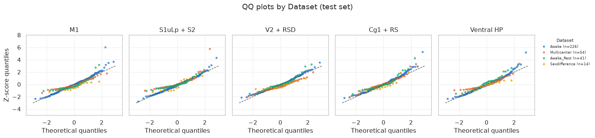

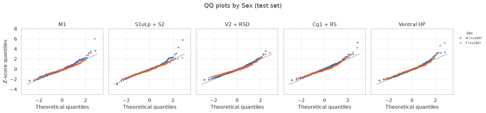

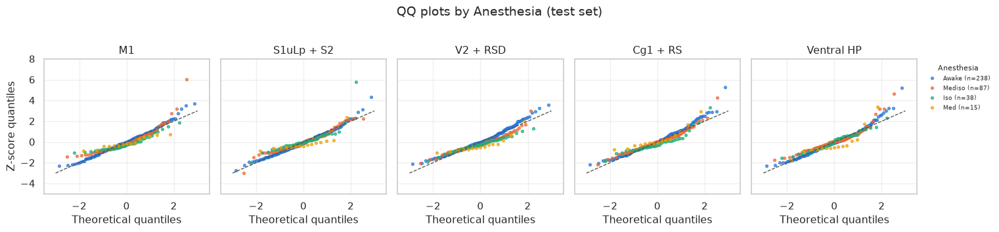

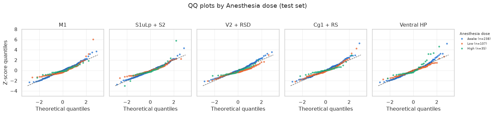

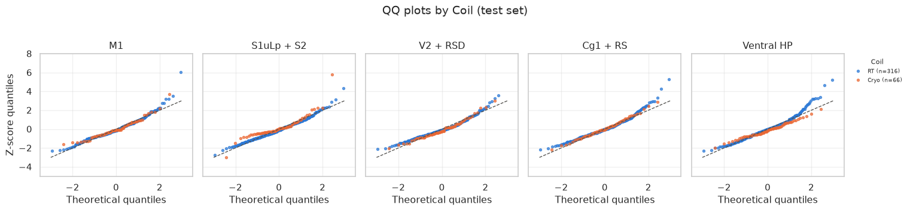

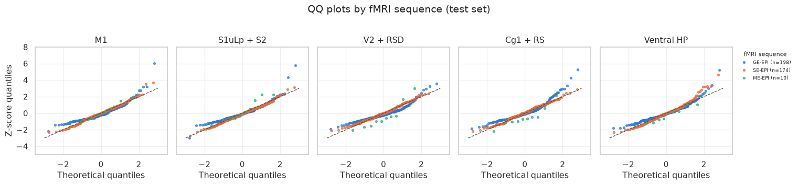

    QQ plots by group saved to: /home/traaffneu/giuvas/digitalrodent/results/normative_model/plots/qq_by_group
    Harmonized to the protocol of dataset: Awake
    MRI                             9.400000
    MRI T.R.                     2500.000000
    FD average                      0.023904
    log_tSNR                        2.827833
    Coil_encoded                    0.000000
    Ventilation_encoded             0.000000
    Anesthesia_high                 0.000000
    Anesthesia_dose_unknown         0.000000
    Rodent.strain_129S2/SvPas       0.000000
    Rodent.strain_F1 C6/129P        0.000000
    fMRI.sequence_ME-EPI            0.000000
    fMRI.sequence_SE-EPI            1.000000
    Anesthesia_Hal                  0.000000
    Anesthesia_Iso                  0.000000
    Anesthesia_Med                  0.000000
    Anesthesia_Mediso               0.000000
    dtype: float64

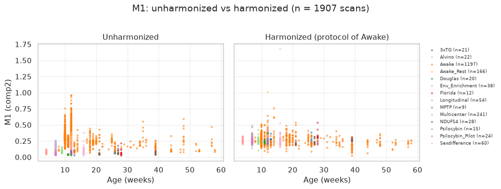

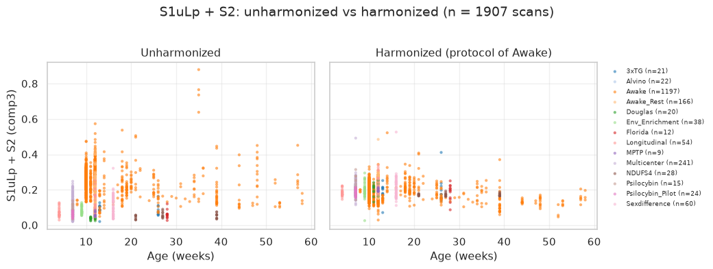

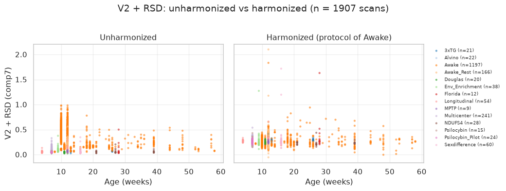

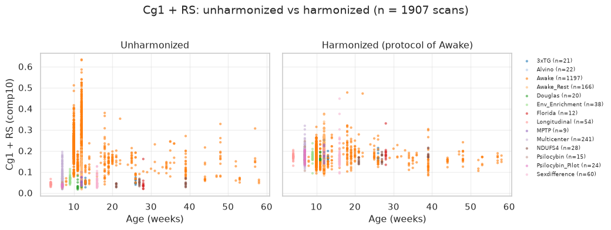

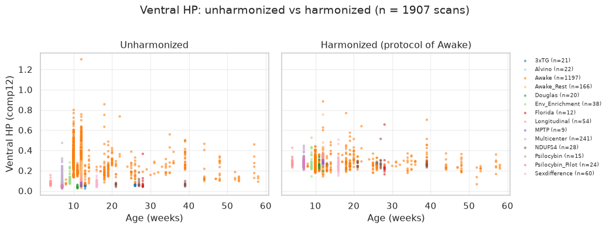

    Between-dataset spread before/after harmonization:

<div>
<style scoped>
    .dataframe tbody tr th:only-of-type {
        vertical-align: middle;
    }
&#10;    .dataframe tbody tr th {
        vertical-align: top;
    }
&#10;    .dataframe thead th {
        text-align: right;
    }
</style>

|  | SD of dataset means, raw | SD of dataset means, harmonized |
|----|----|----|
| M1 (comp2) | 0.067 | 0.021 |
| S1uLp + S2 (comp3) | 0.053 | 0.013 |
| V2 + RSD (comp7) | 0.086 | 0.041 |
| Cg1 + RS (comp10) | 0.047 | 0.007 |
| Ventral HP (comp12) | 0.069 | 0.011 |

</div>

    Harmonized scatter plots saved to: /home/traaffneu/giuvas/digitalrodent/results/normative_model/plots/harmonized_scatter

    BLR training finished.

    Saved to:
    /home/traaffneu/giuvas/digitalrodent/results/normative_model
