# Model Training


``` python
from pathlib import Path
import pandas as pd

from pcntoolkit import (
    BLR,
    BsplineBasisFunction,
    NormativeModel,
    NormData,
    plot_qq
)

import pcntoolkit.util.output


# ============================================================
# PATHS
# ============================================================

# ============================================================
# PATHS
# ============================================================

current_dir = Path.cwd().parent

input_path = current_dir / "results" / "combined_dataset" / "Model_dataframe.csv"

model_dir = current_dir / "results" / "normative_model"

model_dir.mkdir(parents=True, exist_ok=True)


# ============================================================
# LOAD DATA
# ============================================================

model_df = pd.read_csv(input_path)

pcntoolkit.util.output.Output.set_show_messages(False)


# ============================================================
# DEFINE MODEL VARIABLES
# ============================================================

response_vars = [f"comp{i}" for i in range(1, 19)]

batch_effects = []

covariates = [
    col for col in model_df.columns
    if col not in (
        [
            "Scan_id",
            "Participant_Id",
            "Session",
            "Dataset_name"
        ]
        + response_vars
    )
]


# ============================================================
# CHECK MODEL SETUP
# ============================================================
print("\nRows:")
print(len(model_df))

print("\nResponses:")
print(response_vars)

print("\nCovariates:")
print(covariates)

print("\nBatch effects:")
print(batch_effects)

print(
    "\nMissing covariate values:",
    model_df[covariates]
    .isna()
    .sum()
    .sum()
)

print(
    "Missing response values:",
    model_df[response_vars]
    .isna()
    .sum()
    .sum()
)


# ============================================================
# CREATE NORMDATA
# ============================================================

norm_data = NormData.from_dataframe(
    name="DigitalRodent",
    dataframe=model_df,
    covariates=covariates,
    batch_effects=batch_effects,
    response_vars=response_vars,
    remove_Nan=False
)


# ============================================================
# TRAIN / TEST SPLIT
# ============================================================

train, test = norm_data.train_test_split()


# ============================================================
# BLR MODEL
# ============================================================

# Non-linear effects: B-spline basis on the continuous covariates
# that vary within datasets (age, motion, tSNR).
# Without a basis function BLR is linear in every covariate,
# which is why the centile curves came out as straight lines.
# The other covariates (scanner, sex, anesthesia, ...) stay linear.
spline_columns = [
    covariates.index(col)
    for col in ["Age(week)", "FD average", "log_tSNR"]
    if col in covariates
]
print("B-spline applied to:", [covariates[i] for i in spline_columns])

model = NormativeModel(
    BLR(
        basis_function_mean=BsplineBasisFunction(
            basis_column=spline_columns,
            degree=3,
            nknots=5
        ),
        basis_function_var=BsplineBasisFunction(
            basis_column=spline_columns,
            degree=3,
            nknots=5
        ),
        heteroskedastic=True
    ),
    inscaler="standardize",
    outscaler="standardize",
    savemodel=True,
    evaluate_model=True,
    saveresults=True,
    saveplots=True,
    save_dir=str(model_dir)
)


# ============================================================
# FIT MODEL
# ============================================================

model.fit_predict(
    train,
    test
)


# ============================================================
# QQ PLOTS
# ============================================================

qq_dir = (
    model_dir
    / "plots"
    / "qq"
)

qq_dir.mkdir(
    parents=True,
    exist_ok=True
)

plot_qq(
    test,
    plot_id_line=True,
    save_dir=str(qq_dir)
)


# ============================================================
# RESULTS
# ============================================================

train_stats = train.get_statistics_df()
test_stats = test.get_statistics_df()

print("\nTrain statistics:")
display(train_stats)

print("\nTest statistics:")
display(test_stats)

train_stats.to_csv(
    model_dir
    / "Train_statistics.csv",
    index=False
)

test_stats.to_csv(
    model_dir
    / "Test_statistics.csv",
    index=False
)


# ============================================================
# QQ PLOTS AND CALIBRATION BY GROUP (test set)
# PCNToolkit's plot_qq(hue_data=..., split_data=...) only works with
# batch effects; sex, anesthesia, dataset etc. are covariates here, so
# the per-group QQ plots are built from the test z-scores directly.
# If the model is well calibrated, every group has mean z ~ 0, SD ~ 1
# and its QQ curve lies on the identity line.
# ============================================================

import numpy as np
import matplotlib.pyplot as plt
from scipy.stats import norm

qq_components = {
    "comp2": "M1",
    "comp3": "S1uLp + S2",
    "comp7": "V2 + RSD",
    "comp10": "Cg1 + RS",
    "comp11": "Ventral HP",
}
min_group_size = 10

qq_group_dir = model_dir / "plots" / "qq_by_group"
qq_group_dir.mkdir(parents=True, exist_ok=True)

# z-scores of the test set, one row per scan
z_test = pd.DataFrame(
    test.Z.values,
    columns=[str(r) for r in test.Z.coords["response_vars"].values],
    index=test.Z.coords["observations"].values.astype(int),
)
groups_df = model_df.loc[z_test.index].copy()

# rebuild readable group labels from the encoded covariates
anesthesia_dummies = [c for c in covariates if c.startswith("Anesthesia_")
                      and c not in ["Anesthesia_high", "Anesthesia_dose_unknown"]]


def from_dummies(row, cols, prefix, reference):
    for c in cols:
        if row[c] == 1:
            return c.replace(prefix, "")
    return reference


group_labels = pd.DataFrame(index=groups_df.index)
group_labels["Dataset"] = groups_df["Dataset_name"]
group_labels["Sex"] = np.where(
    groups_df.get("Sex_unknown", 0) == 1, "Unknown",
    np.where(groups_df["Sex_encoded"] == 1, "M", "F")
)
group_labels["Anesthesia"] = groups_df.apply(
    lambda r: from_dummies(r, anesthesia_dummies, "Anesthesia_", "Awake"), axis=1
)
if "Anesthesia_high" in groups_df:
    group_labels["Anesthesia dose"] = np.select(
        [group_labels["Anesthesia"] == "Awake",
         groups_df.get("Anesthesia_dose_unknown", 0) == 1,
         groups_df["Anesthesia_high"] == 1],
        ["Awake", "Unknown", "High"], default="Low"
    )
group_labels["Coil"] = np.where(groups_df["Coil_encoded"] == 1, "Cryo", "RT")
seq_dummies = [c for c in covariates if c.startswith("fMRI.sequence_")]
group_labels["fMRI sequence"] = groups_df.apply(
    lambda r: from_dummies(r, seq_dummies, "fMRI.sequence_", "GE-EPI"), axis=1
)

# ---------------- calibration table ----------------
rows = []
for variable in group_labels.columns:
    for group, idx in group_labels.groupby(variable).groups.items():
        row = {"Variable": variable, "Group": group, "N_test": len(idx)}
        for comp, name in qq_components.items():
            row[f"{name} mean z"] = z_test.loc[idx, comp].mean()
            row[f"{name} SD z"] = z_test.loc[idx, comp].std()
        rows.append(row)
calibration = pd.DataFrame(rows).round(2)
calibration.to_csv(model_dir / "Z_calibration_by_group.csv", index=False)

print("\nZ-score calibration by group (test set; ideal: mean 0, SD 1)")
display(calibration)

flag = calibration[(calibration["N_test"] >= min_group_size) &
                   (calibration.filter(like="mean z").abs() > 0.5).any(axis=1)]
if len(flag):
    print("\nGroups with |mean z| > 0.5 in at least one component (model biased for them):")
    display(flag[["Variable", "Group", "N_test"] + list(calibration.filter(like="mean z").columns)])

# ---------------- QQ plots by group ----------------
palette = ["#2a78d6", "#eb6834", "#1baf7a", "#eda100", "#e87ba4", "#008300", "#6250d6", "#e34948"]

for variable in group_labels.columns:
    counts = group_labels[variable].value_counts()
    keep = counts[counts >= min_group_size].index.tolist()
    if len(keep) < 2:
        continue

    fig, axes = plt.subplots(1, len(qq_components), figsize=(3.2 * len(qq_components), 3.6), sharey=True)
    for ax, (comp, name) in zip(axes, qq_components.items()):
        for k, group in enumerate(keep):
            z = np.sort(z_test.loc[group_labels[variable] == group, comp].dropna().to_numpy())
            theoretical = norm.ppf((np.arange(1, len(z) + 1) - 0.5) / len(z))
            ax.plot(theoretical, z, "o", ms=3, alpha=0.7, color=palette[k % len(palette)],
                    label=f"{group} (n={len(z)})")
        ax.plot([-3, 3], [-3, 3], "--", color="#52514e", lw=1)
        ax.set_title(name)
        ax.set_xlabel("Theoretical quantiles")
        ax.set_xlim(-3.5, 3.5)
        ax.set_ylim(-5, 8)
        ax.grid(alpha=0.3)
    axes[0].set_ylabel("Z-score quantiles")
    axes[-1].legend(title=variable, fontsize=7, title_fontsize=8, frameon=False,
                    loc="upper left", bbox_to_anchor=(1.02, 1))
    fig.suptitle(f"QQ plots by {variable} (test set)", y=1.02)
    plt.tight_layout()
    fname = variable.replace(" ", "_")
    plt.savefig(qq_group_dir / f"qq_by_{fname}.png", dpi=200, bbox_inches="tight")
    plt.show()
    plt.close()

print("QQ plots by group saved to:", qq_group_dir)


# ============================================================
# UNHARMONIZED vs HARMONIZED SCATTER PLOTS
# Same idea as model.harmonize() in the PCNToolkit tutorial:
#   1. z = forward(own covariates, Y)        -> where the scan sits in its own norm
#   2. Y_harmonized = backward(reference covariates, z)
#      -> the value the same scan would have under the reference protocol.
# model.harmonize() only swaps batch effects; this model has none
# (site/protocol are covariates), so it would return Y unchanged.
# Here we keep the biology of each scan (age, sex) and set every
# acquisition/protocol covariate to one reference protocol.
# ============================================================

import copy

harm_dir = model_dir / "plots" / "harmonized_scatter"
harm_dir.mkdir(parents=True, exist_ok=True)

keep_own = ["Age(week)", "Sex_encoded", "Sex_unknown"]  # biology kept per scan
harmonized_covs = [c for c in covariates if c not in keep_own]

# reference protocol = the most common value in the largest dataset;
# FD and log tSNR set to the overall median (a "typical" scan quality)
reference_dataset = model_df["Dataset_name"].value_counts().idxmax()
ref_src = model_df[model_df["Dataset_name"] == reference_dataset]
reference_protocol = {c: ref_src[c].mode().iloc[0] for c in harmonized_covs}
for c in ["FD average", "log_tSNR"]:
    if c in reference_protocol:
        reference_protocol[c] = model_df[c].median()

print("Harmonized to the protocol of dataset:", reference_dataset)
print(pd.Series(reference_protocol))

harm_input = model_df.dropna(subset=covariates + response_vars).copy()
ref_input = harm_input.copy()
for c, v in reference_protocol.items():
    ref_input[c] = v


def make_nd(name, df):
    return NormData.from_dataframe(
        name=name, dataframe=df, covariates=covariates,
        batch_effects=batch_effects, response_vars=response_vars, remove_Nan=False,
    )


own_nd = make_nd("own", harm_input)
ref_nd = make_nd("reference", ref_input)
model.preprocess(own_nd)
model.preprocess(ref_nd)
for rv in model.response_vars:
    X, be, _, Y, _ = model.extract_data(own_nd.sel({"response_vars": rv}))
    Z = model[rv].forward(X, be, Y)
    X_ref, be_ref, _, _, _ = model.extract_data(ref_nd.sel({"response_vars": rv}))
    ref_nd["Y"].loc[{"response_vars": rv}] = model[rv].backward(X_ref, be_ref, Z)
model.postprocess(ref_nd)
model.postprocess(own_nd)

harmonized = pd.DataFrame(
    ref_nd.Y.values, index=harm_input.index,
    columns=[str(r) for r in ref_nd.Y.coords["response_vars"].values],
)
harm_out = harm_input[["Dataset_name", "Age(week)"]].join(
    harmonized.add_suffix("_harmonized"))
harm_out.to_csv(model_dir / "Harmonized_data.csv")

# ---------------- scatter plots ----------------
datasets = sorted(harm_input["Dataset_name"].unique())
cmap = plt.get_cmap("tab20")
colors = {d: cmap(i % 20) for i, d in enumerate(datasets)}

for comp, name in qq_components.items():
    fig, axes = plt.subplots(1, 2, figsize=(11, 4), sharey=True)
    for ax, values, title in [
        (axes[0], harm_input[comp], "Unharmonized"),
        (axes[1], harmonized[comp], f"Harmonized (protocol of {reference_dataset})"),
    ]:
        for d in datasets:
            m = harm_input["Dataset_name"] == d
            ax.scatter(harm_input.loc[m, "Age(week)"], values[m], s=10, alpha=0.6,
                       color=colors[d], label=f"{d} (n={m.sum()})", edgecolors="none")
        ax.set_title(title)
        ax.set_xlabel("Age (weeks)")
        ax.grid(alpha=0.3)
    axes[0].set_ylabel(f"{name} ({comp})")
    axes[1].legend(fontsize=7, frameon=False, loc="upper left", bbox_to_anchor=(1.02, 1))
    fig.suptitle(f"{name}: unharmonized vs harmonized (n = {len(harm_input)} scans)", y=1.02)
    plt.tight_layout()
    plt.savefig(harm_dir / f"harmonized_scatter_{comp}.png", dpi=200, bbox_inches="tight")
    plt.show()
    plt.close()

# how much of the between-dataset spread is removed
spread = pd.DataFrame({
    "SD of dataset means, raw": harm_input.groupby("Dataset_name")[list(qq_components)].mean().std(),
    "SD of dataset means, harmonized": harmonized.join(harm_input["Dataset_name"])
        .groupby("Dataset_name")[list(qq_components)].mean().std(),
}).round(3)
spread.index = [f"{qq_components[c]} ({c})" for c in spread.index]
print("\nBetween-dataset spread before/after harmonization:")
display(spread)
print("Harmonized scatter plots saved to:", harm_dir)


# ============================================================
# DONE
# ============================================================

print("\nBLR training finished.")

print("\nSaved to:")
print(model_dir)
```

    Rows:
    1925

    Responses:
    ['comp1', 'comp2', 'comp3', 'comp4', 'comp5', 'comp6', 'comp7', 'comp8', 'comp9', 'comp10', 'comp11', 'comp12', 'comp13', 'comp14', 'comp15', 'comp16', 'comp17', 'comp18']

    Covariates:
    ['Age(week)', 'MRI', 'MRI T.R.', 'FD average', 'log_tSNR', 'Sex_encoded', 'Sex_unknown', 'Coil_encoded', 'Ventilation_encoded', 'Anesthesia_high', 'Anesthesia_dose_unknown', 'Rodent.strain_129S2/SvPas', 'Rodent.strain_F1 C6/129P', 'fMRI.sequence_ME-EPI', 'fMRI.sequence_SE-EPI', 'Anesthesia_Hal', 'Anesthesia_Iso', 'Anesthesia_Med', 'Anesthesia_Mediso']

    Batch effects:
    []

    Missing covariate values: 0
    Missing response values: 0
    B-spline applied to: ['Age(week)', 'FD average', 'log_tSNR']

    /home/traaffneu/giuvas/digitalrodent/Analysis/.venv/lib64/python3.11/site-packages/pcntoolkit/regression_model/blr.py:674: LinAlgWarning: An ill-conditioned matrix detected: slice 0 has rcond = 2.914099678629302e-230.
      invAXt: np.ndarray = linalg.solve(self.A, X.T, check_finite=False)
    /home/traaffneu/giuvas/digitalrodent/Analysis/.venv/lib64/python3.11/site-packages/pcntoolkit/util/output.py:239: UserWarning: Process: 3339003 - 2026-10-27 23:01:11 - Estimation of posterior distribution failed due to: 
    Matrix is not positive definite
      warnings.warn(message)
    /home/traaffneu/giuvas/digitalrodent/Analysis/.venv/lib64/python3.11/site-packages/pcntoolkit/regression_model/blr.py:674: LinAlgWarning: An ill-conditioned matrix detected: slice 0 has rcond = 1.23671877722108e-230.
      invAXt: np.ndarray = linalg.solve(self.A, X.T, check_finite=False)
    /home/traaffneu/giuvas/digitalrodent/Analysis/.venv/lib64/python3.11/site-packages/pcntoolkit/regression_model/blr.py:674: LinAlgWarning: An ill-conditioned matrix detected: slice 0 has rcond = 2.9141005720743377e-230.
      invAXt: np.ndarray = linalg.solve(self.A, X.T, check_finite=False)
    /home/traaffneu/giuvas/digitalrodent/Analysis/.venv/lib64/python3.11/site-packages/pcntoolkit/regression_model/blr.py:674: LinAlgWarning: An ill-conditioned matrix detected: slice 0 has rcond = 2.9141036657487115e-230.
      invAXt: np.ndarray = linalg.solve(self.A, X.T, check_finite=False)
    /home/traaffneu/giuvas/digitalrodent/Analysis/.venv/lib64/python3.11/site-packages/pcntoolkit/regression_model/blr.py:674: LinAlgWarning: An ill-conditioned matrix detected: slice 0 has rcond = 2.914101309364477e-230.
      invAXt: np.ndarray = linalg.solve(self.A, X.T, check_finite=False)
    /home/traaffneu/giuvas/digitalrodent/Analysis/.venv/lib64/python3.11/site-packages/pcntoolkit/regression_model/blr.py:674: LinAlgWarning: An ill-conditioned matrix detected: slice 0 has rcond = 2.9138078958244475e-230.
      invAXt: np.ndarray = linalg.solve(self.A, X.T, check_finite=False)
    /home/traaffneu/giuvas/digitalrodent/Analysis/.venv/lib64/python3.11/site-packages/pcntoolkit/regression_model/blr.py:674: LinAlgWarning: An ill-conditioned matrix detected: slice 0 has rcond = 2.9012834280692523e-230.
      invAXt: np.ndarray = linalg.solve(self.A, X.T, check_finite=False)
    /home/traaffneu/giuvas/digitalrodent/Analysis/.venv/lib64/python3.11/site-packages/pcntoolkit/regression_model/blr.py:674: LinAlgWarning: An ill-conditioned matrix detected: slice 0 has rcond = 2.7978175079142694e-230.
      invAXt: np.ndarray = linalg.solve(self.A, X.T, check_finite=False)
    /home/traaffneu/giuvas/digitalrodent/Analysis/.venv/lib64/python3.11/site-packages/pcntoolkit/regression_model/blr.py:674: LinAlgWarning: An ill-conditioned matrix detected: slice 0 has rcond = 2.758784171242976e-230.
      invAXt: np.ndarray = linalg.solve(self.A, X.T, check_finite=False)
    /home/traaffneu/giuvas/digitalrodent/Analysis/.venv/lib64/python3.11/site-packages/pcntoolkit/regression_model/blr.py:674: LinAlgWarning: An ill-conditioned matrix detected: slice 0 has rcond = 2.947330248597147e-230.
      invAXt: np.ndarray = linalg.solve(self.A, X.T, check_finite=False)
    /home/traaffneu/giuvas/digitalrodent/Analysis/.venv/lib64/python3.11/site-packages/pcntoolkit/regression_model/blr.py:674: LinAlgWarning: An ill-conditioned matrix detected: slice 0 has rcond = 3.2253811430796916e-230.
      invAXt: np.ndarray = linalg.solve(self.A, X.T, check_finite=False)
    /home/traaffneu/giuvas/digitalrodent/Analysis/.venv/lib64/python3.11/site-packages/pcntoolkit/regression_model/blr.py:674: LinAlgWarning: An ill-conditioned matrix detected: slice 0 has rcond = 3.058407013003435e-230.
      invAXt: np.ndarray = linalg.solve(self.A, X.T, check_finite=False)
    /home/traaffneu/giuvas/digitalrodent/Analysis/.venv/lib64/python3.11/site-packages/pcntoolkit/regression_model/blr.py:674: LinAlgWarning: An ill-conditioned matrix detected: slice 0 has rcond = 2.899640356787266e-230.
      invAXt: np.ndarray = linalg.solve(self.A, X.T, check_finite=False)
    /home/traaffneu/giuvas/digitalrodent/Analysis/.venv/lib64/python3.11/site-packages/pcntoolkit/regression_model/blr.py:674: LinAlgWarning: An ill-conditioned matrix detected: slice 0 has rcond = 2.7608976982121137e-230.
      invAXt: np.ndarray = linalg.solve(self.A, X.T, check_finite=False)
    /home/traaffneu/giuvas/digitalrodent/Analysis/.venv/lib64/python3.11/site-packages/pcntoolkit/regression_model/blr.py:674: LinAlgWarning: An ill-conditioned matrix detected: slice 0 has rcond = 2.808798130720184e-230.
      invAXt: np.ndarray = linalg.solve(self.A, X.T, check_finite=False)
    /home/traaffneu/giuvas/digitalrodent/Analysis/.venv/lib64/python3.11/site-packages/pcntoolkit/regression_model/blr.py:674: LinAlgWarning: An ill-conditioned matrix detected: slice 0 has rcond = 2.901837407309521e-230.
      invAXt: np.ndarray = linalg.solve(self.A, X.T, check_finite=False)
    /home/traaffneu/giuvas/digitalrodent/Analysis/.venv/lib64/python3.11/site-packages/pcntoolkit/regression_model/blr.py:674: LinAlgWarning: An ill-conditioned matrix detected: slice 0 has rcond = 2.9141019415850213e-230.
      invAXt: np.ndarray = linalg.solve(self.A, X.T, check_finite=False)
    /home/traaffneu/giuvas/digitalrodent/Analysis/.venv/lib64/python3.11/site-packages/pcntoolkit/util/output.py:239: UserWarning: Process: 3339003 - 2026-10-27 23:01:12 - Estimation of posterior distribution failed due to: 
    Matrix is not positive definite
      warnings.warn(message)
    /home/traaffneu/giuvas/digitalrodent/Analysis/.venv/lib64/python3.11/site-packages/pcntoolkit/regression_model/blr.py:674: LinAlgWarning: An ill-conditioned matrix detected: slice 0 has rcond = 2.9141034003288476e-230.
      invAXt: np.ndarray = linalg.solve(self.A, X.T, check_finite=False)
    /home/traaffneu/giuvas/digitalrodent/Analysis/.venv/lib64/python3.11/site-packages/pcntoolkit/regression_model/blr.py:674: LinAlgWarning: An ill-conditioned matrix detected: slice 0 has rcond = 2.9141000926368285e-230.
      invAXt: np.ndarray = linalg.solve(self.A, X.T, check_finite=False)
    /home/traaffneu/giuvas/digitalrodent/Analysis/.venv/lib64/python3.11/site-packages/pcntoolkit/regression_model/blr.py:674: LinAlgWarning: An ill-conditioned matrix detected: slice 0 has rcond = 3.4576622152191966e-230.
      invAXt: np.ndarray = linalg.solve(self.A, X.T, check_finite=False)
    /home/traaffneu/giuvas/digitalrodent/Analysis/.venv/lib64/python3.11/site-packages/pcntoolkit/regression_model/blr.py:674: LinAlgWarning: An ill-conditioned matrix detected: slice 0 has rcond = 2.8681115384427072e-230.
      invAXt: np.ndarray = linalg.solve(self.A, X.T, check_finite=False)
    /home/traaffneu/giuvas/digitalrodent/Analysis/.venv/lib64/python3.11/site-packages/pcntoolkit/regression_model/blr.py:674: LinAlgWarning: An ill-conditioned matrix detected: slice 0 has rcond = 2.74571751257503e-230.
      invAXt: np.ndarray = linalg.solve(self.A, X.T, check_finite=False)
    /home/traaffneu/giuvas/digitalrodent/Analysis/.venv/lib64/python3.11/site-packages/pcntoolkit/regression_model/blr.py:674: LinAlgWarning: An ill-conditioned matrix detected: slice 0 has rcond = 2.848123222031807e-230.
      invAXt: np.ndarray = linalg.solve(self.A, X.T, check_finite=False)
    /home/traaffneu/giuvas/digitalrodent/Analysis/.venv/lib64/python3.11/site-packages/pcntoolkit/regression_model/blr.py:674: LinAlgWarning: An ill-conditioned matrix detected: slice 0 has rcond = 2.9092043775305403e-230.
      invAXt: np.ndarray = linalg.solve(self.A, X.T, check_finite=False)
    /home/traaffneu/giuvas/digitalrodent/Analysis/.venv/lib64/python3.11/site-packages/pcntoolkit/regression_model/blr.py:674: LinAlgWarning: An ill-conditioned matrix detected: slice 0 has rcond = 2.9140989172378116e-230.
      invAXt: np.ndarray = linalg.solve(self.A, X.T, check_finite=False)
    /home/traaffneu/giuvas/digitalrodent/Analysis/.venv/lib64/python3.11/site-packages/pcntoolkit/regression_model/blr.py:674: LinAlgWarning: An ill-conditioned matrix detected: slice 0 has rcond = 2.9140996787163005e-230.
      invAXt: np.ndarray = linalg.solve(self.A, X.T, check_finite=False)
    /home/traaffneu/giuvas/digitalrodent/Analysis/.venv/lib64/python3.11/site-packages/pcntoolkit/regression_model/blr.py:674: LinAlgWarning: An ill-conditioned matrix detected: slice 0 has rcond = 2.625252967993138e-230.
      invAXt: np.ndarray = linalg.solve(self.A, X.T, check_finite=False)
    /home/traaffneu/giuvas/digitalrodent/Analysis/.venv/lib64/python3.11/site-packages/pcntoolkit/regression_model/blr.py:674: LinAlgWarning: An ill-conditioned matrix detected: slice 0 has rcond = 2.9944134974883047e-230.
      invAXt: np.ndarray = linalg.solve(self.A, X.T, check_finite=False)
    /home/traaffneu/giuvas/digitalrodent/Analysis/.venv/lib64/python3.11/site-packages/pcntoolkit/regression_model/blr.py:674: LinAlgWarning: An ill-conditioned matrix detected: slice 0 has rcond = 3.0248150338335725e-230.
      invAXt: np.ndarray = linalg.solve(self.A, X.T, check_finite=False)
    /home/traaffneu/giuvas/digitalrodent/Analysis/.venv/lib64/python3.11/site-packages/pcntoolkit/regression_model/blr.py:674: LinAlgWarning: An ill-conditioned matrix detected: slice 0 has rcond = 3.0560138207285953e-230.
      invAXt: np.ndarray = linalg.solve(self.A, X.T, check_finite=False)
    /home/traaffneu/giuvas/digitalrodent/Analysis/.venv/lib64/python3.11/site-packages/pcntoolkit/regression_model/blr.py:674: LinAlgWarning: An ill-conditioned matrix detected: slice 0 has rcond = 2.996457750660265e-230.
      invAXt: np.ndarray = linalg.solve(self.A, X.T, check_finite=False)
    /home/traaffneu/giuvas/digitalrodent/Analysis/.venv/lib64/python3.11/site-packages/pcntoolkit/regression_model/blr.py:674: LinAlgWarning: An ill-conditioned matrix detected: slice 0 has rcond = 2.959534198969488e-230.
      invAXt: np.ndarray = linalg.solve(self.A, X.T, check_finite=False)
    /home/traaffneu/giuvas/digitalrodent/Analysis/.venv/lib64/python3.11/site-packages/pcntoolkit/regression_model/blr.py:674: LinAlgWarning: An ill-conditioned matrix detected: slice 0 has rcond = 1.5406580506664206e-230.
      invAXt: np.ndarray = linalg.solve(self.A, X.T, check_finite=False)
    /home/traaffneu/giuvas/digitalrodent/Analysis/.venv/lib64/python3.11/site-packages/pcntoolkit/regression_model/blr.py:674: LinAlgWarning: An ill-conditioned matrix detected: slice 0 has rcond = 3.0798913033334215e-230.
      invAXt: np.ndarray = linalg.solve(self.A, X.T, check_finite=False)
    /home/traaffneu/giuvas/digitalrodent/Analysis/.venv/lib64/python3.11/site-packages/pcntoolkit/regression_model/blr.py:674: LinAlgWarning: An ill-conditioned matrix detected: slice 0 has rcond = 2.954750869157476e-230.
      invAXt: np.ndarray = linalg.solve(self.A, X.T, check_finite=False)
    /home/traaffneu/giuvas/digitalrodent/Analysis/.venv/lib64/python3.11/site-packages/pcntoolkit/regression_model/blr.py:674: LinAlgWarning: An ill-conditioned matrix detected: slice 0 has rcond = 3.1980217499623183e-230.
      invAXt: np.ndarray = linalg.solve(self.A, X.T, check_finite=False)
    /home/traaffneu/giuvas/digitalrodent/Analysis/.venv/lib64/python3.11/site-packages/pcntoolkit/regression_model/blr.py:674: LinAlgWarning: An ill-conditioned matrix detected: slice 0 has rcond = 2.955464506242561e-230.
      invAXt: np.ndarray = linalg.solve(self.A, X.T, check_finite=False)
    /home/traaffneu/giuvas/digitalrodent/Analysis/.venv/lib64/python3.11/site-packages/pcntoolkit/regression_model/blr.py:674: LinAlgWarning: An ill-conditioned matrix detected: slice 0 has rcond = 2.993169638834254e-230.
      invAXt: np.ndarray = linalg.solve(self.A, X.T, check_finite=False)
    /home/traaffneu/giuvas/digitalrodent/Analysis/.venv/lib64/python3.11/site-packages/pcntoolkit/regression_model/blr.py:674: LinAlgWarning: An ill-conditioned matrix detected: slice 0 has rcond = 2.972846524431011e-230.
      invAXt: np.ndarray = linalg.solve(self.A, X.T, check_finite=False)
    /home/traaffneu/giuvas/digitalrodent/Analysis/.venv/lib64/python3.11/site-packages/pcntoolkit/regression_model/blr.py:674: LinAlgWarning: An ill-conditioned matrix detected: slice 0 has rcond = 3.065989133074526e-230.
      invAXt: np.ndarray = linalg.solve(self.A, X.T, check_finite=False)
    /home/traaffneu/giuvas/digitalrodent/Analysis/.venv/lib64/python3.11/site-packages/pcntoolkit/regression_model/blr.py:674: LinAlgWarning: An ill-conditioned matrix detected: slice 0 has rcond = 2.636792605818461e-230.
      invAXt: np.ndarray = linalg.solve(self.A, X.T, check_finite=False)
    /home/traaffneu/giuvas/digitalrodent/Analysis/.venv/lib64/python3.11/site-packages/pcntoolkit/regression_model/blr.py:674: LinAlgWarning: An ill-conditioned matrix detected: slice 0 has rcond = 3.220571390876462e-230.
      invAXt: np.ndarray = linalg.solve(self.A, X.T, check_finite=False)
    /home/traaffneu/giuvas/digitalrodent/Analysis/.venv/lib64/python3.11/site-packages/pcntoolkit/regression_model/blr.py:674: LinAlgWarning: An ill-conditioned matrix detected: slice 0 has rcond = 3.46149565832021e-142.
      invAXt: np.ndarray = linalg.solve(self.A, X.T, check_finite=False)
    /home/traaffneu/giuvas/digitalrodent/Analysis/.venv/lib64/python3.11/site-packages/pcntoolkit/util/output.py:239: UserWarning: Process: 3339003 - 2026-10-27 23:01:58 - Estimation of posterior distribution failed due to: 
    Matrix is not positive definite
      warnings.warn(message)
    /home/traaffneu/giuvas/digitalrodent/Analysis/.venv/lib64/python3.11/site-packages/pcntoolkit/regression_model/blr.py:674: LinAlgWarning: An ill-conditioned matrix detected: slice 0 has rcond = 3.704742516029065e-142.
      invAXt: np.ndarray = linalg.solve(self.A, X.T, check_finite=False)
    /home/traaffneu/giuvas/digitalrodent/Analysis/.venv/lib64/python3.11/site-packages/pcntoolkit/regression_model/blr.py:674: LinAlgWarning: An ill-conditioned matrix detected: slice 0 has rcond = 3.3425307739095165e-142.
      invAXt: np.ndarray = linalg.solve(self.A, X.T, check_finite=False)
    /home/traaffneu/giuvas/digitalrodent/Analysis/.venv/lib64/python3.11/site-packages/pcntoolkit/regression_model/blr.py:674: LinAlgWarning: An ill-conditioned matrix detected: slice 0 has rcond = 1.603664014996204e-142.
      invAXt: np.ndarray = linalg.solve(self.A, X.T, check_finite=False)
    /home/traaffneu/giuvas/digitalrodent/Analysis/.venv/lib64/python3.11/site-packages/pcntoolkit/util/output.py:239: UserWarning: Process: 3339003 - 2026-10-27 23:01:59 - Estimation of posterior distribution failed due to: 
    Matrix is not positive definite
      warnings.warn(message)
    /home/traaffneu/giuvas/digitalrodent/Analysis/.venv/lib64/python3.11/site-packages/pcntoolkit/regression_model/blr.py:674: LinAlgWarning: An ill-conditioned matrix detected: slice 0 has rcond = 3.424553007816119e-142.
      invAXt: np.ndarray = linalg.solve(self.A, X.T, check_finite=False)
    /home/traaffneu/giuvas/digitalrodent/Analysis/.venv/lib64/python3.11/site-packages/pcntoolkit/regression_model/blr.py:674: LinAlgWarning: An ill-conditioned matrix detected: slice 0 has rcond = 3.460008040986689e-142.
      invAXt: np.ndarray = linalg.solve(self.A, X.T, check_finite=False)
    /home/traaffneu/giuvas/digitalrodent/Analysis/.venv/lib64/python3.11/site-packages/pcntoolkit/regression_model/blr.py:674: LinAlgWarning: An ill-conditioned matrix detected: slice 0 has rcond = 8.813117397805263e-142.
      invAXt: np.ndarray = linalg.solve(self.A, X.T, check_finite=False)
    /home/traaffneu/giuvas/digitalrodent/Analysis/.venv/lib64/python3.11/site-packages/pcntoolkit/regression_model/blr.py:674: LinAlgWarning: An ill-conditioned matrix detected: slice 0 has rcond = 9.246845549096391e-143.
      invAXt: np.ndarray = linalg.solve(self.A, X.T, check_finite=False)
    /home/traaffneu/giuvas/digitalrodent/Analysis/.venv/lib64/python3.11/site-packages/pcntoolkit/regression_model/blr.py:674: LinAlgWarning: An ill-conditioned matrix detected: slice 0 has rcond = 3.471159981419368e-142.
      invAXt: np.ndarray = linalg.solve(self.A, X.T, check_finite=False)
    /home/traaffneu/giuvas/digitalrodent/Analysis/.venv/lib64/python3.11/site-packages/pcntoolkit/regression_model/blr.py:674: LinAlgWarning: An ill-conditioned matrix detected: slice 0 has rcond = 5.654437104510745e-143.
      invAXt: np.ndarray = linalg.solve(self.A, X.T, check_finite=False)
    /home/traaffneu/giuvas/digitalrodent/Analysis/.venv/lib64/python3.11/site-packages/pcntoolkit/regression_model/blr.py:674: LinAlgWarning: An ill-conditioned matrix detected: slice 0 has rcond = 3.3206095355021675e-142.
      invAXt: np.ndarray = linalg.solve(self.A, X.T, check_finite=False)
    /home/traaffneu/giuvas/digitalrodent/Analysis/.venv/lib64/python3.11/site-packages/pcntoolkit/regression_model/blr.py:674: LinAlgWarning: An ill-conditioned matrix detected: slice 0 has rcond = 3.2926567297971405e-142.
      invAXt: np.ndarray = linalg.solve(self.A, X.T, check_finite=False)
    /home/traaffneu/giuvas/digitalrodent/Analysis/.venv/lib64/python3.11/site-packages/pcntoolkit/regression_model/blr.py:674: LinAlgWarning: An ill-conditioned matrix detected: slice 0 has rcond = 3.4333328349605665e-142.
      invAXt: np.ndarray = linalg.solve(self.A, X.T, check_finite=False)
    /home/traaffneu/giuvas/digitalrodent/Analysis/.venv/lib64/python3.11/site-packages/pcntoolkit/regression_model/blr.py:674: LinAlgWarning: An ill-conditioned matrix detected: slice 0 has rcond = 3.4605503397866025e-142.
      invAXt: np.ndarray = linalg.solve(self.A, X.T, check_finite=False)
    /home/traaffneu/giuvas/digitalrodent/Analysis/.venv/lib64/python3.11/site-packages/pcntoolkit/regression_model/blr.py:674: LinAlgWarning: An ill-conditioned matrix detected: slice 0 has rcond = 2.750505919748892e-142.
      invAXt: np.ndarray = linalg.solve(self.A, X.T, check_finite=False)
    /home/traaffneu/giuvas/digitalrodent/Analysis/.venv/lib64/python3.11/site-packages/pcntoolkit/regression_model/blr.py:674: LinAlgWarning: An ill-conditioned matrix detected: slice 0 has rcond = 3.457746169686207e-142.
      invAXt: np.ndarray = linalg.solve(self.A, X.T, check_finite=False)
    /home/traaffneu/giuvas/digitalrodent/Analysis/.venv/lib64/python3.11/site-packages/pcntoolkit/regression_model/blr.py:674: LinAlgWarning: An ill-conditioned matrix detected: slice 0 has rcond = 3.3994991195041614e-142.
      invAXt: np.ndarray = linalg.solve(self.A, X.T, check_finite=False)
    /home/traaffneu/giuvas/digitalrodent/Analysis/.venv/lib64/python3.11/site-packages/pcntoolkit/regression_model/blr.py:674: LinAlgWarning: An ill-conditioned matrix detected: slice 0 has rcond = 3.2637867616633252e-142.
      invAXt: np.ndarray = linalg.solve(self.A, X.T, check_finite=False)
    /home/traaffneu/giuvas/digitalrodent/Analysis/.venv/lib64/python3.11/site-packages/pcntoolkit/regression_model/blr.py:674: LinAlgWarning: An ill-conditioned matrix detected: slice 0 has rcond = 3.386026152387962e-142.
      invAXt: np.ndarray = linalg.solve(self.A, X.T, check_finite=False)
    /home/traaffneu/giuvas/digitalrodent/Analysis/.venv/lib64/python3.11/site-packages/pcntoolkit/regression_model/blr.py:674: LinAlgWarning: An ill-conditioned matrix detected: slice 0 has rcond = 3.118397187431015e-142.
      invAXt: np.ndarray = linalg.solve(self.A, X.T, check_finite=False)
    /home/traaffneu/giuvas/digitalrodent/Analysis/.venv/lib64/python3.11/site-packages/pcntoolkit/regression_model/blr.py:674: LinAlgWarning: An ill-conditioned matrix detected: slice 0 has rcond = 3.556898066685824e-142.
      invAXt: np.ndarray = linalg.solve(self.A, X.T, check_finite=False)
    /home/traaffneu/giuvas/digitalrodent/Analysis/.venv/lib64/python3.11/site-packages/pcntoolkit/regression_model/blr.py:674: LinAlgWarning: An ill-conditioned matrix detected: slice 0 has rcond = 2.647276148347554e-142.
      invAXt: np.ndarray = linalg.solve(self.A, X.T, check_finite=False)
    /home/traaffneu/giuvas/digitalrodent/Analysis/.venv/lib64/python3.11/site-packages/pcntoolkit/regression_model/blr.py:674: LinAlgWarning: An ill-conditioned matrix detected: slice 0 has rcond = 2.80499714523849e-142.
      invAXt: np.ndarray = linalg.solve(self.A, X.T, check_finite=False)
    /home/traaffneu/giuvas/digitalrodent/Analysis/.venv/lib64/python3.11/site-packages/pcntoolkit/regression_model/blr.py:674: LinAlgWarning: An ill-conditioned matrix detected: slice 0 has rcond = 3.55932637452455e-142.
      invAXt: np.ndarray = linalg.solve(self.A, X.T, check_finite=False)
    /home/traaffneu/giuvas/digitalrodent/Analysis/.venv/lib64/python3.11/site-packages/pcntoolkit/regression_model/blr.py:674: LinAlgWarning: An ill-conditioned matrix detected: slice 0 has rcond = 3.51546598030187e-142.
      invAXt: np.ndarray = linalg.solve(self.A, X.T, check_finite=False)
    /home/traaffneu/giuvas/digitalrodent/Analysis/.venv/lib64/python3.11/site-packages/pcntoolkit/regression_model/blr.py:674: LinAlgWarning: An ill-conditioned matrix detected: slice 0 has rcond = 3.516234631381577e-142.
      invAXt: np.ndarray = linalg.solve(self.A, X.T, check_finite=False)
    /home/traaffneu/giuvas/digitalrodent/Analysis/.venv/lib64/python3.11/site-packages/pcntoolkit/regression_model/blr.py:674: LinAlgWarning: An ill-conditioned matrix detected: slice 0 has rcond = 3.65843462235291e-142.
      invAXt: np.ndarray = linalg.solve(self.A, X.T, check_finite=False)
    /home/traaffneu/giuvas/digitalrodent/Analysis/.venv/lib64/python3.11/site-packages/pcntoolkit/regression_model/blr.py:674: LinAlgWarning: An ill-conditioned matrix detected: slice 0 has rcond = 1.68181502694602e-142.
      invAXt: np.ndarray = linalg.solve(self.A, X.T, check_finite=False)
    /home/traaffneu/giuvas/digitalrodent/Analysis/.venv/lib64/python3.11/site-packages/pcntoolkit/regression_model/blr.py:674: LinAlgWarning: An ill-conditioned matrix detected: slice 0 has rcond = 3.798758283583292e-142.
      invAXt: np.ndarray = linalg.solve(self.A, X.T, check_finite=False)
    /home/traaffneu/giuvas/digitalrodent/Analysis/.venv/lib64/python3.11/site-packages/pcntoolkit/regression_model/blr.py:674: LinAlgWarning: An ill-conditioned matrix detected: slice 0 has rcond = 3.5106317127625204e-142.
      invAXt: np.ndarray = linalg.solve(self.A, X.T, check_finite=False)
    /home/traaffneu/giuvas/digitalrodent/Analysis/.venv/lib64/python3.11/site-packages/pcntoolkit/regression_model/blr.py:674: LinAlgWarning: An ill-conditioned matrix detected: slice 0 has rcond = 3.555420523805266e-142.
      invAXt: np.ndarray = linalg.solve(self.A, X.T, check_finite=False)
    /home/traaffneu/giuvas/digitalrodent/Analysis/.venv/lib64/python3.11/site-packages/pcntoolkit/regression_model/blr.py:674: LinAlgWarning: An ill-conditioned matrix detected: slice 0 has rcond = 3.531279297711059e-142.
      invAXt: np.ndarray = linalg.solve(self.A, X.T, check_finite=False)
    /home/traaffneu/giuvas/digitalrodent/Analysis/.venv/lib64/python3.11/site-packages/pcntoolkit/regression_model/blr.py:674: LinAlgWarning: An ill-conditioned matrix detected: slice 0 has rcond = 2.8430879392055614e-142.
      invAXt: np.ndarray = linalg.solve(self.A, X.T, check_finite=False)
    /home/traaffneu/giuvas/digitalrodent/Analysis/.venv/lib64/python3.11/site-packages/pcntoolkit/regression_model/blr.py:674: LinAlgWarning: An ill-conditioned matrix detected: slice 0 has rcond = 3.1320907940171187e-142.
      invAXt: np.ndarray = linalg.solve(self.A, X.T, check_finite=False)
    /home/traaffneu/giuvas/digitalrodent/Analysis/.venv/lib64/python3.11/site-packages/pcntoolkit/regression_model/blr.py:674: LinAlgWarning: An ill-conditioned matrix detected: slice 0 has rcond = 3.825544334620612e-142.
      invAXt: np.ndarray = linalg.solve(self.A, X.T, check_finite=False)
    /home/traaffneu/giuvas/digitalrodent/Analysis/.venv/lib64/python3.11/site-packages/pcntoolkit/regression_model/blr.py:674: LinAlgWarning: An ill-conditioned matrix detected: slice 0 has rcond = 1.6402032918313626e-194.
      invAXt: np.ndarray = linalg.solve(self.A, X.T, check_finite=False)
    /home/traaffneu/giuvas/digitalrodent/Analysis/.venv/lib64/python3.11/site-packages/pcntoolkit/util/output.py:239: UserWarning: Process: 3339003 - 2026-10-27 23:02:39 - Estimation of posterior distribution failed due to: 
    Matrix is not positive definite
      warnings.warn(message)
    /home/traaffneu/giuvas/digitalrodent/Analysis/.venv/lib64/python3.11/site-packages/pcntoolkit/regression_model/blr.py:674: LinAlgWarning: An ill-conditioned matrix detected: slice 0 has rcond = 6.960884139825855e-195.
      invAXt: np.ndarray = linalg.solve(self.A, X.T, check_finite=False)
    /home/traaffneu/giuvas/digitalrodent/Analysis/.venv/lib64/python3.11/site-packages/pcntoolkit/regression_model/blr.py:674: LinAlgWarning: An ill-conditioned matrix detected: slice 0 has rcond = 1.6402032918336746e-194.
      invAXt: np.ndarray = linalg.solve(self.A, X.T, check_finite=False)
    /home/traaffneu/giuvas/digitalrodent/Analysis/.venv/lib64/python3.11/site-packages/pcntoolkit/regression_model/blr.py:674: LinAlgWarning: An ill-conditioned matrix detected: slice 0 has rcond = 1.6402032918416805e-194.
      invAXt: np.ndarray = linalg.solve(self.A, X.T, check_finite=False)
    /home/traaffneu/giuvas/digitalrodent/Analysis/.venv/lib64/python3.11/site-packages/pcntoolkit/regression_model/blr.py:674: LinAlgWarning: An ill-conditioned matrix detected: slice 0 has rcond = 1.6402032918355824e-194.
      invAXt: np.ndarray = linalg.solve(self.A, X.T, check_finite=False)
    /home/traaffneu/giuvas/digitalrodent/Analysis/.venv/lib64/python3.11/site-packages/pcntoolkit/regression_model/blr.py:674: LinAlgWarning: An ill-conditioned matrix detected: slice 0 has rcond = 1.6400389921932554e-194.
      invAXt: np.ndarray = linalg.solve(self.A, X.T, check_finite=False)
    /home/traaffneu/giuvas/digitalrodent/Analysis/.venv/lib64/python3.11/site-packages/pcntoolkit/regression_model/blr.py:674: LinAlgWarning: An ill-conditioned matrix detected: slice 0 has rcond = 1.632989655142234e-194.
      invAXt: np.ndarray = linalg.solve(self.A, X.T, check_finite=False)
    /home/traaffneu/giuvas/digitalrodent/Analysis/.venv/lib64/python3.11/site-packages/pcntoolkit/regression_model/blr.py:674: LinAlgWarning: An ill-conditioned matrix detected: slice 0 has rcond = 1.574753780757052e-194.
      invAXt: np.ndarray = linalg.solve(self.A, X.T, check_finite=False)
    /home/traaffneu/giuvas/digitalrodent/Analysis/.venv/lib64/python3.11/site-packages/pcntoolkit/regression_model/blr.py:674: LinAlgWarning: An ill-conditioned matrix detected: slice 0 has rcond = 1.5527838365685635e-194.
      invAXt: np.ndarray = linalg.solve(self.A, X.T, check_finite=False)
    /home/traaffneu/giuvas/digitalrodent/Analysis/.venv/lib64/python3.11/site-packages/pcntoolkit/regression_model/blr.py:674: LinAlgWarning: An ill-conditioned matrix detected: slice 0 has rcond = 1.6589020337285248e-194.
      invAXt: np.ndarray = linalg.solve(self.A, X.T, check_finite=False)
    /home/traaffneu/giuvas/digitalrodent/Analysis/.venv/lib64/python3.11/site-packages/pcntoolkit/regression_model/blr.py:674: LinAlgWarning: An ill-conditioned matrix detected: slice 0 has rcond = 1.815411165998912e-194.
      invAXt: np.ndarray = linalg.solve(self.A, X.T, check_finite=False)
    /home/traaffneu/giuvas/digitalrodent/Analysis/.venv/lib64/python3.11/site-packages/pcntoolkit/regression_model/blr.py:674: LinAlgWarning: An ill-conditioned matrix detected: slice 0 has rcond = 1.723490537268552e-194.
      invAXt: np.ndarray = linalg.solve(self.A, X.T, check_finite=False)
    /home/traaffneu/giuvas/digitalrodent/Analysis/.venv/lib64/python3.11/site-packages/pcntoolkit/regression_model/blr.py:674: LinAlgWarning: An ill-conditioned matrix detected: slice 0 has rcond = 1.631175196301713e-194.
      invAXt: np.ndarray = linalg.solve(self.A, X.T, check_finite=False)
    /home/traaffneu/giuvas/digitalrodent/Analysis/.venv/lib64/python3.11/site-packages/pcntoolkit/regression_model/blr.py:674: LinAlgWarning: An ill-conditioned matrix detected: slice 0 has rcond = 1.5536346880017352e-194.
      invAXt: np.ndarray = linalg.solve(self.A, X.T, check_finite=False)
    /home/traaffneu/giuvas/digitalrodent/Analysis/.venv/lib64/python3.11/site-packages/pcntoolkit/regression_model/blr.py:674: LinAlgWarning: An ill-conditioned matrix detected: slice 0 has rcond = 1.5819447092286768e-194.
      invAXt: np.ndarray = linalg.solve(self.A, X.T, check_finite=False)
    /home/traaffneu/giuvas/digitalrodent/Analysis/.venv/lib64/python3.11/site-packages/pcntoolkit/regression_model/blr.py:674: LinAlgWarning: An ill-conditioned matrix detected: slice 0 has rcond = 1.633488821476944e-194.
      invAXt: np.ndarray = linalg.solve(self.A, X.T, check_finite=False)
    /home/traaffneu/giuvas/digitalrodent/Analysis/.venv/lib64/python3.11/site-packages/pcntoolkit/regression_model/blr.py:674: LinAlgWarning: An ill-conditioned matrix detected: slice 0 has rcond = 1.640203291839301e-194.
      invAXt: np.ndarray = linalg.solve(self.A, X.T, check_finite=False)
    /home/traaffneu/giuvas/digitalrodent/Analysis/.venv/lib64/python3.11/site-packages/pcntoolkit/regression_model/blr.py:674: LinAlgWarning: An ill-conditioned matrix detected: slice 0 has rcond = 1.6402032918391215e-194.
      invAXt: np.ndarray = linalg.solve(self.A, X.T, check_finite=False)
    /home/traaffneu/giuvas/digitalrodent/Analysis/.venv/lib64/python3.11/site-packages/pcntoolkit/regression_model/blr.py:674: LinAlgWarning: An ill-conditioned matrix detected: slice 0 has rcond = 1.6402032918316047e-194.
      invAXt: np.ndarray = linalg.solve(self.A, X.T, check_finite=False)
    /home/traaffneu/giuvas/digitalrodent/Analysis/.venv/lib64/python3.11/site-packages/pcntoolkit/util/output.py:239: UserWarning: Process: 3339003 - 2026-10-27 23:02:40 - Estimation of posterior distribution failed due to: 
    Matrix is not positive definite
      warnings.warn(message)
    /home/traaffneu/giuvas/digitalrodent/Analysis/.venv/lib64/python3.11/site-packages/pcntoolkit/regression_model/blr.py:674: LinAlgWarning: An ill-conditioned matrix detected: slice 0 has rcond = 1.9384935212004672e-194.
      invAXt: np.ndarray = linalg.solve(self.A, X.T, check_finite=False)
    /home/traaffneu/giuvas/digitalrodent/Analysis/.venv/lib64/python3.11/site-packages/pcntoolkit/regression_model/blr.py:674: LinAlgWarning: An ill-conditioned matrix detected: slice 0 has rcond = 1.6146545810510706e-194.
      invAXt: np.ndarray = linalg.solve(self.A, X.T, check_finite=False)
    /home/traaffneu/giuvas/digitalrodent/Analysis/.venv/lib64/python3.11/site-packages/pcntoolkit/regression_model/blr.py:674: LinAlgWarning: An ill-conditioned matrix detected: slice 0 has rcond = 1.5479948281850867e-194.
      invAXt: np.ndarray = linalg.solve(self.A, X.T, check_finite=False)
    /home/traaffneu/giuvas/digitalrodent/Analysis/.venv/lib64/python3.11/site-packages/pcntoolkit/regression_model/blr.py:674: LinAlgWarning: An ill-conditioned matrix detected: slice 0 has rcond = 1.6023243050476804e-194.
      invAXt: np.ndarray = linalg.solve(self.A, X.T, check_finite=False)
    /home/traaffneu/giuvas/digitalrodent/Analysis/.venv/lib64/python3.11/site-packages/pcntoolkit/regression_model/blr.py:674: LinAlgWarning: An ill-conditioned matrix detected: slice 0 has rcond = 1.6350984319171473e-194.
      invAXt: np.ndarray = linalg.solve(self.A, X.T, check_finite=False)
    /home/traaffneu/giuvas/digitalrodent/Analysis/.venv/lib64/python3.11/site-packages/pcntoolkit/regression_model/blr.py:674: LinAlgWarning: An ill-conditioned matrix detected: slice 0 has rcond = 1.640103567628352e-194.
      invAXt: np.ndarray = linalg.solve(self.A, X.T, check_finite=False)
    /home/traaffneu/giuvas/digitalrodent/Analysis/.venv/lib64/python3.11/site-packages/pcntoolkit/regression_model/blr.py:674: LinAlgWarning: An ill-conditioned matrix detected: slice 0 has rcond = 1.6402032918347985e-194.
      invAXt: np.ndarray = linalg.solve(self.A, X.T, check_finite=False)
    /home/traaffneu/giuvas/digitalrodent/Analysis/.venv/lib64/python3.11/site-packages/pcntoolkit/regression_model/blr.py:674: LinAlgWarning: An ill-conditioned matrix detected: slice 0 has rcond = 1.4776287006802894e-194.
      invAXt: np.ndarray = linalg.solve(self.A, X.T, check_finite=False)
    /home/traaffneu/giuvas/digitalrodent/Analysis/.venv/lib64/python3.11/site-packages/pcntoolkit/regression_model/blr.py:674: LinAlgWarning: An ill-conditioned matrix detected: slice 0 has rcond = 1.6854089947066578e-194.
      invAXt: np.ndarray = linalg.solve(self.A, X.T, check_finite=False)
    /home/traaffneu/giuvas/digitalrodent/Analysis/.venv/lib64/python3.11/site-packages/pcntoolkit/regression_model/blr.py:674: LinAlgWarning: An ill-conditioned matrix detected: slice 0 has rcond = 1.702520904443847e-194.
      invAXt: np.ndarray = linalg.solve(self.A, X.T, check_finite=False)
    /home/traaffneu/giuvas/digitalrodent/Analysis/.venv/lib64/python3.11/site-packages/pcntoolkit/regression_model/blr.py:674: LinAlgWarning: An ill-conditioned matrix detected: slice 0 has rcond = 1.7200815572739156e-194.
      invAXt: np.ndarray = linalg.solve(self.A, X.T, check_finite=False)
    /home/traaffneu/giuvas/digitalrodent/Analysis/.venv/lib64/python3.11/site-packages/pcntoolkit/regression_model/blr.py:674: LinAlgWarning: An ill-conditioned matrix detected: slice 0 has rcond = 1.6865596298375122e-194.
      invAXt: np.ndarray = linalg.solve(self.A, X.T, check_finite=False)
    /home/traaffneu/giuvas/digitalrodent/Analysis/.venv/lib64/python3.11/site-packages/pcntoolkit/regression_model/blr.py:674: LinAlgWarning: An ill-conditioned matrix detected: slice 0 has rcond = 1.665776716877824e-194.
      invAXt: np.ndarray = linalg.solve(self.A, X.T, check_finite=False)
    /home/traaffneu/giuvas/digitalrodent/Analysis/.venv/lib64/python3.11/site-packages/pcntoolkit/regression_model/blr.py:674: LinAlgWarning: An ill-conditioned matrix detected: slice 0 has rcond = 8.671608939905743e-195.
      invAXt: np.ndarray = linalg.solve(self.A, X.T, check_finite=False)
    /home/traaffneu/giuvas/digitalrodent/Analysis/.venv/lib64/python3.11/site-packages/pcntoolkit/regression_model/blr.py:674: LinAlgWarning: An ill-conditioned matrix detected: slice 0 has rcond = 1.7335213164507974e-194.
      invAXt: np.ndarray = linalg.solve(self.A, X.T, check_finite=False)
    /home/traaffneu/giuvas/digitalrodent/Analysis/.venv/lib64/python3.11/site-packages/pcntoolkit/regression_model/blr.py:674: LinAlgWarning: An ill-conditioned matrix detected: slice 0 has rcond = 1.6630843559699642e-194.
      invAXt: np.ndarray = linalg.solve(self.A, X.T, check_finite=False)
    /home/traaffneu/giuvas/digitalrodent/Analysis/.venv/lib64/python3.11/site-packages/pcntoolkit/regression_model/blr.py:674: LinAlgWarning: An ill-conditioned matrix detected: slice 0 has rcond = 1.800012612054548e-194.
      invAXt: np.ndarray = linalg.solve(self.A, X.T, check_finite=False)
    /home/traaffneu/giuvas/digitalrodent/Analysis/.venv/lib64/python3.11/site-packages/pcntoolkit/regression_model/blr.py:674: LinAlgWarning: An ill-conditioned matrix detected: slice 0 has rcond = 1.6634860361103844e-194.
      invAXt: np.ndarray = linalg.solve(self.A, X.T, check_finite=False)
    /home/traaffneu/giuvas/digitalrodent/Analysis/.venv/lib64/python3.11/site-packages/pcntoolkit/regression_model/blr.py:674: LinAlgWarning: An ill-conditioned matrix detected: slice 0 has rcond = 1.684708872375304e-194.
      invAXt: np.ndarray = linalg.solve(self.A, X.T, check_finite=False)
    /home/traaffneu/giuvas/digitalrodent/Analysis/.venv/lib64/python3.11/site-packages/pcntoolkit/regression_model/blr.py:674: LinAlgWarning: An ill-conditioned matrix detected: slice 0 has rcond = 1.673269736608758e-194.
      invAXt: np.ndarray = linalg.solve(self.A, X.T, check_finite=False)
    /home/traaffneu/giuvas/digitalrodent/Analysis/.venv/lib64/python3.11/site-packages/pcntoolkit/regression_model/blr.py:674: LinAlgWarning: An ill-conditioned matrix detected: slice 0 has rcond = 1.7256962947176585e-194.
      invAXt: np.ndarray = linalg.solve(self.A, X.T, check_finite=False)
    /home/traaffneu/giuvas/digitalrodent/Analysis/.venv/lib64/python3.11/site-packages/pcntoolkit/regression_model/blr.py:674: LinAlgWarning: An ill-conditioned matrix detected: slice 0 has rcond = 1.484117311650721e-194.
      invAXt: np.ndarray = linalg.solve(self.A, X.T, check_finite=False)
    /home/traaffneu/giuvas/digitalrodent/Analysis/.venv/lib64/python3.11/site-packages/pcntoolkit/regression_model/blr.py:674: LinAlgWarning: An ill-conditioned matrix detected: slice 0 has rcond = 1.8127049778463008e-194.
      invAXt: np.ndarray = linalg.solve(self.A, X.T, check_finite=False)
    /home/traaffneu/giuvas/digitalrodent/Analysis/.venv/lib64/python3.11/site-packages/pcntoolkit/regression_model/blr.py:674: LinAlgWarning: An ill-conditioned matrix detected: slice 0 has rcond = 8.008213946258068e-117.
      invAXt: np.ndarray = linalg.solve(self.A, X.T, check_finite=False)
    /home/traaffneu/giuvas/digitalrodent/Analysis/.venv/lib64/python3.11/site-packages/pcntoolkit/util/output.py:239: UserWarning: Process: 3339003 - 2026-10-27 23:03:38 - Estimation of posterior distribution failed due to: 
    Matrix is not positive definite
      warnings.warn(message)
    /home/traaffneu/giuvas/digitalrodent/Analysis/.venv/lib64/python3.11/site-packages/pcntoolkit/regression_model/blr.py:674: LinAlgWarning: An ill-conditioned matrix detected: slice 0 has rcond = 3.398618313020333e-117.
      invAXt: np.ndarray = linalg.solve(self.A, X.T, check_finite=False)
    /home/traaffneu/giuvas/digitalrodent/Analysis/.venv/lib64/python3.11/site-packages/pcntoolkit/regression_model/blr.py:674: LinAlgWarning: An ill-conditioned matrix detected: slice 0 has rcond = 8.00821394625807e-117.
      invAXt: np.ndarray = linalg.solve(self.A, X.T, check_finite=False)
    /home/traaffneu/giuvas/digitalrodent/Analysis/.venv/lib64/python3.11/site-packages/pcntoolkit/regression_model/blr.py:674: LinAlgWarning: An ill-conditioned matrix detected: slice 0 has rcond = 8.008213946258071e-117.
      invAXt: np.ndarray = linalg.solve(self.A, X.T, check_finite=False)
    /home/traaffneu/giuvas/digitalrodent/Analysis/.venv/lib64/python3.11/site-packages/pcntoolkit/regression_model/blr.py:674: LinAlgWarning: An ill-conditioned matrix detected: slice 0 has rcond = 8.007411761149451e-117.
      invAXt: np.ndarray = linalg.solve(self.A, X.T, check_finite=False)
    /home/traaffneu/giuvas/digitalrodent/Analysis/.venv/lib64/python3.11/site-packages/pcntoolkit/regression_model/blr.py:674: LinAlgWarning: An ill-conditioned matrix detected: slice 0 has rcond = 7.972993710922124e-117.
      invAXt: np.ndarray = linalg.solve(self.A, X.T, check_finite=False)
    /home/traaffneu/giuvas/digitalrodent/Analysis/.venv/lib64/python3.11/site-packages/pcntoolkit/regression_model/blr.py:674: LinAlgWarning: An ill-conditioned matrix detected: slice 0 has rcond = 7.688659845878324e-117.
      invAXt: np.ndarray = linalg.solve(self.A, X.T, check_finite=False)
    /home/traaffneu/giuvas/digitalrodent/Analysis/.venv/lib64/python3.11/site-packages/pcntoolkit/regression_model/blr.py:674: LinAlgWarning: An ill-conditioned matrix detected: slice 0 has rcond = 7.581392646546962e-117.
      invAXt: np.ndarray = linalg.solve(self.A, X.T, check_finite=False)
    /home/traaffneu/giuvas/digitalrodent/Analysis/.venv/lib64/python3.11/site-packages/pcntoolkit/regression_model/blr.py:674: LinAlgWarning: An ill-conditioned matrix detected: slice 0 has rcond = 8.09950965709831e-117.
      invAXt: np.ndarray = linalg.solve(self.A, X.T, check_finite=False)
    /home/traaffneu/giuvas/digitalrodent/Analysis/.venv/lib64/python3.11/site-packages/pcntoolkit/regression_model/blr.py:674: LinAlgWarning: An ill-conditioned matrix detected: slice 0 has rcond = 8.863657993039182e-117.
      invAXt: np.ndarray = linalg.solve(self.A, X.T, check_finite=False)
    /home/traaffneu/giuvas/digitalrodent/Analysis/.venv/lib64/python3.11/site-packages/pcntoolkit/regression_model/blr.py:674: LinAlgWarning: An ill-conditioned matrix detected: slice 0 has rcond = 8.401924830589105e-117.
      invAXt: np.ndarray = linalg.solve(self.A, X.T, check_finite=False)
    /home/traaffneu/giuvas/digitalrodent/Analysis/.venv/lib64/python3.11/site-packages/pcntoolkit/regression_model/blr.py:674: LinAlgWarning: An ill-conditioned matrix detected: slice 0 has rcond = 7.969158478115918e-117.
      invAXt: np.ndarray = linalg.solve(self.A, X.T, check_finite=False)
    /home/traaffneu/giuvas/digitalrodent/Analysis/.venv/lib64/python3.11/site-packages/pcntoolkit/regression_model/blr.py:674: LinAlgWarning: An ill-conditioned matrix detected: slice 0 has rcond = 7.58818257442656e-117.
      invAXt: np.ndarray = linalg.solve(self.A, X.T, check_finite=False)
    /home/traaffneu/giuvas/digitalrodent/Analysis/.venv/lib64/python3.11/site-packages/pcntoolkit/regression_model/blr.py:674: LinAlgWarning: An ill-conditioned matrix detected: slice 0 has rcond = 7.71751635068505e-117.
      invAXt: np.ndarray = linalg.solve(self.A, X.T, check_finite=False)
    /home/traaffneu/giuvas/digitalrodent/Analysis/.venv/lib64/python3.11/site-packages/pcntoolkit/regression_model/blr.py:674: LinAlgWarning: An ill-conditioned matrix detected: slice 0 has rcond = 7.974165299351577e-117.
      invAXt: np.ndarray = linalg.solve(self.A, X.T, check_finite=False)
    /home/traaffneu/giuvas/digitalrodent/Analysis/.venv/lib64/python3.11/site-packages/pcntoolkit/regression_model/blr.py:674: LinAlgWarning: An ill-conditioned matrix detected: slice 0 has rcond = 9.486577521057587e-117.
      invAXt: np.ndarray = linalg.solve(self.A, X.T, check_finite=False)
    /home/traaffneu/giuvas/digitalrodent/Analysis/.venv/lib64/python3.11/site-packages/pcntoolkit/regression_model/blr.py:674: LinAlgWarning: An ill-conditioned matrix detected: slice 0 has rcond = 7.888862027751985e-117.
      invAXt: np.ndarray = linalg.solve(self.A, X.T, check_finite=False)
    /home/traaffneu/giuvas/digitalrodent/Analysis/.venv/lib64/python3.11/site-packages/pcntoolkit/regression_model/blr.py:674: LinAlgWarning: An ill-conditioned matrix detected: slice 0 has rcond = 7.54784009028994e-117.
      invAXt: np.ndarray = linalg.solve(self.A, X.T, check_finite=False)
    /home/traaffneu/giuvas/digitalrodent/Analysis/.venv/lib64/python3.11/site-packages/pcntoolkit/regression_model/blr.py:674: LinAlgWarning: An ill-conditioned matrix detected: slice 0 has rcond = 7.818687780282043e-117.
      invAXt: np.ndarray = linalg.solve(self.A, X.T, check_finite=False)
    /home/traaffneu/giuvas/digitalrodent/Analysis/.venv/lib64/python3.11/site-packages/pcntoolkit/regression_model/blr.py:674: LinAlgWarning: An ill-conditioned matrix detected: slice 0 has rcond = 7.993457533118518e-117.
      invAXt: np.ndarray = linalg.solve(self.A, X.T, check_finite=False)
    /home/traaffneu/giuvas/digitalrodent/Analysis/.venv/lib64/python3.11/site-packages/pcntoolkit/regression_model/blr.py:674: LinAlgWarning: An ill-conditioned matrix detected: slice 0 has rcond = 8.008213650378921e-117.
      invAXt: np.ndarray = linalg.solve(self.A, X.T, check_finite=False)
    /home/traaffneu/giuvas/digitalrodent/Analysis/.venv/lib64/python3.11/site-packages/pcntoolkit/regression_model/blr.py:674: LinAlgWarning: An ill-conditioned matrix detected: slice 0 has rcond = 7.214451298337257e-117.
      invAXt: np.ndarray = linalg.solve(self.A, X.T, check_finite=False)
    /home/traaffneu/giuvas/digitalrodent/Analysis/.venv/lib64/python3.11/site-packages/pcntoolkit/regression_model/blr.py:674: LinAlgWarning: An ill-conditioned matrix detected: slice 0 has rcond = 8.228928623552208e-117.
      invAXt: np.ndarray = linalg.solve(self.A, X.T, check_finite=False)
    /home/traaffneu/giuvas/digitalrodent/Analysis/.venv/lib64/python3.11/site-packages/pcntoolkit/regression_model/blr.py:674: LinAlgWarning: An ill-conditioned matrix detected: slice 0 has rcond = 8.31247670256234e-117.
      invAXt: np.ndarray = linalg.solve(self.A, X.T, check_finite=False)
    /home/traaffneu/giuvas/digitalrodent/Analysis/.venv/lib64/python3.11/site-packages/pcntoolkit/regression_model/blr.py:674: LinAlgWarning: An ill-conditioned matrix detected: slice 0 has rcond = 8.398215748212239e-117.
      invAXt: np.ndarray = linalg.solve(self.A, X.T, check_finite=False)
    /home/traaffneu/giuvas/digitalrodent/Analysis/.venv/lib64/python3.11/site-packages/pcntoolkit/regression_model/blr.py:674: LinAlgWarning: An ill-conditioned matrix detected: slice 0 has rcond = 8.234546544421813e-117.
      invAXt: np.ndarray = linalg.solve(self.A, X.T, check_finite=False)
    /home/traaffneu/giuvas/digitalrodent/Analysis/.venv/lib64/python3.11/site-packages/pcntoolkit/util/output.py:239: UserWarning: Process: 3339003 - 2026-10-27 23:03:39 - Estimation of posterior distribution failed due to: 
    Matrix is not positive definite
      warnings.warn(message)
    /home/traaffneu/giuvas/digitalrodent/Analysis/.venv/lib64/python3.11/site-packages/pcntoolkit/regression_model/blr.py:674: LinAlgWarning: An ill-conditioned matrix detected: slice 0 has rcond = 8.133074968151818e-117.
      invAXt: np.ndarray = linalg.solve(self.A, X.T, check_finite=False)
    /home/traaffneu/giuvas/digitalrodent/Analysis/.venv/lib64/python3.11/site-packages/pcntoolkit/regression_model/blr.py:674: LinAlgWarning: An ill-conditioned matrix detected: slice 0 has rcond = 4.233871495991357e-117.
      invAXt: np.ndarray = linalg.solve(self.A, X.T, check_finite=False)
    /home/traaffneu/giuvas/digitalrodent/Analysis/.venv/lib64/python3.11/site-packages/pcntoolkit/regression_model/blr.py:674: LinAlgWarning: An ill-conditioned matrix detected: slice 0 has rcond = 8.463834728141001e-117.
      invAXt: np.ndarray = linalg.solve(self.A, X.T, check_finite=False)
    /home/traaffneu/giuvas/digitalrodent/Analysis/.venv/lib64/python3.11/site-packages/pcntoolkit/regression_model/blr.py:674: LinAlgWarning: An ill-conditioned matrix detected: slice 0 has rcond = 8.119929645081479e-117.
      invAXt: np.ndarray = linalg.solve(self.A, X.T, check_finite=False)
    /home/traaffneu/giuvas/digitalrodent/Analysis/.venv/lib64/python3.11/site-packages/pcntoolkit/regression_model/blr.py:674: LinAlgWarning: An ill-conditioned matrix detected: slice 0 has rcond = 8.788475291579094e-117.
      invAXt: np.ndarray = linalg.solve(self.A, X.T, check_finite=False)
    /home/traaffneu/giuvas/digitalrodent/Analysis/.venv/lib64/python3.11/site-packages/pcntoolkit/regression_model/blr.py:674: LinAlgWarning: An ill-conditioned matrix detected: slice 0 has rcond = 8.121890829111611e-117.
      invAXt: np.ndarray = linalg.solve(self.A, X.T, check_finite=False)
    /home/traaffneu/giuvas/digitalrodent/Analysis/.venv/lib64/python3.11/site-packages/pcntoolkit/regression_model/blr.py:674: LinAlgWarning: An ill-conditioned matrix detected: slice 0 has rcond = 8.225510309427027e-117.
      invAXt: np.ndarray = linalg.solve(self.A, X.T, check_finite=False)
    /home/traaffneu/giuvas/digitalrodent/Analysis/.venv/lib64/python3.11/site-packages/pcntoolkit/regression_model/blr.py:674: LinAlgWarning: An ill-conditioned matrix detected: slice 0 has rcond = 8.16965927780084e-117.
      invAXt: np.ndarray = linalg.solve(self.A, X.T, check_finite=False)
    /home/traaffneu/giuvas/digitalrodent/Analysis/.venv/lib64/python3.11/site-packages/pcntoolkit/regression_model/blr.py:674: LinAlgWarning: An ill-conditioned matrix detected: slice 0 has rcond = 8.425629434631611e-117.
      invAXt: np.ndarray = linalg.solve(self.A, X.T, check_finite=False)
    /home/traaffneu/giuvas/digitalrodent/Analysis/.venv/lib64/python3.11/site-packages/pcntoolkit/regression_model/blr.py:674: LinAlgWarning: An ill-conditioned matrix detected: slice 0 has rcond = 7.246131630211966e-117.
      invAXt: np.ndarray = linalg.solve(self.A, X.T, check_finite=False)
    /home/traaffneu/giuvas/digitalrodent/Analysis/.venv/lib64/python3.11/site-packages/pcntoolkit/regression_model/blr.py:674: LinAlgWarning: An ill-conditioned matrix detected: slice 0 has rcond = 8.850445159132226e-117.
      invAXt: np.ndarray = linalg.solve(self.A, X.T, check_finite=False)
    /home/traaffneu/giuvas/digitalrodent/Analysis/.venv/lib64/python3.11/site-packages/pcntoolkit/regression_model/blr.py:674: LinAlgWarning: An ill-conditioned matrix detected: slice 0 has rcond = 3.216408648379098e-21.
      invAXt: np.ndarray = linalg.solve(self.A, X.T, check_finite=False)
    /home/traaffneu/giuvas/digitalrodent/Analysis/.venv/lib64/python3.11/site-packages/pcntoolkit/util/output.py:239: UserWarning: Process: 3339003 - 2026-10-27 23:05:01 - Estimation of posterior distribution failed due to: 
    Matrix is not positive definite
      warnings.warn(message)
    /home/traaffneu/giuvas/digitalrodent/Analysis/.venv/lib64/python3.11/site-packages/pcntoolkit/regression_model/blr.py:674: LinAlgWarning: An ill-conditioned matrix detected: slice 0 has rcond = 4.109828739085418e-21.
      invAXt: np.ndarray = linalg.solve(self.A, X.T, check_finite=False)
    /home/traaffneu/giuvas/digitalrodent/Analysis/.venv/lib64/python3.11/site-packages/pcntoolkit/regression_model/blr.py:674: LinAlgWarning: An ill-conditioned matrix detected: slice 0 has rcond = 2.533237093580642e-21.
      invAXt: np.ndarray = linalg.solve(self.A, X.T, check_finite=False)
    /home/traaffneu/giuvas/digitalrodent/Analysis/.venv/lib64/python3.11/site-packages/pcntoolkit/regression_model/blr.py:674: LinAlgWarning: An ill-conditioned matrix detected: slice 0 has rcond = 3.642564437110976e-21.
      invAXt: np.ndarray = linalg.solve(self.A, X.T, check_finite=False)
    /home/traaffneu/giuvas/digitalrodent/Analysis/.venv/lib64/python3.11/site-packages/pcntoolkit/regression_model/blr.py:674: LinAlgWarning: An ill-conditioned matrix detected: slice 0 has rcond = 3.375615728788118e-21.
      invAXt: np.ndarray = linalg.solve(self.A, X.T, check_finite=False)
    /home/traaffneu/giuvas/digitalrodent/Analysis/.venv/lib64/python3.11/site-packages/pcntoolkit/regression_model/blr.py:674: LinAlgWarning: An ill-conditioned matrix detected: slice 0 has rcond = 3.8425103851256184e-21.
      invAXt: np.ndarray = linalg.solve(self.A, X.T, check_finite=False)
    /home/traaffneu/giuvas/digitalrodent/Analysis/.venv/lib64/python3.11/site-packages/pcntoolkit/regression_model/blr.py:674: LinAlgWarning: An ill-conditioned matrix detected: slice 0 has rcond = 3.800358701990894e-22.
      invAXt: np.ndarray = linalg.solve(self.A, X.T, check_finite=False)
    /home/traaffneu/giuvas/digitalrodent/Analysis/.venv/lib64/python3.11/site-packages/pcntoolkit/regression_model/blr.py:674: LinAlgWarning: An ill-conditioned matrix detected: slice 0 has rcond = 3.674589819036006e-21.
      invAXt: np.ndarray = linalg.solve(self.A, X.T, check_finite=False)
    /home/traaffneu/giuvas/digitalrodent/Analysis/.venv/lib64/python3.11/site-packages/pcntoolkit/regression_model/blr.py:674: LinAlgWarning: An ill-conditioned matrix detected: slice 0 has rcond = 1.4506098446003485e-21.
      invAXt: np.ndarray = linalg.solve(self.A, X.T, check_finite=False)
    /home/traaffneu/giuvas/digitalrodent/Analysis/.venv/lib64/python3.11/site-packages/pcntoolkit/regression_model/blr.py:674: LinAlgWarning: An ill-conditioned matrix detected: slice 0 has rcond = 2.1224103928377486e-21.
      invAXt: np.ndarray = linalg.solve(self.A, X.T, check_finite=False)
    /home/traaffneu/giuvas/digitalrodent/Analysis/.venv/lib64/python3.11/site-packages/pcntoolkit/regression_model/blr.py:674: LinAlgWarning: An ill-conditioned matrix detected: slice 0 has rcond = 2.8949159381874533e-21.
      invAXt: np.ndarray = linalg.solve(self.A, X.T, check_finite=False)
    /home/traaffneu/giuvas/digitalrodent/Analysis/.venv/lib64/python3.11/site-packages/pcntoolkit/regression_model/blr.py:674: LinAlgWarning: An ill-conditioned matrix detected: slice 0 has rcond = 3.7599725738099316e-21.
      invAXt: np.ndarray = linalg.solve(self.A, X.T, check_finite=False)
    /home/traaffneu/giuvas/digitalrodent/Analysis/.venv/lib64/python3.11/site-packages/pcntoolkit/regression_model/blr.py:674: LinAlgWarning: An ill-conditioned matrix detected: slice 0 has rcond = 3.6306584989828795e-21.
      invAXt: np.ndarray = linalg.solve(self.A, X.T, check_finite=False)
    /home/traaffneu/giuvas/digitalrodent/Analysis/.venv/lib64/python3.11/site-packages/pcntoolkit/regression_model/blr.py:674: LinAlgWarning: An ill-conditioned matrix detected: slice 0 has rcond = 1.6026942875765021e-21.
      invAXt: np.ndarray = linalg.solve(self.A, X.T, check_finite=False)
    /home/traaffneu/giuvas/digitalrodent/Analysis/.venv/lib64/python3.11/site-packages/pcntoolkit/regression_model/blr.py:674: LinAlgWarning: An ill-conditioned matrix detected: slice 0 has rcond = 4.373580488196972e-22.
      invAXt: np.ndarray = linalg.solve(self.A, X.T, check_finite=False)
    /home/traaffneu/giuvas/digitalrodent/Analysis/.venv/lib64/python3.11/site-packages/pcntoolkit/regression_model/blr.py:674: LinAlgWarning: An ill-conditioned matrix detected: slice 0 has rcond = 3.844162459594785e-21.
      invAXt: np.ndarray = linalg.solve(self.A, X.T, check_finite=False)
    /home/traaffneu/giuvas/digitalrodent/Analysis/.venv/lib64/python3.11/site-packages/pcntoolkit/regression_model/blr.py:674: LinAlgWarning: An ill-conditioned matrix detected: slice 0 has rcond = 3.840623267682142e-21.
      invAXt: np.ndarray = linalg.solve(self.A, X.T, check_finite=False)
    /home/traaffneu/giuvas/digitalrodent/Analysis/.venv/lib64/python3.11/site-packages/pcntoolkit/regression_model/blr.py:674: LinAlgWarning: An ill-conditioned matrix detected: slice 0 has rcond = 3.844162457798771e-21.
      invAXt: np.ndarray = linalg.solve(self.A, X.T, check_finite=False)
    /home/traaffneu/giuvas/digitalrodent/Analysis/.venv/lib64/python3.11/site-packages/pcntoolkit/regression_model/blr.py:674: LinAlgWarning: An ill-conditioned matrix detected: slice 0 has rcond = 3.887490360391882e-21.
      invAXt: np.ndarray = linalg.solve(self.A, X.T, check_finite=False)
    /home/traaffneu/giuvas/digitalrodent/Analysis/.venv/lib64/python3.11/site-packages/pcntoolkit/regression_model/blr.py:674: LinAlgWarning: An ill-conditioned matrix detected: slice 0 has rcond = 2.892777863158416e-21.
      invAXt: np.ndarray = linalg.solve(self.A, X.T, check_finite=False)
    /home/traaffneu/giuvas/digitalrodent/Analysis/.venv/lib64/python3.11/site-packages/pcntoolkit/regression_model/blr.py:674: LinAlgWarning: An ill-conditioned matrix detected: slice 0 has rcond = 2.8195614155135083e-21.
      invAXt: np.ndarray = linalg.solve(self.A, X.T, check_finite=False)
    /home/traaffneu/giuvas/digitalrodent/Analysis/.venv/lib64/python3.11/site-packages/pcntoolkit/regression_model/blr.py:674: LinAlgWarning: An ill-conditioned matrix detected: slice 0 has rcond = 3.6991900754365905e-21.
      invAXt: np.ndarray = linalg.solve(self.A, X.T, check_finite=False)
    /home/traaffneu/giuvas/digitalrodent/Analysis/.venv/lib64/python3.11/site-packages/pcntoolkit/regression_model/blr.py:674: LinAlgWarning: An ill-conditioned matrix detected: slice 0 has rcond = 3.67119753491902e-21.
      invAXt: np.ndarray = linalg.solve(self.A, X.T, check_finite=False)
    /home/traaffneu/giuvas/digitalrodent/Analysis/.venv/lib64/python3.11/site-packages/pcntoolkit/regression_model/blr.py:674: LinAlgWarning: An ill-conditioned matrix detected: slice 0 has rcond = 2.2883562906149707e-21.
      invAXt: np.ndarray = linalg.solve(self.A, X.T, check_finite=False)
    /home/traaffneu/giuvas/digitalrodent/Analysis/.venv/lib64/python3.11/site-packages/pcntoolkit/regression_model/blr.py:674: LinAlgWarning: An ill-conditioned matrix detected: slice 0 has rcond = 3.841862391010493e-21.
      invAXt: np.ndarray = linalg.solve(self.A, X.T, check_finite=False)
    /home/traaffneu/giuvas/digitalrodent/Analysis/.venv/lib64/python3.11/site-packages/pcntoolkit/regression_model/blr.py:674: LinAlgWarning: An ill-conditioned matrix detected: slice 0 has rcond = 3.839945492871404e-21.
      invAXt: np.ndarray = linalg.solve(self.A, X.T, check_finite=False)
    /home/traaffneu/giuvas/digitalrodent/Analysis/.venv/lib64/python3.11/site-packages/pcntoolkit/regression_model/blr.py:674: LinAlgWarning: An ill-conditioned matrix detected: slice 0 has rcond = 4.230660247839662e-21.
      invAXt: np.ndarray = linalg.solve(self.A, X.T, check_finite=False)
    /home/traaffneu/giuvas/digitalrodent/Analysis/.venv/lib64/python3.11/site-packages/pcntoolkit/regression_model/blr.py:674: LinAlgWarning: An ill-conditioned matrix detected: slice 0 has rcond = 2.5699125940356604e-21.
      invAXt: np.ndarray = linalg.solve(self.A, X.T, check_finite=False)
    /home/traaffneu/giuvas/digitalrodent/Analysis/.venv/lib64/python3.11/site-packages/pcntoolkit/util/output.py:239: UserWarning: Process: 3339003 - 2026-10-27 23:05:02 - Estimation of posterior distribution failed due to: 
    Matrix is not positive definite
      warnings.warn(message)
    /home/traaffneu/giuvas/digitalrodent/Analysis/.venv/lib64/python3.11/site-packages/pcntoolkit/regression_model/blr.py:674: LinAlgWarning: An ill-conditioned matrix detected: slice 0 has rcond = 3.990216927851739e-21.
      invAXt: np.ndarray = linalg.solve(self.A, X.T, check_finite=False)
    /home/traaffneu/giuvas/digitalrodent/Analysis/.venv/lib64/python3.11/site-packages/pcntoolkit/regression_model/blr.py:674: LinAlgWarning: An ill-conditioned matrix detected: slice 0 has rcond = 4.031374023078306e-21.
      invAXt: np.ndarray = linalg.solve(self.A, X.T, check_finite=False)
    /home/traaffneu/giuvas/digitalrodent/Analysis/.venv/lib64/python3.11/site-packages/pcntoolkit/regression_model/blr.py:674: LinAlgWarning: An ill-conditioned matrix detected: slice 0 has rcond = 3.949296341248101e-21.
      invAXt: np.ndarray = linalg.solve(self.A, X.T, check_finite=False)
    /home/traaffneu/giuvas/digitalrodent/Analysis/.venv/lib64/python3.11/site-packages/pcntoolkit/regression_model/blr.py:674: LinAlgWarning: An ill-conditioned matrix detected: slice 0 has rcond = 3.899156319764966e-21.
      invAXt: np.ndarray = linalg.solve(self.A, X.T, check_finite=False)
    /home/traaffneu/giuvas/digitalrodent/Analysis/.venv/lib64/python3.11/site-packages/pcntoolkit/regression_model/blr.py:674: LinAlgWarning: An ill-conditioned matrix detected: slice 0 has rcond = 3.9013356153121705e-21.
      invAXt: np.ndarray = linalg.solve(self.A, X.T, check_finite=False)
    /home/traaffneu/giuvas/digitalrodent/Analysis/.venv/lib64/python3.11/site-packages/pcntoolkit/regression_model/blr.py:674: LinAlgWarning: An ill-conditioned matrix detected: slice 0 has rcond = 4.059268810576968e-21.
      invAXt: np.ndarray = linalg.solve(self.A, X.T, check_finite=False)
    /home/traaffneu/giuvas/digitalrodent/Analysis/.venv/lib64/python3.11/site-packages/pcntoolkit/regression_model/blr.py:674: LinAlgWarning: An ill-conditioned matrix detected: slice 0 has rcond = 3.897789051136267e-21.
      invAXt: np.ndarray = linalg.solve(self.A, X.T, check_finite=False)
    /home/traaffneu/giuvas/digitalrodent/Analysis/.venv/lib64/python3.11/site-packages/pcntoolkit/regression_model/blr.py:674: LinAlgWarning: An ill-conditioned matrix detected: slice 0 has rcond = 2.454061011376309e-21.
      invAXt: np.ndarray = linalg.solve(self.A, X.T, check_finite=False)
    /home/traaffneu/giuvas/digitalrodent/Analysis/.venv/lib64/python3.11/site-packages/pcntoolkit/regression_model/blr.py:674: LinAlgWarning: An ill-conditioned matrix detected: slice 0 has rcond = 3.8954101505877084e-21.
      invAXt: np.ndarray = linalg.solve(self.A, X.T, check_finite=False)
    /home/traaffneu/giuvas/digitalrodent/Analysis/.venv/lib64/python3.11/site-packages/pcntoolkit/regression_model/blr.py:674: LinAlgWarning: An ill-conditioned matrix detected: slice 0 has rcond = 2.645974052538878e-21.
      invAXt: np.ndarray = linalg.solve(self.A, X.T, check_finite=False)
    /home/traaffneu/giuvas/digitalrodent/Analysis/.venv/lib64/python3.11/site-packages/pcntoolkit/regression_model/blr.py:674: LinAlgWarning: An ill-conditioned matrix detected: slice 0 has rcond = 3.921660647364962e-21.
      invAXt: np.ndarray = linalg.solve(self.A, X.T, check_finite=False)
    /home/traaffneu/giuvas/digitalrodent/Analysis/.venv/lib64/python3.11/site-packages/pcntoolkit/regression_model/blr.py:674: LinAlgWarning: An ill-conditioned matrix detected: slice 0 has rcond = 4.044533344971296e-21.
      invAXt: np.ndarray = linalg.solve(self.A, X.T, check_finite=False)
    /home/traaffneu/giuvas/digitalrodent/Analysis/.venv/lib64/python3.11/site-packages/pcntoolkit/regression_model/blr.py:674: LinAlgWarning: An ill-conditioned matrix detected: slice 0 has rcond = 1.4827921454835191e-21.
      invAXt: np.ndarray = linalg.solve(self.A, X.T, check_finite=False)
    /home/traaffneu/giuvas/digitalrodent/Analysis/.venv/lib64/python3.11/site-packages/pcntoolkit/regression_model/blr.py:674: LinAlgWarning: An ill-conditioned matrix detected: slice 0 has rcond = 4.248456552717404e-21.
      invAXt: np.ndarray = linalg.solve(self.A, X.T, check_finite=False)
    /home/traaffneu/giuvas/digitalrodent/Analysis/.venv/lib64/python3.11/site-packages/pcntoolkit/regression_model/blr.py:674: LinAlgWarning: An ill-conditioned matrix detected: slice 0 has rcond = 1.4699846909855742e-112.
      invAXt: np.ndarray = linalg.solve(self.A, X.T, check_finite=False)
    /home/traaffneu/giuvas/digitalrodent/Analysis/.venv/lib64/python3.11/site-packages/pcntoolkit/util/output.py:239: UserWarning: Process: 3339003 - 2026-10-27 23:05:38 - Estimation of posterior distribution failed due to: 
    Matrix is not positive definite
      warnings.warn(message)
    /home/traaffneu/giuvas/digitalrodent/Analysis/.venv/lib64/python3.11/site-packages/pcntoolkit/regression_model/blr.py:674: LinAlgWarning: An ill-conditioned matrix detected: slice 0 has rcond = 1.573283724772576e-112.
      invAXt: np.ndarray = linalg.solve(self.A, X.T, check_finite=False)
    /home/traaffneu/giuvas/digitalrodent/Analysis/.venv/lib64/python3.11/site-packages/pcntoolkit/regression_model/blr.py:674: LinAlgWarning: An ill-conditioned matrix detected: slice 0 has rcond = 1.4194641715019676e-112.
      invAXt: np.ndarray = linalg.solve(self.A, X.T, check_finite=False)
    /home/traaffneu/giuvas/digitalrodent/Analysis/.venv/lib64/python3.11/site-packages/pcntoolkit/regression_model/blr.py:674: LinAlgWarning: An ill-conditioned matrix detected: slice 0 has rcond = 1.3928948155190132e-112.
      invAXt: np.ndarray = linalg.solve(self.A, X.T, check_finite=False)
    /home/traaffneu/giuvas/digitalrodent/Analysis/.venv/lib64/python3.11/site-packages/pcntoolkit/regression_model/blr.py:674: LinAlgWarning: An ill-conditioned matrix detected: slice 0 has rcond = 1.4542963481286654e-112.
      invAXt: np.ndarray = linalg.solve(self.A, X.T, check_finite=False)
    /home/traaffneu/giuvas/digitalrodent/Analysis/.venv/lib64/python3.11/site-packages/pcntoolkit/regression_model/blr.py:674: LinAlgWarning: An ill-conditioned matrix detected: slice 0 has rcond = 1.4693529482586703e-112.
      invAXt: np.ndarray = linalg.solve(self.A, X.T, check_finite=False)
    /home/traaffneu/giuvas/digitalrodent/Analysis/.venv/lib64/python3.11/site-packages/pcntoolkit/regression_model/blr.py:674: LinAlgWarning: An ill-conditioned matrix detected: slice 0 has rcond = 1.7221865464152959e-112.
      invAXt: np.ndarray = linalg.solve(self.A, X.T, check_finite=False)
    /home/traaffneu/giuvas/digitalrodent/Analysis/.venv/lib64/python3.11/site-packages/pcntoolkit/regression_model/blr.py:674: LinAlgWarning: An ill-conditioned matrix detected: slice 0 has rcond = 1.4130330124766508e-112.
      invAXt: np.ndarray = linalg.solve(self.A, X.T, check_finite=False)
    /home/traaffneu/giuvas/digitalrodent/Analysis/.venv/lib64/python3.11/site-packages/pcntoolkit/regression_model/blr.py:674: LinAlgWarning: An ill-conditioned matrix detected: slice 0 has rcond = 1.6292773264157526e-112.
      invAXt: np.ndarray = linalg.solve(self.A, X.T, check_finite=False)
    /home/traaffneu/giuvas/digitalrodent/Analysis/.venv/lib64/python3.11/site-packages/pcntoolkit/regression_model/blr.py:674: LinAlgWarning: An ill-conditioned matrix detected: slice 0 has rcond = 1.4151900192909238e-112.
      invAXt: np.ndarray = linalg.solve(self.A, X.T, check_finite=False)
    /home/traaffneu/giuvas/digitalrodent/Analysis/.venv/lib64/python3.11/site-packages/pcntoolkit/regression_model/blr.py:674: LinAlgWarning: An ill-conditioned matrix detected: slice 0 has rcond = 1.3952709335351083e-112.
      invAXt: np.ndarray = linalg.solve(self.A, X.T, check_finite=False)
    /home/traaffneu/giuvas/digitalrodent/Analysis/.venv/lib64/python3.11/site-packages/pcntoolkit/regression_model/blr.py:674: LinAlgWarning: An ill-conditioned matrix detected: slice 0 has rcond = 1.4560876505316937e-112.
      invAXt: np.ndarray = linalg.solve(self.A, X.T, check_finite=False)
    /home/traaffneu/giuvas/digitalrodent/Analysis/.venv/lib64/python3.11/site-packages/pcntoolkit/regression_model/blr.py:674: LinAlgWarning: An ill-conditioned matrix detected: slice 0 has rcond = 1.4694685106810598e-112.
      invAXt: np.ndarray = linalg.solve(self.A, X.T, check_finite=False)
    /home/traaffneu/giuvas/digitalrodent/Analysis/.venv/lib64/python3.11/site-packages/pcntoolkit/regression_model/blr.py:674: LinAlgWarning: An ill-conditioned matrix detected: slice 0 has rcond = 1.2197943603854473e-112.
      invAXt: np.ndarray = linalg.solve(self.A, X.T, check_finite=False)
    /home/traaffneu/giuvas/digitalrodent/Analysis/.venv/lib64/python3.11/site-packages/pcntoolkit/regression_model/blr.py:674: LinAlgWarning: An ill-conditioned matrix detected: slice 0 has rcond = 1.4699846909855412e-112.
      invAXt: np.ndarray = linalg.solve(self.A, X.T, check_finite=False)
    /home/traaffneu/giuvas/digitalrodent/Analysis/.venv/lib64/python3.11/site-packages/pcntoolkit/regression_model/blr.py:674: LinAlgWarning: An ill-conditioned matrix detected: slice 0 has rcond = 1.4601542753264322e-112.
      invAXt: np.ndarray = linalg.solve(self.A, X.T, check_finite=False)
    /home/traaffneu/giuvas/digitalrodent/Analysis/.venv/lib64/python3.11/site-packages/pcntoolkit/regression_model/blr.py:674: LinAlgWarning: An ill-conditioned matrix detected: slice 0 has rcond = 1.4055547667592316e-112.
      invAXt: np.ndarray = linalg.solve(self.A, X.T, check_finite=False)
    /home/traaffneu/giuvas/digitalrodent/Analysis/.venv/lib64/python3.11/site-packages/pcntoolkit/regression_model/blr.py:674: LinAlgWarning: An ill-conditioned matrix detected: slice 0 has rcond = 1.402995674541724e-112.
      invAXt: np.ndarray = linalg.solve(self.A, X.T, check_finite=False)
    /home/traaffneu/giuvas/digitalrodent/Analysis/.venv/lib64/python3.11/site-packages/pcntoolkit/regression_model/blr.py:674: LinAlgWarning: An ill-conditioned matrix detected: slice 0 has rcond = 1.4672965929497067e-112.
      invAXt: np.ndarray = linalg.solve(self.A, X.T, check_finite=False)
    /home/traaffneu/giuvas/digitalrodent/Analysis/.venv/lib64/python3.11/site-packages/pcntoolkit/regression_model/blr.py:674: LinAlgWarning: An ill-conditioned matrix detected: slice 0 has rcond = 1.6177791187075428e-112.
      invAXt: np.ndarray = linalg.solve(self.A, X.T, check_finite=False)
    /home/traaffneu/giuvas/digitalrodent/Analysis/.venv/lib64/python3.11/site-packages/pcntoolkit/regression_model/blr.py:674: LinAlgWarning: An ill-conditioned matrix detected: slice 0 has rcond = 1.0175966146204e-112.
      invAXt: np.ndarray = linalg.solve(self.A, X.T, check_finite=False)
    /home/traaffneu/giuvas/digitalrodent/Analysis/.venv/lib64/python3.11/site-packages/pcntoolkit/regression_model/blr.py:674: LinAlgWarning: An ill-conditioned matrix detected: slice 0 has rcond = 1.1242121311140385e-112.
      invAXt: np.ndarray = linalg.solve(self.A, X.T, check_finite=False)
    /home/traaffneu/giuvas/digitalrodent/Analysis/.venv/lib64/python3.11/site-packages/pcntoolkit/regression_model/blr.py:674: LinAlgWarning: An ill-conditioned matrix detected: slice 0 has rcond = 1.5415732726813883e-112.
      invAXt: np.ndarray = linalg.solve(self.A, X.T, check_finite=False)
    /home/traaffneu/giuvas/digitalrodent/Analysis/.venv/lib64/python3.11/site-packages/pcntoolkit/regression_model/blr.py:674: LinAlgWarning: An ill-conditioned matrix detected: slice 0 has rcond = 1.026803087175385e-112.
      invAXt: np.ndarray = linalg.solve(self.A, X.T, check_finite=False)
    /home/traaffneu/giuvas/digitalrodent/Analysis/.venv/lib64/python3.11/site-packages/pcntoolkit/regression_model/blr.py:674: LinAlgWarning: An ill-conditioned matrix detected: slice 0 has rcond = 1.4929041324385855e-112.
      invAXt: np.ndarray = linalg.solve(self.A, X.T, check_finite=False)
    /home/traaffneu/giuvas/digitalrodent/Analysis/.venv/lib64/python3.11/site-packages/pcntoolkit/regression_model/blr.py:674: LinAlgWarning: An ill-conditioned matrix detected: slice 0 has rcond = 1.4932305535673195e-112.
      invAXt: np.ndarray = linalg.solve(self.A, X.T, check_finite=False)
    /home/traaffneu/giuvas/digitalrodent/Analysis/.venv/lib64/python3.11/site-packages/pcntoolkit/regression_model/blr.py:674: LinAlgWarning: An ill-conditioned matrix detected: slice 0 has rcond = 1.5536182675555116e-112.
      invAXt: np.ndarray = linalg.solve(self.A, X.T, check_finite=False)
    /home/traaffneu/giuvas/digitalrodent/Analysis/.venv/lib64/python3.11/site-packages/pcntoolkit/regression_model/blr.py:674: LinAlgWarning: An ill-conditioned matrix detected: slice 0 has rcond = 1.4904911819603578e-112.
      invAXt: np.ndarray = linalg.solve(self.A, X.T, check_finite=False)
    /home/traaffneu/giuvas/digitalrodent/Analysis/.venv/lib64/python3.11/site-packages/pcntoolkit/regression_model/blr.py:674: LinAlgWarning: An ill-conditioned matrix detected: slice 0 has rcond = 1.6132091652924234e-112.
      invAXt: np.ndarray = linalg.solve(self.A, X.T, check_finite=False)
    /home/traaffneu/giuvas/digitalrodent/Analysis/.venv/lib64/python3.11/site-packages/pcntoolkit/regression_model/blr.py:674: LinAlgWarning: An ill-conditioned matrix detected: slice 0 has rcond = 1.4908511761513539e-112.
      invAXt: np.ndarray = linalg.solve(self.A, X.T, check_finite=False)
    /home/traaffneu/giuvas/digitalrodent/Analysis/.venv/lib64/python3.11/site-packages/pcntoolkit/regression_model/blr.py:674: LinAlgWarning: An ill-conditioned matrix detected: slice 0 has rcond = 1.5098715283514104e-112.
      invAXt: np.ndarray = linalg.solve(self.A, X.T, check_finite=False)
    /home/traaffneu/giuvas/digitalrodent/Analysis/.venv/lib64/python3.11/site-packages/pcntoolkit/regression_model/blr.py:674: LinAlgWarning: An ill-conditioned matrix detected: slice 0 has rcond = 8.906854620421271e-113.
      invAXt: np.ndarray = linalg.solve(self.A, X.T, check_finite=False)
    /home/traaffneu/giuvas/digitalrodent/Analysis/.venv/lib64/python3.11/site-packages/pcntoolkit/regression_model/blr.py:674: LinAlgWarning: An ill-conditioned matrix detected: slice 0 has rcond = 1.5466053184821796e-112.
      invAXt: np.ndarray = linalg.solve(self.A, X.T, check_finite=False)
    /home/traaffneu/giuvas/digitalrodent/Analysis/.venv/lib64/python3.11/site-packages/pcntoolkit/regression_model/blr.py:674: LinAlgWarning: An ill-conditioned matrix detected: slice 0 has rcond = 1.3300971523437454e-112.
      invAXt: np.ndarray = linalg.solve(self.A, X.T, check_finite=False)
    /home/traaffneu/giuvas/digitalrodent/Analysis/.venv/lib64/python3.11/site-packages/pcntoolkit/util/output.py:239: UserWarning: Process: 3339003 - 2026-10-27 23:05:39 - Estimation of posterior distribution failed due to: 
    Matrix is not positive definite
      warnings.warn(message)
    /home/traaffneu/giuvas/digitalrodent/Analysis/.venv/lib64/python3.11/site-packages/pcntoolkit/regression_model/blr.py:674: LinAlgWarning: An ill-conditioned matrix detected: slice 0 has rcond = 1.6245843304936735e-112.
      invAXt: np.ndarray = linalg.solve(self.A, X.T, check_finite=False)
    /home/traaffneu/giuvas/digitalrodent/Analysis/.venv/lib64/python3.11/site-packages/pcntoolkit/regression_model/blr.py:674: LinAlgWarning: An ill-conditioned matrix detected: slice 0 has rcond = 1.8456818123599052e-77.
      invAXt: np.ndarray = linalg.solve(self.A, X.T, check_finite=False)
    /home/traaffneu/giuvas/digitalrodent/Analysis/.venv/lib64/python3.11/site-packages/pcntoolkit/util/output.py:239: UserWarning: Process: 3339003 - 2026-10-27 23:06:35 - Estimation of posterior distribution failed due to: 
    Matrix is not positive definite
      warnings.warn(message)
    /home/traaffneu/giuvas/digitalrodent/Analysis/.venv/lib64/python3.11/site-packages/pcntoolkit/regression_model/blr.py:674: LinAlgWarning: An ill-conditioned matrix detected: slice 0 has rcond = 1.9753819031595837e-77.
      invAXt: np.ndarray = linalg.solve(self.A, X.T, check_finite=False)
    /home/traaffneu/giuvas/digitalrodent/Analysis/.venv/lib64/python3.11/site-packages/pcntoolkit/regression_model/blr.py:674: LinAlgWarning: An ill-conditioned matrix detected: slice 0 has rcond = 1.7822493123252473e-77.
      invAXt: np.ndarray = linalg.solve(self.A, X.T, check_finite=False)
    /home/traaffneu/giuvas/digitalrodent/Analysis/.venv/lib64/python3.11/site-packages/pcntoolkit/regression_model/blr.py:674: LinAlgWarning: An ill-conditioned matrix detected: slice 0 has rcond = 1.7488893886440292e-77.
      invAXt: np.ndarray = linalg.solve(self.A, X.T, check_finite=False)
    /home/traaffneu/giuvas/digitalrodent/Analysis/.venv/lib64/python3.11/site-packages/pcntoolkit/regression_model/blr.py:674: LinAlgWarning: An ill-conditioned matrix detected: slice 0 has rcond = 1.825983859548096e-77.
      invAXt: np.ndarray = linalg.solve(self.A, X.T, check_finite=False)
    /home/traaffneu/giuvas/digitalrodent/Analysis/.venv/lib64/python3.11/site-packages/pcntoolkit/regression_model/blr.py:674: LinAlgWarning: An ill-conditioned matrix detected: slice 0 has rcond = 1.8448886094998254e-77.
      invAXt: np.ndarray = linalg.solve(self.A, X.T, check_finite=False)
    /home/traaffneu/giuvas/digitalrodent/Analysis/.venv/lib64/python3.11/site-packages/pcntoolkit/regression_model/blr.py:674: LinAlgWarning: An ill-conditioned matrix detected: slice 0 has rcond = 1.866723062528148e-77.
      invAXt: np.ndarray = linalg.solve(self.A, X.T, check_finite=False)
    /home/traaffneu/giuvas/digitalrodent/Analysis/.venv/lib64/python3.11/site-packages/pcntoolkit/regression_model/blr.py:674: LinAlgWarning: An ill-conditioned matrix detected: slice 0 has rcond = 1.850834863853697e-77.
      invAXt: np.ndarray = linalg.solve(self.A, X.T, check_finite=False)
    /home/traaffneu/giuvas/digitalrodent/Analysis/.venv/lib64/python3.11/site-packages/pcntoolkit/util/output.py:239: UserWarning: Process: 3339003 - 2026-10-27 23:06:36 - Estimation of posterior distribution failed due to: 
    Matrix is not positive definite
      warnings.warn(message)
    /home/traaffneu/giuvas/digitalrodent/Analysis/.venv/lib64/python3.11/site-packages/pcntoolkit/regression_model/blr.py:674: LinAlgWarning: An ill-conditioned matrix detected: slice 0 has rcond = 2.051624432935173e-77.
      invAXt: np.ndarray = linalg.solve(self.A, X.T, check_finite=False)
    /home/traaffneu/giuvas/digitalrodent/Analysis/.venv/lib64/python3.11/site-packages/pcntoolkit/regression_model/blr.py:674: LinAlgWarning: An ill-conditioned matrix detected: slice 0 has rcond = 1.7714551322184172e-77.
      invAXt: np.ndarray = linalg.solve(self.A, X.T, check_finite=False)
    /home/traaffneu/giuvas/digitalrodent/Analysis/.venv/lib64/python3.11/site-packages/pcntoolkit/regression_model/blr.py:674: LinAlgWarning: An ill-conditioned matrix detected: slice 0 has rcond = 1.755114188074187e-77.
      invAXt: np.ndarray = linalg.solve(self.A, X.T, check_finite=False)
    /home/traaffneu/giuvas/digitalrodent/Analysis/.venv/lib64/python3.11/site-packages/pcntoolkit/regression_model/blr.py:674: LinAlgWarning: An ill-conditioned matrix detected: slice 0 has rcond = 1.8303241750076542e-77.
      invAXt: np.ndarray = linalg.solve(self.A, X.T, check_finite=False)
    /home/traaffneu/giuvas/digitalrodent/Analysis/.venv/lib64/python3.11/site-packages/pcntoolkit/regression_model/blr.py:674: LinAlgWarning: An ill-conditioned matrix detected: slice 0 has rcond = 1.8451578428950024e-77.
      invAXt: np.ndarray = linalg.solve(self.A, X.T, check_finite=False)
    /home/traaffneu/giuvas/digitalrodent/Analysis/.venv/lib64/python3.11/site-packages/pcntoolkit/regression_model/blr.py:674: LinAlgWarning: An ill-conditioned matrix detected: slice 0 has rcond = 1.4763086674169028e-77.
      invAXt: np.ndarray = linalg.solve(self.A, X.T, check_finite=False)
    /home/traaffneu/giuvas/digitalrodent/Analysis/.venv/lib64/python3.11/site-packages/pcntoolkit/regression_model/blr.py:674: LinAlgWarning: An ill-conditioned matrix detected: slice 0 has rcond = 1.8426938110251963e-77.
      invAXt: np.ndarray = linalg.solve(self.A, X.T, check_finite=False)
    /home/traaffneu/giuvas/digitalrodent/Analysis/.venv/lib64/python3.11/site-packages/pcntoolkit/regression_model/blr.py:674: LinAlgWarning: An ill-conditioned matrix detected: slice 0 has rcond = 1.8052781527974623e-77.
      invAXt: np.ndarray = linalg.solve(self.A, X.T, check_finite=False)
    /home/traaffneu/giuvas/digitalrodent/Analysis/.venv/lib64/python3.11/site-packages/pcntoolkit/regression_model/blr.py:674: LinAlgWarning: An ill-conditioned matrix detected: slice 0 has rcond = 1.7398947963865754e-77.
      invAXt: np.ndarray = linalg.solve(self.A, X.T, check_finite=False)
    /home/traaffneu/giuvas/digitalrodent/Analysis/.venv/lib64/python3.11/site-packages/pcntoolkit/regression_model/blr.py:674: LinAlgWarning: An ill-conditioned matrix detected: slice 0 has rcond = 1.814118676983665e-77.
      invAXt: np.ndarray = linalg.solve(self.A, X.T, check_finite=False)
    /home/traaffneu/giuvas/digitalrodent/Analysis/.venv/lib64/python3.11/site-packages/pcntoolkit/regression_model/blr.py:674: LinAlgWarning: An ill-conditioned matrix detected: slice 0 has rcond = 1.6627404858132169e-77.
      invAXt: np.ndarray = linalg.solve(self.A, X.T, check_finite=False)
    /home/traaffneu/giuvas/digitalrodent/Analysis/.venv/lib64/python3.11/site-packages/pcntoolkit/regression_model/blr.py:674: LinAlgWarning: An ill-conditioned matrix detected: slice 0 has rcond = 1.8965507162548224e-77.
      invAXt: np.ndarray = linalg.solve(self.A, X.T, check_finite=False)
    /home/traaffneu/giuvas/digitalrodent/Analysis/.venv/lib64/python3.11/site-packages/pcntoolkit/regression_model/blr.py:674: LinAlgWarning: An ill-conditioned matrix detected: slice 0 has rcond = 1.4115370699815512e-77.
      invAXt: np.ndarray = linalg.solve(self.A, X.T, check_finite=False)
    /home/traaffneu/giuvas/digitalrodent/Analysis/.venv/lib64/python3.11/site-packages/pcntoolkit/regression_model/blr.py:674: LinAlgWarning: An ill-conditioned matrix detected: slice 0 has rcond = 1.495634467211888e-77.
      invAXt: np.ndarray = linalg.solve(self.A, X.T, check_finite=False)
    /home/traaffneu/giuvas/digitalrodent/Analysis/.venv/lib64/python3.11/site-packages/pcntoolkit/regression_model/blr.py:674: LinAlgWarning: An ill-conditioned matrix detected: slice 0 has rcond = 1.8978454986422863e-77.
      invAXt: np.ndarray = linalg.solve(self.A, X.T, check_finite=False)
    /home/traaffneu/giuvas/digitalrodent/Analysis/.venv/lib64/python3.11/site-packages/pcntoolkit/regression_model/blr.py:674: LinAlgWarning: An ill-conditioned matrix detected: slice 0 has rcond = 1.8744589802437773e-77.
      invAXt: np.ndarray = linalg.solve(self.A, X.T, check_finite=False)
    /home/traaffneu/giuvas/digitalrodent/Analysis/.venv/lib64/python3.11/site-packages/pcntoolkit/regression_model/blr.py:674: LinAlgWarning: An ill-conditioned matrix detected: slice 0 has rcond = 1.874868827736872e-77.
      invAXt: np.ndarray = linalg.solve(self.A, X.T, check_finite=False)
    /home/traaffneu/giuvas/digitalrodent/Analysis/.venv/lib64/python3.11/site-packages/pcntoolkit/regression_model/blr.py:674: LinAlgWarning: An ill-conditioned matrix detected: slice 0 has rcond = 1.9506903693362636e-77.
      invAXt: np.ndarray = linalg.solve(self.A, X.T, check_finite=False)
    /home/traaffneu/giuvas/digitalrodent/Analysis/.venv/lib64/python3.11/site-packages/pcntoolkit/regression_model/blr.py:674: LinAlgWarning: An ill-conditioned matrix detected: slice 0 has rcond = 8.967497617761531e-78.
      invAXt: np.ndarray = linalg.solve(self.A, X.T, check_finite=False)
    /home/traaffneu/giuvas/digitalrodent/Analysis/.venv/lib64/python3.11/site-packages/pcntoolkit/regression_model/blr.py:674: LinAlgWarning: An ill-conditioned matrix detected: slice 0 has rcond = 2.025511445235649e-77.
      invAXt: np.ndarray = linalg.solve(self.A, X.T, check_finite=False)
    /home/traaffneu/giuvas/digitalrodent/Analysis/.venv/lib64/python3.11/site-packages/pcntoolkit/regression_model/blr.py:674: LinAlgWarning: An ill-conditioned matrix detected: slice 0 has rcond = 1.87188133157565e-77.
      invAXt: np.ndarray = linalg.solve(self.A, X.T, check_finite=False)
    /home/traaffneu/giuvas/digitalrodent/Analysis/.venv/lib64/python3.11/site-packages/pcntoolkit/regression_model/blr.py:674: LinAlgWarning: An ill-conditioned matrix detected: slice 0 has rcond = 1.8957628851289415e-77.
      invAXt: np.ndarray = linalg.solve(self.A, X.T, check_finite=False)
    /home/traaffneu/giuvas/digitalrodent/Analysis/.venv/lib64/python3.11/site-packages/pcntoolkit/regression_model/blr.py:674: LinAlgWarning: An ill-conditioned matrix detected: slice 0 has rcond = 1.8828906974019683e-77.
      invAXt: np.ndarray = linalg.solve(self.A, X.T, check_finite=False)
    /home/traaffneu/giuvas/digitalrodent/Analysis/.venv/lib64/python3.11/site-packages/pcntoolkit/regression_model/blr.py:674: LinAlgWarning: An ill-conditioned matrix detected: slice 0 has rcond = 1.5159446142070157e-77.
      invAXt: np.ndarray = linalg.solve(self.A, X.T, check_finite=False)
    /home/traaffneu/giuvas/digitalrodent/Analysis/.venv/lib64/python3.11/site-packages/pcntoolkit/regression_model/blr.py:674: LinAlgWarning: An ill-conditioned matrix detected: slice 0 has rcond = 1.6700419656116767e-77.
      invAXt: np.ndarray = linalg.solve(self.A, X.T, check_finite=False)
    /home/traaffneu/giuvas/digitalrodent/Analysis/.venv/lib64/python3.11/site-packages/pcntoolkit/regression_model/blr.py:674: LinAlgWarning: An ill-conditioned matrix detected: slice 0 has rcond = 2.0397938630413218e-77.
      invAXt: np.ndarray = linalg.solve(self.A, X.T, check_finite=False)
    /home/traaffneu/giuvas/digitalrodent/Analysis/.venv/lib64/python3.11/site-packages/pcntoolkit/regression_model/blr.py:674: LinAlgWarning: An ill-conditioned matrix detected: slice 0 has rcond = 7.393082480715549e-131.
      invAXt: np.ndarray = linalg.solve(self.A, X.T, check_finite=False)
    /home/traaffneu/giuvas/digitalrodent/Analysis/.venv/lib64/python3.11/site-packages/pcntoolkit/util/output.py:239: UserWarning: Process: 3339003 - 2026-10-27 23:08:04 - Estimation of posterior distribution failed due to: 
    Matrix is not positive definite
      warnings.warn(message)
    /home/traaffneu/giuvas/digitalrodent/Analysis/.venv/lib64/python3.11/site-packages/pcntoolkit/regression_model/blr.py:674: LinAlgWarning: An ill-conditioned matrix detected: slice 0 has rcond = 7.912776199500005e-131.
      invAXt: np.ndarray = linalg.solve(self.A, X.T, check_finite=False)
    /home/traaffneu/giuvas/digitalrodent/Analysis/.venv/lib64/python3.11/site-packages/pcntoolkit/regression_model/blr.py:674: LinAlgWarning: An ill-conditioned matrix detected: slice 0 has rcond = 7.13893871842825e-131.
      invAXt: np.ndarray = linalg.solve(self.A, X.T, check_finite=False)
    /home/traaffneu/giuvas/digitalrodent/Analysis/.venv/lib64/python3.11/site-packages/pcntoolkit/regression_model/blr.py:674: LinAlgWarning: An ill-conditioned matrix detected: slice 0 has rcond = 7.005381646926849e-131.
      invAXt: np.ndarray = linalg.solve(self.A, X.T, check_finite=False)
    /home/traaffneu/giuvas/digitalrodent/Analysis/.venv/lib64/python3.11/site-packages/pcntoolkit/regression_model/blr.py:674: LinAlgWarning: An ill-conditioned matrix detected: slice 0 has rcond = 7.314223263990475e-131.
      invAXt: np.ndarray = linalg.solve(self.A, X.T, check_finite=False)
    /home/traaffneu/giuvas/digitalrodent/Analysis/.venv/lib64/python3.11/site-packages/pcntoolkit/regression_model/blr.py:674: LinAlgWarning: An ill-conditioned matrix detected: slice 0 has rcond = 7.389910133162631e-131.
      invAXt: np.ndarray = linalg.solve(self.A, X.T, check_finite=False)
    /home/traaffneu/giuvas/digitalrodent/Analysis/.venv/lib64/python3.11/site-packages/pcntoolkit/regression_model/blr.py:674: LinAlgWarning: An ill-conditioned matrix detected: slice 0 has rcond = 7.393082480715721e-131.
      invAXt: np.ndarray = linalg.solve(self.A, X.T, check_finite=False)
    /home/traaffneu/giuvas/digitalrodent/Analysis/.venv/lib64/python3.11/site-packages/pcntoolkit/regression_model/blr.py:674: LinAlgWarning: An ill-conditioned matrix detected: slice 0 has rcond = 7.393082480717107e-131.
      invAXt: np.ndarray = linalg.solve(self.A, X.T, check_finite=False)
    /home/traaffneu/giuvas/digitalrodent/Analysis/.venv/lib64/python3.11/site-packages/pcntoolkit/regression_model/blr.py:674: LinAlgWarning: An ill-conditioned matrix detected: slice 0 has rcond = 7.393082480717658e-131.
      invAXt: np.ndarray = linalg.solve(self.A, X.T, check_finite=False)
    /home/traaffneu/giuvas/digitalrodent/Analysis/.venv/lib64/python3.11/site-packages/pcntoolkit/regression_model/blr.py:674: LinAlgWarning: An ill-conditioned matrix detected: slice 0 has rcond = 7.477759647806233e-131.
      invAXt: np.ndarray = linalg.solve(self.A, X.T, check_finite=False)
    /home/traaffneu/giuvas/digitalrodent/Analysis/.venv/lib64/python3.11/site-packages/pcntoolkit/regression_model/blr.py:674: LinAlgWarning: An ill-conditioned matrix detected: slice 0 has rcond = 7.413486393437105e-131.
      invAXt: np.ndarray = linalg.solve(self.A, X.T, check_finite=False)
    /home/traaffneu/giuvas/digitalrodent/Analysis/.venv/lib64/python3.11/site-packages/pcntoolkit/regression_model/blr.py:674: LinAlgWarning: An ill-conditioned matrix detected: slice 0 has rcond = 8.219345776304077e-131.
      invAXt: np.ndarray = linalg.solve(self.A, X.T, check_finite=False)
    /home/traaffneu/giuvas/digitalrodent/Analysis/.venv/lib64/python3.11/site-packages/pcntoolkit/regression_model/blr.py:674: LinAlgWarning: An ill-conditioned matrix detected: slice 0 has rcond = 7.094574092683656e-131.
      invAXt: np.ndarray = linalg.solve(self.A, X.T, check_finite=False)
    /home/traaffneu/giuvas/digitalrodent/Analysis/.venv/lib64/python3.11/site-packages/pcntoolkit/regression_model/blr.py:674: LinAlgWarning: An ill-conditioned matrix detected: slice 0 has rcond = 7.030995616092453e-131.
      invAXt: np.ndarray = linalg.solve(self.A, X.T, check_finite=False)
    /home/traaffneu/giuvas/digitalrodent/Analysis/.venv/lib64/python3.11/site-packages/pcntoolkit/regression_model/blr.py:674: LinAlgWarning: An ill-conditioned matrix detected: slice 0 has rcond = 7.332042475486433e-131.
      invAXt: np.ndarray = linalg.solve(self.A, X.T, check_finite=False)
    /home/traaffneu/giuvas/digitalrodent/Analysis/.venv/lib64/python3.11/site-packages/pcntoolkit/regression_model/blr.py:674: LinAlgWarning: An ill-conditioned matrix detected: slice 0 has rcond = 7.391014388667641e-131.
      invAXt: np.ndarray = linalg.solve(self.A, X.T, check_finite=False)
    /home/traaffneu/giuvas/digitalrodent/Analysis/.venv/lib64/python3.11/site-packages/pcntoolkit/regression_model/blr.py:674: LinAlgWarning: An ill-conditioned matrix detected: slice 0 has rcond = 5.901184136591534e-131.
      invAXt: np.ndarray = linalg.solve(self.A, X.T, check_finite=False)
    /home/traaffneu/giuvas/digitalrodent/Analysis/.venv/lib64/python3.11/site-packages/pcntoolkit/util/output.py:239: UserWarning: Process: 3339003 - 2026-10-27 23:08:05 - Estimation of posterior distribution failed due to: 
    Matrix is not positive definite
      warnings.warn(message)
    /home/traaffneu/giuvas/digitalrodent/Analysis/.venv/lib64/python3.11/site-packages/pcntoolkit/regression_model/blr.py:674: LinAlgWarning: An ill-conditioned matrix detected: slice 0 has rcond = 7.393082480715682e-131.
      invAXt: np.ndarray = linalg.solve(self.A, X.T, check_finite=False)
    /home/traaffneu/giuvas/digitalrodent/Analysis/.venv/lib64/python3.11/site-packages/pcntoolkit/regression_model/blr.py:674: LinAlgWarning: An ill-conditioned matrix detected: slice 0 has rcond = 7.393082481044181e-131.
      invAXt: np.ndarray = linalg.solve(self.A, X.T, check_finite=False)
    /home/traaffneu/giuvas/digitalrodent/Analysis/.venv/lib64/python3.11/site-packages/pcntoolkit/regression_model/blr.py:674: LinAlgWarning: An ill-conditioned matrix detected: slice 0 has rcond = 7.382566141199006e-131.
      invAXt: np.ndarray = linalg.solve(self.A, X.T, check_finite=False)
    /home/traaffneu/giuvas/digitalrodent/Analysis/.venv/lib64/python3.11/site-packages/pcntoolkit/regression_model/blr.py:674: LinAlgWarning: An ill-conditioned matrix detected: slice 0 has rcond = 7.240669862736342e-131.
      invAXt: np.ndarray = linalg.solve(self.A, X.T, check_finite=False)
    /home/traaffneu/giuvas/digitalrodent/Analysis/.venv/lib64/python3.11/site-packages/pcntoolkit/regression_model/blr.py:674: LinAlgWarning: An ill-conditioned matrix detected: slice 0 has rcond = 6.968340155093162e-131.
      invAXt: np.ndarray = linalg.solve(self.A, X.T, check_finite=False)
    /home/traaffneu/giuvas/digitalrodent/Analysis/.venv/lib64/python3.11/site-packages/pcntoolkit/regression_model/blr.py:674: LinAlgWarning: An ill-conditioned matrix detected: slice 0 has rcond = 7.256858557627186e-131.
      invAXt: np.ndarray = linalg.solve(self.A, X.T, check_finite=False)
    /home/traaffneu/giuvas/digitalrodent/Analysis/.venv/lib64/python3.11/site-packages/pcntoolkit/regression_model/blr.py:674: LinAlgWarning: An ill-conditioned matrix detected: slice 0 has rcond = 6.660290778902673e-131.
      invAXt: np.ndarray = linalg.solve(self.A, X.T, check_finite=False)
    /home/traaffneu/giuvas/digitalrodent/Analysis/.venv/lib64/python3.11/site-packages/pcntoolkit/regression_model/blr.py:674: LinAlgWarning: An ill-conditioned matrix detected: slice 0 has rcond = 7.596843497201892e-131.
      invAXt: np.ndarray = linalg.solve(self.A, X.T, check_finite=False)
    /home/traaffneu/giuvas/digitalrodent/Analysis/.venv/lib64/python3.11/site-packages/pcntoolkit/regression_model/blr.py:674: LinAlgWarning: An ill-conditioned matrix detected: slice 0 has rcond = 5.65406773425168e-131.
      invAXt: np.ndarray = linalg.solve(self.A, X.T, check_finite=False)
    /home/traaffneu/giuvas/digitalrodent/Analysis/.venv/lib64/python3.11/site-packages/pcntoolkit/regression_model/blr.py:674: LinAlgWarning: An ill-conditioned matrix detected: slice 0 has rcond = 5.99092915314482e-131.
      invAXt: np.ndarray = linalg.solve(self.A, X.T, check_finite=False)
    /home/traaffneu/giuvas/digitalrodent/Analysis/.venv/lib64/python3.11/site-packages/pcntoolkit/regression_model/blr.py:674: LinAlgWarning: An ill-conditioned matrix detected: slice 0 has rcond = 7.602029891151905e-131.
      invAXt: np.ndarray = linalg.solve(self.A, X.T, check_finite=False)
    /home/traaffneu/giuvas/digitalrodent/Analysis/.venv/lib64/python3.11/site-packages/pcntoolkit/regression_model/blr.py:674: LinAlgWarning: An ill-conditioned matrix detected: slice 0 has rcond = 7.510751796751887e-131.
      invAXt: np.ndarray = linalg.solve(self.A, X.T, check_finite=False)
    /home/traaffneu/giuvas/digitalrodent/Analysis/.venv/lib64/python3.11/site-packages/pcntoolkit/regression_model/blr.py:674: LinAlgWarning: An ill-conditioned matrix detected: slice 0 has rcond = 7.509994296536432e-131.
      invAXt: np.ndarray = linalg.solve(self.A, X.T, check_finite=False)
    /home/traaffneu/giuvas/digitalrodent/Analysis/.venv/lib64/python3.11/site-packages/pcntoolkit/regression_model/blr.py:674: LinAlgWarning: An ill-conditioned matrix detected: slice 0 has rcond = 7.813705861031923e-131.
      invAXt: np.ndarray = linalg.solve(self.A, X.T, check_finite=False)
    /home/traaffneu/giuvas/digitalrodent/Analysis/.venv/lib64/python3.11/site-packages/pcntoolkit/regression_model/blr.py:674: LinAlgWarning: An ill-conditioned matrix detected: slice 0 has rcond = 3.591393518550106e-131.
      invAXt: np.ndarray = linalg.solve(self.A, X.T, check_finite=False)
    /home/traaffneu/giuvas/digitalrodent/Analysis/.venv/lib64/python3.11/site-packages/pcntoolkit/regression_model/blr.py:674: LinAlgWarning: An ill-conditioned matrix detected: slice 0 has rcond = 8.113409949630958e-131.
      invAXt: np.ndarray = linalg.solve(self.A, X.T, check_finite=False)
    /home/traaffneu/giuvas/digitalrodent/Analysis/.venv/lib64/python3.11/site-packages/pcntoolkit/regression_model/blr.py:674: LinAlgWarning: An ill-conditioned matrix detected: slice 0 has rcond = 7.498027550455664e-131.
      invAXt: np.ndarray = linalg.solve(self.A, X.T, check_finite=False)
    /home/traaffneu/giuvas/digitalrodent/Analysis/.venv/lib64/python3.11/site-packages/pcntoolkit/regression_model/blr.py:674: LinAlgWarning: An ill-conditioned matrix detected: slice 0 has rcond = 7.593687752557648e-131.
      invAXt: np.ndarray = linalg.solve(self.A, X.T, check_finite=False)
    /home/traaffneu/giuvas/digitalrodent/Analysis/.venv/lib64/python3.11/site-packages/pcntoolkit/regression_model/blr.py:674: LinAlgWarning: An ill-conditioned matrix detected: slice 0 has rcond = 7.542126782007098e-131.
      invAXt: np.ndarray = linalg.solve(self.A, X.T, check_finite=False)
    /home/traaffneu/giuvas/digitalrodent/Analysis/.venv/lib64/python3.11/site-packages/pcntoolkit/regression_model/blr.py:674: LinAlgWarning: An ill-conditioned matrix detected: slice 0 has rcond = 6.072283691573107e-131.
      invAXt: np.ndarray = linalg.solve(self.A, X.T, check_finite=False)
    /home/traaffneu/giuvas/digitalrodent/Analysis/.venv/lib64/python3.11/site-packages/pcntoolkit/regression_model/blr.py:674: LinAlgWarning: An ill-conditioned matrix detected: slice 0 has rcond = 6.689537663181339e-131.
      invAXt: np.ndarray = linalg.solve(self.A, X.T, check_finite=False)
    /home/traaffneu/giuvas/digitalrodent/Analysis/.venv/lib64/python3.11/site-packages/pcntoolkit/regression_model/blr.py:674: LinAlgWarning: An ill-conditioned matrix detected: slice 0 has rcond = 8.170619752617449e-131.
      invAXt: np.ndarray = linalg.solve(self.A, X.T, check_finite=False)
    /home/traaffneu/giuvas/digitalrodent/Analysis/.venv/lib64/python3.11/site-packages/pcntoolkit/regression_model/blr.py:674: LinAlgWarning: An ill-conditioned matrix detected: slice 0 has rcond = 2.76184335050445e-111.
      invAXt: np.ndarray = linalg.solve(self.A, X.T, check_finite=False)
    /home/traaffneu/giuvas/digitalrodent/Analysis/.venv/lib64/python3.11/site-packages/pcntoolkit/util/output.py:239: UserWarning: Process: 3339003 - 2026-10-27 23:08:50 - Estimation of posterior distribution failed due to: 
    Matrix is not positive definite
      warnings.warn(message)
    /home/traaffneu/giuvas/digitalrodent/Analysis/.venv/lib64/python3.11/site-packages/pcntoolkit/regression_model/blr.py:674: LinAlgWarning: An ill-conditioned matrix detected: slice 0 has rcond = 2.869024971414704e-111.
      invAXt: np.ndarray = linalg.solve(self.A, X.T, check_finite=False)
    /home/traaffneu/giuvas/digitalrodent/Analysis/.venv/lib64/python3.11/site-packages/pcntoolkit/regression_model/blr.py:674: LinAlgWarning: An ill-conditioned matrix detected: slice 0 has rcond = 2.705442147811451e-111.
      invAXt: np.ndarray = linalg.solve(self.A, X.T, check_finite=False)
    /home/traaffneu/giuvas/digitalrodent/Analysis/.venv/lib64/python3.11/site-packages/pcntoolkit/regression_model/blr.py:674: LinAlgWarning: An ill-conditioned matrix detected: slice 0 has rcond = 2.6025711463454155e-111.
      invAXt: np.ndarray = linalg.solve(self.A, X.T, check_finite=False)
    /home/traaffneu/giuvas/digitalrodent/Analysis/.venv/lib64/python3.11/site-packages/pcntoolkit/regression_model/blr.py:674: LinAlgWarning: An ill-conditioned matrix detected: slice 0 has rcond = 2.7103312450688584e-111.
      invAXt: np.ndarray = linalg.solve(self.A, X.T, check_finite=False)
    /home/traaffneu/giuvas/digitalrodent/Analysis/.venv/lib64/python3.11/site-packages/pcntoolkit/regression_model/blr.py:674: LinAlgWarning: An ill-conditioned matrix detected: slice 0 has rcond = 2.758693720614489e-111.
      invAXt: np.ndarray = linalg.solve(self.A, X.T, check_finite=False)
    /home/traaffneu/giuvas/digitalrodent/Analysis/.venv/lib64/python3.11/site-packages/pcntoolkit/regression_model/blr.py:674: LinAlgWarning: An ill-conditioned matrix detected: slice 0 has rcond = 2.793329079233157e-111.
      invAXt: np.ndarray = linalg.solve(self.A, X.T, check_finite=False)
    /home/traaffneu/giuvas/digitalrodent/Analysis/.venv/lib64/python3.11/site-packages/pcntoolkit/regression_model/blr.py:674: LinAlgWarning: An ill-conditioned matrix detected: slice 0 has rcond = 2.4741134686594056e-111.
      invAXt: np.ndarray = linalg.solve(self.A, X.T, check_finite=False)
    /home/traaffneu/giuvas/digitalrodent/Analysis/.venv/lib64/python3.11/site-packages/pcntoolkit/regression_model/blr.py:674: LinAlgWarning: An ill-conditioned matrix detected: slice 0 has rcond = 2.3526290001656683e-111.
      invAXt: np.ndarray = linalg.solve(self.A, X.T, check_finite=False)
    /home/traaffneu/giuvas/digitalrodent/Analysis/.venv/lib64/python3.11/site-packages/pcntoolkit/regression_model/blr.py:674: LinAlgWarning: An ill-conditioned matrix detected: slice 0 has rcond = 2.7618433504556577e-111.
      invAXt: np.ndarray = linalg.solve(self.A, X.T, check_finite=False)
    /home/traaffneu/giuvas/digitalrodent/Analysis/.venv/lib64/python3.11/site-packages/pcntoolkit/regression_model/blr.py:674: LinAlgWarning: An ill-conditioned matrix detected: slice 0 has rcond = 2.7606554335290847e-111.
      invAXt: np.ndarray = linalg.solve(self.A, X.T, check_finite=False)
    /home/traaffneu/giuvas/digitalrodent/Analysis/.venv/lib64/python3.11/site-packages/pcntoolkit/regression_model/blr.py:674: LinAlgWarning: An ill-conditioned matrix detected: slice 0 has rcond = 2.7050269752585404e-111.
      invAXt: np.ndarray = linalg.solve(self.A, X.T, check_finite=False)
    /home/traaffneu/giuvas/digitalrodent/Analysis/.venv/lib64/python3.11/site-packages/pcntoolkit/regression_model/blr.py:674: LinAlgWarning: An ill-conditioned matrix detected: slice 0 has rcond = 2.6039021634629802e-111.
      invAXt: np.ndarray = linalg.solve(self.A, X.T, check_finite=False)
    /home/traaffneu/giuvas/digitalrodent/Analysis/.venv/lib64/python3.11/site-packages/pcntoolkit/regression_model/blr.py:674: LinAlgWarning: An ill-conditioned matrix detected: slice 0 has rcond = 2.7078936252986286e-111.
      invAXt: np.ndarray = linalg.solve(self.A, X.T, check_finite=False)
    /home/traaffneu/giuvas/digitalrodent/Analysis/.venv/lib64/python3.11/site-packages/pcntoolkit/regression_model/blr.py:674: LinAlgWarning: An ill-conditioned matrix detected: slice 0 has rcond = 2.7607597063540116e-111.
      invAXt: np.ndarray = linalg.solve(self.A, X.T, check_finite=False)
    /home/traaffneu/giuvas/digitalrodent/Analysis/.venv/lib64/python3.11/site-packages/pcntoolkit/regression_model/blr.py:674: LinAlgWarning: An ill-conditioned matrix detected: slice 0 has rcond = 3.07391601610988e-111.
      invAXt: np.ndarray = linalg.solve(self.A, X.T, check_finite=False)
    /home/traaffneu/giuvas/digitalrodent/Analysis/.venv/lib64/python3.11/site-packages/pcntoolkit/regression_model/blr.py:674: LinAlgWarning: An ill-conditioned matrix detected: slice 0 has rcond = 2.761815586527581e-111.
      invAXt: np.ndarray = linalg.solve(self.A, X.T, check_finite=False)
    /home/traaffneu/giuvas/digitalrodent/Analysis/.venv/lib64/python3.11/site-packages/pcntoolkit/regression_model/blr.py:674: LinAlgWarning: An ill-conditioned matrix detected: slice 0 has rcond = 2.68567331942803e-111.
      invAXt: np.ndarray = linalg.solve(self.A, X.T, check_finite=False)
    /home/traaffneu/giuvas/digitalrodent/Analysis/.venv/lib64/python3.11/site-packages/pcntoolkit/regression_model/blr.py:674: LinAlgWarning: An ill-conditioned matrix detected: slice 0 has rcond = 2.608431593637734e-111.
      invAXt: np.ndarray = linalg.solve(self.A, X.T, check_finite=False)
    /home/traaffneu/giuvas/digitalrodent/Analysis/.venv/lib64/python3.11/site-packages/pcntoolkit/regression_model/blr.py:674: LinAlgWarning: An ill-conditioned matrix detected: slice 0 has rcond = 2.7210613863128967e-111.
      invAXt: np.ndarray = linalg.solve(self.A, X.T, check_finite=False)
    /home/traaffneu/giuvas/digitalrodent/Analysis/.venv/lib64/python3.11/site-packages/pcntoolkit/regression_model/blr.py:674: LinAlgWarning: An ill-conditioned matrix detected: slice 0 has rcond = 2.7618429692165625e-111.
      invAXt: np.ndarray = linalg.solve(self.A, X.T, check_finite=False)
    /home/traaffneu/giuvas/digitalrodent/Analysis/.venv/lib64/python3.11/site-packages/pcntoolkit/regression_model/blr.py:674: LinAlgWarning: An ill-conditioned matrix detected: slice 0 has rcond = 2.4880934100369798e-111.
      invAXt: np.ndarray = linalg.solve(self.A, X.T, check_finite=False)
    /home/traaffneu/giuvas/digitalrodent/Analysis/.venv/lib64/python3.11/site-packages/pcntoolkit/regression_model/blr.py:674: LinAlgWarning: An ill-conditioned matrix detected: slice 0 has rcond = 2.8379626160402165e-111.
      invAXt: np.ndarray = linalg.solve(self.A, X.T, check_finite=False)
    /home/traaffneu/giuvas/digitalrodent/Analysis/.venv/lib64/python3.11/site-packages/pcntoolkit/regression_model/blr.py:674: LinAlgWarning: An ill-conditioned matrix detected: slice 0 has rcond = 2.8667763700197196e-111.
      invAXt: np.ndarray = linalg.solve(self.A, X.T, check_finite=False)
    /home/traaffneu/giuvas/digitalrodent/Analysis/.venv/lib64/python3.11/site-packages/pcntoolkit/regression_model/blr.py:674: LinAlgWarning: An ill-conditioned matrix detected: slice 0 has rcond = 2.896345736509594e-111.
      invAXt: np.ndarray = linalg.solve(self.A, X.T, check_finite=False)
    /home/traaffneu/giuvas/digitalrodent/Analysis/.venv/lib64/python3.11/site-packages/pcntoolkit/regression_model/blr.py:674: LinAlgWarning: An ill-conditioned matrix detected: slice 0 has rcond = 2.8399001039123285e-111.
      invAXt: np.ndarray = linalg.solve(self.A, X.T, check_finite=False)
    /home/traaffneu/giuvas/digitalrodent/Analysis/.venv/lib64/python3.11/site-packages/pcntoolkit/regression_model/blr.py:674: LinAlgWarning: An ill-conditioned matrix detected: slice 0 has rcond = 2.804904960167672e-111.
      invAXt: np.ndarray = linalg.solve(self.A, X.T, check_finite=False)
    /home/traaffneu/giuvas/digitalrodent/Analysis/.venv/lib64/python3.11/site-packages/pcntoolkit/regression_model/blr.py:674: LinAlgWarning: An ill-conditioned matrix detected: slice 0 has rcond = 2.805518248203595e-111.
      invAXt: np.ndarray = linalg.solve(self.A, X.T, check_finite=False)
    /home/traaffneu/giuvas/digitalrodent/Analysis/.venv/lib64/python3.11/site-packages/pcntoolkit/regression_model/blr.py:674: LinAlgWarning: An ill-conditioned matrix detected: slice 0 has rcond = 2.305227917008947e-111.
      invAXt: np.ndarray = linalg.solve(self.A, X.T, check_finite=False)
    /home/traaffneu/giuvas/digitalrodent/Analysis/.venv/lib64/python3.11/site-packages/pcntoolkit/regression_model/blr.py:674: LinAlgWarning: An ill-conditioned matrix detected: slice 0 has rcond = 2.800371449530348e-111.
      invAXt: np.ndarray = linalg.solve(self.A, X.T, check_finite=False)
    /home/traaffneu/giuvas/digitalrodent/Analysis/.venv/lib64/python3.11/site-packages/pcntoolkit/regression_model/blr.py:674: LinAlgWarning: An ill-conditioned matrix detected: slice 0 has rcond = 2.480203921681722e-111.
      invAXt: np.ndarray = linalg.solve(self.A, X.T, check_finite=False)
    /home/traaffneu/giuvas/digitalrodent/Analysis/.venv/lib64/python3.11/site-packages/pcntoolkit/regression_model/blr.py:674: LinAlgWarning: An ill-conditioned matrix detected: slice 0 has rcond = 2.8010478154603427e-111.
      invAXt: np.ndarray = linalg.solve(self.A, X.T, check_finite=False)
    /home/traaffneu/giuvas/digitalrodent/Analysis/.venv/lib64/python3.11/site-packages/pcntoolkit/regression_model/blr.py:674: LinAlgWarning: An ill-conditioned matrix detected: slice 0 has rcond = 2.8367837204463034e-111.
      invAXt: np.ndarray = linalg.solve(self.A, X.T, check_finite=False)
    /home/traaffneu/giuvas/digitalrodent/Analysis/.venv/lib64/python3.11/site-packages/pcntoolkit/regression_model/blr.py:674: LinAlgWarning: An ill-conditioned matrix detected: slice 0 has rcond = 2.817522022226129e-111.
      invAXt: np.ndarray = linalg.solve(self.A, X.T, check_finite=False)
    /home/traaffneu/giuvas/digitalrodent/Analysis/.venv/lib64/python3.11/site-packages/pcntoolkit/regression_model/blr.py:674: LinAlgWarning: An ill-conditioned matrix detected: slice 0 has rcond = 2.9058000677822372e-111.
      invAXt: np.ndarray = linalg.solve(self.A, X.T, check_finite=False)
    /home/traaffneu/giuvas/digitalrodent/Analysis/.venv/lib64/python3.11/site-packages/pcntoolkit/regression_model/blr.py:674: LinAlgWarning: An ill-conditioned matrix detected: slice 0 has rcond = 2.499019206290175e-111.
      invAXt: np.ndarray = linalg.solve(self.A, X.T, check_finite=False)
    /home/traaffneu/giuvas/digitalrodent/Analysis/.venv/lib64/python3.11/site-packages/pcntoolkit/regression_model/blr.py:674: LinAlgWarning: An ill-conditioned matrix detected: slice 0 has rcond = 3.0523089512581245e-111.
      invAXt: np.ndarray = linalg.solve(self.A, X.T, check_finite=False)
    /home/traaffneu/giuvas/digitalrodent/Analysis/.venv/lib64/python3.11/site-packages/pcntoolkit/regression_model/blr.py:674: LinAlgWarning: An ill-conditioned matrix detected: slice 0 has rcond = 6.812993756563023e-45.
      invAXt: np.ndarray = linalg.solve(self.A, X.T, check_finite=False)
    /home/traaffneu/giuvas/digitalrodent/Analysis/.venv/lib64/python3.11/site-packages/pcntoolkit/util/output.py:239: UserWarning: Process: 3339003 - 2026-10-27 23:09:27 - Estimation of posterior distribution failed due to: 
    Matrix is not positive definite
      warnings.warn(message)
    /home/traaffneu/giuvas/digitalrodent/Analysis/.venv/lib64/python3.11/site-packages/pcntoolkit/regression_model/blr.py:674: LinAlgWarning: An ill-conditioned matrix detected: slice 0 has rcond = 7.077392428539381e-45.
      invAXt: np.ndarray = linalg.solve(self.A, X.T, check_finite=False)
    /home/traaffneu/giuvas/digitalrodent/Analysis/.venv/lib64/python3.11/site-packages/pcntoolkit/regression_model/blr.py:674: LinAlgWarning: An ill-conditioned matrix detected: slice 0 has rcond = 6.673861665041614e-45.
      invAXt: np.ndarray = linalg.solve(self.A, X.T, check_finite=False)
    /home/traaffneu/giuvas/digitalrodent/Analysis/.venv/lib64/python3.11/site-packages/pcntoolkit/regression_model/blr.py:674: LinAlgWarning: An ill-conditioned matrix detected: slice 0 has rcond = 6.420096551755464e-45.
      invAXt: np.ndarray = linalg.solve(self.A, X.T, check_finite=False)
    /home/traaffneu/giuvas/digitalrodent/Analysis/.venv/lib64/python3.11/site-packages/pcntoolkit/regression_model/blr.py:674: LinAlgWarning: An ill-conditioned matrix detected: slice 0 has rcond = 6.685922229260078e-45.
      invAXt: np.ndarray = linalg.solve(self.A, X.T, check_finite=False)
    /home/traaffneu/giuvas/digitalrodent/Analysis/.venv/lib64/python3.11/site-packages/pcntoolkit/regression_model/blr.py:674: LinAlgWarning: An ill-conditioned matrix detected: slice 0 has rcond = 6.805224159937708e-45.
      invAXt: np.ndarray = linalg.solve(self.A, X.T, check_finite=False)
    /home/traaffneu/giuvas/digitalrodent/Analysis/.venv/lib64/python3.11/site-packages/pcntoolkit/regression_model/blr.py:674: LinAlgWarning: An ill-conditioned matrix detected: slice 0 has rcond = 6.890663648018078e-45.
      invAXt: np.ndarray = linalg.solve(self.A, X.T, check_finite=False)
    /home/traaffneu/giuvas/digitalrodent/Analysis/.venv/lib64/python3.11/site-packages/pcntoolkit/regression_model/blr.py:674: LinAlgWarning: An ill-conditioned matrix detected: slice 0 has rcond = 4.85069540442002e-45.
      invAXt: np.ndarray = linalg.solve(self.A, X.T, check_finite=False)
    /home/traaffneu/giuvas/digitalrodent/Analysis/.venv/lib64/python3.11/site-packages/pcntoolkit/regression_model/blr.py:674: LinAlgWarning: An ill-conditioned matrix detected: slice 0 has rcond = 6.704697892610528e-45.
      invAXt: np.ndarray = linalg.solve(self.A, X.T, check_finite=False)
    /home/traaffneu/giuvas/digitalrodent/Analysis/.venv/lib64/python3.11/site-packages/pcntoolkit/regression_model/blr.py:674: LinAlgWarning: An ill-conditioned matrix detected: slice 0 has rcond = 6.811121628990366e-45.
      invAXt: np.ndarray = linalg.solve(self.A, X.T, check_finite=False)
    /home/traaffneu/giuvas/digitalrodent/Analysis/.venv/lib64/python3.11/site-packages/pcntoolkit/regression_model/blr.py:674: LinAlgWarning: An ill-conditioned matrix detected: slice 0 has rcond = 6.653651483231642e-45.
      invAXt: np.ndarray = linalg.solve(self.A, X.T, check_finite=False)
    /home/traaffneu/giuvas/digitalrodent/Analysis/.venv/lib64/python3.11/site-packages/pcntoolkit/util/output.py:239: UserWarning: Process: 3339003 - 2026-10-27 23:09:28 - Estimation of posterior distribution failed due to: 
    Matrix is not positive definite
      warnings.warn(message)
    /home/traaffneu/giuvas/digitalrodent/Analysis/.venv/lib64/python3.11/site-packages/pcntoolkit/regression_model/blr.py:674: LinAlgWarning: An ill-conditioned matrix detected: slice 0 has rcond = 6.446127784942308e-45.
      invAXt: np.ndarray = linalg.solve(self.A, X.T, check_finite=False)
    /home/traaffneu/giuvas/digitalrodent/Analysis/.venv/lib64/python3.11/site-packages/pcntoolkit/regression_model/blr.py:674: LinAlgWarning: An ill-conditioned matrix detected: slice 0 has rcond = 6.673643810124052e-45.
      invAXt: np.ndarray = linalg.solve(self.A, X.T, check_finite=False)
    /home/traaffneu/giuvas/digitalrodent/Analysis/.venv/lib64/python3.11/site-packages/pcntoolkit/regression_model/blr.py:674: LinAlgWarning: An ill-conditioned matrix detected: slice 0 has rcond = 6.811707970900251e-45.
      invAXt: np.ndarray = linalg.solve(self.A, X.T, check_finite=False)
    /home/traaffneu/giuvas/digitalrodent/Analysis/.venv/lib64/python3.11/site-packages/pcntoolkit/regression_model/blr.py:674: LinAlgWarning: An ill-conditioned matrix detected: slice 0 has rcond = 6.81299374417626e-45.
      invAXt: np.ndarray = linalg.solve(self.A, X.T, check_finite=False)
    /home/traaffneu/giuvas/digitalrodent/Analysis/.venv/lib64/python3.11/site-packages/pcntoolkit/regression_model/blr.py:674: LinAlgWarning: An ill-conditioned matrix detected: slice 0 has rcond = 7.413644557933237e-45.
      invAXt: np.ndarray = linalg.solve(self.A, X.T, check_finite=False)
    /home/traaffneu/giuvas/digitalrodent/Analysis/.venv/lib64/python3.11/site-packages/pcntoolkit/regression_model/blr.py:674: LinAlgWarning: An ill-conditioned matrix detected: slice 0 has rcond = 6.812993373881037e-45.
      invAXt: np.ndarray = linalg.solve(self.A, X.T, check_finite=False)
    /home/traaffneu/giuvas/digitalrodent/Analysis/.venv/lib64/python3.11/site-packages/pcntoolkit/regression_model/blr.py:674: LinAlgWarning: An ill-conditioned matrix detected: slice 0 has rcond = 6.702639696295266e-45.
      invAXt: np.ndarray = linalg.solve(self.A, X.T, check_finite=False)
    /home/traaffneu/giuvas/digitalrodent/Analysis/.venv/lib64/python3.11/site-packages/pcntoolkit/regression_model/blr.py:674: LinAlgWarning: An ill-conditioned matrix detected: slice 0 has rcond = 6.422535236994272e-45.
      invAXt: np.ndarray = linalg.solve(self.A, X.T, check_finite=False)
    /home/traaffneu/giuvas/digitalrodent/Analysis/.venv/lib64/python3.11/site-packages/pcntoolkit/regression_model/blr.py:674: LinAlgWarning: An ill-conditioned matrix detected: slice 0 has rcond = 6.647555053544441e-45.
      invAXt: np.ndarray = linalg.solve(self.A, X.T, check_finite=False)
    /home/traaffneu/giuvas/digitalrodent/Analysis/.venv/lib64/python3.11/site-packages/pcntoolkit/regression_model/blr.py:674: LinAlgWarning: An ill-conditioned matrix detected: slice 0 has rcond = 1.2423809992671918e-47.
      invAXt: np.ndarray = linalg.solve(self.A, X.T, check_finite=False)
    /home/traaffneu/giuvas/digitalrodent/Analysis/.venv/lib64/python3.11/site-packages/pcntoolkit/regression_model/blr.py:674: LinAlgWarning: An ill-conditioned matrix detected: slice 0 has rcond = 6.137699614726998e-45.
      invAXt: np.ndarray = linalg.solve(self.A, X.T, check_finite=False)
    /home/traaffneu/giuvas/digitalrodent/Analysis/.venv/lib64/python3.11/site-packages/pcntoolkit/regression_model/blr.py:674: LinAlgWarning: An ill-conditioned matrix detected: slice 0 has rcond = 7.000766926520293e-45.
      invAXt: np.ndarray = linalg.solve(self.A, X.T, check_finite=False)
    /home/traaffneu/giuvas/digitalrodent/Analysis/.venv/lib64/python3.11/site-packages/pcntoolkit/regression_model/blr.py:674: LinAlgWarning: An ill-conditioned matrix detected: slice 0 has rcond = 7.071845514641289e-45.
      invAXt: np.ndarray = linalg.solve(self.A, X.T, check_finite=False)
    /home/traaffneu/giuvas/digitalrodent/Analysis/.venv/lib64/python3.11/site-packages/pcntoolkit/regression_model/blr.py:674: LinAlgWarning: An ill-conditioned matrix detected: slice 0 has rcond = 7.14478806920139e-45.
      invAXt: np.ndarray = linalg.solve(self.A, X.T, check_finite=False)
    /home/traaffneu/giuvas/digitalrodent/Analysis/.venv/lib64/python3.11/site-packages/pcntoolkit/regression_model/blr.py:674: LinAlgWarning: An ill-conditioned matrix detected: slice 0 has rcond = 7.00554637672826e-45.
      invAXt: np.ndarray = linalg.solve(self.A, X.T, check_finite=False)
    /home/traaffneu/giuvas/digitalrodent/Analysis/.venv/lib64/python3.11/site-packages/pcntoolkit/regression_model/blr.py:674: LinAlgWarning: An ill-conditioned matrix detected: slice 0 has rcond = 6.919219360462608e-45.
      invAXt: np.ndarray = linalg.solve(self.A, X.T, check_finite=False)
    /home/traaffneu/giuvas/digitalrodent/Analysis/.venv/lib64/python3.11/site-packages/pcntoolkit/regression_model/blr.py:674: LinAlgWarning: An ill-conditioned matrix detected: slice 0 has rcond = 6.920732236838612e-45.
      invAXt: np.ndarray = linalg.solve(self.A, X.T, check_finite=False)
    /home/traaffneu/giuvas/digitalrodent/Analysis/.venv/lib64/python3.11/site-packages/pcntoolkit/regression_model/blr.py:674: LinAlgWarning: An ill-conditioned matrix detected: slice 0 has rcond = 5.686601813664832e-45.
      invAXt: np.ndarray = linalg.solve(self.A, X.T, check_finite=False)
    /home/traaffneu/giuvas/digitalrodent/Analysis/.venv/lib64/python3.11/site-packages/pcntoolkit/regression_model/blr.py:674: LinAlgWarning: An ill-conditioned matrix detected: slice 0 has rcond = 6.908035967435596e-45.
      invAXt: np.ndarray = linalg.solve(self.A, X.T, check_finite=False)
    /home/traaffneu/giuvas/digitalrodent/Analysis/.venv/lib64/python3.11/site-packages/pcntoolkit/regression_model/blr.py:674: LinAlgWarning: An ill-conditioned matrix detected: slice 0 has rcond = 6.118237600381767e-45.
      invAXt: np.ndarray = linalg.solve(self.A, X.T, check_finite=False)
    /home/traaffneu/giuvas/digitalrodent/Analysis/.venv/lib64/python3.11/site-packages/pcntoolkit/regression_model/blr.py:674: LinAlgWarning: An ill-conditioned matrix detected: slice 0 has rcond = 6.909704446155588e-45.
      invAXt: np.ndarray = linalg.solve(self.A, X.T, check_finite=False)
    /home/traaffneu/giuvas/digitalrodent/Analysis/.venv/lib64/python3.11/site-packages/pcntoolkit/regression_model/blr.py:674: LinAlgWarning: An ill-conditioned matrix detected: slice 0 has rcond = 6.997858793327486e-45.
      invAXt: np.ndarray = linalg.solve(self.A, X.T, check_finite=False)
    /home/traaffneu/giuvas/digitalrodent/Analysis/.venv/lib64/python3.11/site-packages/pcntoolkit/regression_model/blr.py:674: LinAlgWarning: An ill-conditioned matrix detected: slice 0 has rcond = 6.950343488127054e-45.
      invAXt: np.ndarray = linalg.solve(self.A, X.T, check_finite=False)
    /home/traaffneu/giuvas/digitalrodent/Analysis/.venv/lib64/python3.11/site-packages/pcntoolkit/regression_model/blr.py:674: LinAlgWarning: An ill-conditioned matrix detected: slice 0 has rcond = 7.168110282578202e-45.
      invAXt: np.ndarray = linalg.solve(self.A, X.T, check_finite=False)
    /home/traaffneu/giuvas/digitalrodent/Analysis/.venv/lib64/python3.11/site-packages/pcntoolkit/regression_model/blr.py:674: LinAlgWarning: An ill-conditioned matrix detected: slice 0 has rcond = 6.164651679783632e-45.
      invAXt: np.ndarray = linalg.solve(self.A, X.T, check_finite=False)
    /home/traaffneu/giuvas/digitalrodent/Analysis/.venv/lib64/python3.11/site-packages/pcntoolkit/regression_model/blr.py:674: LinAlgWarning: An ill-conditioned matrix detected: slice 0 has rcond = 7.529522564784407e-45.
      invAXt: np.ndarray = linalg.solve(self.A, X.T, check_finite=False)
    /home/traaffneu/giuvas/digitalrodent/Analysis/.venv/lib64/python3.11/site-packages/pcntoolkit/regression_model/blr.py:674: LinAlgWarning: An ill-conditioned matrix detected: slice 0 has rcond = 7.965486369462968e-49.
      invAXt: np.ndarray = linalg.solve(self.A, X.T, check_finite=False)
    /home/traaffneu/giuvas/digitalrodent/Analysis/.venv/lib64/python3.11/site-packages/pcntoolkit/util/output.py:239: UserWarning: Process: 3339003 - 2026-10-27 23:12:10 - Estimation of posterior distribution failed due to: 
    Matrix is not positive definite
      warnings.warn(message)
    /home/traaffneu/giuvas/digitalrodent/Analysis/.venv/lib64/python3.11/site-packages/pcntoolkit/regression_model/blr.py:674: LinAlgWarning: An ill-conditioned matrix detected: slice 0 has rcond = 8.52523848841681e-49.
      invAXt: np.ndarray = linalg.solve(self.A, X.T, check_finite=False)
    /home/traaffneu/giuvas/digitalrodent/Analysis/.venv/lib64/python3.11/site-packages/pcntoolkit/regression_model/blr.py:674: LinAlgWarning: An ill-conditioned matrix detected: slice 0 has rcond = 7.691728069942735e-49.
      invAXt: np.ndarray = linalg.solve(self.A, X.T, check_finite=False)
    /home/traaffneu/giuvas/digitalrodent/Analysis/.venv/lib64/python3.11/site-packages/pcntoolkit/regression_model/blr.py:674: LinAlgWarning: An ill-conditioned matrix detected: slice 0 has rcond = 7.5477552488478e-49.
      invAXt: np.ndarray = linalg.solve(self.A, X.T, check_finite=False)
    /home/traaffneu/giuvas/digitalrodent/Analysis/.venv/lib64/python3.11/site-packages/pcntoolkit/regression_model/blr.py:674: LinAlgWarning: An ill-conditioned matrix detected: slice 0 has rcond = 7.880475088765468e-49.
      invAXt: np.ndarray = linalg.solve(self.A, X.T, check_finite=False)
    /home/traaffneu/giuvas/digitalrodent/Analysis/.venv/lib64/python3.11/site-packages/pcntoolkit/regression_model/blr.py:674: LinAlgWarning: An ill-conditioned matrix detected: slice 0 has rcond = 7.96206311062828e-49.
      invAXt: np.ndarray = linalg.solve(self.A, X.T, check_finite=False)
    /home/traaffneu/giuvas/digitalrodent/Analysis/.venv/lib64/python3.11/site-packages/pcntoolkit/regression_model/blr.py:674: LinAlgWarning: An ill-conditioned matrix detected: slice 0 has rcond = 9.33210626577581e-49.
      invAXt: np.ndarray = linalg.solve(self.A, X.T, check_finite=False)
    /home/traaffneu/giuvas/digitalrodent/Analysis/.venv/lib64/python3.11/site-packages/pcntoolkit/regression_model/blr.py:674: LinAlgWarning: An ill-conditioned matrix detected: slice 0 has rcond = 7.65696321127507e-49.
      invAXt: np.ndarray = linalg.solve(self.A, X.T, check_finite=False)
    /home/traaffneu/giuvas/digitalrodent/Analysis/.venv/lib64/python3.11/site-packages/pcntoolkit/regression_model/blr.py:674: LinAlgWarning: An ill-conditioned matrix detected: slice 0 has rcond = 8.820994731685903e-49.
      invAXt: np.ndarray = linalg.solve(self.A, X.T, check_finite=False)
    /home/traaffneu/giuvas/digitalrodent/Analysis/.venv/lib64/python3.11/site-packages/pcntoolkit/regression_model/blr.py:674: LinAlgWarning: An ill-conditioned matrix detected: slice 0 has rcond = 7.675283728088263e-49.
      invAXt: np.ndarray = linalg.solve(self.A, X.T, check_finite=False)
    /home/traaffneu/giuvas/digitalrodent/Analysis/.venv/lib64/python3.11/site-packages/pcntoolkit/regression_model/blr.py:674: LinAlgWarning: An ill-conditioned matrix detected: slice 0 has rcond = 7.556868751942679e-49.
      invAXt: np.ndarray = linalg.solve(self.A, X.T, check_finite=False)
    /home/traaffneu/giuvas/digitalrodent/Analysis/.venv/lib64/python3.11/site-packages/pcntoolkit/regression_model/blr.py:674: LinAlgWarning: An ill-conditioned matrix detected: slice 0 has rcond = 7.887375041376453e-49.
      invAXt: np.ndarray = linalg.solve(self.A, X.T, check_finite=False)
    /home/traaffneu/giuvas/digitalrodent/Analysis/.venv/lib64/python3.11/site-packages/pcntoolkit/regression_model/blr.py:674: LinAlgWarning: An ill-conditioned matrix detected: slice 0 has rcond = 7.962509212690622e-49.
      invAXt: np.ndarray = linalg.solve(self.A, X.T, check_finite=False)
    /home/traaffneu/giuvas/digitalrodent/Analysis/.venv/lib64/python3.11/site-packages/pcntoolkit/util/output.py:239: UserWarning: Process: 3339003 - 2026-10-27 23:12:11 - Estimation of posterior distribution failed due to: 
    Matrix is not positive definite
      warnings.warn(message)
    /home/traaffneu/giuvas/digitalrodent/Analysis/.venv/lib64/python3.11/site-packages/pcntoolkit/regression_model/blr.py:674: LinAlgWarning: An ill-conditioned matrix detected: slice 0 has rcond = 6.6349118928090425e-49.
      invAXt: np.ndarray = linalg.solve(self.A, X.T, check_finite=False)
    /home/traaffneu/giuvas/digitalrodent/Analysis/.venv/lib64/python3.11/site-packages/pcntoolkit/regression_model/blr.py:674: LinAlgWarning: An ill-conditioned matrix detected: slice 0 has rcond = 7.965486048745809e-49.
      invAXt: np.ndarray = linalg.solve(self.A, X.T, check_finite=False)
    /home/traaffneu/giuvas/digitalrodent/Analysis/.venv/lib64/python3.11/site-packages/pcntoolkit/regression_model/blr.py:674: LinAlgWarning: An ill-conditioned matrix detected: slice 0 has rcond = 7.965484643128063e-49.
      invAXt: np.ndarray = linalg.solve(self.A, X.T, check_finite=False)
    /home/traaffneu/giuvas/digitalrodent/Analysis/.venv/lib64/python3.11/site-packages/pcntoolkit/regression_model/blr.py:674: LinAlgWarning: An ill-conditioned matrix detected: slice 0 has rcond = 7.905088986174096e-49.
      invAXt: np.ndarray = linalg.solve(self.A, X.T, check_finite=False)
    /home/traaffneu/giuvas/digitalrodent/Analysis/.venv/lib64/python3.11/site-packages/pcntoolkit/regression_model/blr.py:674: LinAlgWarning: An ill-conditioned matrix detected: slice 0 has rcond = 7.601175323569994e-49.
      invAXt: np.ndarray = linalg.solve(self.A, X.T, check_finite=False)
    /home/traaffneu/giuvas/digitalrodent/Analysis/.venv/lib64/python3.11/site-packages/pcntoolkit/regression_model/blr.py:674: LinAlgWarning: An ill-conditioned matrix detected: slice 0 has rcond = 7.620977451627363e-49.
      invAXt: np.ndarray = linalg.solve(self.A, X.T, check_finite=False)
    /home/traaffneu/giuvas/digitalrodent/Analysis/.venv/lib64/python3.11/site-packages/pcntoolkit/regression_model/blr.py:674: LinAlgWarning: An ill-conditioned matrix detected: slice 0 has rcond = 7.954573874308197e-49.
      invAXt: np.ndarray = linalg.solve(self.A, X.T, check_finite=False)
    /home/traaffneu/giuvas/digitalrodent/Analysis/.venv/lib64/python3.11/site-packages/pcntoolkit/regression_model/blr.py:674: LinAlgWarning: An ill-conditioned matrix detected: slice 0 has rcond = 8.76634811089544e-49.
      invAXt: np.ndarray = linalg.solve(self.A, X.T, check_finite=False)
    /home/traaffneu/giuvas/digitalrodent/Analysis/.venv/lib64/python3.11/site-packages/pcntoolkit/regression_model/blr.py:674: LinAlgWarning: An ill-conditioned matrix detected: slice 0 has rcond = 5.514106380207094e-49.
      invAXt: np.ndarray = linalg.solve(self.A, X.T, check_finite=False)
    /home/traaffneu/giuvas/digitalrodent/Analysis/.venv/lib64/python3.11/site-packages/pcntoolkit/regression_model/blr.py:674: LinAlgWarning: An ill-conditioned matrix detected: slice 0 has rcond = 6.0918354394533876e-49.
      invAXt: np.ndarray = linalg.solve(self.A, X.T, check_finite=False)
    /home/traaffneu/giuvas/digitalrodent/Analysis/.venv/lib64/python3.11/site-packages/pcntoolkit/regression_model/blr.py:674: LinAlgWarning: An ill-conditioned matrix detected: slice 0 has rcond = 8.353407328915e-49.
      invAXt: np.ndarray = linalg.solve(self.A, X.T, check_finite=False)
    /home/traaffneu/giuvas/digitalrodent/Analysis/.venv/lib64/python3.11/site-packages/pcntoolkit/regression_model/blr.py:674: LinAlgWarning: An ill-conditioned matrix detected: slice 0 has rcond = 5.563876356049342e-49.
      invAXt: np.ndarray = linalg.solve(self.A, X.T, check_finite=False)
    /home/traaffneu/giuvas/digitalrodent/Analysis/.venv/lib64/python3.11/site-packages/pcntoolkit/regression_model/blr.py:674: LinAlgWarning: An ill-conditioned matrix detected: slice 0 has rcond = 8.08968119925203e-49.
      invAXt: np.ndarray = linalg.solve(self.A, X.T, check_finite=False)
    /home/traaffneu/giuvas/digitalrodent/Analysis/.venv/lib64/python3.11/site-packages/pcntoolkit/regression_model/blr.py:674: LinAlgWarning: An ill-conditioned matrix detected: slice 0 has rcond = 8.091449995258937e-49.
      invAXt: np.ndarray = linalg.solve(self.A, X.T, check_finite=False)
    /home/traaffneu/giuvas/digitalrodent/Analysis/.venv/lib64/python3.11/site-packages/pcntoolkit/regression_model/blr.py:674: LinAlgWarning: An ill-conditioned matrix detected: slice 0 has rcond = 8.418676200814612e-49.
      invAXt: np.ndarray = linalg.solve(self.A, X.T, check_finite=False)
    /home/traaffneu/giuvas/digitalrodent/Analysis/.venv/lib64/python3.11/site-packages/pcntoolkit/regression_model/blr.py:674: LinAlgWarning: An ill-conditioned matrix detected: slice 0 has rcond = 8.076606012644763e-49.
      invAXt: np.ndarray = linalg.solve(self.A, X.T, check_finite=False)
    /home/traaffneu/giuvas/digitalrodent/Analysis/.venv/lib64/python3.11/site-packages/pcntoolkit/regression_model/blr.py:674: LinAlgWarning: An ill-conditioned matrix detected: slice 0 has rcond = 8.74158465460879e-49.
      invAXt: np.ndarray = linalg.solve(self.A, X.T, check_finite=False)
    /home/traaffneu/giuvas/digitalrodent/Analysis/.venv/lib64/python3.11/site-packages/pcntoolkit/regression_model/blr.py:674: LinAlgWarning: An ill-conditioned matrix detected: slice 0 has rcond = 8.078556732838636e-49.
      invAXt: np.ndarray = linalg.solve(self.A, X.T, check_finite=False)
    /home/traaffneu/giuvas/digitalrodent/Analysis/.venv/lib64/python3.11/site-packages/pcntoolkit/regression_model/blr.py:674: LinAlgWarning: An ill-conditioned matrix detected: slice 0 has rcond = 8.18162335463476e-49.
      invAXt: np.ndarray = linalg.solve(self.A, X.T, check_finite=False)
    /home/traaffneu/giuvas/digitalrodent/Analysis/.venv/lib64/python3.11/site-packages/pcntoolkit/regression_model/blr.py:674: LinAlgWarning: An ill-conditioned matrix detected: slice 0 has rcond = 4.82627677215924e-49.
      invAXt: np.ndarray = linalg.solve(self.A, X.T, check_finite=False)
    /home/traaffneu/giuvas/digitalrodent/Analysis/.venv/lib64/python3.11/site-packages/pcntoolkit/regression_model/blr.py:674: LinAlgWarning: An ill-conditioned matrix detected: slice 0 has rcond = 8.380674750462065e-49.
      invAXt: np.ndarray = linalg.solve(self.A, X.T, check_finite=False)
    /home/traaffneu/giuvas/digitalrodent/Analysis/.venv/lib64/python3.11/site-packages/pcntoolkit/regression_model/blr.py:674: LinAlgWarning: An ill-conditioned matrix detected: slice 0 has rcond = 7.207470119945543e-49.
      invAXt: np.ndarray = linalg.solve(self.A, X.T, check_finite=False)
    /home/traaffneu/giuvas/digitalrodent/Analysis/.venv/lib64/python3.11/site-packages/pcntoolkit/regression_model/blr.py:674: LinAlgWarning: An ill-conditioned matrix detected: slice 0 has rcond = 8.803223883858441e-49.
      invAXt: np.ndarray = linalg.solve(self.A, X.T, check_finite=False)
    /home/traaffneu/giuvas/digitalrodent/Analysis/.venv/lib64/python3.11/site-packages/pcntoolkit/regression_model/blr.py:674: LinAlgWarning: An ill-conditioned matrix detected: slice 0 has rcond = 7.495886122167996e-152.
      invAXt: np.ndarray = linalg.solve(self.A, X.T, check_finite=False)
    /home/traaffneu/giuvas/digitalrodent/Analysis/.venv/lib64/python3.11/site-packages/pcntoolkit/util/output.py:239: UserWarning: Process: 3339003 - 2026-10-27 23:12:48 - Estimation of posterior distribution failed due to: 
    Matrix is not positive definite
      warnings.warn(message)
    /home/traaffneu/giuvas/digitalrodent/Analysis/.venv/lib64/python3.11/site-packages/pcntoolkit/regression_model/blr.py:674: LinAlgWarning: An ill-conditioned matrix detected: slice 0 has rcond = 8.022638406423545e-152.
      invAXt: np.ndarray = linalg.solve(self.A, X.T, check_finite=False)
    /home/traaffneu/giuvas/digitalrodent/Analysis/.venv/lib64/python3.11/site-packages/pcntoolkit/regression_model/blr.py:674: LinAlgWarning: An ill-conditioned matrix detected: slice 0 has rcond = 7.238267071300024e-152.
      invAXt: np.ndarray = linalg.solve(self.A, X.T, check_finite=False)
    /home/traaffneu/giuvas/digitalrodent/Analysis/.venv/lib64/python3.11/site-packages/pcntoolkit/regression_model/blr.py:674: LinAlgWarning: An ill-conditioned matrix detected: slice 0 has rcond = 7.102782077470561e-152.
      invAXt: np.ndarray = linalg.solve(self.A, X.T, check_finite=False)
    /home/traaffneu/giuvas/digitalrodent/Analysis/.venv/lib64/python3.11/site-packages/pcntoolkit/regression_model/blr.py:674: LinAlgWarning: An ill-conditioned matrix detected: slice 0 has rcond = 7.415886628144267e-152.
      invAXt: np.ndarray = linalg.solve(self.A, X.T, check_finite=False)
    /home/traaffneu/giuvas/digitalrodent/Analysis/.venv/lib64/python3.11/site-packages/pcntoolkit/regression_model/blr.py:674: LinAlgWarning: An ill-conditioned matrix detected: slice 0 has rcond = 7.4926646794086755e-152.
      invAXt: np.ndarray = linalg.solve(self.A, X.T, check_finite=False)
    /home/traaffneu/giuvas/digitalrodent/Analysis/.venv/lib64/python3.11/site-packages/pcntoolkit/regression_model/blr.py:674: LinAlgWarning: An ill-conditioned matrix detected: slice 0 has rcond = 8.781937874743159e-152.
      invAXt: np.ndarray = linalg.solve(self.A, X.T, check_finite=False)
    /home/traaffneu/giuvas/digitalrodent/Analysis/.venv/lib64/python3.11/site-packages/pcntoolkit/regression_model/blr.py:674: LinAlgWarning: An ill-conditioned matrix detected: slice 0 has rcond = 7.2062196105046695e-152.
      invAXt: np.ndarray = linalg.solve(self.A, X.T, check_finite=False)
    /home/traaffneu/giuvas/digitalrodent/Analysis/.venv/lib64/python3.11/site-packages/pcntoolkit/regression_model/blr.py:674: LinAlgWarning: An ill-conditioned matrix detected: slice 0 has rcond = 8.307038009571405e-152.
      invAXt: np.ndarray = linalg.solve(self.A, X.T, check_finite=False)
    /home/traaffneu/giuvas/digitalrodent/Analysis/.venv/lib64/python3.11/site-packages/pcntoolkit/regression_model/blr.py:674: LinAlgWarning: An ill-conditioned matrix detected: slice 0 has rcond = 7.217457737944603e-152.
      invAXt: np.ndarray = linalg.solve(self.A, X.T, check_finite=False)
    /home/traaffneu/giuvas/digitalrodent/Analysis/.venv/lib64/python3.11/site-packages/pcntoolkit/regression_model/blr.py:674: LinAlgWarning: An ill-conditioned matrix detected: slice 0 has rcond = 7.114347230442076e-152.
      invAXt: np.ndarray = linalg.solve(self.A, X.T, check_finite=False)
    /home/traaffneu/giuvas/digitalrodent/Analysis/.venv/lib64/python3.11/site-packages/pcntoolkit/regression_model/blr.py:674: LinAlgWarning: An ill-conditioned matrix detected: slice 0 has rcond = 7.4246071581620095e-152.
      invAXt: np.ndarray = linalg.solve(self.A, X.T, check_finite=False)
    /home/traaffneu/giuvas/digitalrodent/Analysis/.venv/lib64/python3.11/site-packages/pcntoolkit/regression_model/blr.py:674: LinAlgWarning: An ill-conditioned matrix detected: slice 0 has rcond = 7.4932273010408036e-152.
      invAXt: np.ndarray = linalg.solve(self.A, X.T, check_finite=False)
    /home/traaffneu/giuvas/digitalrodent/Analysis/.venv/lib64/python3.11/site-packages/pcntoolkit/util/output.py:239: UserWarning: Process: 3339003 - 2026-10-27 23:12:49 - Estimation of posterior distribution failed due to: 
    Matrix is not positive definite
      warnings.warn(message)
    /home/traaffneu/giuvas/digitalrodent/Analysis/.venv/lib64/python3.11/site-packages/pcntoolkit/regression_model/blr.py:674: LinAlgWarning: An ill-conditioned matrix detected: slice 0 has rcond = 6.226601295355308e-152.
      invAXt: np.ndarray = linalg.solve(self.A, X.T, check_finite=False)
    /home/traaffneu/giuvas/digitalrodent/Analysis/.venv/lib64/python3.11/site-packages/pcntoolkit/regression_model/blr.py:674: LinAlgWarning: An ill-conditioned matrix detected: slice 0 has rcond = 7.495886115004244e-152.
      invAXt: np.ndarray = linalg.solve(self.A, X.T, check_finite=False)
    /home/traaffneu/giuvas/digitalrodent/Analysis/.venv/lib64/python3.11/site-packages/pcntoolkit/regression_model/blr.py:674: LinAlgWarning: An ill-conditioned matrix detected: slice 0 has rcond = 7.4439366100499326e-152.
      invAXt: np.ndarray = linalg.solve(self.A, X.T, check_finite=False)
    /home/traaffneu/giuvas/digitalrodent/Analysis/.venv/lib64/python3.11/site-packages/pcntoolkit/regression_model/blr.py:674: LinAlgWarning: An ill-conditioned matrix detected: slice 0 has rcond = 7.163353551441206e-152.
      invAXt: np.ndarray = linalg.solve(self.A, X.T, check_finite=False)
    /home/traaffneu/giuvas/digitalrodent/Analysis/.venv/lib64/python3.11/site-packages/pcntoolkit/regression_model/blr.py:674: LinAlgWarning: An ill-conditioned matrix detected: slice 0 has rcond = 7.159040723858435e-152.
      invAXt: np.ndarray = linalg.solve(self.A, X.T, check_finite=False)
    /home/traaffneu/giuvas/digitalrodent/Analysis/.venv/lib64/python3.11/site-packages/pcntoolkit/regression_model/blr.py:674: LinAlgWarning: An ill-conditioned matrix detected: slice 0 has rcond = 7.483182523120726e-152.
      invAXt: np.ndarray = linalg.solve(self.A, X.T, check_finite=False)
    /home/traaffneu/giuvas/digitalrodent/Analysis/.venv/lib64/python3.11/site-packages/pcntoolkit/regression_model/blr.py:674: LinAlgWarning: An ill-conditioned matrix detected: slice 0 has rcond = 8.249533562504461e-152.
      invAXt: np.ndarray = linalg.solve(self.A, X.T, check_finite=False)
    /home/traaffneu/giuvas/digitalrodent/Analysis/.venv/lib64/python3.11/site-packages/pcntoolkit/regression_model/blr.py:674: LinAlgWarning: An ill-conditioned matrix detected: slice 0 has rcond = 5.189025700930271e-152.
      invAXt: np.ndarray = linalg.solve(self.A, X.T, check_finite=False)
    /home/traaffneu/giuvas/digitalrodent/Analysis/.venv/lib64/python3.11/site-packages/pcntoolkit/regression_model/blr.py:674: LinAlgWarning: An ill-conditioned matrix detected: slice 0 has rcond = 5.7326897100817905e-152.
      invAXt: np.ndarray = linalg.solve(self.A, X.T, check_finite=False)
    /home/traaffneu/giuvas/digitalrodent/Analysis/.venv/lib64/python3.11/site-packages/pcntoolkit/regression_model/blr.py:674: LinAlgWarning: An ill-conditioned matrix detected: slice 0 has rcond = 7.860937445035086e-152.
      invAXt: np.ndarray = linalg.solve(self.A, X.T, check_finite=False)
    /home/traaffneu/giuvas/digitalrodent/Analysis/.venv/lib64/python3.11/site-packages/pcntoolkit/regression_model/blr.py:674: LinAlgWarning: An ill-conditioned matrix detected: slice 0 has rcond = 5.235972223762941e-152.
      invAXt: np.ndarray = linalg.solve(self.A, X.T, check_finite=False)
    /home/traaffneu/giuvas/digitalrodent/Analysis/.venv/lib64/python3.11/site-packages/pcntoolkit/regression_model/blr.py:674: LinAlgWarning: An ill-conditioned matrix detected: slice 0 has rcond = 7.612759123749828e-152.
      invAXt: np.ndarray = linalg.solve(self.A, X.T, check_finite=False)
    /home/traaffneu/giuvas/digitalrodent/Analysis/.venv/lib64/python3.11/site-packages/pcntoolkit/regression_model/blr.py:674: LinAlgWarning: An ill-conditioned matrix detected: slice 0 has rcond = 7.614423641499371e-152.
      invAXt: np.ndarray = linalg.solve(self.A, X.T, check_finite=False)
    /home/traaffneu/giuvas/digitalrodent/Analysis/.venv/lib64/python3.11/site-packages/pcntoolkit/regression_model/blr.py:674: LinAlgWarning: An ill-conditioned matrix detected: slice 0 has rcond = 7.922358431574992e-152.
      invAXt: np.ndarray = linalg.solve(self.A, X.T, check_finite=False)
    /home/traaffneu/giuvas/digitalrodent/Analysis/.venv/lib64/python3.11/site-packages/pcntoolkit/regression_model/blr.py:674: LinAlgWarning: An ill-conditioned matrix detected: slice 0 has rcond = 7.600454776559473e-152.
      invAXt: np.ndarray = linalg.solve(self.A, X.T, check_finite=False)
    /home/traaffneu/giuvas/digitalrodent/Analysis/.venv/lib64/python3.11/site-packages/pcntoolkit/regression_model/blr.py:674: LinAlgWarning: An ill-conditioned matrix detected: slice 0 has rcond = 8.226230020233996e-152.
      invAXt: np.ndarray = linalg.solve(self.A, X.T, check_finite=False)
    /home/traaffneu/giuvas/digitalrodent/Analysis/.venv/lib64/python3.11/site-packages/pcntoolkit/regression_model/blr.py:674: LinAlgWarning: An ill-conditioned matrix detected: slice 0 has rcond = 7.602290493269064e-152.
      invAXt: np.ndarray = linalg.solve(self.A, X.T, check_finite=False)
    /home/traaffneu/giuvas/digitalrodent/Analysis/.venv/lib64/python3.11/site-packages/pcntoolkit/regression_model/blr.py:674: LinAlgWarning: An ill-conditioned matrix detected: slice 0 has rcond = 7.69928088709368e-152.
      invAXt: np.ndarray = linalg.solve(self.A, X.T, check_finite=False)
    /home/traaffneu/giuvas/digitalrodent/Analysis/.venv/lib64/python3.11/site-packages/pcntoolkit/regression_model/blr.py:674: LinAlgWarning: An ill-conditioned matrix detected: slice 0 has rcond = 4.5418682487516375e-152.
      invAXt: np.ndarray = linalg.solve(self.A, X.T, check_finite=False)
    /home/traaffneu/giuvas/digitalrodent/Analysis/.venv/lib64/python3.11/site-packages/pcntoolkit/regression_model/blr.py:674: LinAlgWarning: An ill-conditioned matrix detected: slice 0 has rcond = 7.886597332866549e-152.
      invAXt: np.ndarray = linalg.solve(self.A, X.T, check_finite=False)
    /home/traaffneu/giuvas/digitalrodent/Analysis/.venv/lib64/python3.11/site-packages/pcntoolkit/regression_model/blr.py:674: LinAlgWarning: An ill-conditioned matrix detected: slice 0 has rcond = 6.782558244674299e-152.
      invAXt: np.ndarray = linalg.solve(self.A, X.T, check_finite=False)
    /home/traaffneu/giuvas/digitalrodent/Analysis/.venv/lib64/python3.11/site-packages/pcntoolkit/regression_model/blr.py:674: LinAlgWarning: An ill-conditioned matrix detected: slice 0 has rcond = 8.284235347426906e-152.
      invAXt: np.ndarray = linalg.solve(self.A, X.T, check_finite=False)
    /home/traaffneu/giuvas/digitalrodent/Analysis/.venv/lib64/python3.11/site-packages/pcntoolkit/regression_model/blr.py:674: LinAlgWarning: An ill-conditioned matrix detected: slice 0 has rcond = 2.705079101638317e-46.
      invAXt: np.ndarray = linalg.solve(self.A, X.T, check_finite=False)
    /home/traaffneu/giuvas/digitalrodent/Analysis/.venv/lib64/python3.11/site-packages/pcntoolkit/util/output.py:239: UserWarning: Process: 3339003 - 2026-10-27 23:15:22 - Estimation of posterior distribution failed due to: 
    Matrix is not positive definite
      warnings.warn(message)
    /home/traaffneu/giuvas/digitalrodent/Analysis/.venv/lib64/python3.11/site-packages/pcntoolkit/regression_model/blr.py:674: LinAlgWarning: An ill-conditioned matrix detected: slice 0 has rcond = 7.842445218715163e-47.
      invAXt: np.ndarray = linalg.solve(self.A, X.T, check_finite=False)
    /home/traaffneu/giuvas/digitalrodent/Analysis/.venv/lib64/python3.11/site-packages/pcntoolkit/regression_model/blr.py:674: LinAlgWarning: An ill-conditioned matrix detected: slice 0 has rcond = 2.61211078550748e-46.
      invAXt: np.ndarray = linalg.solve(self.A, X.T, check_finite=False)
    /home/traaffneu/giuvas/digitalrodent/Analysis/.venv/lib64/python3.11/site-packages/pcntoolkit/regression_model/blr.py:674: LinAlgWarning: An ill-conditioned matrix detected: slice 0 has rcond = 6.8653413140954166e-46.
      invAXt: np.ndarray = linalg.solve(self.A, X.T, check_finite=False)
    /home/traaffneu/giuvas/digitalrodent/Analysis/.venv/lib64/python3.11/site-packages/pcntoolkit/regression_model/blr.py:674: LinAlgWarning: An ill-conditioned matrix detected: slice 0 has rcond = 1.1408901749711768e-46.
      invAXt: np.ndarray = linalg.solve(self.A, X.T, check_finite=False)
    /home/traaffneu/giuvas/digitalrodent/Analysis/.venv/lib64/python3.11/site-packages/pcntoolkit/regression_model/blr.py:674: LinAlgWarning: An ill-conditioned matrix detected: slice 0 has rcond = 2.703916562967898e-46.
      invAXt: np.ndarray = linalg.solve(self.A, X.T, check_finite=False)
    /home/traaffneu/giuvas/digitalrodent/Analysis/.venv/lib64/python3.11/site-packages/pcntoolkit/regression_model/blr.py:674: LinAlgWarning: An ill-conditioned matrix detected: slice 0 has rcond = 3.3753353897719207e-47.
      invAXt: np.ndarray = linalg.solve(self.A, X.T, check_finite=False)
    /home/traaffneu/giuvas/digitalrodent/Analysis/.venv/lib64/python3.11/site-packages/pcntoolkit/regression_model/blr.py:674: LinAlgWarning: An ill-conditioned matrix detected: slice 0 has rcond = 9.624696801415391e-46.
      invAXt: np.ndarray = linalg.solve(self.A, X.T, check_finite=False)
    /home/traaffneu/giuvas/digitalrodent/Analysis/.venv/lib64/python3.11/site-packages/pcntoolkit/regression_model/blr.py:674: LinAlgWarning: An ill-conditioned matrix detected: slice 0 has rcond = 1.63731906269619e-46.
      invAXt: np.ndarray = linalg.solve(self.A, X.T, check_finite=False)
    /home/traaffneu/giuvas/digitalrodent/Analysis/.venv/lib64/python3.11/site-packages/pcntoolkit/regression_model/blr.py:674: LinAlgWarning: An ill-conditioned matrix detected: slice 0 has rcond = 4.378513412457688e-46.
      invAXt: np.ndarray = linalg.solve(self.A, X.T, check_finite=False)
    /home/traaffneu/giuvas/digitalrodent/Analysis/.venv/lib64/python3.11/site-packages/pcntoolkit/regression_model/blr.py:674: LinAlgWarning: An ill-conditioned matrix detected: slice 0 has rcond = 1.0420205160238735e-46.
      invAXt: np.ndarray = linalg.solve(self.A, X.T, check_finite=False)
    /home/traaffneu/giuvas/digitalrodent/Analysis/.venv/lib64/python3.11/site-packages/pcntoolkit/regression_model/blr.py:674: LinAlgWarning: An ill-conditioned matrix detected: slice 0 has rcond = 2.6115456331480923e-46.
      invAXt: np.ndarray = linalg.solve(self.A, X.T, check_finite=False)
    /home/traaffneu/giuvas/digitalrodent/Analysis/.venv/lib64/python3.11/site-packages/pcntoolkit/regression_model/blr.py:674: LinAlgWarning: An ill-conditioned matrix detected: slice 0 has rcond = 2.5637192154196863e-46.
      invAXt: np.ndarray = linalg.solve(self.A, X.T, check_finite=False)
    /home/traaffneu/giuvas/digitalrodent/Analysis/.venv/lib64/python3.11/site-packages/pcntoolkit/regression_model/blr.py:674: LinAlgWarning: An ill-conditioned matrix detected: slice 0 has rcond = 2.6762559741934764e-46.
      invAXt: np.ndarray = linalg.solve(self.A, X.T, check_finite=False)
    /home/traaffneu/giuvas/digitalrodent/Analysis/.venv/lib64/python3.11/site-packages/pcntoolkit/regression_model/blr.py:674: LinAlgWarning: An ill-conditioned matrix detected: slice 0 has rcond = 2.7039062988624864e-46.
      invAXt: np.ndarray = linalg.solve(self.A, X.T, check_finite=False)
    /home/traaffneu/giuvas/digitalrodent/Analysis/.venv/lib64/python3.11/site-packages/pcntoolkit/regression_model/blr.py:674: LinAlgWarning: An ill-conditioned matrix detected: slice 0 has rcond = 6.810992246921866e-47.
      invAXt: np.ndarray = linalg.solve(self.A, X.T, check_finite=False)
    /home/traaffneu/giuvas/digitalrodent/Analysis/.venv/lib64/python3.11/site-packages/pcntoolkit/regression_model/blr.py:674: LinAlgWarning: An ill-conditioned matrix detected: slice 0 has rcond = 2.3068391924128644e-46.
      invAXt: np.ndarray = linalg.solve(self.A, X.T, check_finite=False)
    /home/traaffneu/giuvas/digitalrodent/Analysis/.venv/lib64/python3.11/site-packages/pcntoolkit/regression_model/blr.py:674: LinAlgWarning: An ill-conditioned matrix detected: slice 0 has rcond = 1.4762729874415698e-46.
      invAXt: np.ndarray = linalg.solve(self.A, X.T, check_finite=False)
    /home/traaffneu/giuvas/digitalrodent/Analysis/.venv/lib64/python3.11/site-packages/pcntoolkit/regression_model/blr.py:674: LinAlgWarning: An ill-conditioned matrix detected: slice 0 has rcond = 2.0496302325675223e-46.
      invAXt: np.ndarray = linalg.solve(self.A, X.T, check_finite=False)
    /home/traaffneu/giuvas/digitalrodent/Analysis/.venv/lib64/python3.11/site-packages/pcntoolkit/regression_model/blr.py:674: LinAlgWarning: An ill-conditioned matrix detected: slice 0 has rcond = 1.824114437677109e-46.
      invAXt: np.ndarray = linalg.solve(self.A, X.T, check_finite=False)
    /home/traaffneu/giuvas/digitalrodent/Analysis/.venv/lib64/python3.11/site-packages/pcntoolkit/regression_model/blr.py:674: LinAlgWarning: An ill-conditioned matrix detected: slice 0 has rcond = 1.2727467914140672e-46.
      invAXt: np.ndarray = linalg.solve(self.A, X.T, check_finite=False)
    /home/traaffneu/giuvas/digitalrodent/Analysis/.venv/lib64/python3.11/site-packages/pcntoolkit/regression_model/blr.py:674: LinAlgWarning: An ill-conditioned matrix detected: slice 0 has rcond = 6.21917937072931e-46.
      invAXt: np.ndarray = linalg.solve(self.A, X.T, check_finite=False)
    /home/traaffneu/giuvas/digitalrodent/Analysis/.venv/lib64/python3.11/site-packages/pcntoolkit/regression_model/blr.py:674: LinAlgWarning: An ill-conditioned matrix detected: slice 0 has rcond = 2.422194756076837e-46.
      invAXt: np.ndarray = linalg.solve(self.A, X.T, check_finite=False)
    /home/traaffneu/giuvas/digitalrodent/Analysis/.venv/lib64/python3.11/site-packages/pcntoolkit/regression_model/blr.py:674: LinAlgWarning: An ill-conditioned matrix detected: slice 0 has rcond = 1.0875853830658439e-47.
      invAXt: np.ndarray = linalg.solve(self.A, X.T, check_finite=False)
    /home/traaffneu/giuvas/digitalrodent/Analysis/.venv/lib64/python3.11/site-packages/pcntoolkit/regression_model/blr.py:674: LinAlgWarning: An ill-conditioned matrix detected: slice 0 has rcond = 2.0480613568178395e-46.
      invAXt: np.ndarray = linalg.solve(self.A, X.T, check_finite=False)
    /home/traaffneu/giuvas/digitalrodent/Analysis/.venv/lib64/python3.11/site-packages/pcntoolkit/regression_model/blr.py:674: LinAlgWarning: An ill-conditioned matrix detected: slice 0 has rcond = 1.8725904786545094e-46.
      invAXt: np.ndarray = linalg.solve(self.A, X.T, check_finite=False)
    /home/traaffneu/giuvas/digitalrodent/Analysis/.venv/lib64/python3.11/site-packages/pcntoolkit/util/output.py:239: UserWarning: Process: 3339003 - 2026-10-27 23:15:23 - Estimation of posterior distribution failed due to: 
    Matrix is not positive definite
      warnings.warn(message)
    /home/traaffneu/giuvas/digitalrodent/Analysis/.venv/lib64/python3.11/site-packages/pcntoolkit/regression_model/blr.py:674: LinAlgWarning: An ill-conditioned matrix detected: slice 0 has rcond = 2.0687852422775764e-46.
      invAXt: np.ndarray = linalg.solve(self.A, X.T, check_finite=False)
    /home/traaffneu/giuvas/digitalrodent/Analysis/.venv/lib64/python3.11/site-packages/pcntoolkit/regression_model/blr.py:674: LinAlgWarning: An ill-conditioned matrix detected: slice 0 has rcond = 2.836817056086899e-46.
      invAXt: np.ndarray = linalg.solve(self.A, X.T, check_finite=False)
    /home/traaffneu/giuvas/digitalrodent/Analysis/.venv/lib64/python3.11/site-packages/pcntoolkit/regression_model/blr.py:674: LinAlgWarning: An ill-conditioned matrix detected: slice 0 has rcond = 1.8895323125804377e-46.
      invAXt: np.ndarray = linalg.solve(self.A, X.T, check_finite=False)
    /home/traaffneu/giuvas/digitalrodent/Analysis/.venv/lib64/python3.11/site-packages/pcntoolkit/regression_model/blr.py:674: LinAlgWarning: An ill-conditioned matrix detected: slice 0 has rcond = 2.7472556647514684e-46.
      invAXt: np.ndarray = linalg.solve(self.A, X.T, check_finite=False)
    /home/traaffneu/giuvas/digitalrodent/Analysis/.venv/lib64/python3.11/site-packages/pcntoolkit/regression_model/blr.py:674: LinAlgWarning: An ill-conditioned matrix detected: slice 0 has rcond = 2.7478563478606666e-46.
      invAXt: np.ndarray = linalg.solve(self.A, X.T, check_finite=False)
    /home/traaffneu/giuvas/digitalrodent/Analysis/.venv/lib64/python3.11/site-packages/pcntoolkit/regression_model/blr.py:674: LinAlgWarning: An ill-conditioned matrix detected: slice 0 has rcond = 8.846043798966366e-46.
      invAXt: np.ndarray = linalg.solve(self.A, X.T, check_finite=False)
    /home/traaffneu/giuvas/digitalrodent/Analysis/.venv/lib64/python3.11/site-packages/pcntoolkit/regression_model/blr.py:674: LinAlgWarning: An ill-conditioned matrix detected: slice 0 has rcond = 3.801232800190515e-47.
      invAXt: np.ndarray = linalg.solve(self.A, X.T, check_finite=False)
    /home/traaffneu/giuvas/digitalrodent/Analysis/.venv/lib64/python3.11/site-packages/pcntoolkit/regression_model/blr.py:674: LinAlgWarning: An ill-conditioned matrix detected: slice 0 has rcond = 2.9686420725089627e-46.
      invAXt: np.ndarray = linalg.solve(self.A, X.T, check_finite=False)
    /home/traaffneu/giuvas/digitalrodent/Analysis/.venv/lib64/python3.11/site-packages/pcntoolkit/regression_model/blr.py:674: LinAlgWarning: An ill-conditioned matrix detected: slice 0 has rcond = 2.067889370099588e-46.
      invAXt: np.ndarray = linalg.solve(self.A, X.T, check_finite=False)
    /home/traaffneu/giuvas/digitalrodent/Analysis/.venv/lib64/python3.11/site-packages/pcntoolkit/regression_model/blr.py:674: LinAlgWarning: An ill-conditioned matrix detected: slice 0 has rcond = 2.7784792199186832e-46.
      invAXt: np.ndarray = linalg.solve(self.A, X.T, check_finite=False)
    /home/traaffneu/giuvas/digitalrodent/Analysis/.venv/lib64/python3.11/site-packages/pcntoolkit/regression_model/blr.py:674: LinAlgWarning: An ill-conditioned matrix detected: slice 0 has rcond = 1.6390474297305814e-46.
      invAXt: np.ndarray = linalg.solve(self.A, X.T, check_finite=False)
    /home/traaffneu/giuvas/digitalrodent/Analysis/.venv/lib64/python3.11/site-packages/pcntoolkit/regression_model/blr.py:674: LinAlgWarning: An ill-conditioned matrix detected: slice 0 has rcond = 2.8460770722066323e-46.
      invAXt: np.ndarray = linalg.solve(self.A, X.T, check_finite=False)
    /home/traaffneu/giuvas/digitalrodent/Analysis/.venv/lib64/python3.11/site-packages/pcntoolkit/regression_model/blr.py:674: LinAlgWarning: An ill-conditioned matrix detected: slice 0 has rcond = 1.1901473577319586e-46.
      invAXt: np.ndarray = linalg.solve(self.A, X.T, check_finite=False)
    /home/traaffneu/giuvas/digitalrodent/Analysis/.venv/lib64/python3.11/site-packages/pcntoolkit/regression_model/blr.py:674: LinAlgWarning: An ill-conditioned matrix detected: slice 0 has rcond = 2.989574754224866e-46.
      invAXt: np.ndarray = linalg.solve(self.A, X.T, check_finite=False)
    /home/traaffneu/giuvas/digitalrodent/Analysis/.venv/lib64/python3.11/site-packages/pcntoolkit/regression_model/blr.py:674: LinAlgWarning: An ill-conditioned matrix detected: slice 0 has rcond = 4.6805533052922336e-122.
      invAXt: np.ndarray = linalg.solve(self.A, X.T, check_finite=False)
    /home/traaffneu/giuvas/digitalrodent/Analysis/.venv/lib64/python3.11/site-packages/pcntoolkit/util/output.py:239: UserWarning: Process: 3339003 - 2026-10-27 23:16:18 - Estimation of posterior distribution failed due to: 
    Matrix is not positive definite
      warnings.warn(message)
    /home/traaffneu/giuvas/digitalrodent/Analysis/.venv/lib64/python3.11/site-packages/pcntoolkit/regression_model/blr.py:674: LinAlgWarning: An ill-conditioned matrix detected: slice 0 has rcond = 1.9863872625264888e-122.
      invAXt: np.ndarray = linalg.solve(self.A, X.T, check_finite=False)
    /home/traaffneu/giuvas/digitalrodent/Analysis/.venv/lib64/python3.11/site-packages/pcntoolkit/regression_model/blr.py:674: LinAlgWarning: An ill-conditioned matrix detected: slice 0 has rcond = 4.680084452913065e-122.
      invAXt: np.ndarray = linalg.solve(self.A, X.T, check_finite=False)
    /home/traaffneu/giuvas/digitalrodent/Analysis/.venv/lib64/python3.11/site-packages/pcntoolkit/regression_model/blr.py:674: LinAlgWarning: An ill-conditioned matrix detected: slice 0 has rcond = 4.6599681673299965e-122.
      invAXt: np.ndarray = linalg.solve(self.A, X.T, check_finite=False)
    /home/traaffneu/giuvas/digitalrodent/Analysis/.venv/lib64/python3.11/site-packages/pcntoolkit/regression_model/blr.py:674: LinAlgWarning: An ill-conditioned matrix detected: slice 0 has rcond = 4.4937838195130753e-122.
      invAXt: np.ndarray = linalg.solve(self.A, X.T, check_finite=False)
    /home/traaffneu/giuvas/digitalrodent/Analysis/.venv/lib64/python3.11/site-packages/pcntoolkit/regression_model/blr.py:674: LinAlgWarning: An ill-conditioned matrix detected: slice 0 has rcond = 4.431089459977955e-122.
      invAXt: np.ndarray = linalg.solve(self.A, X.T, check_finite=False)
    /home/traaffneu/giuvas/digitalrodent/Analysis/.venv/lib64/python3.11/site-packages/pcntoolkit/regression_model/blr.py:674: LinAlgWarning: An ill-conditioned matrix detected: slice 0 has rcond = 4.7339128239063937e-122.
      invAXt: np.ndarray = linalg.solve(self.A, X.T, check_finite=False)
    /home/traaffneu/giuvas/digitalrodent/Analysis/.venv/lib64/python3.11/site-packages/pcntoolkit/regression_model/blr.py:674: LinAlgWarning: An ill-conditioned matrix detected: slice 0 has rcond = 5.180533886171147e-122.
      invAXt: np.ndarray = linalg.solve(self.A, X.T, check_finite=False)
    /home/traaffneu/giuvas/digitalrodent/Analysis/.venv/lib64/python3.11/site-packages/pcntoolkit/regression_model/blr.py:674: LinAlgWarning: An ill-conditioned matrix detected: slice 0 has rcond = 4.95020239677616e-122.
      invAXt: np.ndarray = linalg.solve(self.A, X.T, check_finite=False)
    /home/traaffneu/giuvas/digitalrodent/Analysis/.venv/lib64/python3.11/site-packages/pcntoolkit/regression_model/blr.py:674: LinAlgWarning: An ill-conditioned matrix detected: slice 0 has rcond = 4.640435473475919e-122.
      invAXt: np.ndarray = linalg.solve(self.A, X.T, check_finite=False)
    /home/traaffneu/giuvas/digitalrodent/Analysis/.venv/lib64/python3.11/site-packages/pcntoolkit/regression_model/blr.py:674: LinAlgWarning: An ill-conditioned matrix detected: slice 0 has rcond = 4.4292356363485345e-122.
      invAXt: np.ndarray = linalg.solve(self.A, X.T, check_finite=False)
    /home/traaffneu/giuvas/digitalrodent/Analysis/.venv/lib64/python3.11/site-packages/pcntoolkit/regression_model/blr.py:674: LinAlgWarning: An ill-conditioned matrix detected: slice 0 has rcond = 4.529821199082575e-122.
      invAXt: np.ndarray = linalg.solve(self.A, X.T, check_finite=False)
    /home/traaffneu/giuvas/digitalrodent/Analysis/.venv/lib64/python3.11/site-packages/pcntoolkit/regression_model/blr.py:674: LinAlgWarning: An ill-conditioned matrix detected: slice 0 has rcond = 4.6640873491654823e-122.
      invAXt: np.ndarray = linalg.solve(self.A, X.T, check_finite=False)
    /home/traaffneu/giuvas/digitalrodent/Analysis/.venv/lib64/python3.11/site-packages/pcntoolkit/regression_model/blr.py:674: LinAlgWarning: An ill-conditioned matrix detected: slice 0 has rcond = 5.377701994629439e-122.
      invAXt: np.ndarray = linalg.solve(self.A, X.T, check_finite=False)
    /home/traaffneu/giuvas/digitalrodent/Analysis/.venv/lib64/python3.11/site-packages/pcntoolkit/regression_model/blr.py:674: LinAlgWarning: An ill-conditioned matrix detected: slice 0 has rcond = 4.6252301392768026e-122.
      invAXt: np.ndarray = linalg.solve(self.A, X.T, check_finite=False)
    /home/traaffneu/giuvas/digitalrodent/Analysis/.venv/lib64/python3.11/site-packages/pcntoolkit/regression_model/blr.py:674: LinAlgWarning: An ill-conditioned matrix detected: slice 0 has rcond = 4.466761076110546e-122.
      invAXt: np.ndarray = linalg.solve(self.A, X.T, check_finite=False)
    /home/traaffneu/giuvas/digitalrodent/Analysis/.venv/lib64/python3.11/site-packages/pcntoolkit/regression_model/blr.py:674: LinAlgWarning: An ill-conditioned matrix detected: slice 0 has rcond = 4.5460082512076123e-122.
      invAXt: np.ndarray = linalg.solve(self.A, X.T, check_finite=False)
    /home/traaffneu/giuvas/digitalrodent/Analysis/.venv/lib64/python3.11/site-packages/pcntoolkit/regression_model/blr.py:674: LinAlgWarning: An ill-conditioned matrix detected: slice 0 has rcond = 4.6233193531287165e-122.
      invAXt: np.ndarray = linalg.solve(self.A, X.T, check_finite=False)
    /home/traaffneu/giuvas/digitalrodent/Analysis/.venv/lib64/python3.11/site-packages/pcntoolkit/regression_model/blr.py:674: LinAlgWarning: An ill-conditioned matrix detected: slice 0 has rcond = 4.678556145905521e-122.
      invAXt: np.ndarray = linalg.solve(self.A, X.T, check_finite=False)
    /home/traaffneu/giuvas/digitalrodent/Analysis/.venv/lib64/python3.11/site-packages/pcntoolkit/regression_model/blr.py:674: LinAlgWarning: An ill-conditioned matrix detected: slice 0 has rcond = 4.216623593838996e-122.
      invAXt: np.ndarray = linalg.solve(self.A, X.T, check_finite=False)
    /home/traaffneu/giuvas/digitalrodent/Analysis/.venv/lib64/python3.11/site-packages/pcntoolkit/regression_model/blr.py:674: LinAlgWarning: An ill-conditioned matrix detected: slice 0 has rcond = 4.809554206025786e-122.
      invAXt: np.ndarray = linalg.solve(self.A, X.T, check_finite=False)
    /home/traaffneu/giuvas/digitalrodent/Analysis/.venv/lib64/python3.11/site-packages/pcntoolkit/regression_model/blr.py:674: LinAlgWarning: An ill-conditioned matrix detected: slice 0 has rcond = 4.858385473520294e-122.
      invAXt: np.ndarray = linalg.solve(self.A, X.T, check_finite=False)
    /home/traaffneu/giuvas/digitalrodent/Analysis/.venv/lib64/python3.11/site-packages/pcntoolkit/regression_model/blr.py:674: LinAlgWarning: An ill-conditioned matrix detected: slice 0 has rcond = 4.90849729323453e-122.
      invAXt: np.ndarray = linalg.solve(self.A, X.T, check_finite=False)
    /home/traaffneu/giuvas/digitalrodent/Analysis/.venv/lib64/python3.11/site-packages/pcntoolkit/regression_model/blr.py:674: LinAlgWarning: An ill-conditioned matrix detected: slice 0 has rcond = 4.812837706975342e-122.
      invAXt: np.ndarray = linalg.solve(self.A, X.T, check_finite=False)
    /home/traaffneu/giuvas/digitalrodent/Analysis/.venv/lib64/python3.11/site-packages/pcntoolkit/regression_model/blr.py:674: LinAlgWarning: An ill-conditioned matrix detected: slice 0 has rcond = 4.7535307098230814e-122.
      invAXt: np.ndarray = linalg.solve(self.A, X.T, check_finite=False)
    /home/traaffneu/giuvas/digitalrodent/Analysis/.venv/lib64/python3.11/site-packages/pcntoolkit/regression_model/blr.py:674: LinAlgWarning: An ill-conditioned matrix detected: slice 0 has rcond = 2.47456690814368e-122.
      invAXt: np.ndarray = linalg.solve(self.A, X.T, check_finite=False)
    /home/traaffneu/giuvas/digitalrodent/Analysis/.venv/lib64/python3.11/site-packages/pcntoolkit/regression_model/blr.py:674: LinAlgWarning: An ill-conditioned matrix detected: slice 0 has rcond = 4.946849556979972e-122.
      invAXt: np.ndarray = linalg.solve(self.A, X.T, check_finite=False)
    /home/traaffneu/giuvas/digitalrodent/Analysis/.venv/lib64/python3.11/site-packages/pcntoolkit/regression_model/blr.py:674: LinAlgWarning: An ill-conditioned matrix detected: slice 0 has rcond = 4.745847675159266e-122.
      invAXt: np.ndarray = linalg.solve(self.A, X.T, check_finite=False)
    /home/traaffneu/giuvas/digitalrodent/Analysis/.venv/lib64/python3.11/site-packages/pcntoolkit/regression_model/blr.py:674: LinAlgWarning: An ill-conditioned matrix detected: slice 0 has rcond = 5.136591923059078e-122.
      invAXt: np.ndarray = linalg.solve(self.A, X.T, check_finite=False)
    /home/traaffneu/giuvas/digitalrodent/Analysis/.venv/lib64/python3.11/site-packages/pcntoolkit/util/output.py:239: UserWarning: Process: 3339003 - 2026-10-27 23:16:19 - Estimation of posterior distribution failed due to: 
    Matrix is not positive definite
      warnings.warn(message)
    /home/traaffneu/giuvas/digitalrodent/Analysis/.venv/lib64/python3.11/site-packages/pcntoolkit/regression_model/blr.py:674: LinAlgWarning: An ill-conditioned matrix detected: slice 0 has rcond = 4.7469939265528907e-122.
      invAXt: np.ndarray = linalg.solve(self.A, X.T, check_finite=False)
    /home/traaffneu/giuvas/digitalrodent/Analysis/.venv/lib64/python3.11/site-packages/pcntoolkit/regression_model/blr.py:674: LinAlgWarning: An ill-conditioned matrix detected: slice 0 has rcond = 4.8075563071705344e-122.
      invAXt: np.ndarray = linalg.solve(self.A, X.T, check_finite=False)
    /home/traaffneu/giuvas/digitalrodent/Analysis/.venv/lib64/python3.11/site-packages/pcntoolkit/regression_model/blr.py:674: LinAlgWarning: An ill-conditioned matrix detected: slice 0 has rcond = 4.774913107021621e-122.
      invAXt: np.ndarray = linalg.solve(self.A, X.T, check_finite=False)
    /home/traaffneu/giuvas/digitalrodent/Analysis/.venv/lib64/python3.11/site-packages/pcntoolkit/regression_model/blr.py:674: LinAlgWarning: An ill-conditioned matrix detected: slice 0 has rcond = 4.924519744862669e-122.
      invAXt: np.ndarray = linalg.solve(self.A, X.T, check_finite=False)
    /home/traaffneu/giuvas/digitalrodent/Analysis/.venv/lib64/python3.11/site-packages/pcntoolkit/regression_model/blr.py:674: LinAlgWarning: An ill-conditioned matrix detected: slice 0 has rcond = 4.2351397677404465e-122.
      invAXt: np.ndarray = linalg.solve(self.A, X.T, check_finite=False)
    /home/traaffneu/giuvas/digitalrodent/Analysis/.venv/lib64/python3.11/site-packages/pcntoolkit/regression_model/blr.py:674: LinAlgWarning: An ill-conditioned matrix detected: slice 0 has rcond = 5.172811393511823e-122.
      invAXt: np.ndarray = linalg.solve(self.A, X.T, check_finite=False)

    Train statistics:

<div>
<style scoped>
    .dataframe tbody tr th:only-of-type {
        vertical-align: middle;
    }
&#10;    .dataframe tbody tr th {
        vertical-align: top;
    }
&#10;    .dataframe thead th {
        text-align: right;
    }
</style>

| statistic | EXPV | MACE | MAPE | MSLL | NLL | R2 | RMSE | Rho | Rho_p | SMSE | ShapiroW |
|----|----|----|----|----|----|----|----|----|----|----|----|
| response_vars |  |  |  |  |  |  |  |  |  |  |  |
| comp1 | 0.834471 | 0.025974 | 0.278400 | -0.008740 | 0.087100 | 0.834450 | 0.108355 | 0.928073 | 0.0 | 0.165550 | 0.969587 |
| comp10 | 0.757274 | 0.030130 | 0.254176 | 1.103738 | 0.334180 | 0.757206 | 0.055229 | 0.908391 | 0.0 | 0.242794 | 0.952851 |
| comp11 | 0.767580 | 0.042727 | 0.235634 | 0.768933 | 0.352328 | 0.767319 | 0.076951 | 0.900935 | 0.0 | 0.232681 | 0.919379 |
| comp12 | 0.724402 | 0.043247 | 0.246970 | 0.874891 | 0.408020 | 0.724391 | 0.079643 | 0.896052 | 0.0 | 0.275609 | 0.905318 |
| comp13 | 0.866774 | 0.024026 | 0.190745 | 0.992206 | 0.177431 | 0.866766 | 0.039104 | 0.921360 | 0.0 | 0.133234 | 0.984864 |
| comp14 | 0.798941 | 0.030130 | 0.228747 | 1.335840 | 0.364966 | 0.798875 | 0.041101 | 0.907576 | 0.0 | 0.201125 | 0.947161 |
| comp15 | 0.850376 | 0.020260 | 0.211924 | 0.658474 | 0.154236 | 0.850245 | 0.056554 | 0.927387 | 0.0 | 0.149755 | 0.972517 |
| comp16 | 0.809623 | 0.034545 | 0.287178 | 0.433045 | 0.154535 | 0.809601 | 0.079917 | 0.912222 | 0.0 | 0.190399 | 0.947059 |
| comp17 | 0.837231 | 0.030649 | 0.205816 | 0.848305 | 0.219617 | 0.837113 | 0.052080 | 0.917733 | 0.0 | 0.162887 | 0.947626 |
| comp18 | 0.723969 | 0.042597 | 0.276312 | 0.944790 | 0.342669 | 0.722297 | 0.069832 | 0.893272 | 0.0 | 0.277703 | 0.922102 |
| comp2 | 0.749954 | 0.028052 | 0.254583 | 0.877316 | 0.428622 | 0.749796 | 0.077276 | 0.894765 | 0.0 | 0.250204 | 0.939851 |
| comp3 | 0.730773 | 0.024935 | 0.245166 | 1.477127 | 0.613271 | 0.730760 | 0.052925 | 0.847638 | 0.0 | 0.269240 | 0.972872 |
| comp4 | 0.778200 | 0.026623 | 0.285561 | 0.516224 | 0.258404 | 0.778155 | 0.088068 | 0.920753 | 0.0 | 0.221845 | 0.943550 |
| comp5 | 0.831611 | 0.028052 | 0.221211 | 1.038137 | 0.294980 | 0.831579 | 0.047229 | 0.921932 | 0.0 | 0.168421 | 0.955039 |
| comp6 | 0.778222 | 0.033636 | 0.237790 | 1.315760 | 0.485822 | 0.778211 | 0.049693 | 0.896550 | 0.0 | 0.221789 | 0.946829 |
| comp7 | 0.788509 | 0.032468 | 0.301003 | 0.379803 | 0.259433 | 0.788293 | 0.098708 | 0.909473 | 0.0 | 0.211707 | 0.924592 |
| comp8 | 0.600721 | 0.034416 | 0.256251 | 1.090862 | 0.404781 | 0.595496 | 0.077493 | 0.846604 | 0.0 | 0.404504 | 0.934236 |
| comp9 | 0.770873 | 0.036234 | 0.242638 | 0.722575 | 0.336760 | 0.770764 | 0.078768 | 0.893629 | 0.0 | 0.229236 | 0.941651 |

</div>

    Test statistics:

<div>
<style scoped>
    .dataframe tbody tr th:only-of-type {
        vertical-align: middle;
    }
&#10;    .dataframe tbody tr th {
        vertical-align: top;
    }
&#10;    .dataframe thead th {
        text-align: right;
    }
</style>

| statistic | EXPV | MACE | MAPE | MSLL | NLL | R2 | RMSE | Rho | Rho_p | SMSE | ShapiroW |
|----|----|----|----|----|----|----|----|----|----|----|----|
| response_vars |  |  |  |  |  |  |  |  |  |  |  |
| comp1 | 0.821807 | 0.023377 | 0.288034 | 0.084383 | 0.181947 | 0.820189 | 0.113121 | 0.918716 | 1.286195e-156 | 0.179811 | 0.930817 |
| comp10 | 0.804656 | 0.029091 | 0.223940 | 1.052898 | 0.281830 | 0.800337 | 0.050008 | 0.923877 | 7.496172e-162 | 0.199663 | 0.947618 |
| comp11 | 0.777279 | 0.042078 | 0.224636 | 0.791387 | 0.425869 | 0.770773 | 0.080381 | 0.910974 | 2.204402e-149 | 0.229227 | 0.896728 |
| comp12 | 0.792575 | 0.035325 | 0.225500 | 0.831165 | 0.341592 | 0.789971 | 0.067965 | 0.911956 | 2.905732e-150 | 0.210029 | 0.931031 |
| comp13 | 0.885649 | 0.027792 | 0.178069 | 1.011384 | 0.213441 | 0.882020 | 0.037422 | 0.929228 | 1.099663e-167 | 0.117980 | 0.938896 |
| comp14 | 0.772780 | 0.034286 | 0.231574 | 1.362398 | 0.418472 | 0.769132 | 0.045238 | 0.899115 | 1.704999e-139 | 0.230868 | 0.942358 |
| comp15 | 0.844091 | 0.021558 | 0.199629 | 0.634573 | 0.135959 | 0.841007 | 0.058601 | 0.932857 | 6.584105e-172 | 0.158993 | 0.952366 |
| comp16 | 0.804696 | 0.041558 | 0.283056 | 0.436449 | 0.160989 | 0.804162 | 0.081298 | 0.915523 | 1.502474e-153 | 0.195838 | 0.927999 |
| comp17 | 0.840934 | 0.035584 | 0.194881 | 0.899986 | 0.318394 | 0.832975 | 0.055280 | 0.921600 | 1.690982e-159 | 0.167025 | 0.910117 |
| comp18 | 0.710912 | 0.045195 | 0.255726 | 0.887765 | 0.326960 | 0.701436 | 0.075462 | 0.904208 | 1.391334e-143 | 0.298564 | 0.890316 |
| comp2 | 0.776476 | 0.034805 | 0.251062 | 0.731145 | 0.325380 | 0.773431 | 0.076761 | 0.917952 | 7.153097e-156 | 0.226569 | 0.960381 |
| comp3 | 0.755995 | 0.034805 | 0.251531 | 1.451790 | 0.631386 | 0.755829 | 0.052640 | 0.879545 | 1.332823e-125 | 0.244171 | 0.883571 |
| comp4 | 0.787633 | 0.034286 | 0.259654 | 0.441392 | 0.265457 | 0.778622 | 0.095482 | 0.932347 | 2.663995e-171 | 0.221378 | 0.917271 |
| comp5 | 0.865119 | 0.025974 | 0.214569 | 0.940175 | 0.234226 | 0.863747 | 0.044091 | 0.939347 | 4.359642e-180 | 0.136253 | 0.959424 |
| comp6 | 0.799559 | 0.031169 | 0.235524 | 1.236869 | 0.455173 | 0.797610 | 0.049816 | 0.921273 | 3.636777e-159 | 0.202390 | 0.921811 |
| comp7 | 0.807417 | 0.032727 | 0.281266 | 0.378806 | 0.257179 | 0.804296 | 0.094785 | 0.921860 | 9.176404e-160 | 0.195704 | 0.939927 |
| comp8 | 0.616458 | 0.026753 | 0.267560 | 1.127382 | 0.463236 | 0.600495 | 0.078721 | 0.855027 | 2.838616e-111 | 0.399505 | 0.958927 |
| comp9 | 0.781656 | 0.027532 | 0.228805 | 0.655787 | 0.306178 | 0.776879 | 0.080575 | 0.910739 | 3.562932e-149 | 0.223121 | 0.941595 |

</div>

    Z-score calibration by group (test set; ideal: mean 0, SD 1)

<div>
<style scoped>
    .dataframe tbody tr th:only-of-type {
        vertical-align: middle;
    }
&#10;    .dataframe tbody tr th {
        vertical-align: top;
    }
&#10;    .dataframe thead th {
        text-align: right;
    }
</style>

|  | Variable | Group | N_test | M1 mean z | M1 SD z | S1uLp + S2 mean z | S1uLp + S2 SD z | V2 + RSD mean z | V2 + RSD SD z | Cg1 + RS mean z | Cg1 + RS SD z | Ventral HP mean z | Ventral HP SD z |
|----|----|----|----|----|----|----|----|----|----|----|----|----|----|
| 0 | Dataset | 3xTG | 2 | 0.44 | 0.63 | 0.89 | 0.25 | 0.01 | 0.32 | 0.04 | 0.78 | 0.54 | 1.09 |
| 1 | Dataset | Alvino | 3 | -0.62 | 0.21 | -0.73 | 0.11 | -0.62 | 0.03 | -0.71 | 0.26 | -0.64 | 0.05 |
| 2 | Dataset | Awake | 227 | 0.12 | 1.00 | 0.03 | 1.10 | 0.13 | 0.95 | 0.15 | 1.00 | 0.20 | 1.18 |
| 3 | Dataset | Awake_Rest | 43 | 0.06 | 0.90 | 0.26 | 0.88 | 0.51 | 1.07 | 0.27 | 1.06 | 0.32 | 1.11 |
| 4 | Dataset | Douglas | 3 | -0.69 | 0.47 | -0.26 | 0.23 | -0.14 | 0.28 | 0.68 | 0.87 | 0.29 | 0.21 |
| 5 | Dataset | Env_Enrichment | 10 | -0.02 | 0.68 | -0.07 | 0.63 | 0.30 | 1.91 | -0.02 | 0.54 | 0.26 | 0.75 |
| 6 | Dataset | Florida | 2 | -0.14 | 1.44 | -0.58 | 1.00 | 0.10 | 1.23 | -0.54 | 0.92 | -0.50 | 0.75 |
| 7 | Dataset | Longitudinal | 9 | 0.32 | 0.75 | 0.15 | 1.10 | -0.02 | 0.66 | 0.08 | 0.51 | -0.26 | 0.39 |
| 8 | Dataset | MPTP | 4 | -0.21 | 0.14 | -0.75 | 0.42 | -0.13 | 0.69 | -0.19 | 0.42 | 0.51 | 0.52 |
| 9 | Dataset | Multicenter | 56 | 0.07 | 0.74 | -0.12 | 0.69 | 0.02 | 1.03 | 0.23 | 0.92 | -0.02 | 0.82 |
| 10 | Dataset | NDUFS4 | 5 | -0.60 | 0.66 | -0.65 | 0.55 | -0.45 | 0.25 | -0.28 | 0.58 | 0.24 | 0.47 |
| 11 | Dataset | Psilocybin | 7 | 0.09 | 1.26 | 0.39 | 1.35 | -0.24 | 1.33 | -0.43 | 1.39 | -0.03 | 0.81 |
| 12 | Dataset | Psilocybin_Pilot | 3 | -0.12 | 0.88 | -0.23 | 0.61 | -0.33 | 0.30 | -0.79 | 0.24 | 0.73 | 0.72 |
| 13 | Dataset | Sexdifference | 11 | -0.54 | 0.70 | -0.18 | 1.14 | -0.50 | 0.57 | -0.25 | 0.87 | -0.53 | 0.47 |
| 14 | Sex | F | 163 | 0.11 | 0.94 | 0.09 | 0.91 | 0.21 | 1.03 | 0.12 | 0.99 | 0.20 | 1.15 |
| 15 | Sex | M | 189 | -0.00 | 0.95 | -0.04 | 1.12 | 0.03 | 0.97 | 0.10 | 0.97 | 0.11 | 1.01 |
| 16 | Sex | Unknown | 33 | 0.16 | 0.74 | -0.07 | 0.64 | 0.12 | 0.97 | 0.24 | 0.95 | 0.04 | 0.97 |
| 17 | Anesthesia | Awake | 246 | 0.15 | 0.99 | 0.09 | 1.10 | 0.19 | 0.97 | 0.19 | 1.03 | 0.27 | 1.20 |
| 18 | Anesthesia | Hal | 7 | 0.04 | 0.72 | 0.16 | 1.01 | -0.30 | 0.55 | 0.47 | 1.27 | -0.33 | 0.32 |
| 19 | Anesthesia | Iso | 38 | -0.26 | 0.83 | -0.37 | 0.53 | -0.08 | 0.99 | -0.00 | 0.89 | -0.06 | 0.65 |
| 20 | Anesthesia | Med | 17 | -0.09 | 0.53 | -0.04 | 0.53 | -0.24 | 0.56 | -0.03 | 0.69 | -0.41 | 0.59 |
| 21 | Anesthesia | Mediso | 77 | -0.01 | 0.83 | -0.04 | 0.89 | 0.07 | 1.15 | -0.04 | 0.83 | 0.01 | 0.78 |
| 22 | Anesthesia dose | Awake | 246 | 0.15 | 0.99 | 0.09 | 1.10 | 0.19 | 0.97 | 0.19 | 1.03 | 0.27 | 1.20 |
| 23 | Anesthesia dose | High | 37 | -0.02 | 0.67 | -0.16 | 0.61 | 0.09 | 1.28 | 0.03 | 0.65 | -0.03 | 0.75 |
| 24 | Anesthesia dose | Low | 97 | -0.11 | 0.85 | -0.12 | 0.85 | -0.08 | 0.94 | -0.04 | 0.92 | -0.12 | 0.71 |
| 25 | Anesthesia dose | Unknown | 5 | -0.24 | 0.77 | 0.20 | 0.66 | -0.08 | 0.27 | 0.42 | 0.80 | 0.39 | 0.58 |
| 26 | Coil | Cryo | 57 | 0.11 | 0.86 | 0.04 | 1.37 | 0.09 | 1.14 | -0.02 | 0.85 | 0.13 | 0.96 |
| 27 | Coil | RT | 328 | 0.05 | 0.94 | 0.01 | 0.93 | 0.12 | 0.97 | 0.14 | 0.99 | 0.15 | 1.09 |
| 28 | fMRI sequence | GE-EPI | 199 | -0.03 | 0.87 | -0.03 | 0.90 | 0.08 | 0.99 | 0.13 | 1.02 | 0.13 | 1.07 |
| 29 | fMRI sequence | ME-EPI | 10 | 0.03 | 1.11 | 0.21 | 1.18 | -0.27 | 1.09 | -0.54 | 1.15 | 0.20 | 0.83 |
| 30 | fMRI sequence | SE-EPI | 176 | 0.17 | 0.97 | 0.05 | 1.10 | 0.17 | 1.00 | 0.15 | 0.90 | 0.16 | 1.08 |

</div>

    Groups with |mean z| > 0.5 in at least one component (model biased for them):

<div>
<style scoped>
    .dataframe tbody tr th:only-of-type {
        vertical-align: middle;
    }
&#10;    .dataframe tbody tr th {
        vertical-align: top;
    }
&#10;    .dataframe thead th {
        text-align: right;
    }
</style>

|  | Variable | Group | N_test | M1 mean z | S1uLp + S2 mean z | V2 + RSD mean z | Cg1 + RS mean z | Ventral HP mean z |
|----|----|----|----|----|----|----|----|----|
| 3 | Dataset | Awake_Rest | 43 | 0.06 | 0.26 | 0.51 | 0.27 | 0.32 |
| 13 | Dataset | Sexdifference | 11 | -0.54 | -0.18 | -0.50 | -0.25 | -0.53 |
| 29 | fMRI sequence | ME-EPI | 10 | 0.03 | 0.21 | -0.27 | -0.54 | 0.20 |

</div>

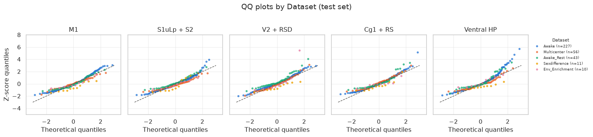

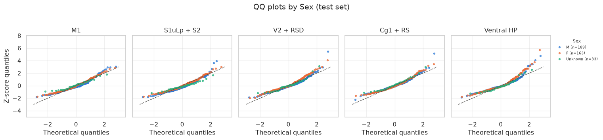

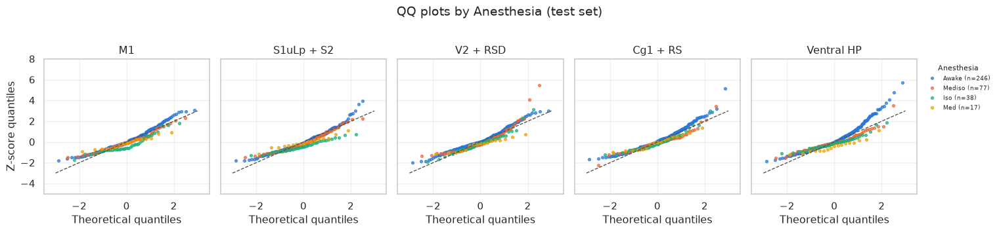

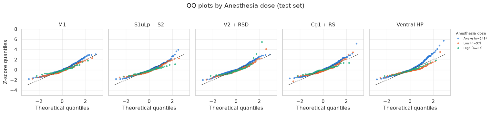

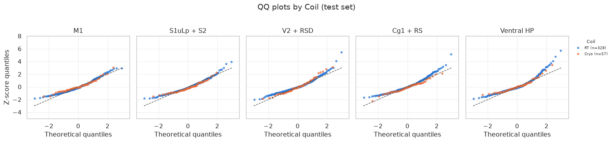

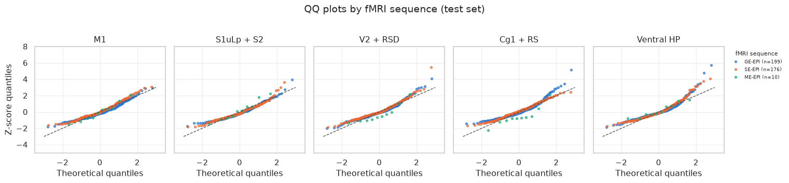

    QQ plots by group saved to: /home/traaffneu/giuvas/digitalrodent/results/normative_model/plots/qq_by_group
    Harmonized to the protocol of dataset: Awake
    MRI                             9.400000
    MRI T.R.                     2500.000000
    FD average                      0.023456
    log_tSNR                        2.832625
    Coil_encoded                    0.000000
    Ventilation_encoded             0.000000
    Anesthesia_high                 0.000000
    Anesthesia_dose_unknown         0.000000
    Rodent.strain_129S2/SvPas       0.000000
    Rodent.strain_F1 C6/129P        0.000000
    fMRI.sequence_ME-EPI            0.000000
    fMRI.sequence_SE-EPI            1.000000
    Anesthesia_Hal                  0.000000
    Anesthesia_Iso                  0.000000
    Anesthesia_Med                  0.000000
    Anesthesia_Mediso               0.000000
    dtype: float64

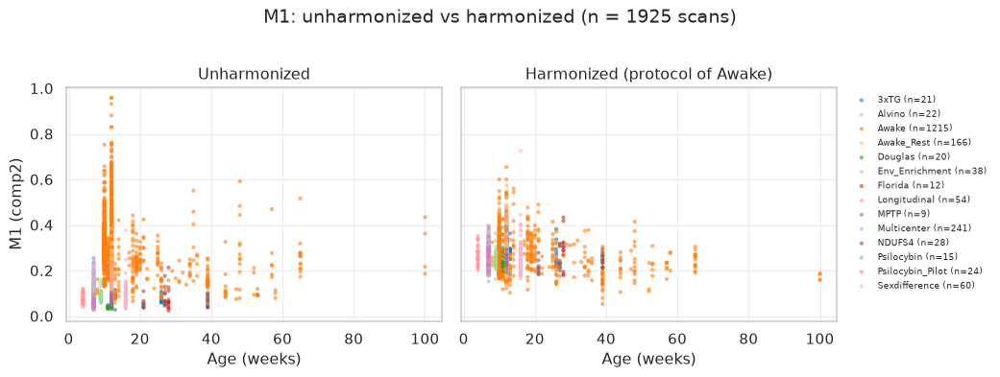

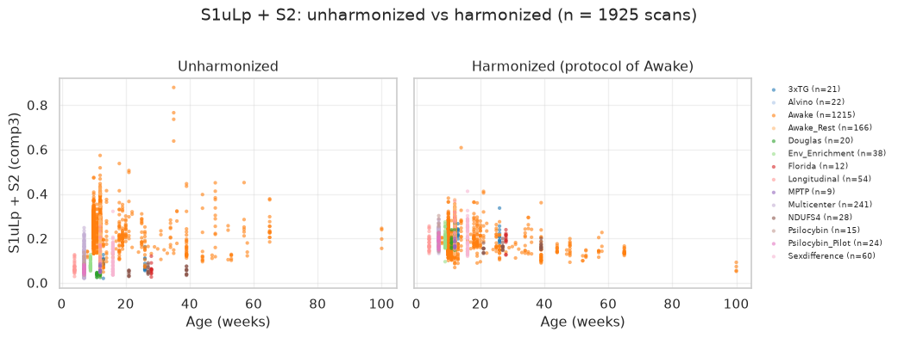

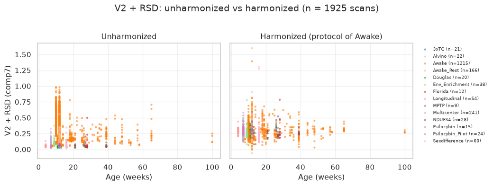

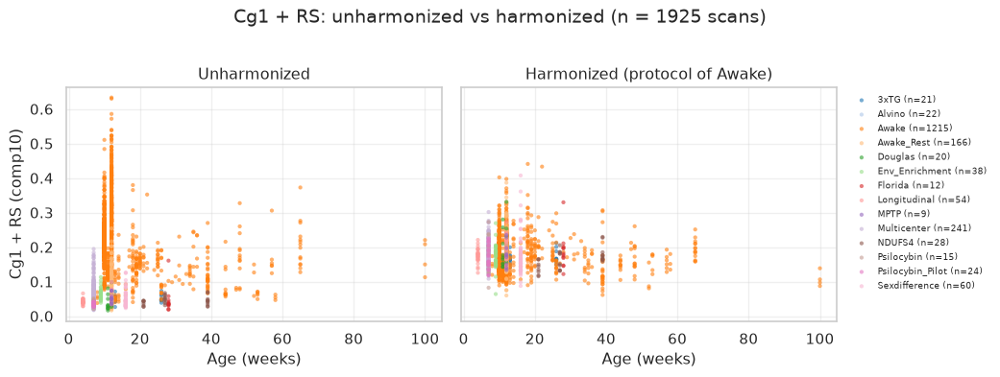

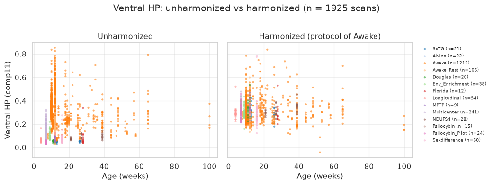

    Between-dataset spread before/after harmonization:

<div>
<style scoped>
    .dataframe tbody tr th:only-of-type {
        vertical-align: middle;
    }
&#10;    .dataframe tbody tr th {
        vertical-align: top;
    }
&#10;    .dataframe thead th {
        text-align: right;
    }
</style>

|  | SD of dataset means, raw | SD of dataset means, harmonized |
|----|----|----|
| M1 (comp2) | 0.067 | 0.017 |
| S1uLp + S2 (comp3) | 0.053 | 0.018 |
| V2 + RSD (comp7) | 0.085 | 0.028 |
| Cg1 + RS (comp10) | 0.047 | 0.010 |
| Ventral HP (comp11) | 0.072 | 0.021 |

</div>

    Harmonized scatter plots saved to: /home/traaffneu/giuvas/digitalrodent/results/normative_model/plots/harmonized_scatter

    BLR training finished.

    Saved to:
    /home/traaffneu/giuvas/digitalrodent/results/normative_model
