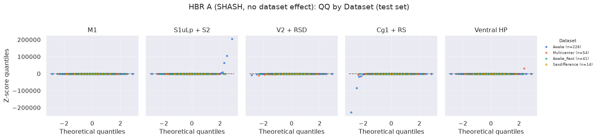
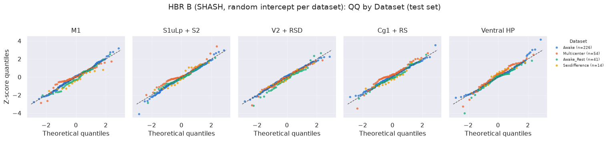
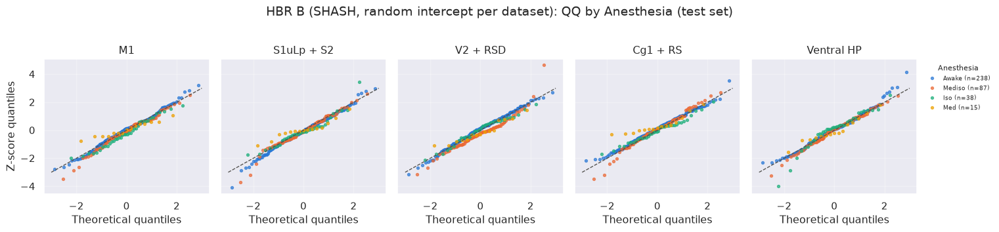
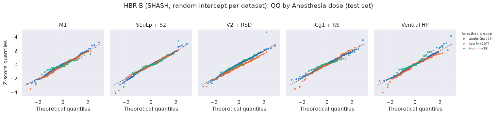
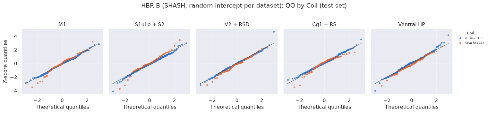
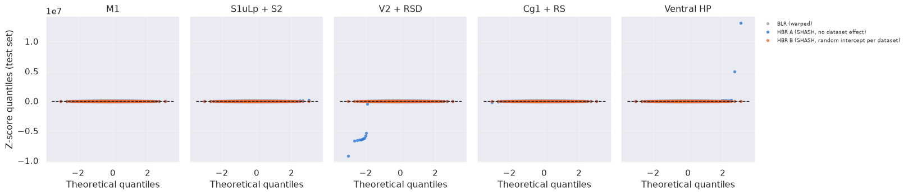

# Model Training HBR


Hierarchical Bayesian Regression (HBR) with a SHASH likelihood, as an
alternative to the warped BLR in `Model_Training.qmd`.

Two models are trained on exactly the same train/test split as the BLR,
each with its own output folder, so the three can be compared:

| Model | Folder | Dataset effect |
|----|----|----|
| BLR (warped) | `results/normative_model/` | none (protocol covariates only) |
| HBR A | `results/normative_model_HBR_A/` | none (same covariates as BLR) |
| HBR B | `results/normative_model_HBR_B/` | random intercept per dataset (protocol covariates dropped) |

SHASHb likelihood: besides mean (mu) and spread (sigma), it has skewness
(epsilon) and tail weight (delta), so it can follow skewed, heavy-tailed
data. mu and sigma depend on all covariates, with a B-spline on age, FD
and log(tSNR).

Run this after `Model_Training.qmd` (it reuses its train/test split and
its statistics for the comparison). HBR uses MCMC sampling: run it as a
SLURM job.

``` python
from pathlib import Path
import os
import numpy as np
import pandas as pd
import matplotlib.pyplot as plt
from scipy.stats import norm, skew, kurtosis

from pcntoolkit import (
    HBR,
    BsplineBasisFunction,
    NormativeModel,
    NormData,
    SHASHbLikelihood,
    make_prior,
)
import pcntoolkit.util.output

pcntoolkit.util.output.Output.set_show_messages(False)


# ============================================================
# SETTINGS
# ============================================================

MODELS_TO_RUN = os.environ.get("HBR_MODELS", "A,B").split(",")  # e.g. HBR_MODELS=A to run only A

# MCMC settings (PCNToolkit defaults: 1500 draws, 500 tune, 4 chains)
DRAWS = int(os.environ.get("HBR_DRAWS", 1500))
TUNE = int(os.environ.get("HBR_TUNE", 500))
CHAINS = int(os.environ.get("HBR_CHAINS", 4))
CORES = int(os.environ.get("SLURM_CPUS_PER_TASK", os.environ.get("HBR_CORES", 4)))

# Fit all 18 components, or only the selected ones (much faster)
FIT_ALL_COMPONENTS = os.environ.get("HBR_ALL", "1") == "1"

print(f"MCMC: {CHAINS} chains x {DRAWS} draws (+{TUNE} tune), {CORES} cores")


# ============================================================
# PATHS
# ============================================================

current_dir = Path.cwd().parent
input_path = current_dir / "results" / "combined_dataset" / "Model_dataframe.csv"
blr_dir = current_dir / "results" / "normative_model"
compare_dir = current_dir / "results" / "model_comparison"
compare_dir.mkdir(parents=True, exist_ok=True)

out_dirs = {
    "A": current_dir / "results" / "normative_model_HBR_A",
    "B": current_dir / "results" / "normative_model_HBR_B",
}


# ============================================================
# COMPONENT LABELS
# ============================================================

try:
    from component_labels import ACRONYM, SELECTED_COMPONENTS
    selected = {c: ACRONYM[c] for c in SELECTED_COMPONENTS}
except ImportError:
    selected = {"comp2": "M1", "comp3": "S1uLp + S2", "comp7": "V2 + RSD",
                "comp10": "Cg1 + RS", "comp12": "Ventral HP"}
print("Selected components:", selected)


# ============================================================
# DATA
# ============================================================

model_df = pd.read_csv(input_path)

all_responses = [f"comp{i}" for i in range(1, 19)]
response_vars = all_responses if FIT_ALL_COMPONENTS else list(selected)
if os.environ.get("HBR_ONLY"):  # e.g. HBR_ONLY=comp10 for a quick test
    response_vars = os.environ["HBR_ONLY"].split(",")

id_columns = ["Scan_id", "Participant_Id", "Session", "Dataset_name"]
covariates = [c for c in model_df.columns if c not in id_columns + all_responses]

print("Rows:", len(model_df))
print("Responses:", response_vars)
print("Covariates:", covariates)

# Model B: the dataset intercept already absorbs everything that is constant
# within a dataset (scanner, TR, coil, ventilation, strain, sequence). Keeping
# those covariates as well makes the model non-identifiable (in testing the
# z-scores exploded), so B only keeps covariates that vary within datasets.
covariates_B = [c for c in covariates
                if c in ["Age(week)", "FD average", "log_tSNR", "Sex_encoded", "Anesthesia_high"]
                or (c.startswith("Anesthesia_") and c != "Anesthesia_dose_unknown")]
print("Covariates model B:", covariates_B)


def spline_columns_for(covs):
    return [covs.index(c) for c in ["Age(week)", "FD average", "log_tSNR"] if c in covs]


def make_normdata(name, batch_effects, covs=None):
    return NormData.from_dataframe(
        name=name,
        dataframe=model_df,
        covariates=covs or covariates,
        batch_effects=batch_effects,
        response_vars=response_vars,
        remove_Nan=False,
    )


# Same split as the BLR: Model_Training.qmd uses train_test_split() on data
# without batch effects (random_state = 42). Reproduce it and keep the
# observation indices, then apply them to every model.
reference_split = make_normdata("DigitalRodent", [])
ref_train, ref_test = reference_split.train_test_split()
train_obs = ref_train.observations.values
test_obs = ref_test.observations.values
print(f"Train: {len(train_obs)} scans, test: {len(test_obs)} scans (same split as BLR)")
```

    MCMC: 4 chains x 1500 draws (+500 tune), 8 cores
    Selected components: {'comp2': 'M1', 'comp3': 'S1uLp + S2', 'comp7': 'V2 + RSD', 'comp10': 'Cg1 + RS', 'comp12': 'Ventral HP'}
    Rows: 1907
    Responses: ['comp2', 'comp3', 'comp7', 'comp10', 'comp12']
    Covariates: ['Age(week)', 'MRI', 'MRI T.R.', 'FD average', 'log_tSNR', 'Sex_encoded', 'Coil_encoded', 'Ventilation_encoded', 'Anesthesia_high', 'Anesthesia_dose_unknown', 'Rodent.strain_129S2/SvPas', 'Rodent.strain_F1 C6/129P', 'fMRI.sequence_ME-EPI', 'fMRI.sequence_SE-EPI', 'Anesthesia_Hal', 'Anesthesia_Iso', 'Anesthesia_Med', 'Anesthesia_Mediso']
    Covariates model B: ['Age(week)', 'FD average', 'log_tSNR', 'Sex_encoded', 'Anesthesia_high', 'Anesthesia_Hal', 'Anesthesia_Iso', 'Anesthesia_Med', 'Anesthesia_Mediso']
    Train: 1525 scans, test: 382 scans (same split as BLR)

``` python
# ============================================================
# HBR MODELS
# ============================================================

def bspline(covs):
    return BsplineBasisFunction(basis_column=spline_columns_for(covs), degree=3, nknots=5)


def shash_likelihood(random_intercept, covs):
    if random_intercept:
        # every dataset gets its own intercept, drawn from a shared
        # distribution (small datasets borrow strength from large ones)
        mu_intercept = make_prior(
            random=True,
            mu=make_prior(dist_name="Normal", dist_params=(0.0, 1.0)),
            sigma=make_prior(dist_name="Gamma", dist_params=(1.0, 0.5)),
        )
    else:
        mu_intercept = make_prior(dist_name="Normal", dist_params=(0.0, 1.0))

    mu = make_prior(
        linear=True,
        slope=make_prior(dist_name="Normal", dist_params=(0.0, 3.0)),
        intercept=mu_intercept,
        basis_function=bspline(covs),
    )
    sigma = make_prior(
        linear=True,
        slope=make_prior(dist_name="Normal", dist_params=(0.0, 2.0)),
        intercept=make_prior(dist_name="Normal", dist_params=(0.0, 1.0)),
        basis_function=bspline(covs),
        mapping="softplus",
        mapping_params=(0.0, 2.0),
    )
    # skewness (0 = symmetric) and tail weight (1 = Gaussian tails)
    epsilon = make_prior(dist_name="Normal", dist_params=(0.0, 1.0))
    delta = make_prior(
        dist_name="Normal", dist_params=(1.0, 1.0),
        mapping="softplus", mapping_params=(0.0, 3.0, 0.6),
    )
    return SHASHbLikelihood(mu, sigma, epsilon, delta)


model_specs = {
    "A": {"batch_effects": [], "random_intercept": False,
          "covariates": covariates, "label": "HBR A (SHASH, no dataset effect)"},
    "B": {"batch_effects": ["Dataset_name"], "random_intercept": True,
          "covariates": covariates_B, "label": "HBR B (SHASH, random intercept per dataset)"},
}

results = {}

for key in MODELS_TO_RUN:
    spec = model_specs[key]
    out_dir = out_dirs[key]
    out_dir.mkdir(parents=True, exist_ok=True)
    print("\n" + "=" * 60)
    print(spec["label"], "->", out_dir)
    print("=" * 60)

    data = make_normdata(f"HBR_{key}", spec["batch_effects"], spec["covariates"])
    train = data.sel(observations=train_obs)
    test = data.sel(observations=test_obs)

    model = NormativeModel(
        HBR(
            name="template",
            likelihood=shash_likelihood(spec["random_intercept"], spec["covariates"]),
            draws=DRAWS, tune=TUNE, chains=CHAINS, cores=CORES,
            nuts_sampler="nutpie", progressbar=False,
        ),
        inscaler="standardize",
        outscaler="standardize",
        savemodel=True,
        evaluate_model=True,
        saveresults=True,
        saveplots=False,
        save_dir=str(out_dir),
    )
    model.fit_predict(train, test)

    stats = test.get_statistics_df()
    stats.to_csv(out_dir / "Test_statistics.csv")
    train.get_statistics_df().to_csv(out_dir / "Train_statistics.csv")

    z_test = pd.DataFrame(
        test.Z.values,
        columns=[str(r) for r in test.Z.coords["response_vars"].values],
        index=test.Z.coords["observations"].values.astype(int),
    )
    z_test.to_csv(out_dir / "Z_test.csv")
    results[key] = {"stats": stats, "z": z_test, "label": spec["label"]}
    print(stats.round(3).to_string())
```

    ============================================================
    HBR A (SHASH, no dataset effect) -> /home/traaffneu/giuvas/digitalrodent/results/normative_model_HBR_A
    ============================================================

    statistic       EXPV   MACE   MAPE          MSLL           NLL     R2   RMSE    Rho  Rho_p   SMSE  ShapiroW
    response_vars                                                                                              
    comp10         0.224  0.055  0.814  3.138959e+08  3.138959e+08  0.212  0.102  0.721    0.0  0.788     0.052
    comp12         0.357  0.048  0.889  1.026495e+12  1.026495e+12  0.357  0.123  0.655    0.0  0.643     0.043
    comp2          0.790  0.010  0.263  7.950000e-01  3.570000e-01  0.790  0.072  0.906    0.0  0.210     0.991
    comp3          0.150  0.085  0.752  2.997338e+08  2.997338e+08  0.047  0.099  0.712    0.0  0.953     0.060
    comp7         -0.566  0.109  2.583  2.288342e+12  2.288342e+12 -0.706  0.286  0.222    0.0  1.706     0.149

    ============================================================
    HBR B (SHASH, random intercept per dataset) -> /home/traaffneu/giuvas/digitalrodent/results/normative_model_HBR_B
    ============================================================

    statistic       EXPV   MACE   MAPE   MSLL    NLL     R2   RMSE    Rho  Rho_p   SMSE  ShapiroW
    response_vars                                                                                
    comp10         0.792  0.023  0.240  0.996  0.250  0.790  0.053  0.923    0.0  0.210     0.996
    comp12         0.782  0.016  0.250  0.791  0.336  0.782  0.072  0.912    0.0  0.218     0.992
    comp2          0.792  0.014  0.257  0.773  0.335  0.792  0.071  0.915    0.0  0.208     0.995
    comp3          0.746  0.018  0.244  1.475  0.606  0.745  0.051  0.865    0.0  0.255     0.990
    comp7          0.754  0.006  0.333  0.251  0.152  0.754  0.109  0.911    0.0  0.246     0.992

``` python
# ============================================================
# QQ PLOTS AND CALIBRATION BY GROUP (one set per HBR model)
# ============================================================

def group_labels_for(index):
    g = model_df.loc[index]
    labels = pd.DataFrame(index=index)
    labels["Dataset"] = g["Dataset_name"]
    labels["Sex"] = np.where(g["Sex_encoded"] == 1, "M", "F")
    anest = [c for c in covariates if c.startswith("Anesthesia_")
             and c not in ["Anesthesia_high", "Anesthesia_dose_unknown"]]
    labels["Anesthesia"] = g[anest].idxmax(axis=1).str.replace("Anesthesia_", "").where(
        g[anest].sum(axis=1) > 0, "Awake")
    labels["Anesthesia dose"] = np.select(
        [labels["Anesthesia"] == "Awake",
         g.get("Anesthesia_dose_unknown", 0) == 1,
         g.get("Anesthesia_high", 0) == 1],
        ["Awake", "Unknown", "High"], default="Low")
    labels["Coil"] = np.where(g["Coil_encoded"] == 1, "Cryo", "RT")
    seq = [c for c in covariates if c.startswith("fMRI.sequence_")]
    labels["fMRI sequence"] = g[seq].idxmax(axis=1).str.replace("fMRI.sequence_", "").where(
        g[seq].sum(axis=1) > 0, "GE-EPI")
    return labels


palette = ["#2a78d6", "#eb6834", "#1baf7a", "#eda100", "#e87ba4", "#008300", "#6250d6", "#e34948"]

for key, res in results.items():
    out_dir = out_dirs[key]
    qq_dir = out_dir / "plots" / "qq_by_group"
    qq_dir.mkdir(parents=True, exist_ok=True)
    z = res["z"]
    labels = group_labels_for(z.index)
    sel_here = {c: n for c, n in selected.items() if c in z.columns}

    rows = []
    for variable in labels.columns:
        for group, idx in labels.groupby(variable).groups.items():
            row = {"Variable": variable, "Group": group, "N_test": len(idx)}
            for comp, name in sel_here.items():
                row[f"{name} mean z"] = z.loc[idx, comp].mean()
                row[f"{name} SD z"] = z.loc[idx, comp].std()
            rows.append(row)
    calibration = pd.DataFrame(rows).round(2)
    calibration.to_csv(out_dir / "Z_calibration_by_group.csv", index=False)
    print(f"\n{res['label']}: calibration by group (ideal mean 0, SD 1)")
    display(calibration)

    for variable in labels.columns:
        counts = labels[variable].value_counts()
        keep = counts[counts >= 10].index.tolist()
        if len(keep) < 2:
            continue
        fig, axes = plt.subplots(1, max(len(sel_here), 2), figsize=(3.2 * max(len(sel_here), 2), 3.6), sharey=True)
        for ax, (comp, name) in zip(axes, sel_here.items()):
            for k, group in enumerate(keep):
                zz = np.sort(z.loc[labels[variable] == group, comp].dropna().to_numpy())
                th = norm.ppf((np.arange(1, len(zz) + 1) - 0.5) / len(zz))
                ax.plot(th, zz, "o", ms=3, alpha=0.7, color=palette[k % len(palette)],
                        label=f"{group} (n={len(zz)})")
            ax.plot([-3, 3], [-3, 3], "--", color="#52514e", lw=1)
            ax.set_title(name)
            ax.set_xlabel("Theoretical quantiles")
            ax.grid(alpha=0.3)
        axes[0].set_ylabel("Z-score quantiles")
        axes[-1].legend(title=variable, fontsize=7, title_fontsize=8, frameon=False,
                        loc="upper left", bbox_to_anchor=(1.02, 1))
        fig.suptitle(f"{res['label']}: QQ by {variable} (test set)", y=1.02)
        plt.tight_layout()
        plt.savefig(qq_dir / f"qq_by_{variable.replace(' ', '_')}.png", dpi=200, bbox_inches="tight")
        plt.show()
        plt.close()
```

    HBR A (SHASH, no dataset effect): calibration by group (ideal mean 0, SD 1)

<div>
<style scoped>
    .dataframe tbody tr th:only-of-type {
        vertical-align: middle;
    }
&#10;    .dataframe tbody tr th {
        vertical-align: top;
    }
&#10;    .dataframe thead th {
        text-align: right;
    }
</style>

|  | Variable | Group | N_test | M1 mean z | M1 SD z | S1uLp + S2 mean z | S1uLp + S2 SD z | V2 + RSD mean z | V2 + RSD SD z | Cg1 + RS mean z | Cg1 + RS SD z | Ventral HP mean z | Ventral HP SD z |
|----|----|----|----|----|----|----|----|----|----|----|----|----|----|
| 0 | Dataset | 3xTG | 4 | -1.00 | 1.30 | -9.78 | 1.79 | -337.47 | 242.73 | 0.07 | 0.38 | -1.18 | 1.05 |
| 1 | Dataset | Alvino | 3 | -0.97 | 0.45 | 165.34 | 59.09 | -1541.39 | 1255.15 | -0.16 | 0.10 | 40057.66 | 53816.63 |
| 2 | Dataset | Awake | 226 | 0.03 | 1.07 | 1705.21 | 15858.55 | -52.05 | 510.16 | -1549.87 | 16179.65 | 0.10 | 0.89 |
| 3 | Dataset | Awake_Rest | 41 | 0.05 | 1.13 | -57.98 | 89.47 | -0.80 | 1.38 | 0.15 | 1.28 | -0.83 | 1.98 |
| 4 | Dataset | Douglas | 2 | -0.03 | 1.23 | -707.91 | 954.09 | -221058.65 | 312532.01 | -7908.18 | 10085.28 | 9022017.68 | 5761844.84 |
| 5 | Dataset | Env_Enrichment | 7 | -0.11 | 0.60 | -0.09 | 0.45 | 0.26 | 1.84 | 0.21 | 0.26 | -0.04 | 1.45 |
| 6 | Dataset | Florida | 4 | 0.73 | 1.60 | -10.12 | 6.12 | 17.44 | 23.13 | 3.65 | 7.28 | -1.10 | 1.01 |
| 7 | Dataset | Longitudinal | 8 | 0.17 | 1.05 | -1.87 | 2.68 | -0.61 | 0.42 | -0.21 | 0.65 | -0.29 | 0.85 |
| 8 | Dataset | MPTP | 5 | -0.28 | 0.78 | -75.23 | 12.40 | -820.34 | 58.46 | 0.13 | 0.37 | -1.62 | 0.37 |
| 9 | Dataset | Multicenter | 54 | 0.13 | 0.85 | -15.46 | 95.83 | -660.58 | 1653.33 | -122.50 | 670.64 | 544.16 | 4236.79 |
| 10 | Dataset | NDUFS4 | 4 | -0.49 | 1.21 | -1.08 | 1.24 | -1.04 | 0.38 | -0.26 | 0.15 | 0.03 | 0.43 |
| 11 | Dataset | Psilocybin | 7 | 0.11 | 1.60 | -509.44 | 189.27 | -6305817.00 | 461612.60 | 0.42 | 0.92 | 47369.97 | 15941.44 |
| 12 | Dataset | Psilocybin_Pilot | 3 | -0.48 | 1.72 | -570.97 | 34.43 | -7084186.53 | 1830157.90 | 0.39 | 0.27 | 93307.15 | 81043.99 |
| 13 | Dataset | Sexdifference | 14 | -0.32 | 0.68 | -0.43 | 0.91 | -0.40 | 0.34 | -0.89 | 0.61 | -2.72 | 1.58 |
| 14 | Sex | F | 182 | 0.00 | 0.97 | -13.78 | 51.70 | -8.60 | 41.38 | -9.23 | 107.73 | 553.45 | 7575.88 |
| 15 | Sex | M | 200 | 0.02 | 1.12 | 1889.97 | 16855.03 | -329456.58 | 1444736.05 | -1855.05 | 17219.35 | 93521.54 | 988122.48 |
| 16 | Anesthesia | Awake | 238 | 0.04 | 1.06 | 1619.31 | 15456.37 | -49.42 | 497.21 | -1471.72 | 15768.38 | 0.15 | 0.92 |
| 17 | Anesthesia | Hal | 4 | -0.42 | 1.17 | 265.90 | 206.83 | -2463.36 | 2109.60 | 0.00 | 0.35 | 37817.58 | 44168.90 |
| 18 | Anesthesia | Iso | 38 | -0.10 | 0.98 | -24.05 | 61.40 | 1.53 | 8.63 | -173.79 | 796.96 | -0.77 | 1.81 |
| 19 | Anesthesia | Med | 15 | 0.09 | 0.61 | -12.58 | 11.76 | -31104.71 | 113714.49 | -1002.67 | 3883.19 | 329772.53 | 1277532.77 |
| 20 | Anesthesia | Mediso | 87 | -0.01 | 1.13 | -113.47 | 223.71 | -751778.79 | 2123259.80 | -8.94 | 83.29 | 157553.69 | 1403520.60 |
| 21 | Anesthesia dose | Awake | 238 | 0.04 | 1.06 | 1619.31 | 15456.37 | -49.42 | 497.21 | -1471.72 | 15768.38 | 0.15 | 0.92 |
| 22 | Anesthesia dose | High | 35 | 0.04 | 0.94 | -27.55 | 62.30 | -737.27 | 1861.70 | 0.48 | 2.48 | -34.27 | 78.21 |
| 23 | Anesthesia dose | Low | 107 | -0.06 | 1.08 | -70.38 | 179.10 | -611338.31 | 1935001.14 | -61.89 | 478.18 | 7123.03 | 24307.70 |
| 24 | Anesthesia dose | Unknown | 2 | -0.03 | 1.23 | -707.91 | 954.09 | -221058.65 | 312532.01 | -7908.18 | 10085.28 | 9022017.68 | 5761844.84 |
| 25 | Coil | Cryo | 66 | 0.04 | 1.15 | -104.66 | 195.60 | -991279.55 | 2392372.75 | 0.12 | 0.62 | 9239.78 | 27970.52 |
| 26 | Coil | RT | 316 | 0.01 | 1.03 | 1210.10 | 13426.26 | -1482.38 | 24869.42 | -1179.42 | 13715.41 | 57579.78 | 786707.75 |
| 27 | fMRI sequence | GE-EPI | 198 | -0.01 | 1.01 | 1923.66 | 16937.26 | -2523.52 | 31412.69 | -1882.75 | 17304.85 | 91886.47 | 993206.10 |
| 28 | fMRI sequence | ME-EPI | 10 | -0.07 | 1.56 | -527.90 | 158.20 | -6539327.86 | 1013781.54 | 0.41 | 0.76 | 61151.13 | 46058.54 |
| 29 | fMRI sequence | SE-EPI | 174 | 0.04 | 1.07 | -0.69 | 1.80 | 0.31 | 7.31 | 0.52 | 1.39 | 0.01 | 0.95 |

</div>




    HBR B (SHASH, random intercept per dataset): calibration by group (ideal mean 0, SD 1)

<div>
<style scoped>
    .dataframe tbody tr th:only-of-type {
        vertical-align: middle;
    }
&#10;    .dataframe tbody tr th {
        vertical-align: top;
    }
&#10;    .dataframe thead th {
        text-align: right;
    }
</style>

|  | Variable | Group | N_test | M1 mean z | M1 SD z | S1uLp + S2 mean z | S1uLp + S2 SD z | V2 + RSD mean z | V2 + RSD SD z | Cg1 + RS mean z | Cg1 + RS SD z | Ventral HP mean z | Ventral HP SD z |
|----|----|----|----|----|----|----|----|----|----|----|----|----|----|
| 0 | Dataset | 3xTG | 4 | -0.99 | 1.19 | -0.97 | 1.62 | -0.73 | 1.32 | -0.10 | 0.92 | -0.45 | 0.50 |
| 1 | Dataset | Alvino | 3 | -0.61 | 0.53 | -0.82 | 0.69 | -0.94 | 0.94 | -0.53 | 0.34 | -0.82 | 0.64 |
| 2 | Dataset | Awake | 226 | 0.05 | 1.02 | -0.07 | 1.03 | 0.07 | 0.96 | 0.13 | 0.94 | 0.03 | 1.04 |
| 3 | Dataset | Awake_Rest | 41 | -0.16 | 1.09 | -0.04 | 0.97 | -0.20 | 1.18 | -0.01 | 1.01 | -0.13 | 1.12 |
| 4 | Dataset | Douglas | 2 | -0.45 | 1.28 | -0.32 | 0.61 | -0.24 | 0.65 | -0.38 | 0.89 | 0.02 | 0.30 |
| 5 | Dataset | Env_Enrichment | 7 | -0.12 | 0.49 | 0.08 | 0.69 | 0.59 | 1.90 | 0.22 | 0.53 | 1.05 | 1.27 |
| 6 | Dataset | Florida | 4 | -0.02 | 1.24 | -0.65 | 0.76 | -0.01 | 1.40 | -0.57 | 0.94 | -0.46 | 1.65 |
| 7 | Dataset | Longitudinal | 8 | 0.00 | 0.99 | 0.03 | 0.84 | -0.43 | 0.83 | -0.30 | 0.97 | 0.08 | 1.15 |
| 8 | Dataset | MPTP | 5 | 0.15 | 0.73 | -0.42 | 0.62 | -0.52 | 0.68 | 0.58 | 0.72 | -0.33 | 0.42 |
| 9 | Dataset | Multicenter | 54 | 0.08 | 0.90 | 0.22 | 0.96 | -0.01 | 0.99 | 0.32 | 1.07 | 0.21 | 1.15 |
| 10 | Dataset | NDUFS4 | 4 | -0.82 | 1.06 | -0.72 | 0.57 | -0.82 | 0.62 | 0.02 | 0.45 | -0.07 | 0.39 |
| 11 | Dataset | Psilocybin | 7 | -0.51 | 1.98 | -0.53 | 2.14 | 0.00 | 1.46 | -0.77 | 1.53 | -0.79 | 1.01 |
| 12 | Dataset | Psilocybin_Pilot | 3 | -0.24 | 1.51 | -0.15 | 1.02 | -0.62 | 0.56 | -0.71 | 0.50 | 0.62 | 0.49 |
| 13 | Dataset | Sexdifference | 14 | -0.37 | 0.82 | 0.03 | 1.11 | -0.04 | 0.93 | -0.08 | 0.98 | 0.19 | 1.01 |
| 14 | Sex | F | 182 | -0.03 | 0.94 | -0.14 | 0.99 | -0.06 | 0.93 | 0.09 | 0.93 | 0.04 | 1.01 |
| 15 | Sex | M | 200 | -0.02 | 1.10 | 0.01 | 1.07 | 0.02 | 1.11 | 0.09 | 1.02 | 0.03 | 1.12 |
| 16 | Anesthesia | Awake | 238 | 0.03 | 1.03 | -0.07 | 1.05 | 0.07 | 1.02 | 0.12 | 0.95 | 0.06 | 1.05 |
| 17 | Anesthesia | Hal | 4 | -0.19 | 0.93 | -0.31 | 1.17 | -0.43 | 1.28 | -0.40 | 0.38 | -0.10 | 1.54 |
| 18 | Anesthesia | Iso | 38 | -0.19 | 1.01 | -0.05 | 0.99 | -0.01 | 0.92 | -0.04 | 0.81 | 0.04 | 1.24 |
| 19 | Anesthesia | Med | 15 | 0.06 | 0.50 | 0.04 | 0.62 | -0.11 | 0.75 | 0.34 | 0.60 | -0.01 | 0.86 |
| 20 | Anesthesia | Mediso | 87 | -0.11 | 1.10 | -0.05 | 1.08 | -0.23 | 1.10 | 0.04 | 1.15 | -0.02 | 1.07 |
| 21 | Anesthesia dose | Awake | 238 | 0.03 | 1.03 | -0.07 | 1.05 | 0.07 | 1.02 | 0.12 | 0.95 | 0.06 | 1.05 |
| 22 | Anesthesia dose | High | 35 | -0.06 | 0.79 | -0.01 | 1.08 | 0.15 | 1.22 | 0.12 | 0.70 | 0.28 | 1.16 |
| 23 | Anesthesia dose | Low | 107 | -0.13 | 1.09 | -0.05 | 1.00 | -0.27 | 0.95 | 0.02 | 1.10 | -0.10 | 1.08 |
| 24 | Anesthesia dose | Unknown | 2 | -0.45 | 1.28 | -0.32 | 0.61 | -0.24 | 0.65 | -0.38 | 0.89 | 0.02 | 0.30 |
| 25 | Coil | Cryo | 66 | -0.02 | 1.23 | 0.06 | 1.22 | -0.13 | 1.11 | 0.00 | 1.05 | -0.13 | 1.08 |
| 26 | Coil | RT | 316 | -0.03 | 0.98 | -0.08 | 0.99 | 0.01 | 1.01 | 0.11 | 0.96 | 0.07 | 1.06 |
| 27 | fMRI sequence | GE-EPI | 198 | -0.04 | 1.03 | 0.06 | 1.01 | -0.17 | 0.99 | 0.13 | 1.00 | 0.00 | 1.06 |
| 28 | fMRI sequence | ME-EPI | 10 | -0.43 | 1.78 | -0.42 | 1.82 | -0.18 | 1.25 | -0.75 | 1.28 | -0.37 | 1.09 |
| 29 | fMRI sequence | SE-EPI | 174 | 0.01 | 0.97 | -0.17 | 0.99 | 0.17 | 1.03 | 0.10 | 0.91 | 0.09 | 1.07 |

</div>











``` python
# ============================================================
# COMPARISON: BLR vs HBR A vs HBR B (same test set)
# ============================================================

models = {}

blr_z_path = blr_dir / "results" / "Z_DigitalRodent_test.csv"
if blr_z_path.exists():
    blr_z = pd.read_csv(blr_z_path)
    obs_col = [c for c in blr_z.columns if not c.startswith("comp")]
    if obs_col:
        blr_z = blr_z.set_index(obs_col[0])
    blr_stats = pd.read_csv(blr_dir / "Test_statistics.csv")
    if "Unnamed: 0" in blr_stats.columns:
        blr_stats = blr_stats.set_index("Unnamed: 0")
    else:
        blr_stats.index = all_responses
    models["BLR (warped)"] = {"z": blr_z, "stats": blr_stats}
else:
    print("BLR results not found: run Model_Training.qmd first")

for key, res in results.items():
    models[res["label"]] = {"z": res["z"], "stats": res["stats"]}


def stat_mean(stats, name, comps):
    if name in stats.columns:
        s = stats[name]
    elif name in stats.index:
        s = stats.loc[name]
    else:
        return np.nan
    s.index = [str(i) for i in s.index]
    return pd.to_numeric(s.reindex(comps), errors="coerce").mean()


rows = []
for label, m in models.items():
    for comp_set, comps in [("all fitted", response_vars), ("selected", [c for c in selected if c in response_vars])]:
        z = m["z"][[c for c in comps if c in m["z"].columns]]
        rows.append({
            "Model": label,
            "Components": comp_set,
            "EXPV": stat_mean(m["stats"], "EXPV", comps),
            "ShapiroW (z)": stat_mean(m["stats"], "ShapiroW", comps),
            "MACE": stat_mean(m["stats"], "MACE", comps),
            "Skew (z)": z.apply(lambda s: skew(s.dropna())).mean(),
            "Excess kurtosis (z)": z.apply(lambda s: kurtosis(s.dropna())).mean(),
            "% |z| > 1.96 (ideal 5%)": 100 * (z.abs() > 1.96).mean().mean(),
        })
comparison = pd.DataFrame(rows).round(3)
comparison.to_csv(compare_dir / "BLR_vs_HBR_test_metrics.csv", index=False)
print("Model comparison on the same test set")
print("ideal: ShapiroW -> 1, MACE -> 0, skew -> 0, excess kurtosis -> 0, |z|>1.96 -> 5%")
display(comparison)

# QQ overlay of the three models
colors = {"BLR (warped)": "#9aa0a6"}
extra = ["#2a78d6", "#eb6834"]
for i, label in enumerate([l for l in models if l not in colors]):
    colors[label] = extra[i % 2]

plot_sel = {c: n for c, n in selected.items() if c in response_vars}
fig, axes = plt.subplots(1, max(len(plot_sel), 2), figsize=(3.4 * max(len(plot_sel), 2), 3.8), sharey=True)
for ax, (comp, name) in zip(axes, plot_sel.items()):
    for label, m in models.items():
        if comp not in m["z"].columns:
            continue
        zz = np.sort(m["z"][comp].dropna().to_numpy())
        th = norm.ppf((np.arange(1, len(zz) + 1) - 0.5) / len(zz))
        ax.plot(th, zz, "o", ms=3, alpha=0.7, color=colors[label], label=label)
    ax.plot([-3.5, 3.5], [-3.5, 3.5], "--", color="k", lw=1)
    ax.set_title(name)
    ax.set_xlabel("Theoretical quantiles")
    ax.grid(alpha=0.3)
axes[0].set_ylabel("Z-score quantiles (test set)")
axes[-1].legend(fontsize=7, frameon=False, loc="upper left", bbox_to_anchor=(1.02, 1))
plt.tight_layout()
plt.savefig(compare_dir / "qq_BLR_vs_HBR.png", dpi=200, bbox_inches="tight")
plt.show()
plt.close()

print("Comparison saved to:", compare_dir)
```

    Model comparison on the same test set
    ideal: ShapiroW -> 1, MACE -> 0, skew -> 0, excess kurtosis -> 0, |z|>1.96 -> 5%

<div>
<style scoped>
    .dataframe tbody tr th:only-of-type {
        vertical-align: middle;
    }
&#10;    .dataframe tbody tr th {
        vertical-align: top;
    }
&#10;    .dataframe thead th {
        text-align: right;
    }
</style>

|  | Model | Components | EXPV | ShapiroW (z) | MACE | Skew (z) | Excess kurtosis (z) | % \|z\| \> 1.96 (ideal 5%) |
|----|----|----|----|----|----|----|----|----|
| 0 | BLR (warped) | all fitted | 0.792 | 0.940 | 0.027 | 1.265 | 5.738 | 4.988 |
| 1 | BLR (warped) | selected | 0.792 | 0.940 | 0.027 | 1.265 | 5.738 | 4.988 |
| 2 | HBR A (SHASH, no dataset effect) | all fitted | 0.191 | 0.259 | 0.061 | 1.643 | 167.379 | 21.885 |
| 3 | HBR A (SHASH, no dataset effect) | selected | 0.191 | 0.259 | 0.061 | 1.643 | 167.379 | 21.885 |
| 4 | HBR B (SHASH, random intercept per dataset) | all fitted | 0.773 | 0.993 | 0.015 | -0.071 | 0.758 | 5.550 |
| 5 | HBR B (SHASH, random intercept per dataset) | selected | 0.773 | 0.993 | 0.015 | -0.071 | 0.758 | 5.550 |

</div>



    Comparison saved to: /home/traaffneu/giuvas/digitalrodent/results/model_comparison
