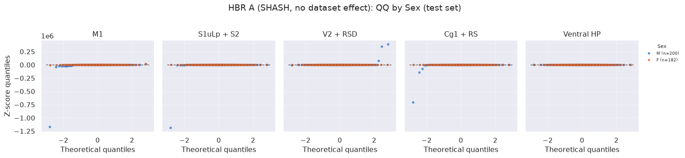
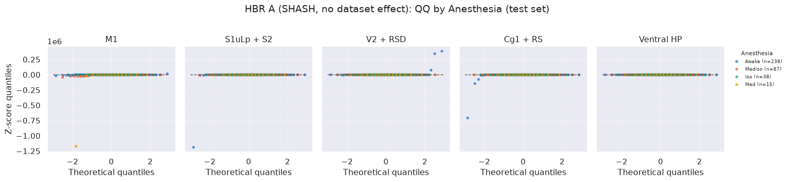
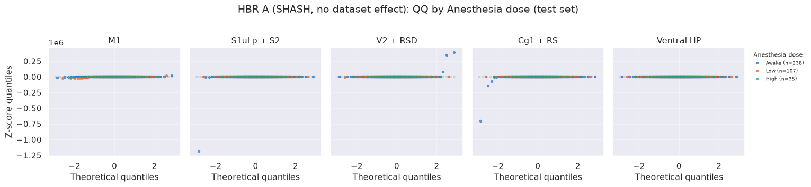
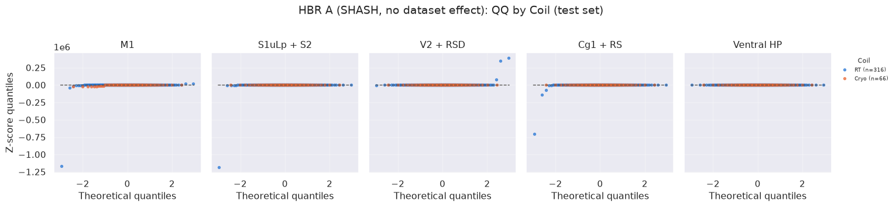
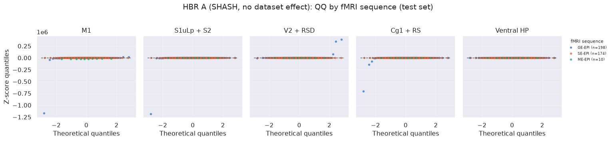
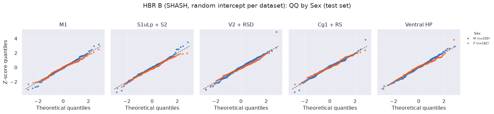
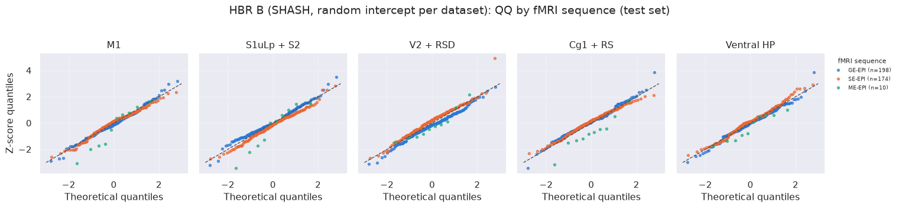

# Model Training HBR


Hierarchical Bayesian Regression (HBR) with a SHASH likelihood, as an
alternative to the warped BLR in `Model_Training.qmd`.

Two models are trained on exactly the same train/test split as the BLR,
each with its own output folder, so the three can be compared:

| Model | Folder | Dataset effect |
|----|----|----|
| BLR (warped) | `results/normative_model/` | none (protocol covariates only) |
| HBR A | `results/normative_model_HBR_A/` | none (same covariates as BLR) |
| HBR B | `results/normative_model_HBR_B/` | random intercept per dataset (protocol covariates dropped) |

SHASHb likelihood: besides mean (mu) and spread (sigma), it has skewness
(epsilon) and tail weight (delta), so it can follow skewed, heavy-tailed
data. mu and sigma depend on all covariates, with a B-spline on age, FD
and log(tSNR).

Run this after `Model_Training.qmd` (it reuses its train/test split and
its statistics for the comparison). HBR uses MCMC sampling: run it as a
SLURM job.

``` python
from pathlib import Path
import os
import numpy as np
import pandas as pd
import matplotlib.pyplot as plt
from scipy.stats import norm, skew, kurtosis

from pcntoolkit import (
    HBR,
    BsplineBasisFunction,
    NormativeModel,
    NormData,
    SHASHbLikelihood,
    make_prior,
)
import pcntoolkit.util.output

pcntoolkit.util.output.Output.set_show_messages(False)


# ============================================================
# SETTINGS
# ============================================================

MODELS_TO_RUN = os.environ.get("HBR_MODELS", "A,B").split(",")  # e.g. HBR_MODELS=A to run only A

# MCMC settings (PCNToolkit defaults: 1500 draws, 500 tune, 4 chains)
DRAWS = int(os.environ.get("HBR_DRAWS", 1500))
TUNE = int(os.environ.get("HBR_TUNE", 1500))
CHAINS = int(os.environ.get("HBR_CHAINS", 4))

# Prior width of the slopes. With many correlated covariates (model A),
# wide priors let the chains drift apart (r-hat up to 4.7 in the first run),
# so the slopes are kept tight; covariates are standardized, so a slope of
# 1 already means one SD of the outcome per SD of the covariate.
MU_SLOPE_SD = float(os.environ.get("HBR_MU_SLOPE_SD", 1.0))
SIGMA_SLOPE_SD = float(os.environ.get("HBR_SIGMA_SLOPE_SD", 0.5))
CORES = int(os.environ.get("SLURM_CPUS_PER_TASK", os.environ.get("HBR_CORES", 4)))

# Fit all 18 components, or only the selected ones (much faster)
FIT_ALL_COMPONENTS = os.environ.get("HBR_ALL", "1") == "1"

print(f"MCMC: {CHAINS} chains x {DRAWS} draws (+{TUNE} tune), {CORES} cores")


# ============================================================
# PATHS
# ============================================================

current_dir = Path.cwd().parent
input_path = current_dir / "results" / "combined_dataset" / "Model_dataframe.csv"
blr_dir = current_dir / "results" / "normative_model"
compare_dir = current_dir / "results" / "model_comparison"
compare_dir.mkdir(parents=True, exist_ok=True)

out_dirs = {
    "A": current_dir / "results" / "normative_model_HBR_A",
    "B": current_dir / "results" / "normative_model_HBR_B",
}


# ============================================================
# COMPONENT LABELS
# ============================================================

try:
    from component_labels import ACRONYM, SELECTED_COMPONENTS
    selected = {c: ACRONYM[c] for c in SELECTED_COMPONENTS}
except ImportError:
    selected = {"comp2": "M1", "comp3": "S1uLp + S2", "comp7": "V2 + RSD",
                "comp10": "Cg1 + RS", "comp12": "Ventral HP"}
print("Selected components:", selected)


# ============================================================
# DATA
# ============================================================

model_df = pd.read_csv(input_path)

all_responses = [f"comp{i}" for i in range(1, 19)]
response_vars = all_responses if FIT_ALL_COMPONENTS else list(selected)
if os.environ.get("HBR_ONLY"):  # e.g. HBR_ONLY=comp10 for a quick test
    response_vars = os.environ["HBR_ONLY"].split(",")

id_columns = ["Scan_id", "Participant_Id", "Session", "Dataset_name"]
covariates = [c for c in model_df.columns if c not in id_columns + all_responses]

print("Rows:", len(model_df))
print("Responses:", response_vars)
print("Covariates:", covariates)

# Model B: the dataset intercept already absorbs everything that is constant
# within a dataset (scanner, TR, coil, ventilation, strain, sequence). Keeping
# those covariates as well makes the model non-identifiable (in testing the
# z-scores exploded), so B only keeps covariates that vary within datasets.
covariates_B = [c for c in covariates
                if c in ["Age(week)", "FD average", "log_tSNR", "Sex_encoded", "Anesthesia_high"]
                or (c.startswith("Anesthesia_") and c != "Anesthesia_dose_unknown")]
print("Covariates model B:", covariates_B)


def spline_columns_for(covs):
    return [covs.index(c) for c in ["Age(week)", "FD average", "log_tSNR"] if c in covs]


def make_normdata(name, batch_effects, covs=None):
    return NormData.from_dataframe(
        name=name,
        dataframe=model_df,
        covariates=covs or covariates,
        batch_effects=batch_effects,
        response_vars=response_vars,
        remove_Nan=False,
    )


# Same split as the BLR: Model_Training.qmd uses train_test_split() on data
# without batch effects (random_state = 42). Reproduce it and keep the
# observation indices, then apply them to every model.
reference_split = make_normdata("DigitalRodent", [])
ref_train, ref_test = reference_split.train_test_split()
train_obs = ref_train.observations.values
test_obs = ref_test.observations.values
print(f"Train: {len(train_obs)} scans, test: {len(test_obs)} scans (same split as BLR)")
```

    MCMC: 4 chains x 1500 draws (+1500 tune), 8 cores
    Selected components: {'comp2': 'M1', 'comp3': 'S1uLp + S2', 'comp7': 'V2 + RSD', 'comp10': 'Cg1 + RS', 'comp12': 'Ventral HP'}
    Rows: 1907
    Responses: ['comp2', 'comp3', 'comp7', 'comp10', 'comp12']
    Covariates: ['Age(week)', 'MRI', 'MRI T.R.', 'FD average', 'log_tSNR', 'Sex_encoded', 'Coil_encoded', 'Ventilation_encoded', 'Anesthesia_high', 'Anesthesia_dose_unknown', 'Rodent.strain_129S2/SvPas', 'Rodent.strain_F1 C6/129P', 'fMRI.sequence_ME-EPI', 'fMRI.sequence_SE-EPI', 'Anesthesia_Hal', 'Anesthesia_Iso', 'Anesthesia_Med', 'Anesthesia_Mediso']
    Covariates model B: ['Age(week)', 'FD average', 'log_tSNR', 'Sex_encoded', 'Anesthesia_high', 'Anesthesia_Hal', 'Anesthesia_Iso', 'Anesthesia_Med', 'Anesthesia_Mediso']
    Train: 1525 scans, test: 382 scans (same split as BLR)

``` python
# ============================================================
# HBR MODELS
# ============================================================

def bspline(covs):
    return BsplineBasisFunction(basis_column=spline_columns_for(covs), degree=3, nknots=5)


def shash_likelihood(random_intercept, covs):
    if random_intercept:
        # every dataset gets its own intercept, drawn from a shared
        # distribution (small datasets borrow strength from large ones)
        mu_intercept = make_prior(
            random=True,
            mu=make_prior(dist_name="Normal", dist_params=(0.0, 1.0)),
            sigma=make_prior(dist_name="Gamma", dist_params=(1.0, 0.5)),
        )
    else:
        mu_intercept = make_prior(dist_name="Normal", dist_params=(0.0, 1.0))

    mu = make_prior(
        linear=True,
        slope=make_prior(dist_name="Normal", dist_params=(0.0, MU_SLOPE_SD)),
        intercept=mu_intercept,
        basis_function=bspline(covs),
    )
    sigma = make_prior(
        linear=True,
        slope=make_prior(dist_name="Normal", dist_params=(0.0, SIGMA_SLOPE_SD)),
        intercept=make_prior(dist_name="Normal", dist_params=(0.0, 1.0)),
        basis_function=bspline(covs),
        mapping="softplus",
        mapping_params=(0.0, 2.0),
    )
    # skewness (0 = symmetric) and tail weight (1 = Gaussian tails)
    epsilon = make_prior(dist_name="Normal", dist_params=(0.0, 1.0))
    delta = make_prior(
        dist_name="Normal", dist_params=(1.0, 1.0),
        mapping="softplus", mapping_params=(0.0, 3.0, 0.6),
    )
    return SHASHbLikelihood(mu, sigma, epsilon, delta)


model_specs = {
    "A": {"batch_effects": [], "random_intercept": False,
          "covariates": covariates, "label": "HBR A (SHASH, no dataset effect)"},
    "B": {"batch_effects": ["Dataset_name"], "random_intercept": True,
          "covariates": covariates_B, "label": "HBR B (SHASH, random intercept per dataset)"},
}

results = {}

for key in MODELS_TO_RUN:
    spec = model_specs[key]
    out_dir = out_dirs[key]
    out_dir.mkdir(parents=True, exist_ok=True)
    print("\n" + "=" * 60)
    print(spec["label"], "->", out_dir)
    print("=" * 60)

    data = make_normdata(f"HBR_{key}", spec["batch_effects"], spec["covariates"])
    train = data.sel(observations=train_obs)
    test = data.sel(observations=test_obs)

    model = NormativeModel(
        HBR(
            name="template",
            likelihood=shash_likelihood(spec["random_intercept"], spec["covariates"]),
            draws=DRAWS, tune=TUNE, chains=CHAINS, cores=CORES,
            nuts_sampler="nutpie", progressbar=False,
        ),
        inscaler="standardize",
        outscaler="standardize",
        savemodel=True,
        evaluate_model=True,
        saveresults=True,
        saveplots=False,
        save_dir=str(out_dir),
    )
    model.fit_predict(train, test)

    stats = test.get_statistics_df()
    stats.to_csv(out_dir / "Test_statistics.csv")
    train.get_statistics_df().to_csv(out_dir / "Train_statistics.csv")

    z_test = pd.DataFrame(
        test.Z.values,
        columns=[str(r) for r in test.Z.coords["response_vars"].values],
        index=test.Z.coords["observations"].values.astype(int),
    )
    z_test.to_csv(out_dir / "Z_test.csv")
    # ---- convergence check: r-hat compares the chains (1.00 = they agree)
    import arviz as az
    rhat_rows = []
    for rv in response_vars:
        idata_path = out_dir / "model" / rv / "idata.nc"
        if not idata_path.exists():
            continue
        r = az.rhat(az.from_netcdf(idata_path).posterior)
        vals = {v: float(np.nanmax(r[v].values)) for v in r.data_vars}
        worst = max(vals, key=vals.get)
        rhat_rows.append({"component": rv, "max_rhat": round(vals[worst], 3), "parameter": worst})
    rhat = pd.DataFrame(rhat_rows)
    rhat.to_csv(out_dir / "Convergence_rhat.csv", index=False)
    print("\nConvergence (max r-hat per component; > 1.05 = chains disagree):")
    print(rhat.to_string(index=False))
    if (rhat["max_rhat"] > 1.05).any():
        print("WARNING: not converged:", rhat.loc[rhat["max_rhat"] > 1.05, "component"].tolist())

    results[key] = {"stats": stats, "z": z_test, "label": spec["label"], "rhat": rhat}
    print(stats.round(3).to_string())
```

    ============================================================
    HBR A (SHASH, no dataset effect) -> /home/traaffneu/giuvas/digitalrodent/results/normative_model_HBR_A
    ============================================================

    Convergence (max r-hat per component; > 1.05 = chains disagree):
    component  max_rhat parameter
        comp2     3.185  slope_mu
        comp3     1.677  slope_mu
        comp7     1.596  slope_mu
       comp10     1.667  slope_mu
       comp12     1.034  slope_mu
    WARNING: not converged: ['comp2', 'comp3', 'comp7', 'comp10']
    statistic       EXPV   MACE   MAPE          MSLL           NLL     R2   RMSE    Rho  Rho_p   SMSE  ShapiroW
    response_vars                                                                                              
    comp10         0.414  0.078  0.779  2.745124e+09  2.745124e+09  0.370  0.091  0.674    0.0  0.630     0.040
    comp12         0.779  0.018  0.254  7.620000e-01  3.060000e-01  0.778  0.072  0.911    0.0  0.222     0.992
    comp2          0.291  0.030  0.957  8.413342e+09  8.413342e+09  0.282  0.132  0.648    0.0  0.718     0.036
    comp3          0.263  0.049  0.561  7.361749e+09  7.361749e+09  0.262  0.087  0.797    0.0  0.738     0.027
    comp7          0.296  0.078  1.393  1.457339e+09  1.457339e+09  0.282  0.186  0.577    0.0  0.718     0.053

    ============================================================
    HBR B (SHASH, random intercept per dataset) -> /home/traaffneu/giuvas/digitalrodent/results/normative_model_HBR_B
    ============================================================

    Convergence (max r-hat per component; > 1.05 = chains disagree):
    component  max_rhat       parameter
        comp2     1.021        slope_mu
        comp3     1.029        slope_mu
        comp7     1.403 mu_intercept_mu
       comp10     1.116        slope_mu
       comp12     1.020        slope_mu
    WARNING: not converged: ['comp7', 'comp10']
    statistic       EXPV   MACE   MAPE   MSLL    NLL     R2   RMSE    Rho  Rho_p   SMSE  ShapiroW
    response_vars                                                                                
    comp10         0.790  0.025  0.241  0.992  0.246  0.788  0.053  0.923    0.0  0.212     0.994
    comp12         0.783  0.017  0.248  0.744  0.288  0.783  0.071  0.914    0.0  0.217     0.995
    comp2          0.791  0.015  0.259  0.750  0.312  0.790  0.071  0.915    0.0  0.210     0.996
    comp3          0.745  0.017  0.245  1.421  0.552  0.744  0.051  0.865    0.0  0.256     0.995
    comp7          0.754  0.006  0.335  0.252  0.152  0.753  0.109  0.911    0.0  0.247     0.989

``` python
# ============================================================
# QQ PLOTS AND CALIBRATION BY GROUP (one set per HBR model)
# ============================================================

def group_labels_for(index):
    g = model_df.loc[index]
    labels = pd.DataFrame(index=index)
    labels["Dataset"] = g["Dataset_name"]
    labels["Sex"] = np.where(g["Sex_encoded"] == 1, "M", "F")
    anest = [c for c in covariates if c.startswith("Anesthesia_")
             and c not in ["Anesthesia_high", "Anesthesia_dose_unknown"]]
    labels["Anesthesia"] = g[anest].idxmax(axis=1).str.replace("Anesthesia_", "").where(
        g[anest].sum(axis=1) > 0, "Awake")
    labels["Anesthesia dose"] = np.select(
        [labels["Anesthesia"] == "Awake",
         g.get("Anesthesia_dose_unknown", 0) == 1,
         g.get("Anesthesia_high", 0) == 1],
        ["Awake", "Unknown", "High"], default="Low")
    labels["Coil"] = np.where(g["Coil_encoded"] == 1, "Cryo", "RT")
    seq = [c for c in covariates if c.startswith("fMRI.sequence_")]
    labels["fMRI sequence"] = g[seq].idxmax(axis=1).str.replace("fMRI.sequence_", "").where(
        g[seq].sum(axis=1) > 0, "GE-EPI")
    return labels


palette = ["#2a78d6", "#eb6834", "#1baf7a", "#eda100", "#e87ba4", "#008300", "#6250d6", "#e34948"]

for key, res in results.items():
    out_dir = out_dirs[key]
    qq_dir = out_dir / "plots" / "qq_by_group"
    qq_dir.mkdir(parents=True, exist_ok=True)
    z = res["z"]
    labels = group_labels_for(z.index)
    sel_here = {c: n for c, n in selected.items() if c in z.columns}

    rows = []
    for variable in labels.columns:
        for group, idx in labels.groupby(variable).groups.items():
            row = {"Variable": variable, "Group": group, "N_test": len(idx)}
            for comp, name in sel_here.items():
                row[f"{name} mean z"] = z.loc[idx, comp].mean()
                row[f"{name} SD z"] = z.loc[idx, comp].std()
            rows.append(row)
    calibration = pd.DataFrame(rows).round(2)
    calibration.to_csv(out_dir / "Z_calibration_by_group.csv", index=False)
    print(f"\n{res['label']}: calibration by group (ideal mean 0, SD 1)")
    display(calibration)

    for variable in labels.columns:
        counts = labels[variable].value_counts()
        keep = counts[counts >= 10].index.tolist()
        if len(keep) < 2:
            continue
        fig, axes = plt.subplots(1, max(len(sel_here), 2), figsize=(3.2 * max(len(sel_here), 2), 3.6), sharey=True)
        for ax, (comp, name) in zip(axes, sel_here.items()):
            for k, group in enumerate(keep):
                zz = np.sort(z.loc[labels[variable] == group, comp].dropna().to_numpy())
                th = norm.ppf((np.arange(1, len(zz) + 1) - 0.5) / len(zz))
                ax.plot(th, zz, "o", ms=3, alpha=0.7, color=palette[k % len(palette)],
                        label=f"{group} (n={len(zz)})")
            ax.plot([-3, 3], [-3, 3], "--", color="#52514e", lw=1)
            ax.set_title(name)
            ax.set_xlabel("Theoretical quantiles")
            ax.grid(alpha=0.3)
        axes[0].set_ylabel("Z-score quantiles")
        axes[-1].legend(title=variable, fontsize=7, title_fontsize=8, frameon=False,
                        loc="upper left", bbox_to_anchor=(1.02, 1))
        fig.suptitle(f"{res['label']}: QQ by {variable} (test set)", y=1.02)
        plt.tight_layout()
        plt.savefig(qq_dir / f"qq_by_{variable.replace(' ', '_')}.png", dpi=200, bbox_inches="tight")
        plt.show()
        plt.close()
```

    HBR A (SHASH, no dataset effect): calibration by group (ideal mean 0, SD 1)

<div>
<style scoped>
    .dataframe tbody tr th:only-of-type {
        vertical-align: middle;
    }
&#10;    .dataframe tbody tr th {
        vertical-align: top;
    }
&#10;    .dataframe thead th {
        text-align: right;
    }
</style>

|  | Variable | Group | N_test | M1 mean z | M1 SD z | S1uLp + S2 mean z | S1uLp + S2 SD z | V2 + RSD mean z | V2 + RSD SD z | Cg1 + RS mean z | Cg1 + RS SD z | Ventral HP mean z | Ventral HP SD z |
|----|----|----|----|----|----|----|----|----|----|----|----|----|----|
| 0 | Dataset | 3xTG | 4 | -1.19 | 0.74 | -0.60 | 1.34 | -3.94 | 1.07 | -25.21 | 22.32 | -0.34 | 0.65 |
| 1 | Dataset | Alvino | 3 | 8174.65 | 9922.77 | -0.87 | 0.34 | -25.66 | 14.80 | -17.16 | 2.39 | -1.20 | 0.50 |
| 2 | Dataset | Awake | 226 | -21.24 | 1616.66 | -5284.10 | 78874.99 | 3612.45 | 34985.84 | -4109.23 | 48097.23 | -0.00 | 1.07 |
| 3 | Dataset | Awake_Rest | 41 | 6.65 | 22.08 | 0.48 | 0.97 | -1.33 | 1.42 | 2.12 | 2.62 | 0.10 | 1.20 |
| 4 | Dataset | Douglas | 2 | -602928.09 | 800570.37 | -714.79 | 295.04 | -0.25 | 0.07 | -0.11 | 0.56 | -0.34 | 0.82 |
| 5 | Dataset | Env_Enrichment | 7 | -0.77 | 0.35 | 0.60 | 0.57 | 0.06 | 1.53 | -1.25 | 0.43 | 1.07 | 1.45 |
| 6 | Dataset | Florida | 4 | 0.64 | 0.71 | 0.17 | 0.86 | 2.23 | 29.06 | 192.20 | 189.93 | -0.89 | 1.27 |
| 7 | Dataset | Longitudinal | 8 | 0.08 | 0.77 | 3.59 | 2.19 | -0.42 | 0.52 | -0.43 | 0.80 | 0.16 | 1.26 |
| 8 | Dataset | MPTP | 5 | -3.16 | 0.63 | -1.07 | 0.52 | -1.27 | 0.66 | -2.60 | 0.90 | 0.32 | 0.35 |
| 9 | Dataset | Multicenter | 54 | 27.88 | 213.99 | 0.73 | 0.79 | -6.40 | 15.90 | 28.70 | 83.24 | 0.09 | 0.92 |
| 10 | Dataset | NDUFS4 | 4 | 8.61 | 10.25 | -28.66 | 31.93 | 1.57 | 3.20 | -2.95 | 2.15 | -0.01 | 0.58 |
| 11 | Dataset | Psilocybin | 7 | -16686.86 | 1539.33 | 0.44 | 1.22 | -0.43 | 1.16 | -0.66 | 1.32 | -0.76 | 1.19 |
| 12 | Dataset | Psilocybin_Pilot | 3 | -17412.18 | 360.69 | -0.23 | 0.71 | -0.45 | 0.54 | -0.75 | 0.50 | 0.67 | 0.50 |
| 13 | Dataset | Sexdifference | 14 | 0.12 | 0.42 | 25.48 | 12.43 | 1.69 | 2.10 | -1.28 | 0.82 | -0.14 | 0.89 |
| 14 | Sex | F | 182 | 107.91 | 1455.26 | 2.27 | 6.73 | 11.83 | 110.47 | 11.70 | 56.40 | 0.01 | 0.99 |
| 15 | Sex | M | 200 | -6865.13 | 82730.03 | -5978.62 | 83844.41 | 4068.96 | 37176.60 | -4643.12 | 51118.49 | 0.01 | 1.14 |
| 16 | Anesthesia | Awake | 238 | -20.19 | 1575.21 | -5017.61 | 76860.96 | 3430.32 | 34097.82 | -3902.03 | 46872.42 | 0.04 | 1.08 |
| 17 | Anesthesia | Hal | 4 | 6523.79 | 8748.85 | -0.38 | 1.02 | -21.69 | 14.46 | -15.75 | 3.43 | -0.45 | 1.55 |
| 18 | Anesthesia | Iso | 38 | 8.06 | 22.54 | 0.47 | 0.77 | -9.06 | 20.14 | 64.33 | 117.47 | -0.04 | 1.10 |
| 19 | Anesthesia | Med | 15 | -77938.04 | 301837.85 | -33.39 | 130.79 | -0.22 | 1.02 | -0.14 | 0.68 | -0.24 | 0.91 |
| 20 | Anesthesia | Mediso | 87 | -2366.80 | 6597.19 | -7.31 | 100.33 | -0.43 | 1.84 | -2.21 | 6.76 | 0.03 | 1.05 |
| 21 | Anesthesia dose | Awake | 238 | -20.19 | 1575.21 | -5017.61 | 76860.96 | 3430.32 | 34097.82 | -3902.03 | 46872.42 | 0.04 | 1.08 |
| 22 | Anesthesia dose | High | 35 | -1.89 | 2.55 | 0.38 | 0.91 | -0.94 | 8.96 | 19.49 | 85.22 | 0.18 | 1.20 |
| 23 | Anesthesia dose | Low | 107 | -1333.26 | 5392.93 | 2.77 | 12.60 | -4.09 | 12.44 | 14.07 | 60.80 | -0.09 | 1.01 |
| 24 | Anesthesia dose | Unknown | 2 | -602928.09 | 800570.37 | -714.79 | 295.04 | -0.25 | 0.07 | -0.11 | 0.56 | -0.34 | 0.82 |
| 25 | Coil | Cryo | 66 | -2562.85 | 6126.47 | 0.25 | 1.04 | -1.24 | 1.67 | -1.93 | 8.05 | -0.10 | 1.02 |
| 26 | Coil | RT | 316 | -3747.59 | 65816.18 | -3782.68 | 66704.14 | 2582.36 | 29613.60 | -2931.54 | 40692.55 | 0.03 | 1.08 |
| 27 | fMRI sequence | GE-EPI | 198 | -5981.49 | 83144.47 | -6036.82 | 84266.93 | 4120.72 | 37361.54 | -4683.36 | 51375.79 | 0.01 | 0.96 |
| 28 | fMRI sequence | ME-EPI | 10 | -16904.45 | 1315.81 | 0.24 | 1.10 | -0.44 | 0.98 | -0.69 | 1.10 | -0.33 | 1.22 |
| 29 | fMRI sequence | SE-EPI | 174 | -0.03 | 0.89 | -0.13 | 0.83 | 0.27 | 3.96 | 4.70 | 38.19 | 0.04 | 1.18 |

</div>












    HBR B (SHASH, random intercept per dataset): calibration by group (ideal mean 0, SD 1)

<div>
<style scoped>
    .dataframe tbody tr th:only-of-type {
        vertical-align: middle;
    }
&#10;    .dataframe tbody tr th {
        vertical-align: top;
    }
&#10;    .dataframe thead th {
        text-align: right;
    }
</style>

|  | Variable | Group | N_test | M1 mean z | M1 SD z | S1uLp + S2 mean z | S1uLp + S2 SD z | V2 + RSD mean z | V2 + RSD SD z | Cg1 + RS mean z | Cg1 + RS SD z | Ventral HP mean z | Ventral HP SD z |
|----|----|----|----|----|----|----|----|----|----|----|----|----|----|
| 0 | Dataset | 3xTG | 4 | -1.05 | 1.29 | -0.99 | 1.61 | -0.73 | 1.28 | -0.13 | 1.03 | -0.41 | 0.46 |
| 1 | Dataset | Alvino | 3 | -0.61 | 0.52 | -0.83 | 0.69 | -0.97 | 0.97 | -0.54 | 0.38 | -0.85 | 0.68 |
| 2 | Dataset | Awake | 226 | 0.06 | 1.00 | -0.06 | 1.00 | 0.07 | 0.96 | 0.14 | 0.95 | 0.02 | 1.00 |
| 3 | Dataset | Awake_Rest | 41 | -0.17 | 1.08 | -0.05 | 0.96 | -0.19 | 1.21 | -0.01 | 1.03 | -0.09 | 1.06 |
| 4 | Dataset | Douglas | 2 | -0.48 | 1.18 | -0.33 | 0.55 | -0.25 | 0.68 | -0.35 | 0.95 | 0.02 | 0.35 |
| 5 | Dataset | Env_Enrichment | 7 | -0.16 | 0.48 | 0.08 | 0.67 | 0.64 | 2.01 | 0.20 | 0.56 | 1.10 | 1.34 |
| 6 | Dataset | Florida | 4 | -0.07 | 1.15 | -0.63 | 0.70 | 0.00 | 1.27 | -0.54 | 0.81 | -0.41 | 1.39 |
| 7 | Dataset | Longitudinal | 8 | 0.00 | 1.02 | 0.04 | 0.86 | -0.41 | 0.80 | -0.28 | 0.96 | -0.03 | 1.12 |
| 8 | Dataset | MPTP | 5 | 0.14 | 0.71 | -0.42 | 0.59 | -0.51 | 0.70 | 0.64 | 0.73 | -0.32 | 0.44 |
| 9 | Dataset | Multicenter | 54 | 0.05 | 0.88 | 0.21 | 0.94 | -0.02 | 0.94 | 0.29 | 1.01 | 0.20 | 1.09 |
| 10 | Dataset | NDUFS4 | 4 | -0.72 | 1.04 | -0.67 | 0.59 | -0.78 | 0.57 | 0.08 | 0.39 | -0.03 | 0.47 |
| 11 | Dataset | Psilocybin | 7 | -0.46 | 1.77 | -0.48 | 1.98 | -0.00 | 1.29 | -0.74 | 1.53 | -0.72 | 0.91 |
| 12 | Dataset | Psilocybin_Pilot | 3 | -0.31 | 1.45 | -0.19 | 0.98 | -0.62 | 0.44 | -0.73 | 0.50 | 0.54 | 0.47 |
| 13 | Dataset | Sexdifference | 14 | -0.33 | 0.91 | 0.09 | 1.15 | -0.01 | 0.93 | -0.05 | 1.02 | 0.20 | 0.99 |
| 14 | Sex | F | 182 | -0.03 | 0.92 | -0.12 | 0.95 | -0.07 | 0.91 | 0.09 | 0.93 | 0.04 | 0.96 |
| 15 | Sex | M | 200 | -0.03 | 1.08 | 0.01 | 1.06 | 0.03 | 1.10 | 0.10 | 1.01 | 0.03 | 1.08 |
| 16 | Anesthesia | Awake | 238 | 0.03 | 1.02 | -0.05 | 1.02 | 0.07 | 1.02 | 0.13 | 0.96 | 0.05 | 1.01 |
| 17 | Anesthesia | Hal | 4 | -0.18 | 0.97 | -0.32 | 1.17 | -0.48 | 1.25 | -0.41 | 0.40 | -0.18 | 1.44 |
| 18 | Anesthesia | Iso | 38 | -0.21 | 0.98 | -0.04 | 0.98 | -0.03 | 0.89 | -0.05 | 0.81 | 0.06 | 1.12 |
| 19 | Anesthesia | Med | 15 | 0.05 | 0.49 | 0.04 | 0.61 | -0.10 | 0.73 | 0.33 | 0.55 | -0.03 | 0.86 |
| 20 | Anesthesia | Mediso | 87 | -0.12 | 1.06 | -0.05 | 1.05 | -0.22 | 1.09 | 0.04 | 1.12 | -0.01 | 1.03 |
| 21 | Anesthesia dose | Awake | 238 | 0.03 | 1.02 | -0.05 | 1.02 | 0.07 | 1.02 | 0.13 | 0.96 | 0.05 | 1.01 |
| 22 | Anesthesia dose | High | 35 | -0.09 | 0.80 | -0.01 | 1.08 | 0.15 | 1.22 | 0.10 | 0.68 | 0.27 | 1.14 |
| 23 | Anesthesia dose | Low | 107 | -0.14 | 1.05 | -0.05 | 0.97 | -0.26 | 0.92 | 0.02 | 1.08 | -0.09 | 1.00 |
| 24 | Anesthesia dose | Unknown | 2 | -0.48 | 1.18 | -0.33 | 0.55 | -0.25 | 0.68 | -0.35 | 0.95 | 0.02 | 0.35 |
| 25 | Coil | Cryo | 66 | -0.02 | 1.22 | 0.05 | 1.19 | -0.12 | 1.09 | 0.02 | 1.06 | -0.13 | 1.03 |
| 26 | Coil | RT | 316 | -0.03 | 0.96 | -0.07 | 0.97 | 0.00 | 1.00 | 0.11 | 0.95 | 0.06 | 1.02 |
| 27 | fMRI sequence | GE-EPI | 198 | -0.04 | 1.01 | 0.07 | 0.97 | -0.18 | 0.97 | 0.12 | 0.99 | -0.02 | 0.99 |
| 28 | fMRI sequence | ME-EPI | 10 | -0.42 | 1.60 | -0.40 | 1.69 | -0.19 | 1.12 | -0.74 | 1.27 | -0.34 | 0.99 |
| 29 | fMRI sequence | SE-EPI | 174 | 0.01 | 0.96 | -0.17 | 0.99 | 0.17 | 1.03 | 0.11 | 0.91 | 0.11 | 1.05 |

</div>







``` python
# ============================================================
# COMPARISON: BLR vs HBR A vs HBR B (same test set)
# ============================================================

models = {}

blr_z_path = blr_dir / "results" / "Z_DigitalRodent_test.csv"
if blr_z_path.exists():
    blr_z = pd.read_csv(blr_z_path)
    obs_col = [c for c in blr_z.columns if not c.startswith("comp")]
    if obs_col:
        blr_z = blr_z.set_index(obs_col[0])
    blr_stats = pd.read_csv(blr_dir / "Test_statistics.csv")
    if "Unnamed: 0" in blr_stats.columns:
        blr_stats = blr_stats.set_index("Unnamed: 0")
    else:
        blr_stats.index = all_responses
    models["BLR (warped)"] = {"z": blr_z, "stats": blr_stats}
else:
    print("BLR results not found: run Model_Training.qmd first")

for key, res in results.items():
    models[res["label"]] = {"z": res["z"], "stats": res["stats"]}


def stat_mean(stats, name, comps):
    if name in stats.columns:
        s = stats[name]
    elif name in stats.index:
        s = stats.loc[name]
    else:
        return np.nan
    s.index = [str(i) for i in s.index]
    return pd.to_numeric(s.reindex(comps), errors="coerce").mean()


rows = []
for label, m in models.items():
    for comp_set, comps in [("all fitted", response_vars), ("selected", [c for c in selected if c in response_vars])]:
        z = m["z"][[c for c in comps if c in m["z"].columns]]
        rows.append({
            "Model": label,
            "Components": comp_set,
            "EXPV": stat_mean(m["stats"], "EXPV", comps),
            "ShapiroW (z)": stat_mean(m["stats"], "ShapiroW", comps),
            "MACE": stat_mean(m["stats"], "MACE", comps),
            "Skew (z)": z.apply(lambda s: skew(s.dropna())).mean(),
            "Excess kurtosis (z)": z.apply(lambda s: kurtosis(s.dropna())).mean(),
            "% |z| > 1.96 (ideal 5%)": 100 * (z.abs() > 1.96).mean().mean(),
        })
comparison = pd.DataFrame(rows).round(3)
comparison.to_csv(compare_dir / "BLR_vs_HBR_test_metrics.csv", index=False)
print("Model comparison on the same test set")
print("ideal: ShapiroW -> 1, MACE -> 0, skew -> 0, excess kurtosis -> 0, |z|>1.96 -> 5%")
display(comparison)

# QQ overlay of the three models
colors = {"BLR (warped)": "#9aa0a6"}
extra = ["#2a78d6", "#eb6834"]
for i, label in enumerate([l for l in models if l not in colors]):
    colors[label] = extra[i % 2]

plot_sel = {c: n for c, n in selected.items() if c in response_vars}
fig, axes = plt.subplots(1, max(len(plot_sel), 2), figsize=(3.4 * max(len(plot_sel), 2), 3.8), sharey=True)
for ax, (comp, name) in zip(axes, plot_sel.items()):
    for label, m in models.items():
        if comp not in m["z"].columns:
            continue
        zz = np.sort(m["z"][comp].dropna().to_numpy())
        th = norm.ppf((np.arange(1, len(zz) + 1) - 0.5) / len(zz))
        ax.plot(th, zz, "o", ms=3, alpha=0.7, color=colors[label], label=label)
    ax.plot([-3.5, 3.5], [-3.5, 3.5], "--", color="k", lw=1)
    ax.set_title(name)
    ax.set_xlabel("Theoretical quantiles")
    ax.grid(alpha=0.3)
axes[0].set_ylabel("Z-score quantiles (test set)")
axes[-1].legend(fontsize=7, frameon=False, loc="upper left", bbox_to_anchor=(1.02, 1))
plt.tight_layout()
plt.savefig(compare_dir / "qq_BLR_vs_HBR.png", dpi=200, bbox_inches="tight")
plt.show()
plt.close()

print("Comparison saved to:", compare_dir)
```

    Model comparison on the same test set
    ideal: ShapiroW -> 1, MACE -> 0, skew -> 0, excess kurtosis -> 0, |z|>1.96 -> 5%

<div>
<style scoped>
    .dataframe tbody tr th:only-of-type {
        vertical-align: middle;
    }
&#10;    .dataframe tbody tr th {
        vertical-align: top;
    }
&#10;    .dataframe thead th {
        text-align: right;
    }
</style>

|  | Model | Components | EXPV | ShapiroW (z) | MACE | Skew (z) | Excess kurtosis (z) | % \|z\| \> 1.96 (ideal 5%) |
|----|----|----|----|----|----|----|----|----|
| 0 | BLR (warped) | all fitted | 0.792 | 0.940 | 0.027 | 1.265 | 5.738 | 4.988 |
| 1 | BLR (warped) | selected | 0.792 | 0.940 | 0.027 | 1.265 | 5.738 | 4.988 |
| 2 | HBR A (SHASH, no dataset effect) | all fitted | 0.409 | 0.229 | 0.051 | -8.732 | 254.760 | 18.325 |
| 3 | HBR A (SHASH, no dataset effect) | selected | 0.409 | 0.229 | 0.051 | -8.732 | 254.760 | 18.325 |
| 4 | HBR B (SHASH, random intercept per dataset) | all fitted | 0.772 | 0.994 | 0.016 | -0.004 | 0.647 | 5.340 |
| 5 | HBR B (SHASH, random intercept per dataset) | selected | 0.772 | 0.994 | 0.016 | -0.004 | 0.647 | 5.340 |

</div>


    Comparison saved to: /home/traaffneu/giuvas/digitalrodent/results/model_comparison
