# Model Training (log DR)


``` python
from pathlib import Path
import numpy as np
import pandas as pd

from pcntoolkit import (
    BLR,
    BsplineBasisFunction,
    NormativeModel,
    NormData,
    plot_qq
)

import pcntoolkit.util.output


# ============================================================
# PATHS
# ============================================================

# ============================================================
# PATHS
# ============================================================

current_dir = Path.cwd().parent

input_path = current_dir / "results" / "combined_dataset" / "Model_dataframe.csv"


# ============================================================
# LOG VERSION ("B version")
# Same model as the original notebook, but fitted on log(DR).
# DR values are all positive and right-skewed, and their spread
# grows with their level (high-value datasets are also the most
# variable). On a log scale the distribution is more symmetric and
# the spread more similar across datasets, and centiles transformed
# back with exp() can never be negative.
# Results go to results/normative_model_log/; the original model in
# results/normative_model/ is not touched.
# ============================================================

model_dir = current_dir / "results" / "normative_model_log"

model_dir.mkdir(parents=True, exist_ok=True)


# ============================================================
# LOAD DATA
# ============================================================

model_df = pd.read_csv(input_path)

pcntoolkit.util.output.Output.set_show_messages(False)


# ============================================================
# DEFINE MODEL VARIABLES
# ============================================================

response_vars = [f"comp{i}" for i in range(1, 19)]

# model log(DR) instead of DR
assert (model_df[response_vars].dropna() > 0).all().all(), "log needs positive DR values"
model_df[response_vars] = np.log(model_df[response_vars])
print("DR values log-transformed")

batch_effects = []

covariates = [
    col for col in model_df.columns
    if col not in (
        [
            "Scan_id",
            "Participant_Id",
            "Session",
            "Dataset_name"
        ]
        + response_vars
    )
]


# ============================================================
# CHECK MODEL SETUP
# ============================================================
print("\nRows:")
print(len(model_df))

print("\nResponses:")
print(response_vars)

print("\nCovariates:")
print(covariates)

print("\nBatch effects:")
print(batch_effects)

print(
    "\nMissing covariate values:",
    model_df[covariates]
    .isna()
    .sum()
    .sum()
)

print(
    "Missing response values:",
    model_df[response_vars]
    .isna()
    .sum()
    .sum()
)


# ============================================================
# CREATE NORMDATA
# ============================================================

norm_data = NormData.from_dataframe(
    name="DigitalRodent",
    dataframe=model_df,
    covariates=covariates,
    batch_effects=batch_effects,
    response_vars=response_vars,
    remove_Nan=False
)


# ============================================================
# TRAIN / TEST SPLIT
# ============================================================

train, test = norm_data.train_test_split()


# ============================================================
# BLR MODEL
# ============================================================

# Non-linear effects: B-spline basis on the continuous covariates
# that vary within datasets (age, motion, tSNR).
# Without a basis function BLR is linear in every covariate,
# which is why the centile curves came out as straight lines.
# The other covariates (scanner, sex, anesthesia, ...) stay linear.
spline_columns = [
    covariates.index(col)
    for col in ["Age(week)", "FD average", "log_tSNR"]
    if col in covariates
]
print("B-spline applied to:", [covariates[i] for i in spline_columns])

model = NormativeModel(
    BLR(
        basis_function_mean=BsplineBasisFunction(
            basis_column=spline_columns,
            degree=3,
            nknots=5
        ),
        basis_function_var=BsplineBasisFunction(
            basis_column=spline_columns,
            degree=3,
            nknots=5
        ),
        heteroskedastic=True,
        # SinhArcsinh warping: lets the predictive distribution be skewed
        # and heavy-tailed instead of Gaussian (the z-scores had skew ~1.3)
        warp_name="WarpSinhArcsinh"
    ),
    inscaler="standardize",
    outscaler="standardize",
    savemodel=True,
    evaluate_model=True,
    saveresults=True,
    saveplots=True,
    save_dir=str(model_dir)
)


# ============================================================
# FIT MODEL
# ============================================================

model.fit_predict(
    train,
    test
)


# ============================================================
# QQ PLOTS
# ============================================================

qq_dir = (
    model_dir
    / "plots"
    / "qq"
)

qq_dir.mkdir(
    parents=True,
    exist_ok=True
)

plot_qq(
    test,
    plot_id_line=True,
    save_dir=str(qq_dir)
)


# ============================================================
# RESULTS
# ============================================================

train_stats = train.get_statistics_df()
test_stats = test.get_statistics_df()

print("\nTrain statistics:")
display(train_stats)

print("\nTest statistics:")
display(test_stats)

train_stats.to_csv(
    model_dir
    / "Train_statistics.csv",
    index=False
)

test_stats.to_csv(
    model_dir
    / "Test_statistics.csv",
    index=False
)


# ============================================================
# QQ PLOTS AND CALIBRATION BY GROUP (test set)
# PCNToolkit's plot_qq(hue_data=..., split_data=...) only works with
# batch effects; sex, anesthesia, dataset etc. are covariates here, so
# the per-group QQ plots are built from the test z-scores directly.
# If the model is well calibrated, every group has mean z ~ 0, SD ~ 1
# and its QQ curve lies on the identity line.
# ============================================================

import numpy as np
import matplotlib.pyplot as plt
from scipy.stats import norm

# Component labels (new Zerbi ICA) -- single source: component_labels.py
from component_labels import ACRONYM, SELECTED_COMPONENTS

qq_components = {c: ACRONYM[c] for c in SELECTED_COMPONENTS}
min_group_size = 10

qq_group_dir = model_dir / "plots" / "qq_by_group"
qq_group_dir.mkdir(parents=True, exist_ok=True)

# z-scores of the test set, one row per scan
z_test = pd.DataFrame(
    test.Z.values,
    columns=[str(r) for r in test.Z.coords["response_vars"].values],
    index=test.Z.coords["observations"].values.astype(int),
)
groups_df = model_df.loc[z_test.index].copy()

# rebuild readable group labels from the encoded covariates
anesthesia_dummies = [c for c in covariates if c.startswith("Anesthesia_")
                      and c not in ["Anesthesia_high", "Anesthesia_dose_unknown"]]


def from_dummies(row, cols, prefix, reference):
    for c in cols:
        if row[c] == 1:
            return c.replace(prefix, "")
    return reference


group_labels = pd.DataFrame(index=groups_df.index)
group_labels["Dataset"] = groups_df["Dataset_name"]
group_labels["Sex"] = np.where(
    groups_df.get("Sex_unknown", 0) == 1, "Unknown",
    np.where(groups_df["Sex_encoded"] == 1, "M", "F")
)
group_labels["Anesthesia"] = groups_df.apply(
    lambda r: from_dummies(r, anesthesia_dummies, "Anesthesia_", "Awake"), axis=1
)
if "Anesthesia_high" in groups_df:
    group_labels["Anesthesia dose"] = np.select(
        [group_labels["Anesthesia"] == "Awake",
         groups_df.get("Anesthesia_dose_unknown", 0) == 1,
         groups_df["Anesthesia_high"] == 1],
        ["Awake", "Unknown", "High"], default="Low"
    )
group_labels["Coil"] = np.where(groups_df["Coil_encoded"] == 1, "Cryo", "RT")
seq_dummies = [c for c in covariates if c.startswith("fMRI.sequence_")]
group_labels["fMRI sequence"] = groups_df.apply(
    lambda r: from_dummies(r, seq_dummies, "fMRI.sequence_", "GE-EPI"), axis=1
)

# ---------------- calibration table ----------------
rows = []
for variable in group_labels.columns:
    for group, idx in group_labels.groupby(variable).groups.items():
        row = {"Variable": variable, "Group": group, "N_test": len(idx)}
        for comp, name in qq_components.items():
            row[f"{name} mean z"] = z_test.loc[idx, comp].mean()
            row[f"{name} SD z"] = z_test.loc[idx, comp].std()
        rows.append(row)
calibration = pd.DataFrame(rows).round(2)
calibration.to_csv(model_dir / "Z_calibration_by_group.csv", index=False)

print("\nZ-score calibration by group (test set; ideal: mean 0, SD 1)")
display(calibration)

flag = calibration[(calibration["N_test"] >= min_group_size) &
                   (calibration.filter(like="mean z").abs() > 0.5).any(axis=1)]
if len(flag):
    print("\nGroups with |mean z| > 0.5 in at least one component (model biased for them):")
    display(flag[["Variable", "Group", "N_test"] + list(calibration.filter(like="mean z").columns)])

# ---------------- QQ plots by group ----------------
palette = ["#2a78d6", "#eb6834", "#1baf7a", "#eda100", "#e87ba4", "#008300", "#6250d6", "#e34948"]

for variable in group_labels.columns:
    counts = group_labels[variable].value_counts()
    keep = counts[counts >= min_group_size].index.tolist()
    if len(keep) < 2:
        continue

    fig, axes = plt.subplots(1, len(qq_components), figsize=(3.2 * len(qq_components), 3.6), sharey=True)
    for ax, (comp, name) in zip(axes, qq_components.items()):
        for k, group in enumerate(keep):
            z = np.sort(z_test.loc[group_labels[variable] == group, comp].dropna().to_numpy())
            theoretical = norm.ppf((np.arange(1, len(z) + 1) - 0.5) / len(z))
            ax.plot(theoretical, z, "o", ms=3, alpha=0.7, color=palette[k % len(palette)],
                    label=f"{group} (n={len(z)})")
        ax.plot([-3, 3], [-3, 3], "--", color="#52514e", lw=1)
        ax.set_title(name)
        ax.set_xlabel("Theoretical quantiles")
        ax.set_xlim(-3.5, 3.5)
        ax.set_ylim(-5, 8)
        ax.grid(alpha=0.3)
    axes[0].set_ylabel("Z-score quantiles")
    axes[-1].legend(title=variable, fontsize=7, title_fontsize=8, frameon=False,
                    loc="upper left", bbox_to_anchor=(1.02, 1))
    fig.suptitle(f"QQ plots by {variable} (test set)", y=1.02)
    plt.tight_layout()
    fname = variable.replace(" ", "_")
    plt.savefig(qq_group_dir / f"qq_by_{fname}.png", dpi=200, bbox_inches="tight")
    plt.show()
    plt.close()

print("QQ plots by group saved to:", qq_group_dir)


# ============================================================
# UNHARMONIZED vs HARMONIZED SCATTER PLOTS
# Same idea as model.harmonize() in the PCNToolkit tutorial:
#   1. z = forward(own covariates, Y)        -> where the scan sits in its own norm
#   2. Y_harmonized = backward(reference covariates, z)
#      -> the value the same scan would have under the reference protocol.
# model.harmonize() only swaps batch effects; this model has none
# (site/protocol are covariates), so it would return Y unchanged.
# Here we keep the biology of each scan (age, sex) and set every
# acquisition/protocol covariate to one reference protocol.
# ============================================================

import copy

harm_dir = model_dir / "plots" / "harmonized_scatter"
harm_dir.mkdir(parents=True, exist_ok=True)

keep_own = ["Age(week)", "Sex_encoded", "Sex_unknown"]  # biology kept per scan
harmonized_covs = [c for c in covariates if c not in keep_own]

# reference protocol = the most common value in the largest dataset;
# FD and log tSNR set to the overall median (a "typical" scan quality)
reference_dataset = model_df["Dataset_name"].value_counts().idxmax()
ref_src = model_df[model_df["Dataset_name"] == reference_dataset]
reference_protocol = {c: ref_src[c].mode().iloc[0] for c in harmonized_covs}
for c in ["FD average", "log_tSNR"]:
    if c in reference_protocol:
        reference_protocol[c] = model_df[c].median()

print("Harmonized to the protocol of dataset:", reference_dataset)
print(pd.Series(reference_protocol))

harm_input = model_df.dropna(subset=covariates + response_vars).copy()
ref_input = harm_input.copy()
for c, v in reference_protocol.items():
    ref_input[c] = v


def make_nd(name, df):
    return NormData.from_dataframe(
        name=name, dataframe=df, covariates=covariates,
        batch_effects=batch_effects, response_vars=response_vars, remove_Nan=False,
    )


own_nd = make_nd("own", harm_input)
ref_nd = make_nd("reference", ref_input)
model.preprocess(own_nd)
model.preprocess(ref_nd)
for rv in model.response_vars:
    X, be, _, Y, _ = model.extract_data(own_nd.sel({"response_vars": rv}))
    Z = model[rv].forward(X, be, Y)
    X_ref, be_ref, _, _, _ = model.extract_data(ref_nd.sel({"response_vars": rv}))
    ref_nd["Y"].loc[{"response_vars": rv}] = model[rv].backward(X_ref, be_ref, Z)
model.postprocess(ref_nd)
model.postprocess(own_nd)

harmonized = pd.DataFrame(
    ref_nd.Y.values, index=harm_input.index,
    columns=[str(r) for r in ref_nd.Y.coords["response_vars"].values],
)
# back from log(DR) to DR for plots and tables
harmonized = np.exp(harmonized)
harm_input[response_vars] = np.exp(harm_input[response_vars])

harm_out = harm_input[["Dataset_name", "Age(week)"]].join(
    harmonized.add_suffix("_harmonized"))
harm_out.to_csv(model_dir / "Harmonized_data.csv")

# ---------------- scatter plots ----------------
datasets = sorted(harm_input["Dataset_name"].unique())
cmap = plt.get_cmap("tab20")
colors = {d: cmap(i % 20) for i, d in enumerate(datasets)}

for comp, name in qq_components.items():
    fig, axes = plt.subplots(1, 2, figsize=(11, 4), sharey=True)
    for ax, values, title in [
        (axes[0], harm_input[comp], "Unharmonized"),
        (axes[1], harmonized[comp], f"Harmonized (protocol of {reference_dataset})"),
    ]:
        for d in datasets:
            m = harm_input["Dataset_name"] == d
            ax.scatter(harm_input.loc[m, "Age(week)"], values[m], s=10, alpha=0.6,
                       color=colors[d], label=f"{d} (n={m.sum()})", edgecolors="none")
        ax.set_title(title)
        ax.set_xlabel("Age (weeks)")
        ax.grid(alpha=0.3)
    axes[0].set_ylabel(f"{name} ({comp})")
    axes[1].legend(fontsize=7, frameon=False, loc="upper left", bbox_to_anchor=(1.02, 1))
    fig.suptitle(f"{name}: unharmonized vs harmonized (n = {len(harm_input)} scans)", y=1.02)
    plt.tight_layout()
    plt.savefig(harm_dir / f"harmonized_scatter_{comp}.png", dpi=200, bbox_inches="tight")
    plt.show()
    plt.close()

# how much of the between-dataset spread is removed
spread = pd.DataFrame({
    "SD of dataset means, raw": harm_input.groupby("Dataset_name")[list(qq_components)].mean().std(),
    "SD of dataset means, harmonized": harmonized.join(harm_input["Dataset_name"])
        .groupby("Dataset_name")[list(qq_components)].mean().std(),
}).round(3)
spread.index = [f"{qq_components[c]} ({c})" for c in spread.index]
print("\nBetween-dataset spread before/after harmonization:")
display(spread)
print("Harmonized scatter plots saved to:", harm_dir)


# ============================================================
# DONE
# ============================================================

print("\nBLR training finished.")

print("\nSaved to:")
print(model_dir)
```

    DR values log-transformed

    Rows:
    1907

    Responses:
    ['comp1', 'comp2', 'comp3', 'comp4', 'comp5', 'comp6', 'comp7', 'comp8', 'comp9', 'comp10', 'comp11', 'comp12', 'comp13', 'comp14', 'comp15', 'comp16', 'comp17', 'comp18']

    Covariates:
    ['Age(week)', 'MRI', 'MRI T.R.', 'FD average', 'log_tSNR', 'Sex_encoded', 'Coil_encoded', 'Ventilation_encoded', 'Anesthesia_high', 'Anesthesia_dose_unknown', 'Rodent.strain_129S2/SvPas', 'Rodent.strain_F1 C6/129P', 'fMRI.sequence_ME-EPI', 'fMRI.sequence_SE-EPI', 'Anesthesia_Hal', 'Anesthesia_Iso', 'Anesthesia_Med', 'Anesthesia_Mediso']

    Batch effects:
    []

    Missing covariate values: 0
    Missing response values: 0
    B-spline applied to: ['Age(week)', 'FD average', 'log_tSNR']

    /home/traaffneu/giuvas/digitalrodent/Analysis/.venv/lib64/python3.11/site-packages/pcntoolkit/regression_model/blr.py:595: RuntimeWarning: overflow encountered in exp
      beta = np.exp(Phi_var.dot(w_d))
    /home/traaffneu/giuvas/digitalrodent/Analysis/.venv/lib64/python3.11/site-packages/pcntoolkit/regression_model/blr.py:672: RuntimeWarning: invalid value encountered in multiply
      XtLambda_n = X.T * self.lambda_n_vec
    /home/traaffneu/giuvas/digitalrodent/Analysis/.venv/lib64/python3.11/site-packages/pcntoolkit/regression_model/blr.py:673: RuntimeWarning: invalid value encountered in dot
      self.A = XtLambda_n.dot(X) + self.Lambda_a
    /home/traaffneu/giuvas/digitalrodent/Analysis/.venv/lib64/python3.11/site-packages/pcntoolkit/regression_model/blr.py:674: LinAlgWarning: An ill-conditioned matrix detected: slice 0 has rcond = 0.0.
      invAXt: np.ndarray = linalg.solve(self.A, X.T, check_finite=False)
    /home/traaffneu/giuvas/digitalrodent/Analysis/.venv/lib64/python3.11/site-packages/pcntoolkit/regression_model/blr.py:729: RuntimeWarning: divide by zero encountered in log
      logdetSigma_n = -np.sum(np.log(self.lambda_n_vec))
    /home/traaffneu/giuvas/digitalrodent/Analysis/.venv/lib64/python3.11/site-packages/numpy/_core/fromnumeric.py:83: RuntimeWarning: invalid value encountered in reduce
      return ufunc.reduce(obj, axis, dtype, out, **passkwargs)
    /home/traaffneu/giuvas/digitalrodent/Analysis/.venv/lib64/python3.11/site-packages/pcntoolkit/regression_model/blr.py:674: LinAlgWarning: An ill-conditioned matrix detected: slice 0 has rcond = 7.190629487526316e-148.
      invAXt: np.ndarray = linalg.solve(self.A, X.T, check_finite=False)
    /home/traaffneu/giuvas/digitalrodent/Analysis/.venv/lib64/python3.11/site-packages/pcntoolkit/util/output.py:239: UserWarning: Process: 2955189 - 2026-11-24 22:27:38 - Estimation of posterior distribution failed due to: 
    Matrix is not positive definite
      warnings.warn(message)
    /home/traaffneu/giuvas/digitalrodent/Analysis/.venv/lib64/python3.11/site-packages/pcntoolkit/regression_model/blr.py:674: LinAlgWarning: An ill-conditioned matrix detected: slice 0 has rcond = 5.4213512025905624e-148.
      invAXt: np.ndarray = linalg.solve(self.A, X.T, check_finite=False)
    /home/traaffneu/giuvas/digitalrodent/Analysis/.venv/lib64/python3.11/site-packages/pcntoolkit/regression_model/blr.py:674: LinAlgWarning: An ill-conditioned matrix detected: slice 0 has rcond = 7.206340775722307e-148.
      invAXt: np.ndarray = linalg.solve(self.A, X.T, check_finite=False)
    /home/traaffneu/giuvas/digitalrodent/Analysis/.venv/lib64/python3.11/site-packages/pcntoolkit/regression_model/blr.py:674: LinAlgWarning: An ill-conditioned matrix detected: slice 0 has rcond = 7.544176538592162e-148.
      invAXt: np.ndarray = linalg.solve(self.A, X.T, check_finite=False)
    /home/traaffneu/giuvas/digitalrodent/Analysis/.venv/lib64/python3.11/site-packages/pcntoolkit/regression_model/blr.py:674: LinAlgWarning: An ill-conditioned matrix detected: slice 0 has rcond = 7.462366804151053e-148.
      invAXt: np.ndarray = linalg.solve(self.A, X.T, check_finite=False)
    /home/traaffneu/giuvas/digitalrodent/Analysis/.venv/lib64/python3.11/site-packages/pcntoolkit/regression_model/blr.py:674: LinAlgWarning: An ill-conditioned matrix detected: slice 0 has rcond = 6.812074703304642e-148.
      invAXt: np.ndarray = linalg.solve(self.A, X.T, check_finite=False)
    /home/traaffneu/giuvas/digitalrodent/Analysis/.venv/lib64/python3.11/site-packages/pcntoolkit/regression_model/blr.py:674: LinAlgWarning: An ill-conditioned matrix detected: slice 0 has rcond = 6.959647445911765e-148.
      invAXt: np.ndarray = linalg.solve(self.A, X.T, check_finite=False)
    /home/traaffneu/giuvas/digitalrodent/Analysis/.venv/lib64/python3.11/site-packages/pcntoolkit/regression_model/blr.py:674: LinAlgWarning: An ill-conditioned matrix detected: slice 0 has rcond = 7.186714544774466e-148.
      invAXt: np.ndarray = linalg.solve(self.A, X.T, check_finite=False)
    /home/traaffneu/giuvas/digitalrodent/Analysis/.venv/lib64/python3.11/site-packages/pcntoolkit/regression_model/blr.py:674: LinAlgWarning: An ill-conditioned matrix detected: slice 0 has rcond = 7.19062176284973e-148.
      invAXt: np.ndarray = linalg.solve(self.A, X.T, check_finite=False)
    /home/traaffneu/giuvas/digitalrodent/Analysis/.venv/lib64/python3.11/site-packages/pcntoolkit/regression_model/blr.py:674: LinAlgWarning: An ill-conditioned matrix detected: slice 0 has rcond = 8.289247087472576e-148.
      invAXt: np.ndarray = linalg.solve(self.A, X.T, check_finite=False)
    /home/traaffneu/giuvas/digitalrodent/Analysis/.venv/lib64/python3.11/site-packages/pcntoolkit/regression_model/blr.py:674: LinAlgWarning: An ill-conditioned matrix detected: slice 0 has rcond = 7.396569052568578e-148.
      invAXt: np.ndarray = linalg.solve(self.A, X.T, check_finite=False)
    /home/traaffneu/giuvas/digitalrodent/Analysis/.venv/lib64/python3.11/site-packages/pcntoolkit/regression_model/blr.py:674: LinAlgWarning: An ill-conditioned matrix detected: slice 0 has rcond = 1.105232613491017e-147.
      invAXt: np.ndarray = linalg.solve(self.A, X.T, check_finite=False)
    /home/traaffneu/giuvas/digitalrodent/Analysis/.venv/lib64/python3.11/site-packages/pcntoolkit/regression_model/blr.py:674: LinAlgWarning: An ill-conditioned matrix detected: slice 0 has rcond = 7.154546284921966e-148.
      invAXt: np.ndarray = linalg.solve(self.A, X.T, check_finite=False)
    /home/traaffneu/giuvas/digitalrodent/Analysis/.venv/lib64/python3.11/site-packages/pcntoolkit/regression_model/blr.py:674: LinAlgWarning: An ill-conditioned matrix detected: slice 0 has rcond = 6.812185506442797e-148.
      invAXt: np.ndarray = linalg.solve(self.A, X.T, check_finite=False)
    /home/traaffneu/giuvas/digitalrodent/Analysis/.venv/lib64/python3.11/site-packages/pcntoolkit/regression_model/blr.py:674: LinAlgWarning: An ill-conditioned matrix detected: slice 0 has rcond = 6.93151359067646e-148.
      invAXt: np.ndarray = linalg.solve(self.A, X.T, check_finite=False)
    /home/traaffneu/giuvas/digitalrodent/Analysis/.venv/lib64/python3.11/site-packages/pcntoolkit/regression_model/blr.py:674: LinAlgWarning: An ill-conditioned matrix detected: slice 0 has rcond = 7.186389377347737e-148.
      invAXt: np.ndarray = linalg.solve(self.A, X.T, check_finite=False)
    /home/traaffneu/giuvas/digitalrodent/Analysis/.venv/lib64/python3.11/site-packages/pcntoolkit/regression_model/blr.py:674: LinAlgWarning: An ill-conditioned matrix detected: slice 0 has rcond = 7.441331106316814e-148.
      invAXt: np.ndarray = linalg.solve(self.A, X.T, check_finite=False)
    /home/traaffneu/giuvas/digitalrodent/Analysis/.venv/lib64/python3.11/site-packages/pcntoolkit/regression_model/blr.py:674: LinAlgWarning: An ill-conditioned matrix detected: slice 0 has rcond = 7.602933280424526e-148.
      invAXt: np.ndarray = linalg.solve(self.A, X.T, check_finite=False)
    /home/traaffneu/giuvas/digitalrodent/Analysis/.venv/lib64/python3.11/site-packages/pcntoolkit/regression_model/blr.py:674: LinAlgWarning: An ill-conditioned matrix detected: slice 0 has rcond = 7.236494248503741e-148.
      invAXt: np.ndarray = linalg.solve(self.A, X.T, check_finite=False)
    /home/traaffneu/giuvas/digitalrodent/Analysis/.venv/lib64/python3.11/site-packages/pcntoolkit/regression_model/blr.py:674: LinAlgWarning: An ill-conditioned matrix detected: slice 0 has rcond = 8.51521807618477e-148.
      invAXt: np.ndarray = linalg.solve(self.A, X.T, check_finite=False)
    /home/traaffneu/giuvas/digitalrodent/Analysis/.venv/lib64/python3.11/site-packages/pcntoolkit/regression_model/blr.py:674: LinAlgWarning: An ill-conditioned matrix detected: slice 0 has rcond = 7.174864266149901e-148.
      invAXt: np.ndarray = linalg.solve(self.A, X.T, check_finite=False)
    /home/traaffneu/giuvas/digitalrodent/Analysis/.venv/lib64/python3.11/site-packages/pcntoolkit/regression_model/blr.py:674: LinAlgWarning: An ill-conditioned matrix detected: slice 0 has rcond = 6.855055399832423e-148.
      invAXt: np.ndarray = linalg.solve(self.A, X.T, check_finite=False)
    /home/traaffneu/giuvas/digitalrodent/Analysis/.venv/lib64/python3.11/site-packages/pcntoolkit/util/output.py:239: UserWarning: Process: 2955189 - 2026-11-24 22:27:39 - Estimation of posterior distribution failed due to: 
    Matrix is not positive definite
      warnings.warn(message)
    /home/traaffneu/giuvas/digitalrodent/Analysis/.venv/lib64/python3.11/site-packages/pcntoolkit/regression_model/blr.py:674: LinAlgWarning: An ill-conditioned matrix detected: slice 0 has rcond = 6.986000528087409e-148.
      invAXt: np.ndarray = linalg.solve(self.A, X.T, check_finite=False)
    /home/traaffneu/giuvas/digitalrodent/Analysis/.venv/lib64/python3.11/site-packages/pcntoolkit/regression_model/blr.py:674: LinAlgWarning: An ill-conditioned matrix detected: slice 0 has rcond = 7.637054541691964e-148.
      invAXt: np.ndarray = linalg.solve(self.A, X.T, check_finite=False)
    /home/traaffneu/giuvas/digitalrodent/Analysis/.venv/lib64/python3.11/site-packages/pcntoolkit/regression_model/blr.py:674: LinAlgWarning: An ill-conditioned matrix detected: slice 0 has rcond = 7.325773050943852e-148.
      invAXt: np.ndarray = linalg.solve(self.A, X.T, check_finite=False)
    /home/traaffneu/giuvas/digitalrodent/Analysis/.venv/lib64/python3.11/site-packages/pcntoolkit/regression_model/blr.py:674: LinAlgWarning: An ill-conditioned matrix detected: slice 0 has rcond = 7.19063837229635e-148.
      invAXt: np.ndarray = linalg.solve(self.A, X.T, check_finite=False)
    /home/traaffneu/giuvas/digitalrodent/Analysis/.venv/lib64/python3.11/site-packages/pcntoolkit/regression_model/blr.py:674: LinAlgWarning: An ill-conditioned matrix detected: slice 0 has rcond = 7.190629534073339e-148.
      invAXt: np.ndarray = linalg.solve(self.A, X.T, check_finite=False)
    /home/traaffneu/giuvas/digitalrodent/Analysis/.venv/lib64/python3.11/site-packages/pcntoolkit/regression_model/blr.py:674: LinAlgWarning: An ill-conditioned matrix detected: slice 0 has rcond = 5.886764017811898e-148.
      invAXt: np.ndarray = linalg.solve(self.A, X.T, check_finite=False)
    /home/traaffneu/giuvas/digitalrodent/Analysis/.venv/lib64/python3.11/site-packages/pcntoolkit/regression_model/blr.py:674: LinAlgWarning: An ill-conditioned matrix detected: slice 0 has rcond = 7.190628886141411e-148.
      invAXt: np.ndarray = linalg.solve(self.A, X.T, check_finite=False)
    /home/traaffneu/giuvas/digitalrodent/Analysis/.venv/lib64/python3.11/site-packages/pcntoolkit/regression_model/blr.py:674: LinAlgWarning: An ill-conditioned matrix detected: slice 0 has rcond = 7.190628539423581e-148.
      invAXt: np.ndarray = linalg.solve(self.A, X.T, check_finite=False)
    /home/traaffneu/giuvas/digitalrodent/Analysis/.venv/lib64/python3.11/site-packages/pcntoolkit/regression_model/blr.py:674: LinAlgWarning: An ill-conditioned matrix detected: slice 0 has rcond = 7.190239120751332e-148.
      invAXt: np.ndarray = linalg.solve(self.A, X.T, check_finite=False)
    /home/traaffneu/giuvas/digitalrodent/Analysis/.venv/lib64/python3.11/site-packages/pcntoolkit/regression_model/blr.py:674: LinAlgWarning: An ill-conditioned matrix detected: slice 0 has rcond = 7.190629075978631e-148.
      invAXt: np.ndarray = linalg.solve(self.A, X.T, check_finite=False)
    /home/traaffneu/giuvas/digitalrodent/Analysis/.venv/lib64/python3.11/site-packages/pcntoolkit/regression_model/blr.py:674: LinAlgWarning: An ill-conditioned matrix detected: slice 0 has rcond = 3.165443211405405e-148.
      invAXt: np.ndarray = linalg.solve(self.A, X.T, check_finite=False)
    /home/traaffneu/giuvas/digitalrodent/Analysis/.venv/lib64/python3.11/site-packages/pcntoolkit/regression_model/blr.py:674: LinAlgWarning: An ill-conditioned matrix detected: slice 0 has rcond = 7.19062924429797e-148.
      invAXt: np.ndarray = linalg.solve(self.A, X.T, check_finite=False)
    /home/traaffneu/giuvas/digitalrodent/Analysis/.venv/lib64/python3.11/site-packages/pcntoolkit/regression_model/blr.py:674: LinAlgWarning: An ill-conditioned matrix detected: slice 0 has rcond = 7.190629243047135e-148.
      invAXt: np.ndarray = linalg.solve(self.A, X.T, check_finite=False)
    /home/traaffneu/giuvas/digitalrodent/Analysis/.venv/lib64/python3.11/site-packages/pcntoolkit/regression_model/blr.py:674: LinAlgWarning: An ill-conditioned matrix detected: slice 0 has rcond = 7.19063074432254e-148.
      invAXt: np.ndarray = linalg.solve(self.A, X.T, check_finite=False)
    /home/traaffneu/giuvas/digitalrodent/Analysis/.venv/lib64/python3.11/site-packages/pcntoolkit/regression_model/blr.py:674: LinAlgWarning: An ill-conditioned matrix detected: slice 0 has rcond = 7.190628083527645e-148.
      invAXt: np.ndarray = linalg.solve(self.A, X.T, check_finite=False)
    /home/traaffneu/giuvas/digitalrodent/Analysis/.venv/lib64/python3.11/site-packages/pcntoolkit/regression_model/blr.py:674: LinAlgWarning: An ill-conditioned matrix detected: slice 0 has rcond = 7.190628339812732e-148.
      invAXt: np.ndarray = linalg.solve(self.A, X.T, check_finite=False)
    /home/traaffneu/giuvas/digitalrodent/Analysis/.venv/lib64/python3.11/site-packages/pcntoolkit/regression_model/blr.py:674: LinAlgWarning: An ill-conditioned matrix detected: slice 0 has rcond = 7.190628264051141e-148.
      invAXt: np.ndarray = linalg.solve(self.A, X.T, check_finite=False)
    /home/traaffneu/giuvas/digitalrodent/Analysis/.venv/lib64/python3.11/site-packages/pcntoolkit/regression_model/blr.py:674: LinAlgWarning: An ill-conditioned matrix detected: slice 0 has rcond = 7.190629290626562e-148.
      invAXt: np.ndarray = linalg.solve(self.A, X.T, check_finite=False)
    /home/traaffneu/giuvas/digitalrodent/Analysis/.venv/lib64/python3.11/site-packages/pcntoolkit/regression_model/blr.py:674: LinAlgWarning: An ill-conditioned matrix detected: slice 0 has rcond = 7.190629241149389e-148.
      invAXt: np.ndarray = linalg.solve(self.A, X.T, check_finite=False)
    /home/traaffneu/giuvas/digitalrodent/Analysis/.venv/lib64/python3.11/site-packages/pcntoolkit/regression_model/blr.py:674: LinAlgWarning: An ill-conditioned matrix detected: slice 0 has rcond = 7.781760478230143e-195.
      invAXt: np.ndarray = linalg.solve(self.A, X.T, check_finite=False)
    /home/traaffneu/giuvas/digitalrodent/Analysis/.venv/lib64/python3.11/site-packages/pcntoolkit/util/output.py:239: UserWarning: Process: 2955189 - 2026-11-24 22:28:27 - Estimation of posterior distribution failed due to: 
    Matrix is not positive definite
      warnings.warn(message)
    /home/traaffneu/giuvas/digitalrodent/Analysis/.venv/lib64/python3.11/site-packages/pcntoolkit/regression_model/blr.py:674: LinAlgWarning: An ill-conditioned matrix detected: slice 0 has rcond = 8.302957935712522e-195.
      invAXt: np.ndarray = linalg.solve(self.A, X.T, check_finite=False)
    /home/traaffneu/giuvas/digitalrodent/Analysis/.venv/lib64/python3.11/site-packages/pcntoolkit/regression_model/blr.py:674: LinAlgWarning: An ill-conditioned matrix detected: slice 0 has rcond = 6.102674962700727e-195.
      invAXt: np.ndarray = linalg.solve(self.A, X.T, check_finite=False)
    /home/traaffneu/giuvas/digitalrodent/Analysis/.venv/lib64/python3.11/site-packages/pcntoolkit/regression_model/blr.py:674: LinAlgWarning: An ill-conditioned matrix detected: slice 0 has rcond = 2.4566002774836846e-195.
      invAXt: np.ndarray = linalg.solve(self.A, X.T, check_finite=False)
    /home/traaffneu/giuvas/digitalrodent/Analysis/.venv/lib64/python3.11/site-packages/pcntoolkit/regression_model/blr.py:674: LinAlgWarning: An ill-conditioned matrix detected: slice 0 has rcond = 1.804176089599764e-195.
      invAXt: np.ndarray = linalg.solve(self.A, X.T, check_finite=False)
    /home/traaffneu/giuvas/digitalrodent/Analysis/.venv/lib64/python3.11/site-packages/pcntoolkit/regression_model/blr.py:674: LinAlgWarning: An ill-conditioned matrix detected: slice 0 has rcond = 5.1289461429279984e-195.
      invAXt: np.ndarray = linalg.solve(self.A, X.T, check_finite=False)
    /home/traaffneu/giuvas/digitalrodent/Analysis/.venv/lib64/python3.11/site-packages/pcntoolkit/regression_model/blr.py:674: LinAlgWarning: An ill-conditioned matrix detected: slice 0 has rcond = 3.2117968328898215e-195.
      invAXt: np.ndarray = linalg.solve(self.A, X.T, check_finite=False)
    /home/traaffneu/giuvas/digitalrodent/Analysis/.venv/lib64/python3.11/site-packages/pcntoolkit/regression_model/blr.py:674: LinAlgWarning: An ill-conditioned matrix detected: slice 0 has rcond = 8.321085513247176e-195.
      invAXt: np.ndarray = linalg.solve(self.A, X.T, check_finite=False)
    /home/traaffneu/giuvas/digitalrodent/Analysis/.venv/lib64/python3.11/site-packages/pcntoolkit/regression_model/blr.py:674: LinAlgWarning: An ill-conditioned matrix detected: slice 0 has rcond = 6.479571265345961e-195.
      invAXt: np.ndarray = linalg.solve(self.A, X.T, check_finite=False)
    /home/traaffneu/giuvas/digitalrodent/Analysis/.venv/lib64/python3.11/site-packages/pcntoolkit/regression_model/blr.py:674: LinAlgWarning: An ill-conditioned matrix detected: slice 0 has rcond = 2.3521496514956376e-195.
      invAXt: np.ndarray = linalg.solve(self.A, X.T, check_finite=False)
    /home/traaffneu/giuvas/digitalrodent/Analysis/.venv/lib64/python3.11/site-packages/pcntoolkit/regression_model/blr.py:674: LinAlgWarning: An ill-conditioned matrix detected: slice 0 has rcond = 3.059894879144306e-196.
      invAXt: np.ndarray = linalg.solve(self.A, X.T, check_finite=False)
    /home/traaffneu/giuvas/digitalrodent/Analysis/.venv/lib64/python3.11/site-packages/pcntoolkit/util/output.py:239: UserWarning: Process: 2955189 - 2026-11-24 22:28:28 - Estimation of posterior distribution failed due to: 
    Matrix is not positive definite
      warnings.warn(message)
    /home/traaffneu/giuvas/digitalrodent/Analysis/.venv/lib64/python3.11/site-packages/pcntoolkit/regression_model/blr.py:674: LinAlgWarning: An ill-conditioned matrix detected: slice 0 has rcond = 1.2419975196035596e-194.
      invAXt: np.ndarray = linalg.solve(self.A, X.T, check_finite=False)
    /home/traaffneu/giuvas/digitalrodent/Analysis/.venv/lib64/python3.11/site-packages/pcntoolkit/regression_model/blr.py:674: LinAlgWarning: An ill-conditioned matrix detected: slice 0 has rcond = 3.2491826918698294e-195.
      invAXt: np.ndarray = linalg.solve(self.A, X.T, check_finite=False)
    /home/traaffneu/giuvas/digitalrodent/Analysis/.venv/lib64/python3.11/site-packages/pcntoolkit/regression_model/blr.py:674: LinAlgWarning: An ill-conditioned matrix detected: slice 0 has rcond = 8.700793645444969e-195.
      invAXt: np.ndarray = linalg.solve(self.A, X.T, check_finite=False)
    /home/traaffneu/giuvas/digitalrodent/Analysis/.venv/lib64/python3.11/site-packages/pcntoolkit/regression_model/blr.py:674: LinAlgWarning: An ill-conditioned matrix detected: slice 0 has rcond = 4.407353729552715e-195.
      invAXt: np.ndarray = linalg.solve(self.A, X.T, check_finite=False)
    /home/traaffneu/giuvas/digitalrodent/Analysis/.venv/lib64/python3.11/site-packages/pcntoolkit/regression_model/blr.py:674: LinAlgWarning: An ill-conditioned matrix detected: slice 0 has rcond = 8.919106668077046e-196.
      invAXt: np.ndarray = linalg.solve(self.A, X.T, check_finite=False)
    /home/traaffneu/giuvas/digitalrodent/Analysis/.venv/lib64/python3.11/site-packages/pcntoolkit/regression_model/blr.py:674: LinAlgWarning: An ill-conditioned matrix detected: slice 0 has rcond = 2.101204529853829e-194.
      invAXt: np.ndarray = linalg.solve(self.A, X.T, check_finite=False)
    /home/traaffneu/giuvas/digitalrodent/Analysis/.venv/lib64/python3.11/site-packages/pcntoolkit/regression_model/blr.py:674: LinAlgWarning: An ill-conditioned matrix detected: slice 0 has rcond = 5.688988928958939e-196.
      invAXt: np.ndarray = linalg.solve(self.A, X.T, check_finite=False)
    /home/traaffneu/giuvas/digitalrodent/Analysis/.venv/lib64/python3.11/site-packages/pcntoolkit/regression_model/blr.py:674: LinAlgWarning: An ill-conditioned matrix detected: slice 0 has rcond = 1.2053635506585536e-193.
      invAXt: np.ndarray = linalg.solve(self.A, X.T, check_finite=False)
    /home/traaffneu/giuvas/digitalrodent/Analysis/.venv/lib64/python3.11/site-packages/pcntoolkit/regression_model/blr.py:674: LinAlgWarning: An ill-conditioned matrix detected: slice 0 has rcond = 6.194791320610868e-195.
      invAXt: np.ndarray = linalg.solve(self.A, X.T, check_finite=False)
    /home/traaffneu/giuvas/digitalrodent/Analysis/.venv/lib64/python3.11/site-packages/pcntoolkit/regression_model/blr.py:674: LinAlgWarning: An ill-conditioned matrix detected: slice 0 has rcond = 2.5439223953269652e-195.
      invAXt: np.ndarray = linalg.solve(self.A, X.T, check_finite=False)
    /home/traaffneu/giuvas/digitalrodent/Analysis/.venv/lib64/python3.11/site-packages/pcntoolkit/regression_model/blr.py:674: LinAlgWarning: An ill-conditioned matrix detected: slice 0 has rcond = 1.8012907502489063e-194.
      invAXt: np.ndarray = linalg.solve(self.A, X.T, check_finite=False)
    /home/traaffneu/giuvas/digitalrodent/Analysis/.venv/lib64/python3.11/site-packages/pcntoolkit/regression_model/blr.py:674: LinAlgWarning: An ill-conditioned matrix detected: slice 0 has rcond = 2.110537815821961e-194.
      invAXt: np.ndarray = linalg.solve(self.A, X.T, check_finite=False)
    /home/traaffneu/giuvas/digitalrodent/Analysis/.venv/lib64/python3.11/site-packages/pcntoolkit/regression_model/blr.py:674: LinAlgWarning: An ill-conditioned matrix detected: slice 0 has rcond = 3.2845696570598027e-196.
      invAXt: np.ndarray = linalg.solve(self.A, X.T, check_finite=False)
    /home/traaffneu/giuvas/digitalrodent/Analysis/.venv/lib64/python3.11/site-packages/pcntoolkit/regression_model/blr.py:674: LinAlgWarning: An ill-conditioned matrix detected: slice 0 has rcond = 8.16572788649252e-194.
      invAXt: np.ndarray = linalg.solve(self.A, X.T, check_finite=False)
    /home/traaffneu/giuvas/digitalrodent/Analysis/.venv/lib64/python3.11/site-packages/pcntoolkit/regression_model/blr.py:674: LinAlgWarning: An ill-conditioned matrix detected: slice 0 has rcond = 2.075964116031652e-194.
      invAXt: np.ndarray = linalg.solve(self.A, X.T, check_finite=False)
    /home/traaffneu/giuvas/digitalrodent/Analysis/.venv/lib64/python3.11/site-packages/pcntoolkit/regression_model/blr.py:674: LinAlgWarning: An ill-conditioned matrix detected: slice 0 has rcond = 4.421041267026429e-195.
      invAXt: np.ndarray = linalg.solve(self.A, X.T, check_finite=False)
    /home/traaffneu/giuvas/digitalrodent/Analysis/.venv/lib64/python3.11/site-packages/pcntoolkit/regression_model/blr.py:674: LinAlgWarning: An ill-conditioned matrix detected: slice 0 has rcond = 2.9624287258620375e-195.
      invAXt: np.ndarray = linalg.solve(self.A, X.T, check_finite=False)
    /home/traaffneu/giuvas/digitalrodent/Analysis/.venv/lib64/python3.11/site-packages/pcntoolkit/regression_model/blr.py:674: LinAlgWarning: An ill-conditioned matrix detected: slice 0 has rcond = 6.091795522861142e-195.
      invAXt: np.ndarray = linalg.solve(self.A, X.T, check_finite=False)
    /home/traaffneu/giuvas/digitalrodent/Analysis/.venv/lib64/python3.11/site-packages/pcntoolkit/regression_model/blr.py:674: LinAlgWarning: An ill-conditioned matrix detected: slice 0 has rcond = 1.0302740072370818e-195.
      invAXt: np.ndarray = linalg.solve(self.A, X.T, check_finite=False)
    /home/traaffneu/giuvas/digitalrodent/Analysis/.venv/lib64/python3.11/site-packages/pcntoolkit/regression_model/blr.py:674: LinAlgWarning: An ill-conditioned matrix detected: slice 0 has rcond = 1.6022640531402826e-194.
      invAXt: np.ndarray = linalg.solve(self.A, X.T, check_finite=False)
    /home/traaffneu/giuvas/digitalrodent/Analysis/.venv/lib64/python3.11/site-packages/pcntoolkit/regression_model/blr.py:674: LinAlgWarning: An ill-conditioned matrix detected: slice 0 has rcond = 5.964904975755513e-195.
      invAXt: np.ndarray = linalg.solve(self.A, X.T, check_finite=False)
    /home/traaffneu/giuvas/digitalrodent/Analysis/.venv/lib64/python3.11/site-packages/pcntoolkit/regression_model/blr.py:674: LinAlgWarning: An ill-conditioned matrix detected: slice 0 has rcond = 3.846191772010602e-196.
      invAXt: np.ndarray = linalg.solve(self.A, X.T, check_finite=False)
    /home/traaffneu/giuvas/digitalrodent/Analysis/.venv/lib64/python3.11/site-packages/pcntoolkit/regression_model/blr.py:674: LinAlgWarning: An ill-conditioned matrix detected: slice 0 has rcond = 1.5142774171458412e-195.
      invAXt: np.ndarray = linalg.solve(self.A, X.T, check_finite=False)
    /home/traaffneu/giuvas/digitalrodent/Analysis/.venv/lib64/python3.11/site-packages/pcntoolkit/regression_model/blr.py:674: LinAlgWarning: An ill-conditioned matrix detected: slice 0 has rcond = 1.94725450839707e-195.
      invAXt: np.ndarray = linalg.solve(self.A, X.T, check_finite=False)
    /home/traaffneu/giuvas/digitalrodent/Analysis/.venv/lib64/python3.11/site-packages/pcntoolkit/regression_model/blr.py:674: LinAlgWarning: An ill-conditioned matrix detected: slice 0 has rcond = 6.486542073347089e-195.
      invAXt: np.ndarray = linalg.solve(self.A, X.T, check_finite=False)
    /home/traaffneu/giuvas/digitalrodent/Analysis/.venv/lib64/python3.11/site-packages/pcntoolkit/regression_model/blr.py:674: LinAlgWarning: An ill-conditioned matrix detected: slice 0 has rcond = 1.056140508337323e-195.
      invAXt: np.ndarray = linalg.solve(self.A, X.T, check_finite=False)
    /home/traaffneu/giuvas/digitalrodent/Analysis/.venv/lib64/python3.11/site-packages/pcntoolkit/regression_model/blr.py:674: LinAlgWarning: An ill-conditioned matrix detected: slice 0 has rcond = 5.3786872349269664e-194.
      invAXt: np.ndarray = linalg.solve(self.A, X.T, check_finite=False)
    /home/traaffneu/giuvas/digitalrodent/Analysis/.venv/lib64/python3.11/site-packages/pcntoolkit/regression_model/blr.py:674: LinAlgWarning: An ill-conditioned matrix detected: slice 0 has rcond = 1.5500184776765346e-195.
      invAXt: np.ndarray = linalg.solve(self.A, X.T, check_finite=False)
    /home/traaffneu/giuvas/digitalrodent/Analysis/.venv/lib64/python3.11/site-packages/pcntoolkit/util/output.py:239: UserWarning: Process: 2955189 - 2026-11-24 22:28:29 - Estimation of posterior distribution failed due to: 
    Matrix is not positive definite
      warnings.warn(message)
    /home/traaffneu/giuvas/digitalrodent/Analysis/.venv/lib64/python3.11/site-packages/pcntoolkit/regression_model/blr.py:674: LinAlgWarning: An ill-conditioned matrix detected: slice 0 has rcond = 1.9460276443582578e-195.
      invAXt: np.ndarray = linalg.solve(self.A, X.T, check_finite=False)
    /home/traaffneu/giuvas/digitalrodent/Analysis/.venv/lib64/python3.11/site-packages/pcntoolkit/regression_model/blr.py:674: LinAlgWarning: An ill-conditioned matrix detected: slice 0 has rcond = 3.825512706515405e-195.
      invAXt: np.ndarray = linalg.solve(self.A, X.T, check_finite=False)
    /home/traaffneu/giuvas/digitalrodent/Analysis/.venv/lib64/python3.11/site-packages/pcntoolkit/regression_model/blr.py:674: LinAlgWarning: An ill-conditioned matrix detected: slice 0 has rcond = 9.769215333692723e-258.
      invAXt: np.ndarray = linalg.solve(self.A, X.T, check_finite=False)
    /home/traaffneu/giuvas/digitalrodent/Analysis/.venv/lib64/python3.11/site-packages/pcntoolkit/util/output.py:239: UserWarning: Process: 2955189 - 2026-11-24 22:29:19 - Estimation of posterior distribution failed due to: 
    Matrix is not positive definite
      warnings.warn(message)
    /home/traaffneu/giuvas/digitalrodent/Analysis/.venv/lib64/python3.11/site-packages/pcntoolkit/regression_model/blr.py:674: LinAlgWarning: An ill-conditioned matrix detected: slice 0 has rcond = 9.912030181208232e-258.
      invAXt: np.ndarray = linalg.solve(self.A, X.T, check_finite=False)
    /home/traaffneu/giuvas/digitalrodent/Analysis/.venv/lib64/python3.11/site-packages/pcntoolkit/regression_model/blr.py:674: LinAlgWarning: An ill-conditioned matrix detected: slice 0 has rcond = 9.747916748159874e-258.
      invAXt: np.ndarray = linalg.solve(self.A, X.T, check_finite=False)
    /home/traaffneu/giuvas/digitalrodent/Analysis/.venv/lib64/python3.11/site-packages/pcntoolkit/regression_model/blr.py:674: LinAlgWarning: An ill-conditioned matrix detected: slice 0 has rcond = 9.31139227611032e-258.
      invAXt: np.ndarray = linalg.solve(self.A, X.T, check_finite=False)
    /home/traaffneu/giuvas/digitalrodent/Analysis/.venv/lib64/python3.11/site-packages/pcntoolkit/regression_model/blr.py:674: LinAlgWarning: An ill-conditioned matrix detected: slice 0 has rcond = 9.35256838618312e-258.
      invAXt: np.ndarray = linalg.solve(self.A, X.T, check_finite=False)
    /home/traaffneu/giuvas/digitalrodent/Analysis/.venv/lib64/python3.11/site-packages/pcntoolkit/regression_model/blr.py:674: LinAlgWarning: An ill-conditioned matrix detected: slice 0 has rcond = 9.708495965544899e-258.
      invAXt: np.ndarray = linalg.solve(self.A, X.T, check_finite=False)
    /home/traaffneu/giuvas/digitalrodent/Analysis/.venv/lib64/python3.11/site-packages/pcntoolkit/regression_model/blr.py:674: LinAlgWarning: An ill-conditioned matrix detected: slice 0 has rcond = 1.146244637553218e-257.
      invAXt: np.ndarray = linalg.solve(self.A, X.T, check_finite=False)
    /home/traaffneu/giuvas/digitalrodent/Analysis/.venv/lib64/python3.11/site-packages/pcntoolkit/regression_model/blr.py:674: LinAlgWarning: An ill-conditioned matrix detected: slice 0 has rcond = 1.08224986310177e-257.
      invAXt: np.ndarray = linalg.solve(self.A, X.T, check_finite=False)
    /home/traaffneu/giuvas/digitalrodent/Analysis/.venv/lib64/python3.11/site-packages/pcntoolkit/regression_model/blr.py:674: LinAlgWarning: An ill-conditioned matrix detected: slice 0 has rcond = 1.0893294118885938e-257.
      invAXt: np.ndarray = linalg.solve(self.A, X.T, check_finite=False)
    /home/traaffneu/giuvas/digitalrodent/Analysis/.venv/lib64/python3.11/site-packages/pcntoolkit/regression_model/blr.py:674: LinAlgWarning: An ill-conditioned matrix detected: slice 0 has rcond = 9.354249147422298e-258.
      invAXt: np.ndarray = linalg.solve(self.A, X.T, check_finite=False)
    /home/traaffneu/giuvas/digitalrodent/Analysis/.venv/lib64/python3.11/site-packages/pcntoolkit/regression_model/blr.py:674: LinAlgWarning: An ill-conditioned matrix detected: slice 0 has rcond = 9.304844820776918e-258.
      invAXt: np.ndarray = linalg.solve(self.A, X.T, check_finite=False)
    /home/traaffneu/giuvas/digitalrodent/Analysis/.venv/lib64/python3.11/site-packages/pcntoolkit/regression_model/blr.py:674: LinAlgWarning: An ill-conditioned matrix detected: slice 0 has rcond = 9.69468751597014e-258.
      invAXt: np.ndarray = linalg.solve(self.A, X.T, check_finite=False)
    /home/traaffneu/giuvas/digitalrodent/Analysis/.venv/lib64/python3.11/site-packages/pcntoolkit/regression_model/blr.py:674: LinAlgWarning: An ill-conditioned matrix detected: slice 0 has rcond = 9.766757188293325e-258.
      invAXt: np.ndarray = linalg.solve(self.A, X.T, check_finite=False)
    /home/traaffneu/giuvas/digitalrodent/Analysis/.venv/lib64/python3.11/site-packages/pcntoolkit/regression_model/blr.py:674: LinAlgWarning: An ill-conditioned matrix detected: slice 0 has rcond = 8.211302050050429e-258.
      invAXt: np.ndarray = linalg.solve(self.A, X.T, check_finite=False)
    /home/traaffneu/giuvas/digitalrodent/Analysis/.venv/lib64/python3.11/site-packages/pcntoolkit/regression_model/blr.py:674: LinAlgWarning: An ill-conditioned matrix detected: slice 0 has rcond = 9.769215333511143e-258.
      invAXt: np.ndarray = linalg.solve(self.A, X.T, check_finite=False)
    /home/traaffneu/giuvas/digitalrodent/Analysis/.venv/lib64/python3.11/site-packages/pcntoolkit/regression_model/blr.py:674: LinAlgWarning: An ill-conditioned matrix detected: slice 0 has rcond = 9.668210897879017e-258.
      invAXt: np.ndarray = linalg.solve(self.A, X.T, check_finite=False)
    /home/traaffneu/giuvas/digitalrodent/Analysis/.venv/lib64/python3.11/site-packages/pcntoolkit/regression_model/blr.py:674: LinAlgWarning: An ill-conditioned matrix detected: slice 0 has rcond = 9.272759820589242e-258.
      invAXt: np.ndarray = linalg.solve(self.A, X.T, check_finite=False)
    /home/traaffneu/giuvas/digitalrodent/Analysis/.venv/lib64/python3.11/site-packages/pcntoolkit/regression_model/blr.py:674: LinAlgWarning: An ill-conditioned matrix detected: slice 0 has rcond = 9.413469393046224e-258.
      invAXt: np.ndarray = linalg.solve(self.A, X.T, check_finite=False)
    /home/traaffneu/giuvas/digitalrodent/Analysis/.venv/lib64/python3.11/site-packages/pcntoolkit/regression_model/blr.py:674: LinAlgWarning: An ill-conditioned matrix detected: slice 0 has rcond = 9.765661579809005e-258.
      invAXt: np.ndarray = linalg.solve(self.A, X.T, check_finite=False)
    /home/traaffneu/giuvas/digitalrodent/Analysis/.venv/lib64/python3.11/site-packages/pcntoolkit/regression_model/blr.py:674: LinAlgWarning: An ill-conditioned matrix detected: slice 0 has rcond = 8.863037025875066e-258.
      invAXt: np.ndarray = linalg.solve(self.A, X.T, check_finite=False)
    /home/traaffneu/giuvas/digitalrodent/Analysis/.venv/lib64/python3.11/site-packages/pcntoolkit/regression_model/blr.py:674: LinAlgWarning: An ill-conditioned matrix detected: slice 0 has rcond = 1.0132048110816e-257.
      invAXt: np.ndarray = linalg.solve(self.A, X.T, check_finite=False)
    /home/traaffneu/giuvas/digitalrodent/Analysis/.venv/lib64/python3.11/site-packages/pcntoolkit/regression_model/blr.py:674: LinAlgWarning: An ill-conditioned matrix detected: slice 0 has rcond = 1.0245791861090767e-257.
      invAXt: np.ndarray = linalg.solve(self.A, X.T, check_finite=False)
    /home/traaffneu/giuvas/digitalrodent/Analysis/.venv/lib64/python3.11/site-packages/pcntoolkit/regression_model/blr.py:674: LinAlgWarning: An ill-conditioned matrix detected: slice 0 has rcond = 1.0077183401837917e-257.
      invAXt: np.ndarray = linalg.solve(self.A, X.T, check_finite=False)
    /home/traaffneu/giuvas/digitalrodent/Analysis/.venv/lib64/python3.11/site-packages/pcntoolkit/regression_model/blr.py:674: LinAlgWarning: An ill-conditioned matrix detected: slice 0 has rcond = 3.912739104196771e-258.
      invAXt: np.ndarray = linalg.solve(self.A, X.T, check_finite=False)
    /home/traaffneu/giuvas/digitalrodent/Analysis/.venv/lib64/python3.11/site-packages/pcntoolkit/regression_model/blr.py:674: LinAlgWarning: An ill-conditioned matrix detected: slice 0 has rcond = 9.890855919115137e-258.
      invAXt: np.ndarray = linalg.solve(self.A, X.T, check_finite=False)
    /home/traaffneu/giuvas/digitalrodent/Analysis/.venv/lib64/python3.11/site-packages/pcntoolkit/regression_model/blr.py:674: LinAlgWarning: An ill-conditioned matrix detected: slice 0 has rcond = 1.0333915962289907e-257.
      invAXt: np.ndarray = linalg.solve(self.A, X.T, check_finite=False)
    /home/traaffneu/giuvas/digitalrodent/Analysis/.venv/lib64/python3.11/site-packages/pcntoolkit/regression_model/blr.py:674: LinAlgWarning: An ill-conditioned matrix detected: slice 0 has rcond = 9.906183529823433e-258.
      invAXt: np.ndarray = linalg.solve(self.A, X.T, check_finite=False)
    /home/traaffneu/giuvas/digitalrodent/Analysis/.venv/lib64/python3.11/site-packages/pcntoolkit/regression_model/blr.py:674: LinAlgWarning: An ill-conditioned matrix detected: slice 0 has rcond = 1.0732890303736261e-257.
      invAXt: np.ndarray = linalg.solve(self.A, X.T, check_finite=False)
    /home/traaffneu/giuvas/digitalrodent/Analysis/.venv/lib64/python3.11/site-packages/pcntoolkit/regression_model/blr.py:674: LinAlgWarning: An ill-conditioned matrix detected: slice 0 has rcond = 9.915589919990471e-258.
      invAXt: np.ndarray = linalg.solve(self.A, X.T, check_finite=False)
    /home/traaffneu/giuvas/digitalrodent/Analysis/.venv/lib64/python3.11/site-packages/pcntoolkit/regression_model/blr.py:674: LinAlgWarning: An ill-conditioned matrix detected: slice 0 has rcond = 1.0035708316385725e-257.
      invAXt: np.ndarray = linalg.solve(self.A, X.T, check_finite=False)
    /home/traaffneu/giuvas/digitalrodent/Analysis/.venv/lib64/python3.11/site-packages/pcntoolkit/regression_model/blr.py:674: LinAlgWarning: An ill-conditioned matrix detected: slice 0 has rcond = 5.985489960613589e-258.
      invAXt: np.ndarray = linalg.solve(self.A, X.T, check_finite=False)
    /home/traaffneu/giuvas/digitalrodent/Analysis/.venv/lib64/python3.11/site-packages/pcntoolkit/regression_model/blr.py:674: LinAlgWarning: An ill-conditioned matrix detected: slice 0 has rcond = 1.0271145817691117e-257.
      invAXt: np.ndarray = linalg.solve(self.A, X.T, check_finite=False)
    /home/traaffneu/giuvas/digitalrodent/Analysis/.venv/lib64/python3.11/site-packages/pcntoolkit/regression_model/blr.py:674: LinAlgWarning: An ill-conditioned matrix detected: slice 0 has rcond = 8.83955157877634e-258.
      invAXt: np.ndarray = linalg.solve(self.A, X.T, check_finite=False)
    /home/traaffneu/giuvas/digitalrodent/Analysis/.venv/lib64/python3.11/site-packages/pcntoolkit/regression_model/blr.py:674: LinAlgWarning: An ill-conditioned matrix detected: slice 0 has rcond = 1.0796652679215897e-257.
      invAXt: np.ndarray = linalg.solve(self.A, X.T, check_finite=False)
    /home/traaffneu/giuvas/digitalrodent/Analysis/.venv/lib64/python3.11/site-packages/pcntoolkit/regression_model/blr.py:674: LinAlgWarning: An ill-conditioned matrix detected: slice 0 has rcond = 3.431045866014501e-127.
      invAXt: np.ndarray = linalg.solve(self.A, X.T, check_finite=False)
    /home/traaffneu/giuvas/digitalrodent/Analysis/.venv/lib64/python3.11/site-packages/pcntoolkit/util/output.py:239: UserWarning: Process: 2955189 - 2026-11-24 22:30:10 - Estimation of posterior distribution failed due to: 
    Matrix is not positive definite
      warnings.warn(message)
    /home/traaffneu/giuvas/digitalrodent/Analysis/.venv/lib64/python3.11/site-packages/pcntoolkit/regression_model/blr.py:674: LinAlgWarning: An ill-conditioned matrix detected: slice 0 has rcond = 5.336179969330112e-127.
      invAXt: np.ndarray = linalg.solve(self.A, X.T, check_finite=False)
    /home/traaffneu/giuvas/digitalrodent/Analysis/.venv/lib64/python3.11/site-packages/pcntoolkit/regression_model/blr.py:674: LinAlgWarning: An ill-conditioned matrix detected: slice 0 has rcond = 3.4235656104280476e-127.
      invAXt: np.ndarray = linalg.solve(self.A, X.T, check_finite=False)
    /home/traaffneu/giuvas/digitalrodent/Analysis/.venv/lib64/python3.11/site-packages/pcntoolkit/regression_model/blr.py:674: LinAlgWarning: An ill-conditioned matrix detected: slice 0 has rcond = 3.2702538773010375e-127.
      invAXt: np.ndarray = linalg.solve(self.A, X.T, check_finite=False)
    /home/traaffneu/giuvas/digitalrodent/Analysis/.venv/lib64/python3.11/site-packages/pcntoolkit/util/output.py:239: UserWarning: Process: 2955189 - 2026-11-24 22:30:11 - Estimation of posterior distribution failed due to: 
    Matrix is not positive definite
      warnings.warn(message)
    /home/traaffneu/giuvas/digitalrodent/Analysis/.venv/lib64/python3.11/site-packages/pcntoolkit/regression_model/blr.py:674: LinAlgWarning: An ill-conditioned matrix detected: slice 0 has rcond = 3.2847152984152e-127.
      invAXt: np.ndarray = linalg.solve(self.A, X.T, check_finite=False)
    /home/traaffneu/giuvas/digitalrodent/Analysis/.venv/lib64/python3.11/site-packages/pcntoolkit/regression_model/blr.py:674: LinAlgWarning: An ill-conditioned matrix detected: slice 0 has rcond = 3.4454510772645157e-127.
      invAXt: np.ndarray = linalg.solve(self.A, X.T, check_finite=False)
    /home/traaffneu/giuvas/digitalrodent/Analysis/.venv/lib64/python3.11/site-packages/pcntoolkit/regression_model/blr.py:674: LinAlgWarning: An ill-conditioned matrix detected: slice 0 has rcond = 3.6155131580420516e-127.
      invAXt: np.ndarray = linalg.solve(self.A, X.T, check_finite=False)
    /home/traaffneu/giuvas/digitalrodent/Analysis/.venv/lib64/python3.11/site-packages/pcntoolkit/regression_model/blr.py:674: LinAlgWarning: An ill-conditioned matrix detected: slice 0 has rcond = 3.560007031766037e-127.
      invAXt: np.ndarray = linalg.solve(self.A, X.T, check_finite=False)
    /home/traaffneu/giuvas/digitalrodent/Analysis/.venv/lib64/python3.11/site-packages/pcntoolkit/regression_model/blr.py:674: LinAlgWarning: An ill-conditioned matrix detected: slice 0 has rcond = 3.4320872293870073e-127.
      invAXt: np.ndarray = linalg.solve(self.A, X.T, check_finite=False)
    /home/traaffneu/giuvas/digitalrodent/Analysis/.venv/lib64/python3.11/site-packages/pcntoolkit/regression_model/blr.py:674: LinAlgWarning: An ill-conditioned matrix detected: slice 0 has rcond = 3.431020101946769e-127.
      invAXt: np.ndarray = linalg.solve(self.A, X.T, check_finite=False)
    /home/traaffneu/giuvas/digitalrodent/Analysis/.venv/lib64/python3.11/site-packages/pcntoolkit/regression_model/blr.py:674: LinAlgWarning: An ill-conditioned matrix detected: slice 0 has rcond = 3.335538861737433e-127.
      invAXt: np.ndarray = linalg.solve(self.A, X.T, check_finite=False)
    /home/traaffneu/giuvas/digitalrodent/Analysis/.venv/lib64/python3.11/site-packages/pcntoolkit/regression_model/blr.py:674: LinAlgWarning: An ill-conditioned matrix detected: slice 0 has rcond = 2.546979267460557e-127.
      invAXt: np.ndarray = linalg.solve(self.A, X.T, check_finite=False)
    /home/traaffneu/giuvas/digitalrodent/Analysis/.venv/lib64/python3.11/site-packages/pcntoolkit/regression_model/blr.py:674: LinAlgWarning: An ill-conditioned matrix detected: slice 0 has rcond = 3.431045872380231e-127.
      invAXt: np.ndarray = linalg.solve(self.A, X.T, check_finite=False)
    /home/traaffneu/giuvas/digitalrodent/Analysis/.venv/lib64/python3.11/site-packages/pcntoolkit/regression_model/blr.py:674: LinAlgWarning: An ill-conditioned matrix detected: slice 0 has rcond = 3.431132305011711e-127.
      invAXt: np.ndarray = linalg.solve(self.A, X.T, check_finite=False)
    /home/traaffneu/giuvas/digitalrodent/Analysis/.venv/lib64/python3.11/site-packages/pcntoolkit/regression_model/blr.py:674: LinAlgWarning: An ill-conditioned matrix detected: slice 0 has rcond = 3.50779216904308e-127.
      invAXt: np.ndarray = linalg.solve(self.A, X.T, check_finite=False)
    /home/traaffneu/giuvas/digitalrodent/Analysis/.venv/lib64/python3.11/site-packages/pcntoolkit/regression_model/blr.py:674: LinAlgWarning: An ill-conditioned matrix detected: slice 0 has rcond = 3.663698103878387e-127.
      invAXt: np.ndarray = linalg.solve(self.A, X.T, check_finite=False)
    /home/traaffneu/giuvas/digitalrodent/Analysis/.venv/lib64/python3.11/site-packages/pcntoolkit/regression_model/blr.py:674: LinAlgWarning: An ill-conditioned matrix detected: slice 0 has rcond = 3.4576751973376496e-127.
      invAXt: np.ndarray = linalg.solve(self.A, X.T, check_finite=False)
    /home/traaffneu/giuvas/digitalrodent/Analysis/.venv/lib64/python3.11/site-packages/pcntoolkit/regression_model/blr.py:674: LinAlgWarning: An ill-conditioned matrix detected: slice 0 has rcond = 3.2941358742037023e-127.
      invAXt: np.ndarray = linalg.solve(self.A, X.T, check_finite=False)
    /home/traaffneu/giuvas/digitalrodent/Analysis/.venv/lib64/python3.11/site-packages/pcntoolkit/regression_model/blr.py:674: LinAlgWarning: An ill-conditioned matrix detected: slice 0 has rcond = 3.2481782366992313e-127.
      invAXt: np.ndarray = linalg.solve(self.A, X.T, check_finite=False)
    /home/traaffneu/giuvas/digitalrodent/Analysis/.venv/lib64/python3.11/site-packages/pcntoolkit/regression_model/blr.py:674: LinAlgWarning: An ill-conditioned matrix detected: slice 0 has rcond = 3.1933865071327094e-127.
      invAXt: np.ndarray = linalg.solve(self.A, X.T, check_finite=False)
    /home/traaffneu/giuvas/digitalrodent/Analysis/.venv/lib64/python3.11/site-packages/pcntoolkit/regression_model/blr.py:674: LinAlgWarning: An ill-conditioned matrix detected: slice 0 has rcond = 3.4310458142194608e-127.
      invAXt: np.ndarray = linalg.solve(self.A, X.T, check_finite=False)
    /home/traaffneu/giuvas/digitalrodent/Analysis/.venv/lib64/python3.11/site-packages/pcntoolkit/regression_model/blr.py:674: LinAlgWarning: An ill-conditioned matrix detected: slice 0 has rcond = 3.4310458799307403e-127.
      invAXt: np.ndarray = linalg.solve(self.A, X.T, check_finite=False)
    /home/traaffneu/giuvas/digitalrodent/Analysis/.venv/lib64/python3.11/site-packages/pcntoolkit/regression_model/blr.py:674: LinAlgWarning: An ill-conditioned matrix detected: slice 0 has rcond = 3.446262846134681e-127.
      invAXt: np.ndarray = linalg.solve(self.A, X.T, check_finite=False)
    /home/traaffneu/giuvas/digitalrodent/Analysis/.venv/lib64/python3.11/site-packages/pcntoolkit/regression_model/blr.py:674: LinAlgWarning: An ill-conditioned matrix detected: slice 0 has rcond = 3.5531420953733458e-127.
      invAXt: np.ndarray = linalg.solve(self.A, X.T, check_finite=False)
    /home/traaffneu/giuvas/digitalrodent/Analysis/.venv/lib64/python3.11/site-packages/pcntoolkit/regression_model/blr.py:674: LinAlgWarning: An ill-conditioned matrix detected: slice 0 has rcond = 3.3584931027999303e-127.
      invAXt: np.ndarray = linalg.solve(self.A, X.T, check_finite=False)
    /home/traaffneu/giuvas/digitalrodent/Analysis/.venv/lib64/python3.11/site-packages/pcntoolkit/regression_model/blr.py:674: LinAlgWarning: An ill-conditioned matrix detected: slice 0 has rcond = 3.369752901631531e-127.
      invAXt: np.ndarray = linalg.solve(self.A, X.T, check_finite=False)
    /home/traaffneu/giuvas/digitalrodent/Analysis/.venv/lib64/python3.11/site-packages/pcntoolkit/regression_model/blr.py:674: LinAlgWarning: An ill-conditioned matrix detected: slice 0 has rcond = 3.4310458555946637e-127.
      invAXt: np.ndarray = linalg.solve(self.A, X.T, check_finite=False)
    /home/traaffneu/giuvas/digitalrodent/Analysis/.venv/lib64/python3.11/site-packages/pcntoolkit/regression_model/blr.py:674: LinAlgWarning: An ill-conditioned matrix detected: slice 0 has rcond = 4.190968208237788e-127.
      invAXt: np.ndarray = linalg.solve(self.A, X.T, check_finite=False)
    /home/traaffneu/giuvas/digitalrodent/Analysis/.venv/lib64/python3.11/site-packages/pcntoolkit/regression_model/blr.py:674: LinAlgWarning: An ill-conditioned matrix detected: slice 0 has rcond = 3.4310536783223865e-127.
      invAXt: np.ndarray = linalg.solve(self.A, X.T, check_finite=False)
    /home/traaffneu/giuvas/digitalrodent/Analysis/.venv/lib64/python3.11/site-packages/pcntoolkit/regression_model/blr.py:674: LinAlgWarning: An ill-conditioned matrix detected: slice 0 has rcond = 3.431006005255719e-127.
      invAXt: np.ndarray = linalg.solve(self.A, X.T, check_finite=False)
    /home/traaffneu/giuvas/digitalrodent/Analysis/.venv/lib64/python3.11/site-packages/pcntoolkit/regression_model/blr.py:674: LinAlgWarning: An ill-conditioned matrix detected: slice 0 has rcond = 3.431052507514798e-127.
      invAXt: np.ndarray = linalg.solve(self.A, X.T, check_finite=False)
    /home/traaffneu/giuvas/digitalrodent/Analysis/.venv/lib64/python3.11/site-packages/pcntoolkit/regression_model/blr.py:674: LinAlgWarning: An ill-conditioned matrix detected: slice 0 has rcond = 3.4310481817117695e-127.
      invAXt: np.ndarray = linalg.solve(self.A, X.T, check_finite=False)
    /home/traaffneu/giuvas/digitalrodent/Analysis/.venv/lib64/python3.11/site-packages/pcntoolkit/regression_model/blr.py:674: LinAlgWarning: An ill-conditioned matrix detected: slice 0 has rcond = 3.431048486777079e-127.
      invAXt: np.ndarray = linalg.solve(self.A, X.T, check_finite=False)
    /home/traaffneu/giuvas/digitalrodent/Analysis/.venv/lib64/python3.11/site-packages/pcntoolkit/regression_model/blr.py:674: LinAlgWarning: An ill-conditioned matrix detected: slice 0 has rcond = 3.4310580203158664e-127.
      invAXt: np.ndarray = linalg.solve(self.A, X.T, check_finite=False)
    /home/traaffneu/giuvas/digitalrodent/Analysis/.venv/lib64/python3.11/site-packages/pcntoolkit/regression_model/blr.py:674: LinAlgWarning: An ill-conditioned matrix detected: slice 0 has rcond = 3.431049221063382e-127.
      invAXt: np.ndarray = linalg.solve(self.A, X.T, check_finite=False)
    /home/traaffneu/giuvas/digitalrodent/Analysis/.venv/lib64/python3.11/site-packages/pcntoolkit/regression_model/blr.py:674: LinAlgWarning: An ill-conditioned matrix detected: slice 0 has rcond = 3.4310666289504302e-127.
      invAXt: np.ndarray = linalg.solve(self.A, X.T, check_finite=False)
    /home/traaffneu/giuvas/digitalrodent/Analysis/.venv/lib64/python3.11/site-packages/pcntoolkit/regression_model/blr.py:674: LinAlgWarning: An ill-conditioned matrix detected: slice 0 has rcond = 3.4310490179629612e-127.
      invAXt: np.ndarray = linalg.solve(self.A, X.T, check_finite=False)
    /home/traaffneu/giuvas/digitalrodent/Analysis/.venv/lib64/python3.11/site-packages/pcntoolkit/regression_model/blr.py:674: LinAlgWarning: An ill-conditioned matrix detected: slice 0 has rcond = 3.43105161348558e-127.
      invAXt: np.ndarray = linalg.solve(self.A, X.T, check_finite=False)
    /home/traaffneu/giuvas/digitalrodent/Analysis/.venv/lib64/python3.11/site-packages/pcntoolkit/regression_model/blr.py:674: LinAlgWarning: An ill-conditioned matrix detected: slice 0 has rcond = 3.4310502097101054e-127.
      invAXt: np.ndarray = linalg.solve(self.A, X.T, check_finite=False)
    /home/traaffneu/giuvas/digitalrodent/Analysis/.venv/lib64/python3.11/site-packages/pcntoolkit/regression_model/blr.py:674: LinAlgWarning: An ill-conditioned matrix detected: slice 0 has rcond = 2.672928686377594e-127.
      invAXt: np.ndarray = linalg.solve(self.A, X.T, check_finite=False)
    /home/traaffneu/giuvas/digitalrodent/Analysis/.venv/lib64/python3.11/site-packages/pcntoolkit/regression_model/blr.py:674: LinAlgWarning: An ill-conditioned matrix detected: slice 0 has rcond = 3.4310258423059707e-127.
      invAXt: np.ndarray = linalg.solve(self.A, X.T, check_finite=False)
    /home/traaffneu/giuvas/digitalrodent/Analysis/.venv/lib64/python3.11/site-packages/pcntoolkit/regression_model/blr.py:674: LinAlgWarning: An ill-conditioned matrix detected: slice 0 has rcond = 3.431067988616911e-127.
      invAXt: np.ndarray = linalg.solve(self.A, X.T, check_finite=False)
    /home/traaffneu/giuvas/digitalrodent/Analysis/.venv/lib64/python3.11/site-packages/pcntoolkit/regression_model/blr.py:674: LinAlgWarning: An ill-conditioned matrix detected: slice 0 has rcond = 8.959935796090054e-271.
      invAXt: np.ndarray = linalg.solve(self.A, X.T, check_finite=False)
    /home/traaffneu/giuvas/digitalrodent/Analysis/.venv/lib64/python3.11/site-packages/pcntoolkit/util/output.py:239: UserWarning: Process: 2955189 - 2026-11-24 22:31:02 - Estimation of posterior distribution failed due to: 
    Matrix is not positive definite
      warnings.warn(message)
    /home/traaffneu/giuvas/digitalrodent/Analysis/.venv/lib64/python3.11/site-packages/pcntoolkit/regression_model/blr.py:674: LinAlgWarning: An ill-conditioned matrix detected: slice 0 has rcond = 1.8920176948775618e-270.
      invAXt: np.ndarray = linalg.solve(self.A, X.T, check_finite=False)
    /home/traaffneu/giuvas/digitalrodent/Analysis/.venv/lib64/python3.11/site-packages/pcntoolkit/regression_model/blr.py:674: LinAlgWarning: An ill-conditioned matrix detected: slice 0 has rcond = 8.694588952809425e-271.
      invAXt: np.ndarray = linalg.solve(self.A, X.T, check_finite=False)
    /home/traaffneu/giuvas/digitalrodent/Analysis/.venv/lib64/python3.11/site-packages/pcntoolkit/regression_model/blr.py:674: LinAlgWarning: An ill-conditioned matrix detected: slice 0 has rcond = 1.693791579657883e-270.
      invAXt: np.ndarray = linalg.solve(self.A, X.T, check_finite=False)
    /home/traaffneu/giuvas/digitalrodent/Analysis/.venv/lib64/python3.11/site-packages/pcntoolkit/regression_model/blr.py:674: LinAlgWarning: An ill-conditioned matrix detected: slice 0 has rcond = 3.3440775441295244e-270.
      invAXt: np.ndarray = linalg.solve(self.A, X.T, check_finite=False)
    /home/traaffneu/giuvas/digitalrodent/Analysis/.venv/lib64/python3.11/site-packages/pcntoolkit/regression_model/blr.py:674: LinAlgWarning: An ill-conditioned matrix detected: slice 0 has rcond = 5.206974794842977e-272.
      invAXt: np.ndarray = linalg.solve(self.A, X.T, check_finite=False)
    /home/traaffneu/giuvas/digitalrodent/Analysis/.venv/lib64/python3.11/site-packages/pcntoolkit/regression_model/blr.py:674: LinAlgWarning: An ill-conditioned matrix detected: slice 0 has rcond = 3.8720806622788924e-272.
      invAXt: np.ndarray = linalg.solve(self.A, X.T, check_finite=False)
    /home/traaffneu/giuvas/digitalrodent/Analysis/.venv/lib64/python3.11/site-packages/pcntoolkit/regression_model/blr.py:674: LinAlgWarning: An ill-conditioned matrix detected: slice 0 has rcond = 8.454845738093673e-271.
      invAXt: np.ndarray = linalg.solve(self.A, X.T, check_finite=False)
    /home/traaffneu/giuvas/digitalrodent/Analysis/.venv/lib64/python3.11/site-packages/pcntoolkit/regression_model/blr.py:674: LinAlgWarning: An ill-conditioned matrix detected: slice 0 has rcond = 8.025347907491906e-271.
      invAXt: np.ndarray = linalg.solve(self.A, X.T, check_finite=False)
    /home/traaffneu/giuvas/digitalrodent/Analysis/.venv/lib64/python3.11/site-packages/pcntoolkit/regression_model/blr.py:674: LinAlgWarning: An ill-conditioned matrix detected: slice 0 has rcond = 1.7165800000961905e-270.
      invAXt: np.ndarray = linalg.solve(self.A, X.T, check_finite=False)
    /home/traaffneu/giuvas/digitalrodent/Analysis/.venv/lib64/python3.11/site-packages/pcntoolkit/regression_model/blr.py:674: LinAlgWarning: An ill-conditioned matrix detected: slice 0 has rcond = 4.017357322113325e-270.
      invAXt: np.ndarray = linalg.solve(self.A, X.T, check_finite=False)
    /home/traaffneu/giuvas/digitalrodent/Analysis/.venv/lib64/python3.11/site-packages/pcntoolkit/regression_model/blr.py:674: LinAlgWarning: An ill-conditioned matrix detected: slice 0 has rcond = 1.7112230489691692e-270.
      invAXt: np.ndarray = linalg.solve(self.A, X.T, check_finite=False)
    /home/traaffneu/giuvas/digitalrodent/Analysis/.venv/lib64/python3.11/site-packages/pcntoolkit/regression_model/blr.py:674: LinAlgWarning: An ill-conditioned matrix detected: slice 0 has rcond = 8.284188680669086e-271.
      invAXt: np.ndarray = linalg.solve(self.A, X.T, check_finite=False)
    /home/traaffneu/giuvas/digitalrodent/Analysis/.venv/lib64/python3.11/site-packages/pcntoolkit/regression_model/blr.py:674: LinAlgWarning: An ill-conditioned matrix detected: slice 0 has rcond = 1.6614287840239702e-270.
      invAXt: np.ndarray = linalg.solve(self.A, X.T, check_finite=False)
    /home/traaffneu/giuvas/digitalrodent/Analysis/.venv/lib64/python3.11/site-packages/pcntoolkit/regression_model/blr.py:674: LinAlgWarning: An ill-conditioned matrix detected: slice 0 has rcond = 2.6245555030592593e-270.
      invAXt: np.ndarray = linalg.solve(self.A, X.T, check_finite=False)
    /home/traaffneu/giuvas/digitalrodent/Analysis/.venv/lib64/python3.11/site-packages/pcntoolkit/regression_model/blr.py:674: LinAlgWarning: An ill-conditioned matrix detected: slice 0 has rcond = 4.204239774004384e-270.
      invAXt: np.ndarray = linalg.solve(self.A, X.T, check_finite=False)
    /home/traaffneu/giuvas/digitalrodent/Analysis/.venv/lib64/python3.11/site-packages/pcntoolkit/regression_model/blr.py:674: LinAlgWarning: An ill-conditioned matrix detected: slice 0 has rcond = 3.4946387612023454e-270.
      invAXt: np.ndarray = linalg.solve(self.A, X.T, check_finite=False)
    /home/traaffneu/giuvas/digitalrodent/Analysis/.venv/lib64/python3.11/site-packages/pcntoolkit/regression_model/blr.py:674: LinAlgWarning: An ill-conditioned matrix detected: slice 0 has rcond = 3.4912312275272155e-270.
      invAXt: np.ndarray = linalg.solve(self.A, X.T, check_finite=False)
    /home/traaffneu/giuvas/digitalrodent/Analysis/.venv/lib64/python3.11/site-packages/pcntoolkit/regression_model/blr.py:674: LinAlgWarning: An ill-conditioned matrix detected: slice 0 has rcond = 1.8839964094599425e-270.
      invAXt: np.ndarray = linalg.solve(self.A, X.T, check_finite=False)
    /home/traaffneu/giuvas/digitalrodent/Analysis/.venv/lib64/python3.11/site-packages/pcntoolkit/util/output.py:239: UserWarning: Process: 2955189 - 2026-11-24 22:31:03 - Estimation of posterior distribution failed due to: 
    Matrix is not positive definite
      warnings.warn(message)
    /home/traaffneu/giuvas/digitalrodent/Analysis/.venv/lib64/python3.11/site-packages/pcntoolkit/regression_model/blr.py:674: LinAlgWarning: An ill-conditioned matrix detected: slice 0 has rcond = 3.463300913541668e-270.
      invAXt: np.ndarray = linalg.solve(self.A, X.T, check_finite=False)
    /home/traaffneu/giuvas/digitalrodent/Analysis/.venv/lib64/python3.11/site-packages/pcntoolkit/regression_model/blr.py:674: LinAlgWarning: An ill-conditioned matrix detected: slice 0 has rcond = 8.95978332395367e-271.
      invAXt: np.ndarray = linalg.solve(self.A, X.T, check_finite=False)
    /home/traaffneu/giuvas/digitalrodent/Analysis/.venv/lib64/python3.11/site-packages/pcntoolkit/regression_model/blr.py:674: LinAlgWarning: An ill-conditioned matrix detected: slice 0 has rcond = 8.320169109672436e-271.
      invAXt: np.ndarray = linalg.solve(self.A, X.T, check_finite=False)
    /home/traaffneu/giuvas/digitalrodent/Analysis/.venv/lib64/python3.11/site-packages/pcntoolkit/regression_model/blr.py:674: LinAlgWarning: An ill-conditioned matrix detected: slice 0 has rcond = 1.7966984669416655e-270.
      invAXt: np.ndarray = linalg.solve(self.A, X.T, check_finite=False)
    /home/traaffneu/giuvas/digitalrodent/Analysis/.venv/lib64/python3.11/site-packages/pcntoolkit/regression_model/blr.py:674: LinAlgWarning: An ill-conditioned matrix detected: slice 0 has rcond = 8.802493706871366e-271.
      invAXt: np.ndarray = linalg.solve(self.A, X.T, check_finite=False)
    /home/traaffneu/giuvas/digitalrodent/Analysis/.venv/lib64/python3.11/site-packages/pcntoolkit/regression_model/blr.py:674: LinAlgWarning: An ill-conditioned matrix detected: slice 0 has rcond = 8.960673303241628e-272.
      invAXt: np.ndarray = linalg.solve(self.A, X.T, check_finite=False)
    /home/traaffneu/giuvas/digitalrodent/Analysis/.venv/lib64/python3.11/site-packages/pcntoolkit/regression_model/blr.py:674: LinAlgWarning: An ill-conditioned matrix detected: slice 0 has rcond = 1.621103111532366e-270.
      invAXt: np.ndarray = linalg.solve(self.A, X.T, check_finite=False)
    /home/traaffneu/giuvas/digitalrodent/Analysis/.venv/lib64/python3.11/site-packages/pcntoolkit/regression_model/blr.py:674: LinAlgWarning: An ill-conditioned matrix detected: slice 0 has rcond = 1.745490070967426e-270.
      invAXt: np.ndarray = linalg.solve(self.A, X.T, check_finite=False)
    /home/traaffneu/giuvas/digitalrodent/Analysis/.venv/lib64/python3.11/site-packages/pcntoolkit/regression_model/blr.py:674: LinAlgWarning: An ill-conditioned matrix detected: slice 0 has rcond = 1.6376836162406839e-270.
      invAXt: np.ndarray = linalg.solve(self.A, X.T, check_finite=False)
    /home/traaffneu/giuvas/digitalrodent/Analysis/.venv/lib64/python3.11/site-packages/pcntoolkit/regression_model/blr.py:674: LinAlgWarning: An ill-conditioned matrix detected: slice 0 has rcond = 3.9935441282038215e-270.
      invAXt: np.ndarray = linalg.solve(self.A, X.T, check_finite=False)
    /home/traaffneu/giuvas/digitalrodent/Analysis/.venv/lib64/python3.11/site-packages/pcntoolkit/regression_model/blr.py:674: LinAlgWarning: An ill-conditioned matrix detected: slice 0 has rcond = 7.896681791839132e-271.
      invAXt: np.ndarray = linalg.solve(self.A, X.T, check_finite=False)
    /home/traaffneu/giuvas/digitalrodent/Analysis/.venv/lib64/python3.11/site-packages/pcntoolkit/regression_model/blr.py:674: LinAlgWarning: An ill-conditioned matrix detected: slice 0 has rcond = 2.1828571398154537e-273.
      invAXt: np.ndarray = linalg.solve(self.A, X.T, check_finite=False)
    /home/traaffneu/giuvas/digitalrodent/Analysis/.venv/lib64/python3.11/site-packages/pcntoolkit/regression_model/blr.py:674: LinAlgWarning: An ill-conditioned matrix detected: slice 0 has rcond = 1.7727935669140237e-270.
      invAXt: np.ndarray = linalg.solve(self.A, X.T, check_finite=False)
    /home/traaffneu/giuvas/digitalrodent/Analysis/.venv/lib64/python3.11/site-packages/pcntoolkit/regression_model/blr.py:674: LinAlgWarning: An ill-conditioned matrix detected: slice 0 has rcond = 1.796587474926368e-270.
      invAXt: np.ndarray = linalg.solve(self.A, X.T, check_finite=False)
    /home/traaffneu/giuvas/digitalrodent/Analysis/.venv/lib64/python3.11/site-packages/pcntoolkit/regression_model/blr.py:674: LinAlgWarning: An ill-conditioned matrix detected: slice 0 has rcond = 9.008663159076359e-271.
      invAXt: np.ndarray = linalg.solve(self.A, X.T, check_finite=False)
    /home/traaffneu/giuvas/digitalrodent/Analysis/.venv/lib64/python3.11/site-packages/pcntoolkit/regression_model/blr.py:674: LinAlgWarning: An ill-conditioned matrix detected: slice 0 has rcond = 8.665033453025277e-271.
      invAXt: np.ndarray = linalg.solve(self.A, X.T, check_finite=False)
    /home/traaffneu/giuvas/digitalrodent/Analysis/.venv/lib64/python3.11/site-packages/pcntoolkit/regression_model/blr.py:674: LinAlgWarning: An ill-conditioned matrix detected: slice 0 has rcond = 1.8708898271013537e-270.
      invAXt: np.ndarray = linalg.solve(self.A, X.T, check_finite=False)
    /home/traaffneu/giuvas/digitalrodent/Analysis/.venv/lib64/python3.11/site-packages/pcntoolkit/regression_model/blr.py:674: LinAlgWarning: An ill-conditioned matrix detected: slice 0 has rcond = 4.241902749411575e-271.
      invAXt: np.ndarray = linalg.solve(self.A, X.T, check_finite=False)
    /home/traaffneu/giuvas/digitalrodent/Analysis/.venv/lib64/python3.11/site-packages/pcntoolkit/regression_model/blr.py:674: LinAlgWarning: An ill-conditioned matrix detected: slice 0 has rcond = 1.8432967419936544e-270.
      invAXt: np.ndarray = linalg.solve(self.A, X.T, check_finite=False)
    /home/traaffneu/giuvas/digitalrodent/Analysis/.venv/lib64/python3.11/site-packages/pcntoolkit/regression_model/blr.py:674: LinAlgWarning: An ill-conditioned matrix detected: slice 0 has rcond = 1.7904572753565712e-274.
      invAXt: np.ndarray = linalg.solve(self.A, X.T, check_finite=False)
    /home/traaffneu/giuvas/digitalrodent/Analysis/.venv/lib64/python3.11/site-packages/pcntoolkit/regression_model/blr.py:674: LinAlgWarning: An ill-conditioned matrix detected: slice 0 has rcond = 6.595025569630578e-271.
      invAXt: np.ndarray = linalg.solve(self.A, X.T, check_finite=False)
    /home/traaffneu/giuvas/digitalrodent/Analysis/.venv/lib64/python3.11/site-packages/pcntoolkit/regression_model/blr.py:674: LinAlgWarning: An ill-conditioned matrix detected: slice 0 has rcond = 3.0065758880690762e-273.
      invAXt: np.ndarray = linalg.solve(self.A, X.T, check_finite=False)
    /home/traaffneu/giuvas/digitalrodent/Analysis/.venv/lib64/python3.11/site-packages/pcntoolkit/regression_model/blr.py:674: LinAlgWarning: An ill-conditioned matrix detected: slice 0 has rcond = 8.963619979330897e-271.
      invAXt: np.ndarray = linalg.solve(self.A, X.T, check_finite=False)
    /home/traaffneu/giuvas/digitalrodent/Analysis/.venv/lib64/python3.11/site-packages/pcntoolkit/regression_model/blr.py:674: LinAlgWarning: An ill-conditioned matrix detected: slice 0 has rcond = 5.286803780528373e-214.
      invAXt: np.ndarray = linalg.solve(self.A, X.T, check_finite=False)
    /home/traaffneu/giuvas/digitalrodent/Analysis/.venv/lib64/python3.11/site-packages/pcntoolkit/util/output.py:239: UserWarning: Process: 2955189 - 2026-11-24 22:31:56 - Estimation of posterior distribution failed due to: 
    Matrix is not positive definite
      warnings.warn(message)
    /home/traaffneu/giuvas/digitalrodent/Analysis/.venv/lib64/python3.11/site-packages/pcntoolkit/regression_model/blr.py:674: LinAlgWarning: An ill-conditioned matrix detected: slice 0 has rcond = 5.429566895857138e-214.
      invAXt: np.ndarray = linalg.solve(self.A, X.T, check_finite=False)
    /home/traaffneu/giuvas/digitalrodent/Analysis/.venv/lib64/python3.11/site-packages/pcntoolkit/regression_model/blr.py:674: LinAlgWarning: An ill-conditioned matrix detected: slice 0 has rcond = 5.264913608367148e-214.
      invAXt: np.ndarray = linalg.solve(self.A, X.T, check_finite=False)
    /home/traaffneu/giuvas/digitalrodent/Analysis/.venv/lib64/python3.11/site-packages/pcntoolkit/regression_model/blr.py:674: LinAlgWarning: An ill-conditioned matrix detected: slice 0 has rcond = 5.015508236287616e-214.
      invAXt: np.ndarray = linalg.solve(self.A, X.T, check_finite=False)
    /home/traaffneu/giuvas/digitalrodent/Analysis/.venv/lib64/python3.11/site-packages/pcntoolkit/regression_model/blr.py:674: LinAlgWarning: An ill-conditioned matrix detected: slice 0 has rcond = 5.0870816435282064e-214.
      invAXt: np.ndarray = linalg.solve(self.A, X.T, check_finite=False)
    /home/traaffneu/giuvas/digitalrodent/Analysis/.venv/lib64/python3.11/site-packages/pcntoolkit/regression_model/blr.py:674: LinAlgWarning: An ill-conditioned matrix detected: slice 0 has rcond = 5.262211309568523e-214.
      invAXt: np.ndarray = linalg.solve(self.A, X.T, check_finite=False)
    /home/traaffneu/giuvas/digitalrodent/Analysis/.venv/lib64/python3.11/site-packages/pcntoolkit/util/output.py:239: UserWarning: Process: 2955189 - 2026-11-24 22:31:57 - Estimation of posterior distribution failed due to: 
    Matrix is not positive definite
      warnings.warn(message)
    /home/traaffneu/giuvas/digitalrodent/Analysis/.venv/lib64/python3.11/site-packages/pcntoolkit/regression_model/blr.py:674: LinAlgWarning: An ill-conditioned matrix detected: slice 0 has rcond = 6.203129193320874e-214.
      invAXt: np.ndarray = linalg.solve(self.A, X.T, check_finite=False)
    /home/traaffneu/giuvas/digitalrodent/Analysis/.venv/lib64/python3.11/site-packages/pcntoolkit/regression_model/blr.py:674: LinAlgWarning: An ill-conditioned matrix detected: slice 0 has rcond = 5.856808834983465e-214.
      invAXt: np.ndarray = linalg.solve(self.A, X.T, check_finite=False)
    /home/traaffneu/giuvas/digitalrodent/Analysis/.venv/lib64/python3.11/site-packages/pcntoolkit/regression_model/blr.py:674: LinAlgWarning: An ill-conditioned matrix detected: slice 0 has rcond = 5.840665991203019e-214.
      invAXt: np.ndarray = linalg.solve(self.A, X.T, check_finite=False)
    /home/traaffneu/giuvas/digitalrodent/Analysis/.venv/lib64/python3.11/site-packages/pcntoolkit/regression_model/blr.py:674: LinAlgWarning: An ill-conditioned matrix detected: slice 0 has rcond = 5.110606667167666e-214.
      invAXt: np.ndarray = linalg.solve(self.A, X.T, check_finite=False)
    /home/traaffneu/giuvas/digitalrodent/Analysis/.venv/lib64/python3.11/site-packages/pcntoolkit/regression_model/blr.py:674: LinAlgWarning: An ill-conditioned matrix detected: slice 0 has rcond = 5.007234211355971e-214.
      invAXt: np.ndarray = linalg.solve(self.A, X.T, check_finite=False)
    /home/traaffneu/giuvas/digitalrodent/Analysis/.venv/lib64/python3.11/site-packages/pcntoolkit/regression_model/blr.py:674: LinAlgWarning: An ill-conditioned matrix detected: slice 0 has rcond = 5.2273893521774445e-214.
      invAXt: np.ndarray = linalg.solve(self.A, X.T, check_finite=False)
    /home/traaffneu/giuvas/digitalrodent/Analysis/.venv/lib64/python3.11/site-packages/pcntoolkit/regression_model/blr.py:674: LinAlgWarning: An ill-conditioned matrix detected: slice 0 has rcond = 5.284270545502377e-214.
      invAXt: np.ndarray = linalg.solve(self.A, X.T, check_finite=False)
    /home/traaffneu/giuvas/digitalrodent/Analysis/.venv/lib64/python3.11/site-packages/pcntoolkit/regression_model/blr.py:674: LinAlgWarning: An ill-conditioned matrix detected: slice 0 has rcond = 4.382206860730385e-214.
      invAXt: np.ndarray = linalg.solve(self.A, X.T, check_finite=False)
    /home/traaffneu/giuvas/digitalrodent/Analysis/.venv/lib64/python3.11/site-packages/pcntoolkit/regression_model/blr.py:674: LinAlgWarning: An ill-conditioned matrix detected: slice 0 has rcond = 5.286803780527952e-214.
      invAXt: np.ndarray = linalg.solve(self.A, X.T, check_finite=False)
    /home/traaffneu/giuvas/digitalrodent/Analysis/.venv/lib64/python3.11/site-packages/pcntoolkit/regression_model/blr.py:674: LinAlgWarning: An ill-conditioned matrix detected: slice 0 has rcond = 5.249185357603665e-214.
      invAXt: np.ndarray = linalg.solve(self.A, X.T, check_finite=False)
    /home/traaffneu/giuvas/digitalrodent/Analysis/.venv/lib64/python3.11/site-packages/pcntoolkit/regression_model/blr.py:674: LinAlgWarning: An ill-conditioned matrix detected: slice 0 has rcond = 5.054198980934589e-214.
      invAXt: np.ndarray = linalg.solve(self.A, X.T, check_finite=False)
    /home/traaffneu/giuvas/digitalrodent/Analysis/.venv/lib64/python3.11/site-packages/pcntoolkit/regression_model/blr.py:674: LinAlgWarning: An ill-conditioned matrix detected: slice 0 has rcond = 5.0504330849606874e-214.
      invAXt: np.ndarray = linalg.solve(self.A, X.T, check_finite=False)
    /home/traaffneu/giuvas/digitalrodent/Analysis/.venv/lib64/python3.11/site-packages/pcntoolkit/regression_model/blr.py:674: LinAlgWarning: An ill-conditioned matrix detected: slice 0 has rcond = 5.275371600666848e-214.
      invAXt: np.ndarray = linalg.solve(self.A, X.T, check_finite=False)
    /home/traaffneu/giuvas/digitalrodent/Analysis/.venv/lib64/python3.11/site-packages/pcntoolkit/regression_model/blr.py:674: LinAlgWarning: An ill-conditioned matrix detected: slice 0 has rcond = 4.796407495876844e-214.
      invAXt: np.ndarray = linalg.solve(self.A, X.T, check_finite=False)
    /home/traaffneu/giuvas/digitalrodent/Analysis/.venv/lib64/python3.11/site-packages/pcntoolkit/regression_model/blr.py:674: LinAlgWarning: An ill-conditioned matrix detected: slice 0 has rcond = 5.483157902356117e-214.
      invAXt: np.ndarray = linalg.solve(self.A, X.T, check_finite=False)
    /home/traaffneu/giuvas/digitalrodent/Analysis/.venv/lib64/python3.11/site-packages/pcntoolkit/regression_model/blr.py:674: LinAlgWarning: An ill-conditioned matrix detected: slice 0 has rcond = 5.5447125787990455e-214.
      invAXt: np.ndarray = linalg.solve(self.A, X.T, check_finite=False)
    /home/traaffneu/giuvas/digitalrodent/Analysis/.venv/lib64/python3.11/site-packages/pcntoolkit/regression_model/blr.py:674: LinAlgWarning: An ill-conditioned matrix detected: slice 0 has rcond = 5.453466781735639e-214.
      invAXt: np.ndarray = linalg.solve(self.A, X.T, check_finite=False)
    /home/traaffneu/giuvas/digitalrodent/Analysis/.venv/lib64/python3.11/site-packages/pcntoolkit/regression_model/blr.py:674: LinAlgWarning: An ill-conditioned matrix detected: slice 0 has rcond = 2.1174560270921437e-214.
      invAXt: np.ndarray = linalg.solve(self.A, X.T, check_finite=False)
    /home/traaffneu/giuvas/digitalrodent/Analysis/.venv/lib64/python3.11/site-packages/pcntoolkit/regression_model/blr.py:674: LinAlgWarning: An ill-conditioned matrix detected: slice 0 has rcond = 5.352631985242171e-214.
      invAXt: np.ndarray = linalg.solve(self.A, X.T, check_finite=False)
    /home/traaffneu/giuvas/digitalrodent/Analysis/.venv/lib64/python3.11/site-packages/pcntoolkit/regression_model/blr.py:674: LinAlgWarning: An ill-conditioned matrix detected: slice 0 has rcond = 5.592402676259728e-214.
      invAXt: np.ndarray = linalg.solve(self.A, X.T, check_finite=False)
    /home/traaffneu/giuvas/digitalrodent/Analysis/.venv/lib64/python3.11/site-packages/pcntoolkit/regression_model/blr.py:674: LinAlgWarning: An ill-conditioned matrix detected: slice 0 has rcond = 5.360926824435691e-214.
      invAXt: np.ndarray = linalg.solve(self.A, X.T, check_finite=False)
    /home/traaffneu/giuvas/digitalrodent/Analysis/.venv/lib64/python3.11/site-packages/pcntoolkit/regression_model/blr.py:674: LinAlgWarning: An ill-conditioned matrix detected: slice 0 has rcond = 5.80831551927128e-214.
      invAXt: np.ndarray = linalg.solve(self.A, X.T, check_finite=False)
    /home/traaffneu/giuvas/digitalrodent/Analysis/.venv/lib64/python3.11/site-packages/pcntoolkit/regression_model/blr.py:674: LinAlgWarning: An ill-conditioned matrix detected: slice 0 has rcond = 5.3660172782125775e-214.
      invAXt: np.ndarray = linalg.solve(self.A, X.T, check_finite=False)
    /home/traaffneu/giuvas/digitalrodent/Analysis/.venv/lib64/python3.11/site-packages/pcntoolkit/regression_model/blr.py:674: LinAlgWarning: An ill-conditioned matrix detected: slice 0 has rcond = 5.431021720277095e-214.
      invAXt: np.ndarray = linalg.solve(self.A, X.T, check_finite=False)
    /home/traaffneu/giuvas/digitalrodent/Analysis/.venv/lib64/python3.11/site-packages/pcntoolkit/regression_model/blr.py:674: LinAlgWarning: An ill-conditioned matrix detected: slice 0 has rcond = 5.3958279276584996e-214.
      invAXt: np.ndarray = linalg.solve(self.A, X.T, check_finite=False)
    /home/traaffneu/giuvas/digitalrodent/Analysis/.venv/lib64/python3.11/site-packages/pcntoolkit/regression_model/blr.py:674: LinAlgWarning: An ill-conditioned matrix detected: slice 0 has rcond = 4.330239505774886e-214.
      invAXt: np.ndarray = linalg.solve(self.A, X.T, check_finite=False)
    /home/traaffneu/giuvas/digitalrodent/Analysis/.venv/lib64/python3.11/site-packages/pcntoolkit/regression_model/blr.py:674: LinAlgWarning: An ill-conditioned matrix detected: slice 0 has rcond = 4.783697882436024e-214.
      invAXt: np.ndarray = linalg.solve(self.A, X.T, check_finite=False)
    /home/traaffneu/giuvas/digitalrodent/Analysis/.venv/lib64/python3.11/site-packages/pcntoolkit/regression_model/blr.py:674: LinAlgWarning: An ill-conditioned matrix detected: slice 0 has rcond = 5.842821787812354e-214.
      invAXt: np.ndarray = linalg.solve(self.A, X.T, check_finite=False)
    /home/traaffneu/giuvas/digitalrodent/Analysis/.venv/lib64/python3.11/site-packages/pcntoolkit/math_functions/warp.py:530: RuntimeWarning: overflow encountered in sinh
      y = np.sinh(b * np.arcsinh(x) - a)
    /home/traaffneu/giuvas/digitalrodent/Analysis/.venv/lib64/python3.11/site-packages/pcntoolkit/regression_model/blr.py:674: LinAlgWarning: An ill-conditioned matrix detected: slice 0 has rcond = 6.700153224374347e-90.
      invAXt: np.ndarray = linalg.solve(self.A, X.T, check_finite=False)
    /home/traaffneu/giuvas/digitalrodent/Analysis/.venv/lib64/python3.11/site-packages/pcntoolkit/regression_model/blr.py:675: RuntimeWarning: invalid value encountered in dot
      self.m = (invAXt * self.lambda_n_vec).dot(y)
    /home/traaffneu/giuvas/digitalrodent/Analysis/.venv/lib64/python3.11/site-packages/pcntoolkit/util/output.py:239: UserWarning: Process: 2955189 - 2026-11-24 22:32:48 - Estimation of posterior distribution failed due to: 
    Matrix is not positive definite
      warnings.warn(message)
    /home/traaffneu/giuvas/digitalrodent/Analysis/.venv/lib64/python3.11/site-packages/pcntoolkit/regression_model/blr.py:674: LinAlgWarning: An ill-conditioned matrix detected: slice 0 has rcond = 1.0754148121395582e-89.
      invAXt: np.ndarray = linalg.solve(self.A, X.T, check_finite=False)
    /home/traaffneu/giuvas/digitalrodent/Analysis/.venv/lib64/python3.11/site-packages/pcntoolkit/regression_model/blr.py:674: LinAlgWarning: An ill-conditioned matrix detected: slice 0 has rcond = 6.685544750212966e-90.
      invAXt: np.ndarray = linalg.solve(self.A, X.T, check_finite=False)
    /home/traaffneu/giuvas/digitalrodent/Analysis/.venv/lib64/python3.11/site-packages/pcntoolkit/util/output.py:239: UserWarning: Process: 2955189 - 2026-11-24 22:32:49 - Estimation of posterior distribution failed due to: 
    Matrix is not positive definite
      warnings.warn(message)
    /home/traaffneu/giuvas/digitalrodent/Analysis/.venv/lib64/python3.11/site-packages/pcntoolkit/regression_model/blr.py:674: LinAlgWarning: An ill-conditioned matrix detected: slice 0 has rcond = 6.386158258967927e-90.
      invAXt: np.ndarray = linalg.solve(self.A, X.T, check_finite=False)
    /home/traaffneu/giuvas/digitalrodent/Analysis/.venv/lib64/python3.11/site-packages/pcntoolkit/regression_model/blr.py:674: LinAlgWarning: An ill-conditioned matrix detected: slice 0 has rcond = 6.414397754128415e-90.
      invAXt: np.ndarray = linalg.solve(self.A, X.T, check_finite=False)
    /home/traaffneu/giuvas/digitalrodent/Analysis/.venv/lib64/python3.11/site-packages/pcntoolkit/regression_model/blr.py:674: LinAlgWarning: An ill-conditioned matrix detected: slice 0 has rcond = 6.70963398976938e-90.
      invAXt: np.ndarray = linalg.solve(self.A, X.T, check_finite=False)
    /home/traaffneu/giuvas/digitalrodent/Analysis/.venv/lib64/python3.11/site-packages/pcntoolkit/regression_model/blr.py:674: LinAlgWarning: An ill-conditioned matrix detected: slice 0 has rcond = 6.976221290153184e-90.
      invAXt: np.ndarray = linalg.solve(self.A, X.T, check_finite=False)
    /home/traaffneu/giuvas/digitalrodent/Analysis/.venv/lib64/python3.11/site-packages/pcntoolkit/regression_model/blr.py:674: LinAlgWarning: An ill-conditioned matrix detected: slice 0 has rcond = 6.976199506600797e-90.
      invAXt: np.ndarray = linalg.solve(self.A, X.T, check_finite=False)
    /home/traaffneu/giuvas/digitalrodent/Analysis/.venv/lib64/python3.11/site-packages/pcntoolkit/regression_model/blr.py:674: LinAlgWarning: An ill-conditioned matrix detected: slice 0 has rcond = 6.781028075478551e-90.
      invAXt: np.ndarray = linalg.solve(self.A, X.T, check_finite=False)
    /home/traaffneu/giuvas/digitalrodent/Analysis/.venv/lib64/python3.11/site-packages/pcntoolkit/regression_model/blr.py:674: LinAlgWarning: An ill-conditioned matrix detected: slice 0 has rcond = 6.700153056710564e-90.
      invAXt: np.ndarray = linalg.solve(self.A, X.T, check_finite=False)
    /home/traaffneu/giuvas/digitalrodent/Analysis/.venv/lib64/python3.11/site-packages/pcntoolkit/regression_model/blr.py:674: LinAlgWarning: An ill-conditioned matrix detected: slice 0 has rcond = 6.513604131746651e-90.
      invAXt: np.ndarray = linalg.solve(self.A, X.T, check_finite=False)
    /home/traaffneu/giuvas/digitalrodent/Analysis/.venv/lib64/python3.11/site-packages/pcntoolkit/regression_model/blr.py:674: LinAlgWarning: An ill-conditioned matrix detected: slice 0 has rcond = 4.936056098579373e-90.
      invAXt: np.ndarray = linalg.solve(self.A, X.T, check_finite=False)
    /home/traaffneu/giuvas/digitalrodent/Analysis/.venv/lib64/python3.11/site-packages/pcntoolkit/regression_model/blr.py:674: LinAlgWarning: An ill-conditioned matrix detected: slice 0 has rcond = 6.7001529951066e-90.
      invAXt: np.ndarray = linalg.solve(self.A, X.T, check_finite=False)
    /home/traaffneu/giuvas/digitalrodent/Analysis/.venv/lib64/python3.11/site-packages/pcntoolkit/regression_model/blr.py:674: LinAlgWarning: An ill-conditioned matrix detected: slice 0 has rcond = 6.701294097221017e-90.
      invAXt: np.ndarray = linalg.solve(self.A, X.T, check_finite=False)
    /home/traaffneu/giuvas/digitalrodent/Analysis/.venv/lib64/python3.11/site-packages/pcntoolkit/regression_model/blr.py:674: LinAlgWarning: An ill-conditioned matrix detected: slice 0 has rcond = 6.8712655806326814e-90.
      invAXt: np.ndarray = linalg.solve(self.A, X.T, check_finite=False)
    /home/traaffneu/giuvas/digitalrodent/Analysis/.venv/lib64/python3.11/site-packages/pcntoolkit/regression_model/blr.py:674: LinAlgWarning: An ill-conditioned matrix detected: slice 0 has rcond = 7.1431028068047215e-90.
      invAXt: np.ndarray = linalg.solve(self.A, X.T, check_finite=False)
    /home/traaffneu/giuvas/digitalrodent/Analysis/.venv/lib64/python3.11/site-packages/pcntoolkit/regression_model/blr.py:674: LinAlgWarning: An ill-conditioned matrix detected: slice 0 has rcond = 6.741191807726685e-90.
      invAXt: np.ndarray = linalg.solve(self.A, X.T, check_finite=False)
    /home/traaffneu/giuvas/digitalrodent/Analysis/.venv/lib64/python3.11/site-packages/pcntoolkit/regression_model/blr.py:674: LinAlgWarning: An ill-conditioned matrix detected: slice 0 has rcond = 6.432794985934878e-90.
      invAXt: np.ndarray = linalg.solve(self.A, X.T, check_finite=False)
    /home/traaffneu/giuvas/digitalrodent/Analysis/.venv/lib64/python3.11/site-packages/pcntoolkit/regression_model/blr.py:674: LinAlgWarning: An ill-conditioned matrix detected: slice 0 has rcond = 6.34304869124906e-90.
      invAXt: np.ndarray = linalg.solve(self.A, X.T, check_finite=False)
    /home/traaffneu/giuvas/digitalrodent/Analysis/.venv/lib64/python3.11/site-packages/pcntoolkit/regression_model/blr.py:674: LinAlgWarning: An ill-conditioned matrix detected: slice 0 has rcond = 6.149772690399479e-90.
      invAXt: np.ndarray = linalg.solve(self.A, X.T, check_finite=False)
    /home/traaffneu/giuvas/digitalrodent/Analysis/.venv/lib64/python3.11/site-packages/pcntoolkit/regression_model/blr.py:674: LinAlgWarning: An ill-conditioned matrix detected: slice 0 has rcond = 6.700151829896956e-90.
      invAXt: np.ndarray = linalg.solve(self.A, X.T, check_finite=False)
    /home/traaffneu/giuvas/digitalrodent/Analysis/.venv/lib64/python3.11/site-packages/pcntoolkit/regression_model/blr.py:674: LinAlgWarning: An ill-conditioned matrix detected: slice 0 has rcond = 6.700157308383125e-90.
      invAXt: np.ndarray = linalg.solve(self.A, X.T, check_finite=False)
    /home/traaffneu/giuvas/digitalrodent/Analysis/.venv/lib64/python3.11/site-packages/pcntoolkit/regression_model/blr.py:674: LinAlgWarning: An ill-conditioned matrix detected: slice 0 has rcond = 6.75708922716196e-90.
      invAXt: np.ndarray = linalg.solve(self.A, X.T, check_finite=False)
    /home/traaffneu/giuvas/digitalrodent/Analysis/.venv/lib64/python3.11/site-packages/pcntoolkit/regression_model/blr.py:674: LinAlgWarning: An ill-conditioned matrix detected: slice 0 has rcond = 6.958194313760438e-90.
      invAXt: np.ndarray = linalg.solve(self.A, X.T, check_finite=False)
    /home/traaffneu/giuvas/digitalrodent/Analysis/.venv/lib64/python3.11/site-packages/pcntoolkit/regression_model/blr.py:674: LinAlgWarning: An ill-conditioned matrix detected: slice 0 has rcond = 6.516274524348487e-90.
      invAXt: np.ndarray = linalg.solve(self.A, X.T, check_finite=False)
    /home/traaffneu/giuvas/digitalrodent/Analysis/.venv/lib64/python3.11/site-packages/pcntoolkit/regression_model/blr.py:674: LinAlgWarning: An ill-conditioned matrix detected: slice 0 has rcond = 6.578413942213007e-90.
      invAXt: np.ndarray = linalg.solve(self.A, X.T, check_finite=False)
    /home/traaffneu/giuvas/digitalrodent/Analysis/.venv/lib64/python3.11/site-packages/pcntoolkit/regression_model/blr.py:674: LinAlgWarning: An ill-conditioned matrix detected: slice 0 has rcond = 6.700152946249837e-90.
      invAXt: np.ndarray = linalg.solve(self.A, X.T, check_finite=False)
    /home/traaffneu/giuvas/digitalrodent/Analysis/.venv/lib64/python3.11/site-packages/pcntoolkit/regression_model/blr.py:674: LinAlgWarning: An ill-conditioned matrix detected: slice 0 has rcond = 8.184176954410904e-90.
      invAXt: np.ndarray = linalg.solve(self.A, X.T, check_finite=False)
    /home/traaffneu/giuvas/digitalrodent/Analysis/.venv/lib64/python3.11/site-packages/pcntoolkit/regression_model/blr.py:674: LinAlgWarning: An ill-conditioned matrix detected: slice 0 has rcond = 6.700152799842891e-90.
      invAXt: np.ndarray = linalg.solve(self.A, X.T, check_finite=False)
    /home/traaffneu/giuvas/digitalrodent/Analysis/.venv/lib64/python3.11/site-packages/pcntoolkit/regression_model/blr.py:674: LinAlgWarning: An ill-conditioned matrix detected: slice 0 has rcond = 6.700152534468628e-90.
      invAXt: np.ndarray = linalg.solve(self.A, X.T, check_finite=False)
    /home/traaffneu/giuvas/digitalrodent/Analysis/.venv/lib64/python3.11/site-packages/pcntoolkit/regression_model/blr.py:674: LinAlgWarning: An ill-conditioned matrix detected: slice 0 has rcond = 6.70015267781659e-90.
      invAXt: np.ndarray = linalg.solve(self.A, X.T, check_finite=False)
    /home/traaffneu/giuvas/digitalrodent/Analysis/.venv/lib64/python3.11/site-packages/pcntoolkit/regression_model/blr.py:674: LinAlgWarning: An ill-conditioned matrix detected: slice 0 has rcond = 6.700152442338217e-90.
      invAXt: np.ndarray = linalg.solve(self.A, X.T, check_finite=False)
    /home/traaffneu/giuvas/digitalrodent/Analysis/.venv/lib64/python3.11/site-packages/pcntoolkit/regression_model/blr.py:674: LinAlgWarning: An ill-conditioned matrix detected: slice 0 has rcond = 6.700155025862196e-90.
      invAXt: np.ndarray = linalg.solve(self.A, X.T, check_finite=False)
    /home/traaffneu/giuvas/digitalrodent/Analysis/.venv/lib64/python3.11/site-packages/pcntoolkit/util/output.py:239: UserWarning: Process: 2955189 - 2026-11-24 22:32:50 - Estimation of posterior distribution failed due to: 
    Matrix is not positive definite
      warnings.warn(message)
    /home/traaffneu/giuvas/digitalrodent/Analysis/.venv/lib64/python3.11/site-packages/pcntoolkit/regression_model/blr.py:674: LinAlgWarning: An ill-conditioned matrix detected: slice 0 has rcond = 6.700153270432303e-90.
      invAXt: np.ndarray = linalg.solve(self.A, X.T, check_finite=False)
    /home/traaffneu/giuvas/digitalrodent/Analysis/.venv/lib64/python3.11/site-packages/pcntoolkit/regression_model/blr.py:674: LinAlgWarning: An ill-conditioned matrix detected: slice 0 has rcond = 6.700152937002687e-90.
      invAXt: np.ndarray = linalg.solve(self.A, X.T, check_finite=False)
    /home/traaffneu/giuvas/digitalrodent/Analysis/.venv/lib64/python3.11/site-packages/pcntoolkit/regression_model/blr.py:674: LinAlgWarning: An ill-conditioned matrix detected: slice 0 has rcond = 6.700153731896572e-90.
      invAXt: np.ndarray = linalg.solve(self.A, X.T, check_finite=False)
    /home/traaffneu/giuvas/digitalrodent/Analysis/.venv/lib64/python3.11/site-packages/pcntoolkit/regression_model/blr.py:674: LinAlgWarning: An ill-conditioned matrix detected: slice 0 has rcond = 6.700152647037159e-90.
      invAXt: np.ndarray = linalg.solve(self.A, X.T, check_finite=False)
    /home/traaffneu/giuvas/digitalrodent/Analysis/.venv/lib64/python3.11/site-packages/pcntoolkit/regression_model/blr.py:674: LinAlgWarning: An ill-conditioned matrix detected: slice 0 has rcond = 6.700153246387931e-90.
      invAXt: np.ndarray = linalg.solve(self.A, X.T, check_finite=False)
    /home/traaffneu/giuvas/digitalrodent/Analysis/.venv/lib64/python3.11/site-packages/pcntoolkit/regression_model/blr.py:674: LinAlgWarning: An ill-conditioned matrix detected: slice 0 has rcond = 6.700151938818972e-90.
      invAXt: np.ndarray = linalg.solve(self.A, X.T, check_finite=False)
    /home/traaffneu/giuvas/digitalrodent/Analysis/.venv/lib64/python3.11/site-packages/pcntoolkit/regression_model/blr.py:674: LinAlgWarning: An ill-conditioned matrix detected: slice 0 has rcond = 5.2196836080538335e-90.
      invAXt: np.ndarray = linalg.solve(self.A, X.T, check_finite=False)
    /home/traaffneu/giuvas/digitalrodent/Analysis/.venv/lib64/python3.11/site-packages/pcntoolkit/regression_model/blr.py:674: LinAlgWarning: An ill-conditioned matrix detected: slice 0 has rcond = 6.700153134208703e-90.
      invAXt: np.ndarray = linalg.solve(self.A, X.T, check_finite=False)
    /home/traaffneu/giuvas/digitalrodent/Analysis/.venv/lib64/python3.11/site-packages/pcntoolkit/regression_model/blr.py:674: LinAlgWarning: An ill-conditioned matrix detected: slice 0 has rcond = 9.490779127887634e-172.
      invAXt: np.ndarray = linalg.solve(self.A, X.T, check_finite=False)
    /home/traaffneu/giuvas/digitalrodent/Analysis/.venv/lib64/python3.11/site-packages/pcntoolkit/util/output.py:239: UserWarning: Process: 2955189 - 2026-11-24 22:33:31 - Estimation of posterior distribution failed due to: 
    Matrix is not positive definite
      warnings.warn(message)
    /home/traaffneu/giuvas/digitalrodent/Analysis/.venv/lib64/python3.11/site-packages/pcntoolkit/regression_model/blr.py:674: LinAlgWarning: An ill-conditioned matrix detected: slice 0 has rcond = 1.0862040845975034e-171.
      invAXt: np.ndarray = linalg.solve(self.A, X.T, check_finite=False)
    /home/traaffneu/giuvas/digitalrodent/Analysis/.venv/lib64/python3.11/site-packages/pcntoolkit/regression_model/blr.py:674: LinAlgWarning: An ill-conditioned matrix detected: slice 0 has rcond = 9.271338894585306e-172.
      invAXt: np.ndarray = linalg.solve(self.A, X.T, check_finite=False)
    /home/traaffneu/giuvas/digitalrodent/Analysis/.venv/lib64/python3.11/site-packages/pcntoolkit/regression_model/blr.py:674: LinAlgWarning: An ill-conditioned matrix detected: slice 0 has rcond = 9.100635956769499e-172.
      invAXt: np.ndarray = linalg.solve(self.A, X.T, check_finite=False)
    /home/traaffneu/giuvas/digitalrodent/Analysis/.venv/lib64/python3.11/site-packages/pcntoolkit/regression_model/blr.py:674: LinAlgWarning: An ill-conditioned matrix detected: slice 0 has rcond = 9.904858391636273e-172.
      invAXt: np.ndarray = linalg.solve(self.A, X.T, check_finite=False)
    /home/traaffneu/giuvas/digitalrodent/Analysis/.venv/lib64/python3.11/site-packages/pcntoolkit/regression_model/blr.py:674: LinAlgWarning: An ill-conditioned matrix detected: slice 0 has rcond = 9.708028085803376e-172.
      invAXt: np.ndarray = linalg.solve(self.A, X.T, check_finite=False)
    /home/traaffneu/giuvas/digitalrodent/Analysis/.venv/lib64/python3.11/site-packages/pcntoolkit/regression_model/blr.py:674: LinAlgWarning: An ill-conditioned matrix detected: slice 0 has rcond = 9.491084637136601e-172.
      invAXt: np.ndarray = linalg.solve(self.A, X.T, check_finite=False)
    /home/traaffneu/giuvas/digitalrodent/Analysis/.venv/lib64/python3.11/site-packages/pcntoolkit/regression_model/blr.py:674: LinAlgWarning: An ill-conditioned matrix detected: slice 0 has rcond = 9.490778844719046e-172.
      invAXt: np.ndarray = linalg.solve(self.A, X.T, check_finite=False)
    /home/traaffneu/giuvas/digitalrodent/Analysis/.venv/lib64/python3.11/site-packages/pcntoolkit/regression_model/blr.py:674: LinAlgWarning: An ill-conditioned matrix detected: slice 0 has rcond = 9.490777899748298e-172.
      invAXt: np.ndarray = linalg.solve(self.A, X.T, check_finite=False)
    /home/traaffneu/giuvas/digitalrodent/Analysis/.venv/lib64/python3.11/site-packages/pcntoolkit/regression_model/blr.py:674: LinAlgWarning: An ill-conditioned matrix detected: slice 0 has rcond = 1.09408228363813e-171.
      invAXt: np.ndarray = linalg.solve(self.A, X.T, check_finite=False)
    /home/traaffneu/giuvas/digitalrodent/Analysis/.venv/lib64/python3.11/site-packages/pcntoolkit/regression_model/blr.py:674: LinAlgWarning: An ill-conditioned matrix detected: slice 0 has rcond = 9.490779424201231e-172.
      invAXt: np.ndarray = linalg.solve(self.A, X.T, check_finite=False)
    /home/traaffneu/giuvas/digitalrodent/Analysis/.venv/lib64/python3.11/site-packages/pcntoolkit/regression_model/blr.py:674: LinAlgWarning: An ill-conditioned matrix detected: slice 0 has rcond = 1.4830171233186664e-171.
      invAXt: np.ndarray = linalg.solve(self.A, X.T, check_finite=False)
    /home/traaffneu/giuvas/digitalrodent/Analysis/.venv/lib64/python3.11/site-packages/pcntoolkit/regression_model/blr.py:674: LinAlgWarning: An ill-conditioned matrix detected: slice 0 has rcond = 9.115558846173542e-172.
      invAXt: np.ndarray = linalg.solve(self.A, X.T, check_finite=False)
    /home/traaffneu/giuvas/digitalrodent/Analysis/.venv/lib64/python3.11/site-packages/pcntoolkit/regression_model/blr.py:674: LinAlgWarning: An ill-conditioned matrix detected: slice 0 has rcond = 9.02097233154822e-172.
      invAXt: np.ndarray = linalg.solve(self.A, X.T, check_finite=False)
    /home/traaffneu/giuvas/digitalrodent/Analysis/.venv/lib64/python3.11/site-packages/pcntoolkit/regression_model/blr.py:674: LinAlgWarning: An ill-conditioned matrix detected: slice 0 has rcond = 9.409529887078996e-172.
      invAXt: np.ndarray = linalg.solve(self.A, X.T, check_finite=False)
    /home/traaffneu/giuvas/digitalrodent/Analysis/.venv/lib64/python3.11/site-packages/pcntoolkit/regression_model/blr.py:674: LinAlgWarning: An ill-conditioned matrix detected: slice 0 has rcond = 9.590842888425898e-172.
      invAXt: np.ndarray = linalg.solve(self.A, X.T, check_finite=False)
    /home/traaffneu/giuvas/digitalrodent/Analysis/.venv/lib64/python3.11/site-packages/pcntoolkit/regression_model/blr.py:674: LinAlgWarning: An ill-conditioned matrix detected: slice 0 has rcond = 1.0006385045249322e-171.
      invAXt: np.ndarray = linalg.solve(self.A, X.T, check_finite=False)
    /home/traaffneu/giuvas/digitalrodent/Analysis/.venv/lib64/python3.11/site-packages/pcntoolkit/regression_model/blr.py:674: LinAlgWarning: An ill-conditioned matrix detected: slice 0 has rcond = 9.839317780228521e-172.
      invAXt: np.ndarray = linalg.solve(self.A, X.T, check_finite=False)
    /home/traaffneu/giuvas/digitalrodent/Analysis/.venv/lib64/python3.11/site-packages/pcntoolkit/regression_model/blr.py:674: LinAlgWarning: An ill-conditioned matrix detected: slice 0 has rcond = 9.49311691683193e-172.
      invAXt: np.ndarray = linalg.solve(self.A, X.T, check_finite=False)
    /home/traaffneu/giuvas/digitalrodent/Analysis/.venv/lib64/python3.11/site-packages/pcntoolkit/regression_model/blr.py:674: LinAlgWarning: An ill-conditioned matrix detected: slice 0 has rcond = 6.205811067196718e-172.
      invAXt: np.ndarray = linalg.solve(self.A, X.T, check_finite=False)
    /home/traaffneu/giuvas/digitalrodent/Analysis/.venv/lib64/python3.11/site-packages/pcntoolkit/regression_model/blr.py:674: LinAlgWarning: An ill-conditioned matrix detected: slice 0 has rcond = 9.83246841556078e-172.
      invAXt: np.ndarray = linalg.solve(self.A, X.T, check_finite=False)
    /home/traaffneu/giuvas/digitalrodent/Analysis/.venv/lib64/python3.11/site-packages/pcntoolkit/regression_model/blr.py:674: LinAlgWarning: An ill-conditioned matrix detected: slice 0 has rcond = 1.0013902524885096e-171.
      invAXt: np.ndarray = linalg.solve(self.A, X.T, check_finite=False)
    /home/traaffneu/giuvas/digitalrodent/Analysis/.venv/lib64/python3.11/site-packages/pcntoolkit/regression_model/blr.py:674: LinAlgWarning: An ill-conditioned matrix detected: slice 0 has rcond = 9.591521020206585e-172.
      invAXt: np.ndarray = linalg.solve(self.A, X.T, check_finite=False)
    /home/traaffneu/giuvas/digitalrodent/Analysis/.venv/lib64/python3.11/site-packages/pcntoolkit/regression_model/blr.py:674: LinAlgWarning: An ill-conditioned matrix detected: slice 0 has rcond = 9.484402181731635e-172.
      invAXt: np.ndarray = linalg.solve(self.A, X.T, check_finite=False)
    /home/traaffneu/giuvas/digitalrodent/Analysis/.venv/lib64/python3.11/site-packages/pcntoolkit/regression_model/blr.py:674: LinAlgWarning: An ill-conditioned matrix detected: slice 0 has rcond = 9.318545576577958e-172.
      invAXt: np.ndarray = linalg.solve(self.A, X.T, check_finite=False)
    /home/traaffneu/giuvas/digitalrodent/Analysis/.venv/lib64/python3.11/site-packages/pcntoolkit/regression_model/blr.py:674: LinAlgWarning: An ill-conditioned matrix detected: slice 0 has rcond = 8.945139766893323e-172.
      invAXt: np.ndarray = linalg.solve(self.A, X.T, check_finite=False)
    /home/traaffneu/giuvas/digitalrodent/Analysis/.venv/lib64/python3.11/site-packages/pcntoolkit/regression_model/blr.py:674: LinAlgWarning: An ill-conditioned matrix detected: slice 0 has rcond = 9.289948949716772e-172.
      invAXt: np.ndarray = linalg.solve(self.A, X.T, check_finite=False)
    /home/traaffneu/giuvas/digitalrodent/Analysis/.venv/lib64/python3.11/site-packages/pcntoolkit/regression_model/blr.py:674: LinAlgWarning: An ill-conditioned matrix detected: slice 0 has rcond = 1.159289939626017e-171.
      invAXt: np.ndarray = linalg.solve(self.A, X.T, check_finite=False)
    /home/traaffneu/giuvas/digitalrodent/Analysis/.venv/lib64/python3.11/site-packages/pcntoolkit/regression_model/blr.py:674: LinAlgWarning: An ill-conditioned matrix detected: slice 0 has rcond = 6.956211532959423e-172.
      invAXt: np.ndarray = linalg.solve(self.A, X.T, check_finite=False)
    /home/traaffneu/giuvas/digitalrodent/Analysis/.venv/lib64/python3.11/site-packages/pcntoolkit/regression_model/blr.py:674: LinAlgWarning: An ill-conditioned matrix detected: slice 0 has rcond = 1.2279108778569142e-171.
      invAXt: np.ndarray = linalg.solve(self.A, X.T, check_finite=False)
    /home/traaffneu/giuvas/digitalrodent/Analysis/.venv/lib64/python3.11/site-packages/pcntoolkit/util/output.py:239: UserWarning: Process: 2955189 - 2026-11-24 22:33:32 - Estimation of posterior distribution failed due to: 
    Matrix is not positive definite
      warnings.warn(message)
    /home/traaffneu/giuvas/digitalrodent/Analysis/.venv/lib64/python3.11/site-packages/pcntoolkit/regression_model/blr.py:674: LinAlgWarning: An ill-conditioned matrix detected: slice 0 has rcond = 6.666491415649237e-172.
      invAXt: np.ndarray = linalg.solve(self.A, X.T, check_finite=False)
    /home/traaffneu/giuvas/digitalrodent/Analysis/.venv/lib64/python3.11/site-packages/pcntoolkit/regression_model/blr.py:674: LinAlgWarning: An ill-conditioned matrix detected: slice 0 has rcond = 9.490779345157802e-172.
      invAXt: np.ndarray = linalg.solve(self.A, X.T, check_finite=False)
    /home/traaffneu/giuvas/digitalrodent/Analysis/.venv/lib64/python3.11/site-packages/pcntoolkit/regression_model/blr.py:674: LinAlgWarning: An ill-conditioned matrix detected: slice 0 has rcond = 9.490779660964061e-172.
      invAXt: np.ndarray = linalg.solve(self.A, X.T, check_finite=False)
    /home/traaffneu/giuvas/digitalrodent/Analysis/.venv/lib64/python3.11/site-packages/pcntoolkit/regression_model/blr.py:674: LinAlgWarning: An ill-conditioned matrix detected: slice 0 has rcond = 9.49077985360902e-172.
      invAXt: np.ndarray = linalg.solve(self.A, X.T, check_finite=False)
    /home/traaffneu/giuvas/digitalrodent/Analysis/.venv/lib64/python3.11/site-packages/pcntoolkit/regression_model/blr.py:674: LinAlgWarning: An ill-conditioned matrix detected: slice 0 has rcond = 9.490778786442997e-172.
      invAXt: np.ndarray = linalg.solve(self.A, X.T, check_finite=False)
    /home/traaffneu/giuvas/digitalrodent/Analysis/.venv/lib64/python3.11/site-packages/pcntoolkit/regression_model/blr.py:674: LinAlgWarning: An ill-conditioned matrix detected: slice 0 has rcond = 9.490778524931939e-172.
      invAXt: np.ndarray = linalg.solve(self.A, X.T, check_finite=False)
    /home/traaffneu/giuvas/digitalrodent/Analysis/.venv/lib64/python3.11/site-packages/pcntoolkit/regression_model/blr.py:674: LinAlgWarning: An ill-conditioned matrix detected: slice 0 has rcond = 9.490777539423054e-172.
      invAXt: np.ndarray = linalg.solve(self.A, X.T, check_finite=False)
    /home/traaffneu/giuvas/digitalrodent/Analysis/.venv/lib64/python3.11/site-packages/pcntoolkit/regression_model/blr.py:674: LinAlgWarning: An ill-conditioned matrix detected: slice 0 has rcond = 6.371567034573824e-172.
      invAXt: np.ndarray = linalg.solve(self.A, X.T, check_finite=False)
    /home/traaffneu/giuvas/digitalrodent/Analysis/.venv/lib64/python3.11/site-packages/pcntoolkit/regression_model/blr.py:674: LinAlgWarning: An ill-conditioned matrix detected: slice 0 has rcond = 9.490778227193056e-172.
      invAXt: np.ndarray = linalg.solve(self.A, X.T, check_finite=False)
    /home/traaffneu/giuvas/digitalrodent/Analysis/.venv/lib64/python3.11/site-packages/pcntoolkit/regression_model/blr.py:674: LinAlgWarning: An ill-conditioned matrix detected: slice 0 has rcond = 9.490778648665336e-172.
      invAXt: np.ndarray = linalg.solve(self.A, X.T, check_finite=False)
    /home/traaffneu/giuvas/digitalrodent/Analysis/.venv/lib64/python3.11/site-packages/pcntoolkit/regression_model/blr.py:674: LinAlgWarning: An ill-conditioned matrix detected: slice 0 has rcond = 9.490778855854567e-172.
      invAXt: np.ndarray = linalg.solve(self.A, X.T, check_finite=False)
    /home/traaffneu/giuvas/digitalrodent/Analysis/.venv/lib64/python3.11/site-packages/pcntoolkit/regression_model/blr.py:674: LinAlgWarning: An ill-conditioned matrix detected: slice 0 has rcond = 9.938422893660234e-294.
      invAXt: np.ndarray = linalg.solve(self.A, X.T, check_finite=False)
    /home/traaffneu/giuvas/digitalrodent/Analysis/.venv/lib64/python3.11/site-packages/pcntoolkit/util/output.py:239: UserWarning: Process: 2955189 - 2026-11-24 22:34:32 - Estimation of posterior distribution failed due to: 
    Matrix is not positive definite
      warnings.warn(message)
    /home/traaffneu/giuvas/digitalrodent/Analysis/.venv/lib64/python3.11/site-packages/pcntoolkit/regression_model/blr.py:674: LinAlgWarning: An ill-conditioned matrix detected: slice 0 has rcond = 1.020818517322344e-293.
      invAXt: np.ndarray = linalg.solve(self.A, X.T, check_finite=False)
    /home/traaffneu/giuvas/digitalrodent/Analysis/.venv/lib64/python3.11/site-packages/pcntoolkit/regression_model/blr.py:674: LinAlgWarning: An ill-conditioned matrix detected: slice 0 has rcond = 9.897055900858373e-294.
      invAXt: np.ndarray = linalg.solve(self.A, X.T, check_finite=False)
    /home/traaffneu/giuvas/digitalrodent/Analysis/.venv/lib64/python3.11/site-packages/pcntoolkit/regression_model/blr.py:674: LinAlgWarning: An ill-conditioned matrix detected: slice 0 has rcond = 9.427936052317337e-294.
      invAXt: np.ndarray = linalg.solve(self.A, X.T, check_finite=False)
    /home/traaffneu/giuvas/digitalrodent/Analysis/.venv/lib64/python3.11/site-packages/pcntoolkit/regression_model/blr.py:674: LinAlgWarning: An ill-conditioned matrix detected: slice 0 has rcond = 9.563516519542021e-294.
      invAXt: np.ndarray = linalg.solve(self.A, X.T, check_finite=False)
    /home/traaffneu/giuvas/digitalrodent/Analysis/.venv/lib64/python3.11/site-packages/pcntoolkit/regression_model/blr.py:674: LinAlgWarning: An ill-conditioned matrix detected: slice 0 has rcond = 9.892366055219696e-294.
      invAXt: np.ndarray = linalg.solve(self.A, X.T, check_finite=False)
    /home/traaffneu/giuvas/digitalrodent/Analysis/.venv/lib64/python3.11/site-packages/pcntoolkit/regression_model/blr.py:674: LinAlgWarning: An ill-conditioned matrix detected: slice 0 has rcond = 1.1660981520496482e-293.
      invAXt: np.ndarray = linalg.solve(self.A, X.T, check_finite=False)
    /home/traaffneu/giuvas/digitalrodent/Analysis/.venv/lib64/python3.11/site-packages/pcntoolkit/regression_model/blr.py:674: LinAlgWarning: An ill-conditioned matrix detected: slice 0 has rcond = 1.100994956986542e-293.
      invAXt: np.ndarray = linalg.solve(self.A, X.T, check_finite=False)
    /home/traaffneu/giuvas/digitalrodent/Analysis/.venv/lib64/python3.11/site-packages/pcntoolkit/regression_model/blr.py:674: LinAlgWarning: An ill-conditioned matrix detected: slice 0 has rcond = 1.0980561236291153e-293.
      invAXt: np.ndarray = linalg.solve(self.A, X.T, check_finite=False)
    /home/traaffneu/giuvas/digitalrodent/Analysis/.venv/lib64/python3.11/site-packages/pcntoolkit/regression_model/blr.py:674: LinAlgWarning: An ill-conditioned matrix detected: slice 0 has rcond = 9.607662483323751e-294.
      invAXt: np.ndarray = linalg.solve(self.A, X.T, check_finite=False)
    /home/traaffneu/giuvas/digitalrodent/Analysis/.venv/lib64/python3.11/site-packages/pcntoolkit/regression_model/blr.py:674: LinAlgWarning: An ill-conditioned matrix detected: slice 0 has rcond = 9.41172571936612e-294.
      invAXt: np.ndarray = linalg.solve(self.A, X.T, check_finite=False)
    /home/traaffneu/giuvas/digitalrodent/Analysis/.venv/lib64/python3.11/site-packages/pcntoolkit/regression_model/blr.py:674: LinAlgWarning: An ill-conditioned matrix detected: slice 0 has rcond = 9.827377792962348e-294.
      invAXt: np.ndarray = linalg.solve(self.A, X.T, check_finite=False)
    /home/traaffneu/giuvas/digitalrodent/Analysis/.venv/lib64/python3.11/site-packages/pcntoolkit/regression_model/blr.py:674: LinAlgWarning: An ill-conditioned matrix detected: slice 0 has rcond = 9.933800498282901e-294.
      invAXt: np.ndarray = linalg.solve(self.A, X.T, check_finite=False)
    /home/traaffneu/giuvas/digitalrodent/Analysis/.venv/lib64/python3.11/site-packages/pcntoolkit/regression_model/blr.py:674: LinAlgWarning: An ill-conditioned matrix detected: slice 0 has rcond = 9.938422893660233e-294.
      invAXt: np.ndarray = linalg.solve(self.A, X.T, check_finite=False)
    /home/traaffneu/giuvas/digitalrodent/Analysis/.venv/lib64/python3.11/site-packages/pcntoolkit/util/output.py:239: UserWarning: Process: 2955189 - 2026-11-24 22:34:33 - Estimation of posterior distribution failed due to: 
    Matrix is not positive definite
      warnings.warn(message)
    /home/traaffneu/giuvas/digitalrodent/Analysis/.venv/lib64/python3.11/site-packages/pcntoolkit/regression_model/blr.py:674: LinAlgWarning: An ill-conditioned matrix detected: slice 0 has rcond = 8.157576845946166e-294.
      invAXt: np.ndarray = linalg.solve(self.A, X.T, check_finite=False)
    /home/traaffneu/giuvas/digitalrodent/Analysis/.venv/lib64/python3.11/site-packages/pcntoolkit/regression_model/blr.py:674: LinAlgWarning: An ill-conditioned matrix detected: slice 0 has rcond = 9.888101451638805e-294.
      invAXt: np.ndarray = linalg.solve(self.A, X.T, check_finite=False)
    /home/traaffneu/giuvas/digitalrodent/Analysis/.venv/lib64/python3.11/site-packages/pcntoolkit/regression_model/blr.py:674: LinAlgWarning: An ill-conditioned matrix detected: slice 0 has rcond = 9.553127881894408e-294.
      invAXt: np.ndarray = linalg.solve(self.A, X.T, check_finite=False)
    /home/traaffneu/giuvas/digitalrodent/Analysis/.venv/lib64/python3.11/site-packages/pcntoolkit/regression_model/blr.py:674: LinAlgWarning: An ill-conditioned matrix detected: slice 0 has rcond = 9.439553301013861e-294.
      invAXt: np.ndarray = linalg.solve(self.A, X.T, check_finite=False)
    /home/traaffneu/giuvas/digitalrodent/Analysis/.venv/lib64/python3.11/site-packages/pcntoolkit/regression_model/blr.py:674: LinAlgWarning: An ill-conditioned matrix detected: slice 0 has rcond = 9.899725276418861e-294.
      invAXt: np.ndarray = linalg.solve(self.A, X.T, check_finite=False)
    /home/traaffneu/giuvas/digitalrodent/Analysis/.venv/lib64/python3.11/site-packages/pcntoolkit/regression_model/blr.py:674: LinAlgWarning: An ill-conditioned matrix detected: slice 0 has rcond = 9.016549136911968e-294.
      invAXt: np.ndarray = linalg.solve(self.A, X.T, check_finite=False)
    /home/traaffneu/giuvas/digitalrodent/Analysis/.venv/lib64/python3.11/site-packages/pcntoolkit/regression_model/blr.py:674: LinAlgWarning: An ill-conditioned matrix detected: slice 0 has rcond = 1.0307540110913828e-293.
      invAXt: np.ndarray = linalg.solve(self.A, X.T, check_finite=False)
    /home/traaffneu/giuvas/digitalrodent/Analysis/.venv/lib64/python3.11/site-packages/pcntoolkit/regression_model/blr.py:674: LinAlgWarning: An ill-conditioned matrix detected: slice 0 has rcond = 1.0423253958253709e-293.
      invAXt: np.ndarray = linalg.solve(self.A, X.T, check_finite=False)
    /home/traaffneu/giuvas/digitalrodent/Analysis/.venv/lib64/python3.11/site-packages/pcntoolkit/regression_model/blr.py:674: LinAlgWarning: An ill-conditioned matrix detected: slice 0 has rcond = 1.0251725118497931e-293.
      invAXt: np.ndarray = linalg.solve(self.A, X.T, check_finite=False)
    /home/traaffneu/giuvas/digitalrodent/Analysis/.venv/lib64/python3.11/site-packages/pcntoolkit/regression_model/blr.py:674: LinAlgWarning: An ill-conditioned matrix detected: slice 0 has rcond = 3.980509648093667e-294.
      invAXt: np.ndarray = linalg.solve(self.A, X.T, check_finite=False)
    /home/traaffneu/giuvas/digitalrodent/Analysis/.venv/lib64/python3.11/site-packages/pcntoolkit/regression_model/blr.py:674: LinAlgWarning: An ill-conditioned matrix detected: slice 0 has rcond = 1.0062170353171318e-293.
      invAXt: np.ndarray = linalg.solve(self.A, X.T, check_finite=False)
    /home/traaffneu/giuvas/digitalrodent/Analysis/.venv/lib64/python3.11/site-packages/pcntoolkit/regression_model/blr.py:674: LinAlgWarning: An ill-conditioned matrix detected: slice 0 has rcond = 1.0512904411736076e-293.
      invAXt: np.ndarray = linalg.solve(self.A, X.T, check_finite=False)
    /home/traaffneu/giuvas/digitalrodent/Analysis/.venv/lib64/python3.11/site-packages/pcntoolkit/regression_model/blr.py:674: LinAlgWarning: An ill-conditioned matrix detected: slice 0 has rcond = 1.0077763445550297e-293.
      invAXt: np.ndarray = linalg.solve(self.A, X.T, check_finite=False)
    /home/traaffneu/giuvas/digitalrodent/Analysis/.venv/lib64/python3.11/site-packages/pcntoolkit/regression_model/blr.py:674: LinAlgWarning: An ill-conditioned matrix detected: slice 0 has rcond = 1.091878918278298e-293.
      invAXt: np.ndarray = linalg.solve(self.A, X.T, check_finite=False)
    /home/traaffneu/giuvas/digitalrodent/Analysis/.venv/lib64/python3.11/site-packages/pcntoolkit/regression_model/blr.py:674: LinAlgWarning: An ill-conditioned matrix detected: slice 0 has rcond = 1.0087332758968385e-293.
      invAXt: np.ndarray = linalg.solve(self.A, X.T, check_finite=False)
    /home/traaffneu/giuvas/digitalrodent/Analysis/.venv/lib64/python3.11/site-packages/pcntoolkit/regression_model/blr.py:674: LinAlgWarning: An ill-conditioned matrix detected: slice 0 has rcond = 1.0209531664397403e-293.
      invAXt: np.ndarray = linalg.solve(self.A, X.T, check_finite=False)
    /home/traaffneu/giuvas/digitalrodent/Analysis/.venv/lib64/python3.11/site-packages/pcntoolkit/regression_model/blr.py:674: LinAlgWarning: An ill-conditioned matrix detected: slice 0 has rcond = 1.0143374766428784e-293.
      invAXt: np.ndarray = linalg.solve(self.A, X.T, check_finite=False)
    /home/traaffneu/giuvas/digitalrodent/Analysis/.venv/lib64/python3.11/site-packages/pcntoolkit/regression_model/blr.py:674: LinAlgWarning: An ill-conditioned matrix detected: slice 0 has rcond = 8.140220435946392e-294.
      invAXt: np.ndarray = linalg.solve(self.A, X.T, check_finite=False)
    /home/traaffneu/giuvas/digitalrodent/Analysis/.venv/lib64/python3.11/site-packages/pcntoolkit/regression_model/blr.py:674: LinAlgWarning: An ill-conditioned matrix detected: slice 0 has rcond = 8.992656910448796e-294.
      invAXt: np.ndarray = linalg.solve(self.A, X.T, check_finite=False)
    /home/traaffneu/giuvas/digitalrodent/Analysis/.venv/lib64/python3.11/site-packages/pcntoolkit/regression_model/blr.py:674: LinAlgWarning: An ill-conditioned matrix detected: slice 0 has rcond = 1.098365595361053e-293.
      invAXt: np.ndarray = linalg.solve(self.A, X.T, check_finite=False)
    /home/traaffneu/giuvas/digitalrodent/Analysis/.venv/lib64/python3.11/site-packages/pcntoolkit/regression_model/blr.py:595: RuntimeWarning: overflow encountered in exp
      beta = np.exp(Phi_var.dot(w_d))
    /home/traaffneu/giuvas/digitalrodent/Analysis/.venv/lib64/python3.11/site-packages/pcntoolkit/regression_model/blr.py:672: RuntimeWarning: invalid value encountered in multiply
      XtLambda_n = X.T * self.lambda_n_vec
    /home/traaffneu/giuvas/digitalrodent/Analysis/.venv/lib64/python3.11/site-packages/pcntoolkit/regression_model/blr.py:673: RuntimeWarning: invalid value encountered in dot
      self.A = XtLambda_n.dot(X) + self.Lambda_a
    /home/traaffneu/giuvas/digitalrodent/Analysis/.venv/lib64/python3.11/site-packages/pcntoolkit/regression_model/blr.py:674: LinAlgWarning: An ill-conditioned matrix detected: slice 0 has rcond = 0.0.
      invAXt: np.ndarray = linalg.solve(self.A, X.T, check_finite=False)
    /home/traaffneu/giuvas/digitalrodent/Analysis/.venv/lib64/python3.11/site-packages/pcntoolkit/regression_model/blr.py:674: LinAlgWarning: An ill-conditioned matrix detected: slice 0 has rcond = 2.8262012824210953e-213.
      invAXt: np.ndarray = linalg.solve(self.A, X.T, check_finite=False)
    /home/traaffneu/giuvas/digitalrodent/Analysis/.venv/lib64/python3.11/site-packages/pcntoolkit/util/output.py:239: UserWarning: Process: 2955189 - 2026-11-24 22:36:12 - Estimation of posterior distribution failed due to: 
    Matrix is not positive definite
      warnings.warn(message)
    /home/traaffneu/giuvas/digitalrodent/Analysis/.venv/lib64/python3.11/site-packages/pcntoolkit/regression_model/blr.py:674: LinAlgWarning: An ill-conditioned matrix detected: slice 0 has rcond = 4.636887245063682e-213.
      invAXt: np.ndarray = linalg.solve(self.A, X.T, check_finite=False)
    /home/traaffneu/giuvas/digitalrodent/Analysis/.venv/lib64/python3.11/site-packages/pcntoolkit/regression_model/blr.py:674: LinAlgWarning: An ill-conditioned matrix detected: slice 0 has rcond = 7.522437340481308e-219.
      invAXt: np.ndarray = linalg.solve(self.A, X.T, check_finite=False)
    /home/traaffneu/giuvas/digitalrodent/Analysis/.venv/lib64/python3.11/site-packages/pcntoolkit/regression_model/blr.py:674: LinAlgWarning: An ill-conditioned matrix detected: slice 0 has rcond = 2.6184521010270556e-213.
      invAXt: np.ndarray = linalg.solve(self.A, X.T, check_finite=False)
    /home/traaffneu/giuvas/digitalrodent/Analysis/.venv/lib64/python3.11/site-packages/pcntoolkit/regression_model/blr.py:674: LinAlgWarning: An ill-conditioned matrix detected: slice 0 has rcond = 2.6728117522566388e-213.
      invAXt: np.ndarray = linalg.solve(self.A, X.T, check_finite=False)
    /home/traaffneu/giuvas/digitalrodent/Analysis/.venv/lib64/python3.11/site-packages/pcntoolkit/regression_model/blr.py:674: LinAlgWarning: An ill-conditioned matrix detected: slice 0 has rcond = 1.225879352416811e-221.
      invAXt: np.ndarray = linalg.solve(self.A, X.T, check_finite=False)
    /home/traaffneu/giuvas/digitalrodent/Analysis/.venv/lib64/python3.11/site-packages/pcntoolkit/regression_model/blr.py:674: LinAlgWarning: An ill-conditioned matrix detected: slice 0 has rcond = 2.932160872791098e-213.
      invAXt: np.ndarray = linalg.solve(self.A, X.T, check_finite=False)
    /home/traaffneu/giuvas/digitalrodent/Analysis/.venv/lib64/python3.11/site-packages/pcntoolkit/regression_model/blr.py:674: LinAlgWarning: An ill-conditioned matrix detected: slice 0 has rcond = 3.2129720726303395e-213.
      invAXt: np.ndarray = linalg.solve(self.A, X.T, check_finite=False)
    /home/traaffneu/giuvas/digitalrodent/Analysis/.venv/lib64/python3.11/site-packages/pcntoolkit/regression_model/blr.py:674: LinAlgWarning: An ill-conditioned matrix detected: slice 0 has rcond = 2.6142042119516332e-213.
      invAXt: np.ndarray = linalg.solve(self.A, X.T, check_finite=False)
    /home/traaffneu/giuvas/digitalrodent/Analysis/.venv/lib64/python3.11/site-packages/pcntoolkit/regression_model/blr.py:674: LinAlgWarning: An ill-conditioned matrix detected: slice 0 has rcond = 3.2761179148152426e-213.
      invAXt: np.ndarray = linalg.solve(self.A, X.T, check_finite=False)
    /home/traaffneu/giuvas/digitalrodent/Analysis/.venv/lib64/python3.11/site-packages/pcntoolkit/regression_model/blr.py:674: LinAlgWarning: An ill-conditioned matrix detected: slice 0 has rcond = 2.605531488227799e-213.
      invAXt: np.ndarray = linalg.solve(self.A, X.T, check_finite=False)
    /home/traaffneu/giuvas/digitalrodent/Analysis/.venv/lib64/python3.11/site-packages/pcntoolkit/util/output.py:239: UserWarning: Process: 2955189 - 2026-11-24 22:36:13 - Estimation of posterior distribution failed due to: 
    Matrix is not positive definite
      warnings.warn(message)
    /home/traaffneu/giuvas/digitalrodent/Analysis/.venv/lib64/python3.11/site-packages/pcntoolkit/regression_model/blr.py:674: LinAlgWarning: An ill-conditioned matrix detected: slice 0 has rcond = 3.4775684222351136e-213.
      invAXt: np.ndarray = linalg.solve(self.A, X.T, check_finite=False)
    /home/traaffneu/giuvas/digitalrodent/Analysis/.venv/lib64/python3.11/site-packages/pcntoolkit/regression_model/blr.py:674: LinAlgWarning: An ill-conditioned matrix detected: slice 0 has rcond = 2.6714659178117594e-213.
      invAXt: np.ndarray = linalg.solve(self.A, X.T, check_finite=False)
    /home/traaffneu/giuvas/digitalrodent/Analysis/.venv/lib64/python3.11/site-packages/pcntoolkit/regression_model/blr.py:674: LinAlgWarning: An ill-conditioned matrix detected: slice 0 has rcond = 2.6060190101649043e-213.
      invAXt: np.ndarray = linalg.solve(self.A, X.T, check_finite=False)
    /home/traaffneu/giuvas/digitalrodent/Analysis/.venv/lib64/python3.11/site-packages/pcntoolkit/regression_model/blr.py:674: LinAlgWarning: An ill-conditioned matrix detected: slice 0 has rcond = 8.648610715663493e-220.
      invAXt: np.ndarray = linalg.solve(self.A, X.T, check_finite=False)
    /home/traaffneu/giuvas/digitalrodent/Analysis/.venv/lib64/python3.11/site-packages/pcntoolkit/regression_model/blr.py:674: LinAlgWarning: An ill-conditioned matrix detected: slice 0 has rcond = 2.9024403724459162e-213.
      invAXt: np.ndarray = linalg.solve(self.A, X.T, check_finite=False)
    /home/traaffneu/giuvas/digitalrodent/Analysis/.venv/lib64/python3.11/site-packages/pcntoolkit/regression_model/blr.py:674: LinAlgWarning: An ill-conditioned matrix detected: slice 0 has rcond = 3.317334325970442e-214.
      invAXt: np.ndarray = linalg.solve(self.A, X.T, check_finite=False)
    /home/traaffneu/giuvas/digitalrodent/Analysis/.venv/lib64/python3.11/site-packages/pcntoolkit/regression_model/blr.py:674: LinAlgWarning: An ill-conditioned matrix detected: slice 0 has rcond = 2.9334552379025706e-213.
      invAXt: np.ndarray = linalg.solve(self.A, X.T, check_finite=False)
    /home/traaffneu/giuvas/digitalrodent/Analysis/.venv/lib64/python3.11/site-packages/pcntoolkit/regression_model/blr.py:674: LinAlgWarning: An ill-conditioned matrix detected: slice 0 has rcond = 2.86063161319078e-213.
      invAXt: np.ndarray = linalg.solve(self.A, X.T, check_finite=False)
    /home/traaffneu/giuvas/digitalrodent/Analysis/.venv/lib64/python3.11/site-packages/pcntoolkit/regression_model/blr.py:674: LinAlgWarning: An ill-conditioned matrix detected: slice 0 has rcond = 2.4585114298489678e-213.
      invAXt: np.ndarray = linalg.solve(self.A, X.T, check_finite=False)
    /home/traaffneu/giuvas/digitalrodent/Analysis/.venv/lib64/python3.11/site-packages/pcntoolkit/regression_model/blr.py:674: LinAlgWarning: An ill-conditioned matrix detected: slice 0 has rcond = 2.8173705344270458e-213.
      invAXt: np.ndarray = linalg.solve(self.A, X.T, check_finite=False)
    /home/traaffneu/giuvas/digitalrodent/Analysis/.venv/lib64/python3.11/site-packages/pcntoolkit/regression_model/blr.py:674: LinAlgWarning: An ill-conditioned matrix detected: slice 0 has rcond = 2.8528055282868583e-213.
      invAXt: np.ndarray = linalg.solve(self.A, X.T, check_finite=False)
    /home/traaffneu/giuvas/digitalrodent/Analysis/.venv/lib64/python3.11/site-packages/pcntoolkit/regression_model/blr.py:674: LinAlgWarning: An ill-conditioned matrix detected: slice 0 has rcond = 2.8120238482770744e-213.
      invAXt: np.ndarray = linalg.solve(self.A, X.T, check_finite=False)
    /home/traaffneu/giuvas/digitalrodent/Analysis/.venv/lib64/python3.11/site-packages/pcntoolkit/regression_model/blr.py:674: LinAlgWarning: An ill-conditioned matrix detected: slice 0 has rcond = 2.9417121489856205e-213.
      invAXt: np.ndarray = linalg.solve(self.A, X.T, check_finite=False)
    /home/traaffneu/giuvas/digitalrodent/Analysis/.venv/lib64/python3.11/site-packages/pcntoolkit/regression_model/blr.py:674: LinAlgWarning: An ill-conditioned matrix detected: slice 0 has rcond = 2.9409250155226288e-213.
      invAXt: np.ndarray = linalg.solve(self.A, X.T, check_finite=False)
    /home/traaffneu/giuvas/digitalrodent/Analysis/.venv/lib64/python3.11/site-packages/pcntoolkit/regression_model/blr.py:674: LinAlgWarning: An ill-conditioned matrix detected: slice 0 has rcond = 2.656019492404192e-213.
      invAXt: np.ndarray = linalg.solve(self.A, X.T, check_finite=False)
    /home/traaffneu/giuvas/digitalrodent/Analysis/.venv/lib64/python3.11/site-packages/pcntoolkit/regression_model/blr.py:674: LinAlgWarning: An ill-conditioned matrix detected: slice 0 has rcond = 2.8275096712033993e-213.
      invAXt: np.ndarray = linalg.solve(self.A, X.T, check_finite=False)
    /home/traaffneu/giuvas/digitalrodent/Analysis/.venv/lib64/python3.11/site-packages/pcntoolkit/regression_model/blr.py:674: LinAlgWarning: An ill-conditioned matrix detected: slice 0 has rcond = 3.3873792505408313e-213.
      invAXt: np.ndarray = linalg.solve(self.A, X.T, check_finite=False)
    /home/traaffneu/giuvas/digitalrodent/Analysis/.venv/lib64/python3.11/site-packages/pcntoolkit/regression_model/blr.py:674: LinAlgWarning: An ill-conditioned matrix detected: slice 0 has rcond = 2.0568083495151745e-213.
      invAXt: np.ndarray = linalg.solve(self.A, X.T, check_finite=False)
    /home/traaffneu/giuvas/digitalrodent/Analysis/.venv/lib64/python3.11/site-packages/pcntoolkit/regression_model/blr.py:674: LinAlgWarning: An ill-conditioned matrix detected: slice 0 has rcond = 3.6356552752007023e-213.
      invAXt: np.ndarray = linalg.solve(self.A, X.T, check_finite=False)
    /home/traaffneu/giuvas/digitalrodent/Analysis/.venv/lib64/python3.11/site-packages/pcntoolkit/regression_model/blr.py:674: LinAlgWarning: An ill-conditioned matrix detected: slice 0 has rcond = 2.03150335803681e-213.
      invAXt: np.ndarray = linalg.solve(self.A, X.T, check_finite=False)
    /home/traaffneu/giuvas/digitalrodent/Analysis/.venv/lib64/python3.11/site-packages/pcntoolkit/regression_model/blr.py:674: LinAlgWarning: An ill-conditioned matrix detected: slice 0 has rcond = 2.8057682375152308e-213.
      invAXt: np.ndarray = linalg.solve(self.A, X.T, check_finite=False)
    /home/traaffneu/giuvas/digitalrodent/Analysis/.venv/lib64/python3.11/site-packages/pcntoolkit/regression_model/blr.py:674: LinAlgWarning: An ill-conditioned matrix detected: slice 0 has rcond = 2.8188372047454033e-213.
      invAXt: np.ndarray = linalg.solve(self.A, X.T, check_finite=False)
    /home/traaffneu/giuvas/digitalrodent/Analysis/.venv/lib64/python3.11/site-packages/pcntoolkit/regression_model/blr.py:674: LinAlgWarning: An ill-conditioned matrix detected: slice 0 has rcond = 2.8017488482471822e-213.
      invAXt: np.ndarray = linalg.solve(self.A, X.T, check_finite=False)
    /home/traaffneu/giuvas/digitalrodent/Analysis/.venv/lib64/python3.11/site-packages/pcntoolkit/regression_model/blr.py:674: LinAlgWarning: An ill-conditioned matrix detected: slice 0 has rcond = 2.0614591857364492e-213.
      invAXt: np.ndarray = linalg.solve(self.A, X.T, check_finite=False)
    /home/traaffneu/giuvas/digitalrodent/Analysis/.venv/lib64/python3.11/site-packages/pcntoolkit/regression_model/blr.py:674: LinAlgWarning: An ill-conditioned matrix detected: slice 0 has rcond = 2.8383924248147e-213.
      invAXt: np.ndarray = linalg.solve(self.A, X.T, check_finite=False)
    /home/traaffneu/giuvas/digitalrodent/Analysis/.venv/lib64/python3.11/site-packages/pcntoolkit/regression_model/blr.py:674: LinAlgWarning: An ill-conditioned matrix detected: slice 0 has rcond = 2.809810996288126e-213.
      invAXt: np.ndarray = linalg.solve(self.A, X.T, check_finite=False)
    /home/traaffneu/giuvas/digitalrodent/Analysis/.venv/lib64/python3.11/site-packages/pcntoolkit/regression_model/blr.py:674: LinAlgWarning: An ill-conditioned matrix detected: slice 0 has rcond = 1.8606074755291043e-213.
      invAXt: np.ndarray = linalg.solve(self.A, X.T, check_finite=False)
    /home/traaffneu/giuvas/digitalrodent/Analysis/.venv/lib64/python3.11/site-packages/pcntoolkit/regression_model/blr.py:674: LinAlgWarning: An ill-conditioned matrix detected: slice 0 has rcond = 2.8027663533247813e-213.
      invAXt: np.ndarray = linalg.solve(self.A, X.T, check_finite=False)
    /home/traaffneu/giuvas/digitalrodent/Analysis/.venv/lib64/python3.11/site-packages/pcntoolkit/regression_model/blr.py:674: LinAlgWarning: An ill-conditioned matrix detected: slice 0 has rcond = 1.9575699081658448e-221.
      invAXt: np.ndarray = linalg.solve(self.A, X.T, check_finite=False)
    /home/traaffneu/giuvas/digitalrodent/Analysis/.venv/lib64/python3.11/site-packages/pcntoolkit/regression_model/blr.py:674: LinAlgWarning: An ill-conditioned matrix detected: slice 0 has rcond = 2.815192220785629e-213.
      invAXt: np.ndarray = linalg.solve(self.A, X.T, check_finite=False)
    /home/traaffneu/giuvas/digitalrodent/Analysis/.venv/lib64/python3.11/site-packages/pcntoolkit/regression_model/blr.py:674: LinAlgWarning: An ill-conditioned matrix detected: slice 0 has rcond = 2.8117398360129926e-213.
      invAXt: np.ndarray = linalg.solve(self.A, X.T, check_finite=False)
    /home/traaffneu/giuvas/digitalrodent/Analysis/.venv/lib64/python3.11/site-packages/pcntoolkit/regression_model/blr.py:674: LinAlgWarning: An ill-conditioned matrix detected: slice 0 has rcond = 2.383077190803483e-208.
      invAXt: np.ndarray = linalg.solve(self.A, X.T, check_finite=False)
    /home/traaffneu/giuvas/digitalrodent/Analysis/.venv/lib64/python3.11/site-packages/pcntoolkit/util/output.py:239: UserWarning: Process: 2955189 - 2026-11-24 22:37:22 - Estimation of posterior distribution failed due to: 
    Matrix is not positive definite
      warnings.warn(message)
    /home/traaffneu/giuvas/digitalrodent/Analysis/.venv/lib64/python3.11/site-packages/pcntoolkit/regression_model/blr.py:674: LinAlgWarning: An ill-conditioned matrix detected: slice 0 has rcond = 2.667265219378336e-208.
      invAXt: np.ndarray = linalg.solve(self.A, X.T, check_finite=False)
    /home/traaffneu/giuvas/digitalrodent/Analysis/.venv/lib64/python3.11/site-packages/pcntoolkit/regression_model/blr.py:674: LinAlgWarning: An ill-conditioned matrix detected: slice 0 has rcond = 2.2560640876675783e-208.
      invAXt: np.ndarray = linalg.solve(self.A, X.T, check_finite=False)
    /home/traaffneu/giuvas/digitalrodent/Analysis/.venv/lib64/python3.11/site-packages/pcntoolkit/regression_model/blr.py:674: LinAlgWarning: An ill-conditioned matrix detected: slice 0 has rcond = 2.2879845655373315e-208.
      invAXt: np.ndarray = linalg.solve(self.A, X.T, check_finite=False)
    /home/traaffneu/giuvas/digitalrodent/Analysis/.venv/lib64/python3.11/site-packages/pcntoolkit/regression_model/blr.py:674: LinAlgWarning: An ill-conditioned matrix detected: slice 0 has rcond = 2.3725963844655056e-208.
      invAXt: np.ndarray = linalg.solve(self.A, X.T, check_finite=False)
    /home/traaffneu/giuvas/digitalrodent/Analysis/.venv/lib64/python3.11/site-packages/pcntoolkit/regression_model/blr.py:674: LinAlgWarning: An ill-conditioned matrix detected: slice 0 has rcond = 2.382838477271605e-208.
      invAXt: np.ndarray = linalg.solve(self.A, X.T, check_finite=False)
    /home/traaffneu/giuvas/digitalrodent/Analysis/.venv/lib64/python3.11/site-packages/pcntoolkit/regression_model/blr.py:674: LinAlgWarning: An ill-conditioned matrix detected: slice 0 has rcond = 2.3830771908034833e-208.
      invAXt: np.ndarray = linalg.solve(self.A, X.T, check_finite=False)
    /home/traaffneu/giuvas/digitalrodent/Analysis/.venv/lib64/python3.11/site-packages/pcntoolkit/regression_model/blr.py:674: LinAlgWarning: An ill-conditioned matrix detected: slice 0 has rcond = 2.4105872568960566e-208.
      invAXt: np.ndarray = linalg.solve(self.A, X.T, check_finite=False)
    /home/traaffneu/giuvas/digitalrodent/Analysis/.venv/lib64/python3.11/site-packages/pcntoolkit/regression_model/blr.py:674: LinAlgWarning: An ill-conditioned matrix detected: slice 0 has rcond = 2.6400124016235962e-208.
      invAXt: np.ndarray = linalg.solve(self.A, X.T, check_finite=False)
    /home/traaffneu/giuvas/digitalrodent/Analysis/.venv/lib64/python3.11/site-packages/pcntoolkit/regression_model/blr.py:674: LinAlgWarning: An ill-conditioned matrix detected: slice 0 has rcond = 2.642240997795665e-208.
      invAXt: np.ndarray = linalg.solve(self.A, X.T, check_finite=False)
    /home/traaffneu/giuvas/digitalrodent/Analysis/.venv/lib64/python3.11/site-packages/pcntoolkit/regression_model/blr.py:674: LinAlgWarning: An ill-conditioned matrix detected: slice 0 has rcond = 2.2959393237163735e-208.
      invAXt: np.ndarray = linalg.solve(self.A, X.T, check_finite=False)
    /home/traaffneu/giuvas/digitalrodent/Analysis/.venv/lib64/python3.11/site-packages/pcntoolkit/regression_model/blr.py:674: LinAlgWarning: An ill-conditioned matrix detected: slice 0 has rcond = 2.2609711164059475e-208.
      invAXt: np.ndarray = linalg.solve(self.A, X.T, check_finite=False)
    /home/traaffneu/giuvas/digitalrodent/Analysis/.venv/lib64/python3.11/site-packages/pcntoolkit/regression_model/blr.py:674: LinAlgWarning: An ill-conditioned matrix detected: slice 0 has rcond = 2.3598760906709054e-208.
      invAXt: np.ndarray = linalg.solve(self.A, X.T, check_finite=False)
    /home/traaffneu/giuvas/digitalrodent/Analysis/.venv/lib64/python3.11/site-packages/pcntoolkit/regression_model/blr.py:674: LinAlgWarning: An ill-conditioned matrix detected: slice 0 has rcond = 2.3821993172046774e-208.
      invAXt: np.ndarray = linalg.solve(self.A, X.T, check_finite=False)
    /home/traaffneu/giuvas/digitalrodent/Analysis/.venv/lib64/python3.11/site-packages/pcntoolkit/regression_model/blr.py:674: LinAlgWarning: An ill-conditioned matrix detected: slice 0 has rcond = 2.0585348676494705e-208.
      invAXt: np.ndarray = linalg.solve(self.A, X.T, check_finite=False)
    /home/traaffneu/giuvas/digitalrodent/Analysis/.venv/lib64/python3.11/site-packages/pcntoolkit/regression_model/blr.py:674: LinAlgWarning: An ill-conditioned matrix detected: slice 0 has rcond = 2.3830654087738877e-208.
      invAXt: np.ndarray = linalg.solve(self.A, X.T, check_finite=False)
    /home/traaffneu/giuvas/digitalrodent/Analysis/.venv/lib64/python3.11/site-packages/pcntoolkit/regression_model/blr.py:674: LinAlgWarning: An ill-conditioned matrix detected: slice 0 has rcond = 2.3355463883446758e-208.
      invAXt: np.ndarray = linalg.solve(self.A, X.T, check_finite=False)
    /home/traaffneu/giuvas/digitalrodent/Analysis/.venv/lib64/python3.11/site-packages/pcntoolkit/regression_model/blr.py:674: LinAlgWarning: An ill-conditioned matrix detected: slice 0 has rcond = 2.245548615969182e-208.
      invAXt: np.ndarray = linalg.solve(self.A, X.T, check_finite=False)
    /home/traaffneu/giuvas/digitalrodent/Analysis/.venv/lib64/python3.11/site-packages/pcntoolkit/regression_model/blr.py:674: LinAlgWarning: An ill-conditioned matrix detected: slice 0 has rcond = 2.3349411971928105e-208.
      invAXt: np.ndarray = linalg.solve(self.A, X.T, check_finite=False)
    /home/traaffneu/giuvas/digitalrodent/Analysis/.venv/lib64/python3.11/site-packages/pcntoolkit/regression_model/blr.py:674: LinAlgWarning: An ill-conditioned matrix detected: slice 0 has rcond = 2.6408959829774193e-208.
      invAXt: np.ndarray = linalg.solve(self.A, X.T, check_finite=False)
    /home/traaffneu/giuvas/digitalrodent/Analysis/.venv/lib64/python3.11/site-packages/pcntoolkit/util/output.py:239: UserWarning: Process: 2955189 - 2026-11-24 22:37:23 - Estimation of posterior distribution failed due to: 
    Matrix is not positive definite
      warnings.warn(message)
    /home/traaffneu/giuvas/digitalrodent/Analysis/.venv/lib64/python3.11/site-packages/pcntoolkit/regression_model/blr.py:674: LinAlgWarning: An ill-conditioned matrix detected: slice 0 has rcond = 2.471585682601823e-208.
      invAXt: np.ndarray = linalg.solve(self.A, X.T, check_finite=False)
    /home/traaffneu/giuvas/digitalrodent/Analysis/.venv/lib64/python3.11/site-packages/pcntoolkit/regression_model/blr.py:674: LinAlgWarning: An ill-conditioned matrix detected: slice 0 has rcond = 2.499332039665113e-208.
      invAXt: np.ndarray = linalg.solve(self.A, X.T, check_finite=False)
    /home/traaffneu/giuvas/digitalrodent/Analysis/.venv/lib64/python3.11/site-packages/pcntoolkit/regression_model/blr.py:674: LinAlgWarning: An ill-conditioned matrix detected: slice 0 has rcond = 2.458202127006089e-208.
      invAXt: np.ndarray = linalg.solve(self.A, X.T, check_finite=False)
    /home/traaffneu/giuvas/digitalrodent/Analysis/.venv/lib64/python3.11/site-packages/pcntoolkit/regression_model/blr.py:674: LinAlgWarning: An ill-conditioned matrix detected: slice 0 has rcond = 2.4092646338332053e-208.
      invAXt: np.ndarray = linalg.solve(self.A, X.T, check_finite=False)
    /home/traaffneu/giuvas/digitalrodent/Analysis/.venv/lib64/python3.11/site-packages/pcntoolkit/regression_model/blr.py:674: LinAlgWarning: An ill-conditioned matrix detected: slice 0 has rcond = 2.4127498814644978e-208.
      invAXt: np.ndarray = linalg.solve(self.A, X.T, check_finite=False)
    /home/traaffneu/giuvas/digitalrodent/Analysis/.venv/lib64/python3.11/site-packages/pcntoolkit/regression_model/blr.py:674: LinAlgWarning: An ill-conditioned matrix detected: slice 0 has rcond = 2.520828805613591e-208.
      invAXt: np.ndarray = linalg.solve(self.A, X.T, check_finite=False)
    /home/traaffneu/giuvas/digitalrodent/Analysis/.venv/lib64/python3.11/site-packages/pcntoolkit/regression_model/blr.py:674: LinAlgWarning: An ill-conditioned matrix detected: slice 0 has rcond = 2.4164888592863016e-208.
      invAXt: np.ndarray = linalg.solve(self.A, X.T, check_finite=False)
    /home/traaffneu/giuvas/digitalrodent/Analysis/.venv/lib64/python3.11/site-packages/pcntoolkit/regression_model/blr.py:674: LinAlgWarning: An ill-conditioned matrix detected: slice 0 has rcond = 2.618153577392933e-208.
      invAXt: np.ndarray = linalg.solve(self.A, X.T, check_finite=False)
    /home/traaffneu/giuvas/digitalrodent/Analysis/.venv/lib64/python3.11/site-packages/pcntoolkit/regression_model/blr.py:674: LinAlgWarning: An ill-conditioned matrix detected: slice 0 has rcond = 2.418783429841637e-208.
      invAXt: np.ndarray = linalg.solve(self.A, X.T, check_finite=False)
    /home/traaffneu/giuvas/digitalrodent/Analysis/.venv/lib64/python3.11/site-packages/pcntoolkit/regression_model/blr.py:674: LinAlgWarning: An ill-conditioned matrix detected: slice 0 has rcond = 2.448084801637389e-208.
      invAXt: np.ndarray = linalg.solve(self.A, X.T, check_finite=False)
    /home/traaffneu/giuvas/digitalrodent/Analysis/.venv/lib64/python3.11/site-packages/pcntoolkit/regression_model/blr.py:674: LinAlgWarning: An ill-conditioned matrix detected: slice 0 has rcond = 2.4322214200675447e-208.
      invAXt: np.ndarray = linalg.solve(self.A, X.T, check_finite=False)
    /home/traaffneu/giuvas/digitalrodent/Analysis/.venv/lib64/python3.11/site-packages/pcntoolkit/regression_model/blr.py:674: LinAlgWarning: An ill-conditioned matrix detected: slice 0 has rcond = 1.951896579223871e-208.
      invAXt: np.ndarray = linalg.solve(self.A, X.T, check_finite=False)
    /home/traaffneu/giuvas/digitalrodent/Analysis/.venv/lib64/python3.11/site-packages/pcntoolkit/regression_model/blr.py:674: LinAlgWarning: An ill-conditioned matrix detected: slice 0 has rcond = 2.1562974123070857e-208.
      invAXt: np.ndarray = linalg.solve(self.A, X.T, check_finite=False)
    /home/traaffneu/giuvas/digitalrodent/Analysis/.venv/lib64/python3.11/site-packages/pcntoolkit/regression_model/blr.py:674: LinAlgWarning: An ill-conditioned matrix detected: slice 0 has rcond = 2.633707606805424e-208.
      invAXt: np.ndarray = linalg.solve(self.A, X.T, check_finite=False)
    /home/traaffneu/giuvas/digitalrodent/Analysis/.venv/lib64/python3.11/site-packages/pcntoolkit/regression_model/blr.py:674: LinAlgWarning: An ill-conditioned matrix detected: slice 0 has rcond = 2.00790108844227e-186.
      invAXt: np.ndarray = linalg.solve(self.A, X.T, check_finite=False)
    /home/traaffneu/giuvas/digitalrodent/Analysis/.venv/lib64/python3.11/site-packages/pcntoolkit/util/output.py:239: UserWarning: Process: 2955189 - 2026-11-24 22:38:18 - Estimation of posterior distribution failed due to: 
    Matrix is not positive definite
      warnings.warn(message)
    /home/traaffneu/giuvas/digitalrodent/Analysis/.venv/lib64/python3.11/site-packages/pcntoolkit/regression_model/blr.py:674: LinAlgWarning: An ill-conditioned matrix detected: slice 0 has rcond = 2.1136335001478333e-186.
      invAXt: np.ndarray = linalg.solve(self.A, X.T, check_finite=False)
    /home/traaffneu/giuvas/digitalrodent/Analysis/.venv/lib64/python3.11/site-packages/pcntoolkit/regression_model/blr.py:674: LinAlgWarning: An ill-conditioned matrix detected: slice 0 has rcond = 1.9856136808898255e-186.
      invAXt: np.ndarray = linalg.solve(self.A, X.T, check_finite=False)
    /home/traaffneu/giuvas/digitalrodent/Analysis/.venv/lib64/python3.11/site-packages/pcntoolkit/regression_model/blr.py:674: LinAlgWarning: An ill-conditioned matrix detected: slice 0 has rcond = 1.8929289777020375e-186.
      invAXt: np.ndarray = linalg.solve(self.A, X.T, check_finite=False)
    /home/traaffneu/giuvas/digitalrodent/Analysis/.venv/lib64/python3.11/site-packages/pcntoolkit/regression_model/blr.py:674: LinAlgWarning: An ill-conditioned matrix detected: slice 0 has rcond = 1.9533384629980553e-186.
      invAXt: np.ndarray = linalg.solve(self.A, X.T, check_finite=False)
    /home/traaffneu/giuvas/digitalrodent/Analysis/.venv/lib64/python3.11/site-packages/pcntoolkit/regression_model/blr.py:674: LinAlgWarning: An ill-conditioned matrix detected: slice 0 has rcond = 2.00324115804033e-186.
      invAXt: np.ndarray = linalg.solve(self.A, X.T, check_finite=False)
    /home/traaffneu/giuvas/digitalrodent/Analysis/.venv/lib64/python3.11/site-packages/pcntoolkit/regression_model/blr.py:674: LinAlgWarning: An ill-conditioned matrix detected: slice 0 has rcond = 2.0079010887915796e-186.
      invAXt: np.ndarray = linalg.solve(self.A, X.T, check_finite=False)
    /home/traaffneu/giuvas/digitalrodent/Analysis/.venv/lib64/python3.11/site-packages/pcntoolkit/regression_model/blr.py:674: LinAlgWarning: An ill-conditioned matrix detected: slice 0 has rcond = 2.0079010886864724e-186.
      invAXt: np.ndarray = linalg.solve(self.A, X.T, check_finite=False)
    /home/traaffneu/giuvas/digitalrodent/Analysis/.venv/lib64/python3.11/site-packages/pcntoolkit/regression_model/blr.py:674: LinAlgWarning: An ill-conditioned matrix detected: slice 0 has rcond = 2.0079010884442413e-186.
      invAXt: np.ndarray = linalg.solve(self.A, X.T, check_finite=False)
    /home/traaffneu/giuvas/digitalrodent/Analysis/.venv/lib64/python3.11/site-packages/pcntoolkit/regression_model/blr.py:674: LinAlgWarning: An ill-conditioned matrix detected: slice 0 has rcond = 1.8284668859156921e-186.
      invAXt: np.ndarray = linalg.solve(self.A, X.T, check_finite=False)
    /home/traaffneu/giuvas/digitalrodent/Analysis/.venv/lib64/python3.11/site-packages/pcntoolkit/regression_model/blr.py:674: LinAlgWarning: An ill-conditioned matrix detected: slice 0 has rcond = 2.0727727788805785e-186.
      invAXt: np.ndarray = linalg.solve(self.A, X.T, check_finite=False)
    /home/traaffneu/giuvas/digitalrodent/Analysis/.venv/lib64/python3.11/site-packages/pcntoolkit/regression_model/blr.py:674: LinAlgWarning: An ill-conditioned matrix detected: slice 0 has rcond = 2.193407278479382e-186.
      invAXt: np.ndarray = linalg.solve(self.A, X.T, check_finite=False)
    /home/traaffneu/giuvas/digitalrodent/Analysis/.venv/lib64/python3.11/site-packages/pcntoolkit/regression_model/blr.py:674: LinAlgWarning: An ill-conditioned matrix detected: slice 0 has rcond = 1.9586115494744302e-186.
      invAXt: np.ndarray = linalg.solve(self.A, X.T, check_finite=False)
    /home/traaffneu/giuvas/digitalrodent/Analysis/.venv/lib64/python3.11/site-packages/pcntoolkit/regression_model/blr.py:674: LinAlgWarning: An ill-conditioned matrix detected: slice 0 has rcond = 1.895204111246428e-186.
      invAXt: np.ndarray = linalg.solve(self.A, X.T, check_finite=False)
    /home/traaffneu/giuvas/digitalrodent/Analysis/.venv/lib64/python3.11/site-packages/pcntoolkit/regression_model/blr.py:674: LinAlgWarning: An ill-conditioned matrix detected: slice 0 has rcond = 1.9751303163117884e-186.
      invAXt: np.ndarray = linalg.solve(self.A, X.T, check_finite=False)
    /home/traaffneu/giuvas/digitalrodent/Analysis/.venv/lib64/python3.11/site-packages/pcntoolkit/regression_model/blr.py:674: LinAlgWarning: An ill-conditioned matrix detected: slice 0 has rcond = 2.0059921666299956e-186.
      invAXt: np.ndarray = linalg.solve(self.A, X.T, check_finite=False)
    /home/traaffneu/giuvas/digitalrodent/Analysis/.venv/lib64/python3.11/site-packages/pcntoolkit/regression_model/blr.py:674: LinAlgWarning: An ill-conditioned matrix detected: slice 0 has rcond = 2.0079010885216152e-186.
      invAXt: np.ndarray = linalg.solve(self.A, X.T, check_finite=False)
    /home/traaffneu/giuvas/digitalrodent/Analysis/.venv/lib64/python3.11/site-packages/pcntoolkit/regression_model/blr.py:674: LinAlgWarning: An ill-conditioned matrix detected: slice 0 has rcond = 1.8638834580119967e-186.
      invAXt: np.ndarray = linalg.solve(self.A, X.T, check_finite=False)
    /home/traaffneu/giuvas/digitalrodent/Analysis/.venv/lib64/python3.11/site-packages/pcntoolkit/regression_model/blr.py:674: LinAlgWarning: An ill-conditioned matrix detected: slice 0 has rcond = 2.0079010884420465e-186.
      invAXt: np.ndarray = linalg.solve(self.A, X.T, check_finite=False)
    /home/traaffneu/giuvas/digitalrodent/Analysis/.venv/lib64/python3.11/site-packages/pcntoolkit/regression_model/blr.py:674: LinAlgWarning: An ill-conditioned matrix detected: slice 0 has rcond = 1.9996456336813505e-186.
      invAXt: np.ndarray = linalg.solve(self.A, X.T, check_finite=False)
    /home/traaffneu/giuvas/digitalrodent/Analysis/.venv/lib64/python3.11/site-packages/pcntoolkit/regression_model/blr.py:674: LinAlgWarning: An ill-conditioned matrix detected: slice 0 has rcond = 1.9000510185349052e-186.
      invAXt: np.ndarray = linalg.solve(self.A, X.T, check_finite=False)
    /home/traaffneu/giuvas/digitalrodent/Analysis/.venv/lib64/python3.11/site-packages/pcntoolkit/regression_model/blr.py:674: LinAlgWarning: An ill-conditioned matrix detected: slice 0 has rcond = 1.930468213358561e-186.
      invAXt: np.ndarray = linalg.solve(self.A, X.T, check_finite=False)
    /home/traaffneu/giuvas/digitalrodent/Analysis/.venv/lib64/python3.11/site-packages/pcntoolkit/regression_model/blr.py:674: LinAlgWarning: An ill-conditioned matrix detected: slice 0 has rcond = 2.0051960226740272e-186.
      invAXt: np.ndarray = linalg.solve(self.A, X.T, check_finite=False)
    /home/traaffneu/giuvas/digitalrodent/Analysis/.venv/lib64/python3.11/site-packages/pcntoolkit/regression_model/blr.py:674: LinAlgWarning: An ill-conditioned matrix detected: slice 0 has rcond = 2.225130575249853e-186.
      invAXt: np.ndarray = linalg.solve(self.A, X.T, check_finite=False)
    /home/traaffneu/giuvas/digitalrodent/Analysis/.venv/lib64/python3.11/site-packages/pcntoolkit/regression_model/blr.py:674: LinAlgWarning: An ill-conditioned matrix detected: slice 0 has rcond = 2.0824753813477085e-186.
      invAXt: np.ndarray = linalg.solve(self.A, X.T, check_finite=False)
    /home/traaffneu/giuvas/digitalrodent/Analysis/.venv/lib64/python3.11/site-packages/pcntoolkit/regression_model/blr.py:674: LinAlgWarning: An ill-conditioned matrix detected: slice 0 has rcond = 2.1058535350771854e-186.
      invAXt: np.ndarray = linalg.solve(self.A, X.T, check_finite=False)
    /home/traaffneu/giuvas/digitalrodent/Analysis/.venv/lib64/python3.11/site-packages/pcntoolkit/regression_model/blr.py:674: LinAlgWarning: An ill-conditioned matrix detected: slice 0 has rcond = 1.4548467997302658e-186.
      invAXt: np.ndarray = linalg.solve(self.A, X.T, check_finite=False)
    /home/traaffneu/giuvas/digitalrodent/Analysis/.venv/lib64/python3.11/site-packages/pcntoolkit/regression_model/blr.py:674: LinAlgWarning: An ill-conditioned matrix detected: slice 0 has rcond = 2.0299657514736164e-186.
      invAXt: np.ndarray = linalg.solve(self.A, X.T, check_finite=False)
    /home/traaffneu/giuvas/digitalrodent/Analysis/.venv/lib64/python3.11/site-packages/pcntoolkit/regression_model/blr.py:674: LinAlgWarning: An ill-conditioned matrix detected: slice 0 has rcond = 2.032902304480133e-186.
      invAXt: np.ndarray = linalg.solve(self.A, X.T, check_finite=False)
    /home/traaffneu/giuvas/digitalrodent/Analysis/.venv/lib64/python3.11/site-packages/pcntoolkit/regression_model/blr.py:674: LinAlgWarning: An ill-conditioned matrix detected: slice 0 has rcond = 2.1239659886830897e-186.
      invAXt: np.ndarray = linalg.solve(self.A, X.T, check_finite=False)
    /home/traaffneu/giuvas/digitalrodent/Analysis/.venv/lib64/python3.11/site-packages/pcntoolkit/regression_model/blr.py:674: LinAlgWarning: An ill-conditioned matrix detected: slice 0 has rcond = 2.0360526420532695e-186.
      invAXt: np.ndarray = linalg.solve(self.A, X.T, check_finite=False)
    /home/traaffneu/giuvas/digitalrodent/Analysis/.venv/lib64/python3.11/site-packages/pcntoolkit/regression_model/blr.py:674: LinAlgWarning: An ill-conditioned matrix detected: slice 0 has rcond = 1.805420879799754e-186.
      invAXt: np.ndarray = linalg.solve(self.A, X.T, check_finite=False)
    /home/traaffneu/giuvas/digitalrodent/Analysis/.venv/lib64/python3.11/site-packages/pcntoolkit/util/output.py:239: UserWarning: Process: 2955189 - 2026-11-24 22:38:19 - Estimation of posterior distribution failed due to: 
    Matrix is not positive definite
      warnings.warn(message)
    /home/traaffneu/giuvas/digitalrodent/Analysis/.venv/lib64/python3.11/site-packages/pcntoolkit/regression_model/blr.py:674: LinAlgWarning: An ill-conditioned matrix detected: slice 0 has rcond = 2.0379859704063903e-186.
      invAXt: np.ndarray = linalg.solve(self.A, X.T, check_finite=False)
    /home/traaffneu/giuvas/digitalrodent/Analysis/.venv/lib64/python3.11/site-packages/pcntoolkit/regression_model/blr.py:674: LinAlgWarning: An ill-conditioned matrix detected: slice 0 has rcond = 2.062674325596134e-186.
      invAXt: np.ndarray = linalg.solve(self.A, X.T, check_finite=False)
    /home/traaffneu/giuvas/digitalrodent/Analysis/.venv/lib64/python3.11/site-packages/pcntoolkit/regression_model/blr.py:674: LinAlgWarning: An ill-conditioned matrix detected: slice 0 has rcond = 2.049308371215775e-186.
      invAXt: np.ndarray = linalg.solve(self.A, X.T, check_finite=False)
    /home/traaffneu/giuvas/digitalrodent/Analysis/.venv/lib64/python3.11/site-packages/pcntoolkit/regression_model/blr.py:674: LinAlgWarning: An ill-conditioned matrix detected: slice 0 has rcond = 1.6446027348400966e-186.
      invAXt: np.ndarray = linalg.solve(self.A, X.T, check_finite=False)
    /home/traaffneu/giuvas/digitalrodent/Analysis/.venv/lib64/python3.11/site-packages/pcntoolkit/regression_model/blr.py:674: LinAlgWarning: An ill-conditioned matrix detected: slice 0 has rcond = 1.8168240371558965e-186.
      invAXt: np.ndarray = linalg.solve(self.A, X.T, check_finite=False)
    /home/traaffneu/giuvas/digitalrodent/Analysis/.venv/lib64/python3.11/site-packages/pcntoolkit/regression_model/blr.py:674: LinAlgWarning: An ill-conditioned matrix detected: slice 0 has rcond = 2.219073888635576e-186.
      invAXt: np.ndarray = linalg.solve(self.A, X.T, check_finite=False)
    /home/traaffneu/giuvas/digitalrodent/Analysis/.venv/lib64/python3.11/site-packages/pcntoolkit/regression_model/blr.py:595: RuntimeWarning: overflow encountered in exp
      beta = np.exp(Phi_var.dot(w_d))
    /home/traaffneu/giuvas/digitalrodent/Analysis/.venv/lib64/python3.11/site-packages/pcntoolkit/regression_model/blr.py:672: RuntimeWarning: invalid value encountered in multiply
      XtLambda_n = X.T * self.lambda_n_vec
    /home/traaffneu/giuvas/digitalrodent/Analysis/.venv/lib64/python3.11/site-packages/pcntoolkit/regression_model/blr.py:673: RuntimeWarning: invalid value encountered in dot
      self.A = XtLambda_n.dot(X) + self.Lambda_a
    /home/traaffneu/giuvas/digitalrodent/Analysis/.venv/lib64/python3.11/site-packages/pcntoolkit/regression_model/blr.py:674: LinAlgWarning: An ill-conditioned matrix detected: slice 0 has rcond = 0.0.
      invAXt: np.ndarray = linalg.solve(self.A, X.T, check_finite=False)
    /home/traaffneu/giuvas/digitalrodent/Analysis/.venv/lib64/python3.11/site-packages/pcntoolkit/regression_model/blr.py:674: LinAlgWarning: An ill-conditioned matrix detected: slice 0 has rcond = 2.3881550368682258e-256.
      invAXt: np.ndarray = linalg.solve(self.A, X.T, check_finite=False)
    /home/traaffneu/giuvas/digitalrodent/Analysis/.venv/lib64/python3.11/site-packages/pcntoolkit/util/output.py:239: UserWarning: Process: 2955189 - 2026-11-24 22:40:07 - Estimation of posterior distribution failed due to: 
    Matrix is not positive definite
      warnings.warn(message)
    /home/traaffneu/giuvas/digitalrodent/Analysis/.venv/lib64/python3.11/site-packages/pcntoolkit/regression_model/blr.py:674: LinAlgWarning: An ill-conditioned matrix detected: slice 0 has rcond = 2.4520078254833857e-256.
      invAXt: np.ndarray = linalg.solve(self.A, X.T, check_finite=False)
    /home/traaffneu/giuvas/digitalrodent/Analysis/.venv/lib64/python3.11/site-packages/pcntoolkit/regression_model/blr.py:674: LinAlgWarning: An ill-conditioned matrix detected: slice 0 has rcond = 2.37708028712527e-256.
      invAXt: np.ndarray = linalg.solve(self.A, X.T, check_finite=False)
    /home/traaffneu/giuvas/digitalrodent/Analysis/.venv/lib64/python3.11/site-packages/pcntoolkit/regression_model/blr.py:674: LinAlgWarning: An ill-conditioned matrix detected: slice 0 has rcond = 2.2646152441061355e-256.
      invAXt: np.ndarray = linalg.solve(self.A, X.T, check_finite=False)
    /home/traaffneu/giuvas/digitalrodent/Analysis/.venv/lib64/python3.11/site-packages/pcntoolkit/regression_model/blr.py:674: LinAlgWarning: An ill-conditioned matrix detected: slice 0 has rcond = 2.2971572768346686e-256.
      invAXt: np.ndarray = linalg.solve(self.A, X.T, check_finite=False)
    /home/traaffneu/giuvas/digitalrodent/Analysis/.venv/lib64/python3.11/site-packages/pcntoolkit/regression_model/blr.py:674: LinAlgWarning: An ill-conditioned matrix detected: slice 0 has rcond = 2.3761503386560246e-256.
      invAXt: np.ndarray = linalg.solve(self.A, X.T, check_finite=False)
    /home/traaffneu/giuvas/digitalrodent/Analysis/.venv/lib64/python3.11/site-packages/pcntoolkit/regression_model/blr.py:674: LinAlgWarning: An ill-conditioned matrix detected: slice 0 has rcond = 2.3794363201405982e-256.
      invAXt: np.ndarray = linalg.solve(self.A, X.T, check_finite=False)
    /home/traaffneu/giuvas/digitalrodent/Analysis/.venv/lib64/python3.11/site-packages/pcntoolkit/regression_model/blr.py:674: LinAlgWarning: An ill-conditioned matrix detected: slice 0 has rcond = 2.3860826410785088e-256.
      invAXt: np.ndarray = linalg.solve(self.A, X.T, check_finite=False)
    /home/traaffneu/giuvas/digitalrodent/Analysis/.venv/lib64/python3.11/site-packages/pcntoolkit/regression_model/blr.py:674: LinAlgWarning: An ill-conditioned matrix detected: slice 0 has rcond = 2.801001709649273e-256.
      invAXt: np.ndarray = linalg.solve(self.A, X.T, check_finite=False)
    /home/traaffneu/giuvas/digitalrodent/Analysis/.venv/lib64/python3.11/site-packages/pcntoolkit/regression_model/blr.py:674: LinAlgWarning: An ill-conditioned matrix detected: slice 0 has rcond = 2.6445965650603423e-256.
      invAXt: np.ndarray = linalg.solve(self.A, X.T, check_finite=False)
    /home/traaffneu/giuvas/digitalrodent/Analysis/.venv/lib64/python3.11/site-packages/pcntoolkit/regression_model/blr.py:674: LinAlgWarning: An ill-conditioned matrix detected: slice 0 has rcond = 2.6360415339618328e-256.
      invAXt: np.ndarray = linalg.solve(self.A, X.T, check_finite=False)
    /home/traaffneu/giuvas/digitalrodent/Analysis/.venv/lib64/python3.11/site-packages/pcntoolkit/regression_model/blr.py:674: LinAlgWarning: An ill-conditioned matrix detected: slice 0 has rcond = 2.3089963126025712e-256.
      invAXt: np.ndarray = linalg.solve(self.A, X.T, check_finite=False)
    /home/traaffneu/giuvas/digitalrodent/Analysis/.venv/lib64/python3.11/site-packages/pcntoolkit/regression_model/blr.py:674: LinAlgWarning: An ill-conditioned matrix detected: slice 0 has rcond = 2.2600599131669726e-256.
      invAXt: np.ndarray = linalg.solve(self.A, X.T, check_finite=False)
    /home/traaffneu/giuvas/digitalrodent/Analysis/.venv/lib64/python3.11/site-packages/pcntoolkit/regression_model/blr.py:674: LinAlgWarning: An ill-conditioned matrix detected: slice 0 has rcond = 2.3600053798715883e-256.
      invAXt: np.ndarray = linalg.solve(self.A, X.T, check_finite=False)
    /home/traaffneu/giuvas/digitalrodent/Analysis/.venv/lib64/python3.11/site-packages/pcntoolkit/regression_model/blr.py:674: LinAlgWarning: An ill-conditioned matrix detected: slice 0 has rcond = 2.386070858396311e-256.
      invAXt: np.ndarray = linalg.solve(self.A, X.T, check_finite=False)
    /home/traaffneu/giuvas/digitalrodent/Analysis/.venv/lib64/python3.11/site-packages/pcntoolkit/regression_model/blr.py:674: LinAlgWarning: An ill-conditioned matrix detected: slice 0 has rcond = 2.3889856945047954e-256.
      invAXt: np.ndarray = linalg.solve(self.A, X.T, check_finite=False)
    /home/traaffneu/giuvas/digitalrodent/Analysis/.venv/lib64/python3.11/site-packages/pcntoolkit/regression_model/blr.py:674: LinAlgWarning: An ill-conditioned matrix detected: slice 0 has rcond = 2.3898184231824454e-256.
      invAXt: np.ndarray = linalg.solve(self.A, X.T, check_finite=False)
    /home/traaffneu/giuvas/digitalrodent/Analysis/.venv/lib64/python3.11/site-packages/pcntoolkit/regression_model/blr.py:674: LinAlgWarning: An ill-conditioned matrix detected: slice 0 has rcond = 2.3960220019099138e-256.
      invAXt: np.ndarray = linalg.solve(self.A, X.T, check_finite=False)
    /home/traaffneu/giuvas/digitalrodent/Analysis/.venv/lib64/python3.11/site-packages/pcntoolkit/regression_model/blr.py:674: LinAlgWarning: An ill-conditioned matrix detected: slice 0 has rcond = 1.9520973327269606e-256.
      invAXt: np.ndarray = linalg.solve(self.A, X.T, check_finite=False)
    /home/traaffneu/giuvas/digitalrodent/Analysis/.venv/lib64/python3.11/site-packages/pcntoolkit/regression_model/blr.py:674: LinAlgWarning: An ill-conditioned matrix detected: slice 0 has rcond = 2.3857643697113202e-256.
      invAXt: np.ndarray = linalg.solve(self.A, X.T, check_finite=False)
    /home/traaffneu/giuvas/digitalrodent/Analysis/.venv/lib64/python3.11/site-packages/pcntoolkit/regression_model/blr.py:674: LinAlgWarning: An ill-conditioned matrix detected: slice 0 has rcond = 2.387207535167351e-256.
      invAXt: np.ndarray = linalg.solve(self.A, X.T, check_finite=False)
    /home/traaffneu/giuvas/digitalrodent/Analysis/.venv/lib64/python3.11/site-packages/pcntoolkit/regression_model/blr.py:674: LinAlgWarning: An ill-conditioned matrix detected: slice 0 has rcond = 2.3768141528971427e-256.
      invAXt: np.ndarray = linalg.solve(self.A, X.T, check_finite=False)
    /home/traaffneu/giuvas/digitalrodent/Analysis/.venv/lib64/python3.11/site-packages/pcntoolkit/regression_model/blr.py:674: LinAlgWarning: An ill-conditioned matrix detected: slice 0 has rcond = 2.2996059170040337e-256.
      invAXt: np.ndarray = linalg.solve(self.A, X.T, check_finite=False)
    /home/traaffneu/giuvas/digitalrodent/Analysis/.venv/lib64/python3.11/site-packages/pcntoolkit/regression_model/blr.py:674: LinAlgWarning: An ill-conditioned matrix detected: slice 0 has rcond = 2.2626018583148382e-256.
      invAXt: np.ndarray = linalg.solve(self.A, X.T, check_finite=False)
    /home/traaffneu/giuvas/digitalrodent/Analysis/.venv/lib64/python3.11/site-packages/pcntoolkit/regression_model/blr.py:674: LinAlgWarning: An ill-conditioned matrix detected: slice 0 has rcond = 2.3759813277922934e-256.
      invAXt: np.ndarray = linalg.solve(self.A, X.T, check_finite=False)
    /home/traaffneu/giuvas/digitalrodent/Analysis/.venv/lib64/python3.11/site-packages/pcntoolkit/regression_model/blr.py:674: LinAlgWarning: An ill-conditioned matrix detected: slice 0 has rcond = 2.1649839724033583e-256.
      invAXt: np.ndarray = linalg.solve(self.A, X.T, check_finite=False)
    /home/traaffneu/giuvas/digitalrodent/Analysis/.venv/lib64/python3.11/site-packages/pcntoolkit/regression_model/blr.py:674: LinAlgWarning: An ill-conditioned matrix detected: slice 0 has rcond = 2.4758717115310625e-256.
      invAXt: np.ndarray = linalg.solve(self.A, X.T, check_finite=False)
    /home/traaffneu/giuvas/digitalrodent/Analysis/.venv/lib64/python3.11/site-packages/pcntoolkit/regression_model/blr.py:674: LinAlgWarning: An ill-conditioned matrix detected: slice 0 has rcond = 2.5036677723220987e-256.
      invAXt: np.ndarray = linalg.solve(self.A, X.T, check_finite=False)
    /home/traaffneu/giuvas/digitalrodent/Analysis/.venv/lib64/python3.11/site-packages/pcntoolkit/regression_model/blr.py:674: LinAlgWarning: An ill-conditioned matrix detected: slice 0 has rcond = 2.4624687570827829e-256.
      invAXt: np.ndarray = linalg.solve(self.A, X.T, check_finite=False)
    /home/traaffneu/giuvas/digitalrodent/Analysis/.venv/lib64/python3.11/site-packages/pcntoolkit/regression_model/blr.py:674: LinAlgWarning: An ill-conditioned matrix detected: slice 0 has rcond = 9.560618239276973e-257.
      invAXt: np.ndarray = linalg.solve(self.A, X.T, check_finite=False)
    /home/traaffneu/giuvas/digitalrodent/Analysis/.venv/lib64/python3.11/site-packages/pcntoolkit/regression_model/blr.py:674: LinAlgWarning: An ill-conditioned matrix detected: slice 0 has rcond = 2.4169367711823596e-256.
      invAXt: np.ndarray = linalg.solve(self.A, X.T, check_finite=False)
    /home/traaffneu/giuvas/digitalrodent/Analysis/.venv/lib64/python3.11/site-packages/pcntoolkit/regression_model/blr.py:674: LinAlgWarning: An ill-conditioned matrix detected: slice 0 has rcond = 2.5251921139287291e-256.
      invAXt: np.ndarray = linalg.solve(self.A, X.T, check_finite=False)
    /home/traaffneu/giuvas/digitalrodent/Analysis/.venv/lib64/python3.11/site-packages/pcntoolkit/regression_model/blr.py:674: LinAlgWarning: An ill-conditioned matrix detected: slice 0 has rcond = 2.420646891857437e-256.
      invAXt: np.ndarray = linalg.solve(self.A, X.T, check_finite=False)
    /home/traaffneu/giuvas/digitalrodent/Analysis/.venv/lib64/python3.11/site-packages/pcntoolkit/regression_model/blr.py:674: LinAlgWarning: An ill-conditioned matrix detected: slice 0 has rcond = 2.622696534699092e-256.
      invAXt: np.ndarray = linalg.solve(self.A, X.T, check_finite=False)
    /home/traaffneu/giuvas/digitalrodent/Analysis/.venv/lib64/python3.11/site-packages/pcntoolkit/regression_model/blr.py:674: LinAlgWarning: An ill-conditioned matrix detected: slice 0 has rcond = 2.4229556451482324e-256.
      invAXt: np.ndarray = linalg.solve(self.A, X.T, check_finite=False)
    /home/traaffneu/giuvas/digitalrodent/Analysis/.venv/lib64/python3.11/site-packages/pcntoolkit/regression_model/blr.py:674: LinAlgWarning: An ill-conditioned matrix detected: slice 0 has rcond = 2.4523237257129987e-256.
      invAXt: np.ndarray = linalg.solve(self.A, X.T, check_finite=False)
    /home/traaffneu/giuvas/digitalrodent/Analysis/.venv/lib64/python3.11/site-packages/pcntoolkit/regression_model/blr.py:674: LinAlgWarning: An ill-conditioned matrix detected: slice 0 has rcond = 2.4364432372411693e-256.
      invAXt: np.ndarray = linalg.solve(self.A, X.T, check_finite=False)
    /home/traaffneu/giuvas/digitalrodent/Analysis/.venv/lib64/python3.11/site-packages/pcntoolkit/regression_model/blr.py:674: LinAlgWarning: An ill-conditioned matrix detected: slice 0 has rcond = 1.95531672904485e-256.
      invAXt: np.ndarray = linalg.solve(self.A, X.T, check_finite=False)
    /home/traaffneu/giuvas/digitalrodent/Analysis/.venv/lib64/python3.11/site-packages/pcntoolkit/regression_model/blr.py:674: LinAlgWarning: An ill-conditioned matrix detected: slice 0 has rcond = 2.160042788469247e-256.
      invAXt: np.ndarray = linalg.solve(self.A, X.T, check_finite=False)
    /home/traaffneu/giuvas/digitalrodent/Analysis/.venv/lib64/python3.11/site-packages/pcntoolkit/regression_model/blr.py:674: LinAlgWarning: An ill-conditioned matrix detected: slice 0 has rcond = 2.6363850117075784e-256.
      invAXt: np.ndarray = linalg.solve(self.A, X.T, check_finite=False)
    /home/traaffneu/giuvas/digitalrodent/Analysis/.venv/lib64/python3.11/site-packages/pcntoolkit/regression_model/blr.py:674: LinAlgWarning: An ill-conditioned matrix detected: slice 0 has rcond = 9.492426447576643e-140.
      invAXt: np.ndarray = linalg.solve(self.A, X.T, check_finite=False)
    /home/traaffneu/giuvas/digitalrodent/Analysis/.venv/lib64/python3.11/site-packages/pcntoolkit/util/output.py:239: UserWarning: Process: 2955189 - 2026-11-24 22:40:59 - Estimation of posterior distribution failed due to: 
    Matrix is not positive definite
      warnings.warn(message)
    /home/traaffneu/giuvas/digitalrodent/Analysis/.venv/lib64/python3.11/site-packages/pcntoolkit/regression_model/blr.py:674: LinAlgWarning: An ill-conditioned matrix detected: slice 0 has rcond = 9.631217169473348e-140.
      invAXt: np.ndarray = linalg.solve(self.A, X.T, check_finite=False)
    /home/traaffneu/giuvas/digitalrodent/Analysis/.venv/lib64/python3.11/site-packages/pcntoolkit/regression_model/blr.py:674: LinAlgWarning: An ill-conditioned matrix detected: slice 0 has rcond = 9.471727743769488e-140.
      invAXt: np.ndarray = linalg.solve(self.A, X.T, check_finite=False)
    /home/traaffneu/giuvas/digitalrodent/Analysis/.venv/lib64/python3.11/site-packages/pcntoolkit/regression_model/blr.py:674: LinAlgWarning: An ill-conditioned matrix detected: slice 0 has rcond = 9.04756666303887e-140.
      invAXt: np.ndarray = linalg.solve(self.A, X.T, check_finite=False)
    /home/traaffneu/giuvas/digitalrodent/Analysis/.venv/lib64/python3.11/site-packages/pcntoolkit/regression_model/blr.py:674: LinAlgWarning: An ill-conditioned matrix detected: slice 0 has rcond = 9.087593059866316e-140.
      invAXt: np.ndarray = linalg.solve(self.A, X.T, check_finite=False)
    /home/traaffneu/giuvas/digitalrodent/Analysis/.venv/lib64/python3.11/site-packages/pcntoolkit/regression_model/blr.py:674: LinAlgWarning: An ill-conditioned matrix detected: slice 0 has rcond = 9.433430261547255e-140.
      invAXt: np.ndarray = linalg.solve(self.A, X.T, check_finite=False)
    /home/traaffneu/giuvas/digitalrodent/Analysis/.venv/lib64/python3.11/site-packages/pcntoolkit/regression_model/blr.py:674: LinAlgWarning: An ill-conditioned matrix detected: slice 0 has rcond = 1.1137683571552756e-139.
      invAXt: np.ndarray = linalg.solve(self.A, X.T, check_finite=False)
    /home/traaffneu/giuvas/digitalrodent/Analysis/.venv/lib64/python3.11/site-packages/pcntoolkit/regression_model/blr.py:674: LinAlgWarning: An ill-conditioned matrix detected: slice 0 has rcond = 1.0515867316346914e-139.
      invAXt: np.ndarray = linalg.solve(self.A, X.T, check_finite=False)
    /home/traaffneu/giuvas/digitalrodent/Analysis/.venv/lib64/python3.11/site-packages/pcntoolkit/regression_model/blr.py:674: LinAlgWarning: An ill-conditioned matrix detected: slice 0 has rcond = 9.97280236546995e-140.
      invAXt: np.ndarray = linalg.solve(self.A, X.T, check_finite=False)
    /home/traaffneu/giuvas/digitalrodent/Analysis/.venv/lib64/python3.11/site-packages/pcntoolkit/regression_model/blr.py:674: LinAlgWarning: An ill-conditioned matrix detected: slice 0 has rcond = 9.4434088923282e-140.
      invAXt: np.ndarray = linalg.solve(self.A, X.T, check_finite=False)
    /home/traaffneu/giuvas/digitalrodent/Analysis/.venv/lib64/python3.11/site-packages/pcntoolkit/regression_model/blr.py:674: LinAlgWarning: An ill-conditioned matrix detected: slice 0 has rcond = 8.990709120659032e-140.
      invAXt: np.ndarray = linalg.solve(self.A, X.T, check_finite=False)
    /home/traaffneu/giuvas/digitalrodent/Analysis/.venv/lib64/python3.11/site-packages/pcntoolkit/regression_model/blr.py:674: LinAlgWarning: An ill-conditioned matrix detected: slice 0 has rcond = 9.153076481526713e-140.
      invAXt: np.ndarray = linalg.solve(self.A, X.T, check_finite=False)
    /home/traaffneu/giuvas/digitalrodent/Analysis/.venv/lib64/python3.11/site-packages/pcntoolkit/regression_model/blr.py:674: LinAlgWarning: An ill-conditioned matrix detected: slice 0 has rcond = 9.453434392712693e-140.
      invAXt: np.ndarray = linalg.solve(self.A, X.T, check_finite=False)
    /home/traaffneu/giuvas/digitalrodent/Analysis/.venv/lib64/python3.11/site-packages/pcntoolkit/regression_model/blr.py:674: LinAlgWarning: An ill-conditioned matrix detected: slice 0 has rcond = 8.0724534018059315e-140.
      invAXt: np.ndarray = linalg.solve(self.A, X.T, check_finite=False)
    /home/traaffneu/giuvas/digitalrodent/Analysis/.venv/lib64/python3.11/site-packages/pcntoolkit/regression_model/blr.py:674: LinAlgWarning: An ill-conditioned matrix detected: slice 0 has rcond = 9.360318504249506e-140.
      invAXt: np.ndarray = linalg.solve(self.A, X.T, check_finite=False)
    /home/traaffneu/giuvas/digitalrodent/Analysis/.venv/lib64/python3.11/site-packages/pcntoolkit/regression_model/blr.py:674: LinAlgWarning: An ill-conditioned matrix detected: slice 0 has rcond = 8.970512559755552e-140.
      invAXt: np.ndarray = linalg.solve(self.A, X.T, check_finite=False)
    /home/traaffneu/giuvas/digitalrodent/Analysis/.venv/lib64/python3.11/site-packages/pcntoolkit/regression_model/blr.py:674: LinAlgWarning: An ill-conditioned matrix detected: slice 0 has rcond = 9.2172683999314e-140.
      invAXt: np.ndarray = linalg.solve(self.A, X.T, check_finite=False)
    /home/traaffneu/giuvas/digitalrodent/Analysis/.venv/lib64/python3.11/site-packages/pcntoolkit/regression_model/blr.py:674: LinAlgWarning: An ill-conditioned matrix detected: slice 0 has rcond = 9.492254430459311e-140.
      invAXt: np.ndarray = linalg.solve(self.A, X.T, check_finite=False)
    /home/traaffneu/giuvas/digitalrodent/Analysis/.venv/lib64/python3.11/site-packages/pcntoolkit/regression_model/blr.py:674: LinAlgWarning: An ill-conditioned matrix detected: slice 0 has rcond = 8.611922677157869e-140.
      invAXt: np.ndarray = linalg.solve(self.A, X.T, check_finite=False)
    /home/traaffneu/giuvas/digitalrodent/Analysis/.venv/lib64/python3.11/site-packages/pcntoolkit/regression_model/blr.py:674: LinAlgWarning: An ill-conditioned matrix detected: slice 0 has rcond = 9.844979168749064e-140.
      invAXt: np.ndarray = linalg.solve(self.A, X.T, check_finite=False)
    /home/traaffneu/giuvas/digitalrodent/Analysis/.venv/lib64/python3.11/site-packages/pcntoolkit/regression_model/blr.py:674: LinAlgWarning: An ill-conditioned matrix detected: slice 0 has rcond = 9.955500244032788e-140.
      invAXt: np.ndarray = linalg.solve(self.A, X.T, check_finite=False)
    /home/traaffneu/giuvas/digitalrodent/Analysis/.venv/lib64/python3.11/site-packages/pcntoolkit/regression_model/blr.py:674: LinAlgWarning: An ill-conditioned matrix detected: slice 0 has rcond = 9.791668928699001e-140.
      invAXt: np.ndarray = linalg.solve(self.A, X.T, check_finite=False)
    /home/traaffneu/giuvas/digitalrodent/Analysis/.venv/lib64/python3.11/site-packages/pcntoolkit/regression_model/blr.py:674: LinAlgWarning: An ill-conditioned matrix detected: slice 0 has rcond = 3.8018803851163686e-140.
      invAXt: np.ndarray = linalg.solve(self.A, X.T, check_finite=False)
    /home/traaffneu/giuvas/digitalrodent/Analysis/.venv/lib64/python3.11/site-packages/pcntoolkit/regression_model/blr.py:674: LinAlgWarning: An ill-conditioned matrix detected: slice 0 has rcond = 9.610620618830468e-140.
      invAXt: np.ndarray = linalg.solve(self.A, X.T, check_finite=False)
    /home/traaffneu/giuvas/digitalrodent/Analysis/.venv/lib64/python3.11/site-packages/pcntoolkit/regression_model/blr.py:674: LinAlgWarning: An ill-conditioned matrix detected: slice 0 has rcond = 1.0041127545747155e-139.
      invAXt: np.ndarray = linalg.solve(self.A, X.T, check_finite=False)
    /home/traaffneu/giuvas/digitalrodent/Analysis/.venv/lib64/python3.11/site-packages/pcntoolkit/regression_model/blr.py:674: LinAlgWarning: An ill-conditioned matrix detected: slice 0 has rcond = 9.625513955941087e-140.
      invAXt: np.ndarray = linalg.solve(self.A, X.T, check_finite=False)
    /home/traaffneu/giuvas/digitalrodent/Analysis/.venv/lib64/python3.11/site-packages/pcntoolkit/regression_model/blr.py:674: LinAlgWarning: An ill-conditioned matrix detected: slice 0 has rcond = 1.0428797840779038e-139.
      invAXt: np.ndarray = linalg.solve(self.A, X.T, check_finite=False)
    /home/traaffneu/giuvas/digitalrodent/Analysis/.venv/lib64/python3.11/site-packages/pcntoolkit/regression_model/blr.py:674: LinAlgWarning: An ill-conditioned matrix detected: slice 0 has rcond = 9.6346538370612e-140.
      invAXt: np.ndarray = linalg.solve(self.A, X.T, check_finite=False)
    /home/traaffneu/giuvas/digitalrodent/Analysis/.venv/lib64/python3.11/site-packages/pcntoolkit/regression_model/blr.py:674: LinAlgWarning: An ill-conditioned matrix detected: slice 0 has rcond = 9.751368947111859e-140.
      invAXt: np.ndarray = linalg.solve(self.A, X.T, check_finite=False)
    /home/traaffneu/giuvas/digitalrodent/Analysis/.venv/lib64/python3.11/site-packages/pcntoolkit/regression_model/blr.py:674: LinAlgWarning: An ill-conditioned matrix detected: slice 0 has rcond = 9.68818090463419e-140.
      invAXt: np.ndarray = linalg.solve(self.A, X.T, check_finite=False)
    /home/traaffneu/giuvas/digitalrodent/Analysis/.venv/lib64/python3.11/site-packages/pcntoolkit/regression_model/blr.py:674: LinAlgWarning: An ill-conditioned matrix detected: slice 0 has rcond = 7.774920083604518e-140.
      invAXt: np.ndarray = linalg.solve(self.A, X.T, check_finite=False)
    /home/traaffneu/giuvas/digitalrodent/Analysis/.venv/lib64/python3.11/site-packages/pcntoolkit/regression_model/blr.py:674: LinAlgWarning: An ill-conditioned matrix detected: slice 0 has rcond = 8.589102637721313e-140.
      invAXt: np.ndarray = linalg.solve(self.A, X.T, check_finite=False)
    /home/traaffneu/giuvas/digitalrodent/Analysis/.venv/lib64/python3.11/site-packages/pcntoolkit/regression_model/blr.py:674: LinAlgWarning: An ill-conditioned matrix detected: slice 0 has rcond = 1.0490753651833855e-139.
      invAXt: np.ndarray = linalg.solve(self.A, X.T, check_finite=False)

    Train statistics:

<div>
<style scoped>
    .dataframe tbody tr th:only-of-type {
        vertical-align: middle;
    }
&#10;    .dataframe tbody tr th {
        vertical-align: top;
    }
&#10;    .dataframe thead th {
        text-align: right;
    }
</style>

| statistic | EXPV | MACE | MAPE | MSLL | NLL | R2 | RMSE | Rho | Rho_p | SMSE | ShapiroW |
|----|----|----|----|----|----|----|----|----|----|----|----|
| response_vars |  |  |  |  |  |  |  |  |  |  |  |
| comp1 | 0.904019 | 0.012656 | 0.461560 | -1.162534 | 0.244432 | 0.903846 | 0.306396 | 0.935181 | 0.0 | 0.096154 | 0.990591 |
| comp10 | 0.853934 | 0.013180 | 0.129652 | -0.777951 | 0.411342 | 0.853656 | 0.304055 | 0.910392 | 0.0 | 0.146344 | 0.993261 |
| comp11 | 0.874071 | 0.025639 | 0.175979 | -0.881897 | 0.336619 | 0.873706 | 0.290837 | 0.905253 | 0.0 | 0.126294 | 0.984031 |
| comp12 | 0.875575 | 0.019607 | 0.166354 | -0.854224 | 0.336538 | 0.875296 | 0.281089 | 0.909750 | 0.0 | 0.124704 | 0.982563 |
| comp13 | 0.906862 | 0.012328 | 0.098688 | -0.959211 | 0.194227 | 0.906715 | 0.234208 | 0.920249 | 0.0 | 0.093285 | 0.994075 |
| comp14 | 0.861416 | 0.017902 | 0.107709 | -0.845753 | 0.337675 | 0.860897 | 0.294705 | 0.903562 | 0.0 | 0.139103 | 0.990387 |
| comp15 | 0.904681 | 0.007803 | 0.129473 | -1.051606 | 0.174941 | 0.904477 | 0.254976 | 0.931800 | 0.0 | 0.095523 | 0.997534 |
| comp16 | 0.894368 | 0.018754 | 0.190051 | -1.153982 | 0.239683 | 0.894269 | 0.317048 | 0.920493 | 0.0 | 0.105731 | 0.988217 |
| comp17 | 0.901069 | 0.018492 | 0.118326 | -1.029106 | 0.182393 | 0.900933 | 0.255785 | 0.919027 | 0.0 | 0.099067 | 0.992275 |
| comp18 | 0.872847 | 0.023148 | 0.159465 | -1.008403 | 0.345500 | 0.872597 | 0.334461 | 0.897293 | 0.0 | 0.127403 | 0.980104 |
| comp2 | 0.848711 | 0.008066 | 0.199481 | -0.737017 | 0.411315 | 0.848653 | 0.296800 | 0.902529 | 0.0 | 0.151347 | 0.993484 |
| comp3 | 0.799486 | 0.010689 | 0.131258 | -0.525466 | 0.487195 | 0.799366 | 0.298372 | 0.849977 | 0.0 | 0.200634 | 0.996063 |
| comp4 | 0.884225 | 0.016197 | 0.222503 | -0.967973 | 0.352447 | 0.884172 | 0.308405 | 0.928890 | 0.0 | 0.115828 | 0.985250 |
| comp5 | 0.881857 | 0.017770 | 0.113563 | -0.947641 | 0.247208 | 0.881154 | 0.275531 | 0.924750 | 0.0 | 0.118846 | 0.993303 |
| comp6 | 0.851740 | 0.017639 | 0.125487 | -0.716964 | 0.417125 | 0.851502 | 0.289836 | 0.898008 | 0.0 | 0.148498 | 0.986707 |
| comp7 | 0.879745 | 0.021836 | 0.291297 | -0.982605 | 0.362630 | 0.879717 | 0.322176 | 0.920469 | 0.0 | 0.120283 | 0.978945 |
| comp8 | 0.851712 | 0.022230 | 0.146612 | -0.813608 | 0.369868 | 0.851551 | 0.304459 | 0.881026 | 0.0 | 0.148449 | 0.988758 |
| comp9 | 0.880983 | 0.026557 | 0.196811 | -0.901495 | 0.338014 | 0.880848 | 0.288487 | 0.897218 | 0.0 | 0.119152 | 0.988939 |

</div>

    Test statistics:

<div>
<style scoped>
    .dataframe tbody tr th:only-of-type {
        vertical-align: middle;
    }
&#10;    .dataframe tbody tr th {
        vertical-align: top;
    }
&#10;    .dataframe thead th {
        text-align: right;
    }
</style>

| statistic | EXPV | MACE | MAPE | MSLL | NLL | R2 | RMSE | Rho | Rho_p | SMSE | ShapiroW |
|----|----|----|----|----|----|----|----|----|----|----|----|
| response_vars |  |  |  |  |  |  |  |  |  |  |  |
| comp1 | 0.894588 | 0.011518 | 0.713494 | -1.130416 | 0.305034 | 0.894350 | 0.330450 | 0.931177 | 1.311356e-168 | 0.105650 | 0.988338 |
| comp10 | 0.873746 | 0.026702 | 0.128086 | -0.771427 | 0.451359 | 0.870729 | 0.295504 | 0.925991 | 7.831692e-163 | 0.129271 | 0.991364 |
| comp11 | 0.890117 | 0.027225 | 0.175210 | -0.815251 | 0.448437 | 0.889628 | 0.284449 | 0.913987 | 6.106674e-151 | 0.110372 | 0.962285 |
| comp12 | 0.868818 | 0.012461 | 0.167085 | -0.784364 | 0.453923 | 0.867932 | 0.303349 | 0.910669 | 5.854520e-148 | 0.132068 | 0.988761 |
| comp13 | 0.904056 | 0.016335 | 0.100079 | -0.912633 | 0.286694 | 0.902721 | 0.250399 | 0.921526 | 3.451350e-158 | 0.097279 | 0.967206 |
| comp14 | 0.871724 | 0.024084 | 0.113664 | -0.743374 | 0.463788 | 0.866480 | 0.295665 | 0.921653 | 2.567757e-158 | 0.133520 | 0.976656 |
| comp15 | 0.902631 | 0.017277 | 0.134793 | -0.918336 | 0.340068 | 0.900689 | 0.268398 | 0.928101 | 3.947497e-165 | 0.099311 | 0.978680 |
| comp16 | 0.901227 | 0.015183 | 0.191914 | -1.124530 | 0.321364 | 0.900095 | 0.324713 | 0.917798 | 1.619618e-154 | 0.099905 | 0.992511 |
| comp17 | 0.898726 | 0.015707 | 0.129842 | -0.945618 | 0.327813 | 0.897852 | 0.276326 | 0.920246 | 6.587872e-157 | 0.102148 | 0.979213 |
| comp18 | 0.878743 | 0.020524 | 0.156661 | -0.952845 | 0.441510 | 0.877842 | 0.341024 | 0.910775 | 4.724017e-148 | 0.122158 | 0.949886 |
| comp2 | 0.855884 | 0.009843 | 0.169589 | -0.690162 | 0.509080 | 0.855884 | 0.304749 | 0.908347 | 6.104901e-146 | 0.144116 | 0.989564 |
| comp3 | 0.804390 | 0.011518 | 0.128251 | -0.464138 | 0.554397 | 0.804019 | 0.296629 | 0.870140 | 7.726864e-119 | 0.195981 | 0.989647 |
| comp4 | 0.886779 | 0.011414 | 0.352512 | -0.885873 | 0.478276 | 0.886677 | 0.318687 | 0.931895 | 1.918670e-169 | 0.113323 | 0.991278 |
| comp5 | 0.888495 | 0.018743 | 0.116333 | -0.908893 | 0.330202 | 0.887886 | 0.279721 | 0.928931 | 4.712955e-166 | 0.112114 | 0.990829 |
| comp6 | 0.862456 | 0.010995 | 0.119655 | -0.686894 | 0.470415 | 0.860948 | 0.287054 | 0.919974 | 1.222866e-156 | 0.139052 | 0.989307 |
| comp7 | 0.882908 | 0.018848 | 0.297946 | -0.953573 | 0.435952 | 0.882900 | 0.332280 | 0.929701 | 6.410998e-167 | 0.117100 | 0.974960 |
| comp8 | 0.843252 | 0.009424 | 1.031030 | -0.759021 | 0.491649 | 0.842285 | 0.335629 | 0.884007 | 1.489483e-127 | 0.157715 | 0.992140 |
| comp9 | 0.881351 | 0.017801 | 0.186983 | -0.870149 | 0.394480 | 0.879815 | 0.297104 | 0.906277 | 3.467076e-144 | 0.120185 | 0.989671 |

</div>

    Z-score calibration by group (test set; ideal: mean 0, SD 1)

<div>
<style scoped>
    .dataframe tbody tr th:only-of-type {
        vertical-align: middle;
    }
&#10;    .dataframe tbody tr th {
        vertical-align: top;
    }
&#10;    .dataframe thead th {
        text-align: right;
    }
</style>

|  | Variable | Group | N_test | M1 mean z | M1 SD z | S1uLp + S2 mean z | S1uLp + S2 SD z | V2 + RSD mean z | V2 + RSD SD z | Cg1 + RS mean z | Cg1 + RS SD z | Ventral HP mean z | Ventral HP SD z |
|----|----|----|----|----|----|----|----|----|----|----|----|----|----|
| 0 | Dataset | 3xTG | 4 | -0.78 | 0.84 | -0.73 | 1.16 | -0.38 | 0.57 | -0.03 | 0.46 | -0.45 | 0.49 |
| 1 | Dataset | Alvino | 3 | -0.72 | 0.39 | -0.94 | 0.39 | -0.76 | 0.23 | -0.84 | 0.28 | -0.95 | 0.46 |
| 2 | Dataset | Awake | 226 | 0.03 | 1.09 | -0.06 | 1.02 | 0.04 | 1.05 | 0.11 | 1.03 | -0.05 | 1.08 |
| 3 | Dataset | Awake_Rest | 41 | 0.07 | 1.17 | 0.20 | 0.84 | 0.25 | 1.03 | 0.18 | 1.17 | 0.29 | 1.13 |
| 4 | Dataset | Douglas | 2 | -0.24 | 0.67 | -0.16 | 0.39 | -0.13 | 0.51 | -0.40 | 0.30 | -0.26 | 0.62 |
| 5 | Dataset | Env_Enrichment | 7 | -0.06 | 0.54 | 0.52 | 0.66 | 0.67 | 2.22 | 0.21 | 0.29 | 1.24 | 1.63 |
| 6 | Dataset | Florida | 4 | 0.48 | 1.73 | -0.12 | 1.08 | 0.22 | 1.32 | 0.04 | 0.42 | -0.96 | 1.36 |
| 7 | Dataset | Longitudinal | 8 | 0.28 | 0.90 | 0.12 | 0.67 | 0.11 | 0.67 | 0.08 | 0.82 | 0.35 | 1.02 |
| 8 | Dataset | MPTP | 5 | -0.25 | 0.66 | -0.87 | 0.50 | -0.12 | 0.49 | 0.32 | 1.00 | 0.36 | 0.34 |
| 9 | Dataset | Multicenter | 54 | 0.05 | 0.83 | 0.18 | 0.85 | -0.09 | 0.74 | 0.29 | 0.85 | 0.17 | 0.78 |
| 10 | Dataset | NDUFS4 | 4 | -0.47 | 0.81 | -0.64 | 0.66 | -0.68 | 0.31 | -0.05 | 0.64 | 0.10 | 0.35 |
| 11 | Dataset | Psilocybin | 7 | 0.16 | 1.68 | 0.51 | 1.61 | -0.14 | 0.99 | -0.49 | 1.43 | -0.49 | 0.77 |
| 12 | Dataset | Psilocybin_Pilot | 3 | -0.20 | 1.07 | -0.35 | 0.63 | -0.30 | 0.37 | -0.68 | 0.38 | 0.41 | 0.43 |
| 13 | Dataset | Sexdifference | 14 | -0.27 | 0.73 | 0.02 | 1.06 | -0.28 | 0.87 | -0.15 | 1.20 | -0.09 | 0.86 |
| 14 | Sex | F | 182 | -0.01 | 1.01 | -0.01 | 0.87 | -0.03 | 0.96 | 0.03 | 0.95 | 0.06 | 1.01 |
| 15 | Sex | M | 200 | 0.03 | 1.08 | 0.01 | 1.07 | 0.07 | 1.06 | 0.18 | 1.06 | -0.00 | 1.08 |
| 16 | Anesthesia | Awake | 238 | 0.04 | 1.08 | -0.02 | 1.02 | 0.07 | 1.08 | 0.13 | 1.04 | -0.01 | 1.10 |
| 17 | Anesthesia | Hal | 4 | -0.29 | 0.92 | -0.41 | 1.10 | -0.47 | 0.61 | -0.50 | 0.72 | -0.37 | 1.22 |
| 18 | Anesthesia | Iso | 38 | -0.20 | 1.01 | 0.08 | 0.94 | -0.07 | 0.80 | 0.03 | 0.75 | 0.11 | 1.03 |
| 19 | Anesthesia | Med | 15 | -0.03 | 0.67 | -0.08 | 0.54 | -0.31 | 0.76 | 0.25 | 0.82 | -0.26 | 0.88 |
| 20 | Anesthesia | Mediso | 87 | 0.04 | 1.04 | 0.04 | 0.94 | 0.00 | 0.95 | 0.09 | 1.06 | 0.16 | 0.92 |
| 21 | Anesthesia dose | Awake | 238 | 0.04 | 1.08 | -0.02 | 1.02 | 0.07 | 1.08 | 0.13 | 1.04 | -0.01 | 1.10 |
| 22 | Anesthesia dose | High | 35 | -0.01 | 0.88 | 0.06 | 1.00 | 0.10 | 1.23 | 0.18 | 0.58 | 0.14 | 1.25 |
| 23 | Anesthesia dose | Low | 107 | -0.05 | 1.04 | 0.02 | 0.88 | -0.11 | 0.75 | 0.05 | 1.06 | 0.08 | 0.85 |
| 24 | Anesthesia dose | Unknown | 2 | -0.24 | 0.67 | -0.16 | 0.39 | -0.13 | 0.51 | -0.40 | 0.30 | -0.26 | 0.62 |
| 25 | Coil | Cryo | 66 | 0.07 | 1.19 | 0.08 | 1.08 | 0.08 | 0.96 | 0.16 | 1.09 | -0.06 | 0.85 |
| 26 | Coil | RT | 316 | -0.00 | 1.01 | -0.02 | 0.96 | 0.00 | 1.02 | 0.10 | 0.99 | 0.04 | 1.08 |
| 27 | fMRI sequence | GE-EPI | 198 | 0.02 | 1.00 | 0.04 | 0.94 | 0.01 | 0.90 | 0.15 | 0.98 | 0.07 | 0.96 |
| 28 | fMRI sequence | ME-EPI | 10 | 0.05 | 1.48 | 0.25 | 1.41 | -0.19 | 0.83 | -0.55 | 1.18 | -0.22 | 0.79 |
| 29 | fMRI sequence | SE-EPI | 174 | -0.00 | 1.08 | -0.06 | 1.00 | 0.04 | 1.14 | 0.09 | 1.02 | -0.01 | 1.16 |

</div>

    Groups with |mean z| > 0.5 in at least one component (model biased for them):

<div>
<style scoped>
    .dataframe tbody tr th:only-of-type {
        vertical-align: middle;
    }
&#10;    .dataframe tbody tr th {
        vertical-align: top;
    }
&#10;    .dataframe thead th {
        text-align: right;
    }
</style>

|  | Variable | Group | N_test | M1 mean z | S1uLp + S2 mean z | V2 + RSD mean z | Cg1 + RS mean z | Ventral HP mean z |
|----|----|----|----|----|----|----|----|----|
| 28 | fMRI sequence | ME-EPI | 10 | 0.05 | 0.25 | -0.19 | -0.55 | -0.22 |

</div>

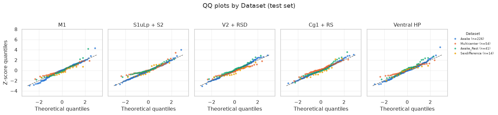

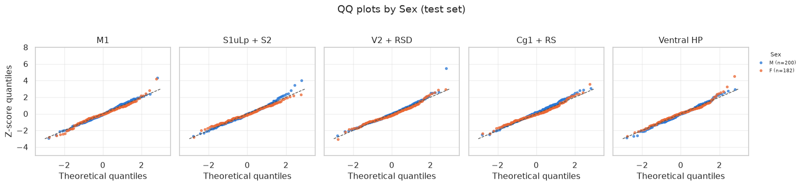

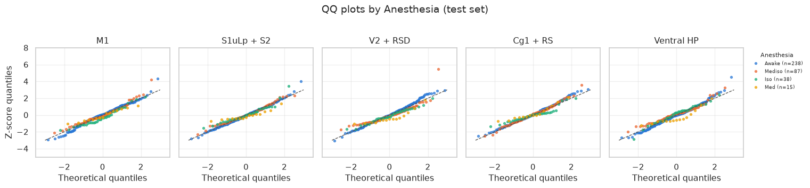

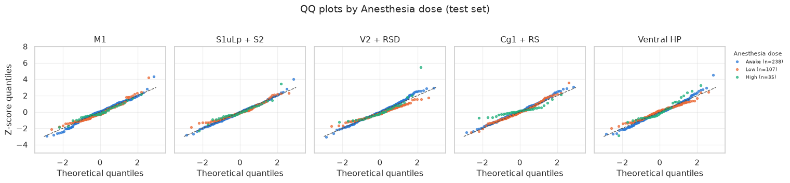

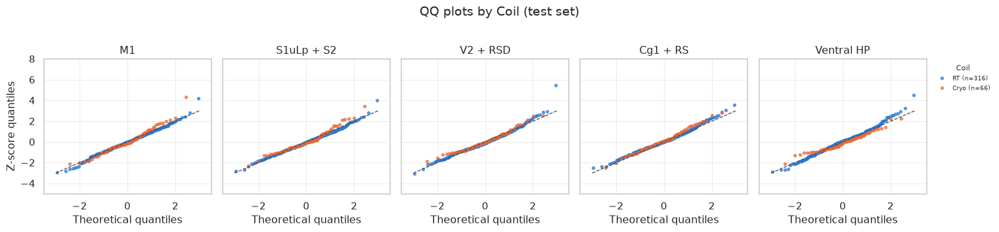

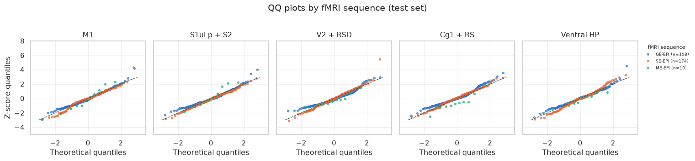

    QQ plots by group saved to: /home/traaffneu/giuvas/digitalrodent/results/normative_model_log/plots/qq_by_group
    Harmonized to the protocol of dataset: Awake
    MRI                             9.400000
    MRI T.R.                     2500.000000
    FD average                      0.023904
    log_tSNR                        2.827833
    Coil_encoded                    0.000000
    Ventilation_encoded             0.000000
    Anesthesia_high                 0.000000
    Anesthesia_dose_unknown         0.000000
    Rodent.strain_129S2/SvPas       0.000000
    Rodent.strain_F1 C6/129P        0.000000
    fMRI.sequence_ME-EPI            0.000000
    fMRI.sequence_SE-EPI            1.000000
    Anesthesia_Hal                  0.000000
    Anesthesia_Iso                  0.000000
    Anesthesia_Med                  0.000000
    Anesthesia_Mediso               0.000000
    dtype: float64

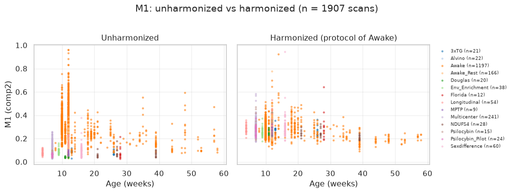

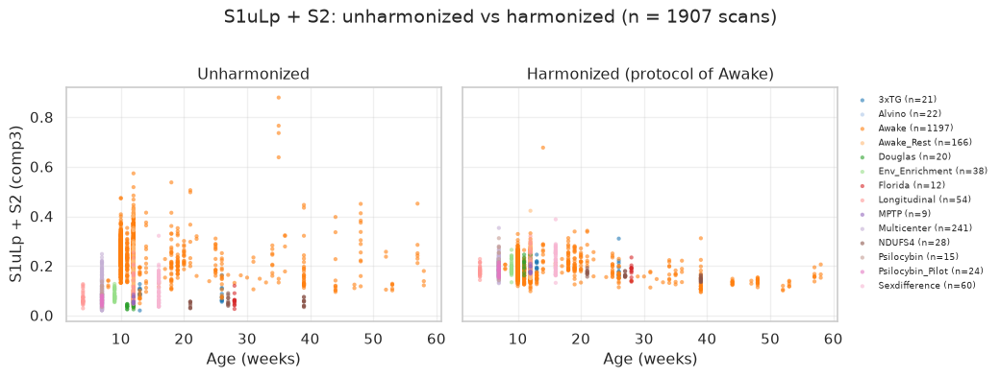

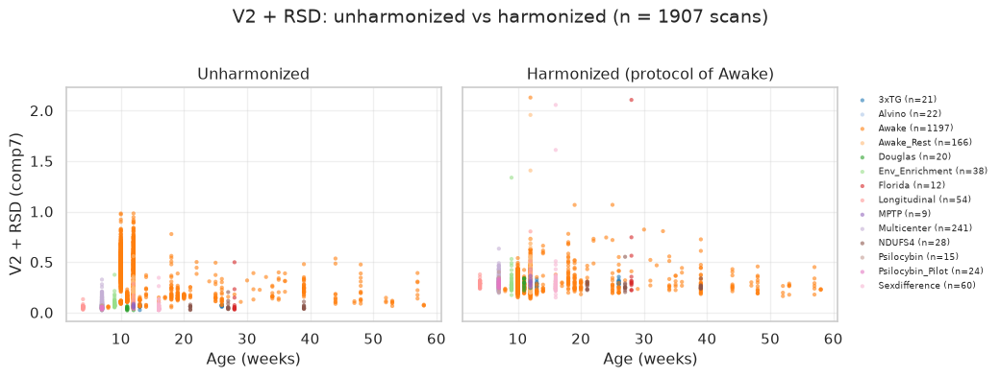

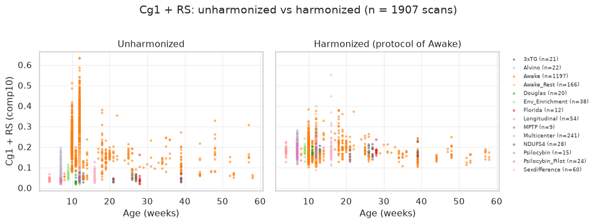

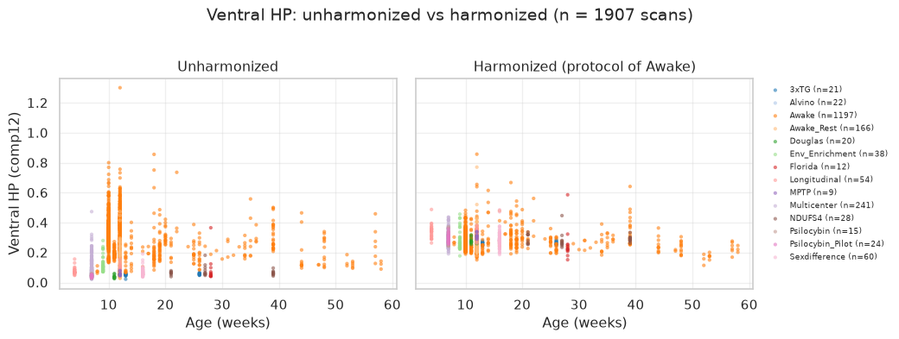

    Between-dataset spread before/after harmonization:

<div>
<style scoped>
    .dataframe tbody tr th:only-of-type {
        vertical-align: middle;
    }
&#10;    .dataframe tbody tr th {
        vertical-align: top;
    }
&#10;    .dataframe thead th {
        text-align: right;
    }
</style>

|  | SD of dataset means, raw | SD of dataset means, harmonized |
|----|----|----|
| M1 (comp2) | 0.067 | 0.022 |
| S1uLp + S2 (comp3) | 0.053 | 0.016 |
| V2 + RSD (comp7) | 0.086 | 0.056 |
| Cg1 + RS (comp10) | 0.047 | 0.009 |
| Ventral HP (comp12) | 0.069 | 0.020 |

</div>

    Harmonized scatter plots saved to: /home/traaffneu/giuvas/digitalrodent/results/normative_model_log/plots/harmonized_scatter

    BLR training finished.

    Saved to:
    /home/traaffneu/giuvas/digitalrodent/results/normative_model_log
