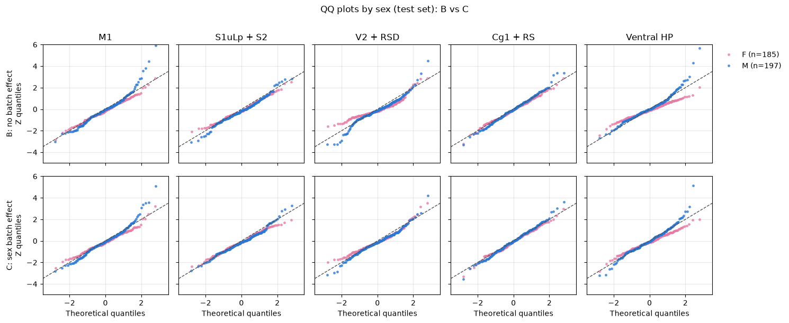
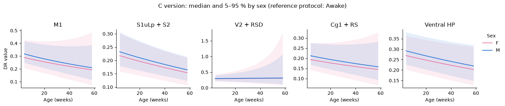

# Model Training, C version: sex as batch effect (log DR, PCNToolkit \>= 1.3)


**C version** = the B version (log DR, warped BLR, B-splines on age, FD
and log tSNR) + **sex as a batch effect**, as suggested by Konstantinos
(and the neurostars post): `fixed_effect=True` gives each sex its own
mean offset, `fixed_effect_var=True` its own spread.

Only sex is used as a batch effect. Dataset/site are not, and neither is
the anesthesia protocol (each lab tends to have its own protocol, so it
would act as a lab effect). Everything else stays a covariate as in the
B version.

To compare fairly, the B version (no batch effects) is refit here with
the same PCNToolkit version on **the same train/test split**.

- Needs PCNToolkit \>= 1.3 (`y_transform="log"`), i.e. Python \>= 3.12.
- Results go to `results/normative_model_log_sexBE/` (C model) and
  `results/normative_model_log_sexBE/B_same_split/` (B refit). The B
  results in `results/normative_model_log/` are not touched.

``` python
from importlib.metadata import version
from pathlib import Path

import numpy as np
import pandas as pd
import matplotlib.pyplot as plt
from scipy.stats import norm

from pcntoolkit import BLR, BsplineBasisFunction, NormativeModel, NormData
import pcntoolkit.util.output

from component_labels import ACRONYM, COMPONENTS, SELECTED_COMPONENTS

pcntoolkit.util.output.Output.set_show_messages(False)
plt.style.use("default")

PCN_VERSION = version("pcntoolkit")
assert tuple(int(v) for v in PCN_VERSION.split(".")[:2]) >= (1, 3), \
    f"this notebook needs PCNToolkit >= 1.3 (found {PCN_VERSION})"
print("PCNToolkit", PCN_VERSION)

root = Path.cwd().parent
model_dir = root / "results" / "normative_model_log_sexBE"
b_dir = model_dir / "B_same_split"
fig_dir = model_dir / "plots"
for d in (model_dir, b_dir, fig_dir):
    d.mkdir(parents=True, exist_ok=True)
```

    PCNToolkit 1.4.0

## Data

``` python
model_df = pd.read_csv(root / "results" / "combined_dataset" / "Model_dataframe.csv")
response_vars = COMPONENTS
assert (model_df[response_vars].dropna() > 0).all().all(), "log needs positive DR values"
assert "Sex_unknown" not in model_df.columns, "expected imputed sex (no unknown)"

id_cols = ["Scan_id", "Participant_Id", "Session", "Dataset_name"]
covariates_B = [c for c in model_df.columns if c not in id_cols + response_vars]

# C version: sex leaves the covariates and becomes a batch effect
model_df["Sex"] = np.where(model_df["Sex_encoded"] == 1, "M", "F")
covariates_C = [c for c in covariates_B if c != "Sex_encoded"]

print(pd.crosstab(model_df["Dataset_name"], model_df["Sex"]))
```

    Sex                 F    M
    Dataset_name              
    3xTG                0   21
    Alvino              8   14
    Awake             556  641
    Awake_Rest        166    0
    Douglas             0   20
    Env_Enrichment     22   16
    Florida             6    6
    Longitudinal       27   27
    MPTP                0    9
    Multicenter        99  142
    NDUFS4             10   18
    Psilocybin          0   15
    Psilocybin_Pilot    0   24
    Sexdifference      30   30

## Same train/test split for both versions

The split is stratified by sex (PCNToolkit’s default when sex is a batch
effect); the same scans are then used for B and C.

``` python
nd_C = NormData.from_dataframe(
    name="DigitalRodent_C", dataframe=model_df, covariates=covariates_C,
    batch_effects=["Sex"], response_vars=response_vars, remove_Nan=False,
)
train_C, test_C = nd_C.train_test_split()
train_idx = train_C.observations.values.astype(int)
test_idx = test_C.observations.values.astype(int)

nd_B = NormData.from_dataframe(
    name="DigitalRodent_B", dataframe=model_df, covariates=covariates_B,
    batch_effects=[], response_vars=response_vars, remove_Nan=False,
)
train_B = nd_B.sel(observations=train_idx)
test_B = nd_B.sel(observations=test_idx)
print(f"train {len(train_idx)} scans, test {len(test_idx)} scans")
```

    train 1525 scans, test 382 scans

## Fit B and C

``` python
def make_model(covariates, sex_batch_effect, save_dir):
    spline_columns = [covariates.index(c) for c in ["Age(week)", "FD average", "log_tSNR"]]
    blr_kwargs = dict(
        basis_function_mean=BsplineBasisFunction(basis_column=spline_columns, degree=3, nknots=5),
        basis_function_var=BsplineBasisFunction(basis_column=spline_columns, degree=3, nknots=5),
        heteroskedastic=True,
        warp_name="WarpSinhArcsinh",
    )
    if sex_batch_effect:
        blr_kwargs.update(fixed_effect=True, fixed_effect_var=True)
    return NormativeModel(
        BLR(**blr_kwargs),
        inscaler="standardize", outscaler="standardize",
        y_transform="log",
        savemodel=True, evaluate_model=True, saveresults=True, saveplots=False,
        save_dir=str(save_dir),
    )


model_B = make_model(covariates_B, False, b_dir)
model_B.fit_predict(train_B, test_B)

model_C = make_model(covariates_C, True, model_dir)
model_C.fit_predict(train_C, test_C)
print("B and C fitted")
```

    /home/traaffneu/giuvas/.conda/envs/pcn14/lib/python3.12/site-packages/pcntoolkit/regression_model/blr.py:697: LinAlgWarning: An ill-conditioned matrix detected: slice 0 has rcond = 3.112267910903711e-20.
      invAXt: np.ndarray = linalg.solve(self.A, X.T, check_finite=False)
    /home/traaffneu/giuvas/.conda/envs/pcn14/lib/python3.12/site-packages/pcntoolkit/util/output.py:342: UserWarning: Process: 1455618 - 2026-11-28 17:40:30 - Posterior estimation failed: 
    Matrix is not positive definite. 
    The optimizer could not find a stable solution. Retrying optimization.
      warnings.warn(message, category)
    /home/traaffneu/giuvas/.conda/envs/pcn14/lib/python3.12/site-packages/pcntoolkit/regression_model/blr.py:697: LinAlgWarning: An ill-conditioned matrix detected: slice 0 has rcond = 8.328951237617786e-21.
      invAXt: np.ndarray = linalg.solve(self.A, X.T, check_finite=False)
    /home/traaffneu/giuvas/.conda/envs/pcn14/lib/python3.12/site-packages/pcntoolkit/regression_model/blr.py:697: LinAlgWarning: An ill-conditioned matrix detected: slice 0 has rcond = 4.6000539991728704e-20.
      invAXt: np.ndarray = linalg.solve(self.A, X.T, check_finite=False)
    /home/traaffneu/giuvas/.conda/envs/pcn14/lib/python3.12/site-packages/pcntoolkit/regression_model/blr.py:697: LinAlgWarning: An ill-conditioned matrix detected: slice 0 has rcond = 1.0054996154668306e-20.
      invAXt: np.ndarray = linalg.solve(self.A, X.T, check_finite=False)
    /home/traaffneu/giuvas/.conda/envs/pcn14/lib/python3.12/site-packages/pcntoolkit/regression_model/blr.py:697: LinAlgWarning: An ill-conditioned matrix detected: slice 0 has rcond = 1.1707227772092466e-21.
      invAXt: np.ndarray = linalg.solve(self.A, X.T, check_finite=False)
    /home/traaffneu/giuvas/.conda/envs/pcn14/lib/python3.12/site-packages/pcntoolkit/regression_model/blr.py:697: LinAlgWarning: An ill-conditioned matrix detected: slice 0 has rcond = 6.6788357523009315e-21.
      invAXt: np.ndarray = linalg.solve(self.A, X.T, check_finite=False)
    /home/traaffneu/giuvas/.conda/envs/pcn14/lib/python3.12/site-packages/pcntoolkit/regression_model/blr.py:697: LinAlgWarning: An ill-conditioned matrix detected: slice 0 has rcond = 1.8230011770364035e-20.
      invAXt: np.ndarray = linalg.solve(self.A, X.T, check_finite=False)
    /home/traaffneu/giuvas/.conda/envs/pcn14/lib/python3.12/site-packages/pcntoolkit/regression_model/blr.py:697: LinAlgWarning: An ill-conditioned matrix detected: slice 0 has rcond = 3.1654817771302944e-21.
      invAXt: np.ndarray = linalg.solve(self.A, X.T, check_finite=False)
    /home/traaffneu/giuvas/.conda/envs/pcn14/lib/python3.12/site-packages/pcntoolkit/regression_model/blr.py:697: LinAlgWarning: An ill-conditioned matrix detected: slice 0 has rcond = 4.006932634721365e-21.
      invAXt: np.ndarray = linalg.solve(self.A, X.T, check_finite=False)
    /home/traaffneu/giuvas/.conda/envs/pcn14/lib/python3.12/site-packages/pcntoolkit/regression_model/blr.py:697: LinAlgWarning: An ill-conditioned matrix detected: slice 0 has rcond = 1.0749638312592826e-21.
      invAXt: np.ndarray = linalg.solve(self.A, X.T, check_finite=False)
    /home/traaffneu/giuvas/.conda/envs/pcn14/lib/python3.12/site-packages/pcntoolkit/regression_model/blr.py:697: LinAlgWarning: An ill-conditioned matrix detected: slice 0 has rcond = 3.488060401064691e-20.
      invAXt: np.ndarray = linalg.solve(self.A, X.T, check_finite=False)
    /home/traaffneu/giuvas/.conda/envs/pcn14/lib/python3.12/site-packages/pcntoolkit/regression_model/blr.py:697: LinAlgWarning: An ill-conditioned matrix detected: slice 0 has rcond = 1.6918215569058453e-20.
      invAXt: np.ndarray = linalg.solve(self.A, X.T, check_finite=False)
    /home/traaffneu/giuvas/.conda/envs/pcn14/lib/python3.12/site-packages/pcntoolkit/regression_model/blr.py:697: LinAlgWarning: An ill-conditioned matrix detected: slice 0 has rcond = 1.81485691961851e-20.
      invAXt: np.ndarray = linalg.solve(self.A, X.T, check_finite=False)
    /home/traaffneu/giuvas/.conda/envs/pcn14/lib/python3.12/site-packages/pcntoolkit/regression_model/blr.py:697: LinAlgWarning: An ill-conditioned matrix detected: slice 0 has rcond = 5.040552484880914e-21.
      invAXt: np.ndarray = linalg.solve(self.A, X.T, check_finite=False)
    /home/traaffneu/giuvas/.conda/envs/pcn14/lib/python3.12/site-packages/pcntoolkit/regression_model/blr.py:697: LinAlgWarning: An ill-conditioned matrix detected: slice 0 has rcond = 6.270013232840304e-21.
      invAXt: np.ndarray = linalg.solve(self.A, X.T, check_finite=False)
    /home/traaffneu/giuvas/.conda/envs/pcn14/lib/python3.12/site-packages/pcntoolkit/regression_model/blr.py:697: LinAlgWarning: An ill-conditioned matrix detected: slice 0 has rcond = 8.523748620164977e-21.
      invAXt: np.ndarray = linalg.solve(self.A, X.T, check_finite=False)
    /home/traaffneu/giuvas/.conda/envs/pcn14/lib/python3.12/site-packages/pcntoolkit/regression_model/blr.py:697: LinAlgWarning: An ill-conditioned matrix detected: slice 0 has rcond = 4.5959846003023204e-21.
      invAXt: np.ndarray = linalg.solve(self.A, X.T, check_finite=False)
    /home/traaffneu/giuvas/.conda/envs/pcn14/lib/python3.12/site-packages/pcntoolkit/regression_model/blr.py:697: LinAlgWarning: An ill-conditioned matrix detected: slice 0 has rcond = 1.6330270303322326e-21.
      invAXt: np.ndarray = linalg.solve(self.A, X.T, check_finite=False)
    /home/traaffneu/giuvas/.conda/envs/pcn14/lib/python3.12/site-packages/pcntoolkit/regression_model/blr.py:697: LinAlgWarning: An ill-conditioned matrix detected: slice 0 has rcond = 1.2550837355305002e-20.
      invAXt: np.ndarray = linalg.solve(self.A, X.T, check_finite=False)
    /home/traaffneu/giuvas/.conda/envs/pcn14/lib/python3.12/site-packages/pcntoolkit/regression_model/blr.py:697: LinAlgWarning: An ill-conditioned matrix detected: slice 0 has rcond = 6.3793969158103265e-21.
      invAXt: np.ndarray = linalg.solve(self.A, X.T, check_finite=False)
    /home/traaffneu/giuvas/.conda/envs/pcn14/lib/python3.12/site-packages/pcntoolkit/regression_model/blr.py:697: LinAlgWarning: An ill-conditioned matrix detected: slice 0 has rcond = 1.606882518921511e-20.
      invAXt: np.ndarray = linalg.solve(self.A, X.T, check_finite=False)
    /home/traaffneu/giuvas/.conda/envs/pcn14/lib/python3.12/site-packages/pcntoolkit/util/output.py:342: UserWarning: Process: 1455618 - 2026-11-28 17:40:32 - Posterior estimation failed: 
    Matrix is not positive definite. 
    The optimizer could not find a stable solution. Retrying optimization.
      warnings.warn(message, category)
    /home/traaffneu/giuvas/.conda/envs/pcn14/lib/python3.12/site-packages/pcntoolkit/regression_model/blr.py:697: LinAlgWarning: An ill-conditioned matrix detected: slice 0 has rcond = 2.6900330275508135e-20.
      invAXt: np.ndarray = linalg.solve(self.A, X.T, check_finite=False)
    /home/traaffneu/giuvas/.conda/envs/pcn14/lib/python3.12/site-packages/pcntoolkit/regression_model/blr.py:697: LinAlgWarning: An ill-conditioned matrix detected: slice 0 has rcond = 1.774690171328725e-20.
      invAXt: np.ndarray = linalg.solve(self.A, X.T, check_finite=False)
    /home/traaffneu/giuvas/.conda/envs/pcn14/lib/python3.12/site-packages/pcntoolkit/regression_model/blr.py:697: LinAlgWarning: An ill-conditioned matrix detected: slice 0 has rcond = 3.944579471751036e-20.
      invAXt: np.ndarray = linalg.solve(self.A, X.T, check_finite=False)
    /home/traaffneu/giuvas/.conda/envs/pcn14/lib/python3.12/site-packages/pcntoolkit/regression_model/blr.py:697: LinAlgWarning: An ill-conditioned matrix detected: slice 0 has rcond = 2.875085304377995e-20.
      invAXt: np.ndarray = linalg.solve(self.A, X.T, check_finite=False)
    /home/traaffneu/giuvas/.conda/envs/pcn14/lib/python3.12/site-packages/pcntoolkit/regression_model/blr.py:697: LinAlgWarning: An ill-conditioned matrix detected: slice 0 has rcond = 8.292827589113184e-21.
      invAXt: np.ndarray = linalg.solve(self.A, X.T, check_finite=False)
    /home/traaffneu/giuvas/.conda/envs/pcn14/lib/python3.12/site-packages/pcntoolkit/regression_model/blr.py:697: LinAlgWarning: An ill-conditioned matrix detected: slice 0 has rcond = 5.54371286575711e-20.
      invAXt: np.ndarray = linalg.solve(self.A, X.T, check_finite=False)
    /home/traaffneu/giuvas/.conda/envs/pcn14/lib/python3.12/site-packages/pcntoolkit/regression_model/blr.py:697: LinAlgWarning: An ill-conditioned matrix detected: slice 0 has rcond = 2.549312021431224e-21.
      invAXt: np.ndarray = linalg.solve(self.A, X.T, check_finite=False)
    /home/traaffneu/giuvas/.conda/envs/pcn14/lib/python3.12/site-packages/pcntoolkit/regression_model/blr.py:697: LinAlgWarning: An ill-conditioned matrix detected: slice 0 has rcond = 3.324915088893539e-20.
      invAXt: np.ndarray = linalg.solve(self.A, X.T, check_finite=False)
    /home/traaffneu/giuvas/.conda/envs/pcn14/lib/python3.12/site-packages/pcntoolkit/regression_model/blr.py:697: LinAlgWarning: An ill-conditioned matrix detected: slice 0 has rcond = 1.2931991463011124e-20.
      invAXt: np.ndarray = linalg.solve(self.A, X.T, check_finite=False)
    /home/traaffneu/giuvas/.conda/envs/pcn14/lib/python3.12/site-packages/pcntoolkit/regression_model/blr.py:697: LinAlgWarning: An ill-conditioned matrix detected: slice 0 has rcond = 1.805456625222393e-20.
      invAXt: np.ndarray = linalg.solve(self.A, X.T, check_finite=False)
    /home/traaffneu/giuvas/.conda/envs/pcn14/lib/python3.12/site-packages/pcntoolkit/regression_model/blr.py:697: LinAlgWarning: An ill-conditioned matrix detected: slice 0 has rcond = 9.048167093999149e-20.
      invAXt: np.ndarray = linalg.solve(self.A, X.T, check_finite=False)
    /home/traaffneu/giuvas/.conda/envs/pcn14/lib/python3.12/site-packages/pcntoolkit/regression_model/blr.py:697: LinAlgWarning: An ill-conditioned matrix detected: slice 0 has rcond = 3.866300856790115e-20.
      invAXt: np.ndarray = linalg.solve(self.A, X.T, check_finite=False)
    /home/traaffneu/giuvas/.conda/envs/pcn14/lib/python3.12/site-packages/pcntoolkit/regression_model/blr.py:697: LinAlgWarning: An ill-conditioned matrix detected: slice 0 has rcond = 8.281723605463942e-20.
      invAXt: np.ndarray = linalg.solve(self.A, X.T, check_finite=False)
    /home/traaffneu/giuvas/.conda/envs/pcn14/lib/python3.12/site-packages/pcntoolkit/regression_model/blr.py:697: LinAlgWarning: An ill-conditioned matrix detected: slice 0 has rcond = 2.1710249637158923e-20.
      invAXt: np.ndarray = linalg.solve(self.A, X.T, check_finite=False)
    /home/traaffneu/giuvas/.conda/envs/pcn14/lib/python3.12/site-packages/pcntoolkit/regression_model/blr.py:697: LinAlgWarning: An ill-conditioned matrix detected: slice 0 has rcond = 4.023625092910587e-20.
      invAXt: np.ndarray = linalg.solve(self.A, X.T, check_finite=False)
    /home/traaffneu/giuvas/.conda/envs/pcn14/lib/python3.12/site-packages/pcntoolkit/regression_model/blr.py:697: LinAlgWarning: An ill-conditioned matrix detected: slice 0 has rcond = 1.9651235598579632e-20.
      invAXt: np.ndarray = linalg.solve(self.A, X.T, check_finite=False)
    /home/traaffneu/giuvas/.conda/envs/pcn14/lib/python3.12/site-packages/pcntoolkit/regression_model/blr.py:697: LinAlgWarning: An ill-conditioned matrix detected: slice 0 has rcond = 3.3282821925484495e-21.
      invAXt: np.ndarray = linalg.solve(self.A, X.T, check_finite=False)
    /home/traaffneu/giuvas/.conda/envs/pcn14/lib/python3.12/site-packages/pcntoolkit/regression_model/blr.py:697: LinAlgWarning: An ill-conditioned matrix detected: slice 0 has rcond = 2.9319018574522885e-20.
      invAXt: np.ndarray = linalg.solve(self.A, X.T, check_finite=False)
    /home/traaffneu/giuvas/.conda/envs/pcn14/lib/python3.12/site-packages/pcntoolkit/regression_model/blr.py:697: LinAlgWarning: An ill-conditioned matrix detected: slice 0 has rcond = 2.1490604914493552e-20.
      invAXt: np.ndarray = linalg.solve(self.A, X.T, check_finite=False)
    /home/traaffneu/giuvas/.conda/envs/pcn14/lib/python3.12/site-packages/pcntoolkit/regression_model/blr.py:615: RuntimeWarning: overflow encountered in exp
      beta = np.exp(Phi_var.dot(w_d))
    /home/traaffneu/giuvas/.conda/envs/pcn14/lib/python3.12/site-packages/pcntoolkit/regression_model/blr.py:696: RuntimeWarning: invalid value encountered in dot
      self.A = XtLambda_n.dot(X) + self.Lambda_a
    /home/traaffneu/giuvas/.conda/envs/pcn14/lib/python3.12/site-packages/pcntoolkit/regression_model/blr.py:697: LinAlgWarning: An ill-conditioned matrix detected: slice 0 has rcond = 0.0.
      invAXt: np.ndarray = linalg.solve(self.A, X.T, check_finite=False)
    /home/traaffneu/giuvas/.conda/envs/pcn14/lib/python3.12/site-packages/pcntoolkit/regression_model/blr.py:759: RuntimeWarning: divide by zero encountered in log
      logdetSigma_n = -np.sum(np.log(self.lambda_n_vec))
    /home/traaffneu/giuvas/.conda/envs/pcn14/lib/python3.12/site-packages/numpy/_core/fromnumeric.py:83: RuntimeWarning: invalid value encountered in reduce
      return ufunc.reduce(obj, axis, dtype, out, **passkwargs)
    /home/traaffneu/giuvas/.conda/envs/pcn14/lib/python3.12/site-packages/pcntoolkit/regression_model/blr.py:697: LinAlgWarning: An ill-conditioned matrix detected: slice 0 has rcond = 2.785549042698864e-21.
      invAXt: np.ndarray = linalg.solve(self.A, X.T, check_finite=False)
    /home/traaffneu/giuvas/.conda/envs/pcn14/lib/python3.12/site-packages/pcntoolkit/util/output.py:342: UserWarning: Process: 1455618 - 2026-11-28 17:40:35 - Posterior estimation failed: 
    Matrix is not positive definite. 
    The optimizer could not find a stable solution. Retrying optimization.
      warnings.warn(message, category)
    /home/traaffneu/giuvas/.conda/envs/pcn14/lib/python3.12/site-packages/pcntoolkit/regression_model/blr.py:697: LinAlgWarning: An ill-conditioned matrix detected: slice 0 has rcond = 1.5250970062875262e-22.
      invAXt: np.ndarray = linalg.solve(self.A, X.T, check_finite=False)
    /home/traaffneu/giuvas/.conda/envs/pcn14/lib/python3.12/site-packages/pcntoolkit/regression_model/blr.py:697: LinAlgWarning: An ill-conditioned matrix detected: slice 0 has rcond = 5.410223996676717e-22.
      invAXt: np.ndarray = linalg.solve(self.A, X.T, check_finite=False)
    /home/traaffneu/giuvas/.conda/envs/pcn14/lib/python3.12/site-packages/pcntoolkit/regression_model/blr.py:697: LinAlgWarning: An ill-conditioned matrix detected: slice 0 has rcond = 2.565802163351477e-21.
      invAXt: np.ndarray = linalg.solve(self.A, X.T, check_finite=False)
    /home/traaffneu/giuvas/.conda/envs/pcn14/lib/python3.12/site-packages/pcntoolkit/regression_model/blr.py:697: LinAlgWarning: An ill-conditioned matrix detected: slice 0 has rcond = 3.0257283706300335e-21.
      invAXt: np.ndarray = linalg.solve(self.A, X.T, check_finite=False)
    /home/traaffneu/giuvas/.conda/envs/pcn14/lib/python3.12/site-packages/pcntoolkit/regression_model/blr.py:697: LinAlgWarning: An ill-conditioned matrix detected: slice 0 has rcond = 2.2364958857711855e-21.
      invAXt: np.ndarray = linalg.solve(self.A, X.T, check_finite=False)
    /home/traaffneu/giuvas/.conda/envs/pcn14/lib/python3.12/site-packages/pcntoolkit/regression_model/blr.py:697: LinAlgWarning: An ill-conditioned matrix detected: slice 0 has rcond = 5.831387555579356e-21.
      invAXt: np.ndarray = linalg.solve(self.A, X.T, check_finite=False)
    /home/traaffneu/giuvas/.conda/envs/pcn14/lib/python3.12/site-packages/pcntoolkit/regression_model/blr.py:697: LinAlgWarning: An ill-conditioned matrix detected: slice 0 has rcond = 2.622055985090413e-22.
      invAXt: np.ndarray = linalg.solve(self.A, X.T, check_finite=False)
    /home/traaffneu/giuvas/.conda/envs/pcn14/lib/python3.12/site-packages/pcntoolkit/regression_model/blr.py:697: LinAlgWarning: An ill-conditioned matrix detected: slice 0 has rcond = 1.4069992020620324e-21.
      invAXt: np.ndarray = linalg.solve(self.A, X.T, check_finite=False)
    /home/traaffneu/giuvas/.conda/envs/pcn14/lib/python3.12/site-packages/pcntoolkit/regression_model/blr.py:697: LinAlgWarning: An ill-conditioned matrix detected: slice 0 has rcond = 2.725840269498095e-21.
      invAXt: np.ndarray = linalg.solve(self.A, X.T, check_finite=False)
    /home/traaffneu/giuvas/.conda/envs/pcn14/lib/python3.12/site-packages/pcntoolkit/regression_model/blr.py:697: LinAlgWarning: An ill-conditioned matrix detected: slice 0 has rcond = 7.438281798355256e-22.
      invAXt: np.ndarray = linalg.solve(self.A, X.T, check_finite=False)
    /home/traaffneu/giuvas/.conda/envs/pcn14/lib/python3.12/site-packages/pcntoolkit/regression_model/blr.py:697: LinAlgWarning: An ill-conditioned matrix detected: slice 0 has rcond = 1.3818015240212373e-21.
      invAXt: np.ndarray = linalg.solve(self.A, X.T, check_finite=False)
    /home/traaffneu/giuvas/.conda/envs/pcn14/lib/python3.12/site-packages/pcntoolkit/regression_model/blr.py:697: LinAlgWarning: An ill-conditioned matrix detected: slice 0 has rcond = 1.6291360982055512e-21.
      invAXt: np.ndarray = linalg.solve(self.A, X.T, check_finite=False)
    /home/traaffneu/giuvas/.conda/envs/pcn14/lib/python3.12/site-packages/pcntoolkit/regression_model/blr.py:697: LinAlgWarning: An ill-conditioned matrix detected: slice 0 has rcond = 2.0854966076969848e-21.
      invAXt: np.ndarray = linalg.solve(self.A, X.T, check_finite=False)
    /home/traaffneu/giuvas/.conda/envs/pcn14/lib/python3.12/site-packages/pcntoolkit/regression_model/blr.py:697: LinAlgWarning: An ill-conditioned matrix detected: slice 0 has rcond = 9.995433607391462e-22.
      invAXt: np.ndarray = linalg.solve(self.A, X.T, check_finite=False)
    /home/traaffneu/giuvas/.conda/envs/pcn14/lib/python3.12/site-packages/pcntoolkit/regression_model/blr.py:697: LinAlgWarning: An ill-conditioned matrix detected: slice 0 has rcond = 2.270617894605967e-21.
      invAXt: np.ndarray = linalg.solve(self.A, X.T, check_finite=False)
    /home/traaffneu/giuvas/.conda/envs/pcn14/lib/python3.12/site-packages/pcntoolkit/regression_model/blr.py:697: LinAlgWarning: An ill-conditioned matrix detected: slice 0 has rcond = 9.581427882527565e-22.
      invAXt: np.ndarray = linalg.solve(self.A, X.T, check_finite=False)
    /home/traaffneu/giuvas/.conda/envs/pcn14/lib/python3.12/site-packages/pcntoolkit/regression_model/blr.py:697: LinAlgWarning: An ill-conditioned matrix detected: slice 0 has rcond = 6.86873355226066e-21.
      invAXt: np.ndarray = linalg.solve(self.A, X.T, check_finite=False)
    /home/traaffneu/giuvas/.conda/envs/pcn14/lib/python3.12/site-packages/pcntoolkit/regression_model/blr.py:697: LinAlgWarning: An ill-conditioned matrix detected: slice 0 has rcond = 8.896648616760353e-22.
      invAXt: np.ndarray = linalg.solve(self.A, X.T, check_finite=False)
    /home/traaffneu/giuvas/.conda/envs/pcn14/lib/python3.12/site-packages/pcntoolkit/regression_model/blr.py:697: LinAlgWarning: An ill-conditioned matrix detected: slice 0 has rcond = 1.4855458581517127e-21.
      invAXt: np.ndarray = linalg.solve(self.A, X.T, check_finite=False)
    /home/traaffneu/giuvas/.conda/envs/pcn14/lib/python3.12/site-packages/pcntoolkit/util/output.py:342: UserWarning: Process: 1455618 - 2026-11-28 17:40:36 - Posterior estimation failed: 
    A singular matrix detected: slice(s) [0] are singular.. 
    The optimizer could not find a stable solution. Retrying optimization.
      warnings.warn(message, category)
    /home/traaffneu/giuvas/.conda/envs/pcn14/lib/python3.12/site-packages/pcntoolkit/regression_model/blr.py:697: LinAlgWarning: An ill-conditioned matrix detected: slice 0 has rcond = 5.0990711370595254e-21.
      invAXt: np.ndarray = linalg.solve(self.A, X.T, check_finite=False)
    /home/traaffneu/giuvas/.conda/envs/pcn14/lib/python3.12/site-packages/pcntoolkit/util/output.py:342: UserWarning: Process: 1455618 - 2026-11-28 17:40:36 - Posterior estimation failed: 
    Matrix is not positive definite. 
    The optimizer could not find a stable solution. Retrying optimization.
      warnings.warn(message, category)
    /home/traaffneu/giuvas/.conda/envs/pcn14/lib/python3.12/site-packages/pcntoolkit/regression_model/blr.py:697: LinAlgWarning: An ill-conditioned matrix detected: slice 0 has rcond = 1.2414544707417666e-22.
      invAXt: np.ndarray = linalg.solve(self.A, X.T, check_finite=False)
    /home/traaffneu/giuvas/.conda/envs/pcn14/lib/python3.12/site-packages/pcntoolkit/regression_model/blr.py:697: LinAlgWarning: An ill-conditioned matrix detected: slice 0 has rcond = 5.134942710658268e-23.
      invAXt: np.ndarray = linalg.solve(self.A, X.T, check_finite=False)
    /home/traaffneu/giuvas/.conda/envs/pcn14/lib/python3.12/site-packages/pcntoolkit/regression_model/blr.py:697: LinAlgWarning: An ill-conditioned matrix detected: slice 0 has rcond = 2.1410317359983087e-21.
      invAXt: np.ndarray = linalg.solve(self.A, X.T, check_finite=False)
    /home/traaffneu/giuvas/.conda/envs/pcn14/lib/python3.12/site-packages/pcntoolkit/regression_model/blr.py:697: LinAlgWarning: An ill-conditioned matrix detected: slice 0 has rcond = 1.591065976364381e-21.
      invAXt: np.ndarray = linalg.solve(self.A, X.T, check_finite=False)
    /home/traaffneu/giuvas/.conda/envs/pcn14/lib/python3.12/site-packages/pcntoolkit/regression_model/blr.py:697: LinAlgWarning: An ill-conditioned matrix detected: slice 0 has rcond = 3.066056329724775e-22.
      invAXt: np.ndarray = linalg.solve(self.A, X.T, check_finite=False)
    /home/traaffneu/giuvas/.conda/envs/pcn14/lib/python3.12/site-packages/pcntoolkit/regression_model/blr.py:697: LinAlgWarning: An ill-conditioned matrix detected: slice 0 has rcond = 3.971112286254352e-22.
      invAXt: np.ndarray = linalg.solve(self.A, X.T, check_finite=False)
    /home/traaffneu/giuvas/.conda/envs/pcn14/lib/python3.12/site-packages/pcntoolkit/regression_model/blr.py:697: LinAlgWarning: An ill-conditioned matrix detected: slice 0 has rcond = 2.850398539701022e-21.
      invAXt: np.ndarray = linalg.solve(self.A, X.T, check_finite=False)
    /home/traaffneu/giuvas/.conda/envs/pcn14/lib/python3.12/site-packages/pcntoolkit/regression_model/blr.py:697: LinAlgWarning: An ill-conditioned matrix detected: slice 0 has rcond = 1.3228570824097938e-21.
      invAXt: np.ndarray = linalg.solve(self.A, X.T, check_finite=False)
    /home/traaffneu/giuvas/.conda/envs/pcn14/lib/python3.12/site-packages/pcntoolkit/regression_model/blr.py:697: LinAlgWarning: An ill-conditioned matrix detected: slice 0 has rcond = 2.4799133577883466e-21.
      invAXt: np.ndarray = linalg.solve(self.A, X.T, check_finite=False)
    /home/traaffneu/giuvas/.conda/envs/pcn14/lib/python3.12/site-packages/pcntoolkit/regression_model/blr.py:697: LinAlgWarning: An ill-conditioned matrix detected: slice 0 has rcond = 1.2272662851952097e-21.
      invAXt: np.ndarray = linalg.solve(self.A, X.T, check_finite=False)
    /home/traaffneu/giuvas/.conda/envs/pcn14/lib/python3.12/site-packages/pcntoolkit/regression_model/blr.py:697: LinAlgWarning: An ill-conditioned matrix detected: slice 0 has rcond = 5.760114418171682e-21.
      invAXt: np.ndarray = linalg.solve(self.A, X.T, check_finite=False)
    /home/traaffneu/giuvas/.conda/envs/pcn14/lib/python3.12/site-packages/pcntoolkit/regression_model/blr.py:697: LinAlgWarning: An ill-conditioned matrix detected: slice 0 has rcond = 4.3773468739982316e-21.
      invAXt: np.ndarray = linalg.solve(self.A, X.T, check_finite=False)
    /home/traaffneu/giuvas/.conda/envs/pcn14/lib/python3.12/site-packages/pcntoolkit/regression_model/blr.py:697: LinAlgWarning: An ill-conditioned matrix detected: slice 0 has rcond = 1.717964909885787e-22.
      invAXt: np.ndarray = linalg.solve(self.A, X.T, check_finite=False)
    /home/traaffneu/giuvas/.conda/envs/pcn14/lib/python3.12/site-packages/pcntoolkit/regression_model/blr.py:697: LinAlgWarning: An ill-conditioned matrix detected: slice 0 has rcond = 4.988639063301351e-21.
      invAXt: np.ndarray = linalg.solve(self.A, X.T, check_finite=False)
    /home/traaffneu/giuvas/.conda/envs/pcn14/lib/python3.12/site-packages/pcntoolkit/regression_model/blr.py:615: RuntimeWarning: overflow encountered in exp
      beta = np.exp(Phi_var.dot(w_d))
    /home/traaffneu/giuvas/.conda/envs/pcn14/lib/python3.12/site-packages/pcntoolkit/regression_model/blr.py:695: RuntimeWarning: overflow encountered in multiply
      XtLambda_n = X.T * self.lambda_n_vec
    /home/traaffneu/giuvas/.conda/envs/pcn14/lib/python3.12/site-packages/pcntoolkit/regression_model/blr.py:696: RuntimeWarning: invalid value encountered in dot
      self.A = XtLambda_n.dot(X) + self.Lambda_a
    /home/traaffneu/giuvas/.conda/envs/pcn14/lib/python3.12/site-packages/pcntoolkit/regression_model/blr.py:697: LinAlgWarning: An ill-conditioned matrix detected: slice 0 has rcond = 0.0.
      invAXt: np.ndarray = linalg.solve(self.A, X.T, check_finite=False)
    /home/traaffneu/giuvas/.conda/envs/pcn14/lib/python3.12/site-packages/pcntoolkit/regression_model/blr.py:615: RuntimeWarning: overflow encountered in exp
      beta = np.exp(Phi_var.dot(w_d))
    /home/traaffneu/giuvas/.conda/envs/pcn14/lib/python3.12/site-packages/pcntoolkit/regression_model/blr.py:696: RuntimeWarning: invalid value encountered in dot
      self.A = XtLambda_n.dot(X) + self.Lambda_a
    /home/traaffneu/giuvas/.conda/envs/pcn14/lib/python3.12/site-packages/pcntoolkit/regression_model/blr.py:697: LinAlgWarning: An ill-conditioned matrix detected: slice 0 has rcond = 0.0.
      invAXt: np.ndarray = linalg.solve(self.A, X.T, check_finite=False)
    /home/traaffneu/giuvas/.conda/envs/pcn14/lib/python3.12/site-packages/pcntoolkit/regression_model/blr.py:615: RuntimeWarning: overflow encountered in exp
      beta = np.exp(Phi_var.dot(w_d))
    /home/traaffneu/giuvas/.conda/envs/pcn14/lib/python3.12/site-packages/pcntoolkit/regression_model/blr.py:696: RuntimeWarning: invalid value encountered in dot
      self.A = XtLambda_n.dot(X) + self.Lambda_a
    /home/traaffneu/giuvas/.conda/envs/pcn14/lib/python3.12/site-packages/pcntoolkit/regression_model/blr.py:697: LinAlgWarning: An ill-conditioned matrix detected: slice 0 has rcond = 0.0.
      invAXt: np.ndarray = linalg.solve(self.A, X.T, check_finite=False)
    /home/traaffneu/giuvas/.conda/envs/pcn14/lib/python3.12/site-packages/pcntoolkit/regression_model/blr.py:697: LinAlgWarning: An ill-conditioned matrix detected: slice 0 has rcond = 1.3019846229889615e-20.
      invAXt: np.ndarray = linalg.solve(self.A, X.T, check_finite=False)
    /home/traaffneu/giuvas/.conda/envs/pcn14/lib/python3.12/site-packages/pcntoolkit/util/output.py:342: UserWarning: Process: 1455618 - 2026-11-28 17:40:41 - Posterior estimation failed: 
    Matrix is not positive definite. 
    The optimizer could not find a stable solution. Retrying optimization.
      warnings.warn(message, category)
    /home/traaffneu/giuvas/.conda/envs/pcn14/lib/python3.12/site-packages/pcntoolkit/regression_model/blr.py:697: LinAlgWarning: An ill-conditioned matrix detected: slice 0 has rcond = 9.222365231144622e-21.
      invAXt: np.ndarray = linalg.solve(self.A, X.T, check_finite=False)
    /home/traaffneu/giuvas/.conda/envs/pcn14/lib/python3.12/site-packages/pcntoolkit/regression_model/blr.py:697: LinAlgWarning: An ill-conditioned matrix detected: slice 0 has rcond = 2.1902057600171022e-20.
      invAXt: np.ndarray = linalg.solve(self.A, X.T, check_finite=False)
    /home/traaffneu/giuvas/.conda/envs/pcn14/lib/python3.12/site-packages/pcntoolkit/regression_model/blr.py:697: LinAlgWarning: An ill-conditioned matrix detected: slice 0 has rcond = 3.219905809204419e-20.
      invAXt: np.ndarray = linalg.solve(self.A, X.T, check_finite=False)
    /home/traaffneu/giuvas/.conda/envs/pcn14/lib/python3.12/site-packages/pcntoolkit/regression_model/blr.py:697: LinAlgWarning: An ill-conditioned matrix detected: slice 0 has rcond = 1.5517687864375334e-20.
      invAXt: np.ndarray = linalg.solve(self.A, X.T, check_finite=False)
    /home/traaffneu/giuvas/.conda/envs/pcn14/lib/python3.12/site-packages/pcntoolkit/regression_model/blr.py:697: LinAlgWarning: An ill-conditioned matrix detected: slice 0 has rcond = 1.8245354012969087e-20.
      invAXt: np.ndarray = linalg.solve(self.A, X.T, check_finite=False)
    /home/traaffneu/giuvas/.conda/envs/pcn14/lib/python3.12/site-packages/pcntoolkit/regression_model/blr.py:697: LinAlgWarning: An ill-conditioned matrix detected: slice 0 has rcond = 3.828122769139944e-20.
      invAXt: np.ndarray = linalg.solve(self.A, X.T, check_finite=False)
    /home/traaffneu/giuvas/.conda/envs/pcn14/lib/python3.12/site-packages/pcntoolkit/regression_model/blr.py:697: LinAlgWarning: An ill-conditioned matrix detected: slice 0 has rcond = 3.396834817409487e-20.
      invAXt: np.ndarray = linalg.solve(self.A, X.T, check_finite=False)
    /home/traaffneu/giuvas/.conda/envs/pcn14/lib/python3.12/site-packages/pcntoolkit/regression_model/blr.py:697: LinAlgWarning: An ill-conditioned matrix detected: slice 0 has rcond = 4.725721892716288e-21.
      invAXt: np.ndarray = linalg.solve(self.A, X.T, check_finite=False)
    /home/traaffneu/giuvas/.conda/envs/pcn14/lib/python3.12/site-packages/pcntoolkit/regression_model/blr.py:697: LinAlgWarning: An ill-conditioned matrix detected: slice 0 has rcond = 1.8718843500162154e-21.
      invAXt: np.ndarray = linalg.solve(self.A, X.T, check_finite=False)
    /home/traaffneu/giuvas/.conda/envs/pcn14/lib/python3.12/site-packages/pcntoolkit/regression_model/blr.py:697: LinAlgWarning: An ill-conditioned matrix detected: slice 0 has rcond = 5.362064823294698e-21.
      invAXt: np.ndarray = linalg.solve(self.A, X.T, check_finite=False)
    /home/traaffneu/giuvas/.conda/envs/pcn14/lib/python3.12/site-packages/pcntoolkit/regression_model/blr.py:697: LinAlgWarning: An ill-conditioned matrix detected: slice 0 has rcond = 9.449571616576281e-21.
      invAXt: np.ndarray = linalg.solve(self.A, X.T, check_finite=False)
    /home/traaffneu/giuvas/.conda/envs/pcn14/lib/python3.12/site-packages/pcntoolkit/regression_model/blr.py:697: LinAlgWarning: An ill-conditioned matrix detected: slice 0 has rcond = 1.0032531863141672e-20.
      invAXt: np.ndarray = linalg.solve(self.A, X.T, check_finite=False)
    /home/traaffneu/giuvas/.conda/envs/pcn14/lib/python3.12/site-packages/pcntoolkit/regression_model/blr.py:697: LinAlgWarning: An ill-conditioned matrix detected: slice 0 has rcond = 1.8479157070577925e-20.
      invAXt: np.ndarray = linalg.solve(self.A, X.T, check_finite=False)
    /home/traaffneu/giuvas/.conda/envs/pcn14/lib/python3.12/site-packages/pcntoolkit/regression_model/blr.py:697: LinAlgWarning: An ill-conditioned matrix detected: slice 0 has rcond = 2.75951263635408e-20.
      invAXt: np.ndarray = linalg.solve(self.A, X.T, check_finite=False)
    /home/traaffneu/giuvas/.conda/envs/pcn14/lib/python3.12/site-packages/pcntoolkit/regression_model/blr.py:697: LinAlgWarning: An ill-conditioned matrix detected: slice 0 has rcond = 1.485769647140041e-21.
      invAXt: np.ndarray = linalg.solve(self.A, X.T, check_finite=False)
    /home/traaffneu/giuvas/.conda/envs/pcn14/lib/python3.12/site-packages/pcntoolkit/regression_model/blr.py:697: LinAlgWarning: An ill-conditioned matrix detected: slice 0 has rcond = 3.5624583558198576e-20.
      invAXt: np.ndarray = linalg.solve(self.A, X.T, check_finite=False)
    /home/traaffneu/giuvas/.conda/envs/pcn14/lib/python3.12/site-packages/pcntoolkit/regression_model/blr.py:697: LinAlgWarning: An ill-conditioned matrix detected: slice 0 has rcond = 1.3581470686717648e-20.
      invAXt: np.ndarray = linalg.solve(self.A, X.T, check_finite=False)
    /home/traaffneu/giuvas/.conda/envs/pcn14/lib/python3.12/site-packages/pcntoolkit/regression_model/blr.py:697: LinAlgWarning: An ill-conditioned matrix detected: slice 0 has rcond = 3.3473311003354806e-20.
      invAXt: np.ndarray = linalg.solve(self.A, X.T, check_finite=False)
    /home/traaffneu/giuvas/.conda/envs/pcn14/lib/python3.12/site-packages/pcntoolkit/regression_model/blr.py:697: LinAlgWarning: An ill-conditioned matrix detected: slice 0 has rcond = 3.215467464751003e-21.
      invAXt: np.ndarray = linalg.solve(self.A, X.T, check_finite=False)
    /home/traaffneu/giuvas/.conda/envs/pcn14/lib/python3.12/site-packages/pcntoolkit/regression_model/blr.py:697: LinAlgWarning: An ill-conditioned matrix detected: slice 0 has rcond = 2.1981990250457446e-22.
      invAXt: np.ndarray = linalg.solve(self.A, X.T, check_finite=False)
    /home/traaffneu/giuvas/.conda/envs/pcn14/lib/python3.12/site-packages/pcntoolkit/util/output.py:342: UserWarning: Process: 1455618 - 2026-11-28 17:40:42 - Posterior estimation failed: 
    Matrix is not positive definite. 
    The optimizer could not find a stable solution. Retrying optimization.
      warnings.warn(message, category)
    /home/traaffneu/giuvas/.conda/envs/pcn14/lib/python3.12/site-packages/pcntoolkit/regression_model/blr.py:697: LinAlgWarning: An ill-conditioned matrix detected: slice 0 has rcond = 9.569419271880872e-21.
      invAXt: np.ndarray = linalg.solve(self.A, X.T, check_finite=False)
    /home/traaffneu/giuvas/.conda/envs/pcn14/lib/python3.12/site-packages/pcntoolkit/regression_model/blr.py:697: LinAlgWarning: An ill-conditioned matrix detected: slice 0 has rcond = 3.1278536440127504e-21.
      invAXt: np.ndarray = linalg.solve(self.A, X.T, check_finite=False)
    /home/traaffneu/giuvas/.conda/envs/pcn14/lib/python3.12/site-packages/pcntoolkit/regression_model/blr.py:697: LinAlgWarning: An ill-conditioned matrix detected: slice 0 has rcond = 4.370171904942827e-21.
      invAXt: np.ndarray = linalg.solve(self.A, X.T, check_finite=False)
    /home/traaffneu/giuvas/.conda/envs/pcn14/lib/python3.12/site-packages/pcntoolkit/regression_model/blr.py:697: LinAlgWarning: An ill-conditioned matrix detected: slice 0 has rcond = 1.3557888468555423e-22.
      invAXt: np.ndarray = linalg.solve(self.A, X.T, check_finite=False)
    /home/traaffneu/giuvas/.conda/envs/pcn14/lib/python3.12/site-packages/pcntoolkit/regression_model/blr.py:697: LinAlgWarning: An ill-conditioned matrix detected: slice 0 has rcond = 2.5857849941757263e-21.
      invAXt: np.ndarray = linalg.solve(self.A, X.T, check_finite=False)
    /home/traaffneu/giuvas/.conda/envs/pcn14/lib/python3.12/site-packages/pcntoolkit/regression_model/blr.py:697: LinAlgWarning: An ill-conditioned matrix detected: slice 0 has rcond = 9.573547172388186e-22.
      invAXt: np.ndarray = linalg.solve(self.A, X.T, check_finite=False)
    /home/traaffneu/giuvas/.conda/envs/pcn14/lib/python3.12/site-packages/pcntoolkit/regression_model/blr.py:697: LinAlgWarning: An ill-conditioned matrix detected: slice 0 has rcond = 7.469748081085377e-22.
      invAXt: np.ndarray = linalg.solve(self.A, X.T, check_finite=False)
    /home/traaffneu/giuvas/.conda/envs/pcn14/lib/python3.12/site-packages/pcntoolkit/regression_model/blr.py:697: LinAlgWarning: An ill-conditioned matrix detected: slice 0 has rcond = 2.789648404130796e-21.
      invAXt: np.ndarray = linalg.solve(self.A, X.T, check_finite=False)
    /home/traaffneu/giuvas/.conda/envs/pcn14/lib/python3.12/site-packages/pcntoolkit/regression_model/blr.py:697: LinAlgWarning: An ill-conditioned matrix detected: slice 0 has rcond = 3.8619139908117925e-21.
      invAXt: np.ndarray = linalg.solve(self.A, X.T, check_finite=False)
    /home/traaffneu/giuvas/.conda/envs/pcn14/lib/python3.12/site-packages/pcntoolkit/regression_model/blr.py:697: LinAlgWarning: An ill-conditioned matrix detected: slice 0 has rcond = 1.6319797006877823e-21.
      invAXt: np.ndarray = linalg.solve(self.A, X.T, check_finite=False)
    /home/traaffneu/giuvas/.conda/envs/pcn14/lib/python3.12/site-packages/pcntoolkit/regression_model/blr.py:697: LinAlgWarning: An ill-conditioned matrix detected: slice 0 has rcond = 1.0067696960370748e-22.
      invAXt: np.ndarray = linalg.solve(self.A, X.T, check_finite=False)
    /home/traaffneu/giuvas/.conda/envs/pcn14/lib/python3.12/site-packages/pcntoolkit/regression_model/blr.py:697: LinAlgWarning: An ill-conditioned matrix detected: slice 0 has rcond = 1.2496635951497662e-20.
      invAXt: np.ndarray = linalg.solve(self.A, X.T, check_finite=False)
    /home/traaffneu/giuvas/.conda/envs/pcn14/lib/python3.12/site-packages/pcntoolkit/regression_model/blr.py:697: LinAlgWarning: An ill-conditioned matrix detected: slice 0 has rcond = 2.2590105535850325e-21.
      invAXt: np.ndarray = linalg.solve(self.A, X.T, check_finite=False)
    /home/traaffneu/giuvas/.conda/envs/pcn14/lib/python3.12/site-packages/pcntoolkit/regression_model/blr.py:697: LinAlgWarning: An ill-conditioned matrix detected: slice 0 has rcond = 5.034404933752527e-23.
      invAXt: np.ndarray = linalg.solve(self.A, X.T, check_finite=False)
    /home/traaffneu/giuvas/.conda/envs/pcn14/lib/python3.12/site-packages/pcntoolkit/regression_model/blr.py:697: LinAlgWarning: An ill-conditioned matrix detected: slice 0 has rcond = 5.507484615940855e-21.
      invAXt: np.ndarray = linalg.solve(self.A, X.T, check_finite=False)
    /home/traaffneu/giuvas/.conda/envs/pcn14/lib/python3.12/site-packages/pcntoolkit/regression_model/blr.py:697: LinAlgWarning: An ill-conditioned matrix detected: slice 0 has rcond = 5.443262013374289e-22.
      invAXt: np.ndarray = linalg.solve(self.A, X.T, check_finite=False)
    /home/traaffneu/giuvas/.conda/envs/pcn14/lib/python3.12/site-packages/pcntoolkit/regression_model/blr.py:697: LinAlgWarning: An ill-conditioned matrix detected: slice 0 has rcond = 3.667990823517919e-21.
      invAXt: np.ndarray = linalg.solve(self.A, X.T, check_finite=False)
    /home/traaffneu/giuvas/.conda/envs/pcn14/lib/python3.12/site-packages/pcntoolkit/regression_model/blr.py:697: LinAlgWarning: An ill-conditioned matrix detected: slice 0 has rcond = 7.419613356921404e-21.
      invAXt: np.ndarray = linalg.solve(self.A, X.T, check_finite=False)
    /home/traaffneu/giuvas/.conda/envs/pcn14/lib/python3.12/site-packages/pcntoolkit/regression_model/blr.py:697: LinAlgWarning: An ill-conditioned matrix detected: slice 0 has rcond = 2.8094614746092382e-21.
      invAXt: np.ndarray = linalg.solve(self.A, X.T, check_finite=False)
    /home/traaffneu/giuvas/.conda/envs/pcn14/lib/python3.12/site-packages/pcntoolkit/regression_model/blr.py:615: RuntimeWarning: overflow encountered in exp
      beta = np.exp(Phi_var.dot(w_d))
    /home/traaffneu/giuvas/.conda/envs/pcn14/lib/python3.12/site-packages/pcntoolkit/regression_model/blr.py:696: RuntimeWarning: invalid value encountered in dot
      self.A = XtLambda_n.dot(X) + self.Lambda_a
    /home/traaffneu/giuvas/.conda/envs/pcn14/lib/python3.12/site-packages/pcntoolkit/regression_model/blr.py:697: LinAlgWarning: An ill-conditioned matrix detected: slice 0 has rcond = 0.0.
      invAXt: np.ndarray = linalg.solve(self.A, X.T, check_finite=False)
    /home/traaffneu/giuvas/.conda/envs/pcn14/lib/python3.12/site-packages/pcntoolkit/regression_model/blr.py:615: RuntimeWarning: overflow encountered in exp
      beta = np.exp(Phi_var.dot(w_d))
    /home/traaffneu/giuvas/.conda/envs/pcn14/lib/python3.12/site-packages/pcntoolkit/math_functions/warp.py:579: RuntimeWarning: overflow encountered in sinh
      y = np.sinh(b * np.arcsinh(x) - a)
    /home/traaffneu/giuvas/.conda/envs/pcn14/lib/python3.12/site-packages/pcntoolkit/regression_model/blr.py:695: RuntimeWarning: overflow encountered in multiply
      XtLambda_n = X.T * self.lambda_n_vec
    /home/traaffneu/giuvas/.conda/envs/pcn14/lib/python3.12/site-packages/pcntoolkit/regression_model/blr.py:696: RuntimeWarning: invalid value encountered in dot
      self.A = XtLambda_n.dot(X) + self.Lambda_a
    /home/traaffneu/giuvas/.conda/envs/pcn14/lib/python3.12/site-packages/pcntoolkit/regression_model/blr.py:697: LinAlgWarning: An ill-conditioned matrix detected: slice 0 has rcond = 0.0.
      invAXt: np.ndarray = linalg.solve(self.A, X.T, check_finite=False)
    /home/traaffneu/giuvas/.conda/envs/pcn14/lib/python3.12/site-packages/pcntoolkit/regression_model/blr.py:759: RuntimeWarning: divide by zero encountered in log
      logdetSigma_n = -np.sum(np.log(self.lambda_n_vec))
    /home/traaffneu/giuvas/.conda/envs/pcn14/lib/python3.12/site-packages/numpy/_core/fromnumeric.py:83: RuntimeWarning: invalid value encountered in reduce
      return ufunc.reduce(obj, axis, dtype, out, **passkwargs)
    /home/traaffneu/giuvas/.conda/envs/pcn14/lib/python3.12/site-packages/pcntoolkit/math_functions/warp.py:621: RuntimeWarning: overflow encountered in cosh
      dx = (b * np.cosh(b * np.arcsinh(x) - a)) / np.sqrt(1 + x**2)
    /home/traaffneu/giuvas/.conda/envs/pcn14/lib/python3.12/site-packages/pcntoolkit/regression_model/blr.py:697: LinAlgWarning: An ill-conditioned matrix detected: slice 0 has rcond = 3.0217819990747463e-20.
      invAXt: np.ndarray = linalg.solve(self.A, X.T, check_finite=False)
    /home/traaffneu/giuvas/.conda/envs/pcn14/lib/python3.12/site-packages/pcntoolkit/util/output.py:342: UserWarning: Process: 1455618 - 2026-11-28 17:40:46 - Posterior estimation failed: 
    Matrix is not positive definite. 
    The optimizer could not find a stable solution. Retrying optimization.
      warnings.warn(message, category)
    /home/traaffneu/giuvas/.conda/envs/pcn14/lib/python3.12/site-packages/pcntoolkit/regression_model/blr.py:697: LinAlgWarning: An ill-conditioned matrix detected: slice 0 has rcond = 6.5669127301286375e-21.
      invAXt: np.ndarray = linalg.solve(self.A, X.T, check_finite=False)
    /home/traaffneu/giuvas/.conda/envs/pcn14/lib/python3.12/site-packages/pcntoolkit/regression_model/blr.py:697: LinAlgWarning: An ill-conditioned matrix detected: slice 0 has rcond = 1.532529203701054e-22.
      invAXt: np.ndarray = linalg.solve(self.A, X.T, check_finite=False)
    /home/traaffneu/giuvas/.conda/envs/pcn14/lib/python3.12/site-packages/pcntoolkit/regression_model/blr.py:697: LinAlgWarning: An ill-conditioned matrix detected: slice 0 has rcond = 1.8970360346314406e-20.
      invAXt: np.ndarray = linalg.solve(self.A, X.T, check_finite=False)
    /home/traaffneu/giuvas/.conda/envs/pcn14/lib/python3.12/site-packages/pcntoolkit/regression_model/blr.py:697: LinAlgWarning: An ill-conditioned matrix detected: slice 0 has rcond = 4.839365063135368e-21.
      invAXt: np.ndarray = linalg.solve(self.A, X.T, check_finite=False)
    /home/traaffneu/giuvas/.conda/envs/pcn14/lib/python3.12/site-packages/pcntoolkit/regression_model/blr.py:697: LinAlgWarning: An ill-conditioned matrix detected: slice 0 has rcond = 2.539104293135413e-21.
      invAXt: np.ndarray = linalg.solve(self.A, X.T, check_finite=False)
    /home/traaffneu/giuvas/.conda/envs/pcn14/lib/python3.12/site-packages/pcntoolkit/regression_model/blr.py:697: LinAlgWarning: An ill-conditioned matrix detected: slice 0 has rcond = 3.232402699858996e-21.
      invAXt: np.ndarray = linalg.solve(self.A, X.T, check_finite=False)
    /home/traaffneu/giuvas/.conda/envs/pcn14/lib/python3.12/site-packages/pcntoolkit/regression_model/blr.py:697: LinAlgWarning: An ill-conditioned matrix detected: slice 0 has rcond = 1.0854436665885064e-21.
      invAXt: np.ndarray = linalg.solve(self.A, X.T, check_finite=False)
    /home/traaffneu/giuvas/.conda/envs/pcn14/lib/python3.12/site-packages/pcntoolkit/regression_model/blr.py:697: LinAlgWarning: An ill-conditioned matrix detected: slice 0 has rcond = 3.4946763821016086e-21.
      invAXt: np.ndarray = linalg.solve(self.A, X.T, check_finite=False)
    /home/traaffneu/giuvas/.conda/envs/pcn14/lib/python3.12/site-packages/pcntoolkit/regression_model/blr.py:697: LinAlgWarning: An ill-conditioned matrix detected: slice 0 has rcond = 9.828960332979938e-21.
      invAXt: np.ndarray = linalg.solve(self.A, X.T, check_finite=False)
    /home/traaffneu/giuvas/.conda/envs/pcn14/lib/python3.12/site-packages/pcntoolkit/regression_model/blr.py:697: LinAlgWarning: An ill-conditioned matrix detected: slice 0 has rcond = 1.170332884798865e-20.
      invAXt: np.ndarray = linalg.solve(self.A, X.T, check_finite=False)
    /home/traaffneu/giuvas/.conda/envs/pcn14/lib/python3.12/site-packages/pcntoolkit/regression_model/blr.py:697: LinAlgWarning: An ill-conditioned matrix detected: slice 0 has rcond = 5.295880793429764e-21.
      invAXt: np.ndarray = linalg.solve(self.A, X.T, check_finite=False)
    /home/traaffneu/giuvas/.conda/envs/pcn14/lib/python3.12/site-packages/pcntoolkit/regression_model/blr.py:697: LinAlgWarning: An ill-conditioned matrix detected: slice 0 has rcond = 1.8358771912234525e-21.
      invAXt: np.ndarray = linalg.solve(self.A, X.T, check_finite=False)
    /home/traaffneu/giuvas/.conda/envs/pcn14/lib/python3.12/site-packages/pcntoolkit/regression_model/blr.py:697: LinAlgWarning: An ill-conditioned matrix detected: slice 0 has rcond = 2.3401547283223e-21.
      invAXt: np.ndarray = linalg.solve(self.A, X.T, check_finite=False)
    /home/traaffneu/giuvas/.conda/envs/pcn14/lib/python3.12/site-packages/pcntoolkit/regression_model/blr.py:697: LinAlgWarning: An ill-conditioned matrix detected: slice 0 has rcond = 4.0132117224638136e-21.
      invAXt: np.ndarray = linalg.solve(self.A, X.T, check_finite=False)
    /home/traaffneu/giuvas/.conda/envs/pcn14/lib/python3.12/site-packages/pcntoolkit/regression_model/blr.py:697: LinAlgWarning: An ill-conditioned matrix detected: slice 0 has rcond = 9.573759141323105e-21.
      invAXt: np.ndarray = linalg.solve(self.A, X.T, check_finite=False)
    /home/traaffneu/giuvas/.conda/envs/pcn14/lib/python3.12/site-packages/pcntoolkit/regression_model/blr.py:697: LinAlgWarning: An ill-conditioned matrix detected: slice 0 has rcond = 3.494428520287528e-21.
      invAXt: np.ndarray = linalg.solve(self.A, X.T, check_finite=False)
    /home/traaffneu/giuvas/.conda/envs/pcn14/lib/python3.12/site-packages/pcntoolkit/regression_model/blr.py:697: LinAlgWarning: An ill-conditioned matrix detected: slice 0 has rcond = 6.285910845426771e-21.
      invAXt: np.ndarray = linalg.solve(self.A, X.T, check_finite=False)
    /home/traaffneu/giuvas/.conda/envs/pcn14/lib/python3.12/site-packages/pcntoolkit/regression_model/blr.py:697: LinAlgWarning: An ill-conditioned matrix detected: slice 0 has rcond = 4.626616850365172e-21.
      invAXt: np.ndarray = linalg.solve(self.A, X.T, check_finite=False)
    /home/traaffneu/giuvas/.conda/envs/pcn14/lib/python3.12/site-packages/pcntoolkit/regression_model/blr.py:697: LinAlgWarning: An ill-conditioned matrix detected: slice 0 has rcond = 1.2485675775628065e-20.
      invAXt: np.ndarray = linalg.solve(self.A, X.T, check_finite=False)
    /home/traaffneu/giuvas/.conda/envs/pcn14/lib/python3.12/site-packages/pcntoolkit/regression_model/blr.py:697: LinAlgWarning: An ill-conditioned matrix detected: slice 0 has rcond = 5.052530289140572e-23.
      invAXt: np.ndarray = linalg.solve(self.A, X.T, check_finite=False)
    /home/traaffneu/giuvas/.conda/envs/pcn14/lib/python3.12/site-packages/pcntoolkit/util/output.py:342: UserWarning: Process: 1455618 - 2026-11-28 17:40:48 - Posterior estimation failed: 
    Matrix is not positive definite. 
    The optimizer could not find a stable solution. Retrying optimization.
      warnings.warn(message, category)
    /home/traaffneu/giuvas/.conda/envs/pcn14/lib/python3.12/site-packages/pcntoolkit/regression_model/blr.py:697: LinAlgWarning: An ill-conditioned matrix detected: slice 0 has rcond = 4.238466475343057e-22.
      invAXt: np.ndarray = linalg.solve(self.A, X.T, check_finite=False)
    /home/traaffneu/giuvas/.conda/envs/pcn14/lib/python3.12/site-packages/pcntoolkit/regression_model/blr.py:697: LinAlgWarning: An ill-conditioned matrix detected: slice 0 has rcond = 1.907324019738287e-21.
      invAXt: np.ndarray = linalg.solve(self.A, X.T, check_finite=False)
    /home/traaffneu/giuvas/.conda/envs/pcn14/lib/python3.12/site-packages/pcntoolkit/regression_model/blr.py:697: LinAlgWarning: An ill-conditioned matrix detected: slice 0 has rcond = 1.3142885552980618e-21.
      invAXt: np.ndarray = linalg.solve(self.A, X.T, check_finite=False)
    /home/traaffneu/giuvas/.conda/envs/pcn14/lib/python3.12/site-packages/pcntoolkit/regression_model/blr.py:697: LinAlgWarning: An ill-conditioned matrix detected: slice 0 has rcond = 3.2103452443251066e-21.
      invAXt: np.ndarray = linalg.solve(self.A, X.T, check_finite=False)
    /home/traaffneu/giuvas/.conda/envs/pcn14/lib/python3.12/site-packages/pcntoolkit/regression_model/blr.py:697: LinAlgWarning: An ill-conditioned matrix detected: slice 0 has rcond = 1.2684401185290287e-21.
      invAXt: np.ndarray = linalg.solve(self.A, X.T, check_finite=False)
    /home/traaffneu/giuvas/.conda/envs/pcn14/lib/python3.12/site-packages/pcntoolkit/regression_model/blr.py:697: LinAlgWarning: An ill-conditioned matrix detected: slice 0 has rcond = 3.923454751320002e-21.
      invAXt: np.ndarray = linalg.solve(self.A, X.T, check_finite=False)
    /home/traaffneu/giuvas/.conda/envs/pcn14/lib/python3.12/site-packages/pcntoolkit/regression_model/blr.py:697: LinAlgWarning: An ill-conditioned matrix detected: slice 0 has rcond = 9.906886898248103e-22.
      invAXt: np.ndarray = linalg.solve(self.A, X.T, check_finite=False)
    /home/traaffneu/giuvas/.conda/envs/pcn14/lib/python3.12/site-packages/pcntoolkit/regression_model/blr.py:697: LinAlgWarning: An ill-conditioned matrix detected: slice 0 has rcond = 1.800168194795955e-21.
      invAXt: np.ndarray = linalg.solve(self.A, X.T, check_finite=False)
    /home/traaffneu/giuvas/.conda/envs/pcn14/lib/python3.12/site-packages/pcntoolkit/regression_model/blr.py:697: LinAlgWarning: An ill-conditioned matrix detected: slice 0 has rcond = 3.0909254567393313e-21.
      invAXt: np.ndarray = linalg.solve(self.A, X.T, check_finite=False)
    /home/traaffneu/giuvas/.conda/envs/pcn14/lib/python3.12/site-packages/pcntoolkit/regression_model/blr.py:697: LinAlgWarning: An ill-conditioned matrix detected: slice 0 has rcond = 3.2037891624030267e-21.
      invAXt: np.ndarray = linalg.solve(self.A, X.T, check_finite=False)
    /home/traaffneu/giuvas/.conda/envs/pcn14/lib/python3.12/site-packages/pcntoolkit/regression_model/blr.py:697: LinAlgWarning: An ill-conditioned matrix detected: slice 0 has rcond = 3.700914420369967e-21.
      invAXt: np.ndarray = linalg.solve(self.A, X.T, check_finite=False)
    /home/traaffneu/giuvas/.conda/envs/pcn14/lib/python3.12/site-packages/pcntoolkit/regression_model/blr.py:697: LinAlgWarning: An ill-conditioned matrix detected: slice 0 has rcond = 4.71282350518787e-21.
      invAXt: np.ndarray = linalg.solve(self.A, X.T, check_finite=False)
    /home/traaffneu/giuvas/.conda/envs/pcn14/lib/python3.12/site-packages/pcntoolkit/regression_model/blr.py:697: LinAlgWarning: An ill-conditioned matrix detected: slice 0 has rcond = 1.1010008180535197e-22.
      invAXt: np.ndarray = linalg.solve(self.A, X.T, check_finite=False)
    /home/traaffneu/giuvas/.conda/envs/pcn14/lib/python3.12/site-packages/pcntoolkit/regression_model/blr.py:697: LinAlgWarning: An ill-conditioned matrix detected: slice 0 has rcond = 2.216932136828554e-21.
      invAXt: np.ndarray = linalg.solve(self.A, X.T, check_finite=False)
    /home/traaffneu/giuvas/.conda/envs/pcn14/lib/python3.12/site-packages/pcntoolkit/regression_model/blr.py:697: LinAlgWarning: An ill-conditioned matrix detected: slice 0 has rcond = 1.0167140784829013e-21.
      invAXt: np.ndarray = linalg.solve(self.A, X.T, check_finite=False)
    /home/traaffneu/giuvas/.conda/envs/pcn14/lib/python3.12/site-packages/pcntoolkit/regression_model/blr.py:697: LinAlgWarning: An ill-conditioned matrix detected: slice 0 has rcond = 1.005966087765293e-21.
      invAXt: np.ndarray = linalg.solve(self.A, X.T, check_finite=False)
    /home/traaffneu/giuvas/.conda/envs/pcn14/lib/python3.12/site-packages/pcntoolkit/regression_model/blr.py:697: LinAlgWarning: An ill-conditioned matrix detected: slice 0 has rcond = 2.398351697960564e-22.
      invAXt: np.ndarray = linalg.solve(self.A, X.T, check_finite=False)
    /home/traaffneu/giuvas/.conda/envs/pcn14/lib/python3.12/site-packages/pcntoolkit/regression_model/blr.py:697: LinAlgWarning: An ill-conditioned matrix detected: slice 0 has rcond = 2.985728224863368e-21.
      invAXt: np.ndarray = linalg.solve(self.A, X.T, check_finite=False)
    /home/traaffneu/giuvas/.conda/envs/pcn14/lib/python3.12/site-packages/pcntoolkit/regression_model/blr.py:697: LinAlgWarning: An ill-conditioned matrix detected: slice 0 has rcond = 4.894989238196929e-21.
      invAXt: np.ndarray = linalg.solve(self.A, X.T, check_finite=False)
    /home/traaffneu/giuvas/.conda/envs/pcn14/lib/python3.12/site-packages/pcntoolkit/regression_model/blr.py:615: RuntimeWarning: overflow encountered in exp
      beta = np.exp(Phi_var.dot(w_d))
    /home/traaffneu/giuvas/.conda/envs/pcn14/lib/python3.12/site-packages/pcntoolkit/regression_model/blr.py:696: RuntimeWarning: invalid value encountered in dot
      self.A = XtLambda_n.dot(X) + self.Lambda_a
    /home/traaffneu/giuvas/.conda/envs/pcn14/lib/python3.12/site-packages/pcntoolkit/regression_model/blr.py:697: LinAlgWarning: An ill-conditioned matrix detected: slice 0 has rcond = 0.0.
      invAXt: np.ndarray = linalg.solve(self.A, X.T, check_finite=False)
    /home/traaffneu/giuvas/.conda/envs/pcn14/lib/python3.12/site-packages/pcntoolkit/regression_model/blr.py:615: RuntimeWarning: overflow encountered in exp
      beta = np.exp(Phi_var.dot(w_d))
    /home/traaffneu/giuvas/.conda/envs/pcn14/lib/python3.12/site-packages/pcntoolkit/regression_model/blr.py:696: RuntimeWarning: invalid value encountered in dot
      self.A = XtLambda_n.dot(X) + self.Lambda_a
    /home/traaffneu/giuvas/.conda/envs/pcn14/lib/python3.12/site-packages/pcntoolkit/regression_model/blr.py:697: LinAlgWarning: An ill-conditioned matrix detected: slice 0 has rcond = 0.0.
      invAXt: np.ndarray = linalg.solve(self.A, X.T, check_finite=False)
    /home/traaffneu/giuvas/.conda/envs/pcn14/lib/python3.12/site-packages/pcntoolkit/regression_model/blr.py:759: RuntimeWarning: divide by zero encountered in log
      logdetSigma_n = -np.sum(np.log(self.lambda_n_vec))
    /home/traaffneu/giuvas/.conda/envs/pcn14/lib/python3.12/site-packages/numpy/_core/fromnumeric.py:83: RuntimeWarning: invalid value encountered in reduce
      return ufunc.reduce(obj, axis, dtype, out, **passkwargs)
    /home/traaffneu/giuvas/.conda/envs/pcn14/lib/python3.12/site-packages/pcntoolkit/regression_model/blr.py:615: RuntimeWarning: overflow encountered in exp
      beta = np.exp(Phi_var.dot(w_d))
    /home/traaffneu/giuvas/.conda/envs/pcn14/lib/python3.12/site-packages/pcntoolkit/regression_model/blr.py:696: RuntimeWarning: invalid value encountered in dot
      self.A = XtLambda_n.dot(X) + self.Lambda_a
    /home/traaffneu/giuvas/.conda/envs/pcn14/lib/python3.12/site-packages/pcntoolkit/regression_model/blr.py:697: LinAlgWarning: An ill-conditioned matrix detected: slice 0 has rcond = 0.0.
      invAXt: np.ndarray = linalg.solve(self.A, X.T, check_finite=False)
    /home/traaffneu/giuvas/.conda/envs/pcn14/lib/python3.12/site-packages/pcntoolkit/regression_model/blr.py:697: LinAlgWarning: An ill-conditioned matrix detected: slice 0 has rcond = 2.329827277855974e-22.
      invAXt: np.ndarray = linalg.solve(self.A, X.T, check_finite=False)
    /home/traaffneu/giuvas/.conda/envs/pcn14/lib/python3.12/site-packages/pcntoolkit/util/output.py:342: UserWarning: Process: 1455618 - 2026-11-28 17:40:53 - Posterior estimation failed: 
    Matrix is not positive definite. 
    The optimizer could not find a stable solution. Retrying optimization.
      warnings.warn(message, category)
    /home/traaffneu/giuvas/.conda/envs/pcn14/lib/python3.12/site-packages/pcntoolkit/regression_model/blr.py:697: LinAlgWarning: An ill-conditioned matrix detected: slice 0 has rcond = 3.455632756404389e-21.
      invAXt: np.ndarray = linalg.solve(self.A, X.T, check_finite=False)
    /home/traaffneu/giuvas/.conda/envs/pcn14/lib/python3.12/site-packages/pcntoolkit/regression_model/blr.py:697: LinAlgWarning: An ill-conditioned matrix detected: slice 0 has rcond = 2.1637349671662813e-22.
      invAXt: np.ndarray = linalg.solve(self.A, X.T, check_finite=False)
    /home/traaffneu/giuvas/.conda/envs/pcn14/lib/python3.12/site-packages/pcntoolkit/regression_model/blr.py:697: LinAlgWarning: An ill-conditioned matrix detected: slice 0 has rcond = 4.936708973164724e-21.
      invAXt: np.ndarray = linalg.solve(self.A, X.T, check_finite=False)
    /home/traaffneu/giuvas/.conda/envs/pcn14/lib/python3.12/site-packages/pcntoolkit/regression_model/blr.py:697: LinAlgWarning: An ill-conditioned matrix detected: slice 0 has rcond = 7.482192824628946e-21.
      invAXt: np.ndarray = linalg.solve(self.A, X.T, check_finite=False)
    /home/traaffneu/giuvas/.conda/envs/pcn14/lib/python3.12/site-packages/pcntoolkit/regression_model/blr.py:697: LinAlgWarning: An ill-conditioned matrix detected: slice 0 has rcond = 4.577300337315274e-21.
      invAXt: np.ndarray = linalg.solve(self.A, X.T, check_finite=False)
    /home/traaffneu/giuvas/.conda/envs/pcn14/lib/python3.12/site-packages/pcntoolkit/regression_model/blr.py:697: LinAlgWarning: An ill-conditioned matrix detected: slice 0 has rcond = 9.277956143129298e-22.
      invAXt: np.ndarray = linalg.solve(self.A, X.T, check_finite=False)
    /home/traaffneu/giuvas/.conda/envs/pcn14/lib/python3.12/site-packages/pcntoolkit/regression_model/blr.py:697: LinAlgWarning: An ill-conditioned matrix detected: slice 0 has rcond = 3.272650692555085e-21.
      invAXt: np.ndarray = linalg.solve(self.A, X.T, check_finite=False)
    /home/traaffneu/giuvas/.conda/envs/pcn14/lib/python3.12/site-packages/pcntoolkit/regression_model/blr.py:697: LinAlgWarning: An ill-conditioned matrix detected: slice 0 has rcond = 3.54330107072957e-21.
      invAXt: np.ndarray = linalg.solve(self.A, X.T, check_finite=False)
    /home/traaffneu/giuvas/.conda/envs/pcn14/lib/python3.12/site-packages/pcntoolkit/regression_model/blr.py:697: LinAlgWarning: An ill-conditioned matrix detected: slice 0 has rcond = 4.735209973798413e-22.
      invAXt: np.ndarray = linalg.solve(self.A, X.T, check_finite=False)
    /home/traaffneu/giuvas/.conda/envs/pcn14/lib/python3.12/site-packages/pcntoolkit/regression_model/blr.py:697: LinAlgWarning: An ill-conditioned matrix detected: slice 0 has rcond = 1.833351500504575e-21.
      invAXt: np.ndarray = linalg.solve(self.A, X.T, check_finite=False)
    /home/traaffneu/giuvas/.conda/envs/pcn14/lib/python3.12/site-packages/pcntoolkit/regression_model/blr.py:697: LinAlgWarning: An ill-conditioned matrix detected: slice 0 has rcond = 3.181248455410436e-22.
      invAXt: np.ndarray = linalg.solve(self.A, X.T, check_finite=False)
    /home/traaffneu/giuvas/.conda/envs/pcn14/lib/python3.12/site-packages/pcntoolkit/regression_model/blr.py:697: LinAlgWarning: An ill-conditioned matrix detected: slice 0 has rcond = 3.712630437090257e-22.
      invAXt: np.ndarray = linalg.solve(self.A, X.T, check_finite=False)
    /home/traaffneu/giuvas/.conda/envs/pcn14/lib/python3.12/site-packages/pcntoolkit/regression_model/blr.py:697: LinAlgWarning: An ill-conditioned matrix detected: slice 0 has rcond = 4.716652439451478e-21.
      invAXt: np.ndarray = linalg.solve(self.A, X.T, check_finite=False)
    /home/traaffneu/giuvas/.conda/envs/pcn14/lib/python3.12/site-packages/pcntoolkit/regression_model/blr.py:697: LinAlgWarning: An ill-conditioned matrix detected: slice 0 has rcond = 5.6890258374509915e-21.
      invAXt: np.ndarray = linalg.solve(self.A, X.T, check_finite=False)
    /home/traaffneu/giuvas/.conda/envs/pcn14/lib/python3.12/site-packages/pcntoolkit/regression_model/blr.py:697: LinAlgWarning: An ill-conditioned matrix detected: slice 0 has rcond = 3.424275220715311e-21.
      invAXt: np.ndarray = linalg.solve(self.A, X.T, check_finite=False)
    /home/traaffneu/giuvas/.conda/envs/pcn14/lib/python3.12/site-packages/pcntoolkit/regression_model/blr.py:697: LinAlgWarning: An ill-conditioned matrix detected: slice 0 has rcond = 1.3757118690726958e-21.
      invAXt: np.ndarray = linalg.solve(self.A, X.T, check_finite=False)
    /home/traaffneu/giuvas/.conda/envs/pcn14/lib/python3.12/site-packages/pcntoolkit/regression_model/blr.py:697: LinAlgWarning: An ill-conditioned matrix detected: slice 0 has rcond = 2.0107613515418813e-21.
      invAXt: np.ndarray = linalg.solve(self.A, X.T, check_finite=False)
    /home/traaffneu/giuvas/.conda/envs/pcn14/lib/python3.12/site-packages/pcntoolkit/regression_model/blr.py:697: LinAlgWarning: An ill-conditioned matrix detected: slice 0 has rcond = 5.393811736579992e-21.
      invAXt: np.ndarray = linalg.solve(self.A, X.T, check_finite=False)
    /home/traaffneu/giuvas/.conda/envs/pcn14/lib/python3.12/site-packages/pcntoolkit/util/output.py:342: UserWarning: Process: 1455618 - 2026-11-28 17:40:53 - Posterior estimation failed: 
    A singular matrix detected: slice(s) [0] are singular.. 
    The optimizer could not find a stable solution. Retrying optimization.
      warnings.warn(message, category)
    /home/traaffneu/giuvas/.conda/envs/pcn14/lib/python3.12/site-packages/xarray/computation/apply_ufunc.py:820: RuntimeWarning: overflow encountered in exp
      result_data = func(*input_data)
    /home/traaffneu/giuvas/.conda/envs/pcn14/lib/python3.12/site-packages/xarray/computation/apply_ufunc.py:820: RuntimeWarning: overflow encountered in exp
      result_data = func(*input_data)
    /home/traaffneu/giuvas/.conda/envs/pcn14/lib/python3.12/site-packages/xarray/computation/apply_ufunc.py:820: RuntimeWarning: overflow encountered in exp
      result_data = func(*input_data)
    /home/traaffneu/giuvas/.conda/envs/pcn14/lib/python3.12/site-packages/xarray/computation/apply_ufunc.py:820: RuntimeWarning: overflow encountered in exp
      result_data = func(*input_data)
    /home/traaffneu/giuvas/.conda/envs/pcn14/lib/python3.12/site-packages/xarray/computation/apply_ufunc.py:820: RuntimeWarning: overflow encountered in exp
      result_data = func(*input_data)
    /home/traaffneu/giuvas/.conda/envs/pcn14/lib/python3.12/site-packages/xarray/computation/apply_ufunc.py:820: RuntimeWarning: overflow encountered in exp
      result_data = func(*input_data)
    /home/traaffneu/giuvas/.conda/envs/pcn14/lib/python3.12/site-packages/pcntoolkit/regression_model/blr.py:615: RuntimeWarning: overflow encountered in exp
      beta = np.exp(Phi_var.dot(w_d))
    /home/traaffneu/giuvas/.conda/envs/pcn14/lib/python3.12/site-packages/pcntoolkit/regression_model/blr.py:695: RuntimeWarning: invalid value encountered in multiply
      XtLambda_n = X.T * self.lambda_n_vec
    /home/traaffneu/giuvas/.conda/envs/pcn14/lib/python3.12/site-packages/pcntoolkit/regression_model/blr.py:696: RuntimeWarning: invalid value encountered in dot
      self.A = XtLambda_n.dot(X) + self.Lambda_a
    /home/traaffneu/giuvas/.conda/envs/pcn14/lib/python3.12/site-packages/pcntoolkit/regression_model/blr.py:697: LinAlgWarning: An ill-conditioned matrix detected: slice 0 has rcond = 0.0.
      invAXt: np.ndarray = linalg.solve(self.A, X.T, check_finite=False)
    /home/traaffneu/giuvas/.conda/envs/pcn14/lib/python3.12/site-packages/pcntoolkit/regression_model/blr.py:759: RuntimeWarning: divide by zero encountered in log
      logdetSigma_n = -np.sum(np.log(self.lambda_n_vec))
    /home/traaffneu/giuvas/.conda/envs/pcn14/lib/python3.12/site-packages/numpy/_core/fromnumeric.py:83: RuntimeWarning: invalid value encountered in reduce
      return ufunc.reduce(obj, axis, dtype, out, **passkwargs)
    /home/traaffneu/giuvas/.conda/envs/pcn14/lib/python3.12/site-packages/pcntoolkit/regression_model/blr.py:697: LinAlgWarning: An ill-conditioned matrix detected: slice 0 has rcond = 3.7359620637823095e-105.
      invAXt: np.ndarray = linalg.solve(self.A, X.T, check_finite=False)
    /home/traaffneu/giuvas/.conda/envs/pcn14/lib/python3.12/site-packages/pcntoolkit/util/output.py:342: UserWarning: Process: 1455618 - 2026-11-28 17:41:03 - Posterior estimation failed: 
    Matrix is not positive definite. 
    The optimizer could not find a stable solution. Retrying optimization.
      warnings.warn(message, category)
    /home/traaffneu/giuvas/.conda/envs/pcn14/lib/python3.12/site-packages/pcntoolkit/regression_model/blr.py:697: LinAlgWarning: An ill-conditioned matrix detected: slice 0 has rcond = 3.5160552947690055e-105.
      invAXt: np.ndarray = linalg.solve(self.A, X.T, check_finite=False)
    /home/traaffneu/giuvas/.conda/envs/pcn14/lib/python3.12/site-packages/pcntoolkit/regression_model/blr.py:697: LinAlgWarning: An ill-conditioned matrix detected: slice 0 has rcond = 3.735962063782008e-105.
      invAXt: np.ndarray = linalg.solve(self.A, X.T, check_finite=False)
    /home/traaffneu/giuvas/.conda/envs/pcn14/lib/python3.12/site-packages/pcntoolkit/regression_model/blr.py:697: LinAlgWarning: An ill-conditioned matrix detected: slice 0 has rcond = 4.305756373862908e-105.
      invAXt: np.ndarray = linalg.solve(self.A, X.T, check_finite=False)
    /home/traaffneu/giuvas/.conda/envs/pcn14/lib/python3.12/site-packages/pcntoolkit/regression_model/blr.py:697: LinAlgWarning: An ill-conditioned matrix detected: slice 0 has rcond = 3.738207693830392e-105.
      invAXt: np.ndarray = linalg.solve(self.A, X.T, check_finite=False)
    /home/traaffneu/giuvas/.conda/envs/pcn14/lib/python3.12/site-packages/pcntoolkit/regression_model/blr.py:697: LinAlgWarning: An ill-conditioned matrix detected: slice 0 has rcond = 7.575808881753214e-105.
      invAXt: np.ndarray = linalg.solve(self.A, X.T, check_finite=False)
    /home/traaffneu/giuvas/.conda/envs/pcn14/lib/python3.12/site-packages/pcntoolkit/regression_model/blr.py:697: LinAlgWarning: An ill-conditioned matrix detected: slice 0 has rcond = 1.0114298683706489e-104.
      invAXt: np.ndarray = linalg.solve(self.A, X.T, check_finite=False)
    /home/traaffneu/giuvas/.conda/envs/pcn14/lib/python3.12/site-packages/pcntoolkit/regression_model/blr.py:697: LinAlgWarning: An ill-conditioned matrix detected: slice 0 has rcond = 3.735962063782037e-105.
      invAXt: np.ndarray = linalg.solve(self.A, X.T, check_finite=False)
    /home/traaffneu/giuvas/.conda/envs/pcn14/lib/python3.12/site-packages/pcntoolkit/regression_model/blr.py:697: LinAlgWarning: An ill-conditioned matrix detected: slice 0 has rcond = 5.372161548660776e-105.
      invAXt: np.ndarray = linalg.solve(self.A, X.T, check_finite=False)
    /home/traaffneu/giuvas/.conda/envs/pcn14/lib/python3.12/site-packages/pcntoolkit/util/output.py:342: UserWarning: Process: 1455618 - 2026-11-28 17:41:04 - Posterior estimation failed: 
    Matrix is not positive definite. 
    The optimizer could not find a stable solution. Retrying optimization.
      warnings.warn(message, category)
    /home/traaffneu/giuvas/.conda/envs/pcn14/lib/python3.12/site-packages/pcntoolkit/regression_model/blr.py:697: LinAlgWarning: An ill-conditioned matrix detected: slice 0 has rcond = 1.309300350752225e-105.
      invAXt: np.ndarray = linalg.solve(self.A, X.T, check_finite=False)
    /home/traaffneu/giuvas/.conda/envs/pcn14/lib/python3.12/site-packages/pcntoolkit/regression_model/blr.py:697: LinAlgWarning: An ill-conditioned matrix detected: slice 0 has rcond = 3.735962063782017e-105.
      invAXt: np.ndarray = linalg.solve(self.A, X.T, check_finite=False)
    /home/traaffneu/giuvas/.conda/envs/pcn14/lib/python3.12/site-packages/pcntoolkit/regression_model/blr.py:697: LinAlgWarning: An ill-conditioned matrix detected: slice 0 has rcond = 7.471924127564608e-105.
      invAXt: np.ndarray = linalg.solve(self.A, X.T, check_finite=False)
    /home/traaffneu/giuvas/.conda/envs/pcn14/lib/python3.12/site-packages/pcntoolkit/regression_model/blr.py:697: LinAlgWarning: An ill-conditioned matrix detected: slice 0 has rcond = 1.4410284279373597e-105.
      invAXt: np.ndarray = linalg.solve(self.A, X.T, check_finite=False)
    /home/traaffneu/giuvas/.conda/envs/pcn14/lib/python3.12/site-packages/pcntoolkit/regression_model/blr.py:697: LinAlgWarning: An ill-conditioned matrix detected: slice 0 has rcond = 7.471924127564501e-105.
      invAXt: np.ndarray = linalg.solve(self.A, X.T, check_finite=False)
    /home/traaffneu/giuvas/.conda/envs/pcn14/lib/python3.12/site-packages/pcntoolkit/regression_model/blr.py:697: LinAlgWarning: An ill-conditioned matrix detected: slice 0 has rcond = 7.471924127564617e-105.
      invAXt: np.ndarray = linalg.solve(self.A, X.T, check_finite=False)
    /home/traaffneu/giuvas/.conda/envs/pcn14/lib/python3.12/site-packages/pcntoolkit/regression_model/blr.py:697: LinAlgWarning: An ill-conditioned matrix detected: slice 0 has rcond = 7.471924127564414e-105.
      invAXt: np.ndarray = linalg.solve(self.A, X.T, check_finite=False)
    /home/traaffneu/giuvas/.conda/envs/pcn14/lib/python3.12/site-packages/pcntoolkit/regression_model/blr.py:697: LinAlgWarning: An ill-conditioned matrix detected: slice 0 has rcond = 3.735962063782226e-105.
      invAXt: np.ndarray = linalg.solve(self.A, X.T, check_finite=False)
    /home/traaffneu/giuvas/.conda/envs/pcn14/lib/python3.12/site-packages/pcntoolkit/regression_model/blr.py:697: LinAlgWarning: An ill-conditioned matrix detected: slice 0 has rcond = 1.806540241734187e-106.
      invAXt: np.ndarray = linalg.solve(self.A, X.T, check_finite=False)
    /home/traaffneu/giuvas/.conda/envs/pcn14/lib/python3.12/site-packages/pcntoolkit/regression_model/blr.py:697: LinAlgWarning: An ill-conditioned matrix detected: slice 0 has rcond = 3.735962063782261e-105.
      invAXt: np.ndarray = linalg.solve(self.A, X.T, check_finite=False)
    /home/traaffneu/giuvas/.conda/envs/pcn14/lib/python3.12/site-packages/pcntoolkit/regression_model/blr.py:697: LinAlgWarning: An ill-conditioned matrix detected: slice 0 has rcond = 3.380438267673008e-105.
      invAXt: np.ndarray = linalg.solve(self.A, X.T, check_finite=False)
    /home/traaffneu/giuvas/.conda/envs/pcn14/lib/python3.12/site-packages/pcntoolkit/regression_model/blr.py:697: LinAlgWarning: An ill-conditioned matrix detected: slice 0 has rcond = 4.128876623925848e-105.
      invAXt: np.ndarray = linalg.solve(self.A, X.T, check_finite=False)
    /home/traaffneu/giuvas/.conda/envs/pcn14/lib/python3.12/site-packages/pcntoolkit/math_functions/warp.py:579: RuntimeWarning: overflow encountered in sinh
      y = np.sinh(b * np.arcsinh(x) - a)
    /home/traaffneu/giuvas/.conda/envs/pcn14/lib/python3.12/site-packages/pcntoolkit/regression_model/blr.py:697: LinAlgWarning: An ill-conditioned matrix detected: slice 0 has rcond = 1.1950985323234427e-39.
      invAXt: np.ndarray = linalg.solve(self.A, X.T, check_finite=False)
    /home/traaffneu/giuvas/.conda/envs/pcn14/lib/python3.12/site-packages/pcntoolkit/regression_model/blr.py:700: RuntimeWarning: invalid value encountered in dot
      self.m = (invAXt * self.lambda_n_vec).dot(y)
    /home/traaffneu/giuvas/.conda/envs/pcn14/lib/python3.12/site-packages/pcntoolkit/util/output.py:342: UserWarning: Process: 1455618 - 2026-11-28 17:41:05 - Posterior estimation failed: 
    Matrix is not positive definite. 
    The optimizer could not find a stable solution. Retrying optimization.
      warnings.warn(message, category)
    /home/traaffneu/giuvas/.conda/envs/pcn14/lib/python3.12/site-packages/pcntoolkit/regression_model/blr.py:697: LinAlgWarning: An ill-conditioned matrix detected: slice 0 has rcond = 5.122996806790008e-40.
      invAXt: np.ndarray = linalg.solve(self.A, X.T, check_finite=False)
    /home/traaffneu/giuvas/.conda/envs/pcn14/lib/python3.12/site-packages/pcntoolkit/regression_model/blr.py:697: LinAlgWarning: An ill-conditioned matrix detected: slice 0 has rcond = 1.1454030246806392e-40.
      invAXt: np.ndarray = linalg.solve(self.A, X.T, check_finite=False)
    /home/traaffneu/giuvas/.conda/envs/pcn14/lib/python3.12/site-packages/pcntoolkit/util/output.py:342: UserWarning: Process: 1455618 - 2026-11-28 17:41:05 - Posterior estimation failed: 
    A singular matrix detected: slice(s) [0] are singular.. 
    The optimizer could not find a stable solution. Retrying optimization.
      warnings.warn(message, category)
    /home/traaffneu/giuvas/.conda/envs/pcn14/lib/python3.12/site-packages/pcntoolkit/regression_model/blr.py:697: LinAlgWarning: An ill-conditioned matrix detected: slice 0 has rcond = 1.621648518789182e-39.
      invAXt: np.ndarray = linalg.solve(self.A, X.T, check_finite=False)
    /home/traaffneu/giuvas/.conda/envs/pcn14/lib/python3.12/site-packages/pcntoolkit/regression_model/blr.py:697: LinAlgWarning: An ill-conditioned matrix detected: slice 0 has rcond = 1.1950985323234424e-39.
      invAXt: np.ndarray = linalg.solve(self.A, X.T, check_finite=False)
    /home/traaffneu/giuvas/.conda/envs/pcn14/lib/python3.12/site-packages/pcntoolkit/regression_model/blr.py:697: LinAlgWarning: An ill-conditioned matrix detected: slice 0 has rcond = 1.3845163961977923e-39.
      invAXt: np.ndarray = linalg.solve(self.A, X.T, check_finite=False)
    /home/traaffneu/giuvas/.conda/envs/pcn14/lib/python3.12/site-packages/pcntoolkit/regression_model/blr.py:697: LinAlgWarning: An ill-conditioned matrix detected: slice 0 has rcond = 1.1950985323234428e-39.
      invAXt: np.ndarray = linalg.solve(self.A, X.T, check_finite=False)
    /home/traaffneu/giuvas/.conda/envs/pcn14/lib/python3.12/site-packages/pcntoolkit/regression_model/blr.py:697: LinAlgWarning: An ill-conditioned matrix detected: slice 0 has rcond = 1.7926477984851638e-39.
      invAXt: np.ndarray = linalg.solve(self.A, X.T, check_finite=False)
    /home/traaffneu/giuvas/.conda/envs/pcn14/lib/python3.12/site-packages/pcntoolkit/regression_model/blr.py:697: LinAlgWarning: An ill-conditioned matrix detected: slice 0 has rcond = 3.5849067705559914e-39.
      invAXt: np.ndarray = linalg.solve(self.A, X.T, check_finite=False)
    /home/traaffneu/giuvas/.conda/envs/pcn14/lib/python3.12/site-packages/pcntoolkit/regression_model/blr.py:697: LinAlgWarning: An ill-conditioned matrix detected: slice 0 has rcond = 7.1237780044423645e-40.
      invAXt: np.ndarray = linalg.solve(self.A, X.T, check_finite=False)
    /home/traaffneu/giuvas/.conda/envs/pcn14/lib/python3.12/site-packages/pcntoolkit/regression_model/blr.py:697: LinAlgWarning: An ill-conditioned matrix detected: slice 0 has rcond = 1.792647798485164e-39.
      invAXt: np.ndarray = linalg.solve(self.A, X.T, check_finite=False)
    /home/traaffneu/giuvas/.conda/envs/pcn14/lib/python3.12/site-packages/pcntoolkit/regression_model/blr.py:697: LinAlgWarning: An ill-conditioned matrix detected: slice 0 has rcond = 1.3207881421586379e-39.
      invAXt: np.ndarray = linalg.solve(self.A, X.T, check_finite=False)
    /home/traaffneu/giuvas/.conda/envs/pcn14/lib/python3.12/site-packages/pcntoolkit/regression_model/blr.py:697: LinAlgWarning: An ill-conditioned matrix detected: slice 0 has rcond = 1.0813698702860844e-39.
      invAXt: np.ndarray = linalg.solve(self.A, X.T, check_finite=False)
    /home/traaffneu/giuvas/.conda/envs/pcn14/lib/python3.12/site-packages/pcntoolkit/regression_model/blr.py:697: LinAlgWarning: An ill-conditioned matrix detected: slice 0 has rcond = 6.162549109811574e-47.
      invAXt: np.ndarray = linalg.solve(self.A, X.T, check_finite=False)
    /home/traaffneu/giuvas/.conda/envs/pcn14/lib/python3.12/site-packages/pcntoolkit/util/output.py:342: UserWarning: Process: 1455618 - 2026-11-28 17:41:07 - Posterior estimation failed: 
    Matrix is not positive definite. 
    The optimizer could not find a stable solution. Retrying optimization.
      warnings.warn(message, category)
    /home/traaffneu/giuvas/.conda/envs/pcn14/lib/python3.12/site-packages/pcntoolkit/regression_model/blr.py:697: LinAlgWarning: An ill-conditioned matrix detected: slice 0 has rcond = 5.799808206818185e-47.
      invAXt: np.ndarray = linalg.solve(self.A, X.T, check_finite=False)
    /home/traaffneu/giuvas/.conda/envs/pcn14/lib/python3.12/site-packages/pcntoolkit/regression_model/blr.py:697: LinAlgWarning: An ill-conditioned matrix detected: slice 0 has rcond = 1.4265637819881243e-46.
      invAXt: np.ndarray = linalg.solve(self.A, X.T, check_finite=False)
    /home/traaffneu/giuvas/.conda/envs/pcn14/lib/python3.12/site-packages/pcntoolkit/regression_model/blr.py:697: LinAlgWarning: An ill-conditioned matrix detected: slice 0 has rcond = 1.234680069899107e-46.
      invAXt: np.ndarray = linalg.solve(self.A, X.T, check_finite=False)
    /home/traaffneu/giuvas/.conda/envs/pcn14/lib/python3.12/site-packages/pcntoolkit/regression_model/blr.py:697: LinAlgWarning: An ill-conditioned matrix detected: slice 0 has rcond = 1.2279144175884195e-46.
      invAXt: np.ndarray = linalg.solve(self.A, X.T, check_finite=False)
    /home/traaffneu/giuvas/.conda/envs/pcn14/lib/python3.12/site-packages/pcntoolkit/regression_model/blr.py:697: LinAlgWarning: An ill-conditioned matrix detected: slice 0 has rcond = 2.8529041653781457e-47.
      invAXt: np.ndarray = linalg.solve(self.A, X.T, check_finite=False)
    /home/traaffneu/giuvas/.conda/envs/pcn14/lib/python3.12/site-packages/pcntoolkit/regression_model/blr.py:697: LinAlgWarning: An ill-conditioned matrix detected: slice 0 has rcond = 8.322186643197138e-47.
      invAXt: np.ndarray = linalg.solve(self.A, X.T, check_finite=False)
    /home/traaffneu/giuvas/.conda/envs/pcn14/lib/python3.12/site-packages/pcntoolkit/regression_model/blr.py:697: LinAlgWarning: An ill-conditioned matrix detected: slice 0 has rcond = 6.162549109948676e-47.
      invAXt: np.ndarray = linalg.solve(self.A, X.T, check_finite=False)
    /home/traaffneu/giuvas/.conda/envs/pcn14/lib/python3.12/site-packages/pcntoolkit/regression_model/blr.py:697: LinAlgWarning: An ill-conditioned matrix detected: slice 0 has rcond = 1.7722990067611323e-46.
      invAXt: np.ndarray = linalg.solve(self.A, X.T, check_finite=False)
    /home/traaffneu/giuvas/.conda/envs/pcn14/lib/python3.12/site-packages/pcntoolkit/regression_model/blr.py:697: LinAlgWarning: An ill-conditioned matrix detected: slice 0 has rcond = 4.319437710125248e-47.
      invAXt: np.ndarray = linalg.solve(self.A, X.T, check_finite=False)
    /home/traaffneu/giuvas/.conda/envs/pcn14/lib/python3.12/site-packages/pcntoolkit/regression_model/blr.py:697: LinAlgWarning: An ill-conditioned matrix detected: slice 0 has rcond = 1.2325098219466239e-46.
      invAXt: np.ndarray = linalg.solve(self.A, X.T, check_finite=False)
    /home/traaffneu/giuvas/.conda/envs/pcn14/lib/python3.12/site-packages/pcntoolkit/regression_model/blr.py:697: LinAlgWarning: An ill-conditioned matrix detected: slice 0 has rcond = 4.533311421034663e-47.
      invAXt: np.ndarray = linalg.solve(self.A, X.T, check_finite=False)
    /home/traaffneu/giuvas/.conda/envs/pcn14/lib/python3.12/site-packages/pcntoolkit/regression_model/blr.py:697: LinAlgWarning: An ill-conditioned matrix detected: slice 0 has rcond = 6.162549109811851e-47.
      invAXt: np.ndarray = linalg.solve(self.A, X.T, check_finite=False)
    /home/traaffneu/giuvas/.conda/envs/pcn14/lib/python3.12/site-packages/pcntoolkit/regression_model/blr.py:697: LinAlgWarning: An ill-conditioned matrix detected: slice 0 has rcond = 5.74281932196254e-47.
      invAXt: np.ndarray = linalg.solve(self.A, X.T, check_finite=False)
    /home/traaffneu/giuvas/.conda/envs/pcn14/lib/python3.12/site-packages/pcntoolkit/regression_model/blr.py:697: LinAlgWarning: An ill-conditioned matrix detected: slice 0 has rcond = 6.162549109811548e-47.
      invAXt: np.ndarray = linalg.solve(self.A, X.T, check_finite=False)
    /home/traaffneu/giuvas/.conda/envs/pcn14/lib/python3.12/site-packages/pcntoolkit/regression_model/blr.py:697: LinAlgWarning: An ill-conditioned matrix detected: slice 0 has rcond = 8.994358981918955e-47.
      invAXt: np.ndarray = linalg.solve(self.A, X.T, check_finite=False)
    /home/traaffneu/giuvas/.conda/envs/pcn14/lib/python3.12/site-packages/pcntoolkit/regression_model/blr.py:697: LinAlgWarning: An ill-conditioned matrix detected: slice 0 has rcond = 3.650513112623246e-47.
      invAXt: np.ndarray = linalg.solve(self.A, X.T, check_finite=False)
    /home/traaffneu/giuvas/.conda/envs/pcn14/lib/python3.12/site-packages/pcntoolkit/regression_model/blr.py:697: LinAlgWarning: An ill-conditioned matrix detected: slice 0 has rcond = 1.0623416031077737e-47.
      invAXt: np.ndarray = linalg.solve(self.A, X.T, check_finite=False)
    /home/traaffneu/giuvas/.conda/envs/pcn14/lib/python3.12/site-packages/pcntoolkit/regression_model/blr.py:697: LinAlgWarning: An ill-conditioned matrix detected: slice 0 has rcond = 6.1625491098119075e-47.
      invAXt: np.ndarray = linalg.solve(self.A, X.T, check_finite=False)
    /home/traaffneu/giuvas/.conda/envs/pcn14/lib/python3.12/site-packages/pcntoolkit/regression_model/blr.py:697: LinAlgWarning: An ill-conditioned matrix detected: slice 0 has rcond = 5.576105025041551e-47.
      invAXt: np.ndarray = linalg.solve(self.A, X.T, check_finite=False)
    /home/traaffneu/giuvas/.conda/envs/pcn14/lib/python3.12/site-packages/pcntoolkit/regression_model/blr.py:697: LinAlgWarning: An ill-conditioned matrix detected: slice 0 has rcond = 6.810670057376877e-47.
      invAXt: np.ndarray = linalg.solve(self.A, X.T, check_finite=False)
    /home/traaffneu/giuvas/.conda/envs/pcn14/lib/python3.12/site-packages/pcntoolkit/regression_model/blr.py:615: RuntimeWarning: overflow encountered in exp
      beta = np.exp(Phi_var.dot(w_d))
    /home/traaffneu/giuvas/.conda/envs/pcn14/lib/python3.12/site-packages/pcntoolkit/math_functions/warp.py:579: RuntimeWarning: overflow encountered in sinh
      y = np.sinh(b * np.arcsinh(x) - a)
    /home/traaffneu/giuvas/.conda/envs/pcn14/lib/python3.12/site-packages/pcntoolkit/regression_model/blr.py:695: RuntimeWarning: invalid value encountered in multiply
      XtLambda_n = X.T * self.lambda_n_vec
    /home/traaffneu/giuvas/.conda/envs/pcn14/lib/python3.12/site-packages/pcntoolkit/regression_model/blr.py:696: RuntimeWarning: invalid value encountered in dot
      self.A = XtLambda_n.dot(X) + self.Lambda_a
    /home/traaffneu/giuvas/.conda/envs/pcn14/lib/python3.12/site-packages/pcntoolkit/regression_model/blr.py:697: LinAlgWarning: An ill-conditioned matrix detected: slice 0 has rcond = 0.0.
      invAXt: np.ndarray = linalg.solve(self.A, X.T, check_finite=False)
    /home/traaffneu/giuvas/.conda/envs/pcn14/lib/python3.12/site-packages/pcntoolkit/math_functions/warp.py:621: RuntimeWarning: overflow encountered in cosh
      dx = (b * np.cosh(b * np.arcsinh(x) - a)) / np.sqrt(1 + x**2)
    /home/traaffneu/giuvas/.conda/envs/pcn14/lib/python3.12/site-packages/pcntoolkit/regression_model/blr.py:697: LinAlgWarning: An ill-conditioned matrix detected: slice 0 has rcond = 8.798524699345032e-33.
      invAXt: np.ndarray = linalg.solve(self.A, X.T, check_finite=False)
    /home/traaffneu/giuvas/.conda/envs/pcn14/lib/python3.12/site-packages/pcntoolkit/util/output.py:342: UserWarning: Process: 1455618 - 2026-11-28 17:41:09 - Posterior estimation failed: 
    Matrix is not positive definite. 
    The optimizer could not find a stable solution. Retrying optimization.
      warnings.warn(message, category)
    /home/traaffneu/giuvas/.conda/envs/pcn14/lib/python3.12/site-packages/pcntoolkit/regression_model/blr.py:697: LinAlgWarning: An ill-conditioned matrix detected: slice 0 has rcond = 8.280624596055779e-33.
      invAXt: np.ndarray = linalg.solve(self.A, X.T, check_finite=False)
    /home/traaffneu/giuvas/.conda/envs/pcn14/lib/python3.12/site-packages/pcntoolkit/regression_model/blr.py:697: LinAlgWarning: An ill-conditioned matrix detected: slice 0 has rcond = 3.0549526496109168e-33.
      invAXt: np.ndarray = linalg.solve(self.A, X.T, check_finite=False)
    /home/traaffneu/giuvas/.conda/envs/pcn14/lib/python3.12/site-packages/pcntoolkit/regression_model/blr.py:697: LinAlgWarning: An ill-conditioned matrix detected: slice 0 has rcond = 1.0140441245985184e-32.
      invAXt: np.ndarray = linalg.solve(self.A, X.T, check_finite=False)
    /home/traaffneu/giuvas/.conda/envs/pcn14/lib/python3.12/site-packages/pcntoolkit/regression_model/blr.py:697: LinAlgWarning: An ill-conditioned matrix detected: slice 0 has rcond = 8.735432153625927e-33.
      invAXt: np.ndarray = linalg.solve(self.A, X.T, check_finite=False)
    /home/traaffneu/giuvas/.conda/envs/pcn14/lib/python3.12/site-packages/pcntoolkit/regression_model/blr.py:697: LinAlgWarning: An ill-conditioned matrix detected: slice 0 has rcond = 7.028334400441624e-33.
      invAXt: np.ndarray = linalg.solve(self.A, X.T, check_finite=False)
    /home/traaffneu/giuvas/.conda/envs/pcn14/lib/python3.12/site-packages/pcntoolkit/regression_model/blr.py:697: LinAlgWarning: An ill-conditioned matrix detected: slice 0 has rcond = 8.798524699344297e-33.
      invAXt: np.ndarray = linalg.solve(self.A, X.T, check_finite=False)
    /home/traaffneu/giuvas/.conda/envs/pcn14/lib/python3.12/site-packages/pcntoolkit/regression_model/blr.py:697: LinAlgWarning: An ill-conditioned matrix detected: slice 0 has rcond = 2.7066292116386593e-33.
      invAXt: np.ndarray = linalg.solve(self.A, X.T, check_finite=False)
    /home/traaffneu/giuvas/.conda/envs/pcn14/lib/python3.12/site-packages/pcntoolkit/regression_model/blr.py:697: LinAlgWarning: An ill-conditioned matrix detected: slice 0 has rcond = 1.2651920781795593e-32.
      invAXt: np.ndarray = linalg.solve(self.A, X.T, check_finite=False)
    /home/traaffneu/giuvas/.conda/envs/pcn14/lib/python3.12/site-packages/pcntoolkit/regression_model/blr.py:697: LinAlgWarning: An ill-conditioned matrix detected: slice 0 has rcond = 3.083519392938262e-33.
      invAXt: np.ndarray = linalg.solve(self.A, X.T, check_finite=False)
    /home/traaffneu/giuvas/.conda/envs/pcn14/lib/python3.12/site-packages/pcntoolkit/regression_model/blr.py:697: LinAlgWarning: An ill-conditioned matrix detected: slice 0 has rcond = 8.79961317428356e-33.
      invAXt: np.ndarray = linalg.solve(self.A, X.T, check_finite=False)
    /home/traaffneu/giuvas/.conda/envs/pcn14/lib/python3.12/site-packages/pcntoolkit/util/output.py:342: UserWarning: Process: 1455618 - 2026-11-28 17:41:09 - Posterior estimation failed: 
    A singular matrix detected: slice(s) [0] are singular.. 
    The optimizer could not find a stable solution. Retrying optimization.
      warnings.warn(message, category)
    /home/traaffneu/giuvas/.conda/envs/pcn14/lib/python3.12/site-packages/pcntoolkit/regression_model/blr.py:697: LinAlgWarning: An ill-conditioned matrix detected: slice 0 has rcond = 2.444194413537709e-33.
      invAXt: np.ndarray = linalg.solve(self.A, X.T, check_finite=False)
    /home/traaffneu/giuvas/.conda/envs/pcn14/lib/python3.12/site-packages/pcntoolkit/regression_model/blr.py:697: LinAlgWarning: An ill-conditioned matrix detected: slice 0 has rcond = 8.798524699344866e-33.
      invAXt: np.ndarray = linalg.solve(self.A, X.T, check_finite=False)
    /home/traaffneu/giuvas/.conda/envs/pcn14/lib/python3.12/site-packages/pcntoolkit/regression_model/blr.py:697: LinAlgWarning: An ill-conditioned matrix detected: slice 0 has rcond = 8.798524699345055e-33.
      invAXt: np.ndarray = linalg.solve(self.A, X.T, check_finite=False)
    /home/traaffneu/giuvas/.conda/envs/pcn14/lib/python3.12/site-packages/pcntoolkit/regression_model/blr.py:697: LinAlgWarning: An ill-conditioned matrix detected: slice 0 has rcond = 7.690462457371907e-34.
      invAXt: np.ndarray = linalg.solve(self.A, X.T, check_finite=False)
    /home/traaffneu/giuvas/.conda/envs/pcn14/lib/python3.12/site-packages/pcntoolkit/regression_model/blr.py:697: LinAlgWarning: An ill-conditioned matrix detected: slice 0 has rcond = 6.69252254907461e-33.
      invAXt: np.ndarray = linalg.solve(self.A, X.T, check_finite=False)
    /home/traaffneu/giuvas/.conda/envs/pcn14/lib/python3.12/site-packages/pcntoolkit/regression_model/blr.py:697: LinAlgWarning: An ill-conditioned matrix detected: slice 0 has rcond = 8.798524699345053e-33.
      invAXt: np.ndarray = linalg.solve(self.A, X.T, check_finite=False)
    /home/traaffneu/giuvas/.conda/envs/pcn14/lib/python3.12/site-packages/pcntoolkit/regression_model/blr.py:697: LinAlgWarning: An ill-conditioned matrix detected: slice 0 has rcond = 8.79969565065379e-33.
      invAXt: np.ndarray = linalg.solve(self.A, X.T, check_finite=False)
    /home/traaffneu/giuvas/.conda/envs/pcn14/lib/python3.12/site-packages/pcntoolkit/regression_model/blr.py:697: LinAlgWarning: An ill-conditioned matrix detected: slice 0 has rcond = 7.961234371480944e-33.
      invAXt: np.ndarray = linalg.solve(self.A, X.T, check_finite=False)
    /home/traaffneu/giuvas/.conda/envs/pcn14/lib/python3.12/site-packages/pcntoolkit/regression_model/blr.py:697: LinAlgWarning: An ill-conditioned matrix detected: slice 0 has rcond = 9.723873619686624e-33.
      invAXt: np.ndarray = linalg.solve(self.A, X.T, check_finite=False)
    /home/traaffneu/giuvas/.conda/envs/pcn14/lib/python3.12/site-packages/pcntoolkit/regression_model/blr.py:697: LinAlgWarning: An ill-conditioned matrix detected: slice 0 has rcond = 1.2911236085699643e-55.
      invAXt: np.ndarray = linalg.solve(self.A, X.T, check_finite=False)
    /home/traaffneu/giuvas/.conda/envs/pcn14/lib/python3.12/site-packages/pcntoolkit/util/output.py:342: UserWarning: Process: 1455618 - 2026-11-28 17:41:11 - Posterior estimation failed: 
    Matrix is not positive definite. 
    The optimizer could not find a stable solution. Retrying optimization.
      warnings.warn(message, category)
    /home/traaffneu/giuvas/.conda/envs/pcn14/lib/python3.12/site-packages/pcntoolkit/regression_model/blr.py:697: LinAlgWarning: An ill-conditioned matrix detected: slice 0 has rcond = 1.2151252937289116e-55.
      invAXt: np.ndarray = linalg.solve(self.A, X.T, check_finite=False)
    /home/traaffneu/giuvas/.conda/envs/pcn14/lib/python3.12/site-packages/pcntoolkit/regression_model/blr.py:697: LinAlgWarning: An ill-conditioned matrix detected: slice 0 has rcond = 1.2911236085698818e-55.
      invAXt: np.ndarray = linalg.solve(self.A, X.T, check_finite=False)
    /home/traaffneu/giuvas/.conda/envs/pcn14/lib/python3.12/site-packages/pcntoolkit/regression_model/blr.py:697: LinAlgWarning: An ill-conditioned matrix detected: slice 0 has rcond = 1.4880404196186003e-55.
      invAXt: np.ndarray = linalg.solve(self.A, X.T, check_finite=False)
    /home/traaffneu/giuvas/.conda/envs/pcn14/lib/python3.12/site-packages/pcntoolkit/regression_model/blr.py:697: LinAlgWarning: An ill-conditioned matrix detected: slice 0 has rcond = 1.2906843089598275e-55.
      invAXt: np.ndarray = linalg.solve(self.A, X.T, check_finite=False)
    /home/traaffneu/giuvas/.conda/envs/pcn14/lib/python3.12/site-packages/pcntoolkit/regression_model/blr.py:697: LinAlgWarning: An ill-conditioned matrix detected: slice 0 has rcond = 1.3085964926117168e-55.
      invAXt: np.ndarray = linalg.solve(self.A, X.T, check_finite=False)
    /home/traaffneu/giuvas/.conda/envs/pcn14/lib/python3.12/site-packages/pcntoolkit/regression_model/blr.py:697: LinAlgWarning: An ill-conditioned matrix detected: slice 0 has rcond = 1.747717133059051e-55.
      invAXt: np.ndarray = linalg.solve(self.A, X.T, check_finite=False)
    /home/traaffneu/giuvas/.conda/envs/pcn14/lib/python3.12/site-packages/pcntoolkit/regression_model/blr.py:697: LinAlgWarning: An ill-conditioned matrix detected: slice 0 has rcond = 1.2911236085698209e-55.
      invAXt: np.ndarray = linalg.solve(self.A, X.T, check_finite=False)
    /home/traaffneu/giuvas/.conda/envs/pcn14/lib/python3.12/site-packages/pcntoolkit/regression_model/blr.py:697: LinAlgWarning: An ill-conditioned matrix detected: slice 0 has rcond = 1.8565832538209294e-55.
      invAXt: np.ndarray = linalg.solve(self.A, X.T, check_finite=False)
    /home/traaffneu/giuvas/.conda/envs/pcn14/lib/python3.12/site-packages/pcntoolkit/regression_model/blr.py:697: LinAlgWarning: An ill-conditioned matrix detected: slice 0 has rcond = 9.217527141251468e-58.
      invAXt: np.ndarray = linalg.solve(self.A, X.T, check_finite=False)
    /home/traaffneu/giuvas/.conda/envs/pcn14/lib/python3.12/site-packages/pcntoolkit/regression_model/blr.py:697: LinAlgWarning: An ill-conditioned matrix detected: slice 0 has rcond = 1.2911236085698805e-55.
      invAXt: np.ndarray = linalg.solve(self.A, X.T, check_finite=False)
    /home/traaffneu/giuvas/.conda/envs/pcn14/lib/python3.12/site-packages/pcntoolkit/regression_model/blr.py:697: LinAlgWarning: An ill-conditioned matrix detected: slice 0 has rcond = 1.2911236085698854e-55.
      invAXt: np.ndarray = linalg.solve(self.A, X.T, check_finite=False)
    /home/traaffneu/giuvas/.conda/envs/pcn14/lib/python3.12/site-packages/pcntoolkit/regression_model/blr.py:697: LinAlgWarning: An ill-conditioned matrix detected: slice 0 has rcond = 2.5822472171396936e-55.
      invAXt: np.ndarray = linalg.solve(self.A, X.T, check_finite=False)
    /home/traaffneu/giuvas/.conda/envs/pcn14/lib/python3.12/site-packages/pcntoolkit/regression_model/blr.py:697: LinAlgWarning: An ill-conditioned matrix detected: slice 0 has rcond = 1.2911236085698439e-55.
      invAXt: np.ndarray = linalg.solve(self.A, X.T, check_finite=False)
    /home/traaffneu/giuvas/.conda/envs/pcn14/lib/python3.12/site-packages/pcntoolkit/regression_model/blr.py:697: LinAlgWarning: An ill-conditioned matrix detected: slice 0 has rcond = 1.2911236085699638e-55.
      invAXt: np.ndarray = linalg.solve(self.A, X.T, check_finite=False)
    /home/traaffneu/giuvas/.conda/envs/pcn14/lib/python3.12/site-packages/pcntoolkit/regression_model/blr.py:697: LinAlgWarning: An ill-conditioned matrix detected: slice 0 has rcond = 1.2911236085699645e-55.
      invAXt: np.ndarray = linalg.solve(self.A, X.T, check_finite=False)
    /home/traaffneu/giuvas/.conda/envs/pcn14/lib/python3.12/site-packages/pcntoolkit/regression_model/blr.py:697: LinAlgWarning: An ill-conditioned matrix detected: slice 0 has rcond = 4.451569936581892e-56.
      invAXt: np.ndarray = linalg.solve(self.A, X.T, check_finite=False)
    /home/traaffneu/giuvas/.conda/envs/pcn14/lib/python3.12/site-packages/pcntoolkit/regression_model/blr.py:697: LinAlgWarning: An ill-conditioned matrix detected: slice 0 has rcond = 2.5822472171399385e-55.
      invAXt: np.ndarray = linalg.solve(self.A, X.T, check_finite=False)
    /home/traaffneu/giuvas/.conda/envs/pcn14/lib/python3.12/site-packages/pcntoolkit/regression_model/blr.py:697: LinAlgWarning: An ill-conditioned matrix detected: slice 0 has rcond = 1.291123608570007e-55.
      invAXt: np.ndarray = linalg.solve(self.A, X.T, check_finite=False)
    /home/traaffneu/giuvas/.conda/envs/pcn14/lib/python3.12/site-packages/pcntoolkit/regression_model/blr.py:697: LinAlgWarning: An ill-conditioned matrix detected: slice 0 has rcond = 1.1682569523436952e-55.
      invAXt: np.ndarray = linalg.solve(self.A, X.T, check_finite=False)
    /home/traaffneu/giuvas/.conda/envs/pcn14/lib/python3.12/site-packages/pcntoolkit/regression_model/blr.py:697: LinAlgWarning: An ill-conditioned matrix detected: slice 0 has rcond = 1.4269122638323614e-55.
      invAXt: np.ndarray = linalg.solve(self.A, X.T, check_finite=False)
    /home/traaffneu/giuvas/.conda/envs/pcn14/lib/python3.12/site-packages/pcntoolkit/regression_model/blr.py:615: RuntimeWarning: overflow encountered in exp
      beta = np.exp(Phi_var.dot(w_d))
    /home/traaffneu/giuvas/.conda/envs/pcn14/lib/python3.12/site-packages/pcntoolkit/regression_model/blr.py:695: RuntimeWarning: invalid value encountered in multiply
      XtLambda_n = X.T * self.lambda_n_vec
    /home/traaffneu/giuvas/.conda/envs/pcn14/lib/python3.12/site-packages/pcntoolkit/regression_model/blr.py:696: RuntimeWarning: invalid value encountered in dot
      self.A = XtLambda_n.dot(X) + self.Lambda_a
    /home/traaffneu/giuvas/.conda/envs/pcn14/lib/python3.12/site-packages/pcntoolkit/regression_model/blr.py:697: LinAlgWarning: An ill-conditioned matrix detected: slice 0 has rcond = 0.0.
      invAXt: np.ndarray = linalg.solve(self.A, X.T, check_finite=False)
    /home/traaffneu/giuvas/.conda/envs/pcn14/lib/python3.12/site-packages/pcntoolkit/regression_model/blr.py:697: LinAlgWarning: An ill-conditioned matrix detected: slice 0 has rcond = 1.4801729882298994e-21.
      invAXt: np.ndarray = linalg.solve(self.A, X.T, check_finite=False)
    /home/traaffneu/giuvas/.conda/envs/pcn14/lib/python3.12/site-packages/pcntoolkit/util/output.py:342: UserWarning: Process: 1455618 - 2026-11-28 17:41:13 - Posterior estimation failed: 
    Matrix is not positive definite. 
    The optimizer could not find a stable solution. Retrying optimization.
      warnings.warn(message, category)
    /home/traaffneu/giuvas/.conda/envs/pcn14/lib/python3.12/site-packages/pcntoolkit/regression_model/blr.py:697: LinAlgWarning: An ill-conditioned matrix detected: slice 0 has rcond = 1.3285316374338028e-20.
      invAXt: np.ndarray = linalg.solve(self.A, X.T, check_finite=False)
    /home/traaffneu/giuvas/.conda/envs/pcn14/lib/python3.12/site-packages/pcntoolkit/regression_model/blr.py:697: LinAlgWarning: An ill-conditioned matrix detected: slice 0 has rcond = 3.932011311049217e-21.
      invAXt: np.ndarray = linalg.solve(self.A, X.T, check_finite=False)
    /home/traaffneu/giuvas/.conda/envs/pcn14/lib/python3.12/site-packages/pcntoolkit/regression_model/blr.py:697: LinAlgWarning: An ill-conditioned matrix detected: slice 0 has rcond = 7.061216567675648e-21.
      invAXt: np.ndarray = linalg.solve(self.A, X.T, check_finite=False)
    /home/traaffneu/giuvas/.conda/envs/pcn14/lib/python3.12/site-packages/pcntoolkit/regression_model/blr.py:697: LinAlgWarning: An ill-conditioned matrix detected: slice 0 has rcond = 7.57635013615508e-21.
      invAXt: np.ndarray = linalg.solve(self.A, X.T, check_finite=False)
    /home/traaffneu/giuvas/.conda/envs/pcn14/lib/python3.12/site-packages/pcntoolkit/regression_model/blr.py:697: LinAlgWarning: An ill-conditioned matrix detected: slice 0 has rcond = 1.1698453503370993e-20.
      invAXt: np.ndarray = linalg.solve(self.A, X.T, check_finite=False)
    /home/traaffneu/giuvas/.conda/envs/pcn14/lib/python3.12/site-packages/pcntoolkit/regression_model/blr.py:697: LinAlgWarning: An ill-conditioned matrix detected: slice 0 has rcond = 4.440780814594959e-21.
      invAXt: np.ndarray = linalg.solve(self.A, X.T, check_finite=False)
    /home/traaffneu/giuvas/.conda/envs/pcn14/lib/python3.12/site-packages/pcntoolkit/regression_model/blr.py:697: LinAlgWarning: An ill-conditioned matrix detected: slice 0 has rcond = 3.670079714672985e-21.
      invAXt: np.ndarray = linalg.solve(self.A, X.T, check_finite=False)
    /home/traaffneu/giuvas/.conda/envs/pcn14/lib/python3.12/site-packages/pcntoolkit/regression_model/blr.py:697: LinAlgWarning: An ill-conditioned matrix detected: slice 0 has rcond = 1.062679144784833e-21.
      invAXt: np.ndarray = linalg.solve(self.A, X.T, check_finite=False)
    /home/traaffneu/giuvas/.conda/envs/pcn14/lib/python3.12/site-packages/pcntoolkit/regression_model/blr.py:697: LinAlgWarning: An ill-conditioned matrix detected: slice 0 has rcond = 1.0286400742503055e-20.
      invAXt: np.ndarray = linalg.solve(self.A, X.T, check_finite=False)
    /home/traaffneu/giuvas/.conda/envs/pcn14/lib/python3.12/site-packages/pcntoolkit/regression_model/blr.py:697: LinAlgWarning: An ill-conditioned matrix detected: slice 0 has rcond = 1.1634221587614044e-23.
      invAXt: np.ndarray = linalg.solve(self.A, X.T, check_finite=False)
    /home/traaffneu/giuvas/.conda/envs/pcn14/lib/python3.12/site-packages/pcntoolkit/regression_model/blr.py:697: LinAlgWarning: An ill-conditioned matrix detected: slice 0 has rcond = 5.147713899461448e-21.
      invAXt: np.ndarray = linalg.solve(self.A, X.T, check_finite=False)
    /home/traaffneu/giuvas/.conda/envs/pcn14/lib/python3.12/site-packages/pcntoolkit/regression_model/blr.py:697: LinAlgWarning: An ill-conditioned matrix detected: slice 0 has rcond = 2.7176523893377027e-21.
      invAXt: np.ndarray = linalg.solve(self.A, X.T, check_finite=False)
    /home/traaffneu/giuvas/.conda/envs/pcn14/lib/python3.12/site-packages/pcntoolkit/regression_model/blr.py:697: LinAlgWarning: An ill-conditioned matrix detected: slice 0 has rcond = 5.827623703507124e-21.
      invAXt: np.ndarray = linalg.solve(self.A, X.T, check_finite=False)
    /home/traaffneu/giuvas/.conda/envs/pcn14/lib/python3.12/site-packages/pcntoolkit/regression_model/blr.py:697: LinAlgWarning: An ill-conditioned matrix detected: slice 0 has rcond = 1.6563576406216634e-20.
      invAXt: np.ndarray = linalg.solve(self.A, X.T, check_finite=False)
    /home/traaffneu/giuvas/.conda/envs/pcn14/lib/python3.12/site-packages/pcntoolkit/regression_model/blr.py:697: LinAlgWarning: An ill-conditioned matrix detected: slice 0 has rcond = 2.559456814280767e-21.
      invAXt: np.ndarray = linalg.solve(self.A, X.T, check_finite=False)
    /home/traaffneu/giuvas/.conda/envs/pcn14/lib/python3.12/site-packages/pcntoolkit/regression_model/blr.py:697: LinAlgWarning: An ill-conditioned matrix detected: slice 0 has rcond = 1.1386039560715468e-20.
      invAXt: np.ndarray = linalg.solve(self.A, X.T, check_finite=False)
    /home/traaffneu/giuvas/.conda/envs/pcn14/lib/python3.12/site-packages/pcntoolkit/regression_model/blr.py:697: LinAlgWarning: An ill-conditioned matrix detected: slice 0 has rcond = 3.881392999245529e-21.
      invAXt: np.ndarray = linalg.solve(self.A, X.T, check_finite=False)
    /home/traaffneu/giuvas/.conda/envs/pcn14/lib/python3.12/site-packages/pcntoolkit/regression_model/blr.py:697: LinAlgWarning: An ill-conditioned matrix detected: slice 0 has rcond = 7.486551127130312e-21.
      invAXt: np.ndarray = linalg.solve(self.A, X.T, check_finite=False)
    /home/traaffneu/giuvas/.conda/envs/pcn14/lib/python3.12/site-packages/pcntoolkit/regression_model/blr.py:697: LinAlgWarning: An ill-conditioned matrix detected: slice 0 has rcond = 3.412487652533276e-21.
      invAXt: np.ndarray = linalg.solve(self.A, X.T, check_finite=False)
    /home/traaffneu/giuvas/.conda/envs/pcn14/lib/python3.12/site-packages/pcntoolkit/regression_model/blr.py:697: LinAlgWarning: An ill-conditioned matrix detected: slice 0 has rcond = 8.257278937328482e-21.
      invAXt: np.ndarray = linalg.solve(self.A, X.T, check_finite=False)
    /home/traaffneu/giuvas/.conda/envs/pcn14/lib/python3.12/site-packages/pcntoolkit/regression_model/blr.py:615: RuntimeWarning: overflow encountered in exp
      beta = np.exp(Phi_var.dot(w_d))
    /home/traaffneu/giuvas/.conda/envs/pcn14/lib/python3.12/site-packages/pcntoolkit/regression_model/blr.py:695: RuntimeWarning: invalid value encountered in multiply
      XtLambda_n = X.T * self.lambda_n_vec
    /home/traaffneu/giuvas/.conda/envs/pcn14/lib/python3.12/site-packages/pcntoolkit/regression_model/blr.py:696: RuntimeWarning: invalid value encountered in dot
      self.A = XtLambda_n.dot(X) + self.Lambda_a
    /home/traaffneu/giuvas/.conda/envs/pcn14/lib/python3.12/site-packages/pcntoolkit/regression_model/blr.py:697: LinAlgWarning: An ill-conditioned matrix detected: slice 0 has rcond = 0.0.
      invAXt: np.ndarray = linalg.solve(self.A, X.T, check_finite=False)
    /home/traaffneu/giuvas/.conda/envs/pcn14/lib/python3.12/site-packages/pcntoolkit/regression_model/blr.py:695: RuntimeWarning: overflow encountered in multiply
      XtLambda_n = X.T * self.lambda_n_vec
    /home/traaffneu/giuvas/.conda/envs/pcn14/lib/python3.12/site-packages/pcntoolkit/regression_model/blr.py:697: LinAlgWarning: An ill-conditioned matrix detected: slice 0 has rcond = 3.6600334966737385e-21.
      invAXt: np.ndarray = linalg.solve(self.A, X.T, check_finite=False)
    /home/traaffneu/giuvas/.conda/envs/pcn14/lib/python3.12/site-packages/pcntoolkit/util/output.py:342: UserWarning: Process: 1455618 - 2026-11-28 17:41:16 - Posterior estimation failed: 
    Matrix is not positive definite. 
    The optimizer could not find a stable solution. Retrying optimization.
      warnings.warn(message, category)
    /home/traaffneu/giuvas/.conda/envs/pcn14/lib/python3.12/site-packages/pcntoolkit/regression_model/blr.py:697: LinAlgWarning: An ill-conditioned matrix detected: slice 0 has rcond = 9.08373799001569e-21.
      invAXt: np.ndarray = linalg.solve(self.A, X.T, check_finite=False)
    /home/traaffneu/giuvas/.conda/envs/pcn14/lib/python3.12/site-packages/pcntoolkit/regression_model/blr.py:697: LinAlgWarning: An ill-conditioned matrix detected: slice 0 has rcond = 3.00437815631707e-20.
      invAXt: np.ndarray = linalg.solve(self.A, X.T, check_finite=False)
    /home/traaffneu/giuvas/.conda/envs/pcn14/lib/python3.12/site-packages/pcntoolkit/regression_model/blr.py:697: LinAlgWarning: An ill-conditioned matrix detected: slice 0 has rcond = 1.4770888783056667e-20.
      invAXt: np.ndarray = linalg.solve(self.A, X.T, check_finite=False)
    /home/traaffneu/giuvas/.conda/envs/pcn14/lib/python3.12/site-packages/pcntoolkit/regression_model/blr.py:697: LinAlgWarning: An ill-conditioned matrix detected: slice 0 has rcond = 1.8531899115867043e-20.
      invAXt: np.ndarray = linalg.solve(self.A, X.T, check_finite=False)
    /home/traaffneu/giuvas/.conda/envs/pcn14/lib/python3.12/site-packages/pcntoolkit/regression_model/blr.py:697: LinAlgWarning: An ill-conditioned matrix detected: slice 0 has rcond = 5.596823224681705e-21.
      invAXt: np.ndarray = linalg.solve(self.A, X.T, check_finite=False)
    /home/traaffneu/giuvas/.conda/envs/pcn14/lib/python3.12/site-packages/pcntoolkit/regression_model/blr.py:697: LinAlgWarning: An ill-conditioned matrix detected: slice 0 has rcond = 6.228159225845128e-21.
      invAXt: np.ndarray = linalg.solve(self.A, X.T, check_finite=False)
    /home/traaffneu/giuvas/.conda/envs/pcn14/lib/python3.12/site-packages/pcntoolkit/regression_model/blr.py:697: LinAlgWarning: An ill-conditioned matrix detected: slice 0 has rcond = 1.710961226009096e-20.
      invAXt: np.ndarray = linalg.solve(self.A, X.T, check_finite=False)
    /home/traaffneu/giuvas/.conda/envs/pcn14/lib/python3.12/site-packages/pcntoolkit/regression_model/blr.py:697: LinAlgWarning: An ill-conditioned matrix detected: slice 0 has rcond = 6.515258024634006e-21.
      invAXt: np.ndarray = linalg.solve(self.A, X.T, check_finite=False)
    /home/traaffneu/giuvas/.conda/envs/pcn14/lib/python3.12/site-packages/pcntoolkit/regression_model/blr.py:697: LinAlgWarning: An ill-conditioned matrix detected: slice 0 has rcond = 2.9685686061281363e-21.
      invAXt: np.ndarray = linalg.solve(self.A, X.T, check_finite=False)
    /home/traaffneu/giuvas/.conda/envs/pcn14/lib/python3.12/site-packages/pcntoolkit/regression_model/blr.py:697: LinAlgWarning: An ill-conditioned matrix detected: slice 0 has rcond = 8.244281412504776e-20.
      invAXt: np.ndarray = linalg.solve(self.A, X.T, check_finite=False)
    /home/traaffneu/giuvas/.conda/envs/pcn14/lib/python3.12/site-packages/pcntoolkit/regression_model/blr.py:697: LinAlgWarning: An ill-conditioned matrix detected: slice 0 has rcond = 1.740905277393231e-20.
      invAXt: np.ndarray = linalg.solve(self.A, X.T, check_finite=False)
    /home/traaffneu/giuvas/.conda/envs/pcn14/lib/python3.12/site-packages/pcntoolkit/regression_model/blr.py:697: LinAlgWarning: An ill-conditioned matrix detected: slice 0 has rcond = 1.818186651256091e-20.
      invAXt: np.ndarray = linalg.solve(self.A, X.T, check_finite=False)
    /home/traaffneu/giuvas/.conda/envs/pcn14/lib/python3.12/site-packages/pcntoolkit/regression_model/blr.py:697: LinAlgWarning: An ill-conditioned matrix detected: slice 0 has rcond = 6.367513568690792e-20.
      invAXt: np.ndarray = linalg.solve(self.A, X.T, check_finite=False)
    /home/traaffneu/giuvas/.conda/envs/pcn14/lib/python3.12/site-packages/pcntoolkit/regression_model/blr.py:697: LinAlgWarning: An ill-conditioned matrix detected: slice 0 has rcond = 2.3184951641698948e-20.
      invAXt: np.ndarray = linalg.solve(self.A, X.T, check_finite=False)
    /home/traaffneu/giuvas/.conda/envs/pcn14/lib/python3.12/site-packages/pcntoolkit/regression_model/blr.py:697: LinAlgWarning: An ill-conditioned matrix detected: slice 0 has rcond = 6.42256175908828e-20.
      invAXt: np.ndarray = linalg.solve(self.A, X.T, check_finite=False)
    /home/traaffneu/giuvas/.conda/envs/pcn14/lib/python3.12/site-packages/pcntoolkit/regression_model/blr.py:697: LinAlgWarning: An ill-conditioned matrix detected: slice 0 has rcond = 1.766930810614196e-20.
      invAXt: np.ndarray = linalg.solve(self.A, X.T, check_finite=False)
    /home/traaffneu/giuvas/.conda/envs/pcn14/lib/python3.12/site-packages/pcntoolkit/regression_model/blr.py:697: LinAlgWarning: An ill-conditioned matrix detected: slice 0 has rcond = 4.3907221687609103e-20.
      invAXt: np.ndarray = linalg.solve(self.A, X.T, check_finite=False)
    /home/traaffneu/giuvas/.conda/envs/pcn14/lib/python3.12/site-packages/pcntoolkit/regression_model/blr.py:697: LinAlgWarning: An ill-conditioned matrix detected: slice 0 has rcond = 6.1318376446524385e-21.
      invAXt: np.ndarray = linalg.solve(self.A, X.T, check_finite=False)
    /home/traaffneu/giuvas/.conda/envs/pcn14/lib/python3.12/site-packages/pcntoolkit/regression_model/blr.py:697: LinAlgWarning: An ill-conditioned matrix detected: slice 0 has rcond = 9.619271808487266e-21.
      invAXt: np.ndarray = linalg.solve(self.A, X.T, check_finite=False)
    /home/traaffneu/giuvas/.conda/envs/pcn14/lib/python3.12/site-packages/pcntoolkit/regression_model/blr.py:697: LinAlgWarning: An ill-conditioned matrix detected: slice 0 has rcond = 3.433663365912438e-20.
      invAXt: np.ndarray = linalg.solve(self.A, X.T, check_finite=False)
    /home/traaffneu/giuvas/.conda/envs/pcn14/lib/python3.12/site-packages/pcntoolkit/regression_model/blr.py:697: LinAlgWarning: An ill-conditioned matrix detected: slice 0 has rcond = 2.732576293756792e-44.
      invAXt: np.ndarray = linalg.solve(self.A, X.T, check_finite=False)
    /home/traaffneu/giuvas/.conda/envs/pcn14/lib/python3.12/site-packages/pcntoolkit/util/output.py:342: UserWarning: Process: 1455618 - 2026-11-28 17:41:17 - Posterior estimation failed: 
    Matrix is not positive definite. 
    The optimizer could not find a stable solution. Retrying optimization.
      warnings.warn(message, category)
    /home/traaffneu/giuvas/.conda/envs/pcn14/lib/python3.12/site-packages/pcntoolkit/regression_model/blr.py:697: LinAlgWarning: An ill-conditioned matrix detected: slice 0 has rcond = 4.0988644407059524e-44.
      invAXt: np.ndarray = linalg.solve(self.A, X.T, check_finite=False)
    /home/traaffneu/giuvas/.conda/envs/pcn14/lib/python3.12/site-packages/pcntoolkit/regression_model/blr.py:697: LinAlgWarning: An ill-conditioned matrix detected: slice 0 has rcond = 8.197728879335513e-44.
      invAXt: np.ndarray = linalg.solve(self.A, X.T, check_finite=False)
    /home/traaffneu/giuvas/.conda/envs/pcn14/lib/python3.12/site-packages/pcntoolkit/regression_model/blr.py:697: LinAlgWarning: An ill-conditioned matrix detected: slice 0 has rcond = 8.197728878145106e-44.
      invAXt: np.ndarray = linalg.solve(self.A, X.T, check_finite=False)
    /home/traaffneu/giuvas/.conda/envs/pcn14/lib/python3.12/site-packages/pcntoolkit/util/output.py:342: UserWarning: Process: 1455618 - 2026-11-28 17:41:17 - Posterior estimation failed: 
    A singular matrix detected: slice(s) [0] are singular.. 
    The optimizer could not find a stable solution. Retrying optimization.
      warnings.warn(message, category)
    /home/traaffneu/giuvas/.conda/envs/pcn14/lib/python3.12/site-packages/pcntoolkit/regression_model/blr.py:697: LinAlgWarning: An ill-conditioned matrix detected: slice 0 has rcond = 2.7325762938040315e-44.
      invAXt: np.ndarray = linalg.solve(self.A, X.T, check_finite=False)
    /home/traaffneu/giuvas/.conda/envs/pcn14/lib/python3.12/site-packages/pcntoolkit/regression_model/blr.py:697: LinAlgWarning: An ill-conditioned matrix detected: slice 0 has rcond = 2.732576293671003e-44.
      invAXt: np.ndarray = linalg.solve(self.A, X.T, check_finite=False)
    /home/traaffneu/giuvas/.conda/envs/pcn14/lib/python3.12/site-packages/pcntoolkit/regression_model/blr.py:697: LinAlgWarning: An ill-conditioned matrix detected: slice 0 has rcond = 4.0988647626065013e-44.
      invAXt: np.ndarray = linalg.solve(self.A, X.T, check_finite=False)
    /home/traaffneu/giuvas/.conda/envs/pcn14/lib/python3.12/site-packages/pcntoolkit/regression_model/blr.py:697: LinAlgWarning: An ill-conditioned matrix detected: slice 0 has rcond = 2.732576293755712e-44.
      invAXt: np.ndarray = linalg.solve(self.A, X.T, check_finite=False)
    /home/traaffneu/giuvas/.conda/envs/pcn14/lib/python3.12/site-packages/pcntoolkit/regression_model/blr.py:697: LinAlgWarning: An ill-conditioned matrix detected: slice 0 has rcond = 4.0988644407057817e-44.
      invAXt: np.ndarray = linalg.solve(self.A, X.T, check_finite=False)
    /home/traaffneu/giuvas/.conda/envs/pcn14/lib/python3.12/site-packages/pcntoolkit/regression_model/blr.py:697: LinAlgWarning: An ill-conditioned matrix detected: slice 0 has rcond = 3.0199638512830143e-44.
      invAXt: np.ndarray = linalg.solve(self.A, X.T, check_finite=False)
    /home/traaffneu/giuvas/.conda/envs/pcn14/lib/python3.12/site-packages/pcntoolkit/regression_model/blr.py:697: LinAlgWarning: An ill-conditioned matrix detected: slice 0 has rcond = 6.07106526670221e-27.
      invAXt: np.ndarray = linalg.solve(self.A, X.T, check_finite=False)
    /home/traaffneu/giuvas/.conda/envs/pcn14/lib/python3.12/site-packages/pcntoolkit/util/output.py:342: UserWarning: Process: 1455618 - 2026-11-28 17:41:18 - Posterior estimation failed: 
    Matrix is not positive definite. 
    The optimizer could not find a stable solution. Retrying optimization.
      warnings.warn(message, category)
    /home/traaffneu/giuvas/.conda/envs/pcn14/lib/python3.12/site-packages/pcntoolkit/regression_model/blr.py:697: LinAlgWarning: An ill-conditioned matrix detected: slice 0 has rcond = 9.164448850896712e-27.
      invAXt: np.ndarray = linalg.solve(self.A, X.T, check_finite=False)
    /home/traaffneu/giuvas/.conda/envs/pcn14/lib/python3.12/site-packages/pcntoolkit/regression_model/blr.py:697: LinAlgWarning: An ill-conditioned matrix detected: slice 0 has rcond = 1.270506011650046e-25.
      invAXt: np.ndarray = linalg.solve(self.A, X.T, check_finite=False)
    /home/traaffneu/giuvas/.conda/envs/pcn14/lib/python3.12/site-packages/pcntoolkit/regression_model/blr.py:697: LinAlgWarning: An ill-conditioned matrix detected: slice 0 has rcond = 1.1998157953474589e-26.
      invAXt: np.ndarray = linalg.solve(self.A, X.T, check_finite=False)
    /home/traaffneu/giuvas/.conda/envs/pcn14/lib/python3.12/site-packages/pcntoolkit/regression_model/blr.py:697: LinAlgWarning: An ill-conditioned matrix detected: slice 0 has rcond = 2.0372901835294668e-26.
      invAXt: np.ndarray = linalg.solve(self.A, X.T, check_finite=False)
    /home/traaffneu/giuvas/.conda/envs/pcn14/lib/python3.12/site-packages/pcntoolkit/regression_model/blr.py:697: LinAlgWarning: An ill-conditioned matrix detected: slice 0 has rcond = 1.2899870207308296e-25.
      invAXt: np.ndarray = linalg.solve(self.A, X.T, check_finite=False)
    /home/traaffneu/giuvas/.conda/envs/pcn14/lib/python3.12/site-packages/pcntoolkit/regression_model/blr.py:697: LinAlgWarning: An ill-conditioned matrix detected: slice 0 has rcond = 1.841700144282319e-26.
      invAXt: np.ndarray = linalg.solve(self.A, X.T, check_finite=False)
    /home/traaffneu/giuvas/.conda/envs/pcn14/lib/python3.12/site-packages/pcntoolkit/regression_model/blr.py:697: LinAlgWarning: An ill-conditioned matrix detected: slice 0 has rcond = 2.371145759238439e-26.
      invAXt: np.ndarray = linalg.solve(self.A, X.T, check_finite=False)
    /home/traaffneu/giuvas/.conda/envs/pcn14/lib/python3.12/site-packages/pcntoolkit/regression_model/blr.py:697: LinAlgWarning: An ill-conditioned matrix detected: slice 0 has rcond = 1.2705070679226199e-25.
      invAXt: np.ndarray = linalg.solve(self.A, X.T, check_finite=False)
    /home/traaffneu/giuvas/.conda/envs/pcn14/lib/python3.12/site-packages/pcntoolkit/regression_model/blr.py:697: LinAlgWarning: An ill-conditioned matrix detected: slice 0 has rcond = 3.4310246359748542e-28.
      invAXt: np.ndarray = linalg.solve(self.A, X.T, check_finite=False)
    /home/traaffneu/giuvas/.conda/envs/pcn14/lib/python3.12/site-packages/pcntoolkit/regression_model/blr.py:697: LinAlgWarning: An ill-conditioned matrix detected: slice 0 has rcond = 9.049008709969857e-27.
      invAXt: np.ndarray = linalg.solve(self.A, X.T, check_finite=False)
    /home/traaffneu/giuvas/.conda/envs/pcn14/lib/python3.12/site-packages/pcntoolkit/regression_model/blr.py:697: LinAlgWarning: An ill-conditioned matrix detected: slice 0 has rcond = 7.180440653082587e-27.
      invAXt: np.ndarray = linalg.solve(self.A, X.T, check_finite=False)
    /home/traaffneu/giuvas/.conda/envs/pcn14/lib/python3.12/site-packages/pcntoolkit/regression_model/blr.py:697: LinAlgWarning: An ill-conditioned matrix detected: slice 0 has rcond = 1.270506796928602e-25.
      invAXt: np.ndarray = linalg.solve(self.A, X.T, check_finite=False)
    /home/traaffneu/giuvas/.conda/envs/pcn14/lib/python3.12/site-packages/pcntoolkit/regression_model/blr.py:697: LinAlgWarning: An ill-conditioned matrix detected: slice 0 has rcond = 1.8189848778869751e-26.
      invAXt: np.ndarray = linalg.solve(self.A, X.T, check_finite=False)
    /home/traaffneu/giuvas/.conda/envs/pcn14/lib/python3.12/site-packages/pcntoolkit/regression_model/blr.py:697: LinAlgWarning: An ill-conditioned matrix detected: slice 0 has rcond = 4.0437052532941e-26.
      invAXt: np.ndarray = linalg.solve(self.A, X.T, check_finite=False)
    /home/traaffneu/giuvas/.conda/envs/pcn14/lib/python3.12/site-packages/pcntoolkit/regression_model/blr.py:697: LinAlgWarning: An ill-conditioned matrix detected: slice 0 has rcond = 2.10191110502077e-26.
      invAXt: np.ndarray = linalg.solve(self.A, X.T, check_finite=False)
    /home/traaffneu/giuvas/.conda/envs/pcn14/lib/python3.12/site-packages/pcntoolkit/regression_model/blr.py:697: LinAlgWarning: An ill-conditioned matrix detected: slice 0 has rcond = 2.172391254213547e-26.
      invAXt: np.ndarray = linalg.solve(self.A, X.T, check_finite=False)
    /home/traaffneu/giuvas/.conda/envs/pcn14/lib/python3.12/site-packages/pcntoolkit/regression_model/blr.py:697: LinAlgWarning: An ill-conditioned matrix detected: slice 0 has rcond = 1.270506131833588e-25.
      invAXt: np.ndarray = linalg.solve(self.A, X.T, check_finite=False)
    /home/traaffneu/giuvas/.conda/envs/pcn14/lib/python3.12/site-packages/pcntoolkit/regression_model/blr.py:697: LinAlgWarning: An ill-conditioned matrix detected: slice 0 has rcond = 5.473735324486337e-26.
      invAXt: np.ndarray = linalg.solve(self.A, X.T, check_finite=False)
    /home/traaffneu/giuvas/.conda/envs/pcn14/lib/python3.12/site-packages/pcntoolkit/regression_model/blr.py:697: LinAlgWarning: An ill-conditioned matrix detected: slice 0 has rcond = 6.709564117334757e-27.
      invAXt: np.ndarray = linalg.solve(self.A, X.T, check_finite=False)
    /home/traaffneu/giuvas/.conda/envs/pcn14/lib/python3.12/site-packages/pcntoolkit/regression_model/blr.py:697: LinAlgWarning: An ill-conditioned matrix detected: slice 0 has rcond = 4.7366897962420725e-26.
      invAXt: np.ndarray = linalg.solve(self.A, X.T, check_finite=False)
    /home/traaffneu/giuvas/.conda/envs/pcn14/lib/python3.12/site-packages/pcntoolkit/util/output.py:342: UserWarning: Process: 1455618 - 2026-11-28 17:41:19 - Posterior estimation failed: 
    Matrix is not positive definite. 
    The optimizer could not find a stable solution. Retrying optimization.
      warnings.warn(message, category)
    /home/traaffneu/giuvas/.conda/envs/pcn14/lib/python3.12/site-packages/pcntoolkit/regression_model/blr.py:615: RuntimeWarning: overflow encountered in exp
      beta = np.exp(Phi_var.dot(w_d))
    /home/traaffneu/giuvas/.conda/envs/pcn14/lib/python3.12/site-packages/pcntoolkit/regression_model/blr.py:695: RuntimeWarning: invalid value encountered in multiply
      XtLambda_n = X.T * self.lambda_n_vec
    /home/traaffneu/giuvas/.conda/envs/pcn14/lib/python3.12/site-packages/pcntoolkit/regression_model/blr.py:696: RuntimeWarning: invalid value encountered in dot
      self.A = XtLambda_n.dot(X) + self.Lambda_a
    /home/traaffneu/giuvas/.conda/envs/pcn14/lib/python3.12/site-packages/pcntoolkit/regression_model/blr.py:697: LinAlgWarning: An ill-conditioned matrix detected: slice 0 has rcond = 0.0.
      invAXt: np.ndarray = linalg.solve(self.A, X.T, check_finite=False)
    /home/traaffneu/giuvas/.conda/envs/pcn14/lib/python3.12/site-packages/pcntoolkit/regression_model/blr.py:697: LinAlgWarning: An ill-conditioned matrix detected: slice 0 has rcond = 2.438731819426418e-30.
      invAXt: np.ndarray = linalg.solve(self.A, X.T, check_finite=False)
    /home/traaffneu/giuvas/.conda/envs/pcn14/lib/python3.12/site-packages/pcntoolkit/util/output.py:342: UserWarning: Process: 1455618 - 2026-11-28 17:41:21 - Posterior estimation failed: 
    Matrix is not positive definite. 
    The optimizer could not find a stable solution. Retrying optimization.
      warnings.warn(message, category)
    /home/traaffneu/giuvas/.conda/envs/pcn14/lib/python3.12/site-packages/pcntoolkit/regression_model/blr.py:697: LinAlgWarning: An ill-conditioned matrix detected: slice 0 has rcond = 2.321437923663819e-31.
      invAXt: np.ndarray = linalg.solve(self.A, X.T, check_finite=False)
    /home/traaffneu/giuvas/.conda/envs/pcn14/lib/python3.12/site-packages/pcntoolkit/regression_model/blr.py:697: LinAlgWarning: An ill-conditioned matrix detected: slice 0 has rcond = 2.1036492333696158e-30.
      invAXt: np.ndarray = linalg.solve(self.A, X.T, check_finite=False)
    /home/traaffneu/giuvas/.conda/envs/pcn14/lib/python3.12/site-packages/pcntoolkit/regression_model/blr.py:697: LinAlgWarning: An ill-conditioned matrix detected: slice 0 has rcond = 2.4387318194264277e-30.
      invAXt: np.ndarray = linalg.solve(self.A, X.T, check_finite=False)
    /home/traaffneu/giuvas/.conda/envs/pcn14/lib/python3.12/site-packages/pcntoolkit/regression_model/blr.py:697: LinAlgWarning: An ill-conditioned matrix detected: slice 0 has rcond = 2.1400799588822365e-30.
      invAXt: np.ndarray = linalg.solve(self.A, X.T, check_finite=False)
    /home/traaffneu/giuvas/.conda/envs/pcn14/lib/python3.12/site-packages/pcntoolkit/regression_model/blr.py:697: LinAlgWarning: An ill-conditioned matrix detected: slice 0 has rcond = 2.5446233664337682e-30.
      invAXt: np.ndarray = linalg.solve(self.A, X.T, check_finite=False)
    /home/traaffneu/giuvas/.conda/envs/pcn14/lib/python3.12/site-packages/pcntoolkit/regression_model/blr.py:697: LinAlgWarning: An ill-conditioned matrix detected: slice 0 has rcond = 2.4387318194263923e-30.
      invAXt: np.ndarray = linalg.solve(self.A, X.T, check_finite=False)
    /home/traaffneu/giuvas/.conda/envs/pcn14/lib/python3.12/site-packages/pcntoolkit/util/output.py:342: UserWarning: Process: 1455618 - 2026-11-28 17:41:21 - Posterior estimation failed: 
    A singular matrix detected: slice(s) [0] are singular.. 
    The optimizer could not find a stable solution. Retrying optimization.
      warnings.warn(message, category)
    /home/traaffneu/giuvas/.conda/envs/pcn14/lib/python3.12/site-packages/pcntoolkit/regression_model/blr.py:697: LinAlgWarning: An ill-conditioned matrix detected: slice 0 has rcond = 2.438731819426344e-30.
      invAXt: np.ndarray = linalg.solve(self.A, X.T, check_finite=False)
    /home/traaffneu/giuvas/.conda/envs/pcn14/lib/python3.12/site-packages/pcntoolkit/regression_model/blr.py:697: LinAlgWarning: An ill-conditioned matrix detected: slice 0 has rcond = 2.4387318194264175e-30.
      invAXt: np.ndarray = linalg.solve(self.A, X.T, check_finite=False)
    /home/traaffneu/giuvas/.conda/envs/pcn14/lib/python3.12/site-packages/pcntoolkit/regression_model/blr.py:697: LinAlgWarning: An ill-conditioned matrix detected: slice 0 has rcond = 1.0735732444669607e-30.
      invAXt: np.ndarray = linalg.solve(self.A, X.T, check_finite=False)
    /home/traaffneu/giuvas/.conda/envs/pcn14/lib/python3.12/site-packages/pcntoolkit/regression_model/blr.py:697: LinAlgWarning: An ill-conditioned matrix detected: slice 0 has rcond = 8.28739887046651e-31.
      invAXt: np.ndarray = linalg.solve(self.A, X.T, check_finite=False)
    /home/traaffneu/giuvas/.conda/envs/pcn14/lib/python3.12/site-packages/pcntoolkit/regression_model/blr.py:697: LinAlgWarning: An ill-conditioned matrix detected: slice 0 has rcond = 1.898710970255895e-30.
      invAXt: np.ndarray = linalg.solve(self.A, X.T, check_finite=False)
    /home/traaffneu/giuvas/.conda/envs/pcn14/lib/python3.12/site-packages/pcntoolkit/regression_model/blr.py:697: LinAlgWarning: An ill-conditioned matrix detected: slice 0 has rcond = 2.438731912676207e-30.
      invAXt: np.ndarray = linalg.solve(self.A, X.T, check_finite=False)
    /home/traaffneu/giuvas/.conda/envs/pcn14/lib/python3.12/site-packages/pcntoolkit/regression_model/blr.py:697: LinAlgWarning: An ill-conditioned matrix detected: slice 0 has rcond = 4.899690783897607e-30.
      invAXt: np.ndarray = linalg.solve(self.A, X.T, check_finite=False)
    /home/traaffneu/giuvas/.conda/envs/pcn14/lib/python3.12/site-packages/pcntoolkit/regression_model/blr.py:697: LinAlgWarning: An ill-conditioned matrix detected: slice 0 has rcond = 1.5500934781322645e-30.
      invAXt: np.ndarray = linalg.solve(self.A, X.T, check_finite=False)
    /home/traaffneu/giuvas/.conda/envs/pcn14/lib/python3.12/site-packages/pcntoolkit/regression_model/blr.py:697: LinAlgWarning: An ill-conditioned matrix detected: slice 0 has rcond = 2.4387318194263723e-30.
      invAXt: np.ndarray = linalg.solve(self.A, X.T, check_finite=False)
    /home/traaffneu/giuvas/.conda/envs/pcn14/lib/python3.12/site-packages/pcntoolkit/regression_model/blr.py:697: LinAlgWarning: An ill-conditioned matrix detected: slice 0 has rcond = 2.4387318194263853e-30.
      invAXt: np.ndarray = linalg.solve(self.A, X.T, check_finite=False)
    /home/traaffneu/giuvas/.conda/envs/pcn14/lib/python3.12/site-packages/pcntoolkit/regression_model/blr.py:697: LinAlgWarning: An ill-conditioned matrix detected: slice 0 has rcond = 3.1431504453686546e-31.
      invAXt: np.ndarray = linalg.solve(self.A, X.T, check_finite=False)
    /home/traaffneu/giuvas/.conda/envs/pcn14/lib/python3.12/site-packages/pcntoolkit/regression_model/blr.py:697: LinAlgWarning: An ill-conditioned matrix detected: slice 0 has rcond = 2.206655802771926e-30.
      invAXt: np.ndarray = linalg.solve(self.A, X.T, check_finite=False)
    /home/traaffneu/giuvas/.conda/envs/pcn14/lib/python3.12/site-packages/pcntoolkit/regression_model/blr.py:697: LinAlgWarning: An ill-conditioned matrix detected: slice 0 has rcond = 2.695215483815772e-30.
      invAXt: np.ndarray = linalg.solve(self.A, X.T, check_finite=False)
    /home/traaffneu/giuvas/.conda/envs/pcn14/lib/python3.12/site-packages/pcntoolkit/regression_model/blr.py:697: LinAlgWarning: An ill-conditioned matrix detected: slice 0 has rcond = 1.5758086068294935e-39.
      invAXt: np.ndarray = linalg.solve(self.A, X.T, check_finite=False)
    /home/traaffneu/giuvas/.conda/envs/pcn14/lib/python3.12/site-packages/pcntoolkit/util/output.py:342: UserWarning: Process: 1455618 - 2026-11-28 17:41:24 - Posterior estimation failed: 
    Matrix is not positive definite. 
    The optimizer could not find a stable solution. Retrying optimization.
      warnings.warn(message, category)
    /home/traaffneu/giuvas/.conda/envs/pcn14/lib/python3.12/site-packages/pcntoolkit/regression_model/blr.py:697: LinAlgWarning: An ill-conditioned matrix detected: slice 0 has rcond = 1.483164138456556e-39.
      invAXt: np.ndarray = linalg.solve(self.A, X.T, check_finite=False)
    /home/traaffneu/giuvas/.conda/envs/pcn14/lib/python3.12/site-packages/pcntoolkit/regression_model/blr.py:697: LinAlgWarning: An ill-conditioned matrix detected: slice 0 has rcond = 7.879968773188312e-40.
      invAXt: np.ndarray = linalg.solve(self.A, X.T, check_finite=False)
    /home/traaffneu/giuvas/.conda/envs/pcn14/lib/python3.12/site-packages/pcntoolkit/regression_model/blr.py:697: LinAlgWarning: An ill-conditioned matrix detected: slice 0 has rcond = 9.081790727379021e-40.
      invAXt: np.ndarray = linalg.solve(self.A, X.T, check_finite=False)
    /home/traaffneu/giuvas/.conda/envs/pcn14/lib/python3.12/site-packages/pcntoolkit/regression_model/blr.py:697: LinAlgWarning: An ill-conditioned matrix detected: slice 0 has rcond = 7.91146723649869e-40.
      invAXt: np.ndarray = linalg.solve(self.A, X.T, check_finite=False)
    /home/traaffneu/giuvas/.conda/envs/pcn14/lib/python3.12/site-packages/pcntoolkit/regression_model/blr.py:697: LinAlgWarning: An ill-conditioned matrix detected: slice 0 has rcond = 8.014244018559204e-40.
      invAXt: np.ndarray = linalg.solve(self.A, X.T, check_finite=False)
    /home/traaffneu/giuvas/.conda/envs/pcn14/lib/python3.12/site-packages/pcntoolkit/regression_model/blr.py:697: LinAlgWarning: An ill-conditioned matrix detected: slice 0 has rcond = 1.0666644418441561e-39.
      invAXt: np.ndarray = linalg.solve(self.A, X.T, check_finite=False)
    /home/traaffneu/giuvas/.conda/envs/pcn14/lib/python3.12/site-packages/pcntoolkit/regression_model/blr.py:697: LinAlgWarning: An ill-conditioned matrix detected: slice 0 has rcond = 7.879968773188192e-40.
      invAXt: np.ndarray = linalg.solve(self.A, X.T, check_finite=False)
    /home/traaffneu/giuvas/.conda/envs/pcn14/lib/python3.12/site-packages/pcntoolkit/regression_model/blr.py:697: LinAlgWarning: An ill-conditioned matrix detected: slice 0 has rcond = 2.2588576056983212e-39.
      invAXt: np.ndarray = linalg.solve(self.A, X.T, check_finite=False)
    /home/traaffneu/giuvas/.conda/envs/pcn14/lib/python3.12/site-packages/pcntoolkit/regression_model/blr.py:697: LinAlgWarning: An ill-conditioned matrix detected: slice 0 has rcond = 5.522370621001771e-40.
      invAXt: np.ndarray = linalg.solve(self.A, X.T, check_finite=False)
    /home/traaffneu/giuvas/.conda/envs/pcn14/lib/python3.12/site-packages/pcntoolkit/regression_model/blr.py:697: LinAlgWarning: An ill-conditioned matrix detected: slice 0 has rcond = 7.879968773188102e-40.
      invAXt: np.ndarray = linalg.solve(self.A, X.T, check_finite=False)
    /home/traaffneu/giuvas/.conda/envs/pcn14/lib/python3.12/site-packages/pcntoolkit/regression_model/blr.py:697: LinAlgWarning: An ill-conditioned matrix detected: slice 0 has rcond = 7.879968773188864e-40.
      invAXt: np.ndarray = linalg.solve(self.A, X.T, check_finite=False)
    /home/traaffneu/giuvas/.conda/envs/pcn14/lib/python3.12/site-packages/pcntoolkit/regression_model/blr.py:697: LinAlgWarning: An ill-conditioned matrix detected: slice 0 has rcond = 7.879968773188089e-40.
      invAXt: np.ndarray = linalg.solve(self.A, X.T, check_finite=False)
    /home/traaffneu/giuvas/.conda/envs/pcn14/lib/python3.12/site-packages/pcntoolkit/regression_model/blr.py:697: LinAlgWarning: An ill-conditioned matrix detected: slice 0 has rcond = 7.879968773188099e-40.
      invAXt: np.ndarray = linalg.solve(self.A, X.T, check_finite=False)
    /home/traaffneu/giuvas/.conda/envs/pcn14/lib/python3.12/site-packages/pcntoolkit/regression_model/blr.py:697: LinAlgWarning: An ill-conditioned matrix detected: slice 0 has rcond = 1.5757510882833683e-39.
      invAXt: np.ndarray = linalg.solve(self.A, X.T, check_finite=False)
    /home/traaffneu/giuvas/.conda/envs/pcn14/lib/python3.12/site-packages/pcntoolkit/regression_model/blr.py:697: LinAlgWarning: An ill-conditioned matrix detected: slice 0 has rcond = 7.879968773188885e-40.
      invAXt: np.ndarray = linalg.solve(self.A, X.T, check_finite=False)
    /home/traaffneu/giuvas/.conda/envs/pcn14/lib/python3.12/site-packages/pcntoolkit/regression_model/blr.py:697: LinAlgWarning: An ill-conditioned matrix detected: slice 0 has rcond = 7.879968773188043e-40.
      invAXt: np.ndarray = linalg.solve(self.A, X.T, check_finite=False)
    /home/traaffneu/giuvas/.conda/envs/pcn14/lib/python3.12/site-packages/pcntoolkit/regression_model/blr.py:697: LinAlgWarning: An ill-conditioned matrix detected: slice 0 has rcond = 7.879968773187303e-40.
      invAXt: np.ndarray = linalg.solve(self.A, X.T, check_finite=False)
    /home/traaffneu/giuvas/.conda/envs/pcn14/lib/python3.12/site-packages/pcntoolkit/regression_model/blr.py:697: LinAlgWarning: An ill-conditioned matrix detected: slice 0 has rcond = 7.1300905989354365e-40.
      invAXt: np.ndarray = linalg.solve(self.A, X.T, check_finite=False)
    /home/traaffneu/giuvas/.conda/envs/pcn14/lib/python3.12/site-packages/pcntoolkit/regression_model/blr.py:697: LinAlgWarning: An ill-conditioned matrix detected: slice 0 has rcond = 1.7415163265133737e-39.
      invAXt: np.ndarray = linalg.solve(self.A, X.T, check_finite=False)
    /home/traaffneu/giuvas/.conda/envs/pcn14/lib/python3.12/site-packages/pcntoolkit/regression_model/blr.py:615: RuntimeWarning: overflow encountered in exp
      beta = np.exp(Phi_var.dot(w_d))
    /home/traaffneu/giuvas/.conda/envs/pcn14/lib/python3.12/site-packages/pcntoolkit/regression_model/blr.py:695: RuntimeWarning: invalid value encountered in multiply
      XtLambda_n = X.T * self.lambda_n_vec
    /home/traaffneu/giuvas/.conda/envs/pcn14/lib/python3.12/site-packages/pcntoolkit/regression_model/blr.py:696: RuntimeWarning: invalid value encountered in dot
      self.A = XtLambda_n.dot(X) + self.Lambda_a
    /home/traaffneu/giuvas/.conda/envs/pcn14/lib/python3.12/site-packages/pcntoolkit/regression_model/blr.py:697: LinAlgWarning: An ill-conditioned matrix detected: slice 0 has rcond = 0.0.
      invAXt: np.ndarray = linalg.solve(self.A, X.T, check_finite=False)
    /home/traaffneu/giuvas/.conda/envs/pcn14/lib/python3.12/site-packages/xarray/computation/apply_ufunc.py:820: RuntimeWarning: overflow encountered in exp
      result_data = func(*input_data)
    /home/traaffneu/giuvas/.conda/envs/pcn14/lib/python3.12/site-packages/xarray/computation/apply_ufunc.py:820: RuntimeWarning: overflow encountered in exp
      result_data = func(*input_data)
    /home/traaffneu/giuvas/.conda/envs/pcn14/lib/python3.12/site-packages/xarray/computation/apply_ufunc.py:820: RuntimeWarning: overflow encountered in exp
      result_data = func(*input_data)
    /home/traaffneu/giuvas/.conda/envs/pcn14/lib/python3.12/site-packages/xarray/computation/apply_ufunc.py:820: RuntimeWarning: overflow encountered in exp
      result_data = func(*input_data)
    /home/traaffneu/giuvas/.conda/envs/pcn14/lib/python3.12/site-packages/xarray/computation/apply_ufunc.py:820: RuntimeWarning: overflow encountered in exp
      result_data = func(*input_data)
    /home/traaffneu/giuvas/.conda/envs/pcn14/lib/python3.12/site-packages/xarray/computation/apply_ufunc.py:820: RuntimeWarning: overflow encountered in exp
      result_data = func(*input_data)

    B and C fitted

## Test-set statistics

**PCNToolkit 1.4.0 bug:** after `fit_predict` with `y_transform="log"`,
the stored centiles are exponentiated twice (they come out as ~15 to inf
instead of DR values), so the toolkit’s MACE is always 0.5. The z-scores
are not affected. MACE is therefore recomputed here from the z-scores:
the fraction of test scans below each nominal centile (5, 25, 50, 75, 95
%) vs the nominal value. Centiles computed separately with
`compute_centiles` (the plots below) are correct.

``` python
def z_frame(test):
    return pd.DataFrame(
        test.Z.values,
        columns=[str(r) for r in test.Z.coords["response_vars"].values],
        index=test.Z.coords["observations"].values.astype(int),
    )


z_B, z_C = z_frame(test_B), z_frame(test_C)

CENTILES = np.array([0.05, 0.25, 0.5, 0.75, 0.95])


def mace_from_z(z):
    q = norm.ppf(CENTILES)
    return pd.Series({c: np.mean(np.abs((z[c].dropna().to_numpy()[:, None] < q).mean(0) - CENTILES))
                      for c in response_vars})


stats_B = test_B.get_statistics_df()
stats_C = test_C.get_statistics_df()
stats_B["MACE"] = mace_from_z(z_B)
stats_C["MACE"] = mace_from_z(z_C)
stats_B.to_csv(b_dir / "Test_statistics.csv")
stats_C.to_csv(model_dir / "Test_statistics.csv")

keep = [c for c in ["MACE", "ShapiroW", "R2", "Rho", "MSLL", "SMSE"] if c in stats_C.columns]
comparison = pd.concat({"B (no batch effect)": stats_B[keep], "C (sex batch effect)": stats_C[keep]}, axis=1)
comparison.index = [f"{ACRONYM[c]} ({c})" for c in comparison.index]
comparison.round(3).to_csv(model_dir / "Test_statistics_B_vs_C.csv")
print(comparison.round(3).to_string())
print("\nMean over the 18 networks:")
print(comparison.mean().round(3).to_string())
```

                              B (no batch effect)                                      C (sex batch effect)                                     
    statistic                                MACE ShapiroW     R2    Rho   MSLL   SMSE                 MACE ShapiroW     R2    Rho   MSLL   SMSE
    Pir (comp1)                             0.029    0.966  0.806  0.929 -0.928  0.194                0.031    0.987  0.822  0.931 -1.045  0.178
    Cg1 + RS (comp10)                       0.014    0.996  0.792  0.908 -0.928  0.208                0.016    0.997  0.790  0.908 -0.932  0.210
    Dorsal HP/SC (comp11)                   0.024    0.996  0.764  0.893 -1.046  0.236                0.028    0.994  0.792  0.911 -1.061  0.208
    Ventral HP (comp12)                     0.043    0.938  0.659  0.840 -0.807  0.341                0.032    0.935  0.758  0.911 -0.885  0.242
    CPu (comp13)                            0.018    0.990  0.885  0.923 -1.173  0.115                0.016    0.989  0.879  0.920 -1.131  0.121
    CPu + En (comp14)                       0.026    0.992  0.835  0.915 -1.051  0.165                0.028    0.992  0.837  0.917 -1.050  0.163
    Septum + VP (comp15)                    0.021    0.984  0.832  0.929 -1.126  0.168                0.025    0.988  0.865  0.932 -1.155  0.135
    Amygdala (comp16)                       0.046    0.969  0.767  0.910 -0.997  0.233                0.025    0.991  0.788  0.918 -1.116  0.212
    Thalamus (comp17)                       0.011    0.997  0.818  0.902 -1.170  0.182                0.012    0.995  0.844  0.913 -1.156  0.156
    MO + GI (comp18)                        0.020    0.994  0.768  0.896 -1.011  0.232                0.018    0.989  0.768  0.896 -0.984  0.232
    M1 (comp2)                              0.027    0.956  0.768  0.913 -0.892  0.232                0.026    0.967  0.755  0.911 -0.887  0.245
    S1uLp + S2 (comp3)                      0.035    0.991  0.740  0.866 -0.811  0.260                0.032    0.994  0.751  0.868 -0.834  0.249
    S1 HL + FL (comp4)                      0.022    0.989  0.814  0.925 -0.980  0.186                0.024    0.988  0.811  0.924 -1.001  0.189
    S1 FL + S1 BF (comp5)                   0.014    0.989  0.851  0.929 -1.098  0.149                0.023    0.986  0.849  0.931 -1.062  0.151
    S1 BF (comp6)                           0.037    0.989  0.798  0.904 -0.911  0.202                0.034    0.993  0.797  0.903 -0.944  0.203
    V2 + RSD (comp7)                        0.055    0.940  0.769  0.917 -0.834  0.231                0.035    0.974  0.794  0.917 -0.975  0.206
    AUd + AUv/TeA-ECT (comp8)               0.050    0.963  0.729  0.877 -0.867  0.271                0.039    0.978  0.736  0.878 -0.970  0.264
    Cg2 (comp9)                             0.018    0.989  0.813  0.901 -0.997  0.187                0.021    0.990  0.817  0.905 -1.033  0.183

    Mean over the 18 networks:
                          statistic
    B (no batch effect)   MACE         0.028
                          ShapiroW     0.979
                          R2           0.789
                          Rho          0.904
                          MSLL        -0.979
                          SMSE         0.211
    C (sex batch effect)  MACE         0.026
                          ShapiroW     0.985
                          R2           0.803
                          Rho          0.911
                          MSLL        -1.012
                          SMSE         0.197

## Calibration by sex and other groups (test set)

If the model is well calibrated, every group has mean z ~ 0 and SD z ~
1.

``` python
groups = model_df.loc[test_idx]
anesthesia_dummies = [c for c in covariates_B if c.startswith("Anesthesia_")
                      and c not in ["Anesthesia_high", "Anesthesia_dose_unknown"]]
labels = pd.DataFrame(index=groups.index)
labels["Sex"] = groups["Sex"]
labels["Dataset"] = groups["Dataset_name"]
labels["Anesthesia"] = groups[anesthesia_dummies].idxmax(axis=1).str.replace("Anesthesia_", "") \
    .where(groups[anesthesia_dummies].sum(axis=1) > 0, "Awake")

rows = []
for variable in labels.columns:
    for group, idx in labels.groupby(variable).groups.items():
        if len(idx) < 10:
            continue
        for version, z in [("B", z_B), ("C", z_C)]:
            zz = z.loc[idx, response_vars]
            rows.append(dict(Variable=variable, Group=group, N_test=len(idx), Version=version,
                             mean_z=zz.mean().mean(), SD_z=zz.std().mean(),
                             worst_abs_mean_z=zz.mean().abs().max()))
calib = pd.DataFrame(rows)
calib.round(3).to_csv(model_dir / "Z_calibration_B_vs_C.csv", index=False)
print("Averaged over the 18 networks (ideal: mean 0, SD 1):")
print(calib.pivot_table(index=["Variable", "Group", "N_test"], columns="Version",
                        values=["mean_z", "SD_z", "worst_abs_mean_z"]).round(2).to_string())
```

    Averaged over the 18 networks (ideal: mean 0, SD 1):
                                      SD_z       mean_z       worst_abs_mean_z      
    Version                              B     C      B     C                B     C
    Variable   Group          N_test                                                
    Anesthesia Awake          243     1.03  1.05  -0.02 -0.03             0.12  0.13
               Iso            28      0.84  0.94  -0.13 -0.17             0.31  0.34
               Med            20      0.85  0.79   0.11  0.08             0.42  0.44
               Mediso         86      0.89  0.90  -0.15 -0.14             0.30  0.29
    Dataset    Awake          232     1.02  1.04  -0.04 -0.04             0.15  0.14
               Awake_Rest     36      0.75  0.73  -0.33 -0.34             0.60  0.57
               Env_Enrichment 15      0.58  0.56  -0.43 -0.44             1.02  0.92
               Multicenter    52      0.95  0.94   0.14  0.12             0.36  0.33
               Sexdifference  10      1.26  1.31  -0.30 -0.27             0.83  0.72
    Sex        F              185     0.90  0.90  -0.10 -0.10             0.16  0.16
               M              197     1.05  1.07  -0.02 -0.02             0.14  0.12

QQ plots by sex, B vs C, selected networks:

``` python
SEX_COLORS = {"F": "#e87ba4", "M": "#2a78d6"}
fig, axes = plt.subplots(2, len(SELECTED_COMPONENTS), figsize=(3 * len(SELECTED_COMPONENTS), 6),
                         sharex=True, sharey=True)
for i, (version, z) in enumerate([("B: no batch effect", z_B), ("C: sex batch effect", z_C)]):
    for j, comp in enumerate(SELECTED_COMPONENTS):
        ax = axes[i, j]
        for sex, color in SEX_COLORS.items():
            zz = np.sort(z.loc[labels["Sex"] == sex, comp].dropna().to_numpy())
            theo = norm.ppf((np.arange(1, len(zz) + 1) - 0.5) / len(zz))
            ax.plot(theo, zz, "o", ms=2.5, alpha=0.7, color=color, label=f"{sex} (n={len(zz)})")
        ax.plot([-3.5, 3.5], [-3.5, 3.5], "--", color="#52514e", lw=1)
        ax.set_xlim(-3.5, 3.5)
        ax.set_ylim(-5, 6)
        ax.grid(alpha=0.3)
        if i == 0:
            ax.set_title(ACRONYM[comp])
        if j == 0:
            ax.set_ylabel(f"{version}\nZ quantiles")
        if i == 1:
            ax.set_xlabel("Theoretical quantiles")
axes[0, -1].legend(frameon=False, loc="upper left", bbox_to_anchor=(1.02, 1))
fig.suptitle("QQ plots by sex (test set): B vs C", y=1.01)
fig.tight_layout()
fig.savefig(fig_dir / "qq_by_sex_B_vs_C.png", dpi=200, bbox_inches="tight")
plt.show()
```



## What the sex batch effect learned

Predicted median and 5–95 % range for a female and a male mouse with the
same reference protocol (most common protocol of the largest dataset,
median FD and tSNR), across age.

``` python
reference_dataset = model_df["Dataset_name"].value_counts().idxmax()
ref_src = model_df[model_df["Dataset_name"] == reference_dataset]
reference = {c: ref_src[c].mode().iloc[0] for c in covariates_C}
reference["FD average"] = model_df["FD average"].median()
reference["log_tSNR"] = model_df["log_tSNR"].median()
age = np.linspace(model_df["Age(week)"].min(), model_df["Age(week)"].max(), 120)

curves = {}
for sex in ["F", "M"]:
    grid = pd.DataFrame({c: [reference[c]] * len(age) for c in covariates_C})
    grid["Age(week)"] = age
    grid["Sex"] = sex
    for c in response_vars:
        grid[c] = 1.0
    nd = NormData.from_dataframe(name=f"grid_{sex}", dataframe=grid, covariates=covariates_C,
                                 batch_effects=["Sex"], response_vars=response_vars, remove_Nan=False)
    model_C.compute_centiles(nd, centiles=[0.05, 0.5, 0.95])
    curves[sex] = nd["centiles"]

fig, axes = plt.subplots(1, len(SELECTED_COMPONENTS), figsize=(3 * len(SELECTED_COMPONENTS), 3))
for ax, comp in zip(axes, SELECTED_COMPONENTS):
    for sex, color in SEX_COLORS.items():
        c = curves[sex].sel(response_vars=comp)
        ax.fill_between(age, c.sel(centile=0.05), c.sel(centile=0.95), color=color, alpha=0.12, lw=0)
        ax.plot(age, c.sel(centile=0.5), color=color, lw=1.5, label=sex)
    ax.set_title(ACRONYM[comp])
    ax.set_xlabel("Age (weeks)")
    ax.spines[["top", "right"]].set_visible(False)
axes[0].set_ylabel("DR value")
axes[-1].legend(title="Sex", frameon=False, loc="upper left", bbox_to_anchor=(1.02, 1))
fig.suptitle(f"C version: median and 5–95 % by sex (reference protocol: {reference_dataset})", y=1.03)
fig.tight_layout()
fig.savefig(fig_dir / "centiles_by_sex_C.png", dpi=200, bbox_inches="tight")
plt.show()
```


